# 消息状态管理

<cite>
**本文引用的文件**
- [messaging.ts](file://apps/client/src/stores/chat/actions/messaging.ts)
- [types.ts](file://apps/client/src/stores/chat/types.ts)
- [utils.ts](file://apps/client/src/stores/chat/utils.ts)
- [index.ts](file://apps/client/src/stores/chat/index.ts)
- [constants.ts](file://apps/client/src/stores/chat/constants.ts)
- [store-type.ts](file://apps/client/src/stores/chat/store-type.ts)
- [higher-order.ts](file://apps/client/src/stores/chat/higher-order.ts)
- [use-mock.ts](file://apps/client/src/stores/helpers/use-mock.ts)
- [transport.ts](file://apps/client/src/features/chat/transport.ts)
- [voice-upload.ts](file://apps/client/src/services/voice-upload.ts)
- [http.ts](file://apps/client/src/services/http.ts)
- [chat.ts（constants）](file://apps/client/src/constants/chat.ts)
- [api.ts（constants）](file://apps/client/src/constants/api.ts)
- [env.ts](file://apps/client/src/config/env.ts)
- [api-types.ts](file://apps/client/src/services/generated/api-types.ts)
- [guards.ts](file://apps/client/src/types/guards.ts)
- [apps/client/src/subpackages/chat/chat-session/types.ts](file://apps/client/src/subpackages/chat/chat-session/types.ts)
- [apps/client/src/subpackages/chat/chat-session/index.vue](file://apps/client/src/subpackages/chat/chat-session/index.vue)
- [ChatBubble.vue](file://apps/client/src/components/chat/ChatBubble.vue)
- [chat.spec.ts](file://apps/client/src/tests/services/chat.spec.ts)
- [TempChatController.java](file://apps/api/src/main/java/com/campuslove/api/chat/TempChatController.java)
- [TempChatMessageService.java](file://apps/api/src/main/java/com/campuslove/api/chat/TempChatMessageService.java)
- [TempChatViewMapper.java](file://apps/api/src/main/java/com/campuslove/api/chat/TempChatViewMapper.java)
- [MockTempChatService.java](file://apps/api/src/main/java/com/campuslove/api/chat/MockTempChatService.java)
- [MessageWebSocketHandler.java](file://apps/api/src/main/java/com/campuslove/api/chat/MessageWebSocketHandler.java)
- [TempChatMessage.java](file://apps/api/src/main/java/com/campuslove/api/entity/TempChatMessage.java)
- [PrivateMessage.java](file://apps/api/src/main/java/com/campuslove/api/entity/PrivateMessage.java)
- [WhisperMessage.java](file://apps/api/src/main/java/com/campuslove/api/entity/WhisperMessage.java)
- [DtoMapper.java](file://apps/api/src/main/java/com/campuslove/api/dto/DtoMapper.java)
- [ChatMetrics.java](file://apps/api/src/main/java/com/campuslove/api/monitor/ChatMetrics.java)
- [GuestDemoDataProvisioner.java](file://apps/api/src/main/java/com/campuslove/api/auth/GuestDemoDataProvisioner.java)
- [feedback-growth-and-auth.yaml](file://docs/openapi/feedback-growth-and-auth.yaml)
- [V2026.06.01.0001__add_recall_delivery_quote_to_messages.sql](file://database/flyway/sql/V2026.06.01.0001__add_recall_delivery_quote_to_messages.sql)
- [V2026.07.26.0001__add_entity_index_annotations.sql](file://database/flyway/sql/V2026.07.26.0001__add_entity_index_annotations.sql)
- [V2026.07.26.0004__p8_database_standardization.sql](file://database/flyway/sql/V2026.07.26.0004__p8_database_standardization.sql)
</cite>

## 目录
1. [简介](#简介)
2. [项目结构](#项目结构)
3. [核心组件](#核心组件)
4. [架构总览](#架构总览)
5. [详细组件分析](#详细组件分析)
6. [端到端链路核对](#端到端链路核对)
7. [状态字段与数据模型核对](#状态字段与数据模型核对)
8. [消息状态监控与指标](#消息状态监控与指标)
9. [依赖关系分析](#依赖关系分析)
10. [性能考虑](#性能考虑)
11. [配置与开关](#配置与开关)
12. [故障排查指南](#故障排查指南)
13. [能力缺口登记](#能力缺口登记)
14. [结论](#结论)

## 简介

本页聚焦 Campus Love 恋爱小程序中「消息状态管理」这一叶子主题：客户端聊天 store 如何为每一条待发送消息维护投递状态、如何把状态持久化到本地、如何在网络异常下重试与降级，以及这些状态在到达服务端后对应到哪些真实字段。

状态机只有三态：`sending`（发送中）、`sent`（已发送）、`failed`（发送失败），定义于 [types.ts:31](file://apps/client/src/stores/chat/types.ts#L31) 的 `MessageDeliveryStatus` 联合类型；状态以「消息 ID → 状态」的映射表形式存放，类型 `MessageDeliveryStatusMap` 见 [types.ts:37](file://apps/client/src/stores/chat/types.ts#L37)，落盘与读取由 `loadMessageStatus` / `saveMessageStatus` 完成，见 [utils.ts:34-70](file://apps/client/src/stores/chat/utils.ts#L34-L70)。发送动作 `sendText` / `sendVoice` 与内部状态写入函数 `_setMessageStatus` 位于 [messaging.ts:55-229](file://apps/client/src/stores/chat/actions/messaging.ts#L55-L229)，重试封装 `withSendRetry` 位于 [utils.ts:70](file://apps/client/src/stores/chat/utils.ts#L70)。

需要强调的边界：本页描述的是**客户端本地投递状态**。它不等于服务端的「已送达/已读/撤回」语义——后两者在仓库现有实体类与 SQL 中并未作为消息表字段存在，相关核对结论与证据缺口集中记录在 [能力缺口登记](#能力缺口登记) 一节。

**章节来源**
- [types.ts:31-49](file://apps/client/src/stores/chat/types.ts#L31-L49)
- [utils.ts:34-70](file://apps/client/src/stores/chat/utils.ts#L34-L70)
- [messaging.ts:55-229](file://apps/client/src/stores/chat/actions/messaging.ts#L55-L229)

## 项目结构

消息状态管理的代码集中在 `apps/client/src/stores/chat/` 目录下，按「类型定义 / 工具函数 / 动作实现」三层拆分：

```
apps/client/src/stores/chat/
├── types.ts                    # ChatOverview / MessageDeliveryStatus / SendMessageRequest / ChatStoreLike / LoadingKey
├── utils.ts                    # useMock / loadMessageStatus / saveMessageStatus / withSendRetry
└── actions/
    └── messaging.ts            # sendText / sendVoice / _setMessageStatus
```

服务端侧与消息状态直接相关的部分分布在 `apps/api` 的 chat 包与 monitor 包：语音消息的存储与删除在 [VoiceMessageService.java:51](file://apps/api/src/main/java/com/campuslove/api/chat/VoiceMessageService.java#L51) 与 [VoiceMessageController.java:47](file://apps/api/src/main/java/com/campuslove/api/chat/VoiceMessageController.java#L47)，消息出参视图在 [MessageView.java:9](file://apps/api/src/main/java/com/campuslove/api/chat/MessageView.java#L9)，发送/失败计数在 [ChatMetrics.java:24](file://apps/api/src/main/java/com/campuslove/api/monitor/ChatMetrics.java#L24)。

[此图为目录结构示意，依据事实包中列出的文件路径整理，不直接对应单个源文件，故不提供图表来源]

**章节来源**
- [types.ts:17-86](file://apps/client/src/stores/chat/types.ts#L17-L86)
- [utils.ts:25-97](file://apps/client/src/stores/chat/utils.ts#L25-L97)
- [messaging.ts:55-229](file://apps/client/src/stores/chat/actions/messaging.ts#L55-L229)

## 核心组件

消息状态管理由「类型契约 + 常量 + 持久化工具 + 状态写入 action + 发送 action」五类组件构成，全部挂在 Pinia store `chat` 上（`defineStore("chat", {...})`，[index.ts:78](file://apps/client/src/stores/chat/index.ts#L78)）。

| 组件 | 位置 | 职责 |
| --- | --- | --- |
| `MessageDeliveryStatus` | [types.ts:31](file://apps/client/src/stores/chat/types.ts#L31) | 三态联合类型 `"sending" \| "sent" \| "failed"` |
| `MessageDeliveryStatusMap` | [types.ts:37](file://apps/client/src/stores/chat/types.ts#L37) | `Record<sendId, MessageDeliveryStatus>` 映射表 |
| `SendMessageRequest` | [types.ts:51-62](file://apps/client/src/stores/chat/types.ts#L51-L62) | 发送载荷强类型契约（sender/kind/body/durationSeconds/quoteRef） |
| `state.messageDeliveryStatus` | [index.ts:105](file://apps/client/src/stores/chat/index.ts#L105)、[store-type.ts:72](file://apps/client/src/stores/chat/store-type.ts#L72) | 运行时状态容器，初始值由 `loadMessageStatus()` 从本地存储恢复 |
| `loadMessageStatus` / `saveMessageStatus` | [utils.ts:34-58](file://apps/client/src/stores/chat/utils.ts#L34-L58) | 本地存储读写，键为 `chat:message-delivery-status` |
| `withSendRetry` | [utils.ts:70-97](file://apps/client/src/stores/chat/utils.ts#L70-L97) | 仅对网络层错误的重试执行器 |
| `_setMessageStatus` | [messaging.ts:219-229](file://apps/client/src/stores/chat/actions/messaging.ts#L219-L229) | 唯一状态写入口：同时更新 state 与本地存储 |
| `sendText` / `sendVoice` | [messaging.ts:55](file://apps/client/src/stores/chat/actions/messaging.ts#L55)、[messaging.ts:145](file://apps/client/src/stores/chat/actions/messaging.ts#L145) | 状态机的驱动者 |
| `withMockMode` / `chatTransport` | [higher-order.ts:30-142](file://apps/client/src/stores/chat/higher-order.ts#L30-L142) | Mock/Real 分支与传输层单例 |
| 常量三件套 | [constants.ts:13-17](file://apps/client/src/stores/chat/constants.ts#L13-L17) → re-export 自 [src/constants/chat.ts:30-36](file://apps/client/src/constants/chat.ts#L30-L36) | 存储键、重试次数、重试间隔 |

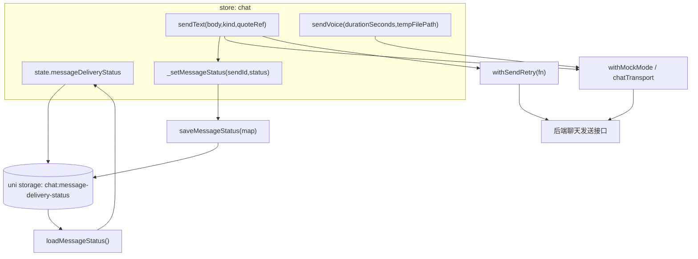

**图表来源**
- [index.ts:78-131](file://apps/client/src/stores/chat/index.ts#L78-L131)
- [messaging.ts:55-229](file://apps/client/src/stores/chat/actions/messaging.ts#L55-L229)
- [utils.ts:34-97](file://apps/client/src/stores/chat/utils.ts#L34-L97)
- [higher-order.ts:30-142](file://apps/client/src/stores/chat/higher-order.ts#L30-L142)
- [chat.ts:30-36](file://apps/client/src/constants/chat.ts#L30-L36)

**章节来源**
- [types.ts:31-62](file://apps/client/src/stores/chat/types.ts#L31-L62)
- [index.ts:78-131](file://apps/client/src/stores/chat/index.ts#L78-L131)
- [store-type.ts:45-123](file://apps/client/src/stores/chat/store-type.ts#L45-L123)
- [constants.ts:13-17](file://apps/client/src/stores/chat/constants.ts#L13-L17)
- [chat.ts:26-36](file://apps/client/src/constants/chat.ts#L26-L36)

## 架构总览

一次文本消息发送的完整链路跨越「页面 → store action → 重试执行器 → 传输层 → HTTP → 后端控制器 → 服务 → 数据库」，客户端投递状态与服务端投递状态是**两套独立取值域**，通过不同字段各自演进。

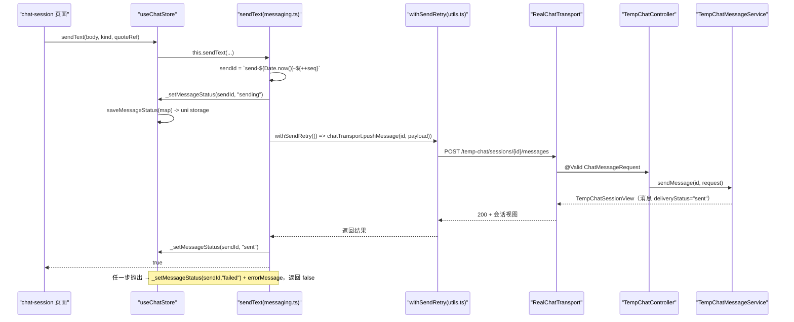

**图表来源**
- [messaging.ts:55-131](file://apps/client/src/stores/chat/actions/messaging.ts#L55-L131)
- [utils.ts:70-97](file://apps/client/src/stores/chat/utils.ts#L70-L97)
- [transport.ts:82-92](file://apps/client/src/features/chat/transport.ts#L82-L92)
- [TempChatController.java:48-55](file://apps/api/src/main/java/com/campuslove/api/chat/TempChatController.java#L48-L55)
- [TempChatMessageService.java:88](file://apps/api/src/main/java/com/campuslove/api/chat/TempChatMessageService.java#L88)

三层职责划分：

1. **状态层**（`messageDeliveryStatus` 映射表）：以客户端 `sendId` 为键，回答「这条我发出的请求本地结局如何」。定义于 [types.ts:31-37](file://apps/client/src/stores/chat/types.ts#L31-L37)，实例化于 [index.ts:105](file://apps/client/src/stores/chat/index.ts#L105)。
2. **传输层**（`ChatTransport`）：`MockChatTransport` / `RealChatTransport` 双实现，工厂 `createChatTransport(mode)` 按 `clientEnv.apiMode` 选择，见 [transport.ts:123-125](file://apps/client/src/features/chat/transport.ts#L123-L125)。Real 实现每次发送都注入随机 `Idempotency-Key` 头，避免同文案重发撞后端幂等锁，见 [transport.ts:87-90](file://apps/client/src/features/chat/transport.ts#L87-L90)。
3. **服务端状态层**：`temp_chat_message.delivery_status` 与 `private_messages.delivery_status` 各自持久化 `sent/delivered/read`，与客户端三态无映射代码，详见 [状态字段与数据模型核对](#状态字段与数据模型核对)。

**章节来源**
- [transport.ts:16-125](file://apps/client/src/features/chat/transport.ts#L16-L125)
- [types.ts:31-37](file://apps/client/src/stores/chat/types.ts#L31-L37)
- [index.ts:105](file://apps/client/src/stores/chat/index.ts#L105)
- [TempChatController.java:20-55](file://apps/api/src/main/java/com/campuslove/api/chat/TempChatController.java#L20-L55)

## 详细组件分析

### 消息投递状态机（MessageDeliveryStatus）

`MessageDeliveryStatus` 是字符串字面量联合类型，取值严格为 `"sending" | "sent" | "failed"` 三个，见 [types.ts:31](file://apps/client/src/stores/chat/types.ts#L31)。注释明确记录了引入动机：修复 P1 BUG——原 `sendText` 无状态持久化，刷新或切换会话后用户无法感知上一条消息是否发送成功（[types.ts:25-30](file://apps/client/src/stores/chat/types.ts#L25-L30)）。

三态语义与转换规则（全部转换点均在 [messaging.ts](file://apps/client/src/stores/chat/actions/messaging.ts) 内）：

| 状态 | 写入时机 | 代码位置 | 语义 |
| --- | --- | --- | --- |
| `sending` | `sendText` 通过 activeSession 守卫后、构造载荷之前 | [messaging.ts:69-70](file://apps/client/src/stores/chat/actions/messaging.ts#L69-L70) | 客户端已受理，尚未确认后端结果 |
| `sent` | `withMockMode(...)` 正常 resolve 之后 | [messaging.ts:122](file://apps/client/src/stores/chat/actions/messaging.ts#L122) | 本次发送意图已完成（Mock 本地追加或 Real 接口 2xx） |
| `failed` | `try` 块任一步抛出后，在 `catch` 中写入 | [messaging.ts:124-126](file://apps/client/src/stores/chat/actions/messaging.ts#L124-L126) | 重试耗尽或非网络错误，终态 |

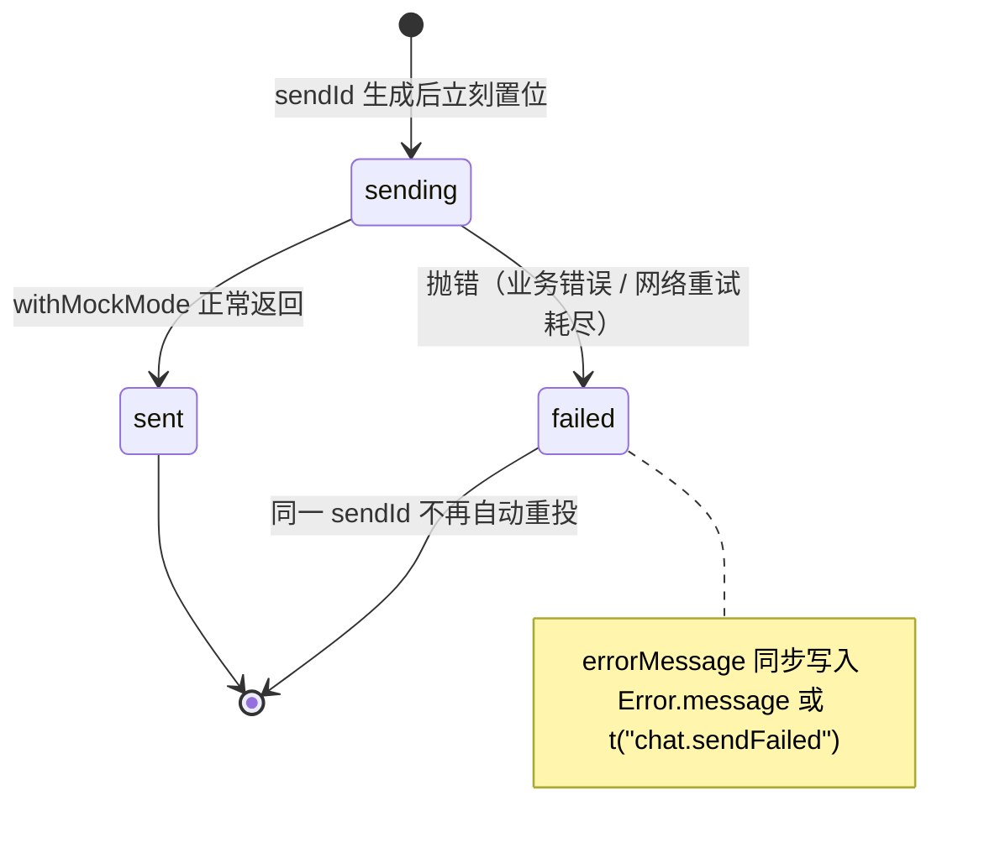

**图表来源**
- [messaging.ts:69-130](file://apps/client/src/stores/chat/actions/messaging.ts#L69-L130)
- [types.ts:25-37](file://apps/client/src/stores/chat/types.ts#L25-L37)

转换规则的四个关键性质：

1. **单向、终态不可逆**：`sent` / `failed` 都不再被同一 `sendId` 改写；重发消息时 `sendText` 会重新生成新的 `sendId`，旧条目留在映射表里。
2. **失败不吞异常**：`catch` 分支把状态写成 `failed` 后返回布尔 `false`，不再向上抛出，页面据此决定是否清空草稿（[messaging.ts:124-130](file://apps/client/src/stores/chat/actions/messaging.ts#L124-L130)）。返回布尔替代「errorMessage 文案差分」的动机写在 [messaging.ts:61-62](file://apps/client/src/stores/chat/actions/messaging.ts#L61-L62)：连续两次相同错误文案会被差分逻辑误判为成功。
3. **`activeSession` 为空时不产生状态**：守卫在生成 `sendId` 之前 `return false`，映射表不落任何条目（[messaging.ts:63-65](file://apps/client/src/stores/chat/actions/messaging.ts#L63-L65)）。
4. **Mock 模式同样置位**：`sending → sent/failed` 与模式无关，因为 `_setMessageStatus` 调用在 `withMockMode` 之外（[messaging.ts:70](file://apps/client/src/stores/chat/actions/messaging.ts#L70)、[messaging.ts:88-122](file://apps/client/src/stores/chat/actions/messaging.ts#L88-L122)）。

**章节来源**
- [types.ts:25-37](file://apps/client/src/stores/chat/types.ts#L25-L37)
- [messaging.ts:37-131](file://apps/client/src/stores/chat/actions/messaging.ts#L37-L131)

### 状态持久化机制

持久化是「整表快照」而非「增量写」：`_setMessageStatus` 先用展开运算构造新的不可变对象写入 `state.messageDeliveryStatus`，再调用 `saveMessageStatus` 把整张表 `JSON.stringify` 落盘，见 [messaging.ts:224-228](file://apps/client/src/stores/chat/actions/messaging.ts#L224-L228)。不可变替换而非就地赋值，是为了让 Pinia 的响应式系统可靠捕获变更。

存储键为常量 `MESSAGE_STATUS_STORAGE_KEY = "chat:message-delivery-status"`（[src/constants/chat.ts:30](file://apps/client/src/constants/chat.ts#L30)），由 [stores/chat/constants.ts:13-17](file://apps/client/src/stores/chat/constants.ts#L13-L17) re-export 后供 utils 使用；读写均走 uni 适配层的 `uni.getStorageSync` / `uni.setStorageSync`，因此 mp-weixin 与 H5 共用同一份本地数据（[utils.ts:36](file://apps/client/src/stores/chat/utils.ts#L36)、[utils.ts:54](file://apps/client/src/stores/chat/utils.ts#L54)）。

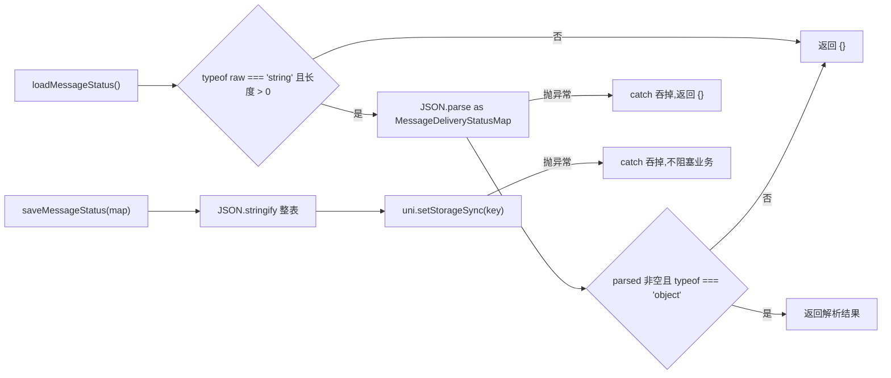

**图表来源**
- [utils.ts:27-58](file://apps/client/src/stores/chat/utils.ts#L27-L58)

设计要点与代价：

- **恢复时机只有一次**：读取发生在 store 定义 state 工厂里（[index.ts:105](file://apps/client/src/stores/chat/index.ts#L105)），即 store 首次实例化时；此后不再从存储回读，内存态为唯一真相。
- **错误静默降级**：读失败返回 `{}`、写失败直接忽略，两处都用空 `catch` 保证「持久化不可用不影响发消息」（[utils.ts:43-46](file://apps/client/src/stores/chat/utils.ts#L43-L46)、[utils.ts:55-57](file://apps/client/src/stores/chat/utils.ts#L55-L57)）。
- **形状校验只到「是对象」这一层**：`loadMessageStatus` 不校验 value 是否为合法三态字符串，脏数据（例如手工改存储）会原样进入状态表。
- **无淘汰/压缩策略**：仓库中 `messageDeliveryStatus` 的引用点只有 store 类型声明、state 初始化、`_setMessageStatus` 与一个单测断言（对 `apps/client/src` 全量检索 `messageDeliveryStatus` 仅命中 [store-type.ts:72](file://apps/client/src/stores/chat/store-type.ts#L72)、[index.ts:105](file://apps/client/src/stores/chat/index.ts#L105)、[messaging.ts:224-228](file://apps/client/src/stores/chat/actions/messaging.ts#L224-L228)、[tests/services/chat.spec.ts:106](file://apps/client/src/tests/services/chat.spec.ts#L106)），没有任何清理、按会话分组或长度上限逻辑，映射表随发送次数单调增长。

**章节来源**
- [utils.ts:27-58](file://apps/client/src/stores/chat/utils.ts#L27-L58)
- [messaging.ts:208-229](file://apps/client/src/stores/chat/actions/messaging.ts#L208-L229)
- [index.ts:97-105](file://apps/client/src/stores/chat/index.ts#L97-L105)
- [apps/client/src/constants/chat.ts:26-30](file://apps/client/src/constants/chat.ts#L26-L30)
- [store-type.ts:64-72](file://apps/client/src/stores/chat/store-type.ts#L64-L72)

### sendText 与 SendMessageRequest 强类型契约

`sendText(this: ChatStoreThis, body: string, kind: SendMessageRequest["kind"] = "text", quoteRef?: string | null): Promise<boolean>`（[messaging.ts:55-60](file://apps/client/src/stores/chat/actions/messaging.ts#L55-L60)）是状态机唯一的文本/表情入口。`kind` 参数在 2026-08-09 表情包机制中加入，与私信链路 `sendMessage` 的 kind 参数对齐（[messaging.ts:40-41](file://apps/client/src/stores/chat/actions/messaging.ts#L40-L41)）。

载荷由 `SendMessageRequest` 显式建模（[types.ts:51-62](file://apps/client/src/stores/chat/types.ts#L51-L62)），字段与后端契约一一对应：

| 客户端字段 | 客户端类型 | 后端字段约束（record `ChatMessageRequest`） | OpenAPI 约束 |
| --- | --- | --- | --- |
| `sender` | `"self" \| "peer"` | `@NotBlank @Size(max = 16)` | `enum: [self, peer]` |
| `kind` | `"text" \| "voice" \| "emoji"` | `@NotBlank @Pattern("(?i)text\|voice\|emoji\|system")` | `enum: [text, voice, emoji, system]` |
| `body` | `string` | `@NotBlank @Size(max = 5000)` | `maxLength: 5000` |
| `durationSeconds` | `number \| null`（可选） | `@Min(0) @Max(3600)` | `minimum: 0, maximum: 3600, nullable` |
| `quoteRef` | `string \| null`（可选） | `@Size(max = 64)` | `maxLength: 64, nullable` |

**章节来源**
- [types.ts:39-62](file://apps/client/src/stores/chat/types.ts#L39-L62)
- [messaging.ts:37-84](file://apps/client/src/stores/chat/actions/messaging.ts#L37-L84)
- [TempChatController.java:150-164](file://apps/api/src/main/java/com/campuslove/api/chat/TempChatController.java#L150-L164)
- [feedback-growth-and-auth.yaml:2020-2045](file://docs/openapi/feedback-growth-and-auth.yaml#L2020-L2045)
- [api-types.ts:1161-1170](file://apps/client/src/services/generated/api-types.ts#L1161-L1170)

契约收敛的三点设计意图写在 [types.ts:46-49](file://apps/client/src/stores/chat/types.ts#L46-L49)：消除 `sendText`/`sendVoice` 重复的内联对象类型推断、静态校验调用方传参避免运行时被后端拒绝、后端契约变更时只需调整该接口即可在编译期暴露所有受影响调用点。客户端 `sender` 只允许 `self`/`peer`，`system` 被有意排除（注释：system 仅由后端生成，前端不可发送，[types.ts:52](file://apps/client/src/stores/chat/types.ts#L52)），而后端枚举仍保留 `system`，属于「客户端更严」的单向收窄。

### 消息 ID 生成策略

发送追踪键与 Mock 消息 ID 共用一个模块级递增计数器：

```
let messageIdSeq = 0;                                   // messaging.ts:35
const sendId = `send-${Date.now()}-${++messageIdSeq}`; // messaging.ts:69
id: `m-${Date.now()}-${++messageIdSeq}`                 // messaging.ts:100（Mock 消息）
```

动机记录在 [messaging.ts:34](file://apps/client/src/stores/chat/actions/messaging.ts#L34) 与 [messaging.ts:68](file://apps/client/src/stores/chat/actions/messaging.ts#L68)（infra R2-00085）：同一毫秒连发两条时 `Date.now()` 相同，纯时间戳会碰撞；`++messageIdSeq` 为**前置自增**，同毫秒内的第二条拿到 `...-2`，从而保证 `sendId` 在单进程内唯一。该计数器是模块级 `let`，不落盘、跨会话共享，因此 `sendId` 只保证「本进程本会话周期内唯一」，重启后可能复用旧键并覆盖其状态。

需注意的实现差异：**`sendVoice` 的 Mock 消息 ID 用的是 `m-${Date.now()}`，不带序号**（[messaging.ts:189](file://apps/client/src/stores/chat/actions/messaging.ts#L189)），与 [messaging.ts:100](file://apps/client/src/stores/chat/actions/messaging.ts#L100) 的文本路径不同口径，同毫秒的 Mock 语音消息存在 ID 重复可能。

**章节来源**
- [messaging.ts:34-35](file://apps/client/src/stores/chat/actions/messaging.ts#L34-L35)
- [messaging.ts:67-69](file://apps/client/src/stores/chat/actions/messaging.ts#L67-L69)
- [messaging.ts:99-100](file://apps/client/src/stores/chat/actions/messaging.ts#L99-L100)
- [messaging.ts:186-190](file://apps/client/src/stores/chat/actions/messaging.ts#L186-L190)

### 引用回复（quoteRef）的校验与边界

`quoteRef` 在 `sendText` 内做三件事后才入包（[messaging.ts:83](file://apps/client/src/stores/chat/actions/messaging.ts#L83)）：

```ts
quoteRef: quoteRef && quoteRef.trim() && quoteRef.trim().length <= 64 ? quoteRef.trim() : null
```

- **空白归 null**：`quoteRef.trim()` 为空串（假值）时降级为 `null`，即「不带引用」而非发送一个空引用。
- **超长归 null**：`> 64` 字符直接置 `null`，与后端 `@Size(max = 64)`（[TempChatController.java:158](file://apps/api/src/main/java/com/campuslove/api/chat/TempChatController.java#L158)）同口径。设计说明见 [messaging.ts:79-82](file://apps/client/src/stores/chat/actions/messaging.ts#L79-L82)：引用是可选语义，不能因一个非法引用 ID 把整条消息拖进 400。
- **入库前 trim**：通过校验后写入的是 `quoteRef.trim()` 而非原值，首尾空白不会进入 `body`/`quote_snapshot`。

同一分支的注释还指出此前的缺陷（MP-R1-SUBPACKAGES-CHAT-CHAT-SESSION-INDEX-002）：临时会话这条链路把页面传来的引用目标直接丢掉，`SendMessageRequest` 早有 `quoteRef` 字段但无人赋值，私信链路同批修复。服务端引用落库形态是 `temp_chat_message.quote_snapshot`（JSON 快照，[TempChatMessage.java:60-62](file://apps/api/src/main/java/com/campuslove/api/entity/TempChatMessage.java#L60-L62)），出参通过 `ChatMessageView.quoteRef/quoteBody/quoteSender` 回给前端（[TempChatController.java:129-141](file://apps/api/src/main/java/com/campuslove/api/chat/TempChatController.java#L129-L141)）。

**章节来源**
- [messaging.ts:74-84](file://apps/client/src/stores/chat/actions/messaging.ts#L74-L84)
- [types.ts:60-61](file://apps/client/src/stores/chat/types.ts#L60-L61)
- [TempChatController.java:129-164](file://apps/api/src/main/java/com/campuslove/api/chat/TempChatController.java#L129-L164)
- [TempChatMessage.java:60-62](file://apps/api/src/main/java/com/campuslove/api/entity/TempChatMessage.java#L60-L62)

### withSendRetry 重试机制

`withSendRetry<T>(fn, maxRetries = MAX_SEND_RETRIES, delayMs = SEND_RETRY_DELAY_MS)`（[utils.ts:70-97](file://apps/client/src/stores/chat/utils.ts#L70-L97)）是**泛型异步执行器**，不感知业务语义，只决定「是否再试一次」。

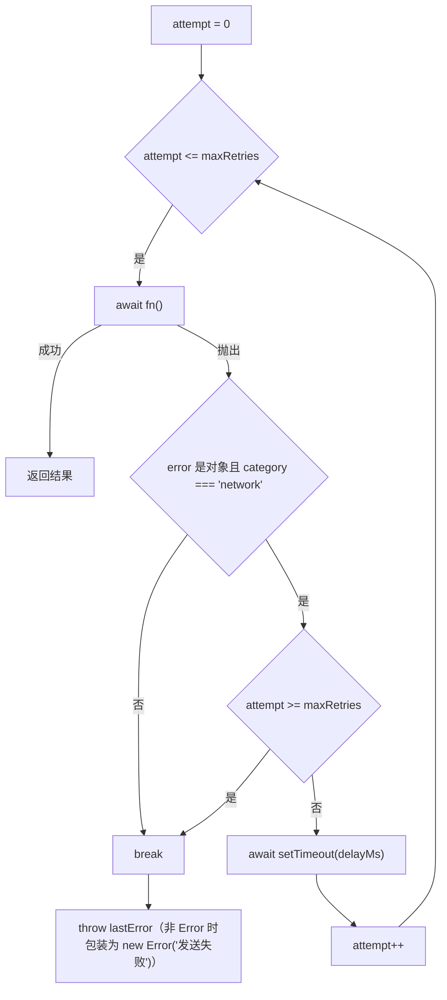

**图表来源**
- [utils.ts:60-97](file://apps/client/src/stores/chat/utils.ts#L60-L97)

实现细节逐条对应源码：

- **循环边界** `for (attempt = 0; attempt <= maxRetries; attempt++)`，配合 `MAX_SEND_RETRIES = 1`（[src/constants/chat.ts:33](file://apps/client/src/constants/chat.ts#L33)）意味着「1 次首发 + 1 次重试」，最多两次调用。
- **仅网络类错误重试**：判定不看 `instanceof`，而是鸭子类型检查 `error !== null && typeof error === "object" && "category" in error && category === "network"`（[utils.ts:82-86](file://apps/client/src/stores/chat/utils.ts#L82-L86)）。`category` 由 HTTP 层 `EnhancedApiError` 携带：`buildNetworkError` 对 `uni.request` fail 一律置 `category: "network"`（[http.ts:621-637](file://apps/client/src/services/http.ts#L621-L637)），业务/鉴权错误经 `categorizeError(statusCode)` 归为其他类别（[http.ts:602-612](file://apps/client/src/services/http.ts#L602-L612)），因此 400 校验失败、403、404 都**不会**触发这一层重试。
- **固定延迟**：`await new Promise(resolve => setTimeout(resolve, delayMs))`，`SEND_RETRY_DELAY_MS = 500`（[src/constants/chat.ts:36](file://apps/client/src/constants/chat.ts#L36)），非指数退避。
- **失败降级**：循环退出后 `throw lastError instanceof Error ? lastError : new Error("发送失败")`（[utils.ts:94-96](file://apps/client/src/stores/chat/utils.ts#L94-L96)）。异常上抛后由 `sendText` 的 `catch` 落 `failed` 状态并把 `Error.message` 写进 `errorMessage`，非 Error 时用 `t("chat.sendFailed")` 兜底（[messaging.ts:124-129](file://apps/client/src/stores/chat/actions/messaging.ts#L124-L129)）。

**与 HTTP 层重试叠加**：`chatTransport.pushMessage` 内部调用的 `request()` 本身已带一层网络错误重试（`DEFAULT_RETRY_COUNT = 1`、指数退避 `DEFAULT_RETRY_DELAY_MS * 2^attempt`，且 `signal.aborted` 时立即终止，见 [http.ts:832-876](file://apps/client/src/services/http.ts#L832-L876)、[src/constants/api.ts:16-20](file://apps/client/src/constants/api.ts#L16-L20)）。两层各 1 次重试，最坏情况一次 `sendText` 会产生 2×2 = 4 次实际网络请求。

**章节来源**
- [utils.ts:60-97](file://apps/client/src/stores/chat/utils.ts#L60-L97)
- [apps/client/src/constants/chat.ts:32-36](file://apps/client/src/constants/chat.ts#L32-L36)
- [http.ts:602-637](file://apps/client/src/services/http.ts#L602-L637)
- [http.ts:832-876](file://apps/client/src/services/http.ts#L832-L876)
- [apps/client/src/constants/api.ts:13-20](file://apps/client/src/constants/api.ts#L13-L20)
- [messaging.ts:114-130](file://apps/client/src/stores/chat/actions/messaging.ts#L114-L130)

### sendVoice 与语音链路、H5 降级

`sendVoice(this, durationSeconds, tempFilePath?): Promise<void>`（[messaging.ts:145-206](file://apps/client/src/stores/chat/actions/messaging.ts#L145-L206)）流程分两步：先上传拿 URL，再发送 `kind="voice"` 消息。

- **占位 body**：`voiceBody` 初值为 `t("chat.voicePlaceholder")`（[messaging.ts:157](file://apps/client/src/stores/chat/actions/messaging.ts#L157)），仅当 `!useMock() && tempFilePath && tempFilePath.length > 0` 时才真实上传（[messaging.ts:158-166](file://apps/client/src/stores/chat/actions/messaging.ts#L158-L166)）。这就是 H5 端与 Mock 端的降级策略：H5 的 `tempFilePath` 通常为空（H5 端为模拟录音），Mock 模式即便真机给出 `wxfile://` 路径也不发起真实上传。
- **上传失败即抛出**：`catch` 中设置 `errorMessage`（非 Error 兜底文案「语音上传失败，请重试」）后 `throw error`，函数返回类型是 `Promise<void>`，异常直接交给调用页处理（[messaging.ts:161-165](file://apps/client/src/stores/chat/actions/messaging.ts#L161-L165)）。
- **上传实现**：`uploadVoiceFile(tempFilePath, durationSeconds)`（[services/voice-upload.ts:49-110](file://apps/client/src/services/voice-upload.ts#L49-L110)）走 `uni.uploadFile` 到 `${appEnv.apiBaseUrl}${normalizeApiPath("/chat/voice")}`，即 `POST /api/v1/chat/voice`，`name: "file"`、`formData.duration`，并显式附加 `Authorization: Bearer ${getToken()}`（否则 `VoiceMessageController` 的 `@PreAuthorize("hasRole('USER')")` 必然 401，见 [voice-upload.ts:9-16](file://apps/client/src/services/voice-upload.ts#L9-L16)）。上传前有扩展名白名单门禁 `isAllowedMediaExt(tempFilePath, "audio")`，与后端 `LocalMediaStorageService` 的 aac/mp3/m4a/wav 同口径（[voice-upload.ts:57-65](file://apps/client/src/services/voice-upload.ts#L57-L65)）；超时 30s（`VOICE_UPLOAD_TIMEOUT_MS`，[voice-upload.ts:31](file://apps/client/src/services/voice-upload.ts#L31)），超时后由 `withTimeout` 抛 `EnhancedApiError(category=network)`（[voice-upload.ts:108-109](file://apps/client/src/services/voice-upload.ts#L108-L109)）。响应解析只认 `url` 字段，缺失即 `reject(new Error("语音上传响应缺少 url 字段"))`（[voice-upload.ts:84-90](file://apps/client/src/services/voice-upload.ts#L84-L90)）。
- **载荷不带 quoteRef**：语音的 `SendMessageRequest` 只赋 `sender/kind/body/durationSeconds`（[messaging.ts:169-174](file://apps/client/src/stores/chat/actions/messaging.ts#L169-L174)），`quoteRef` 依赖接口可选字段省略。
- **不经状态机、不经重试**：Real 分支是裸调 `chatTransport.pushMessage(...)`，既未包 `withSendRetry`，也全程未调用 `_setMessageStatus`（[messaging.ts:177-205](file://apps/client/src/stores/chat/actions/messaging.ts#L177-L205)）。因此 `messageDeliveryStatus` 映射表只覆盖文本/表情消息。

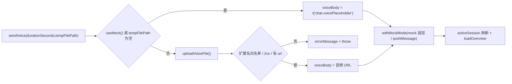

**图表来源**
- [messaging.ts:145-206](file://apps/client/src/stores/chat/actions/messaging.ts#L145-L206)
- [voice-upload.ts:49-110](file://apps/client/src/services/voice-upload.ts#L49-L110)

**章节来源**
- [messaging.ts:133-206](file://apps/client/src/stores/chat/actions/messaging.ts#L133-L206)
- [voice-upload.ts:1-110](file://apps/client/src/services/voice-upload.ts#L1-L110)
- [store-type.ts:99-108](file://apps/client/src/stores/chat/store-type.ts#L99-L108)

## 端到端链路核对

「消息状态」在本仓库有两个互不翻译的位面：客户端的 **发送结局状态**（`messageDeliveryStatus`，按 `sendId` 索引，内存+本地存储）与服务端的 **投递状态**（`delivery_status` 列 / `deliveryStatus` 出参，按消息 ID 索引，数据库）。

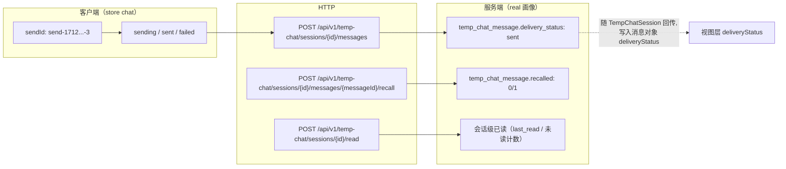

[此图为状态位面映射示意，链路各节点均有源码支撑，但「客户端三态 ↔ 服务端投递态」之间不存在转换代码，故不提供图表来源]

链路核对结论：

- **发送**：`sendText` → `chatTransport.pushMessage` → `POST /temp-chat/sessions/{id}/messages`（[transport.ts:82-92](file://apps/client/src/features/chat/transport.ts#L82-L92)），后端 `@PostMapping("/{id}/messages")` 接收 `@Valid ChatMessageRequest`（[TempChatController.java:48-55](file://apps/api/src/main/java/com/campuslove/api/chat/TempChatController.java#L48-L55)），Real 服务落库时显式 `message.setDeliveryStatus("sent")` 且 `setRecalled(false)`（[TempChatMessageService.java:129-136](file://apps/api/src/main/java/com/campuslove/api/chat/TempChatMessageService.java#L129-L136)）。
- **回传**：出参 `ChatMessageView` 携带 `recalled` 与 `deliveryStatus`（[TempChatController.java:129-141](file://apps/api/src/main/java/com/campuslove/api/chat/TempChatController.java#L129-L141)），视图装配时缺省回落为 `"sent"`（[TempChatViewMapper.java:155](file://apps/api/src/main/java/com/campuslove/api/chat/TempChatViewMapper.java#L155)）。
- **撤回**：独立端点 `POST /{id}/messages/{messageId}/recall`（[TempChatController.java:90-94](file://apps/api/src/main/java/com/campuslove/api/chat/TempChatController.java#L90-L94)），Real 流程为「校验消息属于当前会话 → 仅 self/peer 本人在 2 分钟内可撤回 → `setRecalled(true)` + 正文置 `[已撤回]` → 同步会话预览」（[TempChatMessageService.java:36-41](file://apps/api/src/main/java/com/campuslove/api/chat/TempChatMessageService.java#L36-L41)、[TempChatMessageService.java:318-325](file://apps/api/src/main/java/com/campuslove/api/chat/TempChatMessageService.java#L318-L325)）。撤回不改写 `delivery_status`，也不回写客户端 `messageDeliveryStatus`。
- **已读**：`POST /{id}/read` 是**会话级**标记（[TempChatController.java:84-88](file://apps/api/src/main/java/com/campuslove/api/chat/TempChatController.java#L84-L88)），不是逐条 `delivery_status='read'` 的更新。
- **私信侧对齐**：`PrivateMessage.deliveryStatus` 经 `DtoMapper` 映射为 `MessageDto.status`（[DtoMapper.java:200-229](file://apps/api/src/main/java/com/campuslove/api/dto/DtoMapper.java#L200-L229)），命名差异（`delivery_status` vs 任务规格的 `status`）在实体注释里已显式说明（[PrivateMessage.java:34-35](file://apps/api/src/main/java/com/campuslove/api/entity/PrivateMessage.java#L34-L35)）。
- **视图层状态并集**：会话页本地定义了更宽的 `MessageDeliveryStatus = "sending" | "sent" | "delivered" | ...`，注释明确写出三个来源（ChatBubble props 的 sent/delivered/read、ChatMessage 的 sent/read、chat store 的 sending/sent/failed），由 `ChatBubble` 自行过滤不可识别状态（[chat-session/types.ts:76-86](file://apps/client/src/subpackages/chat/chat-session/types.ts#L76-L86)）。组件侧 prop 收窄为三种（[ChatBubble.vue:27-28](file://apps/client/src/components/chat/ChatBubble.vue#L27-L28)），仅在 `sent` / `delivered|read` 分支渲染状态图标（[ChatBubble.vue:242-244](file://apps/client/src/components/chat/ChatBubble.vue#L242-L244)）。

**章节来源**
- [transport.ts:82-92](file://apps/client/src/features/chat/transport.ts#L82-L92)
- [TempChatController.java:48-94](file://apps/api/src/main/java/com/campuslove/api/chat/TempChatController.java#L48-L94)
- [TempChatMessageService.java:129-141](file://apps/api/src/main/java/com/campuslove/api/chat/TempChatMessageService.java#L129-L141)
- [TempChatMessageService.java:312-325](file://apps/api/src/main/java/com/campuslove/api/chat/TempChatMessageService.java#L312-L325)
- [TempChatViewMapper.java:155](file://apps/api/src/main/java/com/campuslove/api/chat/TempChatViewMapper.java#L155)
- [DtoMapper.java:200-229](file://apps/api/src/main/java/com/campuslove/api/dto/DtoMapper.java#L200-L229)
- [PrivateMessage.java:34-35](file://apps/api/src/main/java/com/campuslove/api/entity/PrivateMessage.java#L34-L35)
- [apps/client/src/subpackages/chat/chat-session/types.ts:76-86](file://apps/client/src/subpackages/chat/chat-session/types.ts#L76-L86)
- [ChatBubble.vue:27-28](file://apps/client/src/components/chat/ChatBubble.vue#L27-L28)

## 状态字段与数据模型核对

按「逐字段到实体类 + SQL 核对」的要求，消息状态相关字段在两张表上对称存在。迁移脚本 `V2026.06.01.0001__add_recall_delivery_quote_to_messages.sql` 是唯一给出 DDL 语义的来源：`temp_chat_message` 增加 3 列（`recalled` / `delivery_status` / `quote_snapshot`），`private_messages` 增加 2 列（`recalled` / `delivery_status`），`delivery_status VARCHAR(16) NOT NULL DEFAULT 'sent'`，注释标明取值域 `sent/delivered/read`（[V2026.06.01.0001:1-11](file://database/flyway/sql/V2026.06.01.0001__add_recall_delivery_quote_to_messages.sql#L1-L11)）。标准化脚本用 `add_column_if_missing` 重放同一定义（[V2026.07.26.0004:112-122](file://database/flyway/sql/V2026.07.26.0004__p8_database_standardization.sql#L112-L122)）。

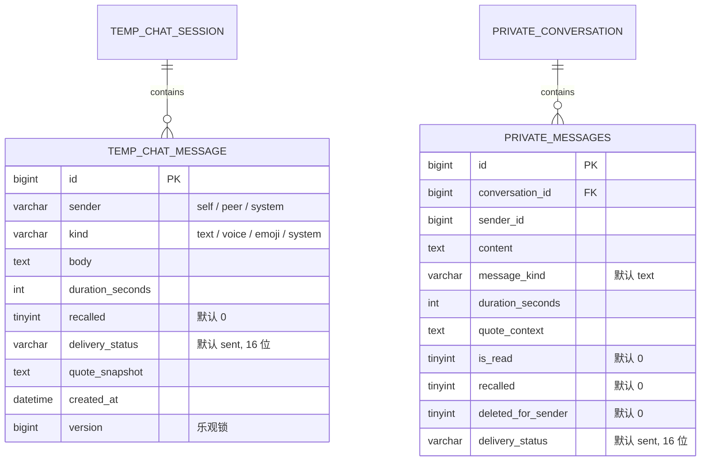

**图表来源**
- [TempChatMessage.java:22-81](file://apps/api/src/main/java/com/campuslove/api/entity/TempChatMessage.java#L22-L81)
- [PrivateMessage.java:37-114](file://apps/api/src/main/java/com/campuslove/api/entity/PrivateMessage.java#L37-L114)
- [V2026.06.01.0001:1-11](file://database/flyway/sql/V2026.06.01.0001__add_recall_delivery_quote_to_messages.sql#L1-L11)

逐字段核对表（实体注解 ↔ DDL）：

| 字段 | 实体定义 | 数据库定义 | 取值域 | 写入点 |
| --- | --- | --- | --- | --- |
| `delivery_status`（临时会话） | `@Column(name = "delivery_status", nullable = false, length = 16)`，Java 默认 `"sent"`（[TempChatMessage.java:56-58](file://apps/api/src/main/java/com/campuslove/api/entity/TempChatMessage.java#L56-L58)） | `VARCHAR(16) NOT NULL DEFAULT 'sent'`（[V2026.06.01.0001:6](file://database/flyway/sql/V2026.06.01.0001__add_recall_delivery_quote_to_messages.sql#L6)） | 注释声明 `sent/delivered/read` | Real 发送固定写 `"sent"`（[TempChatMessageService.java:134](file://apps/api/src/main/java/com/campuslove/api/chat/TempChatMessageService.java#L134)） |
| `delivery_status`（私信） | 同名同长度，默认 `"sent"`（[PrivateMessage.java:112-114](file://apps/api/src/main/java/com/campuslove/api/entity/PrivateMessage.java#L112-L114)） | `VARCHAR(16) NOT NULL DEFAULT 'sent'`（[V2026.06.01.0001:11](file://database/flyway/sql/V2026.06.01.0001__add_recall_delivery_quote_to_messages.sql#L11)） | 同上 | 游客演示数据写 `"sent"`（[GuestDemoDataProvisioner.java:192](file://apps/api/src/main/java/com/campuslove/api/auth/GuestDemoDataProvisioner.java#L192)） |
| `recalled` | `@Column(name = "recalled", nullable = false, columnDefinition = "TINYINT(1) DEFAULT 0")`（[TempChatMessage.java:52-54](file://apps/api/src/main/java/com/campuslove/api/entity/TempChatMessage.java#L52-L54)、[PrivateMessage.java:98-100](file://apps/api/src/main/java/com/campuslove/api/entity/PrivateMessage.java#L98-L100)） | `TINYINT(1) NOT NULL DEFAULT 0 COMMENT '是否已撤回'` | 布尔，非状态机 | 撤回端点置 `true` 并把正文改为 `[已撤回]`（[TempChatMessageService.java:318-320](file://apps/api/src/main/java/com/campuslove/api/chat/TempChatMessageService.java#L318-L320)） |
| `is_read`（私信） | `@Column(name = "is_read", nullable = false, columnDefinition = "TINYINT(1) DEFAULT 0")`（[PrivateMessage.java:94-96](file://apps/api/src/main/java/com/campuslove/api/entity/PrivateMessage.java#L94-L96)） | 实体注释列出 `(conversation_id, is_read)` 复合索引（[PrivateMessage.java:27-28](file://apps/api/src/main/java/com/campuslove/api/entity/PrivateMessage.java#L27-L28)） | 布尔 | 与 `delivery_status` 并存，是两个独立维度 |
| `deleted_for_sender`（私信） | `TINYINT(1) DEFAULT 0`，发送者侧软删除（[PrivateMessage.java:102-110](file://apps/api/src/main/java/com/campuslove/api/entity/PrivateMessage.java#L102-L110)） | Flyway `V2026.08.10.0021`（注释引用） | 布尔 | 查询侧过滤条件，不影响对方记录 |
| `read_at` | **仅** `WhisperMessage`（悄悄说）有 `@Column(name = "read_at") LocalDateTime readAt`（[WhisperMessage.java:68-69](file://apps/api/src/main/java/com/campuslove/api/entity/WhisperMessage.java#L68-L69)） | 同上 | 时间戳 | 普通聊天消息表无该列 |

索引落点：`idx_private_messages_delivery_status`（单列，`delivery_status`）在实体 `@Table(indexes=...)` 声明（[PrivateMessage.java:52-53](file://apps/api/src/main/java/com/campuslove/api/entity/PrivateMessage.java#L52-L53)），并有对应建表脚本 `CREATE INDEX idx_private_messages_delivery_status ON private_messages (delivery_status)`（[V2026.07.26.0001:63-66](file://database/flyway/sql/V2026.07.26.0001__add_entity_index_annotations.sql#L63-L66)）；另一脚本在 `private_messages (conversation_id, delivery_status, created_at)` 上建复合索引（[V2026.07.26.0004:193](file://database/flyway/sql/V2026.07.26.0004__p8_database_standardization.sql#L193)）。

Mock 与 Real 的行为差异（对状态口径影响很大）：Mock 服务在读取会话时把 `sender="peer"` 且 `deliveryStatus="delivered"` 的消息改写为 `"read"`（[MockTempChatService.java:225-229](file://apps/api/src/main/java/com/campuslove/api/chat/MockTempChatService.java#L225-L229)），并在撤回时构造 `recalled=true` 的消息（[MockTempChatService.java:355](file://apps/api/src/main/java/com/campuslove/api/chat/MockTempChatService.java#L355)）；Real 路径下 `delivered` / `read` 两个值在 `apps/api/src/main/java` 内**没有任何写入点**（全量检索 `setDeliveryStatus` 仅命中 `TempChatMessageService.java:134`、`GuestDemoDataProvisioner.java:192` 两处且均为 `"sent"`，`"delivered"` / `"read"` 字面量仅出现在 Mock 服务与演示数据 `GuestDemoDataProvisioner.java:326`）。

**章节来源**
- [TempChatMessage.java:22-81](file://apps/api/src/main/java/com/campuslove/api/entity/TempChatMessage.java#L22-L81)
- [PrivateMessage.java:25-114](file://apps/api/src/main/java/com/campuslove/api/entity/PrivateMessage.java#L25-L114)
- [WhisperMessage.java:54-69](file://apps/api/src/main/java/com/campuslove/api/entity/WhisperMessage.java#L54-L69)
- [V2026.06.01.0001:1-11](file://database/flyway/sql/V2026.06.01.0001__add_recall_delivery_quote_to_messages.sql#L1-L11)
- [V2026.07.26.0004:112-122](file://database/flyway/sql/V2026.07.26.0004__p8_database_standardization.sql#L112-L122)
- [V2026.07.26.0001:63-66](file://database/flyway/sql/V2026.07.26.0001__add_entity_index_annotations.sql#L63-L66)
- [TempChatMessageService.java:129-141](file://apps/api/src/main/java/com/campuslove/api/chat/TempChatMessageService.java#L129-L141)
- [MockTempChatService.java:225-229](file://apps/api/src/main/java/com/campuslove/api/chat/MockTempChatService.java#L225-L229)

## 消息状态监控与指标

服务端已具备聊天指标基础设施 `ChatMetrics`（`@Component`，构造时向 `MeterRegistry` 注册 Gauge，[ChatMetrics.java:23-53](file://apps/api/src/main/java/com/campuslove/api/monitor/ChatMetrics.java#L23-L53)）：

| 指标名 | 类型 | 标签 | 记录方法 | 容错 |
| --- | --- | --- | --- | --- |
| `chat.message.sent` | Counter | `messageType`（空/空白归 `unknown`） | `recordMessageSent(String messageType)`（[ChatMetrics.java:60-70](file://apps/api/src/main/java/com/campuslove/api/monitor/ChatMetrics.java#L60-L70)） | `catch (RuntimeException)` 只 `log.warn` |
| `chat.message.failed` | Counter | `reason`（如 `network_error`、`rate_limited`、`content_filtered`，空归 `unknown`） | `recordMessageFailed(String reason)`（[ChatMetrics.java:77-87](file://apps/api/src/main/java/com/campuslove/api/monitor/ChatMetrics.java#L77-L87)） | 同上 |
| `chat.session.active` | Gauge | 无 | `incrementActiveSession()` / `decrementActiveSession()`（[ChatMetrics.java:92-110](file://apps/api/src/main/java/com/campuslove/api/monitor/ChatMetrics.java#L92-L110)） | 递减用 `updateAndGet(curr -> Math.max(0, curr-1))` 防负值 |

指标类的设计原则写在类注释里：所有记录方法均被 try-catch 包裹，失败只记日志不抛出，保证「埋点不影响业务」（[ChatMetrics.java:21](file://apps/api/src/main/java/com/campuslove/api/monitor/ChatMetrics.java#L21)）。同目录下 `AuthMetrics`（登录成功/失败/令牌刷新，[AuthMetrics.java:22-91](file://apps/api/src/main/java/com/campuslove/api/monitor/AuthMetrics.java#L22-L91)）与 `MatchMetrics`（滑动、匹配成功、推荐耗时，[MatchMetrics.java:27-120](file://apps/api/src/main/java/com/campuslove/api/monitor/MatchMetrics.java#L27-L120)）是同一套模式的兄弟组件。

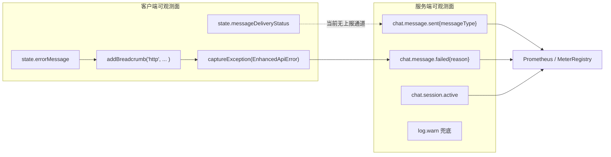

[此图为可观测面现状示意：客户端状态与服务端计数器之间无实际上报链路（依据为全量检索未命中调用点），故不提供图表来源]

实测落差：`apps/api/src/main/java` 全量检索 `recordMessageSent` / `recordMessageFailed` / `incrementActiveSession` / `decrementActiveSession`，除 `ChatMetrics.java` 自身的定义行（60、77、92、103）外**命中 0 个调用点**，即三个指标目前均未接线。客户端侧真正生效的是 HTTP 层：成功请求记 breadcrumb 并透传真实状态码（[http.ts:840-842](file://apps/client/src/services/http.ts#L840-L842)），最终失败且非预期状态时上报 Sentry 并附 `http_url`、`http_status`，同时跳过 `reportError === false` 与 401（[http.ts:860-872](file://apps/client/src/services/http.ts#L860-L872)）。非 `EnhancedApiError` 的意外异常也走 `captureException(error, { source: "http", http_url: url })`（[http.ts:846-849](file://apps/client/src/services/http.ts#L846-L849)）。

因此「消息状态监控」在当前仓库的实际抓手是：`chat.message.*` 指标（已实现未调用，需接线）+ Sentry 异常聚合（已生效，粒度为接口而非消息）+ `store.errorMessage`（仅供 UI）。

**章节来源**
- [ChatMetrics.java:11-110](file://apps/api/src/main/java/com/campuslove/api/monitor/ChatMetrics.java#L11-L110)
- [AuthMetrics.java:22-91](file://apps/api/src/main/java/com/campuslove/api/monitor/AuthMetrics.java#L22-L91)
- [MatchMetrics.java:27-120](file://apps/api/src/main/java/com/campuslove/api/monitor/MatchMetrics.java#L27-L120)
- [http.ts:840-876](file://apps/client/src/services/http.ts#L840-L876)

## 依赖关系分析

状态管理模块的 import 拓扑是单向的：`types` 与 `constants` 为叶子，`utils` 依赖两者，`higher-order` 依赖 `utils`，`actions/messaging` 依赖 `higher-order`+`utils`+`types`，`index.ts` 负责装配。

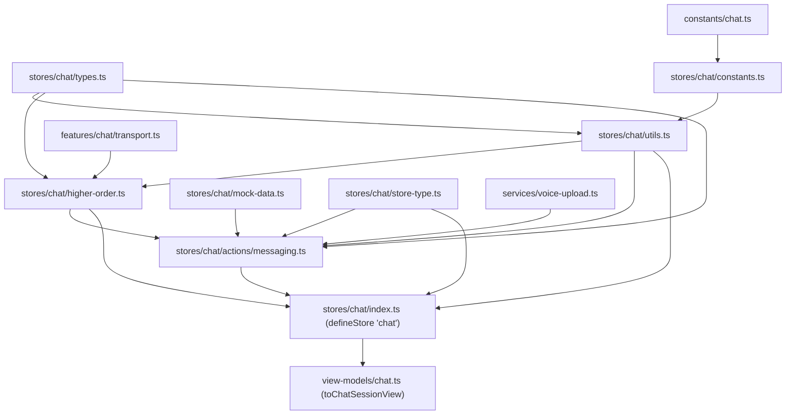

**图表来源**
- [messaging.ts:13-32](file://apps/client/src/stores/chat/actions/messaging.ts#L13-L32)
- [utils.ts:10-16](file://apps/client/src/stores/chat/utils.ts#L10-L16)
- [higher-order.ts:13-22](file://apps/client/src/stores/chat/higher-order.ts#L13-L22)
- [index.ts:26-66](file://apps/client/src/stores/chat/index.ts#L26-L66)
- [constants.ts:13-17](file://apps/client/src/stores/chat/constants.ts#L13-L17)

依赖要点：

1. **传输层可替换**：`chatTransport` 是模块级单例，由 `createChatTransport()` 按 `clientEnv.apiMode` 返回 Real/Mock 实例（[higher-order.ts:24-30](file://apps/client/src/stores/chat/higher-order.ts#L24-L30)、[transport.ts:123-125](file://apps/client/src/features/chat/transport.ts#L123-L125)），注释说明单目的是「避免重复创建连接」。
2. **`useMock` 单一真相源**：`stores/chat/utils.ts` 只是把 `stores/helpers/use-mock` 重导出，保留兼容既有 `import { useMock } from "./utils"` 的引用方式（[utils.ts:18-25](file://apps/client/src/stores/chat/utils.ts#L18-L25)）。
3. **`this` 类型显式化**：actions 拆到独立文件后 Pinia Option API 的 `this` 推断失效，因此每个函数都以 `this: ChatStoreThis` 声明（[messaging.ts:9-11](file://apps/client/src/stores/chat/actions/messaging.ts#L9-L11)、[store-type.ts:76-82](file://apps/client/src/stores/chat/store-type.ts#L76-L82)）。`ChatStoreThis extends ChatState` 且结构兼容 `ChatStoreLike`，因此可安全传入 `withMockMode` / `withErrorHandling`（[store-type.ts:78-80](file://apps/client/src/stores/chat/store-type.ts#L78-L80)、[types.ts:70-83](file://apps/client/src/stores/chat/types.ts#L70-L83)）。
4. **类型契约存在一处漂移**：`ChatStoreThis.sendText` 声明为 `(body: string) => Promise<boolean>`，未列出实现里已有的 `kind` 与 `quoteRef` 两个可选参数（[store-type.ts:96-98](file://apps/client/src/stores/chat/store-type.ts#L96-L98) vs [messaging.ts:55-60](file://apps/client/src/stores/chat/actions/messaging.ts#L55-L60)）。实现与声明结构兼容（多余可选参数不破坏赋值兼容），但通过该接口类型调用时无法直接传 `kind`/`quoteRef`，注释也未同步；`store-type.ts` 自述「当 store 结构变更时，需同步更新此接口」（[store-type.ts:10-11](file://apps/client/src/stores/chat/store-type.ts#L10-L11)）。
5. **拆分史与 re-export 面**：`index.ts` 通过 `export * from "./types" / "./constants" / "./utils" / "./higher-order"` 保持外部 `import { useChatStore } from "@/stores/chat"` 路径兼容，但对 `mock-data` 改为具名导出以限制引用面（infra R2-00094，[index.ts:59-66](file://apps/client/src/stores/chat/index.ts#L59-L66)）。文件头记录了体量演进：944 行 → 555 行 → 约 131 行（[index.ts:22](file://apps/client/src/stores/chat/index.ts#L22)）。
6. **语音依赖跨层**：`messaging.ts` 直接依赖服务层 `uploadVoiceFile`，注释理由是「上传统一走共享服务（携带 Authorization 头，与 services/api.ts 一致）」（[messaging.ts:31-32](file://apps/client/src/stores/chat/actions/messaging.ts#L31-L32)），该服务同时被私信链路 `messagesStore.sendVoiceMessage` 复用（[voice-upload.ts:5-7](file://apps/client/src/services/voice-upload.ts#L5-L7)）。

**章节来源**
- [messaging.ts:1-32](file://apps/client/src/stores/chat/actions/messaging.ts#L1-L32)
- [utils.ts:10-25](file://apps/client/src/stores/chat/utils.ts#L10-L25)
- [higher-order.ts:24-30](file://apps/client/src/stores/chat/higher-order.ts#L24-L30)
- [index.ts:22-66](file://apps/client/src/stores/chat/index.ts#L22-L66)
- [store-type.ts:1-123](file://apps/client/src/stores/chat/store-type.ts#L1-L123)
- [transport.ts:123-125](file://apps/client/src/features/chat/transport.ts#L123-L125)
- [voice-upload.ts:1-10](file://apps/client/src/services/voice-upload.ts#L1-L10)

## 性能考虑

**写放大：整表快照 × 每次发送两次写。** `_setMessageStatus` 每被调用一次就 `JSON.stringify` 整张映射表并同步落盘（[messaging.ts:224-228](file://apps/client/src/stores/chat/actions/messaging.ts#L224-L228) → [utils.ts:52-58](file://apps/client/src/stores/chat/utils.ts#L52-L58)）。一次 `sendText` 至少触发两次调用（`sending` 与 `sent`/`failed`，[messaging.ts:70](file://apps/client/src/stores/chat/actions/messaging.ts#L70)、[messaging.ts:122](file://apps/client/src/stores/chat/actions/messaging.ts#L122) 或 [messaging.ts:126](file://apps/client/src/stores/chat/actions/messaging.ts#L126)），序列化成本随历史条目数线性增长，而表本身没有淘汰逻辑。优化方向是把「写存储」合并为一次（例如仅在终态落盘，`sending` 只进内存），或对映射表设上限并按 `sendId` 时间戳前缀裁剪——`send-${Date.now()}-${seq}` 的格式天然可按时间排序（[messaging.ts:69](file://apps/client/src/stores/chat/actions/messaging.ts#L69)）。

**同步存储 API。** `uni.setStorageSync` / `uni.getStorageSync` 均为同步接口（[utils.ts:36](file://apps/client/src/stores/chat/utils.ts#L36)、[utils.ts:54](file://apps/client/src/stores/chat/utils.ts#L54)），在 mp-weixin 上会占用逻辑层线程；读只发生一次（store 初始化，[index.ts:105](file://apps/client/src/stores/chat/index.ts#L105)），影响主要在写侧。

**双层重试叠加。** store 层 `withSendRetry`（1 次重试、固定 500ms，[utils.ts:70-91](file://apps/client/src/stores/chat/utils.ts#L70-L91)、[src/constants/chat.ts:33-36](file://apps/client/src/constants/chat.ts#L33-L36)）包在 `request()` 外层，而 `request()` 自身对 `category === "network"` 已有 `DEFAULT_RETRY_COUNT = 1` 次指数退避重试（[http.ts:834-876](file://apps/client/src/services/http.ts#L834-L876)、[src/constants/api.ts:16-20](file://apps/client/src/constants/api.ts#L16-L20)），默认超时 10s（`timeout: options.timeout ?? DEFAULT_TIMEOUT_MS`，[http.ts:821](file://apps/client/src/services/http.ts#L821)）。最坏情况下一条文本消息可产生 4 次网络请求与约 40s+ 的用户可感等待，且两次请求体携带相同文案、由 `Idempotency-Key` 区分（[transport.ts:87-90](file://apps/client/src/features/chat/transport.ts#L87-L90)）。若要保持「发送只重试一次」的语义，应给消息请求传 `noRetry`/`retry: 0`（`options.noRetry ? 0 : ...` 已支持该开关，[http.ts:834](file://apps/client/src/services/http.ts#L834)）。

**每次发送都刷新概览。** `sendText` / `sendVoice` 调用 `withMockMode` 时未传第三参，`shouldRefreshOverview` 与 `shouldUpdateActiveSession` 均取默认 `true`（[higher-order.ts:120-123](file://apps/client/src/stores/chat/higher-order.ts#L120-L123)），函数尾部固定 `await store.loadOverview()`（[higher-order.ts:138-140](file://apps/client/src/stores/chat/higher-order.ts#L138-L140)）。这意味着每条消息一次额外的概览请求；高频连发时可对第二次起的发送传 `{ shouldRefreshOverview: false }`，或把概览刷新节流。

**语音链路是串行两段。** `sendVoice` 先等 `uploadVoiceFile` 返回 URL，再发 `pushMessage`（[messaging.ts:158-166](file://apps/client/src/stores/chat/actions/messaging.ts#L158-L166)、[messaging.ts:204](file://apps/client/src/stores/chat/actions/messaging.ts#L204)），上传超时上限 30s（[voice-upload.ts:31](file://apps/client/src/services/voice-upload.ts#L31)），比文本消息的 10s 更久；扩展名门禁在发起网络请求之前拦截，避免必然 400 的上传（[voice-upload.ts:57-65](file://apps/client/src/services/voice-upload.ts#L57-L65)）。该路径既无重试也无状态跟踪，长会话中语音消息的失败只体现为 `errorMessage`。

**后端读侧索引。** 按投递状态过滤已有索引支撑：`idx_private_messages_delivery_status`（[PrivateMessage.java:52-53](file://apps/api/src/main/java/com/campuslove/api/entity/PrivateMessage.java#L52-L53)）与 `(conversation_id, delivery_status, created_at)` 复合索引（[V2026.07.26.0004:193](file://database/flyway/sql/V2026.07.26.0004__p8_database_standardization.sql#L193)）；临时会话消息表侧未发现 `delivery_status` 相关索引（在 `database/flyway/sql` 全量检索 `delivery_status`，命中 `private_messages` 的索引语句，未命中 `temp_chat_message` 的索引语句）。

**章节来源**
- [messaging.ts:69-130](file://apps/client/src/stores/chat/actions/messaging.ts#L69-L130)
- [utils.ts:34-97](file://apps/client/src/stores/chat/utils.ts#L34-L97)
- [higher-order.ts:114-142](file://apps/client/src/stores/chat/higher-order.ts#L114-L142)
- [http.ts:818-876](file://apps/client/src/services/http.ts#L818-L876)
- [apps/client/src/constants/api.ts:13-20](file://apps/client/src/constants/api.ts#L13-L20)
- [apps/client/src/constants/chat.ts:30-36](file://apps/client/src/constants/chat.ts#L30-L36)
- [voice-upload.ts:31-65](file://apps/client/src/services/voice-upload.ts#L31-L65)
- [PrivateMessage.java:39-55](file://apps/api/src/main/java/com/campuslove/api/entity/PrivateMessage.java#L39-L55)
- [V2026.07.26.0004:193](file://database/flyway/sql/V2026.07.26.0004__p8_database_standardization.sql#L193)

## 配置与开关

| 开关 / 常量 | 位置 | 取值 | 对消息状态的影响 |
| --- | --- | --- | --- |
| `VITE_API_MODE` | 客户端环境变量键名（[config/env.ts:25-30](file://apps/client/src/config/env.ts#L25-L30)、[config/env.ts:65-67](file://apps/client/src/config/env.ts#L65-L67)） | `mock` / `real` | 决定 `createChatTransport` 返回 Mock 还是 Real 实现（[transport.ts:14](file://apps/client/src/features/chat/transport.ts#L14)、[transport.ts:123-125](file://apps/client/src/features/chat/transport.ts#L123-L125)） |
| `useMock()` / `isMockMode()` | [stores/helpers/use-mock.ts:16-25](file://apps/client/src/stores/helpers/use-mock.ts#L16-L25) | 布尔 | `withMockMode` 分支选择（[higher-order.ts:125-131](file://apps/client/src/stores/chat/higher-order.ts#L125-L131)）；`sendVoice` 据此决定是否发起真实上传（[messaging.ts:158](file://apps/client/src/stores/chat/actions/messaging.ts#L158)） |
| `MESSAGE_STATUS_STORAGE_KEY` | [src/constants/chat.ts:30](file://apps/client/src/constants/chat.ts#L30) | `"chat:message-delivery-status"` | 映射表落盘位置；改键等于丢弃全部历史状态 |
| `MAX_SEND_RETRIES` | [src/constants/chat.ts:33](file://apps/client/src/constants/chat.ts#L33) | `1` | `withSendRetry` 默认重试次数（[utils.ts:72](file://apps/client/src/stores/chat/utils.ts#L72)） |
| `SEND_RETRY_DELAY_MS` | [src/constants/chat.ts:36](file://apps/client/src/constants/chat.ts#L36) | `500` | 重试固定延迟（[utils.ts:73](file://apps/client/src/stores/chat/utils.ts#L73)） |
| `DEFAULT_RETRY_COUNT` / `DEFAULT_RETRY_DELAY_MS` / `DEFAULT_TIMEOUT_MS` | [src/constants/api.ts:14-20](file://apps/client/src/constants/api.ts#L14-L20) | `1` / `500` / `10000` | HTTP 层内建重试与超时，与 store 层重试叠加（[http.ts:821](file://apps/client/src/services/http.ts#L821)、[http.ts:834-876](file://apps/client/src/services/http.ts#L834-L876)） |
| `RequestOptions.noRetry` / `.retry` | [http.ts:834](file://apps/client/src/services/http.ts#L834) | 布尔 / 数字 | 唯一能关闭 HTTP 层重试的入口；当前消息发送未使用 |
| `VOICE_UPLOAD_TIMEOUT_MS` | [services/voice-upload.ts:31](file://apps/client/src/services/voice-upload.ts#L31) | `30000` | 语音上传超时；超时后抛 `category=network` 错误（[voice-upload.ts:108-109](file://apps/client/src/services/voice-upload.ts#L108-L109)） |
| `MAX_TEMP_CHAT_DURATION_SECONDS` | [TempChatController.java:24-28](file://apps/api/src/main/java/com/campuslove/api/chat/TempChatController.java#L24-L28) | `3600` | 语音 `durationSeconds` 上限，与 OpenAPI `maximum: 3600` 对齐（[feedback-growth-and-auth.yaml:2032-2036](file://docs/openapi/feedback-growth-and-auth.yaml#L2032-L2036)） |
| 后端 Spring Profile | [TempChatMessageService.java:43-45](file://apps/api/src/main/java/com/campuslove/api/chat/TempChatMessageService.java#L43-L45) | `@Profile("real")` | Real 与 Mock 服务实现切换，决定 `delivery_status` 是否真正落库 |

状态相关的「不可配置项」也需明确：映射表的容量、保留时长、淘汰策略、是否按会话分键，在仓库中均无对应配置项（`MESSAGE_STATUS_STORAGE_KEY` 是唯一与持久化相关的常量，[src/constants/chat.ts:26-30](file://apps/client/src/constants/chat.ts#L26-L30)）。

**章节来源**
- [apps/client/src/constants/chat.ts:26-36](file://apps/client/src/constants/chat.ts#L26-L36)
- [apps/client/src/constants/api.ts:13-20](file://apps/client/src/constants/api.ts#L13-L20)
- [utils.ts:70-91](file://apps/client/src/stores/chat/utils.ts#L70-L91)
- [higher-order.ts:114-142](file://apps/client/src/stores/chat/higher-order.ts#L114-L142)
- [transport.ts:123-125](file://apps/client/src/features/chat/transport.ts#L123-L125)
- [use-mock.ts:16-25](file://apps/client/src/stores/helpers/use-mock.ts#L16-L25)
- [env.ts:24-30](file://apps/client/src/config/env.ts#L24-L30)
- [voice-upload.ts:31-31](file://apps/client/src/services/voice-upload.ts#L31-L31)
- [TempChatController.java:24-28](file://apps/api/src/main/java/com/campuslove/api/chat/TempChatController.java#L24-L28)
- [TempChatMessageService.java:43-45](file://apps/api/src/main/java/com/campuslove/api/chat/TempChatMessageService.java#L43-L45)

## 故障排查指南

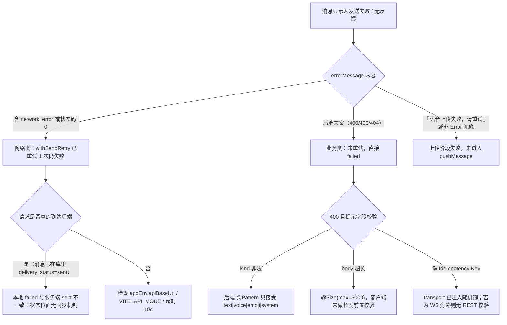

[此图为排障决策示意，判定条件均来自下列源码，但流程编排本身不对应单个源文件，故不提供图表来源]

按症状定位：

| 症状 | 首查点 | 依据 |
| --- | --- | --- |
| 状态永远是 `sending` | 进程在 `withMockMode` 期间被杀（小程序切后台/重启）；重启后 `loadMessageStatus()` 原样恢复，不会纠正为 `failed` | [utils.ts:34-47](file://apps/client/src/stores/chat/utils.ts#L34-L47)、[index.ts:105](file://apps/client/src/stores/chat/index.ts#L105) |
| 消息已送达但本地记 `failed` | `withMockMode` 尾部 `await store.loadOverview()` 抛错会落入 `sendText` 的 `catch`，把已成功的发送标为 `failed` | [higher-order.ts:137-140](file://apps/client/src/stores/chat/higher-order.ts#L137-L140)、[messaging.ts:88-126](file://apps/client/src/stores/chat/actions/messaging.ts#L88-L126) |
| 同文案重发被拒 | 幂等键必须是 `headers`（复数）字段；历史上误用 `header` 导致随机键从未发出、回退稳定键撞锁 | [transport.ts:87-90](file://apps/client/src/features/chat/transport.ts#L87-L90)、[http.ts:822-824](file://apps/client/src/services/http.ts#L822-L824) |
| 语音上传 401 | 未经 `uploadVoiceFile` 的自定义上传不带 `Authorization`；`VoiceMessageController` 要求 `hasRole('USER')` | [voice-upload.ts:9-16](file://apps/client/src/services/voice-upload.ts#L9-L16)、[voice-upload.ts:77-80](file://apps/client/src/services/voice-upload.ts#L77-L80) |
| 语音上传被判扩展名不合法 | 客户端白名单先行拒绝（aac/mp3/m4a/wav），与后端 `LocalMediaStorageService` 同口径，不发起请求 | [voice-upload.ts:57-65](file://apps/client/src/services/voice-upload.ts#L57-L65) |
| H5 语音消息内容是占位文案 | H5 `tempFilePath` 为空 → 直接走 `t("chat.voicePlaceholder")` | [messaging.ts:155-158](file://apps/client/src/stores/chat/actions/messaging.ts#L155-L158) |
| 引用回复「消失了」 | `quoteRef` 空白或长度 > 64 被静默降级为 `null`（不报错、不 400） | [messaging.ts:79-83](file://apps/client/src/stores/chat/actions/messaging.ts#L79-L83)、[TempChatController.java:158](file://apps/api/src/main/java/com/campuslove/api/chat/TempChatController.java#L158) |
| 气泡上没有送达图标 | `ChatBubble` 只识别 `sent` / `delivered` / `read`，其他值不渲染图标；Real 后端只产出 `sent` | [ChatBubble.vue:242-244](file://apps/client/src/components/chat/ChatBubble.vue#L242-L244)、[chat-session/types.ts:76-86](file://apps/client/src/subpackages/chat/chat-session/types.ts#L76-L86)、[TempChatMessageService.java:134](file://apps/api/src/main/java/com/campuslove/api/chat/TempChatMessageService.java#L134) |
| 撤回后状态没变 | 撤回只改 `recalled` 与正文，不动 `delivery_status`，也不动客户端 `messageDeliveryStatus` | [TempChatMessageService.java:318-325](file://apps/api/src/main/java/com/campuslove/api/chat/TempChatMessageService.java#L318-L325) |
| 存储读写异常毫无提示 | `loadMessageStatus` / `saveMessageStatus` 的空 catch 是有意设计（不阻塞业务） | [utils.ts:43-46](file://apps/client/src/stores/chat/utils.ts#L43-L46)、[utils.ts:55-57](file://apps/client/src/stores/chat/utils.ts#L55-L57) |

调试手法：

- 在开发者工具中读取本地存储键 `chat:message-delivery-status`，可直接看到整张映射表；键名定义在 [src/constants/chat.ts:30](file://apps/client/src/constants/chat.ts#L30)，值为 `JSON.stringify` 后的对象（[utils.ts:54](file://apps/client/src/stores/chat/utils.ts#L54)）。
- `sendId` 内嵌毫秒时间戳与序号（`send-${Date.now()}-${seq}`），可据此把一条本地状态与 Sentry/SLS 里同一时刻的请求对上（[messaging.ts:69](file://apps/client/src/stores/chat/actions/messaging.ts#L69)）。
- Mock 模式下追加的消息自带 `deliveryStatus: "sent"`，可与 `mockSessionMap[sessionId].messages` 比对本地追加结果（[messaging.ts:99-108](file://apps/client/src/stores/chat/actions/messaging.ts#L99-L108)）。
- 现有回归断言：Mock 发送后映射表至少含一个 `sent` 条目（[chat.spec.ts:85-108](file://apps/client/src/tests/services/chat.spec.ts#L85-L108)）、emoji 消息同样落到 `sent`（[chat.spec.ts:113-129](file://apps/client/src/tests/services/chat.spec.ts#L113-L129)）。

**章节来源**
- [messaging.ts:55-131](file://apps/client/src/stores/chat/actions/messaging.ts#L55-L131)
- [utils.ts:27-97](file://apps/client/src/stores/chat/utils.ts#L27-L97)
- [higher-order.ts:114-142](file://apps/client/src/stores/chat/higher-order.ts#L114-L142)
- [transport.ts:82-92](file://apps/client/src/features/chat/transport.ts#L82-L92)
- [voice-upload.ts:9-65](file://apps/client/src/services/voice-upload.ts#L9-L65)
- [ChatBubble.vue:242-244](file://apps/client/src/components/chat/ChatBubble.vue#L242-L244)
- [TempChatMessageService.java:129-141](file://apps/api/src/main/java/com/campuslove/api/chat/TempChatMessageService.java#L129-L141)
- [chat.spec.ts:85-129](file://apps/client/src/tests/services/chat.spec.ts#L85-L129)

## 能力缺口登记

本节逐条登记 catalog 要求与仓库现状之间的落差。每条给出判定依据（检索范围 + 命中情况），只陈述已验证的事实。

1. **语音消息不进入投递状态机。** `sendVoice` 全程无 `_setMessageStatus` 调用，Real 分支也未包 `withSendRetry`（[messaging.ts:145-206](file://apps/client/src/stores/chat/actions/messaging.ts#L145-L206)，其中发送调用在 [messaging.ts:204](file://apps/client/src/stores/chat/actions/messaging.ts#L204)）。判定依据：在 [messaging.ts:1-229](file://apps/client/src/stores/chat/actions/messaging.ts#L1-L229) 全文中，`_setMessageStatus` 仅出现在 70/122/126 三行与 219-229 的定义，均位于 `sendText`；`withSendRetry` 仅在 117 行出现一次。因此「`sending`/`sent`/`failed` 跟踪语音消息」在仓库中不存在。
2. **`messageDeliveryStatus` 没有消费方，状态闭环未合上。** 判定依据：对 `apps/client/src` 全量检索 `messageDeliveryStatus`，命中仅 4 处——[store-type.ts:72](file://apps/client/src/stores/chat/store-type.ts#L72)、[index.ts:105](file://apps/client/src/stores/chat/index.ts#L105)、[messaging.ts:224-228](file://apps/client/src/stores/chat/actions/messaging.ts#L224-L228)、[chat.spec.ts:106](file://apps/client/src/tests/services/chat.spec.ts#L106)；页面与组件读取的是消息对象上的 `deliveryStatus`（[chat-session/index.vue:574-575](file://apps/client/src/subpackages/chat/chat-session/index.vue#L574-L575)、[ChatBubble.vue:242-244](file://apps/client/src/components/chat/ChatBubble.vue#L242-L244)），不是这张表。「刷新后恢复展示失败标记」在 UI 层尚未接线。
3. **客户端三态与服务端 `delivery_status` 无映射代码。** 判定依据：`SendMessageRequest` 字段清单里没有状态字段（[types.ts:51-62](file://apps/client/src/stores/chat/types.ts#L51-L62)），后端 `ChatMessageRequest` 同样只有 `sender/kind/body/durationSeconds/quoteRef`（[TempChatController.java:150-159](file://apps/api/src/main/java/com/campuslove/api/chat/TempChatController.java#L150-L159)）；`sendId` 从不随请求发出（对 `apps/client/src` 检索 `sendId`，命中仅在 store 内部与类型/注释，无传输层字段）。因此无法把某个 `sendId` 与服务端某条消息持久关联。
4. **`delivered` / `read` 在 Real 后端无写入点。** 判定依据：`apps/api/src/main/java` 全量检索 `setDeliveryStatus`，仅 [TempChatMessageService.java:134](file://apps/api/src/main/java/com/campuslove/api/chat/TempChatMessageService.java#L134) 与 [GuestDemoDataProvisioner.java:192](file://apps/api/src/main/java/com/campuslove/api/auth/GuestDemoDataProvisioner.java#L192)，值均为 `"sent"`；字面量 `"delivered"` / `"read"` 只出现在 Mock 服务（[MockTempChatService.java:225-229](file://apps/api/src/main/java/com/campuslove/api/chat/MockTempChatService.java#L225-L229)）与演示数据（[GuestDemoDataProvisioner.java:326](file://apps/api/src/main/java/com/campuslove/api/auth/GuestDemoDataProvisioner.java#L326)）。DDL 注释声明的三值中，Real 链路只产生第一值。
5. **无逐条消息的已读回执端点。** 判定依据：`TempChatController` 暴露的是会话级 `POST /{id}/read`（[TempChatController.java:84-88](file://apps/api/src/main/java/com/campuslove/api/chat/TempChatController.java#L84-L88)）；消息级只有撤回端点（[TempChatController.java:90-94](file://apps/api/src/main/java/com/campuslove/api/chat/TempChatController.java#L90-L94)）。`private_messages` 侧存在布尔 `is_read` 列（[PrivateMessage.java:94-96](file://apps/api/src/main/java/com/campuslove/api/entity/PrivateMessage.java#L94-L96)）与 `(conversation_id, is_read, created_at)` 索引（[PrivateMessage.java:45-47](file://apps/api/src/main/java/com/campuslove/api/entity/PrivateMessage.java#L45-L47)），但没有逐条已读的状态推进实现。
6. **WebSocket 链路不参与消息状态推进。** 判定依据：对 [MessageWebSocketHandler.java](file://apps/api/src/main/java/com/campuslove/api/chat/MessageWebSocketHandler.java) 检索 `deliveryStatus` / `DeliveryStatus` / `read` / `recall`，命中 0 行。该处理器只按 REST 契约构造 `ChatMessageRequest`（其 `new ChatMessageRequest` 在 [MessageWebSocketHandler.java:191](file://apps/api/src/main/java/com/campuslove/api/chat/MessageWebSocketHandler.java#L191)），因此不存在「服务端推送把 `sending` 推进到 `delivered`」的机制。
7. **`chat.message.*` 指标未接线。** 判定依据：`apps/api/src/main/java` 检索 `recordMessageSent` / `recordMessageFailed` / `incrementActiveSession` / `decrementActiveSession`，除 [ChatMetrics.java](file://apps/api/src/main/java/com/campuslove/api/monitor/ChatMetrics.java) 自身定义行（60/77/92/103）外命中 0 调用点。catalog 要求的「消息状态监控」目前只有实现体，没有生产者。
8. **已存在但未启用的存储校验器。** `isMessageDeliveryStatusMap` / `isMessageDeliveryStatus` 定义于 [guards.ts:183-211](file://apps/client/src/types/guards.ts#L183-L211)，但对 `apps/client/src` 检索这两个符号，除定义与内部互调（208 行）外命中 0 调用点——`loadMessageStatus` 只做了 `typeof === "object"` 检查（[utils.ts:37-42](file://apps/client/src/stores/chat/utils.ts#L37-L42)）。附带一处类型漂移：guards.ts 从 `stores/chat/types` 导入的是三态 `MessageDeliveryStatus`（[guards.ts:24](file://apps/client/src/types/guards.ts#L24)），而守卫放行五个值 `sending|sent|delivered|read|failed`（[guards.ts:188-194](file://apps/client/src/types/guards.ts#L188-L194)），若直接接入会把视图层状态域灌进 store 的三态映射表。
9. **`ChatStoreThis.sendText` 声明落后于实现。** 声明 `(body: string) => Promise<boolean>`（[store-type.ts:98](file://apps/client/src/stores/chat/store-type.ts#L98)），实现含 `kind`、`quoteRef`（[messaging.ts:55-60](file://apps/client/src/stores/chat/actions/messaging.ts#L55-L60)）。经该接口类型调用时拿不到 emoji 与引用能力。
10. **映射表无生命周期策略。** 判定依据：`src/constants/chat.ts` 中与消息状态相关的常量只有键名、重试次数与延迟三项（[src/constants/chat.ts:30-36](file://apps/client/src/constants/chat.ts#L30-L36)），无容量上限、TTL、清理开关；`utils.ts` 与 `messaging.ts` 中也无任何删除/裁剪分支（[utils.ts:27-58](file://apps/client/src/stores/chat/utils.ts#L27-L58)、[messaging.ts:219-229](file://apps/client/src/stores/chat/actions/messaging.ts#L219-L229)）。
11. **`temp_chat_message.delivery_status` 无索引。** 判定依据：对仓库 `*.sql` 全量检索 `delivery_status`，索引类语句均落在 `private_messages`（[V2026.07.26.0001:63-66](file://database/flyway/sql/V2026.07.26.0001__add_entity_index_annotations.sql#L63-L66)、[V2026.07.26.0004:193](file://database/flyway/sql/V2026.07.26.0004__p8_database_standardization.sql#L193)），`temp_chat_message` 只出现在列添加语句（[V2026.06.01.0001:4-7](file://database/flyway/sql/V2026.06.01.0001__add_recall_delivery_quote_to_messages.sql#L4-L7)）。
12. **状态相关单测覆盖不完整。** 判定依据：对 `apps/client/src/tests` 检索 `withSendRetry` / `loadMessageStatus` / `saveMessageStatus` / `"failed"`，仅命中一处无关断言（[match.spec.ts:90](file://apps/client/src/tests/stores/match.spec.ts#L90)）。现有消息状态断言只覆盖 Mock 路径的 `sent`（[chat.spec.ts:85-129](file://apps/client/src/tests/services/chat.spec.ts#L85-L129)），未覆盖 `sending → failed`、重试次数、存储读写。

catalog 中已满足、不需登记的要求：三态语义与转换规则、持久化机制与 `loadMessageStatus`/`saveMessageStatus` 实现、`sendText` 流程、`SendMessageRequest` 契约设计、`withSendRetry` 重试与失败降级、`send-${timestamp}-${seq}` ID 策略、`quoteRef` 校验与边界、语音上传与 H5 降级、调试手法（本地存储键可直接观测）。

**章节来源**
- [messaging.ts:145-229](file://apps/client/src/stores/chat/actions/messaging.ts#L145-L229)
- [utils.ts:27-58](file://apps/client/src/stores/chat/utils.ts#L27-L58)
- [guards.ts:183-211](file://apps/client/src/types/guards.ts#L183-L211)
- [store-type.ts:96-98](file://apps/client/src/stores/chat/store-type.ts#L96-L98)
- [apps/client/src/constants/chat.ts:30-36](file://apps/client/src/constants/chat.ts#L30-L36)
- [TempChatController.java:84-94](file://apps/api/src/main/java/com/campuslove/api/chat/TempChatController.java#L84-L94)
- [MessageWebSocketHandler.java:191](file://apps/api/src/main/java/com/campuslove/api/chat/MessageWebSocketHandler.java#L191-L191)
- [ChatMetrics.java:60-103](file://apps/api/src/main/java/com/campuslove/api/monitor/ChatMetrics.java#L60-L103)
- [V2026.06.01.0001:1-11](file://database/flyway/sql/V2026.06.01.0001__add_recall_delivery_quote_to_messages.sql#L1-L11)

## 结论

消息状态管理在当前仓库是一个**客户端本地、单入口、三态、整表快照**的轻量状态机：`sendText` 生成 `send-${Date.now()}-${++messageIdSeq}` 作为追踪键，`_setMessageStatus` 是唯一写入口并同时落盘到 `chat:message-delivery-status`，`withSendRetry` 只对 `category === "network"` 的错误重试一次、固定 500ms 延迟，失败终态写 `failed` 并回填 `errorMessage`，函数以布尔返回值取代文案差分判定。`SendMessageRequest` 把载荷固定为 `sender/kind/body/durationSeconds/quoteRef` 五字段，与后端 `ChatMessageRequest` 的 Bean Validation（`@Size(max=64)` 的 `quoteRef`、`@Size(max=5000)` 的 `body`、`@Pattern` 的 `kind`）同口径，客户端还对 `quoteRef` 做了「空白与超长静默降级为 null」的前置处理。

同时必须承认边界：这套三态是**发送结局**而非**投递回执**。服务端 `delivery_status` 的 `sent/delivered/read` 与它没有映射代码，Real 链路只产出 `sent`，`delivered`/`read` 仅存在于 Mock 与演示数据；撤回是独立布尔 `recalled` + 正文替换，不参与状态机；`sendVoice` 完全绕开状态机与重试；`messageDeliveryStatus` 目前没有任何 UI 消费方；`chat.message.*` 指标已实现但无调用点；为持久化准备的 `isMessageDeliveryStatusMap` 守卫也尚未接入读取路径。上述 12 条落差逐条记录在 [能力缺口登记](#能力缺口登记)，每条都给出检索范围与命中情况。

落地顺序建议（均为上表可验证的缺口，不涉及新造概念）：先把 `sendVoice` 接入 `_setMessageStatus` 与 `withSendRetry`；再让 UI 读取 `messageDeliveryStatus` 或在发送成功后用服务端回传的 `deliveryStatus` 覆盖本地键；随后在 `loadMessageStatus` 中启用守卫并统一状态域（三态与五态二选一）；最后给消息发送请求传 `noRetry` 以消除双层重试叠加，并把 `ChatMetrics` 接入发送成功/失败路径。

**章节来源**
- [messaging.ts:34-131](file://apps/client/src/stores/chat/actions/messaging.ts#L34-L131)
- [messaging.ts:145-229](file://apps/client/src/stores/chat/actions/messaging.ts#L145-L229)
- [types.ts:25-62](file://apps/client/src/stores/chat/types.ts#L25-L62)
- [utils.ts:27-97](file://apps/client/src/stores/chat/utils.ts#L27-L97)
- [TempChatController.java:150-164](file://apps/api/src/main/java/com/campuslove/api/chat/TempChatController.java#L150-L164)
- [guards.ts:183-211](file://apps/client/src/types/guards.ts#L183-L211)
