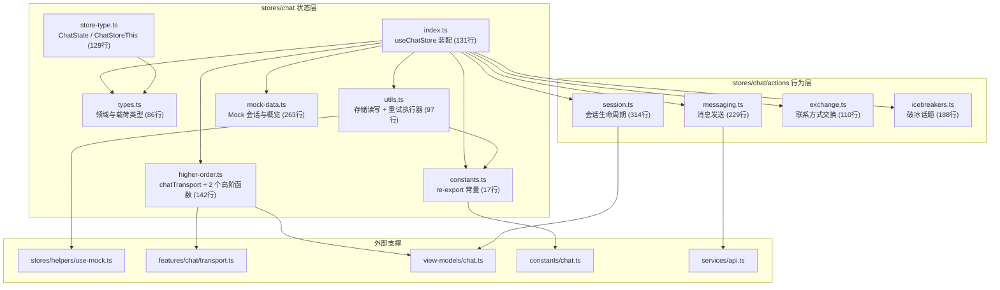
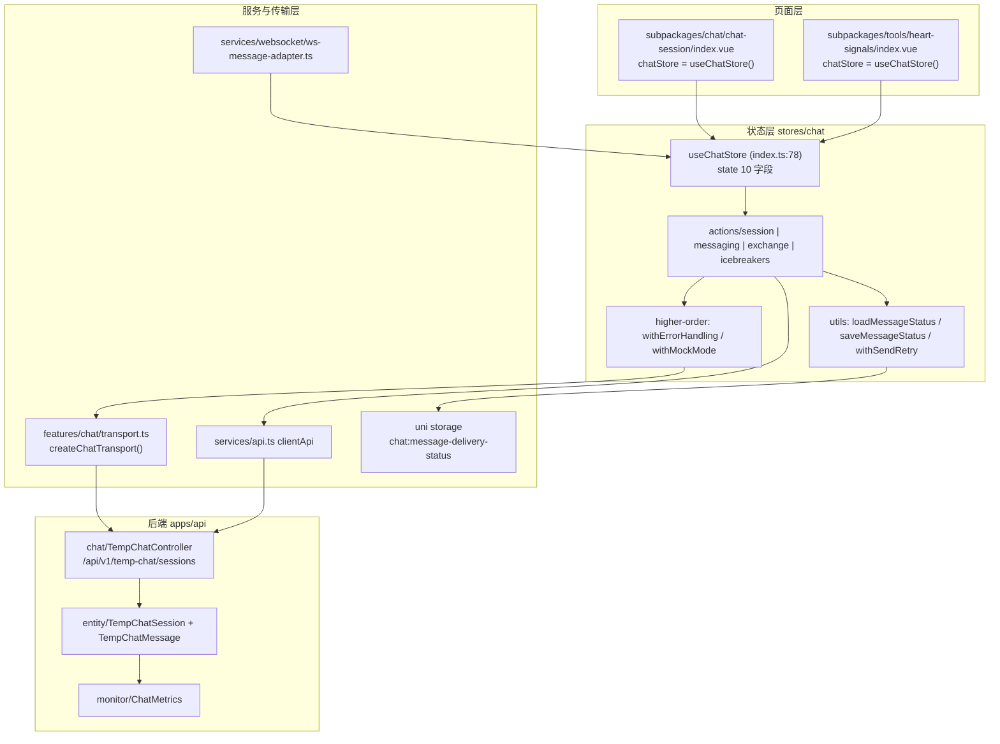
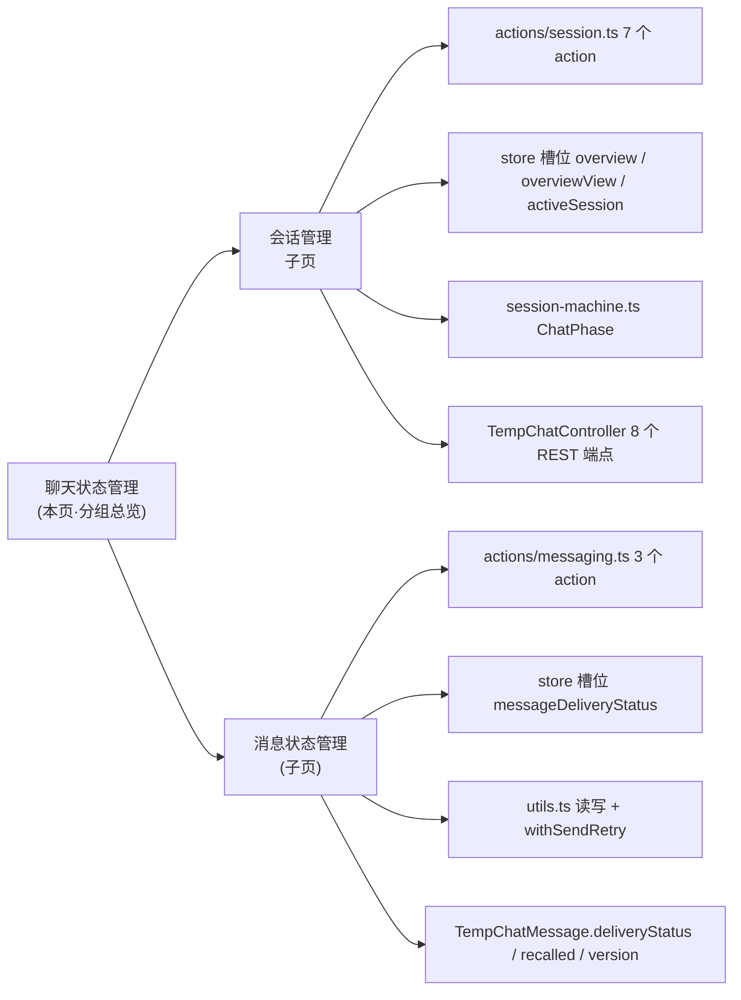
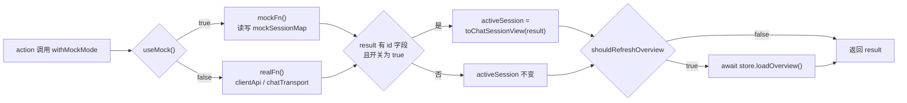
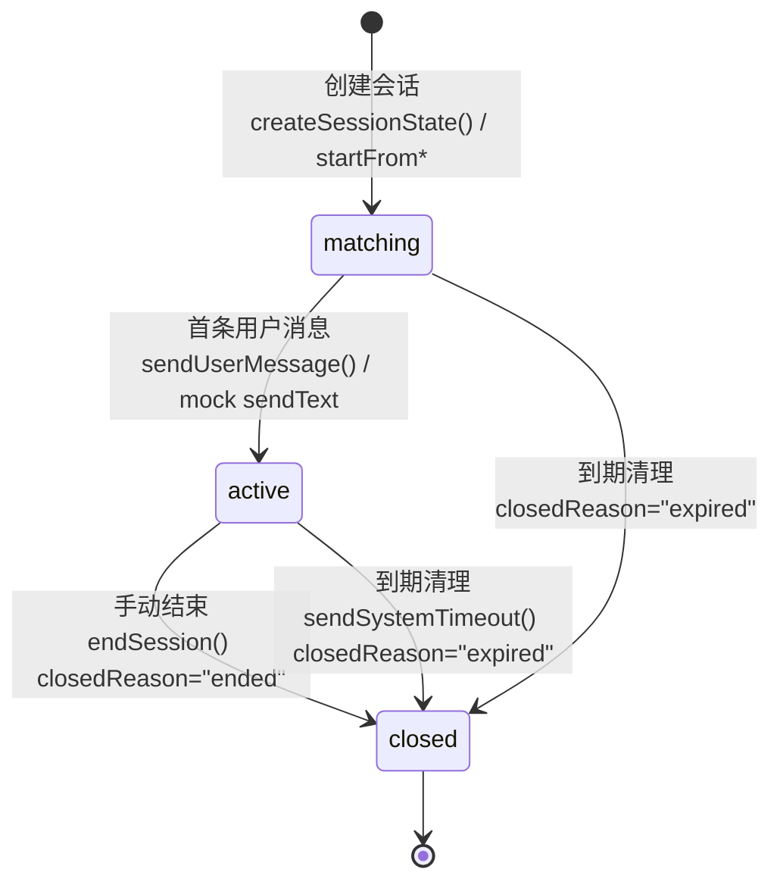
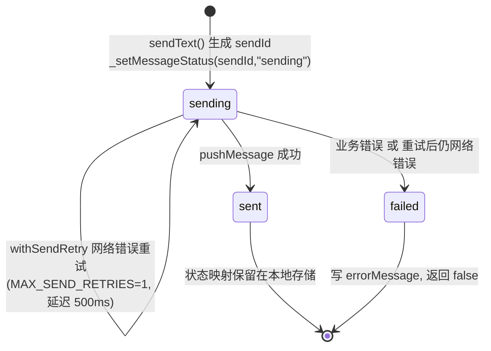
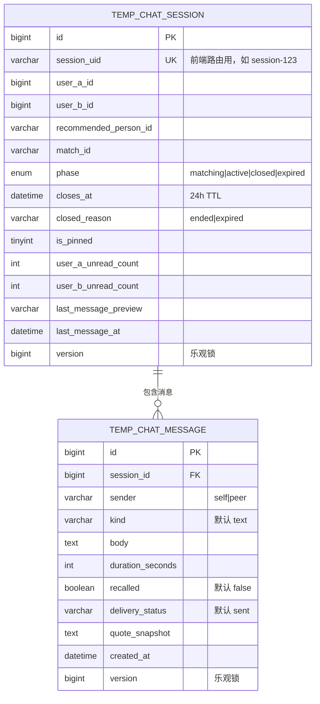
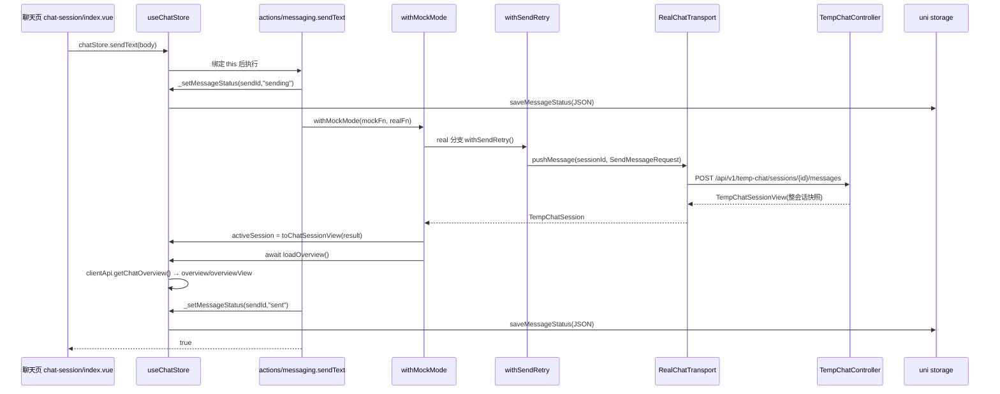
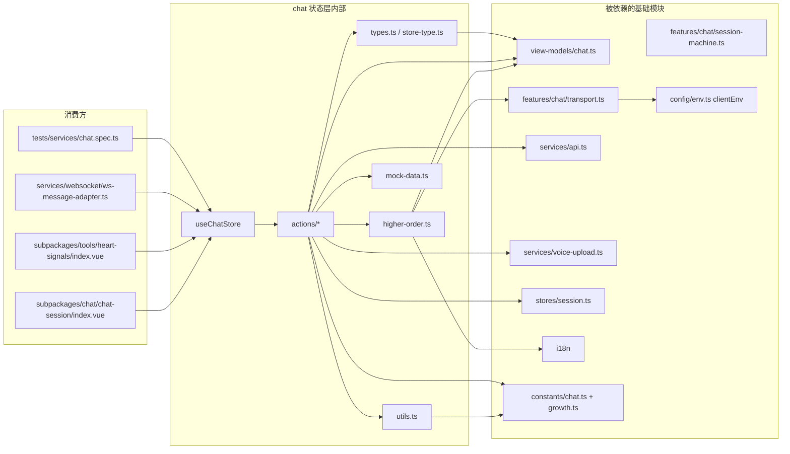

# 聊天状态管理

<cite>
**本文引用的文件**
- [index.ts](file://apps/client/src/stores/chat/index.ts)
- [types.ts](file://apps/client/src/stores/chat/types.ts)
- [store-type.ts](file://apps/client/src/stores/chat/store-type.ts)
- [constants.ts](file://apps/client/src/stores/chat/constants.ts)
- [utils.ts](file://apps/client/src/stores/chat/utils.ts)
- [higher-order.ts](file://apps/client/src/stores/chat/higher-order.ts)
- [mock-data.ts](file://apps/client/src/stores/chat/mock-data.ts)
- [chat.ts](file://apps/client/src/stores/chat.ts)
- [session.ts](file://apps/client/src/stores/chat/actions/session.ts)
- [messaging.ts](file://apps/client/src/stores/chat/actions/messaging.ts)
- [exchange.ts](file://apps/client/src/stores/chat/actions/exchange.ts)
- [icebreakers.ts](file://apps/client/src/stores/chat/actions/icebreakers.ts)
- [chat.ts (常量)](file://apps/client/src/constants/chat.ts)
- [growth.ts](file://apps/client/src/constants/growth.ts)
- [transport.ts](file://apps/client/src/features/chat/transport.ts)
- [session-machine.ts](file://apps/client/src/features/chat/session-machine.ts)
- [chat.ts (视图模型)](file://apps/client/src/view-models/chat.ts)
- [api.ts](file://apps/client/src/services/api.ts)
- [http.ts](file://apps/client/src/services/http.ts)
- [ws-message-adapter.ts](file://apps/client/src/services/websocket/ws-message-adapter.ts)
- [package.json](file://apps/client/package.json)
- [TempChatController.java](file://apps/api/src/main/java/com/campuslove/api/chat/TempChatController.java)
- [TempChatCleanupService.java](file://apps/api/src/main/java/com/campuslove/api/chat/TempChatCleanupService.java)
- [TempChatSession.java](file://apps/api/src/main/java/com/campuslove/api/entity/TempChatSession.java)
- [TempChatMessage.java](file://apps/api/src/main/java/com/campuslove/api/entity/TempChatMessage.java)
- [MessageView.java](file://apps/api/src/main/java/com/campuslove/api/chat/MessageView.java)
- [ConversationView.java](file://apps/api/src/main/java/com/campuslove/api/chat/ConversationView.java)
- [ChatMetrics.java](file://apps/api/src/main/java/com/campuslove/api/monitor/ChatMetrics.java)
</cite>

## 目录
1. [简介](#简介)
2. [项目结构](#项目结构)
3. [核心组件](#核心组件)
4. [架构总览](#架构总览)
5. [模块边界与子页导航](#模块边界与子页导航)
6. [详细组件分析](#详细组件分析)
7. [会话生命周期状态机](#会话生命周期状态机)
8. [消息状态与投递状态](#消息状态与投递状态)
9. [数据模型与持久化策略](#数据模型与持久化策略)
10. [端到端调用链路](#端到端调用链路)
11. [依赖关系分析](#依赖关系分析)
12. [性能考虑](#性能考虑)
13. [故障排查指南](#故障排查指南)
14. [能力缺口登记](#能力缺口登记)
15. [结论](#结论)

## 简介

本页是「消息聊天系统」下的**分组总览页**，聚焦聊天功能的客户端状态层：以 Pinia 为中心的状态定义、装配、更新机制与副作用处理，并把客户端状态与后端 `chat` 包的数据模型、指标组件串成一条完整链路。页面不重复子页实现细节，而是给出模块边界、整体数据流与状态口径，并索引两个子页：

- **会话管理**：概览加载、会话创建（从匹配 / 从推荐人 / 从信号切入）、会话激活（`activeSession`）、置顶、结束与销毁。
- **消息状态管理**：消息投递三态（`sending` / `sent` / `failed`）、`sendId` 生成规则、本地持久化、重试执行器与状态回写。

状态主体由一个 store 承担。`defineStore("chat", { ... })` 在 `apps/client/src/stores/chat/index.ts` 中声明为选项式（Option API）store，导出 `useChatStore`，其 state 只保留 10 个字段（3 个 loading 标记、1 个错误消息、3 个数据槽位、2 个破冰话题容器、1 个投递状态映射表），15 个 action 全部从 `./actions/*` 目录挂载进来。这是一种"薄 store 主体 + 外置 action 函数"的组织方式：actions 以函数引用形式写进 `actions: {}` 对象，由 Pinia 在运行时把 `this` 绑定到 store 实例，因此拆分后的函数必须显式声明 `this: ChatStoreThis` 才能通过 `noImplicitThis` 检查。

该结构是重构产物而非初始设计：文件头注释记录了演化路径——原 `chat.ts` 单文件 944 行，先抽出中间层 `index.ts`（555 行），再拆到当前约 131 行的装配入口。拆分动机在 `types.ts`、`store-type.ts`、`utils.ts`、`higher-order.ts`、`constants.ts` 五处文件头中被重复声明为"违反单一职责原则"。

**章节来源**
- [index.ts:1-30](file://apps/client/src/stores/chat/index.ts#L1-L30)
- [index.ts:78-131](file://apps/client/src/stores/chat/index.ts#L78-L131)
- [types.ts:1-14](file://apps/client/src/stores/chat/types.ts#L1-L14)
- [store-type.ts:1-26](file://apps/client/src/stores/chat/store-type.ts#L1-L26)
- [utils.ts:1-16](file://apps/client/src/stores/chat/utils.ts#L1-L16)
- [constants.ts:1-17](file://apps/client/src/stores/chat/constants.ts#L1-L17)

## 项目结构

聊天状态层在客户端由五个目录共同承担：`stores/chat`（状态与 action）、`stores/helpers`（模式判断单一真相源）、`features/chat`（传输层）、`view-models`（DTO→UI 视图模型）、`constants`（常量单一真相源）。`stores/chat/index.ts` 通过 `export * from` 把 `./types`、`./constants`、`./utils`、`./higher-order` 全部 re-export，同时显式具名 re-export 五个 mock 变量，外部一律以 `import { useChatStore } from "@/stores/chat"` 访问，旧 import 路径保持兼容。

**图表来源**
- [index.ts:26-67](file://apps/client/src/stores/chat/index.ts#L26-L67)
- [index.ts:107-130](file://apps/client/src/stores/chat/index.ts#L107-L130)
- [utils.ts:10-16](file://apps/client/src/stores/chat/utils.ts#L10-L16)
- [constants.ts:13-17](file://apps/client/src/stores/chat/constants.ts#L13-L17)
- [higher-order.ts:13-30](file://apps/client/src/stores/chat/higher-order.ts#L13-L30)
- [store-type.ts:14-26](file://apps/client/src/stores/chat/store-type.ts#L14-L26)

**章节来源**
- [index.ts:1-30](file://apps/client/src/stores/chat/index.ts#L1-L30)
- [index.ts:59-67](file://apps/client/src/stores/chat/index.ts#L59-L67)
- [constants.ts:9-17](file://apps/client/src/stores/chat/constants.ts#L9-L17)
- [utils.ts:10-25](file://apps/client/src/stores/chat/utils.ts#L10-L25)
- [higher-order.ts:13-30](file://apps/client/src/stores/chat/higher-order.ts#L13-L30)

## 核心组件

聊天状态层由 9 个可辨识组件构成，各自的职责边界在文件头注释中已写明，下表按"状态定义 → 状态更新 → 状态副作用"三条线归类。

| 组件 | 位置 | 类别 | 职责与关键导出 |
| --- | --- | --- | --- |
| `useChatStore` | `stores/chat/index.ts:78` | 状态定义 | `defineStore("chat", { state, actions })`，state 10 字段、actions 15 个函数引用 |
| `ChatState` | `stores/chat/store-type.ts:45` | 状态定义 | state 的显式接口，与 `index.ts` 的 `state()` 返回值结构等价 |
| `ChatStoreThis` | `stores/chat/store-type.ts:82` | 状态定义 | `ChatState` + 14 个 action 签名，拆分后的 action 用它声明 `this` |
| 领域类型 | `stores/chat/types.ts:17-86` | 状态定义 | `ChatOverview` / `ChatSessionSummary` / `TempChatSession`（取自 OpenAPI `components["schemas"]`）、`MessageDeliveryStatus`、`SendMessageRequest`、`LoadingKey` |
| 常量层 | `constants/chat.ts:13-45`（由 `stores/chat/constants.ts:13-17` re-export） | 状态口径 | `MESSAGE_STATUS_STORAGE_KEY`、`MAX_SEND_RETRIES=1`、`SEND_RETRY_DELAY_MS=500`、`MESSAGE_MAX_LENGTH=1000`、`IDLE_ICEBREAKER_DELAY_MS=5000`、`COUNTDOWN_TICK_MS=1000` |
| 工具函数 | `stores/chat/utils.ts:25-97` | 状态持久化 | `useMock()`、`loadMessageStatus()`、`saveMessageStatus()`、`withSendRetry()` |
| 高阶函数 | `stores/chat/higher-order.ts:54-142` | 状态更新模板 | `withErrorHandling()` 管 loading/errorMessage，`withMockMode()` 管模式分流/activeSession/概览刷新 |
| Action 模块 | `stores/chat/actions/{session,messaging,exchange,icebreakers}.ts` | 状态更新 | 会话 7 个、消息 3 个、交换 2 个、破冰 3 个 action |
| 传输层 | `features/chat/transport.ts:16-125` | 外部 IO | `ChatTransport` 接口 6 方法，`MockChatTransport` / `RealChatTransport` 双实现，`createChatTransport(mode)` 工厂 |
| 纯 reducer | `features/chat/session-machine.ts:33-112` | 会话状态机 | `createSessionState` / `sendUserMessage` / `proposeContactExchange` / `respondToContactExchange` / `sendSystemTimeout`，返回新对象不做原地修改 |

### state 字段全景

state 定义集中在 `index.ts:79-106`，10 个字段按用途分四组：

- **加载标记（3 个，受 `LoadingKey` 联合类型约束）**：`loadingOverview`、`loadingSession`、`loadingIcebreakers`。`LoadingKey` 在 `types.ts:86` 定义，作用是禁止高阶函数写到未知 loading 字段。
- **错误通道（1 个）**：`errorMessage: string | null`，全局单槽，由 `withErrorHandling` 写入、由各 action 失败分支覆写。
- **数据槽位（3 个）**：`overview`（后端原始 DTO）、`overviewView`（视图模型）、`activeSession`（视图模型）。原始数据与视图模型分两槽保存，页面渲染只读 `*View`。
- **业务容器（3 个）**：`icebreakerTopics: string[]`、`icebreakerItems`（含 id/content/category/source）、`messageDeliveryStatus: Record<string, MessageDeliveryStatus>`。

`messageDeliveryStatus` 是唯一一个在 store 创建时从本地存储读入的字段：初始值为 `loadMessageStatus()` 的返回值，因此 store 实例化即完成一次跨会话状态恢复。

**章节来源**
- [index.ts:78-106](file://apps/client/src/stores/chat/index.ts#L78-L106)
- [store-type.ts:45-123](file://apps/client/src/stores/chat/store-type.ts#L45-L123)
- [types.ts:17-86](file://apps/client/src/stores/chat/types.ts#L17-L86)
- [apps/client/src/constants/chat.ts:13-45](file://apps/client/src/constants/chat.ts#L13-L45)
- [constants.ts:13-17](file://apps/client/src/stores/chat/constants.ts#L13-L17)
- [utils.ts:25-97](file://apps/client/src/stores/chat/utils.ts#L25-L97)
- [higher-order.ts:54-142](file://apps/client/src/stores/chat/higher-order.ts#L54-L142)
- [transport.ts:16-125](file://apps/client/src/features/chat/transport.ts#L16-L125)
- [session-machine.ts:33-112](file://apps/client/src/features/chat/session-machine.ts#L33-L112)
- [growth.ts:40-40](file://apps/client/src/constants/growth.ts#L40-L40)

## 架构总览

状态层处于「页面」与「传输/后端」之间，形成四条清晰的数据流：读流（后端 DTO → `overview` → `overviewView` → 页面）、写流（页面 → action → `chatTransport` → REST）、恢复流（`uni.getStorageSync` → `messageDeliveryStatus` 初值）、实时流（STOMP 推送 → `ws-message-adapter` → 读 `activeSession` 做会话归因）。

**图表来源**
- [index.ts:78-131](file://apps/client/src/stores/chat/index.ts#L78-L131)
- [higher-order.ts:30-142](file://apps/client/src/stores/chat/higher-order.ts#L30-L142)
- [utils.ts:34-97](file://apps/client/src/stores/chat/utils.ts#L34-L97)
- [apps/client/src/constants/chat.ts:30-30](file://apps/client/src/constants/chat.ts#L30-L30)
- [transport.ts:123-125](file://apps/client/src/features/chat/transport.ts#L123-L125)
- [ws-message-adapter.ts:107-114](file://apps/client/src/services/websocket/ws-message-adapter.ts#L107-L114)
- [TempChatController.java:20-98](file://apps/api/src/main/java/com/campuslove/api/chat/TempChatController.java#L20-L98)
- [TempChatSession.java:23-88](file://apps/api/src/main/java/com/campuslove/api/entity/TempChatSession.java#L23-L88)
- [ChatMetrics.java:23-110](file://apps/api/src/main/java/com/campuslove/api/monitor/ChatMetrics.java#L23-L110)

三条结构性约束值得注意：

1. **单一 store 实例**。页面通过 `stores/chat.ts`（19 行 re-export 垫片）导入 `useChatStore`，实际定义在 `stores/chat/index.ts`，因此 `subpackages/chat/chat-session/index.vue` 与 `subpackages/tools/heart-signals/index.vue` 共享同一份 state。
2. **传输层是模块级单例**。`chatTransport = createChatTransport()` 在 `higher-order.ts:30` 求值一次，按 `clientEnv.apiMode` 静态选中 Mock 或 Real 实现；`withMockMode` 再按 `useMock()` 运行时分流，两处判断口径独立。
3. **后端以整会话快照返回**。`TempChatController` 的 `sendMessage` / `endSession` / `respondToContactExchange` 全部返回 `TempChatSessionView`（而非单条消息），这正是客户端每次写操作后用返回值重建 `activeSession` 并能顺带 `loadOverview()` 的前提。

**章节来源**
- [chat.ts:1-18](file://apps/client/src/stores/chat.ts#L1-L18)
- [index.ts:26-32](file://apps/client/src/stores/chat/index.ts#L26-L32)
- [higher-order.ts:13-30](file://apps/client/src/stores/chat/higher-order.ts#L13-L30)
- [TempChatController.java:36-98](file://apps/api/src/main/java/com/campuslove/api/chat/TempChatController.java#L36-L98)

## 模块边界与子页导航

本组按「状态容器的两条主线」切分：一条是**会话**（`overview` / `overviewView` / `activeSession` 三个数据槽位的生命周期），一条是**消息**（`messageDeliveryStatus` 映射表与消息体的读写）。两条线共用同一个 store 与同一套高阶函数，因此在源码层面可精确切开。

**图表来源**
- [session.ts:40-314](file://apps/client/src/stores/chat/actions/session.ts#L40-L314)
- [messaging.ts:55-229](file://apps/client/src/stores/chat/actions/messaging.ts#L55-L229)
- [index.ts:79-106](file://apps/client/src/stores/chat/index.ts#L79-L106)
- [session-machine.ts:1-31](file://apps/client/src/features/chat/session-machine.ts#L1-L31)
- [TempChatController.java:36-98](file://apps/api/src/main/java/com/campuslove/api/chat/TempChatController.java#L36-L98)
- [TempChatMessage.java:22-81](file://apps/api/src/main/java/com/campuslove/api/entity/TempChatMessage.java#L22-L81)

| 子页 | 覆盖范围（代码区域） | 不覆盖（归属他处） |
| --- | --- | --- |
| [会话管理](会话管理.md) | `actions/session.ts` 的 `loadOverview` / `startFromRecommendation` / `startFromMatch` / `startFromSignal` / `loadSession` / `setSessionPinned` / `endSession`；`ChatState` 的 3 个数据槽位；`view-models/chat` 转换；`session-machine.ts` 的 phase 迁移；后端 `temp_chat_session` 表与 8 个会话端点 | 联系方式交换的具体协议（属"会话交换机制"页）、消息投递状态（属"消息状态管理"页） |
| [消息状态管理](消息状态管理.md) | `actions/messaging.ts` 的 `sendText` / `sendVoice` / `_setMessageStatus`；`MessageDeliveryStatus` 三态与 `sendId` 规则；`utils.ts` 持久化与重试；`constants/chat.ts` 重试与长度常量；`transport.ts` 幂等键；后端 `temp_chat_message` 表字段 | 会话创建入口（属"会话管理"页）、WebSocket 帧解析（属"WebSocket实时通信"页） |

**边界判据**（三条，供后续维护时判断新增代码归哪一页）：

1. 变更若只影响 `withMockMode` 的 `shouldRefreshOverview` / `shouldUpdateActiveSession` 组合语义 → 属本页总览层，因为它同时约束两条线。
2. 变更若落在 `store-type.ts:45-73` 的 `ChatState` 且新增的是列表/视图字段 → 会话管理；若新增的是按 `sendId` 索引的映射字段 → 消息状态管理。
3. `actions/exchange.ts` 与 `actions/icebreakers.ts` 的 5 个 action 在本组中**不设子页**，它们的状态出口仍是 `activeSession`，文档归属见同级"消息聊天系统"分组下的会话交换机制与破冰机制页。

**章节来源**
- [index.ts:107-130](file://apps/client/src/stores/chat/index.ts#L107-L130)
- [store-type.ts:45-123](file://apps/client/src/stores/chat/store-type.ts#L45-L123)
- [session.ts:40-40](file://apps/client/src/stores/chat/actions/session.ts#L40-L40)
- [messaging.ts:55-55](file://apps/client/src/stores/chat/actions/messaging.ts#L55-L55)
- [higher-order.ts:114-142](file://apps/client/src/stores/chat/higher-order.ts#L114-L142)

## 详细组件分析

### 状态装配与拆分后的 this 绑定

`defineStore("chat", { state, actions })` 的 actions 对象里 15 个键全部是函数引用而非实现体。这些函数在 `actions/*.ts` 中以模块级导出函数形式存在，签名为 `async function xxx(this: ChatStoreThis, ...)`。拆分带来一个 TypeScript 层面的硬约束：Pinia 对选项式 store 的 `this` 推断只在字面量对象内有效，函数移出后 `this` 会退化为隐式 any，因此 `store-type.ts` 必须手写一份与 store 实例结构等价的 `ChatStoreThis`，并且 `ChatStoreInstance` 只是它的别名（`store-type.ts:129`）。

这一约束形成一处可观测的不一致风险：`ChatStoreThis` 只声明了 14 个 action（`store-type.ts:85-122`），而 `index.ts:109-129` 挂载了 15 个，多出的 `startFromSignal` 未在接口中声明。运行时不受影响（Pinia 按对象键绑定），但通过 store 实例调用 `startFromSignal` 时无法获得类型检查。新增 action 时需同时改 `store-type.ts:82-123`，否则该 action 在类型层面不可见。

`ChatStoreLike`（`types.ts:70-83`）是另一层解耦：高阶函数只依赖 6 个成员（3 个 loading 标记、`errorMessage`、`activeSession`、`loadOverview`），因此不需要引用完整 store 类型，避开了 store 定义与高阶函数之间的循环依赖。`ChatStoreThis extends ChatState` 在结构上满足 `ChatStoreLike`，可直接作为参数传入。

**章节来源**
- [index.ts:68-131](file://apps/client/src/stores/chat/index.ts#L68-L131)
- [store-type.ts:1-26](file://apps/client/src/stores/chat/store-type.ts#L1-L26)
- [store-type.ts:82-129](file://apps/client/src/stores/chat/store-type.ts#L82-L129)
- [types.ts:64-86](file://apps/client/src/stores/chat/types.ts#L64-L86)
- [session.ts:1-30](file://apps/client/src/stores/chat/actions/session.ts#L1-L30)

### withErrorHandling：loading 与 errorMessage 的成对管理

`withErrorHandling(store, { loadingKey?, errorPrefixKey, rethrow? }, fn)` 把「置 loading → 清错误 → 执行业务 → 写错误 → 复位 loading」压成一次调用。关键语义有四点：

1. `loadingKey` 可选且不传即不管理 loading，`setSessionPinned`（`session.ts:247-249`）就是这样用的——它只关心错误消息，不希望按钮因写操作而进入骨架屏。
2. `store.errorMessage = null` 在 try 之前执行，因此错误通道是**一次性**的：任何一次 action 成功都会顺带清掉上一条错误。
3. 错误文案取值优先级为 `error.message` → `t(errorPrefixKey)`，非 Error 抛出（如字符串、后端 JSON）走 i18n 兜底，避免把 `[object Object]` 渲染到页面。
4. 默认吞掉异常返回 `undefined`；只有显式 `rethrow: true`（`sendIcebreaker` 使用，`icebreakers.ts:104-106`）才向上抛。

`finally` 保证 loading 在异常路径下也复位，这是"状态更新原子性"在该层的唯一实现手段：**loading 的置位与复位成对出现在同一个函数体内**，不存在跨 action 的悬挂 loading。`fetchIcebreakers` 是唯一绕过该模板的 action，它手写 `this.loadingIcebreakers = true` / `finally { ... = false }`（`icebreakers.ts:176-186`）。

**章节来源**
- [higher-order.ts:32-86](file://apps/client/src/stores/chat/higher-order.ts#L32-L86)
- [session.ts:240-283](file://apps/client/src/stores/chat/actions/session.ts#L240-L283)
- [icebreakers.ts:167-188](file://apps/client/src/stores/chat/actions/icebreakers.ts#L167-L188)
- [types.ts:85-86](file://apps/client/src/stores/chat/types.ts#L85-L86)

### withMockMode：双实现分流与统一后置动作

`withMockMode(store, mockFn, realFn, options)` 承担三件事：按 `useMock()` 选分支、按结果形状更新 `activeSession`、按开关刷新概览。

- 判断依据是 `useMock()`（`utils.ts:25` 转发 `stores/helpers/use-mock`，全局单一真相源），与传输层的 `clientEnv.apiMode` 是两个独立开关：`RealChatTransport` 与 `MockChatTransport` 由 `createChatTransport(mode)` 在模块加载期选定，而 mock 分支在每次调用期决定。
- 后置动作由两个布尔开关控制，默认均为 `true`。四个调用组合覆盖了全部场景：概览加载两者都关（`session.ts:55`，防止递归）、置顶只刷新概览（`session.ts:279`）、会话创建与消息发送两者都用默认值。
- 活跃会话更新有形状条件：`shouldUpdateActiveSession && result && typeof result === "object" && "id" in result`（`higher-order.ts:133`）。置顶分支返回 `undefined` 且开关关闭，双重保险；而 `pinTempChatSession` 的真实返回值类型是 `ChatSessionSummaryView`（含 `id`），若开关误设为 `true` 会把会话摘要错当成完整会话写入 `activeSession`——这是该形状判断必须保留的原因。
- `result as unknown as TempChatSession` 的双重断言（`higher-order.ts:135`）是泛型 `T` 无法约束到具体类型的直接后果。

[此图为概念流程，不直接对应具体源文件，故不提供图表来源]

**章节来源**
- [higher-order.ts:88-142](file://apps/client/src/stores/chat/higher-order.ts#L88-L142)
- [session.ts:40-64](file://apps/client/src/stores/chat/actions/session.ts#L40-L64)
- [session.ts:247-283](file://apps/client/src/stores/chat/actions/session.ts#L247-L283)
- [utils.ts:18-25](file://apps/client/src/stores/chat/utils.ts#L18-L25)
- [transport.ts:123-125](file://apps/client/src/features/chat/transport.ts#L123-L125)

### 视图模型层：原始 DTO 与渲染视图分双槽

store 同时保存 `overview`（原始 DTO）和 `overviewView`（视图模型），是因为 `toChatOverviewView` 需要**外部输入**才能完成转换：它接收 `sessionStore.completionState` 来决定推荐人卡片的动作是"完善资料"还是"去聊天"（`view-models/chat.ts:92-109`，`session.ts:58-61`）。这意味着 `overviewView` 不是 `overview` 的纯函数，不能简单用 Pinia getter 表达，必须由 action 在拿到两份数据后手工拼装。

视图模型只增不改：`toChatOverviewView` 给每个会话摘要追加 `statusLabel`，给每个推荐人追加 `action`；`toChatSessionView` 给完整会话追加 `contactExchangeLabel`（`view-models/chat.ts:115-120`）。文案全部来自 `config/status-copy` 的 `statusCopyMap`，`toSessionStatusLabel`（`view-models/chat.ts:78-90`）把 `phase === "closed"` 与 `closedReason === "ended"` 组合成"已结束 / 已关闭"，`phase === "matching"` 显示"等待开聊"，其余状态回落联系方式交换文案。页面因此不需要理解 phase 语义，只读 `statusLabel`。

**章节来源**
- [apps/client/src/view-models/chat.ts:19-120](file://apps/client/src/view-models/chat.ts#L19-L120)
- [session.ts:40-64](file://apps/client/src/stores/chat/actions/session.ts#L40-L64)
- [index.ts:83-85](file://apps/client/src/stores/chat/index.ts#L83-L85)

### mockSessionMap：可变模块态及其污染修复

`mock-data.ts:259` 导出的 `mockSessionMap: Record<string, TempChatSession>` 是模块级可变对象，Mock 模式下所有写 action（`sendText` / `sendVoice` / `acceptExchange` / `rejectExchange` / `endSession` / `sendIcebreaker`）都往它写入新会话对象。写入方式统一为"展开旧对象 → 追加/替换字段 → 整键赋值"，从不原地改数组，因此 `activeSession` 的视图重建能拿到全新引用。

两处历史缺陷已在代码里留下修复注释，构成该层的既有约束：

- `setSessionPinned` 原先直接改共享常量 `mockChatSessionSummaries` 里的对象，导致页面销毁重建后置顶状态残留；现改为复制对象后替换数组元素（`session.ts:255-266`）。
- `loadSession` 原先在未知 `sessionId` 时回退到 `mockSession1`，造成"A 会话数据展示成 B 会话"；现返回 `null` 并清空 `activeSession` 抛错（`session.ts:198-225`）。

`mockSession1` / `mockSession2` / `mockTempSessionXinghe` 三个常量会话仍被多处作为 `?? mockSession1` 兜底引用（`messaging.ts:93`、`icebreakers.ts:124`），而 `index.ts:64` 已显式收窄 re-export 列表，不再通配导出 mock 数据，以限制引用面。

**章节来源**
- [mock-data.ts:24-24](file://apps/client/src/stores/chat/mock-data.ts#L24-L24)
- [mock-data.ts:207-263](file://apps/client/src/stores/chat/mock-data.ts#L207-L263)
- [session.ts:196-225](file://apps/client/src/stores/chat/actions/session.ts#L196-L225)
- [session.ts:251-280](file://apps/client/src/stores/chat/actions/session.ts#L251-L280)
- [messaging.ts:88-113](file://apps/client/src/stores/chat/actions/messaging.ts#L88-L113)
- [index.ts:59-66](file://apps/client/src/stores/chat/index.ts#L59-L66)

### ChatTransport：传输层的两副面孔

`ChatTransport` 接口声明 6 个方法，返回值统一为 `TempChatSession`，与后端 `TempChatSessionView` 一致，这是 `withMockMode` 能统一重建 `activeSession` 的结构前提（`transport.ts:16-26`）。`RealChatTransport` 的 5 个 URL 与后端 `TempChatController` 的映射一一对应：`POST /temp-chat/sessions`、`GET /temp-chat/sessions/{id}`、`POST /temp-chat/sessions/{id}/messages`、`POST .../contact-exchange/respond`、`POST .../end`。`pushVoice` 在两个实现里都只是 `pushMessage` 的语法糖，把时长渲染进 i18n body 模板。

`pushMessage` 是唯一携带 `Idempotency-Key` 的方法，键值为 `tmp-${Date.now()}-${随机串}`，每次调用独立。代码注释记录了一次真实故障：原实现把键写在 `header` 字段（`RequestOptions` 并无此字段，只有 `headers`），导致随机幂等键从未随请求发出，拦截器回退到稳定键，同一文案重发会撞后端幂等锁。

值得注意的是 `store-type.ts:104-105` 描述 sendVoice 会"通过 `uni.uploadFile` 上传至 `/api/chat/voice`"，而当前实现已改为调用 `services/voice-upload` 的 `uploadVoiceFile(tempFilePath, durationSeconds)`（`messaging.ts:32`、`messaging.ts:158-166`）；`ChatTransport` 接口中虽有 `pushVoice` 方法，但 `sendVoice` 并未使用它，real 分支直接调 `pushMessage`。

**章节来源**
- [transport.ts:16-125](file://apps/client/src/features/chat/transport.ts#L16-L125)
- [TempChatController.java:20-98](file://apps/api/src/main/java/com/campuslove/api/chat/TempChatController.java#L20-L98)
- [messaging.ts:133-206](file://apps/client/src/stores/chat/actions/messaging.ts#L133-L206)
- [store-type.ts:99-108](file://apps/client/src/stores/chat/store-type.ts#L99-L108)

## 会话生命周期状态机

会话生命周期由两套 phase 词汇共同描述，两者**并不全等**，这是排查会话显示异常时第一个要核对的点。

客户端词汇表在 `features/chat/session-machine.ts:1`：`ChatPhase = "matching" | "active" | "closing" | "closed"`。后端词汇表在 `entity/TempChatSession.java:29-31`：`SessionPhase { matching, active, closed, expired }`，且列定义 `ENUM('matching','active','closed','expired') DEFAULT 'matching'`（同文件 L59）。逐条对照结果：

| phase | 客户端 ChatPhase | 后端 SessionPhase | 判定依据 |
| --- | --- | --- | --- |
| matching | 有（初始值） | 有（DB 默认值） | `session-machine.ts:36` 的 `createSessionState` 与 `TempChatSession.java:60` 字段初值一致 |
| active | 有（发消息触发） | 有 | `session-machine.ts:50` 与 `session.ts:96` mock 分支同为发消息后升 active |
| closing | **仅客户端声明** | 无对应 | 通读 `session-machine.ts` 全部 112 行，`closing` 只出现在类型定义 L1，无任何 reducer 产出该值 |
| closed | 有 | 有 | `session.ts:304` 手动结束、`session-machine.ts:108` 超时 |
| expired | 无（作为 closedReason 出现） | 有（独立 phase） | 客户端用 `closedReason: "expired"` 表达（`session-machine.ts:109`），后端有 `phase = expired` |

`closedReason` 在客户端是封闭联合类型 `"expired" | "ended"`（`session-machine.ts:25`），后端是 `length = 32` 的普通字符串列并注明 `ended(手动结束) / expired(自动过期)`（`TempChatSession.java:66-68`），口径一致但后端不受枚举约束。

**TTL 与自动过期**。三个创建 action 统一用 `Date.now() + TEMP_SESSION_DURATION_MS` 计算 `closesAt`，该常量为 `24 * 60 * 60 * 1000`（`constants/growth.ts:40`，被 `session.ts:17` 引入）。后端侧由定时任务收敛：`TempChatCleanupService.cleanupExpiredSessions()` 以 `@Scheduled(cron = "0 0 * * * *")` 每小时整点扫描 `matching` / `active` 阶段且 `closesAt < now()` 的会话，标记为 `expired` 并写 `closedReason = "expired"`，并持有分布式锁避免多实例重复执行（`TempChatCleanupService.java:72-95`）。这解释了客户端为何必须保留"进入会话时 `loadSession` 全量刷新"的路径。

**激活与卸载**。"激活"在状态层不是一个 phase，而是 `activeSession` 槽位是否持有该会话：由 `withMockMode` 在结果含 `id` 时写入视图模型。清空只发生在两条异常路径——real 模式加载抛错时 `this.activeSession = null`（`session.ts:213`，注释说明残留旧会话会让 `sendText` 把消息发进错误会话）、mock 未知 `sessionId` 返回 null 时清空并抛错（`session.ts:222-224`）。正常 `endSession()` 不会清空：结束后 `activeSession` 仍指向 phase 为 `closed` 的视图，页面靠 `statusLabel` 区分"已结束 / 已关闭"（`view-models/chat.ts:78-90`）。

**服务端计数联动**。活跃会话数由 `ChatMetrics` 以 `AtomicLong` 维护并注册为 Gauge 指标 `chat.session.active`，`incrementActiveSession()` 在建会话时调用、`decrementActiveSession()` 在会话关闭时调用，后者用 `updateAndGet(curr -> Math.max(0, curr - 1))` 防止减到负数（`ChatMetrics.java:38-53`、L92-L110）。指标记录全部包在 try-catch 中，失败只写 warn 日志，不影响会话状态迁移。

**章节来源**
- [session-machine.ts:1-31](file://apps/client/src/features/chat/session-machine.ts#L1-L31)
- [session-machine.ts:33-112](file://apps/client/src/features/chat/session-machine.ts#L33-L112)
- [TempChatSession.java:26-95](file://apps/api/src/main/java/com/campuslove/api/entity/TempChatSession.java#L26-L95)
- [session.ts:87-98](file://apps/client/src/stores/chat/actions/session.ts#L87-L98)
- [session.ts:122-133](file://apps/client/src/stores/chat/actions/session.ts#L122-L133)
- [session.ts:158-169](file://apps/client/src/stores/chat/actions/session.ts#L158-L169)
- [session.ts:186-229](file://apps/client/src/stores/chat/actions/session.ts#L186-L229)
- [session.ts:290-314](file://apps/client/src/stores/chat/actions/session.ts#L290-L314)
- [growth.ts:40-40](file://apps/client/src/constants/growth.ts#L40-L40)
- [TempChatCleanupService.java:72-95](file://apps/api/src/main/java/com/campuslove/api/chat/TempChatCleanupService.java#L72-L95)
- [ChatMetrics.java:38-53](file://apps/api/src/main/java/com/campuslove/api/monitor/ChatMetrics.java#L38-L53)
- [ChatMetrics.java:92-111](file://apps/api/src/main/java/com/campuslove/api/monitor/ChatMetrics.java#L92-L111)
- [apps/client/src/view-models/chat.ts:78-90](file://apps/client/src/view-models/chat.ts#L78-L90)

## 消息状态与投递状态

消息状态分三个层次，容易混淆，此处一次分清：**消息体状态**（后端 `temp_chat_message` 行上的 `kind` / `recalled` / `deliveryStatus`）、**客户端投递状态**（store 里的 `messageDeliveryStatus` 三态映射）、**会话已读状态**（后端会话行上的两个未读计数）。

### 三态定义与生成规则

`MessageDeliveryStatus` 是封闭字符串联合：`"sending" | "sent" | "failed"`（`types.ts:31`），映射表类型为 `Record<string, MessageDeliveryStatus>`（`types.ts:37`）。键为客户端生成的 `sendId`，格式 `` `send-${Date.now()}-${++messageIdSeq}` ``（`messaging.ts:69`），模块级计数器 `messageIdSeq` 的注释说明它专治同毫秒连发产生的 id 碰撞（`messaging.ts:34-35`，标记 infra R2-00085）。同一计数器也被 mock 消息 id 复用（`messaging.ts:100`），因此 `sendId` 与消息体 id 是两个命名空间，前者只用于投递跟踪、与消息体解耦（`types.ts:35-36` 明确该设计）。

状态迁移只由一个 action 完成：`_setMessageStatus(sendId, status)`，它同时写内存与本地存储——用展开运算生成新映射对象整体替换 `this.messageDeliveryStatus`，再调 `saveMessageStatus()`（`messaging.ts:219-229`）。整体替换而非原地赋值，是为了让依赖该字段的视图可靠触发更新。

**章节来源**
- [types.ts:25-37](file://apps/client/src/stores/chat/types.ts#L25-L37)
- [messaging.ts:34-35](file://apps/client/src/stores/chat/actions/messaging.ts#L34-L35)
- [messaging.ts:55-131](file://apps/client/src/stores/chat/actions/messaging.ts#L55-L131)
- [messaging.ts:208-229](file://apps/client/src/stores/chat/actions/messaging.ts#L208-L229)

### 状态写入的完整时序

`sendText` 的状态写入严格成对：入口先 `_setMessageStatus(sendId, "sending")`，成功分支在 `withMockMode` 之后写 `"sent"` 并 `return true`，catch 分支写 `"failed"`、把 `error.message` 或 i18n 兜底文案（`t("chat.sendFailed")`）赋给 `errorMessage` 并 `return false`（`messaging.ts:70-130`）。返回布尔值是修复项 MP-R2-CHAT-CHAT-SESSION-INDEX-001 的结果：原返回 `void` 时页面靠"errorMessage 文案差分"判断成败，连续两次相同错误文案会被误判为成功，页面随即清空草稿导致正文丢失。

`sendVoice` **不进入该状态机**：它没有生成 `sendId`，也没有调用 `_setMessageStatus`，失败时直接 `throw`（上传失败写 `errorMessage` 后抛出，`messaging.ts:150-206`）。因此语音消息在刷新后无法恢复投递状态，这是当前消息状态覆盖面的真实边界（归"消息状态管理"子页展开）。

`sendText` 的 `quoteRef` 在进入状态机之前被裁剪：仅当去空白后长度 ≤ 64 才透传，否则置 null，注释给出与后端 `@Size(max=64)` 同口径的理由，避免非法引用 ID 让整条消息吃到 400（`messaging.ts:79-83`）。

**章节来源**
- [messaging.ts:56-131](file://apps/client/src/stores/chat/actions/messaging.ts#L56-L131)
- [messaging.ts:145-206](file://apps/client/src/stores/chat/actions/messaging.ts#L145-L206)
- [store-type.ts:96-98](file://apps/client/src/stores/chat/store-type.ts#L96-L98)

### 重试语义：只补网络，不补业务

`withSendRetry(fn, maxRetries = MAX_SEND_RETRIES, delayMs = SEND_RETRY_DELAY_MS)` 的循环为 `attempt = 0..maxRetries`，因此默认配置下最多执行 2 次调用（1 次首发 + 1 次重试）。放行重试的唯一条件是异常对象上 `category === "network"`，即 `EnhancedApiError` 的网络分类；业务错误（如内容审核、参数校验）第一次即抛出。穷尽后抛出原始 `Error`，若不是 Error 实例则包装为 `new Error("发送失败")`（`utils.ts:60-97`）。两个阈值常量在 `constants/chat.ts:33`（`MAX_SEND_RETRIES = 1`）与 L36（`SEND_RETRY_DELAY_MS = 500`），且 `stores/chat/constants.ts:13-17` 只做 re-export，改值须改 `src/constants/chat.ts`。

重试发生在 `withMockMode` 的 real 分支内部（`messaging.ts:116-119`），所以 Mock 模式不重试；重试的每一次都是同一个 `sendId` 的重复提交，而 `transport.ts:90` 的随机 `Idempotency-Key` 使每次提交具备独立意图，同文案重发不会撞后端幂等锁。

**章节来源**
- [utils.ts:60-97](file://apps/client/src/stores/chat/utils.ts#L60-L97)
- [apps/client/src/constants/chat.ts:24-36](file://apps/client/src/constants/chat.ts#L24-L36)
- [constants.ts:13-17](file://apps/client/src/stores/chat/constants.ts#L13-L17)
- [messaging.ts:114-120](file://apps/client/src/stores/chat/actions/messaging.ts#L114-L120)
- [transport.ts:82-92](file://apps/client/src/features/chat/transport.ts#L82-L92)

### 与后端字段的对照

后端消息实体 `TempChatMessage`（表 `temp_chat_message`）自带的状态字段与客户端三态并非同一集合：`deliveryStatus` 字段默认值为字符串 `"sent"`（`TempChatMessage.java:58`），`recalled` 默认 `false`（L54），`kind` 默认 `"text"`（L42），`durationSeconds`（L50）与 `quoteSnapshot`（L62）分别承载语音时长与引用快照，`version` 为 `@Version` 乐观锁字段（L81）。撤回由独立端点 `POST /api/v1/temp-chat/sessions/{id}/messages/{messageId}/recall` 提供（`TempChatController.java:90-97`），对应客户端 `recalled` 的重新渲染。

"已读"落在会话粒度而非消息粒度：`temp_chat_session` 有 `user_a_unread_count` / `user_b_unread_count` 两列（`TempChatSession.java:74-80`），后端 `POST /{id}/read` 由 `markSessionRead` 处理（`TempChatController.java:84-88`），客户端在 `loadSession` 成功后紧跟一次 `clientApi.markTempChatSessionRead(sessionId)`（`session.ts:206-207`）。因此本页不存在"单条消息已读回执"的状态实现。

**章节来源**
- [TempChatMessage.java:22-81](file://apps/api/src/main/java/com/campuslove/api/entity/TempChatMessage.java#L22-L81)
- [TempChatMessage.java:143-171](file://apps/api/src/main/java/com/campuslove/api/entity/TempChatMessage.java#L143-L171)
- [TempChatSession.java:71-88](file://apps/api/src/main/java/com/campuslove/api/entity/TempChatSession.java#L71-L88)
- [TempChatController.java:84-98](file://apps/api/src/main/java/com/campuslove/api/chat/TempChatController.java#L84-L98)
- [session.ts:195-217](file://apps/client/src/stores/chat/actions/session.ts#L195-L217)
- [MessageView.java:1-31](file://apps/api/src/main/java/com/campuslove/api/chat/MessageView.java#L1-L31)

## 数据模型与持久化策略

聊天状态有两处持久化：客户端本地存储只保存**投递状态映射表**这一份最小必要数据；服务端保存**会话与消息全量**。两者不是镜像关系——本地不缓存消息正文与会话列表。

**图表来源**
- [TempChatSession.java:23-114](file://apps/api/src/main/java/com/campuslove/api/entity/TempChatSession.java#L23-L114)
- [TempChatMessage.java:22-81](file://apps/api/src/main/java/com/campuslove/api/entity/TempChatMessage.java#L22-L81)

### 客户端本地缓存

存储键为 `"chat:message-delivery-status"`（`constants/chat.ts:30`），值是 `JSON.stringify` 后的映射表。读写都被包在 try-catch 中且**失败静默**：`loadMessageStatus()` 仅当取回的原始值是长度大于 0 的字符串、`JSON.parse` 结果是非空对象时才返回，其余一律返回 `{}`（`utils.ts:34-47`）；`saveMessageStatus()` 写失败直接忽略，注释理由是"避免阻塞业务流程"（`utils.ts:52-58`）。

恢复时机只有一处：store 的 state 工厂在实例化时调用 `loadMessageStatus()`（`index.ts:105`）。由于 `useChatStore` 首次调用即触发 state 工厂，进程内首个访问点（页面或 WS 适配器）就完成恢复，之后的读取全部走内存。

由此派生三条可验证的行为边界：

1. **无过期清理**：映射表只增不减，代码中没有任何删除 `sendId` 的分支（`_setMessageStatus` 只做合并写入，`messaging.ts:224-227`），长跑客户端的该键体积随消息数单调增长。
2. **无容量上限**：写入前不检查大小，`uni.setStorageSync` 抛错才靠静默失败兜底。
3. **无跨用户隔离**：键名是常量字符串，不含用户或会话维度，换账号登录不会自动失效。

**章节来源**
- [apps/client/src/constants/chat.ts:24-30](file://apps/client/src/constants/chat.ts#L24-L30)
- [utils.ts:27-58](file://apps/client/src/stores/chat/utils.ts#L27-L58)
- [index.ts:97-106](file://apps/client/src/stores/chat/index.ts#L97-L106)
- [messaging.ts:219-229](file://apps/client/src/stores/chat/actions/messaging.ts#L219-L229)

### 服务端模型与并发控制

两张表都以 `@Version` 做乐观锁：`temp_chat_session.version`（`TempChatSession.java:112-114`，`BIGINT DEFAULT 0`）与 `temp_chat_message.version`（`TempChatMessage.java:81`，初始 `0L`）。会话审计字段由 `@EntityListeners(AuditingEntityListener.class)` + `@CreatedDate` 注入（`TempChatSession.java:24`、L92-L94），消息侧的 `createdAt` 同理（`TempChatMessage.java:69`）。会话与用户的关联用 `user_a_id` / `user_b_id` 两个 `Long` 列表达，不用外键关联用户表；会话对外标识是唯一的 `session_uid`（`length = 64, unique = true`，注释注明"用于前端路由，如 session-123"），前端 `sessionId` 参数对应的正是它。

列表页需要的排序与预览信息被**反范式化到会话行**：`last_message_preview`（255 字符）、`last_message_at`、两个未读计数（`TempChatSession.java:74-88`）。因此概览刷新只需读会话表，不必聚合消息表；代价是发送消息必须同步回写这些列，这也是每次写操作后 `withMockMode` 强制 `loadOverview()` 的原因（`higher-order.ts:137-140`）。

**章节来源**
- [TempChatSession.java:23-114](file://apps/api/src/main/java/com/campuslove/api/entity/TempChatSession.java#L23-L114)
- [TempChatMessage.java:22-81](file://apps/api/src/main/java/com/campuslove/api/entity/TempChatMessage.java#L22-L81)
- [TempChatController.java:42-46](file://apps/api/src/main/java/com/campuslove/api/chat/TempChatController.java#L42-L46)
- [ConversationView.java:1-51](file://apps/api/src/main/java/com/campuslove/api/chat/ConversationView.java#L1-L51)

### 同步与冲突解决

采用的策略是**服务端快照权威 + 全量覆盖**，而非增量合并：

- 每次写操作（发消息、交换联系方式、结束会话）的响应体都是完整 `TempChatSessionView`，客户端直接用它重建 `activeSession`，不做字段级 diff（`higher-order.ts:133-136`）。
- 进入会话固定 `loadSession` 全量拉取，作为实时推送缺位的兜底：`ws-message-adapter.ts:96-101` 的注释明确"temp 未读以服务端计数为准，进入会话时 loadSession 全量刷新兜底"。
- 实时侧的临时会话推送缺 `sessionId` 时，适配器只在"用户正停留在该会话（`chatStore.activeSession?.id` 命中）且为 peer 消息"时借用 store 里的会话 id 归因，否则丢弃该帧（`ws-message-adapter.ts:107-114`）。这是对状态层的一次反向依赖：store 成为 WS 分发的会话归因来源。

**章节来源**
- [higher-order.ts:123-142](file://apps/client/src/stores/chat/higher-order.ts#L123-L142)
- [ws-message-adapter.ts:95-114](file://apps/client/src/services/websocket/ws-message-adapter.ts#L95-L114)
- [session.ts:186-229](file://apps/client/src/stores/chat/actions/session.ts#L186-L229)

### 与私信渠道的模型分界

聊天域实际有两条并行渠道，状态层必须区分它们的视图模型：本页讨论的**临时会话**侧是 `TempChatController` 返回的 `TempChatSessionView`；**私信**侧是 `ConversationView`（会话列表视图，含 `conversationUid` / `unreadCount` / `pinned` / `muted` / `relationship`）与 `MessageView`（消息视图，含 `isRead` / `quoteContext` / `durationSeconds`）。私信侧 `ConversationView.phase` 的注释给出取值 `matching/active/closing/closed`（`ConversationView.java:21-22`），与客户端 `ChatPhase` 定义完全一致；临时会话侧 `SessionPhase` 则是 `matching/active/closed/expired`。客户端 `ChatPhase` 因此实际是两套词汇的并集，混用会导致状态判断落空。`MessageView.isRead` 是消息级已读的唯一落点，临时会话渠道没有对应字段（`MessageView.java:9-19`）。

**章节来源**
- [ConversationView.java:1-51](file://apps/api/src/main/java/com/campuslove/api/chat/ConversationView.java#L1-L51)
- [MessageView.java:1-31](file://apps/api/src/main/java/com/campuslove/api/chat/MessageView.java#L1-L31)
- [session-machine.ts:1-1](file://apps/client/src/features/chat/session-machine.ts#L1-L1)
- [TempChatSession.java:29-31](file://apps/api/src/main/java/com/campuslove/api/entity/TempChatSession.java#L29-L31)

## 端到端调用链路

状态层对外有**两条不同的 IO 通道**，这是本页最需要澄清的一点：

- `chatTransport`（`features/chat/transport.ts`）负责会话实体的生命周期：`createSession` / `loadSession` / `pushMessage` / `respondToContactExchange` / `endSession`，返回完整 `TempChatSession`。
- `clientApi`（`services/api.ts`）负责概览与会话摘要级操作：`getChatOverview()` 走 `GET /chat/overview`，`pinTempChatSession` / `unpinTempChatSession` / `markTempChatSessionRead` 走 `/temp-chat/sessions/{id}/pin|unpin|read` 并返回 `ChatSessionSummary`（`api.ts:452-482`）。

两条通道都各自内建 `useMock()` 判断，与 `withMockMode` 的分流叠加后，同一次 action 最多出现三层 mock 判定；此外传输层实例本身还在模块加载期按 `clientEnv.apiMode` 选定实现。路径前缀由 `normalizeApiPath()` 单点补齐：`/temp-chat/sessions` → `/v1/temp-chat/sessions`，与后端 `@RequestMapping("/api/v1/temp-chat/sessions")` 对齐，注释明确未补前缀会落到 `/api/xxx` 而 404（`http.ts:33-64`）。

**图表来源**
- [messaging.ts:55-131](file://apps/client/src/stores/chat/actions/messaging.ts#L55-L131)
- [higher-order.ts:114-142](file://apps/client/src/stores/chat/higher-order.ts#L114-L142)
- [utils.ts:52-97](file://apps/client/src/stores/chat/utils.ts#L52-L97)
- [transport.ts:82-92](file://apps/client/src/features/chat/transport.ts#L82-L92)
- [api.ts:452-482](file://apps/client/src/services/api.ts#L452-L482)
- [http.ts:33-64](file://apps/client/src/services/http.ts#L33-L64)
- [TempChatController.java:48-55](file://apps/api/src/main/java/com/campuslove/api/chat/TempChatController.java#L48-L55)
- [session.ts:40-64](file://apps/client/src/stores/chat/actions/session.ts#L40-L64)

链路上有两个隐性成本值得索引到子页：`sendText` 每成功一次都会紧跟一次 `loadOverview()`（`higher-order.ts:138-140` 的默认开关），即"发一条消息 = 两次网络往返"；`loadSession` 在 real 分支里同样紧跟 `markTempChatSessionRead`（`session.ts:206-207`），进入会话也是两次往返。两者都依赖概览与会话视图的字段口径一致才不会闪烁。

**章节来源**
- [api.ts:452-482](file://apps/client/src/services/api.ts#L452-L482)
- [transport.ts:16-125](file://apps/client/src/features/chat/transport.ts#L16-L125)
- [http.ts:33-64](file://apps/client/src/services/http.ts#L33-L64)
- [higher-order.ts:133-142](file://apps/client/src/stores/chat/higher-order.ts#L133-L142)
- [session.ts:195-217](file://apps/client/src/stores/chat/actions/session.ts#L195-L217)
- [TempChatController.java:36-98](file://apps/api/src/main/java/com/campuslove/api/chat/TempChatController.java#L36-L98)

## 依赖关系分析

**图表来源**
- [index.ts:26-67](file://apps/client/src/stores/chat/index.ts#L26-L67)
- [session.ts:13-27](file://apps/client/src/stores/chat/actions/session.ts#L13-L27)
- [messaging.ts:13-32](file://apps/client/src/stores/chat/actions/messaging.ts#L13-L32)
- [icebreakers.ts:13-20](file://apps/client/src/stores/chat/actions/icebreakers.ts#L13-L20)
- [higher-order.ts:13-22](file://apps/client/src/stores/chat/higher-order.ts#L13-L22)
- [utils.ts:10-16](file://apps/client/src/stores/chat/utils.ts#L10-L16)
- [types.ts:10-11](file://apps/client/src/stores/chat/types.ts#L10-L11)
- [transport.ts:1-6](file://apps/client/src/features/chat/transport.ts#L1-L6)

三个结构性结论：

1. **无循环依赖**。`types.ts` 与 `store-type.ts` 依赖 `view-models/chat` 的类型（`ReturnType<typeof toChatSessionView>`），而 view-models 不反向引用 store；高阶函数只依赖 `ChatStoreLike` 这组窄字段而不引用 store 实例类型，注释把这点写成设计目的（`types.ts:64-69`）。
2. **跨 store 依赖单向**。`loadOverview` 内取 `useSessionStore().completionState` 作为视图模型输入（`session.ts:46`、L58-61），是聊天状态对全局用户态的唯一引用点；反向不存在。
3. **消费面很窄但关键**。除两个页面外，`ws-message-adapter.ts:110-111` 在纯函数 `resolveWsSessionId` 里调用 `useChatStore()` 读取 `activeSession?.id` 做会话归因，把 store 变成了实时链路的隐式输入；该文件同时被 `tests/ws-store-dispatch.spec.ts` 与 `tests/ws-message-adapter.spec.ts` 以 mock 形式替换掉 `useChatStore`，说明这一耦合已被测试承认。

**章节来源**
- [types.ts:64-83](file://apps/client/src/stores/chat/types.ts#L64-L83)
- [session.ts:40-64](file://apps/client/src/stores/chat/actions/session.ts#L40-L64)
- [ws-message-adapter.ts:107-114](file://apps/client/src/services/websocket/ws-message-adapter.ts#L107-L114)
- [chat.ts:13-18](file://apps/client/src/stores/chat.ts#L13-L18)

## 性能考虑

以下每条都对应可定位的实现，不是通用建议。

**写操作后的强制概览刷新**。`withMockMode` 默认 `shouldRefreshOverview = true`，于是 `sendText` / `sendVoice` / `acceptExchange` / `rejectExchange` / `endSession` 每次成功都会追加一次 `loadOverview()`（`higher-order.ts:137-140`）。在弱网下这会把单条消息的端到端时延长约一倍，并让 `loadingOverview` 在发送后再次置真。发送链路本身没有把概览刷新纳入 loading 视觉，因此页面表现为"消息已出现但列表预览稍后才更新"。

**投递状态映射表的全量重写**。`_setMessageStatus` 每次调用都做三件事：展开旧映射生成新对象（O(n) 内存复制）、整体替换响应式字段（触发依赖该字段的视图重渲染）、`JSON.stringify` 后同步写本地存储（`messaging.ts:224-228`、`utils.ts:52-58`）。`uni.setStorageSync` 是同步 API，写在主线程上，因此映射表规模直接决定每次发送的固定开销；而该表从不清理（无任何删除分支），长会话客户端上呈单调增长。

**重试策略的固定退避**。`withSendRetry` 的重试延迟是常量 `SEND_RETRY_DELAY_MS = 500`，无指数退避、无抖动，且用 `setTimeout` 实现（`utils.ts:91`、`constants/chat.ts:36`）。默认 `MAX_SEND_RETRIES = 1` 使最坏路径为"首发失败 + 等 500ms + 再失败"，这段时间消息一直停在 `sending` 态。

**视图模型的整对象重建**。`toChatOverviewView` 对 `overview.sessions` 与 `overview.recommendedPeople` 各做一次 `map` 展开并生成全新对象（`view-models/chat.ts:98-108`），`toChatSessionView` 对完整会话做一次浅展开（L115-120）。由于 store 每次都替换整个 `overviewView` / `activeSession`，会话列表项即使内容未变也会获得新引用，虚拟列表无法靠引用相等跳过更新。

**服务端指标的标签基数**。`ChatMetrics.recordMessageSent` 以 `messageType` 为标签、`recordMessageFailed` 以 `reason` 为标签，两者都在方法内 `Counter.builder(...).register(meterRegistry)`（`ChatMetrics.java:60-87`）。标签值来自调用方传入的字符串，空值统一归一为 `"unknown"`，但若上游把用户可控文本直接作为 `reason`，Prometheus 时间序列数会随之膨胀。

**定时器节奏**。与聊天状态联动的周期常量有三个：会话倒计时 `COUNTDOWN_TICK_MS = 1000`、录音计时 `RECORDING_TICK_MS = 1000`、空闲破冰提示 `IDLE_ICEBREAKER_DELAY_MS = 5000`（`constants/chat.ts:38-45`）。这三个值不在 store 内部消费，但它们的"统一常量"定位使聊天页的秒级重绘可以被一处调整。

**章节来源**
- [higher-order.ts:114-142](file://apps/client/src/stores/chat/higher-order.ts#L114-L142)
- [messaging.ts:219-229](file://apps/client/src/stores/chat/actions/messaging.ts#L219-L229)
- [utils.ts:52-97](file://apps/client/src/stores/chat/utils.ts#L52-L97)
- [apps/client/src/constants/chat.ts:24-45](file://apps/client/src/constants/chat.ts#L24-L45)
- [apps/client/src/view-models/chat.ts:92-120](file://apps/client/src/view-models/chat.ts#L92-L120)
- [ChatMetrics.java:55-87](file://apps/api/src/main/java/com/campuslove/api/monitor/ChatMetrics.java#L55-L87)

## 故障排查指南

### 先看三个可观测点

1. **store id 是 `"chat"`**（`defineStore("chat", ...)`，`index.ts:78`），因此在 Pinia Devtools 中以 `chat` 名称出现，10 个 state 字段可直接观察；`_setMessageStatus` 以下划线前缀命名，提示它是内部辅助方法而不应由页面调用（`store-type.ts:121-122`）。
2. **本地缓存可用 `uni.getStorageSync("chat:message-delivery-status")` 直读**（键定义 `constants/chat.ts:30`），值是 `sendId → sending|sent|failed` 的 JSON 对象；若读到空串或非法 JSON，`loadMessageStatus()` 返回 `{}` 而不是报错（`utils.ts:43-46`），这是"状态莫名丢失"的正常表现。
3. **`errorMessage` 是全局单槽**，任何一次 action 成功都会把它清成 `null`（`higher-order.ts:69`），因此不能用"当前有没有错误文案"回溯上一次的失败。

### 症状与定位

| 症状 | 定位路径 | 代码依据 |
| --- | --- | --- |
| 消息气泡长期停在"发送中" | `sendText` 在 `withSendRetry` 内重试，最坏首发失败 + 等 500ms 再失败，期间状态是 `sending` | `messaging.ts:70`、`utils.ts:76-92` |
| 刷新后旧消息仍显示"发送失败" | 设计如此：映射表只合并写入、无删除分支，恢复流在 store 实例化时读回 | `messaging.ts:224-227`、`index.ts:105` |
| 语音消息刷新后查不到投递状态 | `sendVoice` 未生成 `sendId`、未调 `_setMessageStatus`，不进三态机 | `messaging.ts:145-206` |
| 看到的消息属于另一个会话 | real 加载失败或未知 `sessionId` 时未清空 `activeSession` 的调用点；两处已修，需核对是否绕过 `loadSession` | `session.ts:209-224` |
| 同一文案重发被后端拒绝 | 历史故障：幂等键写在 `header` 字段（`RequestOptions` 只消费 `headers`），随机键从未发出导致撞幂等锁 | `transport.ts:87-91` |
| 发送成功但列表预览不动 | 概览刷新发生在 `withMockMode` 末尾且走独立通道 `clientApi.getChatOverview()`（`GET /chat/overview`） | `higher-order.ts:137-140`、`api.ts:452-456` |
| Mock 下置顶状态在页面重建后残留 | 原实现直接改共享常量对象，现改为复制后替换数组元素；核对是否有新代码原地改 `mockChatOverview` | `session.ts:255-266` |
| 会话已过期但页面仍显示"等待开聊" | 后端定时任务每小时整点标记 `expired`，客户端 phase 不会自动迁移，需重新 `loadSession` | `TempChatCleanupService.java:74-95`、`view-models/chat.ts:78-90` |
| 对端消息没渲染进当前会话 | `resolveWsSessionId` 在无 `sessionId` 且非当前活跃会话的 peer 消息时返回空串并丢弃该帧 | `ws-message-adapter.ts:96-114` |
| Mock / Real 行为不一致 | 三个开关口径不同：`clientEnv.apiMode` 决定 transport 实例、`useMock()` 决定 `withMockMode` 分支、`clientApi` 内部再判一次 `useMock()` | `transport.ts:123-125`、`utils.ts:25`、`api.ts:453-455` |
| `startFromSignal` 在页面无类型提示 | 该 action 在 `index.ts:112` 已挂载，但 `ChatStoreThis` 未声明 | `index.ts:109-115`、`store-type.ts:85-95` |

### 排查顺序建议

按"状态源 → 状态迁移 → 传输 → 服务端"四步收敛：先在 Devtools 确认 `activeSession.id` 是否为期望会话；再看 `messageDeliveryStatus` 中对应 `sendId` 的取值；然后确认 `chatTransport` 走的是 Mock 还是 Real 实现（取决于 `clientEnv.apiMode`）；最后用后端端点核对，会话相关是 `/api/v1/temp-chat/sessions/**`，概览相关是 `/chat/overview`。指标侧可查 `chat.message.sent` / `chat.message.failed` / `chat.session.active` 三条（`ChatMetrics.java:29-33`）。所有指标写入都 try-catch 静默，因此指标缺失不代表业务未发生（`ChatMetrics.java:21` 的容错策略说明）。

**章节来源**
- [index.ts:78-115](file://apps/client/src/stores/chat/index.ts#L78-L115)
- [store-type.ts:85-122](file://apps/client/src/stores/chat/store-type.ts#L85-L122)
- [higher-order.ts:64-70](file://apps/client/src/stores/chat/higher-order.ts#L64-L70)
- [utils.ts:25-92](file://apps/client/src/stores/chat/utils.ts#L25-L92)
- [messaging.ts:70-227](file://apps/client/src/stores/chat/actions/messaging.ts#L70-L227)
- [session.ts:201-266](file://apps/client/src/stores/chat/actions/session.ts#L201-L266)
- [transport.ts:82-125](file://apps/client/src/features/chat/transport.ts#L82-L125)
- [api.ts:452-482](file://apps/client/src/services/api.ts#L452-L482)
- [ws-message-adapter.ts:95-114](file://apps/client/src/services/websocket/ws-message-adapter.ts#L95-L114)
- [TempChatCleanupService.java:72-95](file://apps/api/src/main/java/com/campuslove/api/chat/TempChatCleanupService.java#L72-L95)
- [ChatMetrics.java:11-33](file://apps/api/src/main/java/com/campuslove/api/monitor/ChatMetrics.java#L11-L33)

## 能力缺口登记

生成本页的 catalog 指令共提出 12 项要求。逐项核验后，下表记录**在仓库中找不到实现证据**的条目，并给出检索方式与命中结果；所有检索范围为 `apps/client/src/stores/chat`、`apps/client/src/features/chat`（大小写不敏感、正则全字匹配扩展形式），命中数为 0 者才计入缺口。

| # | catalog 要求 | 判定 | 依据 |
| --- | --- | --- | --- |
| 1 | 会话"暂停"状态与转换 | **仓库无实现** | `paused`、`pause(` 在两目录内各 0 命中；`ChatPhase` 的 `closing` 仅出现在 `session-machine.ts:1` 类型行，无任何 reducer 产出该值，也不构成"暂停"语义 |
| 2 | 会话"销毁"（从状态层移除会话） | **仓库无实现** | `$reset`、`subscribe` 各 0 命中；store 无 remove/delete 类 action（挂载的 15 个见 `index.ts:109-129`）；`endSession` 只把 phase 改为 `closed`，`activeSession` 仍持有该会话视图（`session.ts:290-314`） |
| 3 | 消息"已送达"（delivered）状态 | **仓库无实现** | `delivered` 0 命中；`MessageDeliveryStatus` 只有 `sending \| sent \| failed` 三值（`types.ts:31`）；后端 `temp_chat_message.delivery_status` 是无枚举约束的字符串列且默认 `"sent"`（`TempChatMessage.java:58`），未见 `delivered` 取值 |
| 4 | 消息级"已读"状态 | **临时会话渠道无实现** | 已读只落在会话粒度的 `user_a_unread_count` / `user_b_unread_count`（`TempChatSession.java:74-80`）与 `POST /{id}/read`（`TempChatController.java:84-88`）；消息级 `isRead` 仅存在于私信视图 `MessageView.java:15`，不在本页状态模型内 |
| 5 | 状态层"用户信息状态"的组织 | **不在 chat store 内** | `index.ts:79-106` 的 10 个 state 字段无用户信息槽位；对端信息以会话内嵌字段形式存在（`partnerName` / `partnerHeadline` / `availabilityHint`，`session.ts:90-92`），用户主档由 `stores/session` 等其他 store 承担，本页不重复其细节 |
| 6 | 客户端"冲突解决机制" | **无合并逻辑** | `conflict`、`merge` 各 0 命中；写路径统一用服务端整会话快照覆盖 `activeSession`（`higher-order.ts:133-136`），不存在字段级 diff 或三路合并；乐观锁只在服务端实体上（`TempChatSession.java:112-114`、`TempChatMessage.java:81`），客户端不感知 |
| 7 | 状态更新的"原子性保证"机制 | **无显式并发控制** | `mutex`、`subscribe` 0 命中；仅 `withErrorHandling` 的 try/finally 保证 loading 成对复位（`higher-order.ts:80-85`），两个 action 并发时后完成者覆盖 `errorMessage` 与 `activeSession`，无序列化队列 |
| 8 | Pinia 持久化插件方案 | **未使用插件** | `apps/client/package.json:94` 仅有 `"pinia": "2.3.1"`，两目录内 `persist` 0 命中；持久化是手写 `uni.getStorageSync` / `setStorageSync`（`utils.ts:34-58`），只覆盖投递状态一个字段 |
| 9 | Pinia Devtools 定制配置 | **仓库无配置** | `devtools` 0 命中，未见 store 级 `devtools` 选项或插件注册；可用能力来自 Pinia 2.3.1 默认行为（store id 为 `chat`，`index.ts:78`） |
| 10 | 客户端"状态监控"上报 | **仅服务端有指标** | 客户端目录无任何指标上报调用；三条聊天指标 `chat.message.sent` / `chat.message.failed` / `chat.session.active` 全在服务端 `ChatMetrics.java:29-33`，客户端 `failed` 态不产生对应埋点（`messaging.ts:124-130` 只写 `errorMessage`） |

其余两项要求——基于 Pinia 的状态管理模式与组织更新机制、副作用处理与调试排查手段——已由前述章节实现覆盖，不在此登记。

上述缺口按现状属于**设计取舍而非缺陷**的两条：第 6 项（整快照覆盖使合并变得不必要）、第 10 项（客户端与服务端监控分工）；其余八条是文档化时不可回避的空白，任何"已实现"的表述都会与本仓库源码冲突。

**章节来源**
- [index.ts:78-131](file://apps/client/src/stores/chat/index.ts#L78-L131)
- [types.ts:25-37](file://apps/client/src/stores/chat/types.ts#L25-L37)
- [session-machine.ts:1-31](file://apps/client/src/features/chat/session-machine.ts#L1-L31)
- [session.ts:90-92](file://apps/client/src/stores/chat/actions/session.ts#L90-L92)
- [session.ts:290-314](file://apps/client/src/stores/chat/actions/session.ts#L290-L314)
- [messaging.ts:124-130](file://apps/client/src/stores/chat/actions/messaging.ts#L124-L130)
- [higher-order.ts:80-136](file://apps/client/src/stores/chat/higher-order.ts#L80-L136)
- [utils.ts:34-58](file://apps/client/src/stores/chat/utils.ts#L34-L58)
- [TempChatMessage.java:54-81](file://apps/api/src/main/java/com/campuslove/api/entity/TempChatMessage.java#L54-L81)
- [TempChatSession.java:71-114](file://apps/api/src/main/java/com/campuslove/api/entity/TempChatSession.java#L71-L114)
- [TempChatController.java:84-88](file://apps/api/src/main/java/com/campuslove/api/chat/TempChatController.java#L84-L88)
- [ChatMetrics.java:28-33](file://apps/api/src/main/java/com/campuslove/api/monitor/ChatMetrics.java#L28-L33)
- [package.json:94-94](file://apps/client/package.json#L94-L94)

## 结论

聊天状态管理在本仓库是一个**单 store、薄状态、厚 action** 的实现：`defineStore("chat")` 只提供 10 个 state 字段与 15 个挂载点，真正的复杂度分布在三个位置——`withErrorHandling` / `withMockMode` 两个高阶函数（决定 loading、错误通道、`activeSession` 与概览刷新的成组语义）、`features/chat/transport.ts` 的双实现（决定 Mock 与 Real 的口径）、`utils.ts` 的存储读写与重试执行器（决定投递状态能否跨刷新存活）。

本页作为分组总览，得出四条结构性判断：

1. **两条状态主线共用一套机制**。会话线（`overview` / `overviewView` / `activeSession`）与消息线（`messageDeliveryStatus`）在 action 层完全分开，但都通过同一个 `withMockMode` 出口更新状态，因此任何对该高阶函数开关的改动都会同时影响两个子页描述的行为。
2. **状态权威在服务端**。客户端不缓存消息正文与会话列表，写操作靠响应快照覆盖、读操作靠 `loadSession` 全量刷新，冲突解决被简化为"最新快照胜出"，代价是每次写多一次概览往返。
3. **phase 词汇存在两套**。临时会话侧 `matching/active/closed/expired`，私信侧 `matching/active/closing/closed`，客户端 `ChatPhase` 是两者并集，且 `closing` 在临时会话链路中无任何产出点，跨渠道复用状态判断前必须先确认所属渠道。
4. **持久化面极小且有明确副作用**。只有投递状态三态进本地存储，键名固定、无过期清理、无容量上限、无用户隔离；`failed` 一旦出现即长期保留，这是"旧消息显示发送失败"类反馈的根因，而非缺陷。

子页分工：[会话管理](会话管理.md) 展开 `actions/session.ts` 的七个 action、`ChatState` 三个数据槽位、`session-machine.ts` 的 phase 迁移与后端八个会话端点；[消息状态管理](消息状态管理.md) 展开 `actions/messaging.ts` 的三个 action、`sendId` 生成与三态迁移、`utils.ts` 的读写与重试、`temp_chat_message` 字段与幂等键。同级其他页覆盖会话交换机制、破冰机制、消息收发机制与 WebSocket 实时通信。

**章节来源**
- [index.ts:78-131](file://apps/client/src/stores/chat/index.ts#L78-L131)
- [higher-order.ts:54-142](file://apps/client/src/stores/chat/higher-order.ts#L54-L142)
- [utils.ts:34-97](file://apps/client/src/stores/chat/utils.ts#L34-L97)
- [transport.ts:16-125](file://apps/client/src/features/chat/transport.ts#L16-L125)
- [session-machine.ts:1-31](file://apps/client/src/features/chat/session-machine.ts#L1-L31)
- [TempChatSession.java:26-95](file://apps/api/src/main/java/com/campuslove/api/entity/TempChatSession.java#L26-L95)
- [TempChatMessage.java:22-81](file://apps/api/src/main/java/com/campuslove/api/entity/TempChatMessage.java#L22-L81)
- [ChatMetrics.java:23-111](file://apps/api/src/main/java/com/campuslove/api/monitor/ChatMetrics.java#L23-L111)
