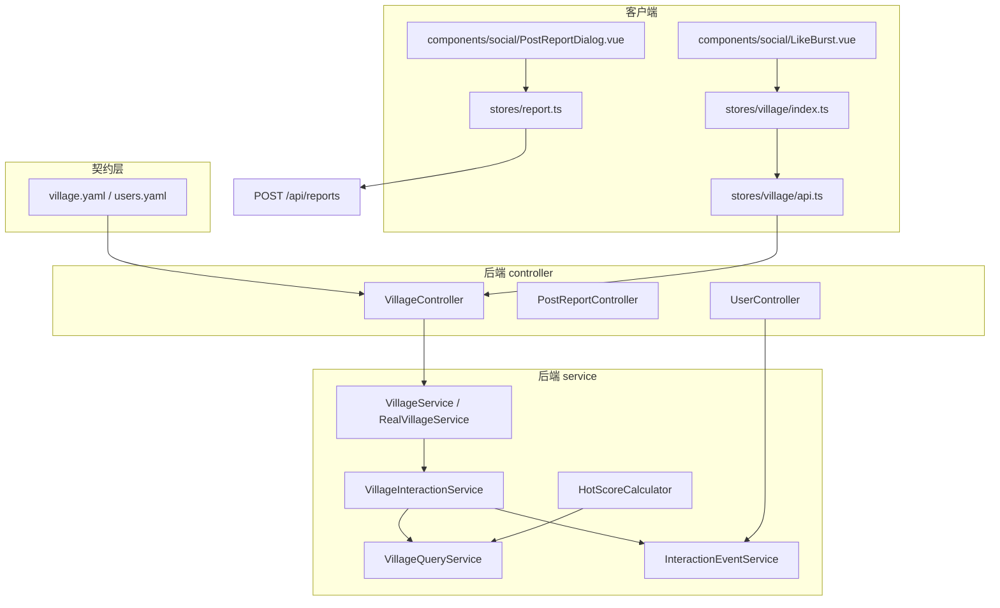
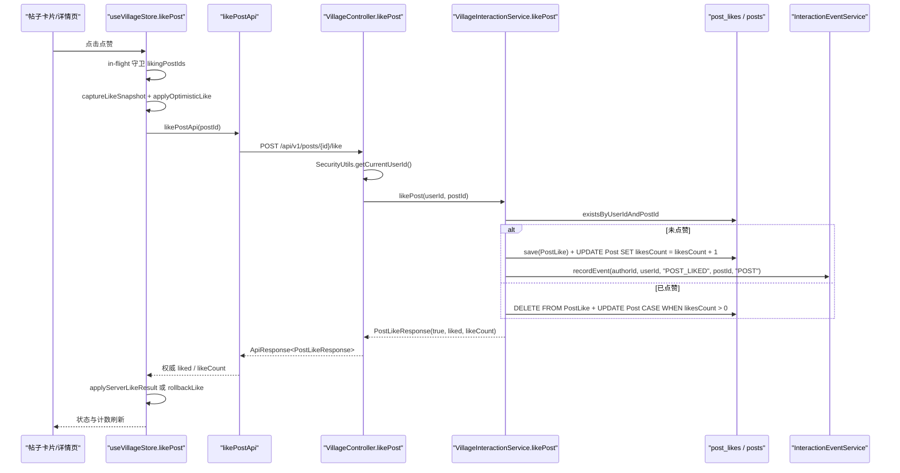
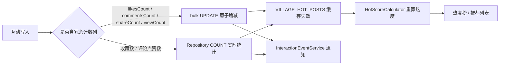
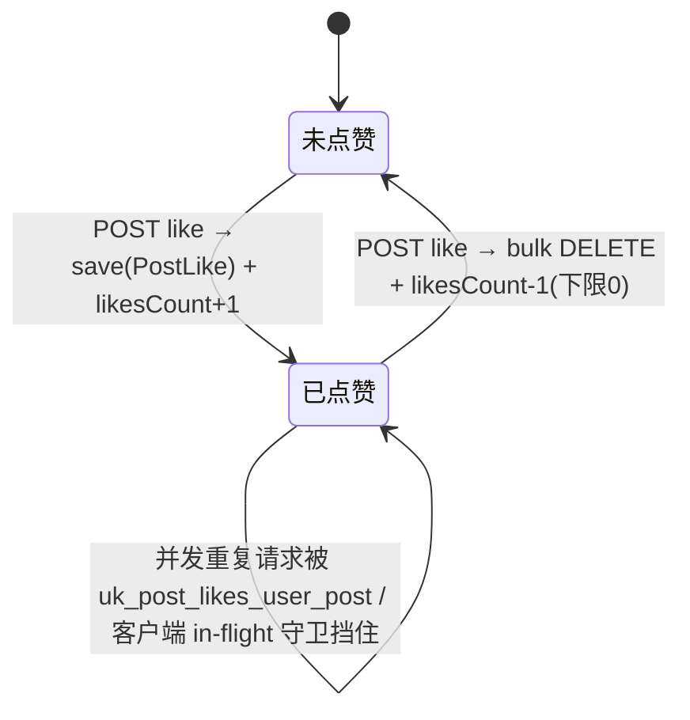
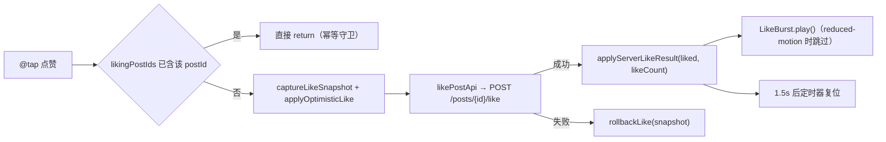
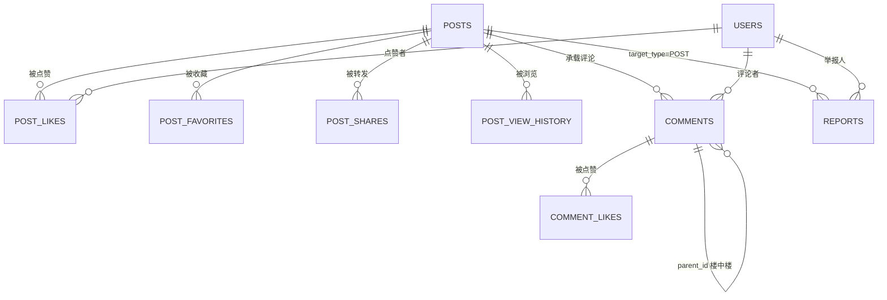
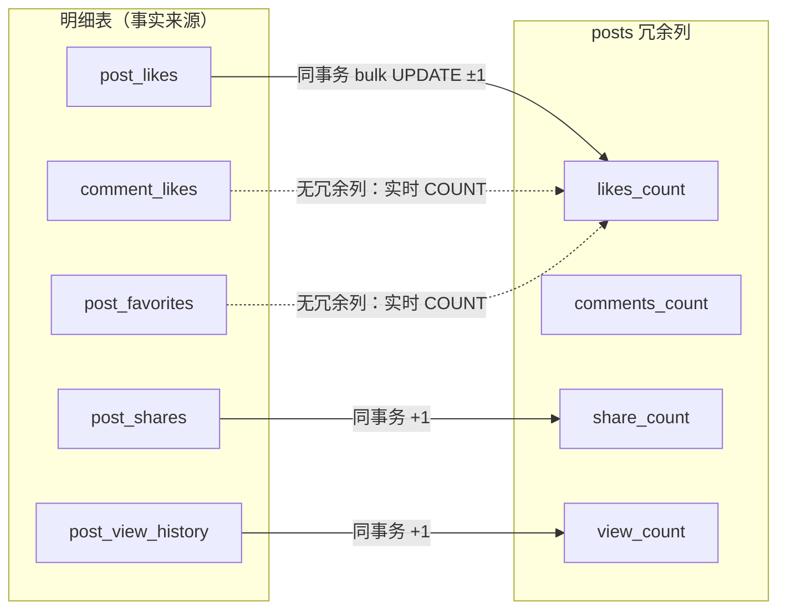
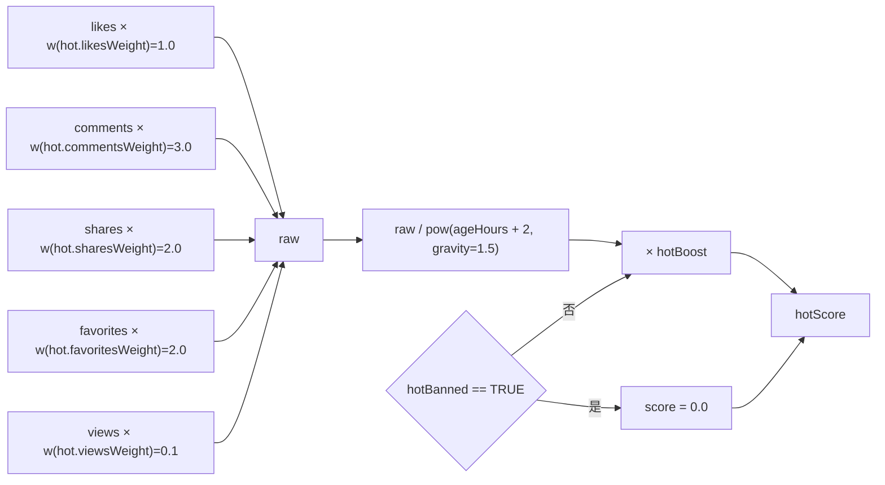
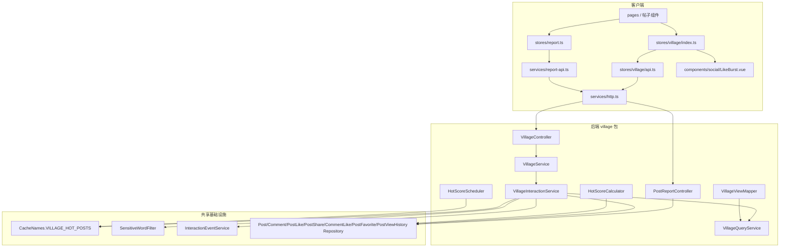
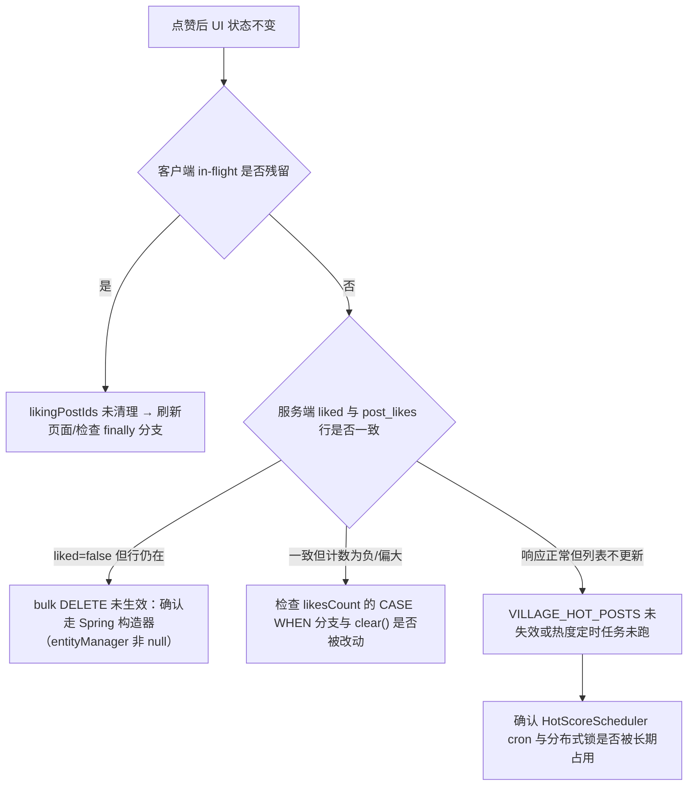

# 互动功能

<cite>
**本文引用的文件**
- [VillageInteractionService.java](file://apps/api/src/main/java/com/campuslove/api/village/VillageInteractionService.java)
- [VillageController.java](file://apps/api/src/main/java/com/campuslove/api/village/VillageController.java)
- [PostReportController.java](file://apps/api/src/main/java/com/campuslove/api/village/PostReportController.java)
- [HotScoreCalculator.java](file://apps/api/src/main/java/com/campuslove/api/village/HotScoreCalculator.java)
- [HotScoreScheduler.java](file://apps/api/src/main/java/com/campuslove/api/village/HotScoreScheduler.java)
- [VillageQueryService.java](file://apps/api/src/main/java/com/campuslove/api/village/VillageQueryService.java)
- [VillageViewMapper.java](file://apps/api/src/main/java/com/campuslove/api/village/VillageViewMapper.java)
- [InteractionEventService.java](file://apps/api/src/main/java/com/campuslove/api/chat/InteractionEventService.java)
- [UserController.java](file://apps/api/src/main/java/com/campuslove/api/user/UserController.java)
- [village.yaml](file://docs/openapi/village.yaml)
- [users.yaml](file://docs/openapi/users.yaml)
- [V2026.05.26.0003__create_post_likes.sql](file://database/flyway/sql/V2026.05.26.0003__create_post_likes.sql)
- [V2026.08.08.0002__add_comments_parent_id.sql](file://database/flyway/sql/V2026.08.08.0002__add_comments_parent_id.sql)
- [V2026.08.09.0001__create_post_favorites_and_view_history.sql](file://database/flyway/sql/V2026.08.09.0001__create_post_favorites_and_view_history.sql)
- [village.ts](file://apps/client/src/stores/village.ts)
- [api.ts](file://apps/client/src/stores/village/api.ts)
- [index.ts](file://apps/client/src/stores/village/index.ts)
- [report.ts](file://apps/client/src/stores/report.ts)
- [report-api.ts](file://apps/client/src/services/report-api.ts)
- [LikeBurst.vue](file://apps/client/src/components/social/LikeBurst.vue)
</cite>

## 目录
1. [简介](#简介)
2. [项目结构](#项目结构)
3. [核心组件](#核心组件)
4. [架构总览](#架构总览)
5. [详细组件分析](#详细组件分析)
6. [数据模型](#数据模型)
7. [互动统计与热度评分](#互动统计与热度评分)
8. [依赖关系分析](#依赖关系分析)
9. [性能考虑](#性能考虑)
10. [故障排查指南](#故障排查指南)
11. [能力缺口登记](#能力缺口登记)
12. [结论](#结论)

## 简介

本页文档化 Campus Love 社区圈子（village / 同城村落）的互动功能真实实现，覆盖点赞、评论、分享、收藏、浏览记录、关注与举报等能力的端到端链路：OpenAPI 契约（`docs/openapi/village.yaml`）定义对外端点，`VillageController` 接收请求，`VillageInteractionService` 承载写路径业务规则，客户端由 `apps/client/src/stores/village.ts` 与 `apps/client/src/components/social/` 下的组件呈现与反馈。

文档只描述仓库中存在的代码。对于生成指令中提到但仓库内没有实现证据的能力（例如自动审核流水线、申诉流程、排行榜算法、WebSocket 实时推送、互动分析报表），统一收敛到 [能力缺口登记](#能力缺口登记) 一节并给出判定依据，不做推测性描述。

## 项目结构

互动功能的代码分布在四个层面：

- 契约层：`docs/openapi/village.yaml` 定义 `/posts`、`/posts/{id}/like`、`/posts/{id}/share`、`/posts/{id}/comments`、`/circles/{id}/join`、`/circles/topics/{id}/replies` 等端点及其 `operationId`。
- 后端写路径：`com.campuslove.api.village` 包内的 `VillageInteractionService`（点赞/收藏/浏览/评论/分享）、`PostReportController`（举报）、`HotScoreCalculator` 与 `HotScoreScheduler`（热度重算）。
- 后端读路径：`VillageQueryService`、`VillagePostService`、`RealVillageService` 与一组视图记录类（`PostDetailView`、`CommentItemView`、`PostLikeResponse`、`ShareView`、`FavoriteResponse` 等）。
- 客户端：`apps/client/src/stores/village.ts` 及 `stores/village/`、`stores/likes.ts` 与 `stores/report.ts` 提供状态与请求封装；`components/social/` 下 `LikeBurst.vue`、`PostReportDialog.vue` 负责交互反馈。

## 核心组件

互动功能由「写路径服务 + 控制器 + 统计组件 + 客户端 store/组件」四类构件组成，各自职责在源码注释中已明确划分。

**图表来源**
- [VillageController.java:36-38](file://apps/api/src/main/java/com/campuslove/api/village/VillageController.java#L36-L38)
- [VillageInteractionService.java:37-56](file://apps/api/src/main/java/com/campuslove/api/village/VillageInteractionService.java#L37-L56)
- [api.ts:250-448](file://apps/client/src/stores/village/api.ts#L250-L448)
- [report.ts:27-66](file://apps/client/src/stores/report.ts#L27-L66)

各组件的分工要点：

- `VillageInteractionService`：`@Profile("real")` 的 `@Component`，注释明确其职责为「处理帖子的点赞、评论、转发等互动行为，包含计数维护、互动事件通知」，并显式声明不负责发帖（`VillagePostService`）与查询（`VillageQueryService`）。它由 `RealVillageService.likePost / commentPost / sharePost` 拆分而来（Task 4.2.2）。
- `VillageController`：`@RequestMapping("/api/v1/posts")`，暴露 `/{id}/like`、`/{id}/favorite`、`/{id}/comments`、`/comments/{commentId}/like`、`/{id}/share`、`/history` 等写端点，当前用户 ID 一律由 `SecurityUtils.getCurrentUserId()` 从 JWT 取。
- `PostReportController`：同样映射 `/api/v1/posts`，只承担 `POST /{id}/report` 一条举报路由，复用 `Report` 实体与 `ReportRepository`。
- `HotScoreCalculator`：`@Component`，把点赞数、评论数、分享数、收藏数、浏览量按可配置权重合成热度分，供热度榜使用。
- `InteractionEventService`：互动事件写入口，`recordEvent(userId, triggerUserId, eventType, referenceId, referenceType, summary)` 是与互动行为绑定的通知落库接口。
- 客户端 `useVillageStore`（`stores/village/index.ts`）实现「幂等守卫 + 乐观更新 + 失败回滚 + 服务端权威校正」；`stores/village/api.ts` 是纯请求封装层；`stores/report.ts` 是最薄的举报 API 包装；`LikeBurst.vue` 提供点赞粒子动画。

**章节来源**
- [VillageInteractionService.java:28-56](file://apps/api/src/main/java/com/campuslove/api/village/VillageInteractionService.java#L28-L56)
- [VillageInteractionService.java:101-L117](file://apps/api/src/main/java/com/campuslove/api/village/VillageInteractionService.java#L101-L117)
- [VillageController.java:218-224](file://apps/api/src/main/java/com/campuslove/api/village/VillageController.java#L218-L224)
- [VillageController.java:235-241](file://apps/api/src/main/java/com/campuslove/api/village/VillageController.java#L235-L241)
- [PostReportController.java:30-L66](file://apps/api/src/main/java/com/campuslove/api/village/PostReportController.java#L30-L66)
- [HotScoreCalculator.java:17-L57](file://apps/api/src/main/java/com/campuslove/api/village/HotScoreCalculator.java#L17-L57)
- [InteractionEventService.java:9-L40](file://apps/api/src/main/java/com/campuslove/api/chat/InteractionEventService.java#L9-L40)
- [report.ts:1-L27](file://apps/client/src/stores/report.ts#L1-L27)

## 架构总览

互动写路径遵循「OpenAPI 契约 → 控制器鉴权与限流 → 领域服务事务 → 数据库侧原子更新 → 互动事件通知 → 客户端乐观更新校正」的单一线性链路。以点赞为例：

**图表来源**
- [index.ts:539-606](file://apps/client/src/stores/village/index.ts#L539-L606)
- [api.ts:265-272](file://apps/client/src/stores/village/api.ts#L265-L272)
- [VillageController.java:235-251](file://apps/api/src/main/java/com/campuslove/api/village/VillageController.java#L235-L251)
- [VillageInteractionService.java:143-205](file://apps/api/src/main/java/com/campuslove/api/village/VillageInteractionService.java#L143-L205)

分层的关键约束有三条：

1. **身份来源单一**。控制器不接受客户端传入的用户 ID，统一由 `SecurityUtils.getCurrentUserId()` 解析；`PostReportController` 的类注释明确写出「举报人 ID 从 JWT 认证上下文中获取，避免客户端伪造」。客户端 `followUserApi` 的注释也记录了 P2-13 改造：删除原 query 参数 `userId`。
2. **计数只在数据库侧变更**。`likePost` / `commentPost` / `sharePost` / `recordPostView` 全部使用 JPQL bulk `UPDATE` 做原子增减，配合 `entityManager.clear()` 防止托管实体脏写覆盖 bulk 结果；收藏数、评论点赞数没有冗余列，改为实时 `COUNT`。
3. **缓存与热度联动**。写路径通过 `@CacheEvict(cacheNames = CacheNames.VILLAGE_HOT_POSTS, allEntries = true)` 主动失效热门列表缓存，而浏览量刻意不做失效，避免每次详情都击穿缓存。

**图表来源**
- [VillageInteractionService.java:219-241](file://apps/api/src/main/java/com/campuslove/api/village/VillageInteractionService.java#L219-L241)
- [VillageInteractionService.java:258-320](file://apps/api/src/main/java/com/campuslove/api/village/VillageInteractionService.java#L258-L320)
- [HotScoreCalculator.java:59-101](file://apps/api/src/main/java/com/campuslove/api/village/HotScoreCalculator.java#L59-L101)
- [index.ts:617-682](file://apps/client/src/stores/village/index.ts#L617-L682)

**章节来源**
- [PostReportController.java:30-45](file://apps/api/src/main/java/com/campuslove/api/village/PostReportController.java#L30-L45)
- [api.ts:394-L412](file://apps/client/src/stores/village/api.ts#L394-L412)

## 详细组件分析

### 点赞：帖子与评论两条 toggle 链路

帖子点赞入口 `VillageController.likePost`（`POST /api/v1/posts/{id}/like`）带 `@RateLimit(capacity = 60, refillTokens = 2, key = "#request.remoteAddr")`，并有一条重要决策注释：2026-09-07 R16 起移除 `@Idempotent`，因为「稳定幂等键会拦截第二次点击（409），导致无法取消点赞」。响应体为 `PostLikeResponse(success, liked, likeCount)`，`liked` 即 toggle 后的新状态。

`VillageInteractionService.likePost` 的分支语义：

- 入参校验：`userId == null` 抛 `IllegalArgumentException("userId is required")`；帖子不存在时由 `queryService.findPostOrThrow(postId)` 抛出。
- 取消点赞：Spring 注入路径（`entityManager != null`）执行 `DELETE FROM PostLike pl WHERE pl.userId = :userId AND pl.postId = :postId`；测试构造器路径回退 `postLikeRepository.deleteByUserIdAndPostId`。
- 计数递减：`UPDATE Post p SET p.likesCount = CASE WHEN p.likesCount > 0 THEN p.likesCount - 1 ELSE 0 END, p.updatedAt = :now WHERE p.id = :postId`，随后 `entityManager.clear()`。响应用的本地值通过 `Math.max(0, post.getLikesCount() - 1)` 同步。
- 新增点赞：`postLikeRepository.save(new PostLike(userId, postId))` + `likesCount = likesCount + 1`，并在 `userId != post.getAuthorId()` 时调用 `interactionEventService.recordEvent(post.getAuthorId(), userId, "POST_LIKED", postId, "POST", "有人赞了你的帖子")`，作者给自己点赞不产生通知。

关于「响应 liked=false 但表里行还在」的历史缺陷，源码给出了完整因果链：派生删除把实体置为 `pending-removal`，紧随其后的 `entityManager.clear()` 将其清出持久化上下文，事务提交时不再发 `DELETE`，导致再次点赞时 `exists` 命中旧行永远返回 `liked=false`，toggle 卡死。修复方式即上文改用 bulk DELETE。

评论点赞是独立入口 `POST /api/v1/posts/comments/{commentId}/like`（同样 `@RateLimit(60, 2)` 且移除 `@Idempotent`），落到 `VillageInteractionService.likeComment`：先 `commentRepository.findById(commentId)` 校验存在性（不存在抛「评论不存在: 」+ id），再按 `existsByUserIdAndCommentId` 决定 `deleteByUserIdAndCommentId` 或 `save(new CommentLike(userId, commentId))`，最后 `commentLikeRepository.countByCommentId(commentId)` 返回权威点赞数。`comments` 表没有点赞数冗余列，因此该计数完全实时统计。

**图表来源**
- [VillageInteractionService.java:143-205](file://apps/api/src/main/java/com/campuslove/api/village/VillageInteractionService.java#L143-L205)
- [V2026.05.26.0003__create_post_likes.sql:1-16](file://database/flyway/sql/V2026.05.26.0003__create_post_likes.sql#L1-L16)

### 评论与楼中楼：三级重载 + 敏感词过滤

`commentPost` 有三个重载：`(userId, postId, content)`（兼容旧调用，委托 `parentId = null`）、`(userId, postId, content, parentId)`（委托 `images = List.of()`）与 `(userId, postId, content, parentId, images)`（真实实现）。三者都带 `@Transactional` 与 `@CacheEvict(cacheNames = CacheNames.VILLAGE_HOT_POSTS, allEntries = true)`。

真实实现的校验与写入顺序：

1. `userId` 为空抛 `userId is required`；`content` 为 null 或 `isBlank()` 抛 `content is required`。
2. `queryService.findPostOrThrow(postId)` 定位帖子。
3. 楼中楼防护：`parentId != null` 时加载父评论，不存在抛「父评论不存在: 」+ id；若 `parent.getPost() == null` 或父评论所属帖子与 `postId` 不一致，抛 `ErrorMessages.PARENT_COMMENT_MISMATCH`，从而禁止跨帖回复。
4. 内容过滤：`sensitiveWordFilter.filterWithLog(content, userId, "POST_COMMENT")`，与发帖（`VillagePostService`）同口径；测试构造器下 `sensitiveWordFilter == null` 时跳过过滤。
5. 组装 `Comment`：`setPost`、`setAuthorId`、`setParentId`、`setCreatedAt(LocalDateTime.now(TimeZones.BUSINESS))`、`setImages(imagesToJson(images))`，图片 URL 列表以最小转义的 JSON 字符串落库，空列表写 `"[]"`。
6. `commentRepository.saveAndFlush(comment)` 并接收返回值——注释说明实体带 `@Version` 时 `save` 走 `merge` 返回新托管实例，必须接收返回值才能回填 IDENTITY 主键。
7. `UPDATE Post p SET p.commentsCount = p.commentsCount + 1, p.updatedAt = :now WHERE p.id = :postId`，随后同步本地实体 `post.setCommentsCount(post.getCommentsCount() + 1)`。
8. 非作者触发 `recordEvent(..., "POST_COMMENTED", postId, "POST", "有人评论了你的帖子")`，返回 `queryService.toCommentItemView(comment)`。

评论列表分页由 `VillageController.getComments` 提供，`page` 默认 1、`pageSize` 默认 20 且 `@Max(100)`；发帖端点 `POST /{id}/comments` 的限流是 `@RateLimit(capacity = 30, refillTokens = 1)` 加 `@Idempotent`，并在成功后调用 `villageMetrics.recordCommentCreated()`（监控异常被吞掉，不影响主流程）。数据库侧楼中楼能力由 `comments.parent_id` 列与 `idx_comments_parent_id` 索引承载。

### 分享

`sharePost(userId, postId, comment)` 记录 `PostShare`（`setPost` / `setUserId` / `setComment` / `setCreatedAt`），`saveAndFlush` 回填主键后执行 `UPDATE Post p SET p.shareCount = p.shareCount + 1` 并同步本地实体，返回 `new ShareView(share.getId(), postId, post.getShareCount())`。控制器侧 `POST /{id}/share` 为 `@RateLimit(30, 1)` + `@Idempotent` + `@PreAuthorize("hasRole('USER')")`，请求体是 `SharePostRequest`。OpenAPI 契约把该端点定义为 `operationId: sharePost`，请求体 `SharePostRequest`、响应 `ShareResponse`。客户端 `sharePostApi` 在无评论时提交 `{ comment: "" }`。分享不产生互动事件，也没有「取消分享」路径。

### 收藏与浏览记录

`toggleFavorite(userId, postId)` 与 `likePost` 同构：`existsByUserIdAndPostId` → bulk `DELETE FROM PostFavorite` 或 `save(new PostFavorite(userId, postId))`，随后 `postFavoriteRepository.countByPostId(postId)` 实时取数，返回 `FavoriteResponse(true, !alreadyFavorited, count)`；带 `@CacheEvict(VILLAGE_HOT_POSTS, allEntries = true)`。控制器 `POST /{id}/favorite` 为 `@RateLimit(60, 2)` + `@Idempotent`。

浏览记录 `recordPostView(userId, postId)` 用 `@Transactional(propagation = Propagation.REQUIRES_NEW)`，原因是调用方 `VillageQueryService.getPost` 是只读事务，写操作必须开独立读写事务。行为为：`UPDATE Post p SET p.viewCount = p.viewCount + 1` 无条件原子累加（匿名浏览也计），登录用户再 `findByUserIdAndPostId(...).ifPresentOrElse(h -> h.setViewedAt(now), () -> save(new PostViewHistory(userId, postId, now)))`，upsert 竞态由 `uk_post_view_history_user_post` 唯一约束兜底。`clearPostHistory(userId)` 在 `userId != null` 时 `deleteByUserId(userId)`，对应 `DELETE /api/v1/posts/history`。

### 关注

关注是用户关系而非帖子互动，但同为社区互动写路径的一部分，契约在 `docs/openapi/users.yaml`：`POST /users/{id}/follow`（`operationId: followUser`）、`DELETE /users/{id}/follow`（`unfollowUser`）、`GET /users/{id}/followers`（`getFollowers`）、`GET /users/{id}/following`（`getFollowing`）、`GET /users/{id}/is-following`（`isFollowing`），响应 schema 为 `FollowView(following, followerCount, followingCount)` / `FollowUserView` / `IsFollowingView`。后端由 `UserController`（`@RequestMapping("/api/v1/users")`）转发到 `profileService`。消费侧在圈子读路径：`VillageQueryService` 注入 `UserFollowRepository`，`category=following` Tab 展示我关注作者的帖子（未登录或未关注任何人返回空列表，此前 `parseCategory` 对 `following` 抛 400 导致圈子页不可用）；`VillageViewMapper` 用 `followedUserIds` 集合计算每条帖子的 `isFollowed`。客户端 `followUserApi(targetUserId, isFollow)` 依据布尔值选择 `POST` 或 `DELETE`。

### 举报

`PostReportController.reportPost`（`POST /api/v1/posts/{id}/report`）标注 `@ResponseStatus(HttpStatus.CREATED)`、`@Transactional`、`@Idempotent`、`@PreAuthorize("hasRole('USER')")`。流程：`SecurityUtils.getCurrentUserId()` 取举报人 → `postId == null || postId <= 0` 抛 `ErrorMessages.POST_ID_INVALID` → `!postRepository.existsById(postId)` 抛 `ErrorMessages.POST_NOT_FOUND_OR_DELETED` → 组装 `Report`：`targetType = "POST"`、`targetId = postId`、`reporterId`、`reason`、`description`、`status = "PENDING"`、`createdAt = LocalDateTime.now(TimeZones.BUSINESS)` → `reportRepository.save` → `log.info("帖子举报创建：reportId={}, postId={}, reporterId={}, reason={}")` → 返回 `PostReportView`。`DataAccessException` 被捕获后记录 error 日志并抛 `ErrorMessages.REPORT_SUBMIT_FAILED_RETRY`。

请求体 `PostReportRequest` 的校验是 `@NotBlank @Size(max = 64) String reason` 与 `@Size(max = 500) String description`；响应视图 `PostReportView` 的 `status` 注释枚举为 `PENDING/HANDLED/REJECTED`。客户端侧存在两条举报通道：`PostReportDialog.vue` 经 `useReportStore`（Pinia store id `"report"`，state 只有 `submitting` 与 `errorMessage`）调用 `services/report-api.ts` 的 `reportTarget`，走通用 `POST /api/reports`，支持 `POST | COMMENT | USER | TOPIC` 四种 `ReportTargetType`；`report.ts` 的存在理由是修正依赖方向——原组件直接 import service 违反「组件 → store → service」。举报提交失败时写入 i18n 文案 `storeErrors.report.submitFailed`，并可通过 `clearError()` 复位。

### 客户端交互反馈与动画

`LikeBurst.vue` 是点赞的即时反馈组件：以 `Array.from({ length: 12 }, ...)` 生成 12 个粒子，角度 `(i * 360) / 12 + (i % 2 ? 8 : -8)` 均匀分布加少量随机偏移，距离 `80 + (i % 3) * 20` rpx，`delay = i * 16` 错峰启动，颜色取 `--c-romance-500/400/300` 三档；`play()` 通过自增 `animKey` 强制重挂 DOM 以重启 CSS 动画，1500ms 定时器复位 `playing`。为保证 mp-weixin 兼容，它使用 CSS animation 而非 `requestAnimationFrame`、不使用 backdrop blur、事件用 `@tap` / `hover-class`。可访问性上，H5 条件编译块内检测 `window.matchMedia("(prefers-reduced-motion: reduce)")`，命中时 `play()` 直接返回；`onBeforeUnmount` 清理定时器，避免修改已销毁组件的响应式状态。对外通过 `defineExpose({ t, play })` 暴露，父组件用 `burstRef.value?.play()` 触发。

**图表来源**
- [index.ts:539-606](file://apps/client/src/stores/village/index.ts#L539-L606)
- [LikeBurst.vue:30-104](file://apps/client/src/components/social/LikeBurst.vue#L30-L104)

Mock 与真实链路在同一 store 中分流：`useMock()` 为真时调用 `toggleMockPostLike([...this.posts, ...this.nearbyPosts], this.currentPost, postId)`，不发网络请求；MP-R1-NEARBY-002 记录了一次修复——附近页帖子存放在独立的 `nearbyPosts` 维度，合并查找可避免附近页点赞报「帖子不存在」。所有失败路径最终写 `this.errorMessage`，缺省文案来自 i18n key `storeErrors.village.likePostFailed` / `favoritePostFailed` / `postIdInvalid` / `postNotFound`。

**章节来源**
- [VillageController.java:235-251](file://apps/api/src/main/java/com/campuslove/api/village/VillageController.java#L235-L251)
- [VillageController.java:253-330](file://apps/api/src/main/java/com/campuslove/api/village/VillageController.java#L253-L330)
- [VillageInteractionService.java:119-205](file://apps/api/src/main/java/com/campuslove/api/village/VillageInteractionService.java#L119-L205)
- [VillageInteractionService.java:207-332](file://apps/api/src/main/java/com/campuslove/api/village/VillageInteractionService.java#L207-L332)
- [VillageInteractionService.java:334-L465](file://apps/api/src/main/java/com/campuslove/api/village/VillageInteractionService.java#L334-L465)
- [VillageInteractionService.java:467-L512](file://apps/api/src/main/java/com/campuslove/api/village/VillageInteractionService.java#L467-L512)
- [PostReportController.java:53-L122](file://apps/api/src/main/java/com/campuslove/api/village/PostReportController.java#L53-L122)
- [PostReportController.java:125-L158](file://apps/api/src/main/java/com/campuslove/api/village/PostReportController.java#L125-L158)
- [report-api.ts:1-L75](file://apps/client/src/services/report-api.ts#L1-L75)
- [LikeBurst.vue:1-L105](file://apps/client/src/components/social/LikeBurst.vue#L1-L105)
- [api.ts:274-L412](file://apps/client/src/stores/village/api.ts#L274-L412)
- [village.yaml:114-245](file://docs/openapi/village.yaml#L114-L245)

## 数据模型

互动写路径落库到 5 张明细表 + `posts` 表上的 4 个冗余计数列 + `comments.parent_id` + `reports`。所有明细表都以 `(user_id, 目标 id)` 联合唯一键实现幂等，这是「一条 SQL 内不可能出现重复点赞」的根本保障，也是服务层并发兜底策略。

[此图为概念流程，不直接对应具体源文件，故不提供图表来源]

明细表结构（以 Flyway 迁移为权威定义）：

| 表 | 关键列 | 唯一键 / 索引 | 迁移文件 |
| --- | --- | --- | --- |
| `post_likes` | `id`, `user_id`, `post_id`, `created_at` | `uk_post_likes_user_post (user_id, post_id)`；`idx_post_likes_user` / `idx_post_likes_post`；FK 级联删除 | V2026.05.26.0003 |
| `comment_likes` | `id`, `comment_id`, `user_id`, `created_at` | `uk_comment_likes_user_comment (user_id, comment_id)`；`idx_comment_likes_comment` | V2026.08.08.0002 |
| `post_favorites` | `id`, `user_id`, `post_id`, `created_at`, `version` | `uk_post_favorites_user_post (user_id, post_id)`；`idx_post_favorites_user` / `_post`；FK 级联删除 | V2026.08.09.0001 |
| `post_view_history` | `id`, `user_id`, `post_id`, `viewed_at`, `version` | `uk_post_view_history_user_post (user_id, post_id)`；`idx_post_view_history_user` / `_post` | V2026.08.09.0001 |
| `posts` 增列 | `view_count INT NOT NULL DEFAULT 0` | 位于 `share_count` 之后（`AFTER share_count`，即 `share_count` 已存在） | V2026.08.09.0001 |
| `comments` 增列 | `parent_id BIGINT UNSIGNED NULL` | `idx_comments_parent_id` | V2026.08.08.0002 |

冗余计数列与明细表的一致性口径必须区分两类：

- **有冗余列的**：`posts.likesCount`、`posts.commentsCount`、`posts.shareCount`、`posts.viewCount`。一致性由服务层与明细写入同一事务保证——点赞时 `save(PostLike)` 与 `UPDATE Post SET likesCount = likesCount + 1` 同事务、取消时 bulk `DELETE` 与 `CASE WHEN likesCount > 0 THEN likesCount - 1 ELSE 0 END` 同事务；评论与转发同理分别维护 `commentsCount` 与 `shareCount`。`post_likes` 表本身不存计数，`likes_count` 是聚合快照。
- **没有冗余列的**：评论点赞数与帖子收藏数。`likeComment` 每次通过 `commentLikeRepository.countByCommentId(commentId)` 实时求值；`toggleFavorite` 通过 `postFavoriteRepository.countByPostId(postId)` 实时求值。`V2026.08.09.0001` 迁移文件头部注释也说明 `post_favorites` 是仿 `post_likes` 结构建的独立明细表，未在 `posts` 上增加收藏列。热度计算因此在 `calculateScore` 里现查收藏数（或复用批量结果），避免两处数字打架。

互动事件（通知）不落在这几张表里，而是走 `InteractionEventService.recordEvent`，接口注释声明的事件类型集合为 `NEW_LIKE / NEW_VISITOR / NEW_FOLLOW / POST_LIKED / POST_COMMENTED / TOPIC_REPLIED`，关联实体类型为 `POST / COMMENT / TOPIC / USER`；互动侧实际使用的是 `POST_LIKED` 与 `POST_COMMENTED` 两种，且 `referenceType` 固定传 `"POST"`。

举报落 `reports` 表（复用 `Report` 实体与 `ReportRepository`），服务层写入的字段为 `targetType`、`targetId`、`reporterId`、`reason`、`description`、`status`、`createdAt`，`status` 取值域在控制器视图注释与客户端类型定义中一致地记为 `PENDING / HANDLED / REJECTED`。

[此图为概念流程，不直接对应具体源文件，故不提供图表来源]

**章节来源**
- [V2026.05.26.0003__create_post_likes.sql:1-16](file://database/flyway/sql/V2026.05.26.0003__create_post_likes.sql#L1-L16)
- [V2026.08.08.0002__add_comments_parent_id.sql:1-21](file://database/flyway/sql/V2026.08.08.0002__add_comments_parent_id.sql#L1-L21)
- [V2026.08.09.0001__create_post_favorites_and_view_history.sql:1-55](file://database/flyway/sql/V2026.08.09.0001__create_post_favorites_and_view_history.sql#L1-L55)
- [VillageInteractionService.java:151-205](file://apps/api/src/main/java/com/campuslove/api/village/VillageInteractionService.java#L151-L205)
- [VillageInteractionService.java:219-241](file://apps/api/src/main/java/com/campuslove/api/village/VillageInteractionService.java#L219-L241)
- [VillageInteractionService.java:258-320](file://apps/api/src/main/java/com/campuslove/api/village/VillageInteractionService.java#L258-L320)
- [VillageInteractionService.java:478-512](file://apps/api/src/main/java/com/campuslove/api/village/VillageInteractionService.java#L478-L512)
- [HotScoreCalculator.java:59-101](file://apps/api/src/main/java/com/campuslove/api/village/HotScoreCalculator.java#L59-L101)
- [PostReportController.java:95-L117](file://apps/api/src/main/java/com/campuslove/api/village/PostReportController.java#L95-L117)
- [InteractionEventService.java:11-L22](file://apps/api/src/main/java/com/campuslove/api/chat/InteractionEventService.java#L11-L22)

## 互动统计与热度评分

热度分是互动数据的唯一聚合出口，由 `HotScoreCalculator`（`@Profile("real")` 的 `@Component`）计算，注释标明参考贴吧/主流社区热度公式，且「贴吧式回复权重最高」。

**图表来源**
- [HotScoreCalculator.java:17-L48](file://apps/api/src/main/java/com/campuslove/api/village/HotScoreCalculator.java#L17-L48)
- [HotScoreCalculator.java:59-L101](file://apps/api/src/main/java/com/campuslove/api/village/HotScoreCalculator.java#L59-L101)

要点逐条对应源码：

- 权重全部来自 `app_config` 表，键名为 `hot.likesWeight`、`hot.commentsWeight`、`hot.sharesWeight`、`hot.favoritesWeight`、`hot.viewsWeight`、`hot.gravity`（与迁移 `V2026.08.11.0003` 的 seed 一致），后台「全局配置」页可改且实时生效；`weight(key, fallback)` 在配置缺失或 `Double.parseDouble` 抛 `RuntimeException` 时回退内置默认常量（1.0 / 3.0 / 2.0 / 2.0 / 0.1 / 1.5）。
- 时间衰减用 `ageHours = max(0, Duration.between(createdAt, now).toMinutes() / 60.0)`，分母是 `pow(ageHours + 2.0, gravity)`；`createdAt` 为 null 时 `ageHours` 取 0。
- 运营干预有两个开关字段：`hotBoost`（倍率，`>1` 加成、`0` 压榜，null 视为 1.0）与 `hotBanned`（`Boolean.TRUE` 时直接 `return 0.0`，强制不上榜但不影响前台可见）。
- 空值安全：`nvl(Integer)` 把四个计数列的 null 统一折成 0.0。
- N+1 防护：`calculateScores(List<Post>)` 先抽出非 null 的 `postId` 列表，调用 `postFavoriteRepository.countByPostIds(postIds)` 一次性取回 `postId → count`，再在流里用 `getOrDefault(id, 0)` 组装；`favoriteCounter()` 与 `countFavorites(postId)` 则供单帖/管理端「立即重算」场景使用，`readWeight` 是给单测与管理端读配置的口子。
- 定时重算：`HotScoreScheduler`（`@Component`，L33）以 `@Scheduled(cron = "0 */15 * * * *")` 每 15 分钟触发 `scheduledHotScoreRecalc()`，通过 `redissonClient.getLock("hot-score:recalc")` 与 `tryLock(3, LOCK_TIMEOUT_SECONDS, SECONDS)` 做多实例互斥，抢锁失败时记录「热度分重算获取锁失败，已有任务在执行，跳过本次」；`evictHotCache()` 通过 `cacheManager.getCache(CacheNames.VILLAGE_HOT_POSTS)` 拿到缓存后 `cache.clear()`，`RuntimeException` 被 catch 兜住。
- 列表入口：`VillageController` 提供 `GET /hot-board`（`page` 默认 1、`@Min(1)`）与 `GET /recommend`（带 `@RateLimit(capacity = 30, refillTokens = 2, key = "#request.remoteAddr")`）读取热度/推荐结果；`POST /api/v1/posts/{id}/like` 成功且 `liked` 为真时调用 `villageMetrics.recordPostLiked(id)` 记录埋点，评论成功时调用 `villageMetrics.recordCommentCreated()`，两处都允许监控异常被吞掉而不影响主流程。

关于「排行榜算法」，仓库中的实现就是 `hotScore` 的加权时间衰减排序，由上述定时任务与 `@CacheEvict` 驱动的缓存失效共同维护；未见独立的榜单表或榜单服务。

**章节来源**
- [HotScoreCalculator.java:17-57](file://apps/api/src/main/java/com/campuslove/api/village/HotScoreCalculator.java#L17-L57)
- [HotScoreCalculator.java:59-131](file://apps/api/src/main/java/com/campuslove/api/village/HotScoreCalculator.java#L59-L131)
- [HotScoreScheduler.java:33-67](file://apps/api/src/main/java/com/campuslove/api/village/HotScoreScheduler.java#L33-L67)
- [HotScoreScheduler.java:161-167](file://apps/api/src/main/java/com/campuslove/api/village/HotScoreScheduler.java#L161-L167)
- [VillageController.java:184-196](file://apps/api/src/main/java/com/campuslove/api/village/VillageController.java#L184-L196)
- [VillageController.java:235-251](file://apps/api/src/main/java/com/campuslove/api/village/VillageController.java#L235-L251)
- [VillageController.java:272-L290](file://apps/api/src/main/java/com/campuslove/api/village/VillageController.java#L272-L290)
- [VillageInteractionService.java:334-L343](file://apps/api/src/main/java/com/campuslove/api/village/VillageInteractionService.java#L334-L343)

## 依赖关系分析

**图表来源**
- [VillageInteractionService.java:41-99](file://apps/api/src/main/java/com/campuslove/api/village/VillageInteractionService.java#L41-L99)
- [VillageController.java:253-330](file://apps/api/src/main/java/com/campuslove/api/village/VillageController.java#L253-L330)
- [HotScoreCalculator.java:50-57](file://apps/api/src/main/java/com/campuslove/api/village/HotScoreCalculator.java#L50-L57)
- [report.ts:13-L27](file://apps/client/src/stores/report.ts#L13-L27)
- [api.ts:1-L448](file://apps/client/src/stores/village/api.ts#L1-L448)

依赖关系中的几个具体事实：

- `VillageInteractionService` 构造器注入 11 个协作者：`PostRepository`、`CommentRepository`、`PostLikeRepository`、`PostShareRepository`、`CommentLikeRepository`、`PostFavoriteRepository`、`PostViewHistoryRepository`、`InteractionEventService`、`VillageQueryService`、`EntityManager`、`SensitiveWordFilter`。
- 该类还保留一个 `@Deprecated` 的 6 参数测试构造器（`postRepository` … `queryService`），把 `entityManager`、`sensitiveWordFilter`、`commentLikeRepository`、`postFavoriteRepository`、`postViewHistoryRepository` 全部置 null；因此所有涉及这些协作者的分支都写了 null 回退，属于「测试兼容」而非业务降级，文档在讨论评论点赞/收藏/敏感词时必须意识到这一点。
- 读路径依赖写路径的反方向约束通过 `queryService.findPostOrThrow` 与 `queryService.toCommentItemView` 两个口子实现，`VillageInteractionService` 只借用查询服务，不复制查询逻辑。
- 视图层 `VillageViewMapper` 把关注关系投影为 `isFollowed`：以 `followedUserIds` 集合 `contains(post.getAuthorId())` 判定，集合为 null 时统一 `false`，并同时输出 `favoriteCount`、`isFavorite`、`post.getViewCount()`；`VillageQueryService` 注入 `UserFollowRepository` 支撑 `category=following`。
- 客户端强制「组件 → store → service」方向：`report.ts` 文件头注释记录了这次重构动因（P3 代码风格问题），`stores/village.ts` 只做 `export * from "./village/index"` 的向后兼容 re-export，真实实现已拆到 `village/types.ts`、`constants.ts`、`utils.ts`、`api.ts`、`index.ts`。
- 契约依赖方向由 OpenAPI 固定：帖子互动集中在 `village.yaml` 的 `/posts/{id}/like`、`/posts/{id}/share`、`/posts/{id}/comments`，关注在 `users.yaml` 的 `/users/{id}/follow`、`/users/{id}/followers`、`/users/{id}/following`、`/users/{id}/is-following`，圈子加入与话题回复在 `village.yaml` 的 `/circles/{id}/join`（`toggleCircleJoin`）与 `/circles/topics/{id}/replies`（`getCircleReplies`）。

**章节来源**
- [VillageInteractionService.java:76-L117](file://apps/api/src/main/java/com/campuslove/api/village/VillageInteractionService.java#L76-L117)
- [VillageQueryService.java:211-212](file://apps/api/src/main/java/com/campuslove/api/village/VillageQueryService.java#L211-L212)
- [VillageViewMapper.java:101-110](file://apps/api/src/main/java/com/campuslove/api/village/VillageViewMapper.java#L101-L110)
- [village.ts:1-16](file://apps/client/src/stores/village.ts#L1-L16)
- [report.ts:1-L18](file://apps/client/src/stores/report.ts#L1-L18)
- [village.yaml:248-268](file://docs/openapi/village.yaml#L248-L268)
- [village.yaml:350-353](file://docs/openapi/village.yaml#L350-L353)
- [users.yaml:15-181](file://docs/openapi/users.yaml#L15-L181)

## 性能考虑

互动链路的性能设计集中在「原子更新、缓存失效粒度、N+1 抑制、客户端并发收敛」四点，全部有源码注释支撑：

- **数据库侧原子计数替代读-改-写**。`FIN-00018` 修复把 `likesCount`、`commentsCount`、`shareCount`、`viewCount` 的增减改成单条 JPQL bulk `UPDATE`，消除并发点赞/评论下的丢失更新；`infra R2-00015` 进一步要求 bulk `UPDATE` 之后必须 `entityManager.clear()`，否则事务提交 flush 时托管实体的旧值会覆盖 bulk 结果形成脏写回归。取消点赞/取消收藏则必须用 bulk `DELETE`（派生删除 + `clear()` 会让 `DELETE` 不落库）。
- **缓存失效粒度是刻意的不对称**。点赞、收藏、评论、转发四个写方法都带 `@CacheEvict(cacheNames = CacheNames.VILLAGE_HOT_POSTS, allEntries = true)`；`recordPostView` 明确不做失效，注释理由是「浏览量是模糊指标，热门列表短暂陈旧可接受；若每次详情都 evict 会击穿缓存」。这也解释了为什么浏览量允许与热度榜短暂不一致。
- **独立事务避免只读事务被污染**。`recordPostView` 使用 `Propagation.REQUIRES_NEW`，因为它的调用方 `VillageQueryService.getPost` 是只读事务；浏览写不会把详情读事务变成写事务。
- **批量统计防 N+1**。`HotScoreCalculator.calculateScores` 一次 `countByPostIds(postIds)` 取回全部收藏数再在内存映射；`saveAndFlush` 用于立即回填 IDENTITY 主键，避免视图组装时再发一次查询。
- **限流按端点分级**。点赞/收藏/评论点赞桶容量 60、每秒补 2 个令牌；发帖评论/转发桶容量 30、每秒补 1 个；推荐列表 30/2。键均为 `#request.remoteAddr`，注释目标是「防止自动化脚本批量刷评论点赞」「防止刷转发与垃圾引流」。
- **客户端幂等与回滚收敛**。`likingPostIds` / `favoritingPostIds` 这类模块级 Set 做 in-flight 守卫，同一实体的并发点击直接 `return`；随后 `captureLikeSnapshot` → `applyOptimisticLike` → 成功 `applyServerLikeResult(liked, likeCount)` / 失败 `rollbackLike(snapshot)`，保证 UI 不会漂移到与后端不一致的计数上。
- **动画成本可控**。`LikeBurst` 用 CSS animation 而非 JS 动画（注释指出 mp-weixin 对 `requestAnimationFrame` 支持有限），固定 12 粒子、1500ms 复位定时器并在 `onBeforeUnmount` 清理；H5 端 `prefers-reduced-motion` 命中时直接跳过绘制。

**章节来源**
- [VillageInteractionService.java:60-L68](file://apps/api/src/main/java/com/campuslove/api/village/VillageInteractionService.java#L60-L68)
- [VillageInteractionService.java:119-L145](file://apps/api/src/main/java/com/campuslove/api/village/VillageInteractionService.java#L119-L145)
- [VillageInteractionService.java:151-L205](file://apps/api/src/main/java/com/campuslove/api/village/VillageInteractionService.java#L151-L205)
- [VillageInteractionService.java:287-L320](file://apps/api/src/main/java/com/campuslove/api/village/VillageInteractionService.java#L287-L320)
- [HotScoreCalculator.java:91-L101](file://apps/api/src/main/java/com/campuslove/api/village/HotScoreCalculator.java#L91-L101)
- [VillageController.java:253-L330](file://apps/api/src/main/java/com/campuslove/api/village/VillageController.java#L253-L330)
- [index.ts:539-L682](file://apps/client/src/stores/village/index.ts#L539-L682)
- [LikeBurst.vue:1-L105](file://apps/client/src/components/social/LikeBurst.vue#L1-L105)

## 故障排查指南

**图表来源**
- [VillageInteractionService.java:119-L205](file://apps/api/src/main/java/com/campuslove/api/village/VillageInteractionService.java#L119-L205)
- [index.ts:539-L606](file://apps/client/src/stores/village/index.ts#L539-L606)
- [HotScoreScheduler.java:33-L67](file://apps/api/src/main/java/com/campuslove/api/village/HotScoreScheduler.java#L33-L67)

按症状定位的排查清单：

1. **无法取消点赞**。历史上由派生删除被 `entityManager.clear()` 吞掉导致（源码在 `likePost` 注释中完整记录了因果链）；现网若复现，先确认实例是通过带 `EntityManager` 的构造器创建，而不是 `@Deprecated` 测试构造器。另一诱因是 `@Idempotent`：`VillageController` 在 R16 已移除点赞端点的该注解，若被重新加回，第二次点击会返回 409 而不是 toggle 取消。
2. **提示「评论不存在: {id}」或「父评论不存在: {id}」**。分别来自 `likeComment` 的 `commentRepository.findById` 与 `commentPost` 的父评论校验；后者还包含跨帖校验，父评论所属帖子与 `postId` 不一致时抛 `ErrorMessages.PARENT_COMMENT_MISMATCH`。前端应在提交楼中楼前确认父评论 id 属于当前帖子。
3. **评论提交 400 `content is required`**。`content == null || content.isBlank()` 即抛；评论与发帖共用 `SensitiveWordFilter` 口径（场景标记 `POST_COMMENT`），若内容被过滤后为空需检查过滤器实现与词库配置。
4. **举报返回 400**。`postId == null || postId <= 0` 抛 `ErrorMessages.POST_ID_INVALID`，`!postRepository.existsById(postId)` 抛 `ErrorMessages.POST_NOT_FOUND_OR_DELETED`；`reason` 超 64 字符或 `description` 超 500 字符会被 Bean Validation 拦下（`@NotBlank @Size(max = 64)` / `@Size(max = 500)`）。
5. **举报 500 且提示重试**。`DataAccessException` 被统一转换为 `ErrorMessages.REPORT_SUBMIT_FAILED_RETRY`，并在 `log.error("帖子举报创建失败：postId={}, reporterId={}")` 留痕；成功路径同样是 `log.info` 级别（含 `reportId`、`postId`、`reporterId`、`reason`）。创建成功返回 201（`@ResponseStatus(HttpStatus.CREATED)`）。
6. **客户端计数漂移**。若 store 的乐观值未被服务端校正，检查 `applyServerLikeResult` / `rollbackLike` 是否命中（失败分支会 `throw`，`errorMessage` 落 `storeErrors.village.likePostFailed`）；附近页帖子只存在于 `nearbyPosts` 维度，遗漏合并查找会报「帖子不存在」（MP-R1-NEARBY-002）。
7. **热度榜长时间不变**。`@Scheduled(cron = "0 */15 * * * *")` 的 `scheduledHotScoreRecalc()` 依赖 Redisson 锁 `hot-score:recalc`（`tryLock` 等待 3 秒）；日志出现「获取锁失败，已有任务在执行，跳过本次」属正常互斥，持续出现则需排查锁未释放。运营侧可用 `hot_banned = 1` 直接归零、`hot_boost = 0` 压榜。

**章节来源**
- [VillageInteractionService.java:129-L136](file://apps/api/src/main/java/com/campuslove/api/village/VillageInteractionService.java#L129-L136)
- [VillageInteractionService.java:219-L241](file://apps/api/src/main/java/com/campuslove/api/village/VillageInteractionService.java#L219-L241)
- [VillageInteractionService.java:382-L407](file://apps/api/src/main/java/com/campuslove/api/village/VillageInteractionService.java#L382-L407)
- [PostReportController.java:77-L122](file://apps/api/src/main/java/com/campuslove/api/village/PostReportController.java#L77-L122)
- [PostReportController.java:125-L136](file://apps/api/src/main/java/com/campuslove/api/village/PostReportController.java#L125-L136)
- [VillageController.java:235-L241](file://apps/api/src/main/java/com/campuslove/api/village/VillageController.java#L235-L241)
- [index.ts:608-L682](file://apps/client/src/stores/village/index.ts#L608-L682)
- [HotScoreScheduler.java:33-L67](file://apps/api/src/main/java/com/campuslove/api/village/HotScoreScheduler.java#L33-L67)
- [report.ts:44-L65](file://apps/client/src/stores/report.ts#L44-L65)

## 能力缺口登记

以下条目来自本页生成指令的能力清单，但在仓库取证范围内**没有找到实现证据**。逐条给出判定依据，不做推测性描述，也不虚构类名、表名或端点。

| 指令要求 | 判定 | 判定依据 |
| --- | --- | --- |
| 举报处理流程（受理、结案、驳回的操作端点） | 未实现（仅创建） | `PostReportController` 只有 `POST /api/v1/posts/{id}/report` 一个方法，`status` 恒写入常量 `PENDING`；该类无列表、更新或转派方法。视图 `PostReportView` 虽注释了 `PENDING/HANDLED/REJECTED` 三个取值，但仓库互动侧没有任何写入 `HANDLED` / `REJECTED` 的代码路径。 |
| 举报的通知机制 | 未实现 | 互动事件写入只有 `POST_LIKED` 与 `POST_COMMENTED` 两处调用（均在 `VillageInteractionService`）；`InteractionEventService` 接口注释列出的类型集合里没有举报相关事件，举报控制器也未注入任何通知/事件服务。 |
| 内容审核：人工审核 | 未实现 | 取证范围内的审核能力只有一处：`SensitiveWordFilter.filterWithLog(content, userId, "POST_COMMENT")`，属发布时同步词表过滤；`village` 包与 `docs/openapi/village.yaml` 均无「待审队列」「审核通过/拒绝」端点或状态字段。 |
| 内容审核：申诉流程 | 未实现 | `village.yaml` 的端点集合为 `/posts`、`/posts/{id}`、`/posts/{id}/like`、`/posts/{id}/share`、`/posts/{id}/comments`、`/circles`、`/circles/{id}/join`、`/circles/{id}/topics`、`/circles/topics/{id}/replies`；控制器侧另补充 `/hot-board`、`/recommend`、`/campus-feed`、`/{id}/similar-authors`、`/history`、`/{id}/favorite`、`/comments/{commentId}/like`、`/{id}/report`。其中不存在 appeal/申诉类路径。 |
| 互动排行榜算法（独立榜单） | 部分实现（仅热度分） | 已实现的是 `HotScoreCalculator` 的加权 + 时间衰减 + `hotBoost`/`hotBanned` 运营干预与 `HotScoreScheduler` 每 15 分钟重算；未见按用户维度的互动排行榜实现（无「互动达人榜」表或服务）。 |
| 实时更新：WebSocket 推送互动状态 | 未实现（互动链路） | `stores/village/api.ts` 与 `stores/village/index.ts` 的互动函数全部为 `request()` 同步请求 + 响应校正，未见订阅/推送接入；`likePost`、`toggleFavorite` 的注释把一致性方案明确描述为「乐观更新 + 服务端权威校正」，而非推送。 |
| 评论系统的「实时更新」 | 未实现（按需拉取） | 评论读取是 `GET /api/v1/posts/{id}/comments`（`page` 默认 1、`pageSize` 默认 20、上限 100）分页拉取；写路径通过 `@CacheEvict` 失效服务端缓存，没有向在线客户端广播的机制。 |
| 频率限制（防刷） | 已实现，非缺口 | 点赞/收藏/评论点赞 `@RateLimit(capacity = 60, refillTokens = 2)`，评论/转发 `capacity = 30, refillTokens = 1`，发帖 `capacity = 20, refillTokens = 0.5`，键为 `#request.remoteAddr`；叠加 `post_likes` / `comment_likes` / `post_favorites` / `post_view_history` 的 `(user_id, target)` 唯一约束与客户端 in-flight 守卫。 |
| 互动数据的分析报表与用户画像/行为洞察 | 未实现（仅埋点计数） | 互动控制器侧可见的是 `villageMetrics.recordPostLiked(id)` 与 `villageMetrics.recordCommentCreated()` 两处指标上报（且异常被显式忽略），举报侧是 `log.info` / `log.error` 结构化日志；取证范围内无报表聚合服务、无画像计算代码。 |
| 动画与交互反馈 | 已实现，非缺口 | `LikeBurst.vue`：12 粒子心形爆破 + 中心弹跳、CSS animation、错峰 16ms、1500ms 复位、`prefers-reduced-motion` 降级、卸载清理定时器。 |

补充说明两点：一是举报在客户端另有通用通道（`report-api.ts` 的 `POST /api/reports`，`targetType` 支持 `POST / COMMENT / USER / TOPIC`），本页取证到的帖子侧专用端点是 `POST /api/v1/posts/{id}/report`，两者是并存的入口，不构成对「处理流程」的补充证据；二是 `@Deprecated` 测试构造器会把 `sensitiveWordFilter`、`commentLikeRepository`、`postFavoriteRepository`、`postViewHistoryRepository`、`entityManager` 置 null 并跳过相应能力，因此「能力是否存在」在不同装配路径下结论不同，生产路径（`@Profile("real")` + Spring 注入）为全量启用。

**章节来源**
- [PostReportController.java:53-L122](file://apps/api/src/main/java/com/campuslove/api/village/PostReportController.java#L53-L122)
- [PostReportController.java:138-L158](file://apps/api/src/main/java/com/campuslove/api/village/PostReportController.java#L138-L158)
- [VillageInteractionService.java:101-L117](file://apps/api/src/main/java/com/campuslove/api/village/VillageInteractionService.java#L101-L117)
- [VillageInteractionService.java:196-L201](file://apps/api/src/main/java/com/campuslove/api/village/VillageInteractionService.java#L196-L201)
- [VillageInteractionService.java:396-L444](file://apps/api/src/main/java/com/campuslove/api/village/VillageInteractionService.java#L396-L444)
- [InteractionEventService.java:11-L22](file://apps/api/src/main/java/com/campuslove/api/chat/InteractionEventService.java#L11-L22)
- [HotScoreCalculator.java:59-L101](file://apps/api/src/main/java/com/campuslove/api/village/HotScoreCalculator.java#L59-L101)
- [village.yaml:9-L245](file://docs/openapi/village.yaml#L9-L245)
- [api.ts:334-L392](file://apps/client/src/stores/village/api.ts#L334-L392)
- [VillageController.java:243-L290](file://apps/api/src/main/java/com/campuslove/api/village/VillageController.java#L243-L290)

## 结论

社区互动功能在仓库里是一套「契约 → 控制器（鉴权/限流/幂等策略）→ 领域服务（事务 + 数据库侧原子计数 + 事件通知）→ 明细表（唯一键幂等）→ 客户端（乐观更新 + 服务端权威校正 + 动画反馈）」的闭环实现。真实存在的写能力有六项：帖子点赞（toggle）、评论点赞（toggle）、评论与楼中楼回复（含图片 URL 列表与敏感词过滤）、转发、收藏（toggle）、浏览记录（view_count 累加 + 历史 upsert + 清空），外加帖子举报与用户关注两条相关链路。

设计上最值得沿用的三条结论：其一，**幂等归属要明确**——帖子/评论点赞是 toggle 语义，因此必须去掉 `@Idempotent`（R16），而评论、转发、收藏保留幂等注解，靠 `Idempotent` + 唯一约束双重防重；其二，**计数一致性优先用数据库侧原子更新**，并且 bulk 写之后必须处理持久化上下文（`clear()`），否则脏写回归；没有冗余列的指标（收藏数、评论点赞数）直接实时 `COUNT`，避免快照与明细两本账；其三，**缓存失效要分级**，热度类写操作 evict、浏览量类不 evict，把「陈旧可接受」显式写进注释而不是留给后来者猜测。

不足的部分已经集中登记在上一节：举报只有受理没有处理闭环，审核只有同步词表过滤没有人工复核与申诉，实时性依赖客户端请求-响应而非推送，分析侧只有埋点计数没有报表与画像。这些是当前实现与生成指令之间的真实差距，后续补齐时应沿用本页描述的端点前缀（`/api/v1/posts`、`/api/v1/users`）、缓存名（`CacheNames.VILLAGE_HOT_POSTS`）与「组件 → store → service」的客户端分层约束，避免新增第二套互动链路。

**章节来源**
- [VillageInteractionService.java:28-L56](file://apps/api/src/main/java/com/campuslove/api/village/VillageInteractionService.java#L28-L56)
- [VillageController.java:218-L330](file://apps/api/src/main/java/com/campuslove/api/village/VillageController.java#L218-L330)
- [index.ts:539-L682](file://apps/client/src/stores/village/index.ts#L539-L682)
- [report.ts:1-L67](file://apps/client/src/stores/report.ts#L1-L67)
- [village.yaml:114-L245](file://docs/openapi/village.yaml#L114-L245)

