# 帖子管理系统

<cite>
**本文引用的文件**
- [detail.vue](file://apps/client/src/subpackages/village/village/detail.vue)
- [api.ts](file://apps/client/src/stores/village/api.ts)
- [index.ts](file://apps/client/src/stores/village/index.ts)
- [http.ts](file://apps/client/src/services/http.ts)
- [VillageController.java](file://apps/api/src/main/java/com/campuslove/api/village/VillageController.java)
- [VillageService.java](file://apps/api/src/main/java/com/campuslove/api/village/VillageService.java)
- [VillagePostService.java](file://apps/api/src/main/java/com/campuslove/api/village/VillagePostService.java)
- [VillageQueryService.java](file://apps/api/src/main/java/com/campuslove/api/village/VillageQueryService.java)
- [HotScoreCalculator.java](file://apps/api/src/main/java/com/campuslove/api/village/HotScoreCalculator.java)
- [HotScoreScheduler.java](file://apps/api/src/main/java/com/campuslove/api/village/HotScoreScheduler.java)
- [CreatePostRequest.java](file://apps/api/src/main/java/com/campuslove/api/village/CreatePostRequest.java)
- [PostDetailView.java](file://apps/api/src/main/java/com/campuslove/api/village/PostDetailView.java)
- [PostListResponse.java](file://apps/api/src/main/java/com/campuslove/api/village/PostListResponse.java)
- [PostLikeResponse.java](file://apps/api/src/main/java/com/campuslove/api/village/PostLikeResponse.java)
- [FavoriteResponse.java](file://apps/api/src/main/java/com/campuslove/api/village/FavoriteResponse.java)
- [SimilarAuthorsResponse.java](file://apps/api/src/main/java/com/campuslove/api/village/SimilarAuthorsResponse.java)
- [AdminVillagePostController.java](file://apps/api/src/main/java/com/campuslove/api/admin/AdminVillagePostController.java)
- [Post.java](file://apps/api/src/main/java/com/campuslove/api/entity/Post.java)
- [PostRepository.java](file://apps/api/src/main/java/com/campuslove/api/repository/PostRepository.java)
- [RecommendationRanker.java](file://apps/api/src/main/java/com/campuslove/api/discover/RecommendationRanker.java)
- [RecommendationCacheManager.java](file://apps/api/src/main/java/com/campuslove/api/discover/RecommendationCacheManager.java)
- [ContentSecurityChecker.java](file://apps/api/src/main/java/com/campuslove/api/config/ContentSecurityChecker.java)
- [SensitiveWordFilter.java](file://apps/api/src/main/java/com/campuslove/api/config/SensitiveWordFilter.java)
- [CacheNames.java](file://apps/api/src/main/java/com/campuslove/api/config/CacheNames.java)
- [CaffeineCacheConfig.java](file://apps/api/src/main/java/com/campuslove/api/config/CaffeineCacheConfig.java)
- [RedisConfig.java](file://apps/api/src/main/java/com/campuslove/api/config/RedisConfig.java)
- [AppConfigService.java](file://apps/api/src/main/java/com/campuslove/api/growth/AppConfigService.java)
- [ErrorMessages.java](file://apps/api/src/main/java/com/campuslove/api/common/ErrorMessages.java)
- [MediaUploadController.java](file://apps/api/src/main/java/com/campuslove/api/media/MediaUploadController.java)
- [MediaAccessController.java](file://apps/api/src/main/java/com/campuslove/api/media/MediaAccessController.java)
- [PostTag.java](file://apps/api/src/main/java/com/campuslove/api/entity/PostTag.java)
- [PostFavorite.java](file://apps/api/src/main/java/com/campuslove/api/entity/PostFavorite.java)
- [PostViewHistory.java](file://apps/api/src/main/java/com/campuslove/api/entity/PostViewHistory.java)
- [CommentLike.java](file://apps/api/src/main/java/com/campuslove/api/village/CommentLike.java)
- [application.yml](file://apps/api/src/main/resources/application.yml)
- [village.yaml](file://docs/openapi/village.yaml)
- [V2026.05.21.0003__create_posts_table.sql](file://database/flyway/sql/V2026.05.21.0003__create_posts_table.sql)
- [V2026.05.31.0001__fix_entity_ddl_mismatches.sql](file://database/flyway/sql/V2026.05.31.0001__fix_entity_ddl_mismatches.sql)
- [V2026.06.25.0004__add_user_status_and_post_audit_status.sql](file://database/flyway/sql/V2026.06.25.0004__add_user_status_and_post_audit_status.sql)
- [V2026.07.25.0014__add_performance_indexes.sql](file://database/flyway/sql/V2026.07.25.0014__add_performance_indexes.sql)
- [V2026.07.25.0017__add_remaining_missing_indexes.sql](file://database/flyway/sql/V2026.07.25.0017__add_remaining_missing_indexes.sql)
- [V2026.07.26.0001__add_entity_index_annotations.sql](file://database/flyway/sql/V2026.07.26.0001__add_entity_index_annotations.sql)
- [V2026.07.26.0004__p8_database_standardization.sql](file://database/flyway/sql/V2026.07.26.0004__p8_database_standardization.sql)
- [V2026.07.28.0007__rebuild_indexes_after_enum_migration.sql](file://database/flyway/sql/V2026.07.28.0007__rebuild_indexes_after_enum_migration.sql)
- [V2026.08.07.0017__add_forum_admin_fields.sql](file://database/flyway/sql/V2026.08.07.0017__add_forum_admin_fields.sql)
</cite>

## 目录
1. [简介](#简介)
2. [项目结构](#项目结构)
3. [核心组件](#核心组件)
4. [架构总览](#架构总览)
5. [详细组件分析](#详细组件分析)
6. [数据模型](#数据模型)
7. [前后端接口契约](#前后端接口契约)
8. [依赖关系分析](#依赖关系分析)
9. [性能考虑](#性能考虑)
10. [配置与开关](#配置与开关)
11. [故障排查指南](#故障排查指南)
12. [能力缺口登记](#能力缺口登记)
13. [结论](#结论)

## 简介

帖子管理系统是 Campus Love「社区圈子」域的核心实现，承担帖子（Post）从创建、审核、分发到互动的全生命周期管理。系统由三层组成：小程序端的帖子详情页 `apps/client/src/subpackages/village/village/detail.vue`、REST 层的 `VillageController`（基础路径 `/api/v1/posts`）、服务与持久层的 `VillagePostService` + `PostRepository`，实体模型为 `Post`。

从事实证据看，本系统的职责边界包括：帖子发布入口与内容安全校验、浏览与互动（点赞、收藏、评论、分享）计数、热榜与推荐流的排序输出、浏览历史维护，以及帖子在发现页（discover）链路中的二次分发。控制器暴露的 16 个映射端点覆盖了「我的日报」「热榜」「推荐」「详情」「收藏」「点赞」「评论」「评论点赞」「分享」「校园流」「相似作者」「浏览历史」等能力，构成帖子读写的完整契约面。

**章节来源**
- [VillageController.java:35-36](file://apps/api/src/main/java/com/campuslove/api/village/VillageController.java#L35-L36)
- [VillageController.java:113-393](file://apps/api/src/main/java/com/campuslove/api/village/VillageController.java#L113-L393)
- [Post.java:37-60](file://apps/api/src/main/java/com/campuslove/api/entity/Post.java#L37-L60)

## 项目结构

帖子管理相关代码分布在客户端分包与服务端两个包下，形成「页面 — 控制器 — 服务 — 仓储 — 实体」的五段式结构：

- 客户端：`apps/client/src/subpackages/village/village/detail.vue` 是帖子详情主页面（共 3276 行，脚本段自 L1 起、模板段自 L756 起、样式段自 L1427 起），同目录承载社区子包的其余页面。
- 服务端控制器：`apps/api/src/main/java/com/campuslove/api/village/VillageController.java`（共 404 行），`@RestController` + `@RequestMapping("/api/v1/posts")`。
- 服务端服务：`apps/api/src/main/java/com/campuslove/api/village/VillagePostService.java`（共 373 行），`@Component`，持有 `ContentSecurityChecker` 字段并提供 `createPost(...)`。
- 实体与仓储：`entity/Post.java`（共 472 行，含 5 个内嵌枚举）与 `repository/PostRepository.java`（共 477 行）。
- 分发链路：`discover/RecommendationRanker.java`（共 1039 行）、`discover/RecommendationCacheManager.java`（共 248 行）负责把帖子内容组织成推荐流与历史。
- 数据库演进：`database/flyway/sql/` 下的 Flyway 迁移脚本负责索引注解补齐。

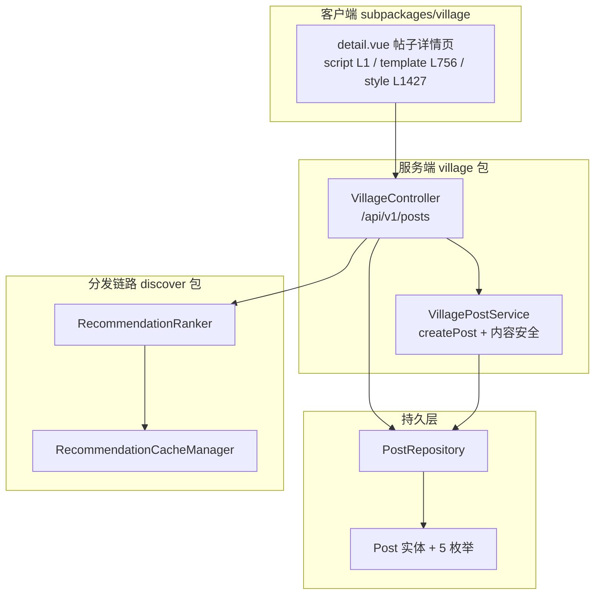

**图表来源**
- [detail.vue:1-1](file://apps/client/src/subpackages/village/village/detail.vue#L1-L1)
- [detail.vue:756-756](file://apps/client/src/subpackages/village/village/detail.vue#L756-L756)
- [VillageController.java:35-36](file://apps/api/src/main/java/com/campuslove/api/village/VillageController.java#L35-L36)
- [VillagePostService.java:44-66](file://apps/api/src/main/java/com/campuslove/api/village/VillagePostService.java#L44-L66)
- [Post.java:37-60](file://apps/api/src/main/java/com/campuslove/api/entity/Post.java#L37-L60)
- [RecommendationRanker.java:60-61](file://apps/api/src/main/java/com/campuslove/api/discover/RecommendationRanker.java#L60-L61)
- [RecommendationCacheManager.java:33-34](file://apps/api/src/main/java/com/campuslove/api/discover/RecommendationCacheManager.java#L33-L34)

## 核心组件

帖子管理的服务端由 `com.campuslove.api.village` 包内的一组协作类构成，写路径与读路径按职责拆分，控制器只保留协议适配。

- `VillageController`（404 行）：唯一 REST 入口，`@RestController` + `@RequestMapping("/api/v1/posts")` + `@Validated`。构造器注入四个协作者：`VillageService`、`PostRepository`（R16 我的日常直查）、`VillageMetrics`（Micrometer 指标）、`AppConfigService`（B6 发帖开关强制点）。类注释明确「写操作的用户 ID 从 JWT 认证上下文中获取，不再从请求参数获取」。
- `VillageService`（337 行，接口）：帖子域的服务契约，覆盖列表（3 个重载）、按作者查询、详情、发布、点赞、评论、转发、分类列表、同校流、相似作者、热度榜与推荐流。对 mock 实现未覆盖的能力（`toggleFavorite`、`getPostHistory`、`clearPostHistory`、`likeComment`、`getHotBoard`、`getPostRecommend`）提供 default 方法兜底，保证演示链路可编译运行。
- `VillagePostService`（373 行，`@Profile("real") @Component`）：帖子写组件（Task 4.2.2 从 `RealVillageService.createPost` 拆出），只负责创建，不负责查询（`VillageQueryService`）与互动（`VillageInteractionService`）。持有 `SensitiveWordFilter`、`ContentSecurityChecker`（字段注入 `required = false`）、`PostRepository`、`PostTagRepository`、`CircleMembershipRepository`、`CampusCertificationRepository`、`ActivityRepository`。标题长度阈值以常量暴露：`POST_TITLE_MIN_LENGTH = 5`、`POST_TITLE_MAX_LENGTH = 30`。
- `PostRepository`（477 行）：`extends JpaRepository<Post, Long>`，除派生查询外还有 13 个 `@Query` JPQL，承载热度榜、可见范围过滤、管理端多条件检索、关键词搜索与作者发帖数批量统计。
- `Post`（472 行）：`posts` 表实体，含 `PostCategory`、`PostStatus`、`AuditStatus`、`Visibility` 四个内嵌枚举与 `@Version` 乐观锁字段。
- 视图/请求模型：`CreatePostRequest`、`PostDetailView`、`PostSummaryView`、`PostListResponse`、`PostAuthorView`、`SimilarAuthorsResponse`、`FavoriteResponse`、`PostLikeResponse`、`CommentItemView`、`MyDailyItemView` 等独立 record 文件，便于跨包引用（如 mock 包）。
- 热度链路：`HotScoreCalculator` 与 `HotScoreScheduler` 负责热度分的定时重算，`posts.hot_score` 落库后榜单查询零计算。
- 内容安全：`ContentSecurityChecker`（微信 msgSecCheck v2 / 本地兜底）与 `SensitiveWordFilter` 在发布前构成两级过滤。

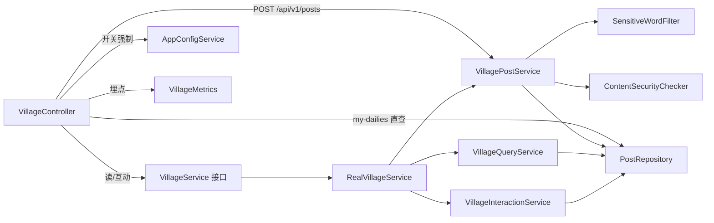

**图表来源**
- [VillageController.java:35-62](file://apps/api/src/main/java/com/campuslove/api/village/VillageController.java#L35-L62)
- [VillageController.java:113-133](file://apps/api/src/main/java/com/campuslove/api/village/VillageController.java#L113-L133)
- [VillageController.java:152-176](file://apps/api/src/main/java/com/campuslove/api/village/VillageController.java#L152-L176)
- [VillageService.java:11-48](file://apps/api/src/main/java/com/campuslove/api/village/VillageService.java#L11-L48)
- [VillageService.java:232-270](file://apps/api/src/main/java/com/campuslove/api/village/VillageService.java#L232-L270)
- [VillagePostService.java:43-110](file://apps/api/src/main/java/com/campuslove/api/village/VillagePostService.java#L43-L110)
- [PostRepository.java:21-31](file://apps/api/src/main/java/com/campuslove/api/repository/PostRepository.java#L21-L31)

**章节来源**
- [VillageController.java:30-62](file://apps/api/src/main/java/com/campuslove/api/village/VillageController.java#L30-L62)
- [VillageService.java:11-336](file://apps/api/src/main/java/com/campuslove/api/village/VillageService.java#L11-L336)
- [VillagePostService.java:34-135](file://apps/api/src/main/java/com/campuslove/api/village/VillagePostService.java#L34-L135)
- [PostRepository.java:21-107](file://apps/api/src/main/java/com/campuslove/api/repository/PostRepository.java#L21-L107)
- [Post.java:20-97](file://apps/api/src/main/java/com/campuslove/api/entity/Post.java#L20-L97)

## 架构总览

系统按「页面 → Pinia store → API 封装 → REST 控制器 → 服务组件 → Repository → `posts` 表」七段组织。客户端侧 store 名为 `village`（`defineStore("village", {`），页面只调 store 动作（`setCurrentPost` / `fetchComments` / `fetchSimilarAuthors` / `likePost` / `commentPost` / `sharePost`），store 再调 `stores/village/api.ts` 导出的 13 个请求函数，路径全部以 `/posts` 为前缀，与后端 `@RequestMapping("/api/v1/posts")` 对齐。

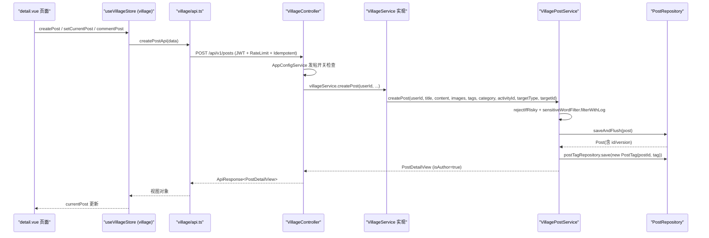

**图表来源**
- [detail.vue:412-478](file://apps/client/src/subpackages/village/village/detail.vue#L412-L478)
- [api.ts:203-242](file://apps/client/src/stores/village/api.ts#L203-L242)
- [VillageController.java:152-176](file://apps/api/src/main/java/com/campuslove/api/village/VillageController.java#L152-L176)
- [VillagePostService.java:164-258](file://apps/api/src/main/java/com/campuslove/api/village/VillagePostService.java#L164-L258)
- [PostRepository.java:21-31](file://apps/api/src/main/java/com/campuslove/api/repository/PostRepository.java#L21-L31)

读路径的扇出关系如下：列表类端点（`/posts`、`/posts/hot-board`、`/posts/recommend`、`/posts/history`、`/posts/campus-feed`、`/posts/my-dailies`）走查询服务；详情端点 `GET /posts/{id}` 返回 `PostDetailView`，前端在 `onLoad` 里并行触发 `fetchComments` 与 `fetchSimilarAuthors` 两个附属请求，形成「一主两辅」的详情页加载模式。

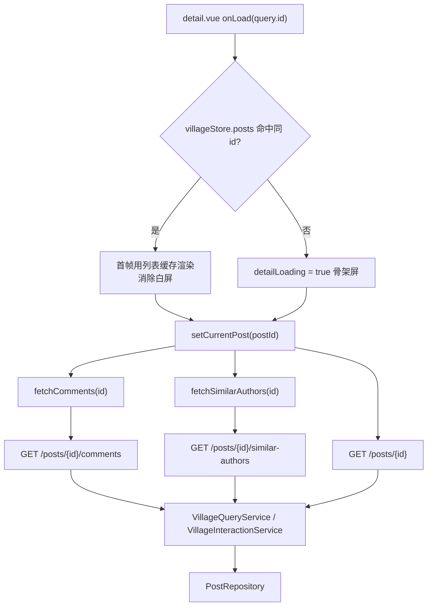

**图表来源**
- [detail.vue:679-725](file://apps/client/src/subpackages/village/village/detail.vue#L679-L725)
- [api.ts:250-257](file://apps/client/src/stores/village/api.ts#L250-L257)
- [api.ts:340-347](file://apps/client/src/stores/village/api.ts#L340-L347)
- [api.ts:441-448](file://apps/client/src/stores/village/api.ts#L441-L448)
- [VillageController.java:205-208](file://apps/api/src/main/java/com/campuslove/api/village/VillageController.java#L205-L208)
- [VillageController.java:258-264](file://apps/api/src/main/java/com/campuslove/api/village/VillageController.java#L258-L264)
- [VillageController.java:360-370](file://apps/api/src/main/java/com/campuslove/api/village/VillageController.java#L360-L370)

**章节来源**
- [detail.vue:14-50](file://apps/client/src/subpackages/village/village/detail.vue#L14-L50)
- [api.ts:101-127](file://apps/client/src/stores/village/api.ts#L101-L127)
- [VillageService.java:11-108](file://apps/api/src/main/java/com/campuslove/api/village/VillageService.java#L11-L108)

## 详细组件分析

### 帖子发布链路

发布是帖子的唯一写入口：`POST /api/v1/posts`，由 `VillageController.createPost` 接收 `CreatePostRequest`，经 `VillageService` 委托给 `VillagePostService.createPost(...)`（9 参数签名）。

控制器侧的四道前置闸门（`VillageController.java`）：

1. `@RateLimit(capacity = 20, refillTokens = 0.5, key = "#request.remoteAddr")`——按客户端 IP 令牌桶限流，桶容量 20、每 2 秒补 1 个令牌，注释明确用于「防止垃圾帖子批量发布」。
2. `@Idempotent`——同键重复提交被幂等拦截。
3. `@PreAuthorize("hasRole('USER')")`——登录态要求，`userId` 由 `SecurityUtils.getCurrentUserId()` 从 JWT 上下文取得，不接受请求参数传入。
4. `AppConfigService.isSwitchEnabled(AppConfigService.SWITCH_POST_PUBLISH_OPEN)`——B6 发帖开关强制点，后台关闭时抛 `OperationForbiddenException(ErrorMessages.POST_PUBLISH_CLOSED)`（403）。

服务侧的处理顺序（`VillagePostService.createPost`，方法体 L166-L258）：

- 参数校验：`userId` 为空抛 `IllegalArgumentException("userId is required")`；标题按 `POST_TITLE_MIN_LENGTH = 5` / `POST_TITLE_MAX_LENGTH = 30` 校验，失败文案取自 `ErrorMessages.POST_TITLE_REQUIRED_LENGTH`；正文 `isBlank` 拒绝。
- 可见范围推导：`deriveVisibility(targetType)` 把 `general|campus|circle|friends|daily` 映射为 `Visibility.public_|school|interest|friends`，非法值抛「不支持的 targetType」。
- 可见范围校验：`interest` 要求 `targetId` 非空并通过 `validateCircleMembership`（`CircleMembershipRepository.findByUserIdAndCircleId` 为空则 403 `CIRCLE_JOIN_REQUIRED`）；`school` 要求 `validateSchoolCertification`（`CampusCertificationRepository.findByUserId` 为空或状态非 `APPROVED` 则 403）。
- 统一内容安全检查：`rejectIfRisky(title, ...)` 与 `rejectIfRisky(content, ...)`，场景号 `"3"`（论坛），命中 `risky` 直接拒绝发布，`review` 放行并记录告警。
- 本地敏感词替换：`sensitiveWordFilter.filterWithLog(text, userId, "POST")` 与标签场景 `"POST_TAG"`。
- 分类解析：`PostCategory.valueOf(category)`，非法值转 400 并附带 `ErrorMessages.UNSUPPORTED_POST_CATEGORY_PREFIX` 与允许值列表（infra R2-00216，原实现未捕获直接 500）。
- 实体初始化：`images`/`tags` 经 `queryService.toJsonString` 序列化为 JSON 字符串，三个计数置 0，`status = active`，`auditStatus = AuditStatus.pending`（2026-09-03 发帖审核制），时间取 `LocalDateTime.now(TimeZones.BUSINESS)`。
- 落库：`postRepository.saveAndFlush(post)` 立即回填 IDENTITY 主键（实体带 `@Version` 时 `save()` 走 merge，必须接收返回值）。
- 标签落库：遍历过滤后标签逐条 `postTagRepository.save(new PostTag(post.getId(), tag))`，`DataIntegrityViolationException`（重复标签）只记日志不阻断发帖（R4-00328 修复标签断链）。
- 缓存失效：方法级 `@CacheEvict(cacheNames = CacheNames.VILLAGE_HOT_POSTS, allEntries = true)`。
- 监控：控制器在成功返回后调用 `villageMetrics.recordPostCreated()`，并用 try/catch 吞掉 `RuntimeException`，保证埋点失败不影响主流程。

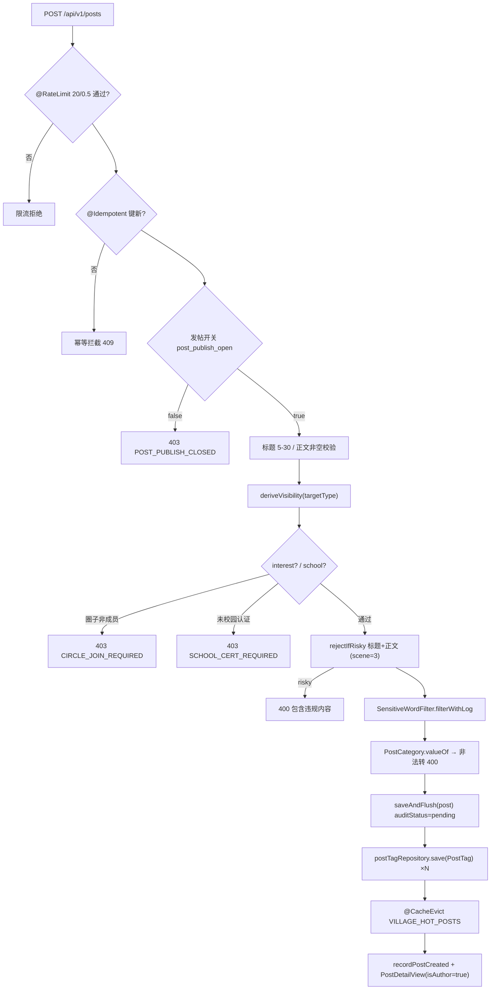

**图表来源**
- [VillageController.java:146-176](file://apps/api/src/main/java/com/campuslove/api/village/VillageController.java#L146-L176)
- [VillagePostService.java:164-258](file://apps/api/src/main/java/com/campuslove/api/village/VillagePostService.java#L164-L258)
- [VillagePostService.java:274-336](file://apps/api/src/main/java/com/campuslove/api/village/VillagePostService.java#L274-L336)
- [Post.java:124-150](file://apps/api/src/main/java/com/campuslove/api/entity/Post.java#L124-L150)

**章节来源**
- [VillageController.java:146-176](file://apps/api/src/main/java/com/campuslove/api/village/VillageController.java#L146-L176)
- [VillagePostService.java:49-53](file://apps/api/src/main/java/com/campuslove/api/village/VillagePostService.java#L49-L53)
- [VillagePostService.java:164-373](file://apps/api/src/main/java/com/campuslove/api/village/VillagePostService.java#L164-L373)
- [ContentSecurityChecker.java:16-27](file://apps/api/src/main/java/com/campuslove/api/config/ContentSecurityChecker.java#L16-L27)
- [SensitiveWordFilter.java:156-172](file://apps/api/src/main/java/com/campuslove/api/config/SensitiveWordFilter.java#L156-L172)

### 帖子读取与可见性判定

列表查询由 `VillageQueryService.getPosts(...)` 承担，核心是「排序 + 分类路由 + 可见范围过滤」三段：

- 排序构造（FIN-00023 修复后 `sortBy` 真正生效）：`hottest` → `likesCount DESC`；默认 `latest` → `isPinned DESC, createdAt DESC`（2026-08-09 置顶优先）。分页用 `PageRequest.of(page - 1, pageSize, sort)`，即客户端 1 基页码在服务端转 0 基。
- 分类路由：`category=campus` 走 `getCampusCategoryPosts`；`following` 先取关注集合 `loadFollowedUserIds`，为空或未登录直接返回空列表；`samecity` 按作者校区城市过滤（`Post` 表无城市字段，需经 `UserCampusProfile` 关联，`city` 为空时回退用户校区城市，仍为空则退化为全量可见帖）；`discover` 按 `discoverSub`（`all/alumni/hometown/buddy`）服务端过滤。
- 可见范围过滤：非上述分支时统一走 `findVisiblePosts` / `findVisiblePostsByCategory`，入参固定为 `status=active`、`auditStatus=approved`，并传入 `Visibility` 四个枚举值、`Like.LikeStatus.active`、`userId`、`userCampusName`、`memberCircleIds`。

`PostRepository` 中的可见性 JPQL 是本系统最关键的读规则：`public_` 无条件可见；`school` 需 `EXISTS` 命中同校区 `UserCampusProfile`；`interest` 需 `circleId IN :memberCircleIds`；`friends` 需「作者本人 / 被点赞（互相喜欢）/ 被关注」三者之一；排序恒为 `isPinned DESC, createdAt DESC`。

详情读取（`getPost`）的三道门禁值得注意：

1. 非 `active` 状态（`hidden` / `deleted`）直接 `ResourceNotFoundException`（404），避免已下架内容通过直链访问，构成「举报处理 → 审核下架」的合规闭环。
2. `auditStatus = pending` 的帖子仅作者本人可见，其他用户（含匿名）访问一律 404。
3. 未登录允许匿名查看：`SecurityUtils.getCurrentUserId()` 抛 `HttpClientErrorException.Unauthorized` 时被捕获，`isLiked` / `isAuthor` 均为 false。

浏览量处理为「双写」：只读事务内 `post.setViewCount(+1)` 保证本次响应即时；数据库原子 +1 与浏览历史写入由调用方 `RealVillageService.getPostDetail` 在 `recordPostView`（`REQUIRES_NEW` 独立事务）中完成，只读事务不 flush 本地修改，因此无脏写风险。

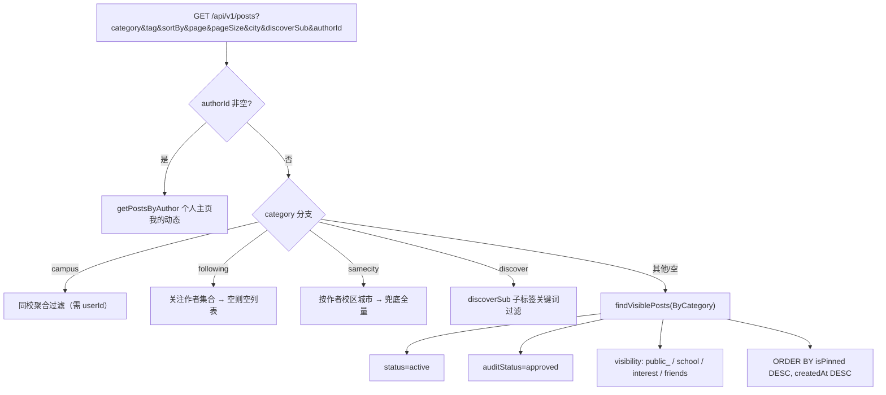

**图表来源**
- [VillageController.java:66-104](file://apps/api/src/main/java/com/campuslove/api/village/VillageController.java#L66-L104)
- [VillageQueryService.java:196-248](file://apps/api/src/main/java/com/campuslove/api/village/VillageQueryService.java#L196-L248)
- [VillageQueryService.java:265-312](file://apps/api/src/main/java/com/campuslove/api/village/VillageQueryService.java#L265-L312)
- [PostRepository.java:357-432](file://apps/api/src/main/java/com/campuslove/api/repository/PostRepository.java#L357-L432)

**章节来源**
- [VillageQueryService.java:196-248](file://apps/api/src/main/java/com/campuslove/api/village/VillageQueryService.java#L196-L248)
- [VillageQueryService.java:406-437](file://apps/api/src/main/java/com/campuslove/api/village/VillageQueryService.java#L406-L437)
- [VillageQueryService.java:450-469](file://apps/api/src/main/java/com/campuslove/api/village/VillageQueryService.java#L450-L469)
- [PostRepository.java:340-476](file://apps/api/src/main/java/com/campuslove/api/repository/PostRepository.java#L340-L476)
- [VillageController.java:66-104](file://apps/api/src/main/java/com/campuslove/api/village/VillageController.java#L66-L104)

### 编辑与删除的实现边界

服务层文档注释声明 `VillagePostService` 「职责：处理帖子创建/更新/删除等写操作」，但类中实际只有 `createPost` 一个公开写方法（L166-L258）与若干私有校验方法。全仓检索 `PutMapping` / `PatchMapping` 与 `updatePost` / `editPost` 在帖子域均无命中，C 端不存在帖子编辑端点。

删除能力只存在于管理端：`AdminVillagePostController`（`@RequestMapping("/api/v1/admin/forum/village-posts")` + `@PreAuthorize("hasRole('ADMIN')")`）的 `@DeleteMapping("/{id}")` → `deletePost`，实现为软删除：`post.setStatus(PostStatus.deleted)` + 更新 `updatedAt` 后 `postRepository.save(post)`，并标注 `@Auditable(value = AuditOperation.DELETE_POST, targetType = "POST")`；帖子不存在返回 404，删除前执行 `assertPostCampusAccess(post)` 做校区数据隔离（校区管理员仅能删本校区作者的帖子）。注释明确「评论通过帖子维度查询天然随帖子隐藏，不硬删」。

同一控制器还提供 `@PostMapping("/{id}/audit")`（审核，与 `AdminPostController#auditPost` 逻辑一致：拒绝时同步把 `status` 置 `hidden`）、`@PostMapping("/{id}/pin")` / `@PostMapping("/{id}/unpin")`（置顶，写 `isPinned`）以及 `@PostMapping("/{id}/hot-boost")`（热度倍率，取值范围校验 `0 ≤ boost ≤ 100`，设置后立即重算该帖热度并清榜单缓存）。

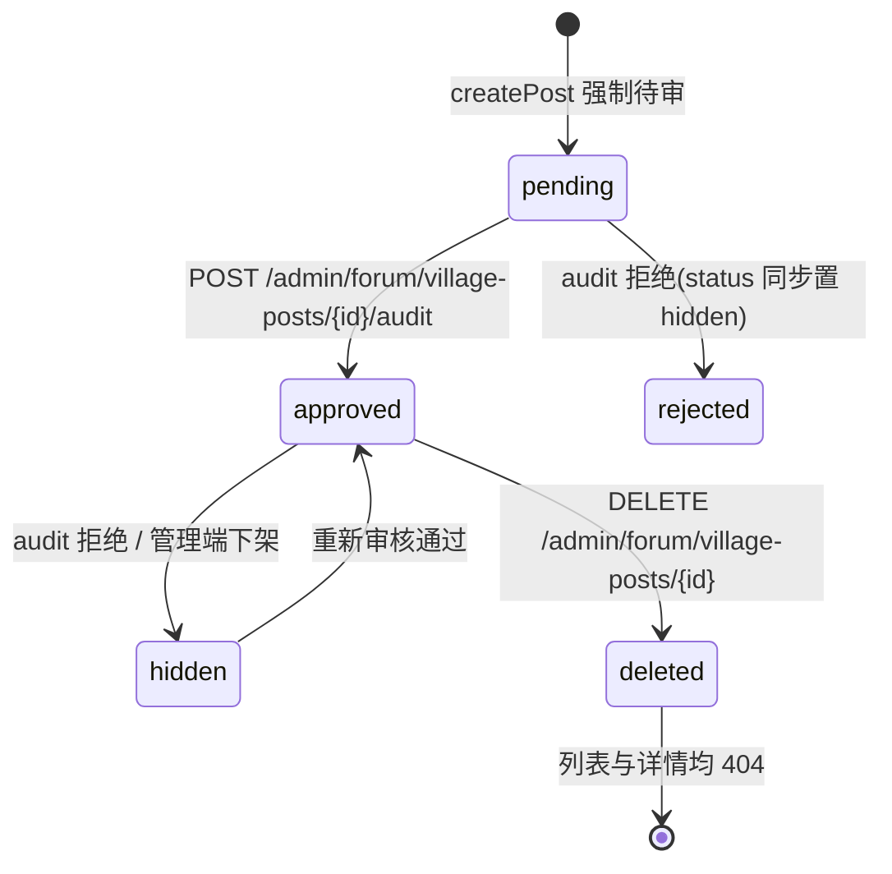

**图表来源**
- [VillagePostService.java:232-242](file://apps/api/src/main/java/com/campuslove/api/village/VillagePostService.java#L232-L242)
- [AdminVillagePostController.java:201-248](file://apps/api/src/main/java/com/campuslove/api/admin/AdminVillagePostController.java#L201-L248)
- [AdminVillagePostController.java:257-342](file://apps/api/src/main/java/com/campuslove/api/admin/AdminVillagePostController.java#L257-L342)
- [Post.java:67-83](file://apps/api/src/main/java/com/campuslove/api/entity/Post.java#L67-L83)

**章节来源**
- [VillagePostService.java:34-58](file://apps/api/src/main/java/com/campuslove/api/village/VillagePostService.java#L34-L58)
- [VillagePostService.java:164-258](file://apps/api/src/main/java/com/campuslove/api/village/VillagePostService.java#L164-L258)
- [AdminVillagePostController.java:71-74](file://apps/api/src/main/java/com/campuslove/api/admin/AdminVillagePostController.java#L71-L74)
- [AdminVillagePostController.java:183-342](file://apps/api/src/main/java/com/campuslove/api/admin/AdminVillagePostController.java#L183-L342)
- [AdminVillagePostController.java:351-369](file://apps/api/src/main/java/com/campuslove/api/admin/AdminVillagePostController.java#L351-L369)

### 分类系统与标签过滤

`Post.PostCategory` 的实际取值集合为 `all, interest, sincere, hometown, anonymous, latest, campus, activity`，数据库侧以 `ENUM(...)` 列定义约束（`columnDefinition` 与枚举名一一对应）。分类解析失败统一转 400，错误文案 `UNSUPPORTED_POST_CATEGORY_PREFIX + category + ", 仅支持: " + Arrays.toString(PostCategory.values())`，在读路径（`VillageQueryService.parseCategory`）与写路径（`VillagePostService.createPost`）各出现一次。

需要区分的是：列表接口还接受 4 个**不属于** `PostCategory` 的路由分类值——`campus` 同时是枚举值也是分支键，`following`、`samecity`、`discover` 则在进入 `parseCategory` 之前被短路处理，因此不会因非法枚举被拒。

标签以两条链路存储：`posts.tags` JSON 列（默认 `"[]"`）与 `post_tags` 关联表（实体 `PostTag`，`@Table(name = "post_tags")`，由 `PostTag(postId, tag)` 构造写入）。标签的读侧入口是 `PostTagController` / `RealPostTagService`，聚合查询走 `findByIdInAndStatusOrderByCreatedAtDesc`；发现转子标签（`hometown` → 「老乡/同乡」、`buddy` → 「搭子」）用 `findByStatusAndKeyword` 对 `content` 与 `tags` 做 `LIKE %kw%` 匹配。写侧标签必须经 `filterWithLog(tag, userId, "POST_TAG")` 过滤，空串与空白标签被丢弃。

**章节来源**
- [Post.java:62-65](file://apps/api/src/main/java/com/campuslove/api/entity/Post.java#L62-L65)
- [Post.java:119-126](file://apps/api/src/main/java/com/campuslove/api/entity/Post.java#L119-L126)
- [PostTag.java:22-23](file://apps/api/src/main/java/com/campuslove/api/entity/PostTag.java#L22-L23)
- [VillagePostService.java:196-255](file://apps/api/src/main/java/com/campuslove/api/village/VillagePostService.java#L196-L255)
- [VillagePostService.java:298-310](file://apps/api/src/main/java/com/campuslove/api/village/VillagePostService.java#L298-L310)
- [VillageQueryService.java:190-194](file://apps/api/src/main/java/com/campuslove/api/village/VillageQueryService.java#L190-L194)
- [PostRepository.java:66-79](file://apps/api/src/main/java/com/campuslove/api/repository/PostRepository.java#L66-L79)
- [PostRepository.java:159-159](file://apps/api/src/main/java/com/campuslove/api/repository/PostRepository.java#L159-L159)

### 帖子详情页组件架构（客户端）

`detail.vue` 是帖子详情的单文件组件（3276 行：`<script setup lang="ts">` 自 L1、`<template>` 自 L756、`<style scoped lang="scss">` 自 L1427），文件头注释声明其承载「完整帖子内容、评论列表和互动功能，包含作者交互卡片（关注/私信/校友标签）、相似作者推荐和转发功能」。

状态来源为 Pinia `village` store（`defineStore("village", {` 位于 `stores/village/index.ts:142`），页面通过 `storeToRefs` 解构 `currentPost`、`comments`、`loading`、`similarAuthors` 四个响应式引用，本地只保留交互态（`commentContent`、`commentSort`、`replyingTo`、`showShareModal`、`showReportDialog`、`detailLoading`、`commentPage` 等）。

页面依赖的公共组件与工具：`SafeImage.vue`（受鉴权代理的图片组件，配合 `resolveMediaUrl` 重写用户上传图片 URL）、`EmptyState.vue`（错误/空态，模板 L1252）、`PostReportDialog.vue`（举报弹窗，模板 L1419）、`ActivityCard.vue`（活动链接帖展开的活动卡，模板 L867）、`formatRelativeTime`、`lightHaptic`、`ROUTES` 常量与 `useMock`。

区块划分（按模板锚点）：

- 作者信息卡片：`author-inline`（L784）——头像（`goToUserProfile(author.userId)`）、昵称、校友徽标（`SafeImage` + `IMAGE_PATHS.ICONS_COMMON.SCHOOL`，L802）、关注按钮（`v-if="!isOwnPost"`，L815）。`isOwnPost` 由 `sessionStore.userSession.userId` 与 `currentPost.author.userId` 字符串比较得出（MP-R8-OWNPOST-001：自己的帖子不再显示「+关注」）。
- 正文与图片区：图片全屏查看层 `openImageViewer(index)` / `closeImageViewer()`，`resolveMediaUrl(raw)` 处理后再展示；图片加载失败经 `failedImageKeys` 集合记录（`onImageError` / `isImageFailed`）。
- 评论区：`sortedComments` 客户端排序（`hot` 按 `likes` 降序、`latest` 按 `createdAt` 字符串降序）、`COMMENT_PAGE_SIZE = 20` 分页游标、`loadMoreComments()` 直连 `GET /posts/{id}/comments`、楼中楼折叠（`expandedReplies` / `isRepliesCollapsed` / `visibleReplies`）。
- 相似作者推荐区：`v-if="similarAuthors.length > 0"`（L1147），逐条渲染头像徽标、身份标签，并绑定 `handleFollowSimilarAuthor` 与 `sendMessageToSimilarAuthor`。
- 底部操作与弹窗：转发弹窗、举报弹窗、评论输入增强（`@` 提及 / 表情面板 / 图片上传）。

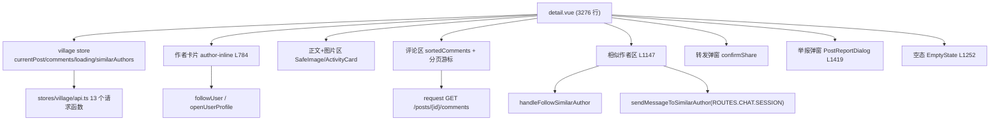

**图表来源**
- [detail.vue:1-50](file://apps/client/src/subpackages/village/village/detail.vue#L1-L50)
- [detail.vue:428-432](file://apps/client/src/subpackages/village/village/detail.vue#L428-L432)
- [detail.vue:60-95](file://apps/client/src/subpackages/village/village/detail.vue#L60-L95)
- [detail.vue:157-206](file://apps/client/src/subpackages/village/village/detail.vue#L157-L206)
- [detail.vue:784-815](file://apps/client/src/subpackages/village/village/detail.vue#L784-L815)
- [detail.vue:1147-1147](file://apps/client/src/subpackages/village/village/detail.vue#L1147-L1147)
- [index.ts:142-142](file://apps/client/src/stores/village/index.ts#L142-L142)

**章节来源**
- [detail.vue:1-58](file://apps/client/src/subpackages/village/village/detail.vue#L1-L58)
- [detail.vue:80-130](file://apps/client/src/subpackages/village/village/detail.vue#L80-L130)
- [detail.vue:137-206](file://apps/client/src/subpackages/village/village/detail.vue#L137-L206)
- [detail.vue:242-262](file://apps/client/src/subpackages/village/village/detail.vue#L242-L262)
- [detail.vue:412-478](file://apps/client/src/subpackages/village/village/detail.vue#L412-L478)
- [detail.vue:606-676](file://apps/client/src/subpackages/village/village/detail.vue#L606-L676)
- [detail.vue:735-753](file://apps/client/src/subpackages/village/village/detail.vue#L735-L753)
- [api.ts:143-195](file://apps/client/src/stores/village/api.ts#L143-L195)

### 互动链路：点赞、收藏、评论、转发与举报

互动端点在控制器侧的限流口径自成体系，可作为容量规划依据：

| 端点 | 方法 | RateLimit（容量/补词速率） | 幂等 | 权限 |
| --- | --- | --- | --- | --- |
| `POST /api/v1/posts` | createPost | 20 / 0.5·s⁻¹ | `@Idempotent` | `hasRole('USER')` |
| `POST /api/v1/posts/{id}/like` | likePost | 60 / 2·s⁻¹ | 无（R16 移除） | `hasRole('USER')` |
| `POST /api/v1/posts/{id}/favorite` | toggleFavorite | 60 / 2·s⁻¹ | `@Idempotent` | `hasRole('USER')` |
| `POST /api/v1/posts/{id}/comments` | createComment | 30 / 1·s⁻¹ | `@Idempotent` | `hasRole('USER')` |
| `POST /api/v1/posts/comments/{commentId}/like` | likeComment | 60 / 2·s⁻¹ | 无（R16 移除） | `hasRole('USER')` |
| `POST /api/v1/posts/{id}/share` | sharePost | 30 / 1·s⁻¹ | `@Idempotent` | `hasRole('USER')` |
| `GET /api/v1/posts/recommend` | getPostRecommend | 30 / 2·s⁻¹ | — | — |

R16（2026-09-07）对点赞语义做了关键修正：帖子点赞与评论点赞均为 toggle，若保留 `@Idempotent`，稳定幂等键会拦截第二次点击并返回 409，导致「无法取消点赞」，因此两个端点显式移除幂等注解；收藏则保留幂等。点赞埋点只在实际 `liked == true` 时调用 `villageMetrics.recordPostLiked(id)`，取消点赞不记录。

评论支持三层能力：楼中楼（`CreateCommentRequest.parentId` 非空即回复）、图片（`images` 服务端限 3 张）、点赞（`comment_likes` 表以 `uk_comment_likes_user_comment` 唯一约束兜底同一用户对同一评论仅一条记录）。客户端在提交时做了两处防御：`isSubmitting` 重入守卫（防抖窗口内二次提交静默丢弃），以及把「回复楼中楼的回复」的 `parentId` 统一上提到根评论（`replyingTo.parentId ?? replyingTo.id`），因为后端只装一层楼中楼。

举报链路为：长按帖子 → `uni.showActionSheet`（复制内容 / 举报）→ `PostReportDialog` 提交 → `handleReportSubmitted` 关闭弹窗；评论举报复用 `REPORT_REASONS`，失败时以 `err.message` 兜底提示。转发则通过 `showShareModal` + `confirmShare` 调用 `villageStore.sharePost(id, comment)`，另配合 `onShareAppMessage` / `onShareTimeline` 生成小程序分享卡片（标题取 `post.title` 或内容前 24 字，路径 `ROUTES.VILLAGE.DETAIL?id=`）。

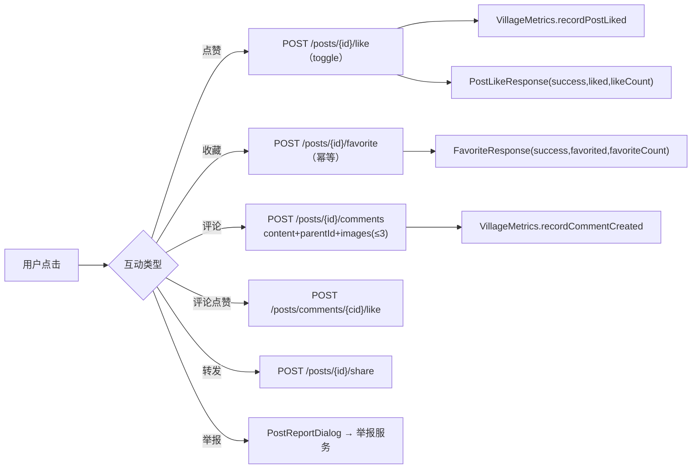

**图表来源**
- [VillageController.java:152-156](file://apps/api/src/main/java/com/campuslove/api/village/VillageController.java#L152-L156)
- [VillageController.java:218-251](file://apps/api/src/main/java/com/campuslove/api/village/VillageController.java#L218-L251)
- [VillageController.java:272-310](file://apps/api/src/main/java/com/campuslove/api/village/VillageController.java#L272-L310)
- [VillageController.java:320-329](file://apps/api/src/main/java/com/campuslove/api/village/VillageController.java#L320-L329)
- [detail.vue:287-408](file://apps/client/src/subpackages/village/village/detail.vue#L287-L408)
- [api.ts:265-305](file://apps/client/src/stores/village/api.ts#L265-L305)

**章节来源**
- [VillageController.java:191-329](file://apps/api/src/main/java/com/campuslove/api/village/VillageController.java#L191-L329)
- [VillageService.java:153-230](file://apps/api/src/main/java/com/campuslove/api/village/VillageService.java#L153-L230)
- [detail.vue:412-478](file://apps/client/src/subpackages/village/village/detail.vue#L412-L478)
- [detail.vue:480-559](file://apps/client/src/subpackages/village/village/detail.vue#L480-L559)
- [detail.vue:606-646](file://apps/client/src/subpackages/village/village/detail.vue#L606-L646)
- [api.ts:340-392](file://apps/client/src/stores/village/api.ts#L340-L392)

### 相似作者推荐

`GET /api/v1/posts/{id}/similar-authors` 由 `VillageController.getSimilarAuthors` 暴露：`@PathVariable("id") @Positive Long postId`，当前用户 ID 从 JWT 取（P2-13 后不再接受 query 传入 `userId`），`IllegalArgumentException` 转换为 `ResponseEntity.badRequest()`。契约是「基于兴趣标签重叠度和同校关系推荐 1-2 位最相似的用户，排除已关注的用户和当前用户自身」，响应体为 `SimilarAuthorsResponse(List<SimilarAuthorView> authors)`。候选集规模受常量 `SIMILAR_AUTHOR_CANDIDATE_LIMIT` 限制（`VillageQueryService` 在取候选用户分页时使用），避免全表扫描。

客户端在 `onLoad` 中与评论列表并行发起 `fetchSimilarAuthors`，渲染条件为 `similarAuthors.length > 0`；关注按钮直接改写列表项的 `isFollowed` 做本地同步，私信按 `messagesStore.sessions` 是否已存在同对象的 private 会话决定跳转参数（`sessionId` 或 `userId`）。

**章节来源**
- [VillageController.java:350-370](file://apps/api/src/main/java/com/campuslove/api/village/VillageController.java#L350-L370)
- [VillageService.java:295-306](file://apps/api/src/main/java/com/campuslove/api/village/VillageService.java#L295-L306)
- [VillageQueryService.java:932-932](file://apps/api/src/main/java/com/campuslove/api/village/VillageQueryService.java#L932-L932)
- [detail.vue:648-676](file://apps/client/src/subpackages/village/village/detail.vue#L648-L676)
- [api.ts:432-448](file://apps/client/src/stores/village/api.ts#L432-L448)

## 数据模型

帖子域的持久化中心是 `posts` 表（`@Table(name = "posts")` + `@EntityListeners(AuditingEntityListener.class)`），实体 `Post` 共 472 行，字段与列一一对应，`@CreatedDate` / `@LastModifiedDate` 由 Spring Data 审计维护。

| 列 | Java 字段 / 类型 | 约束与默认 | 语义 |
| --- | --- | --- | --- |
| `id` | `Long id` | `@GeneratedValue(IDENTITY)` | 主键 |
| `author_id` | `Long authorId` | `nullable = false` | 作者用户 ID |
| `title` | `String title` | `length = 200` | 标题（服务层强制 5-30 字） |
| `content` | `String content` | `nullable = false`, `TEXT` | 正文 |
| `images` | `String images` | `JSON DEFAULT '[]'`，初值 `"[]"` | 图片 URL JSON 数组 |
| `tags` | `String tags` | `JSON DEFAULT '[]'`，初值 `"[]"` | 话题标签 JSON 数组 |
| `category` | `PostCategory category` | `ENUM('all','interest','sincere','hometown','anonymous','latest','campus','activity') DEFAULT 'all'`，`EnumType.STRING` | 分类 |
| `likes_count` / `comments_count` / `share_count` | `Integer` | `nullable = false`，初值 0 | 互动计数 |
| `view_count` | `Integer viewCount` | `nullable = false`，初值 0 | 浏览量（Flyway V2026.08.09.0001 新增） |
| `status` | `PostStatus status` | `ENUM('active','deleted','hidden') DEFAULT 'active'` | 软删/隐藏状态 |
| `is_pinned` | `Boolean isPinned` | `TINYINT(1) DEFAULT 0` | 置顶（V2026.08.07.0017） |
| `hot_score` / `hot_boost` / `hot_banned` | `Double` / `Double` / `Boolean` | 0.0 / 1.0 / false | 热度分、运营倍率、禁止上榜（V2026.08.11.0001） |
| `activity_id` | `Long activityId` | 可空 | 关联活动（V2026.08.09.0004） |
| `audit_status` | `AuditStatus auditStatus` | `VARCHAR(16) DEFAULT 'approved'` | 审核状态（与 `status` 正交） |
| `audit_remark` / `auditor_id` / `audited_at` | `String(500)` / `Long` / `LocalDateTime` | 可空 | 审核留痕 |
| `visibility` | `Visibility visibility` | `VARCHAR(20) DEFAULT 'public'` + `@Convert(VisibilityConverter.class)` | 可见范围（`public_` ↔ 库值 `public`） |
| `circle_id` | `Long circleId` | 可空 | 所属圈子（`visibility = interest` 时必填） |
| `created_at` / `updated_at` | `LocalDateTime` | `nullable = false`，`updatable = false` / 可变 | 发布时间与最近更新 |
| `version` | `Long version` | `@Version`, `BIGINT DEFAULT 0` | 乐观锁（Flyway V2026.07.26.0003） |

实体与协作表的关系如下：`post_tags`（`@Table(name = "post_tags")`）由 `PostTag(postId, tag)` 承载标签聚合；`post_favorites`（`@Table(name = "post_favorites")` + 唯一约束 `uk_post_favorites_user_post(user_id, post_id)`）通过 `PostFavoriteRepository.countByPostId` / `countByPostIds` 为热度公式提供收藏项；`post_view_history`（唯一约束 `uk_post_view_history_user_post(user_id, post_id)`）支撑浏览历史分页；评论点赞由 `CommentLike` 实体与 `comment_likes` 表的 `uk_comment_likes_user_comment` 唯一约束承载；校园/圈子可见性判定跨表引用 `UserCampusProfile`、`Like`、`UserFollow`。

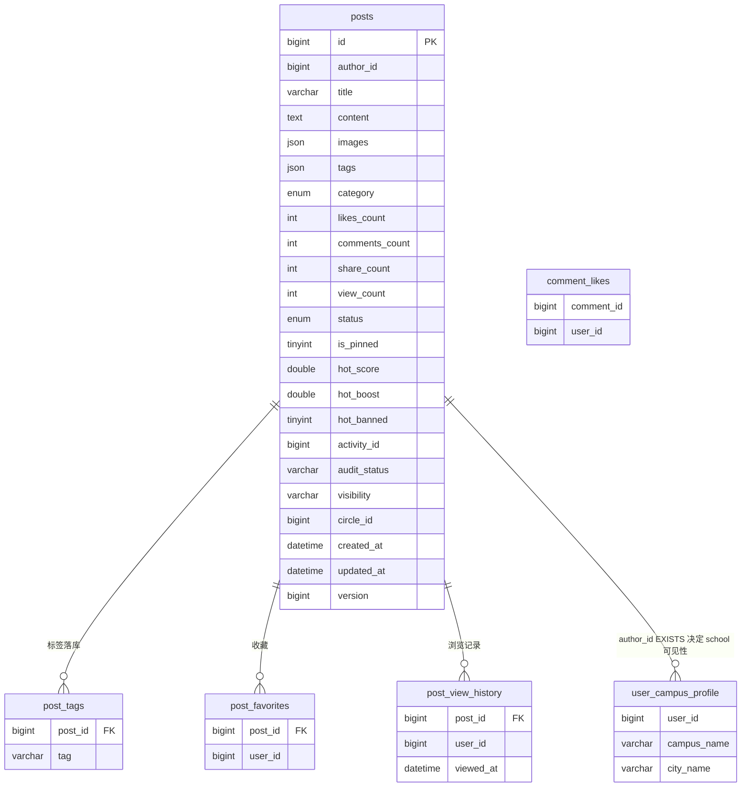

**图表来源**
- [Post.java:37-259](file://apps/api/src/main/java/com/campuslove/api/entity/Post.java#L37-L259)
- [PostRepository.java:357-387](file://apps/api/src/main/java/com/campuslove/api/repository/PostRepository.java#L357-L387)
- [PostRepository.java:446-476](file://apps/api/src/main/java/com/campuslove/api/repository/PostRepository.java#L446-L476)
- [VillagePostService.java:244-255](file://apps/api/src/main/java/com/campuslove/api/village/VillagePostService.java#L244-L255)
- [VillagePostService.java:11-21](file://apps/api/src/main/java/com/campuslove/api/village/VillagePostService.java#L11-L21)
- [HotScoreCalculator.java:51-101](file://apps/api/src/main/java/com/campuslove/api/village/HotScoreCalculator.java#L51-L101)
- [VillageQueryService.java:450-461](file://apps/api/src/main/java/com/campuslove/api/village/VillageQueryService.java#L450-L461)
- [PostTag.java:22-23](file://apps/api/src/main/java/com/campuslove/api/entity/PostTag.java#L22-L23)
- [PostFavorite.java:23-26](file://apps/api/src/main/java/com/campuslove/api/entity/PostFavorite.java#L23-L26)
- [PostViewHistory.java:22-25](file://apps/api/src/main/java/com/campuslove/api/entity/PostViewHistory.java#L22-L25)
- [CommentLike.java:28-28](file://apps/api/src/main/java/com/campuslove/api/village/CommentLike.java#L28-L28)

索引演进有明确的双向记录：`Post` 的 `@Table(indexes = {...})` 注解列出 8 个索引（`idx_posts_author`、`idx_posts_category`、`idx_posts_created_at`、`idx_posts_status`、`idx_posts_author_created_at`、`idx_posts_status_created_at`、`idx_posts_activity`、`idx_posts_circle_id`），类注释同时声明「与数据库 Flyway 脚本保持一致」。建表脚本 `V2026.05.21.0003__create_posts_table.sql` 内联了前三个 `KEY`，复合索引由 `V2026.07.25.0014__add_performance_indexes.sql` 补建，`idx_posts_status` 由 `V2026.07.25.0017` 补齐，审核状态索引 `idx_posts_audit_status` 由 `V2026.06.25.0004` 建立；`V2026.07.26.0004__p8_database_standardization.sql` 与 `V2026.07.28.0007__rebuild_indexes_after_enum_migration.sql` 分别用 `add_index_if_missing` / `add_index_if_missing_enum_fix` 存储过程做幂等补建与 ENUM→VARCHAR 迁移后的重建。`V2026.07.26.0001__add_entity_index_annotations.sql` 则是「实体注解 ↔ DDL」对齐专项（同批处理 `idx_notifications_user_created_at`、`idx_heart_signals_created_at`、`idx_feedback_created_at`、`idx_private_messages_*` 等）。分类列的枚举取值也在迁移中被修正：`V2026.05.31.0001__fix_entity_ddl_mismatches.sql` 将 `category` 改为与实体一致的 ENUM 定义（当时尚无 `activity` 值）。

**章节来源**
- [Post.java:20-59](file://apps/api/src/main/java/com/campuslove/api/entity/Post.java#L20-L59)
- [Post.java:99-259](file://apps/api/src/main/java/com/campuslove/api/entity/Post.java#L99-L259)
- [V2026.05.21.0003__create_posts_table.sql:1-16](file://database/flyway/sql/V2026.05.21.0003__create_posts_table.sql#L1-L16)
- [V2026.06.25.0004__add_user_status_and_post_audit_status.sql:34-45](file://database/flyway/sql/V2026.06.25.0004__add_user_status_and_post_audit_status.sql#L34-L45)
- [V2026.07.25.0014__add_performance_indexes.sql:42-43](file://database/flyway/sql/V2026.07.25.0014__add_performance_indexes.sql#L42-L43)
- [V2026.07.25.0017__add_remaining_missing_indexes.sql:31-32](file://database/flyway/sql/V2026.07.25.0017__add_remaining_missing_indexes.sql#L31-L32)
- [V2026.07.26.0001__add_entity_index_annotations.sql:10-65](file://database/flyway/sql/V2026.07.26.0001__add_entity_index_annotations.sql#L10-L65)
- [V2026.07.26.0004__p8_database_standardization.sql:167-176](file://database/flyway/sql/V2026.07.26.0004__p8_database_standardization.sql#L167-L176)
- [V2026.07.28.0007__rebuild_indexes_after_enum_migration.sql:56-58](file://database/flyway/sql/V2026.07.28.0007__rebuild_indexes_after_enum_migration.sql#L56-L58)
- [V2026.08.07.0017__add_forum_admin_fields.sql:27-27](file://database/flyway/sql/V2026.08.07.0017__add_forum_admin_fields.sql#L27-L27)
- [V2026.05.31.0001__fix_entity_ddl_mismatches.sql:11-11](file://database/flyway/sql/V2026.05.31.0001__fix_entity_ddl_mismatches.sql#L11-L11)

## 前后端接口契约

`/api/v1/posts` 前缀下的 16 个映射构成帖子系统的对外契约，客户端在 `stores/village/api.ts` 有同名封装函数，两侧参数口径逐一对齐。

| 方法与路径 | 控制器方法 | 关键参数 | 响应类型 | 客户端封装 |
| --- | --- | --- | --- | --- |
| `GET /posts` | `getPosts` | `category, tag, sortBy(默认 latest), authorId, page(≥1, 默认 1), pageSize(1-100, 默认 20), city, discoverSub` | `PostListResponse` | `fetchPostsApi` + `buildPostListParams` |
| `GET /posts/my-dailies` | `getMyDailies` | 无（`userId` 取自 JWT） | `List<MyDailyItemView>`（Top12） | — |
| `POST /posts` | `createPost` | `CreatePostRequest` | `ApiResponse<PostDetailView>` | `createPostApi` |
| `GET /posts/hot-board` | `getHotBoard` | `page, pageSize` | `PostListResponse` | `getHotBoardApi` |
| `GET /posts/recommend` | `getPostRecommend` | `page, pageSize` | `PostListResponse` | `getPostRecommendApi` |
| `GET /posts/{id}` | `getPostDetail` | `id @Positive` | `ApiResponse<PostDetailView>` | `fetchPostDetailApi` |
| `POST /posts/{id}/favorite` | `toggleFavorite` | `id` | `ApiResponse<FavoriteResponse>` | `favoritePostApi` |
| `POST /posts/{id}/like` | `likePost` | `id` | `ApiResponse<PostLikeResponse>` | `likePostApi` |
| `GET /posts/{id}/comments` | `getComments` | `id, page, pageSize` | `CommentListResponse` | `fetchCommentsApi` / 页面直连分页 |
| `POST /posts/{id}/comments` | `createComment` | `CreateCommentRequest(content, parentId, images)` | `ApiResponse<CommentItemView>` | `createCommentApi` |
| `POST /posts/comments/{commentId}/like` | `likeComment` | `commentId` | `ApiResponse<PostLikeResponse>` | `likeCommentApi` |
| `POST /posts/{id}/share` | `sharePost` | `SharePostRequest(comment)` | `ApiResponse<ShareView>` | `sharePostApi` |
| `GET /posts/campus-feed` | `getCampusFeed` | `page(≥0), size(1-100)` | `ResponseEntity<CampusFeedView>` | `fetchCampusFeedApi`（走 `/campus/feed`） |
| `GET /posts/{id}/similar-authors` | `getSimilarAuthors` | `id` | `ResponseEntity<SimilarAuthorsResponse>` | `fetchSimilarAuthorsApi`（取 `authors` 字段） |
| `GET /posts/history` / `DELETE /posts/history` | `getPostHistory` / `clearPostHistory` | `page, pageSize` | `PostHistoryResponse` / `ApiResponse<Void>` | `fetchPostHistoryApi` / `clearPostHistoryApi` |

契约细节有三处值得前端特别注意。第一，字面量路径优先于模板变量：`/history`、`/campus-feed` 与 `/{id}` 同级存在，Spring 按字面量优先匹配（源码注释明确此路由说明），因此 `id` 侧的 `@Positive` 校验不会对历史流生效。第二，分页参数不统一：`/posts/history` 等用 `page`（1 基）+ `pageSize`，`/campus-feed` 用 `page`（0 基，`@Min(0)`）+ `size`，服务端在 `PageRequest.of(page - 1, ...)` 与 `PageRequest.of(page, ...)` 中分别换算。第三，`PostDetailView` 是一个 20+ 字段的扁平 record（`id/title/content/author/category/tags/images/likeCount/commentCount/shareCount/createdAt/updatedAt/isLiked/isAuthor/isAlumni/favoriteCount/isFavorite/viewCount/...`），布尔位由服务端计算，匿名读取时 `isLiked`、`isAuthor`、`isFavorite` 恒为 false。

写请求体的 Bean Validation 集中在 `CreatePostRequest`：`@Size(min = 5, max = 30) title`、`@NotBlank @Size(max = 5000) content`、`@NotBlank category`、`@Size(max = 20) List<@Size(max = 20) String> tags`、`@Size(max = 9) List<String> images`（即单帖最多 9 图）、可选 `activityId`、`@Size(max = 20) targetType`、`targetId`。标题的长度校验在 Bean 层与服务层常量（5-30）重复定义，注释说明「前端已保证必填，后端仅约束长度，null 由服务层校验转为 400」。

媒体资源不在帖子接口内：图片先经 `POST /api/v1/media/upload`（`operationId = uploadMedia`，`@PreAuthorize("hasRole('USER')")`，按 IP 桶容量 30 / 1 token·s⁻¹ 限流，校验 MIME 与 magic bytes，落盘路径 `uploads/{userId}/{yyyyMM}/{uuid}.{ext}`，`upload.video.enabled = false` 时 `type = video` 直接 403 `VIDEO_UPLOAD_DISABLED`）换取 URL，再把 URL 数组提交到帖子或评论接口；读取侧由 `MediaAccessController`（同 `/api/v1/media` 前缀，`@Profile("real")`）提供鉴权代理，`IMAGE` 私有缓存时长 `IMAGE_CACHE_MAX_AGE_SECONDS = 3600L`，客户端 `resolveMediaUrl` 负责把用户上传图片重写为代理路径。

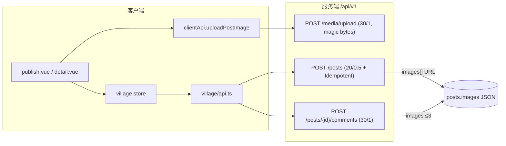

**图表来源**
- [api.ts:203-242](file://apps/client/src/stores/village/api.ts#L203-L242)
- [api.ts:359-378](file://apps/client/src/stores/village/api.ts#L359-L378)
- [detail.vue:518-554](file://apps/client/src/subpackages/village/village/detail.vue#L518-L554)
- [VillageController.java:152-176](file://apps/api/src/main/java/com/campuslove/api/village/VillageController.java#L152-L176)
- [VillageController.java:272-290](file://apps/api/src/main/java/com/campuslove/api/village/VillageController.java#L272-L290)
- [MediaUploadController.java:83-89](file://apps/api/src/main/java/com/campuslove/api/media/MediaUploadController.java#L83-L89)

**章节来源**
- [VillageController.java:66-397](file://apps/api/src/main/java/com/campuslove/api/village/VillageController.java#L66-L397)
- [api.ts:97-195](file://apps/client/src/stores/village/api.ts#L97-L195)
- [api.ts:203-448](file://apps/client/src/stores/village/api.ts#L203-L448)
- [PostListResponse.java:8-9](file://apps/api/src/main/java/com/campuslove/api/village/PostListResponse.java#L8-L9)
- [PostDetailView.java:8-30](file://apps/api/src/main/java/com/campuslove/api/village/PostDetailView.java#L8-L30)
- [CreatePostRequest.java:14-29](file://apps/api/src/main/java/com/campuslove/api/village/CreatePostRequest.java#L14-L29)
- [FavoriteResponse.java:10-15](file://apps/api/src/main/java/com/campuslove/api/village/FavoriteResponse.java#L10-L15)
- [PostLikeResponse.java:6-7](file://apps/api/src/main/java/com/campuslove/api/village/PostLikeResponse.java#L6-L7)
- [SimilarAuthorsResponse.java:8-11](file://apps/api/src/main/java/com/campuslove/api/village/SimilarAuthorsResponse.java#L8-L11)
- [MediaUploadController.java:45-89](file://apps/api/src/main/java/com/campuslove/api/media/MediaUploadController.java#L45-L89)
- [MediaAccessController.java:68-77](file://apps/api/src/main/java/com/campuslove/api/media/MediaAccessController.java#L68-L77)

## 依赖关系分析

帖子系统的依赖呈「单入口 + 双 Profile 实现 + 单向持久化」形态。

- 客户端方向：`detail.vue` 只依赖 `stores/village`（store 名 `village`）与 `services/http` 的 `request`、`services/api` 的 `clientApi.uploadPostImage`，跨域依赖仅 `stores/session`、`stores/messages`、`stores/report`、`composables/useMenuButtonRect`、`utils/{navigation,haptic,media}` 与 `constants/routes`、`config/images`。页面内评论分页是唯一「绕过 store 直连 `request`」的地方（`loadMoreComments` 直接请求 `/posts/{id}/comments`），原因是分页契约需要 `total/page/pageSize`。
- 控制器方向：`VillageController` 依赖 `VillageService`（接口）、`PostRepository`（仅 `/my-dailies` 直查）、`VillageMetrics`、`AppConfigService`，以及横切注解 `@RateLimit`、`@Idempotent`、`@PreAuthorize`、`@Validated` 与 `SecurityUtils`。
- 服务方向：`VillageService` 有 mock / real 两套实现（`RealVillageService` 283 行委托给 `VillagePostService`、`VillageQueryService`、`VillageInteractionService`），接口内大量 `default` 方法保证未升级的 mock 实现可编译并保持演示行为。`VillagePostService` 与 `HotScoreCalculator` / `HotScoreScheduler` 均标注 `@Profile("real")`。
- 写路径依赖：`PostRepository`、`PostTagRepository`、`CircleMembershipRepository`、`CampusCertificationRepository`、`ActivityRepository`、`SensitiveWordFilter`、`ContentSecurityChecker`、`VillageQueryService.toJsonString/toPostDetailView`；后四个 Repository 与 checker 都允许为 null（兼容旧测试构造器），为 null 时对应校验被跳过。
- 读路径依赖：`PostRepository` 的 JPQL 跨实体引用 `UserCampusProfile`、`Like`、`UserFollow`，构成可见性判定的硬依赖；`VillageQueryService` 的字段区（L80-L98）声明了 `CommentRepository`、`UserRepository`、`UserCampusProfileRepository`、`UserFollowRepository`、`ActivityRepository`、`CircleTopicRepository`、`PostViewHistoryRepository`。
- 热度链路依赖：`HotScoreScheduler` → `RedissonClient`（分布式锁 `hot-score:recalc`）+ `CacheManager`（失效 `village_hot_posts`）+ `HotScoreCalculator` → `PostFavoriteRepository`（收藏计数）与 `AdminAppConfigRepository`（权重配置）。
- 缓存键依赖：`CacheNames.VILLAGE_HOT_POSTS = "village_hot_posts"` 在 `CaffeineCacheConfig` 与 `RedisConfig` 两处都注册 15 分钟 TTL，因此本地与 Redis 两种缓存后端行为一致。

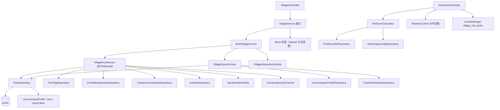

**图表来源**
- [VillageController.java:40-62](file://apps/api/src/main/java/com/campuslove/api/village/VillageController.java#L40-L62)
- [VillageService.java:11-35](file://apps/api/src/main/java/com/campuslove/api/village/VillageService.java#L11-L35)
- [VillagePostService.java:56-110](file://apps/api/src/main/java/com/campuslove/api/village/VillagePostService.java#L56-L110)
- [VillageQueryService.java:265-312](file://apps/api/src/main/java/com/campuslove/api/village/VillageQueryService.java#L265-L312)
- [VillageQueryService.java:450-461](file://apps/api/src/main/java/com/campuslove/api/village/VillageQueryService.java#L450-L461)
- [HotScoreCalculator.java:50-57](file://apps/api/src/main/java/com/campuslove/api/village/HotScoreCalculator.java#L50-L57)
- [HotScoreScheduler.java:42-55](file://apps/api/src/main/java/com/campuslove/api/village/HotScoreScheduler.java#L42-L55)
- [PostRepository.java:357-387](file://apps/api/src/main/java/com/campuslove/api/repository/PostRepository.java#L357-L387)

**章节来源**
- [detail.vue:10-41](file://apps/client/src/subpackages/village/village/detail.vue#L10-L41)
- [detail.vue:173-206](file://apps/client/src/subpackages/village/village/detail.vue#L173-L206)
- [api.ts:1-448](file://apps/client/src/stores/village/api.ts#L1-L448)
- [VillageQueryService.java:80-98](file://apps/api/src/main/java/com/campuslove/api/village/VillageQueryService.java#L80-L98)
- [VillageController.java:35-62](file://apps/api/src/main/java/com/campuslove/api/village/VillageController.java#L35-L62)
- [VillageService.java:146-246](file://apps/api/src/main/java/com/campuslove/api/village/VillageService.java#L146-L246)
- [VillagePostService.java:43-135](file://apps/api/src/main/java/com/campuslove/api/village/VillagePostService.java#L43-L135)
- [HotScoreScheduler.java:24-55](file://apps/api/src/main/java/com/campuslove/api/village/HotScoreScheduler.java#L24-L55)
- [CacheNames.java:42-45](file://apps/api/src/main/java/com/campuslove/api/config/CacheNames.java#L42-L45)
- [CaffeineCacheConfig.java:48-100](file://apps/api/src/main/java/com/campuslove/api/config/CaffeineCacheConfig.java#L48-L100)
- [RedisConfig.java:106-109](file://apps/api/src/main/java/com/campuslove/api/config/RedisConfig.java#L106-L109)

## 性能考虑

系统的性能策略集中在四点：把排序成本从请求路径移到定时任务、把 N+1 消解在批量预加载、用缓存承接读放大、用限流与分页上限约束写放大。

- 热度前置计算：`posts.hot_score` 由 `HotScoreScheduler.scheduledHotScoreRecalc` 每 15 分钟（`@Scheduled(cron = "0 */15 * * * *")`）全量重算，分页步长 500 扫全表（`postRepository.findAll(PageRequest.of(page, 500))`），榜单查询 `findHotBoard` 退化为纯 `ORDER BY p.hotScore DESC, p.createdAt DESC`，实体注释亦写明「重算周期内查询零计算」。并发侧用 Redisson 锁 `hot-score:recalc`（`tryLock(3, 120, SECONDS)`）互斥多实例，抢锁失败直接跳过本次。
- 批量预加载替代逐条查询：`calculateScores` 一次 `countByPostIds` 建 `postId → favoriteCount` 映射；`getPostHistory` 用 `findAllById(postIds)` 建 Map 后按历史顺序映射，作者信息按 `distinct` 的 `authorId` 批量取；管理端列表注释「批量预加载作者信息（昵称/头像），避免 N+1 查询」。
- 聚合下推：作者总获赞用 `sumLikesByAuthorId` 的 JPQL `coalesce(sum(...))` 替代「全量拉取后内存求和」；他人视角作者帖子用 `findTop12ByAuthorIdAndAuditStatusAndStatusOrderByCreatedAtDesc` 限 12 条；我的日常用 `findTop12ByAuthorIdAndVisibilityAndStatusOrderByCreatedAtDesc`。
- 索引驱动的排序：列表主查询恒带 `status` + `audit_status` 过滤与 `ORDER BY isPinned DESC, createdAt DESC`，对应 `idx_posts_status_created_at`、`idx_posts_author_created_at`、`idx_posts_status`、`idx_posts_category`、`idx_posts_activity`、`idx_posts_circle_id`；作者主页分页命中 `(author_id, created_at)` 复合索引。
- 缓存分层：`village_hot_posts` TTL 15 分钟（Caffeine 与 Redis 两套配置同值），key 为 `'board:' + #page` 与 `'hot'`；写路径 `@CacheEvict(allEntries = true)`、重算与管理端操纵后 `evictHotCache()` 主动清空，清空失败只记 warn 并由 TTL 自然兜底。
- 推荐流配额混合：`getPostRecommend(userId, page, pageSize)` 先把 `safeSize` 夹到 `1..100`，再按四段取样灌入 `LinkedHashSet` 去重——关注作者 7 日内新帖占 40%（`max(12, safeSize * 4 / 10)`）、同校区 3 日内热帖占 30%（`max(9, safeSize * 3 / 10)`，走 `findByIdInAndStatusOrderByHotScoreDesc`）、近 3 日新鲜帖占 20%（`max(6, safeSize * 3 / 10)`）、候选不足 `safeSize` 时用全量最新帖补足（`PageRequest.of(0, safeSize * 2)`），最终按 `hot_score * 0.7 + 新鲜度 * 0.3` 混合排序，避免任一段过量拉取。
- 请求面约束：所有分页端点 `pageSize` 受 `@Min(1) @Max(100)` 限制，`findHotBoard` / `findHotPosts` 服务端再次 `Math.min(100, size)` 兜底；写端点按 IP 令牌桶限流（发帖 20/0.5、点赞收藏 60/2、评论转发 30/1）。
- 浏览量写入隔离：详情读取只在本对象上 `+1` 用于即时展示，落库原子自增与历史写入放在 `REQUIRES_NEW` 的 `recordPostView` 独立事务里，避免只读事务被写操作污染。
- 客户端渲染成本：`onLoad` 先用 `villageStore.posts` 同 id 缓存渲染首帧（消除白屏），无缓存才置 `detailLoading` 骨架屏；评论按 `COMMENT_PAGE_SIZE = 20` 增量拉取，`noMoreComments` 与 `commentHasMore` 终止无限滚动。

**章节来源**
- [HotScoreScheduler.java:24-170](file://apps/api/src/main/java/com/campuslove/api/village/HotScoreScheduler.java#L24-L170)
- [HotScoreCalculator.java:91-101](file://apps/api/src/main/java/com/campuslove/api/village/HotScoreCalculator.java#L91-L101)
- [PostRepository.java:102-130](file://apps/api/src/main/java/com/campuslove/api/repository/PostRepository.java#L102-L130)
- [PostRepository.java:260-319](file://apps/api/src/main/java/com/campuslove/api/repository/PostRepository.java#L260-L319)
- [Post.java:24-58](file://apps/api/src/main/java/com/campuslove/api/entity/Post.java#L24-L58)
- [VillageQueryService.java:440-469](file://apps/api/src/main/java/com/campuslove/api/village/VillageQueryService.java#L440-L469)
- [VillageQueryService.java:578-599](file://apps/api/src/main/java/com/campuslove/api/village/VillageQueryService.java#L578-L599)
- [VillageQueryService.java:611-664](file://apps/api/src/main/java/com/campuslove/api/village/VillageQueryService.java#L611-L664)
- [AdminVillagePostController.java:151-153](file://apps/api/src/main/java/com/campuslove/api/admin/AdminVillagePostController.java#L151-L153)
- [VillageController.java:184-200](file://apps/api/src/main/java/com/campuslove/api/village/VillageController.java#L184-L200)
- [CaffeineCacheConfig.java:42-51](file://apps/api/src/main/java/com/campuslove/api/config/CaffeineCacheConfig.java#L42-L51)
- [detail.vue:157-206](file://apps/client/src/subpackages/village/village/detail.vue#L157-L206)
- [detail.vue:679-725](file://apps/client/src/subpackages/village/village/detail.vue#L679-L725)

## 配置与开关

帖子域的行为由四类配置共同决定：应用开关表、内容过滤配置、热度权重配置与缓存/限流参数。

| 配置项 | 位置 | 默认值 | 作用 |
| --- | --- | --- | --- |
| `app_switch.post_publish_open` | `AppConfigService.SWITCH_POST_PUBLISH_OPEN = "post_publish_open"`，由 `isSwitchEnabled` 读取 | real 环境可关；mock profile 由 `MockAppConfigService` 恒开 | 发帖总闸，关闭时 `POST /posts` 返回 403 `POST_PUBLISH_CLOSED` |
| `app.content-filter.enabled` | `SensitiveWordFilter`（`@ConfigurationProperties(prefix = "app.content-filter")`），字段默认 `false`，`application.yml` 显式置 `true` | `true`（yml） | 关闭时 `filter/filterWithLog/containsSensitive` 全部原样返回，不做替换 |
| `app.content-filter.keywords` | 同上，列表注入时自动 `initKeywordSet()` | 15 个词（赌博、色情、违法、毒品、枪支、暴力、诈骗、传销、裸聊、约炮、嫖娼、卖淫、赌博网站、六合彩、博彩） | 命中词替换为常量 `REPLACEMENT = "***"`，正则按词长降序拼接、大小写不敏感 |
| `hot.likesWeight` / `hot.commentsWeight` / `hot.sharesWeight` / `hot.favoritesWeight` / `hot.viewsWeight` / `hot.gravity` | `app_config.config_key`（`AdminAppConfigRepository.findByConfigKey`），seed 见 `V2026.08.11.0003` | 1.0 / 3.0 / 2.0 / 2.0 / 0.1 / 1.5 | 热度公式权重，后台「全局配置」页可改、实时生效无需重启；解析失败或缺失回退内置默认值 |
| `posts.hot_boost` / `posts.hot_banned` | 表列，管理端 `POST /admin/forum/village-posts/{id}/hot-boost` 写 | 1.0 / false | 运营操纵：`boost` 取值 `0 ≤ b ≤ 100`（0 压榜、>1 加成），`hot_banned = true` 时热度直接返回 0.0 |
| `upload.video.enabled` | 媒体上传开关（`MediaUploadController` 注释所述批次 A） | — | `false` 时 `type = video` 直接 403 `VIDEO_UPLOAD_DISABLED`，图片/语音/背景图不受影响 |
| `village_hot_posts` TTL | `CaffeineCacheConfig.VILLAGE_HOT_POSTS_TTL` 与 `RedisConfig.VILLAGE_HOT_POSTS_TTL` | 15 分钟（两处同值） | 热度榜与首页热门缓存有效期，与重算周期对齐 |
| `sensitive_words` TTL | `CacheNames.SENSITIVE_WORDS`（Redis 注释） | 1 小时 | 敏感词相关缓存 |
| Spring Profile | `@Profile("real")` 标注在 `VillagePostService` / `HotScoreCalculator` / `HotScoreScheduler` | — | 决定走真实发帖与热度重算，还是 mock 演示链路 |
| 端点限流参数 | 各 `@RateLimit(capacity, refillTokens, key = "#request.remoteAddr")` | 发帖 20/0.5，点赞/收藏/评论点赞 60/2，评论/转发 30/1，推荐流 30/2 | 按客户端 IP 的令牌桶 |

热度公式与其实现在代码中被写成文档常量：`raw = likes*w1 + comments*w3 + shares*w2 + favorites*w2 + views*w0.1`，`hotScore = raw / pow(ageHours + 2, gravity) * hotBoost`，其中 `ageHours` 由 `createdAt` 与当前时间差按分钟/60 计算并 `max(0, ...)` 防负。

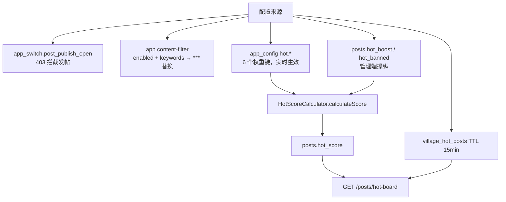

**图表来源**
- [AppConfigService.java:25-27](file://apps/api/src/main/java/com/campuslove/api/growth/AppConfigService.java#L25-L27)
- [VillageController.java:48-52](file://apps/api/src/main/java/com/campuslove/api/village/VillageController.java#L48-L52)
- [SensitiveWordFilter.java:24-43](file://apps/api/src/main/java/com/campuslove/api/config/SensitiveWordFilter.java#L24-L43)
- [application.yml:333-350](file://apps/api/src/main/resources/application.yml#L333-L350)
- [HotScoreCalculator.java:17-48](file://apps/api/src/main/java/com/campuslove/api/village/HotScoreCalculator.java#L17-L48)
- [HotScoreCalculator.java:66-111](file://apps/api/src/main/java/com/campuslove/api/village/HotScoreCalculator.java#L66-L111)
- [Post.java:167-180](file://apps/api/src/main/java/com/campuslove/api/entity/Post.java#L167-L180)
- [CaffeineCacheConfig.java:48-51](file://apps/api/src/main/java/com/campuslove/api/config/CaffeineCacheConfig.java#L48-L51)
- [VillageController.java:184-200](file://apps/api/src/main/java/com/campuslove/api/village/VillageController.java#L184-L200)

**章节来源**
- [AppConfigService.java:25-27](file://apps/api/src/main/java/com/campuslove/api/growth/AppConfigService.java#L25-L27)
- [application.yml:333-350](file://apps/api/src/main/resources/application.yml#L333-L350)
- [SensitiveWordFilter.java:14-116](file://apps/api/src/main/java/com/campuslove/api/config/SensitiveWordFilter.java#L14-L116)
- [HotScoreCalculator.java:17-120](file://apps/api/src/main/java/com/campuslove/api/village/HotScoreCalculator.java#L17-L120)
- [VillageController.java:43-62](file://apps/api/src/main/java/com/campuslove/api/village/VillageController.java#L43-L62)
- [MediaUploadController.java:83-89](file://apps/api/src/main/java/com/campuslove/api/media/MediaUploadController.java#L83-L89)
- [CacheNames.java:42-45](file://apps/api/src/main/java/com/campuslove/api/config/CacheNames.java#L42-L45)
- [RedisConfig.java:257-292](file://apps/api/src/main/java/com/campuslove/api/config/RedisConfig.java#L257-L292)

## 故障排查指南

按症状定位到具体判定分支，可显著缩短排查路径。

- 「发帖返回 403 且文案为『发帖功能暂未开放，请稍后再试』」：`AppConfigService.isSwitchEnabled("post_publish_open")` 返回 false，检查后台开关而非请求体。
- 「发帖 400：帖子标题必填，长度需为 5-30 字」：校验有两条通路——`CreatePostRequest` 的 `@Size(min = 5, max = 30)`（Bean Validation）与 `VillagePostService` 的 `POST_TITLE_MIN_LENGTH/MAX_LENGTH` 常量（`trim()` 后长度）。代码注释要求「调整阈值时同步改 `ErrorMessages` 文案」，三处需一起改。
- 「发帖 400：不支持的帖子分类: xxx」：`category` 不在 `PostCategory` 枚举内，错误文案已附带允许值；注意 `following` / `samecity` / `discover` 是路由分类，不应作为 `category` 传给发帖接口。
- 「圈内发帖 403（请先加入该圈子，再在圈内发帖）」或「校园帖 403」：分别来自 `validateCircleMembership`（`CircleMembershipRepository.findByUserIdAndCircleId` 返回空）与 `validateSchoolCertification`（认证记录缺失或 `status != "APPROVED"`）。若注入的是旧测试构造器（Repository 为 null），这两道校验会被静默跳过——排查越权问题时要先确认走的是 Spring 注入构造器。
- 「帖子发出去了但列表/详情页看不到」：新建帖 `auditStatus` 被强制置 `pending`，各 feed 只查 `AuditStatus.approved`；非作者通过直链访问待审帖会得到 404（`getPost` 显式抛 `ResourceNotFoundException`）。处理路径是管理端 `POST /api/v1/admin/forum/village-posts/{id}/audit`。
- 「已下架内容仍被直链访问」：`getPost` 对 `status != active` 返回 404，与列表过滤同源；若出现回归，先核对该判断是否被绕过，再看 `AdminVillagePostController.auditPost` 拒绝分支是否同步把 `status` 置 `hidden`。
- 「点赞第二次点击返回 409 / 无法取消点赞」：`@Idempotent` 与 toggle 语义冲突，R16 已在 `/{id}/like` 与 `/comments/{commentId}/like` 移除幂等注解；若新加互动端点误加幂等会复现该问题。
- 「多图上传被 409 拦截」：客户端文件名必须含每图唯一量（`comment-${Date.now()}-${index}.jpg`），恒定 `name` 会命中同一 `Idempotency-Key`（MP-R1-CAMPUSPOST-002 同源修复）。
- 「热度榜数据 15 分钟不动」：`findHotBoard` 带 `@Cacheable(key = "'board:' + #page")`，且热度分只在 `cron = "0 */15 * * * *"` 重算；管理端操纵 `hot_boost` 后需 `recalcPostScore` + `evictHotCache` 才立即生效。若多实例并发，日志会出现「热度分重算获取锁失败，已有任务在执行，跳过本次」。
- 「更新帖子冲突返回 409」：`@Version` 乐观锁抛 `ObjectOptimisticLockingFailureException`，由 `GlobalExceptionHandler` 统一转 HTTP 409；批量重算走 `saveAll`，同一帖被并发操纵时会失败而非静默覆盖。
- 「同校流 / 相似作者返回 400」：`getCampusFeed` 与 `getSimilarAuthors` 捕获 `IllegalArgumentException` 后返回 `badRequest()`，多为 `userId` 无法解析或参数非法，不同于全局异常链路的错误体格式。
- 「监控埋点异常但接口仍成功」：`recordPostCreated` / `recordPostLiked` / `recordCommentCreated` 全部包在 try/catch 中并注释「不影响主流程」， Micrometer 故障需看 `/actuator/prometheus` 侧而非接口返回。
- 「详情页白屏或展示他人帖子」：`onLoad` 的两处防御分别是「列表缓存首帧 + 骨架屏」与「无 `query.id` 且无 `currentPost` 时 `clearCurrentPost()` 并提示『帖子不存在』」（infra R2-00072）；若直开分享链接出现串帖，先查该分支。

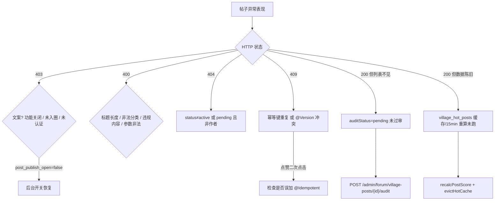

**图表来源**
- [VillageController.java:158-161](file://apps/api/src/main/java/com/campuslove/api/village/VillageController.java#L158-L161)
- [VillagePostService.java:167-194](file://apps/api/src/main/java/com/campuslove/api/village/VillagePostService.java#L167-L194)
- [VillagePostService.java:212-235](file://apps/api/src/main/java/com/campuslove/api/village/VillagePostService.java#L212-L235)
- [VillagePostService.java:274-288](file://apps/api/src/main/java/com/campuslove/api/village/VillagePostService.java#L274-L288)
- [VillagePostService.java:345-372](file://apps/api/src/main/java/com/campuslove/api/village/VillagePostService.java#L345-L372)
- [VillageQueryService.java:406-437](file://apps/api/src/main/java/com/campuslove/api/village/VillageQueryService.java#L406-L437)
- [Post.java:248-259](file://apps/api/src/main/java/com/campuslove/api/entity/Post.java#L248-L259)
- [HotScoreScheduler.java:60-86](file://apps/api/src/main/java/com/campuslove/api/village/HotScoreScheduler.java#L60-L86)
- [detail.vue:709-715](file://apps/client/src/subpackages/village/village/detail.vue#L709-L715)

**章节来源**
- [ErrorMessages.java:793-795](file://apps/api/src/main/java/com/campuslove/api/common/ErrorMessages.java#L793-L795)
- [ErrorMessages.java:1054-1059](file://apps/api/src/main/java/com/campuslove/api/common/ErrorMessages.java#L1054-L1059)
- [ErrorMessages.java:1132-1134](file://apps/api/src/main/java/com/campuslove/api/common/ErrorMessages.java#L1132-L1134)
- [VillageController.java:146-397](file://apps/api/src/main/java/com/campuslove/api/village/VillageController.java#L146-L397)
- [VillagePostService.java:164-373](file://apps/api/src/main/java/com/campuslove/api/village/VillagePostService.java#L164-L373)
- [VillageQueryService.java:406-437](file://apps/api/src/main/java/com/campuslove/api/village/VillageQueryService.java#L406-L437)
- [AdminVillagePostController.java:201-342](file://apps/api/src/main/java/com/campuslove/api/admin/AdminVillagePostController.java#L201-L342)
- [HotScoreScheduler.java:57-170](file://apps/api/src/main/java/com/campuslove/api/village/HotScoreScheduler.java#L57-L170)
- [detail.vue:518-554](file://apps/client/src/subpackages/village/village/detail.vue#L518-L554)
- [detail.vue:679-725](file://apps/client/src/subpackages/village/village/detail.vue#L679-L725)

## 能力缺口登记

官方目录要求中有若干条目在本仓库找不到实现证据。以下逐条给出判定依据（检索范围与命中情况），不做任何推测性描述。

1. **帖子编辑（CRUD 中的 U）未实现**。判定依据：在 `apps/api/src/main/java/com/campuslove/api` 全量检索 `(PutMapping|PatchMapping)` 与 `updatePost|deletePost|editPost`，命中 2 处且都是管理端 `deletePost`（`AdminPostController.java:205`、`AdminVillagePostController.java:321`），帖子域不存在任何更新端点；`VillagePostService` 的类注释虽写「职责：处理帖子创建/更新/删除等写操作」，但类内公开写方法只有 `createPost`（L166-L258），其余为私有校验方法。客户端检索 `updatePost|editPost` 命中 0。
2. **C 端删除帖子未实现**。判定依据：`VillageController` 的 16 个映射中唯一的 `@DeleteMapping` 是 `/history`（清空当前用户浏览历史，L391-L397），没有 `DELETE /posts/{id}`；删除仅存在于管理端 `DELETE /api/v1/admin/forum/village-posts/{id}`，且为 `status = deleted` 软删除，评论不硬删。
3. **分类清单与仓库不符**。官方目录描述的分类为 `dating、study、life、activity、help`，实际 `Post.PostCategory` 为 `all, interest, sincere, hometown, anonymous, latest, campus, activity`（`Post.java:63-65`，列定义 `Post.java:125`），数据库 ENUM 亦按此定义（`V2026.05.31.0001__fix_entity_ddl_mismatches.sql:11`）。判定依据：检索 `PostCategory.(dating|study|life|help)` 与 `category="(dating|study|life|help)"`，在 `apps` 目录的 `*.{java,ts,vue}` 中命中 0 个文件；仅 `activity` 一项与目录描述重合。列表接口另外接受的 `following`、`samecity`、`discover` 是路由分类而非枚举值。
4. **帖子内容的富文本处理未实现**。判定依据：`posts.content` 定义为 `columnDefinition = "TEXT"` 的纯文本列（`Post.java:111-113`），写入前仅经敏感词替换与长度校验（`@Size(max = 5000)`）；在 `apps/client/src` 检索 `rich-text|richeditor|RichEditor|quill|contenteditable` 命中 0。页面上存在的只是评论输入增强——表情面板（`COMMON_EMOJIS` 30 项）、`@` 提及（向字符串末尾追加 `"@"`）、图片上传（≤3 张），全部是纯文本拼接，没有富文本模型、没有 HTML/Markdown 渲染管线。
5. **OpenAPI 契约对帖子端点覆盖不足（契约漂移）**。判定依据：`docs/openapi/village.yaml`（929 行）只声明 7 个 posts 相关 operationId——`getPosts`(L12)、`createPost`(L68)、`getPostDetail`(L91)、`likePost`(L117)、`sharePost`(L143)、`getPostComments`(L175)、`createComment`(L217)；而控制器实际有 16 个映射，`/posts/{id}/favorite`、`/posts/hot-board`、`/posts/recommend`、`/posts/history`（GET/DELETE）、`/posts/campus-feed`、`/posts/{id}/similar-authors`、`/posts/comments/{commentId}/like`、`/posts/my-dailies` 均未在规范中出现。此外 `VillageController` 类上没有 springdoc `@Operation`/`@Tag` 注解（对比 `MediaUploadController` 带 `@Tag` 与 `operationId = "uploadMedia"`）。
6. **服务端帖子链路没有专用熔断/重试恢复**。判定依据：`application.yml` 的 `resilience4j` 段（L364 起）为外部依赖（微信 API / 短信 / 对象存储）配置 CircuitBreaker/Retry/RateLimiter，实例名对齐 `Resilience4jConfig` 的注解 name，帖子控制器与服务类中未出现任何 `@CircuitBreaker` / `@Retry` 注解；异常恢复只落在两处——控制器对 `IllegalArgumentException` 的手工转 400（`campus-feed`、`similar-authors`）与客户端 `services/http.ts` 的请求级恢复（`retry` 默认 1 且仅对 `status = 0` 的网络层错误重试、`noRetry` 开关、`timeout` 默认 10 秒、401 刷新后单次重试并以 `retry401Count` 防死循环、`AbortController.signal` 取消）。
7. **审核流程为人工单级，缺少自动复核闭环**。判定依据：发帖一律 `auditStatus = pending`，只有管理端 `POST /api/v1/admin/forum/village-posts/{id}/audit` 能推进状态，拒绝时同步把 `status` 置 `hidden`；统一内容安全检查的 `review` 判定仅写 warn 日志后放行（`VillagePostService.java:284-287`），仓库中不存在复审队列、无审核 SLA 或定时扫描待审帖的任务。
8. **帖子正文不含视频/音频媒体字段**。判定依据：`Post` 实体仅有 `images` JSON 列（`Post.java:115-117`），`CreatePostRequest` 仅有 `@Size(max = 9) List<String> images`；媒体上传接口支持 `type = video`，但 `upload.video.enabled = false` 时直接 403 `VIDEO_UPLOAD_DISABLED`，帖子表没有承载视频 URL/时长的列，因此帖子域目前只做图片承载。

**章节来源**
- [VillagePostService.java:34-58](file://apps/api/src/main/java/com/campuslove/api/village/VillagePostService.java#L34-L58)
- [VillagePostService.java:164-258](file://apps/api/src/main/java/com/campuslove/api/village/VillagePostService.java#L164-L258)
- [VillagePostService.java:274-288](file://apps/api/src/main/java/com/campuslove/api/village/VillagePostService.java#L274-L288)
- [VillageController.java:178-397](file://apps/api/src/main/java/com/campuslove/api/village/VillageController.java#L178-L397)
- [Post.java:62-65](file://apps/api/src/main/java/com/campuslove/api/entity/Post.java#L62-L65)
- [Post.java:111-126](file://apps/api/src/main/java/com/campuslove/api/entity/Post.java#L111-L126)
- [AdminVillagePostController.java:201-342](file://apps/api/src/main/java/com/campuslove/api/admin/AdminVillagePostController.java#L201-L342)
- [CreatePostRequest.java:14-29](file://apps/api/src/main/java/com/campuslove/api/village/CreatePostRequest.java#L14-L29)
- [village.yaml:9-217](file://docs/openapi/village.yaml#L9-L217)
- [application.yml:352-379](file://apps/api/src/main/resources/application.yml#L352-L379)
- [http.ts:436-440](file://apps/client/src/services/http.ts#L436-L440)
- [http.ts:555-567](file://apps/client/src/services/http.ts#L555-L567)
- [MediaUploadController.java:83-89](file://apps/api/src/main/java/com/campuslove/api/media/MediaUploadController.java#L83-L89)
- [detail.vue:480-516](file://apps/client/src/subpackages/village/village/detail.vue#L480-L516)

## 结论

帖子管理系统在 Campus Love 中是一个「读重、写严、算得快」的子系统：读侧以 `findVisiblePosts*` 三条 JPQL 为收敛点，把状态、审核与四级可见性合并成一条 SQL 谓词，再用 `isPinned → createdAt` 或 `hotScore → createdAt` 两种排序输出；写侧只有一条 `createPost` 通路，但前置了限流、幂等、开关、成员/认证校验、两级内容安全与乐观锁；热度通过 15 分钟全量重算与 `village_hot_posts` 缓存把排序成本移出请求路径。客户端 `detail.vue` 以 Pinia `village` store 为唯一状态源，配合首帧缓存渲染、并行附属请求与 20 条一页的评论增量加载，构成完整的详情体验。

从实现完备度看，读、互动、分发、审核、持久化与索引六个方向都有可验证的代码支撑；而编辑、C 端删除、富文本、契约声明覆盖与服务端恢复策略五个方向处于缺位或半完成状态（详见「能力缺口登记」）。后续若要补齐 CRUD，最低成本的接入点是：在 `VillagePostService` 增加与 `createPost` 同构的更新方法（复用 `rejectIfRisky` 与 `filterWithLog`，并沿用 `@CacheEvict(VILLAGE_HOT_POSTS)`），同时在 `VillageController` 补 `@PatchMapping("/{id}")`，并在 `docs/openapi/village.yaml` 中把已有 8 个未声明端点与新增端点一并登记，避免契约与实现继续分叉。

**章节来源**
- [PostRepository.java:340-476](file://apps/api/src/main/java/com/campuslove/api/repository/PostRepository.java#L340-L476)
- [VillagePostService.java:164-258](file://apps/api/src/main/java/com/campuslove/api/village/VillagePostService.java#L164-L258)
- [HotScoreScheduler.java:57-150](file://apps/api/src/main/java/com/campuslove/api/village/HotScoreScheduler.java#L57-L150)
- [VillageController.java:66-397](file://apps/api/src/main/java/com/campuslove/api/village/VillageController.java#L66-L397)
- [detail.vue:679-753](file://apps/client/src/subpackages/village/village/detail.vue#L679-L753)
- [VillageService.java:11-336](file://apps/api/src/main/java/com/campuslove/api/village/VillageService.java#L11-L336)

