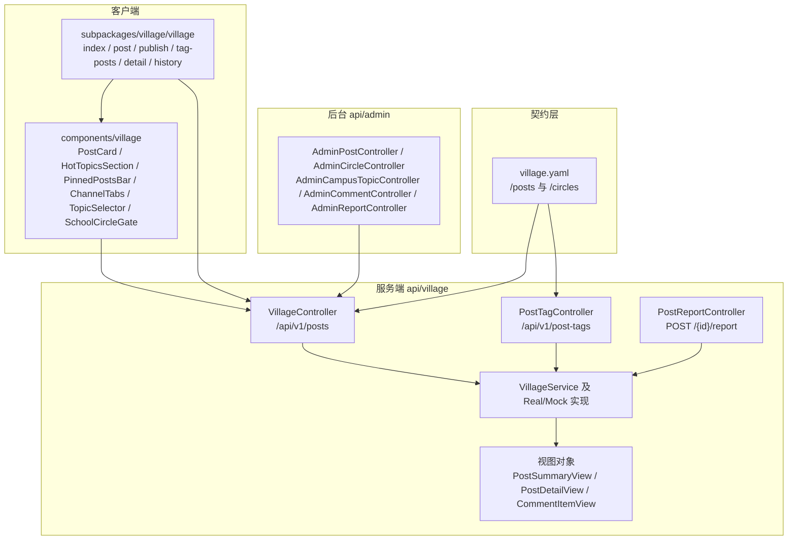
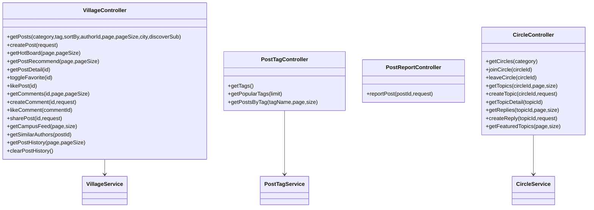
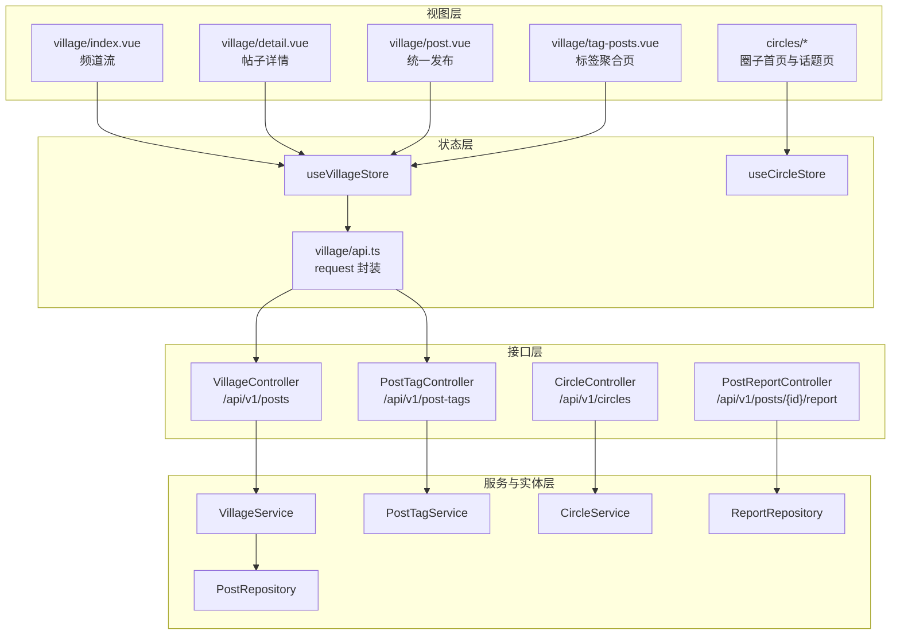
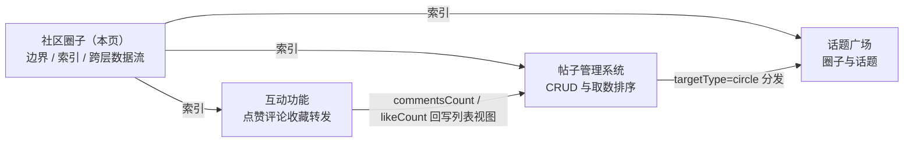
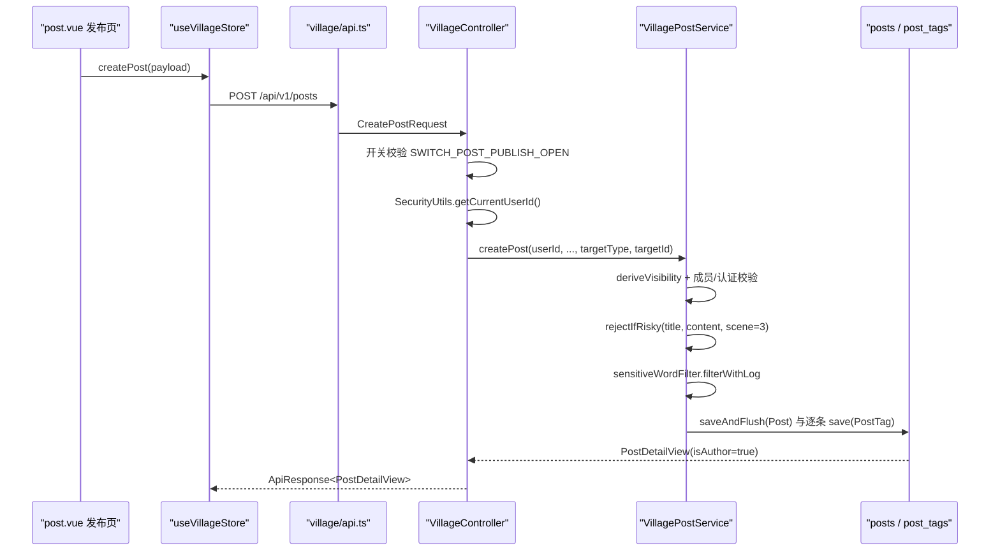
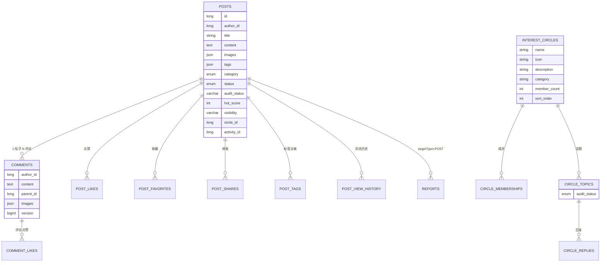
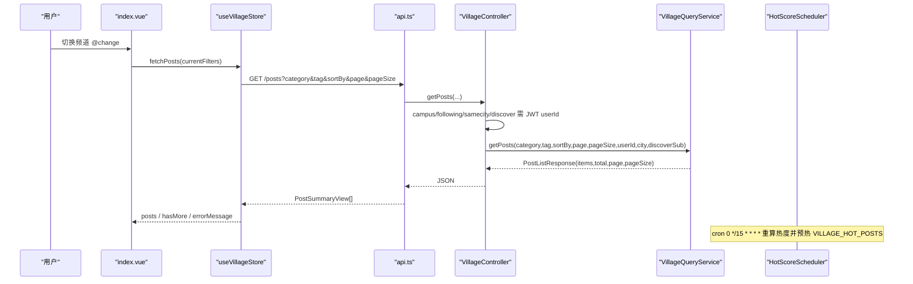
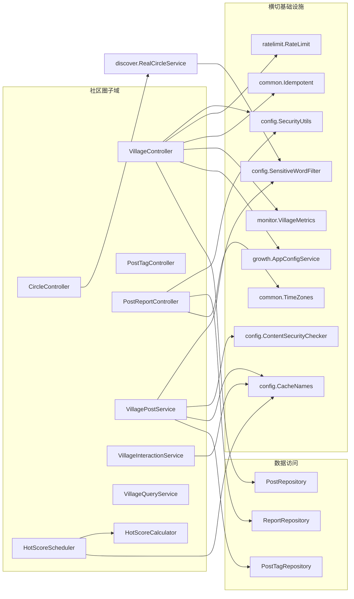
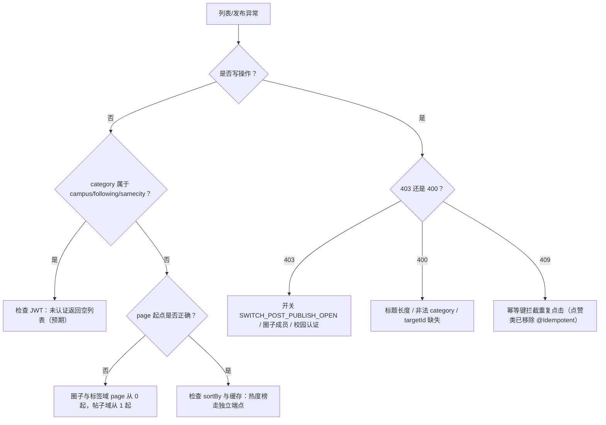
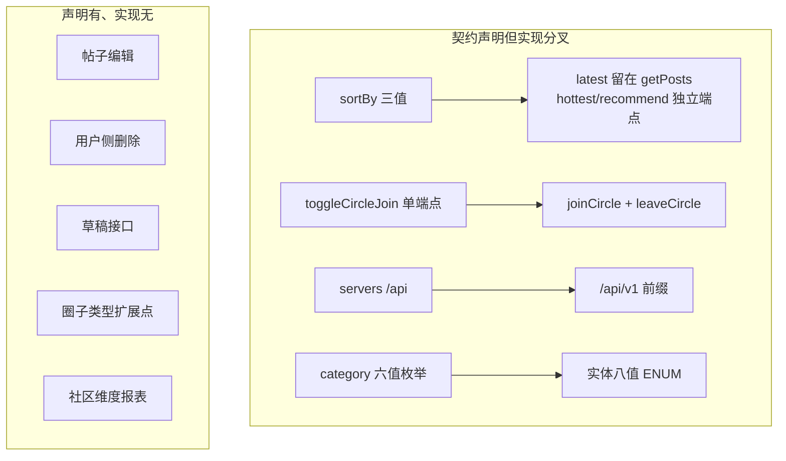

# 社区圈子

<cite>
**本文引用的文件**
- [village.yaml](file://docs/openapi/village.yaml)
- [VillageController.java](file://apps/api/src/main/java/com/campuslove/api/village/VillageController.java)
- [PostTagController.java](file://apps/api/src/main/java/com/campuslove/api/village/PostTagController.java)
- [PostReportController.java](file://apps/api/src/main/java/com/campuslove/api/village/PostReportController.java)
- [VillagePostService.java](file://apps/api/src/main/java/com/campuslove/api/village/VillagePostService.java)
- [RealPostTagService.java](file://apps/api/src/main/java/com/campuslove/api/village/RealPostTagService.java)
- [HotScoreScheduler.java](file://apps/api/src/main/java/com/campuslove/api/village/HotScoreScheduler.java)
- [CircleController.java](file://apps/api/src/main/java/com/campuslove/api/discover/CircleController.java)
- [Post.java](file://apps/api/src/main/java/com/campuslove/api/entity/Post.java)
- [InterestCircle.java](file://apps/api/src/main/java/com/campuslove/api/entity/InterestCircle.java)
- [PostDraft.java](file://apps/api/src/main/java/com/campuslove/api/entity/PostDraft.java)
- [AdminCircleController.java](file://apps/api/src/main/java/com/campuslove/api/admin/AdminCircleController.java)
- [index.vue](file://apps/client/src/subpackages/village/village/index.vue)
- [post.vue](file://apps/client/src/subpackages/village/village/post.vue)
- [history.vue](file://apps/client/src/subpackages/village/village/history.vue)
- [apps/client/src/stores/village/api.ts](file://apps/client/src/stores/village/api.ts)
- [apps/client/src/stores/village/index.ts](file://apps/client/src/stores/village/index.ts)
- [apps/client/src/stores/circle.ts](file://apps/client/src/stores/circle.ts)
- [routes.ts](file://apps/client/src/constants/routes.ts)
</cite>

## 目录
1. [简介](#简介)
2. [项目结构](#项目结构)
3. [核心组件](#核心组件)
4. [架构总览](#架构总览)
5. [子页面索引与边界](#子页面索引与边界)
6. [详细组件分析](#详细组件分析)
7. [数据模型](#数据模型)
8. [端到端链路](#端到端链路)
9. [依赖关系分析](#依赖关系分析)
10. [性能考虑](#性能考虑)
11. [故障排查指南](#故障排查指南)
12. [能力缺口登记](#能力缺口登记)
13. [结论](#结论)

## 简介

社区圈子是 Campus Love 小程序中承载 UGC 内容与社交互动的核心业务域，在代码中以 `village`（村庄）作为包名与目录名统一命名：后端落在 `apps/api/src/main/java/com/campuslove/api/village/`，客户端页面落在 `apps/client/src/subpackages/village/village/`，可复用组件落在 `apps/client/src/components/village/`，接口契约集中在 `docs/openapi/village.yaml`。

本页是 `核心功能模块/社区圈子` 分组的**总览页**，职责是三件事：

1. 划出模块边界——哪些能力属于社区圈子域，哪些属于相邻域（认证、匹配、管理后台）。
2. 串联三个子页（帖子管理系统 / 话题广场 / 互动功能）的覆盖范围，并给出它们的索引入口。
3. 描述跨子页的整体数据流：从客户端频道页取数，到 OpenAPI 契约声明的端点，再到后端视图对象与审核控制器。

本子页中「帖子管理系统」已在仓库中成文，本页不重复其细节，只在 `子页面索引与边界` 一节标明分工；「话题广场」「互动功能」两页尚未落地，其在本页中的定位描述以源码与 OpenAPI 契约中的真实符号为准，不外推未实现的能力。

**章节来源**
- [village.yaml:9-353](file://docs/openapi/village.yaml#L9-L353)

## 项目结构

社区圈子域的目录分布遵循 monorepo 的前后端分层约定，四个物理位置共同构成一个逻辑模块：

| 位置 | 角色 | 内容 |
| --- | --- | --- |
| `docs/openapi/village.yaml` | 契约 | `/posts`、`/circles`、`/post-tags/popular` 三组共 10 个路径、14 个操作声明 |
| `apps/api/.../api/village/` | 服务端 | 帖子视图对象、作者视图、评论预览视图、举报控制器 |
| `apps/api/.../api/admin/` | 后台侧 | 帖子审核请求体等管理端配套类型 |
| `apps/client/src/subpackages/village/village/` | 页面 | 频道列表页、发帖页、话题标签帖子页、详情页、历史页 |
| `apps/client/src/components/village/` | 组件 | 帖子卡片、热门话题、置顶条、频道 Tab、话题选择器、校园圈门禁 |



[此图为模块物理分布的概念示意，节点对应真实目录与类名，但连线不代表直接调用关系，故不提供图表来源]

**章节来源**
- [village.yaml:9-353](file://docs/openapi/village.yaml#L9-L353)
- [VillageController.java:35-62](file://apps/api/src/main/java/com/campuslove/api/village/VillageController.java#L35-L62)
- [PostTagController.java:20-29](file://apps/api/src/main/java/com/campuslove/api/village/PostTagController.java#L20-L29)
- [PostReportController.java:46-49](file://apps/api/src/main/java/com/campuslove/api/village/PostReportController.java#L46-L49)
- [index.vue:1-1](file://apps/client/src/subpackages/village/village/index.vue#L1-L1)
- [post.vue:1-1](file://apps/client/src/subpackages/village/village/post.vue#L1-L1)

## 核心组件

社区圈子由五类组件构成：页面（subpackages）、展示组件（components）、状态容器（stores）、服务端控制器（api.village / api.discover）与视图对象（record）。下表给出每一类的代表实现与其在域中的职责定位。

| 组件 | 类型 | 职责定位 |
| --- | --- | --- |
| `VillageController` | 后端控制器 | `/api/v1/posts` 帖子域唯一入口：列表、详情、发布、点赞、收藏、评论、评论点赞、转发、热度榜、推荐流、同校流、相似作者、浏览历史 |
| `PostTagController` | 后端控制器 | `/api/v1/post-tags` 话题标签：预置标签、热门话题榜、按标签聚合帖子 |
| `PostReportController` | 后端控制器 | `POST /api/v1/posts/{id}/report` 帖子举报，复用 `Report` 实体，`@Profile("real")` 生效 |
| `CircleController` | 后端控制器（discover 包） | `/api/v1/circles` 圈子列表、加入/退出、话题发布与浏览、回复、精选话题 |
| `useVillageStore` | 客户端 store | `defineStore("village")`，帖子列表/详情/互动 action 的唯一持有者 |
| `useCircleStore` | 客户端 store | `defineStore("circle")`，圈子与话题状态 |
| `village/api.ts` | 客户端 API 封装 | 纯调用函数集合，统一走 `services/http` 的 `request` |
| `village/index.vue` | 客户端页面 | 村口频道页，按校园/活动/兴趣频道分支渲染 |
| `village/post.vue` | 客户端页面 | 统一发布页，含已加入圈子选择分支 |
| `PostCard.vue` / `HotTopicsSection.vue` / `PinnedPostsBar.vue` / `SchoolCircleGate.vue` | 客户端组件 | 帖子卡片、热门话题区块、置顶条、校园圈准入门禁 |



**章节来源**
- [VillageController.java:35-399](file://apps/api/src/main/java/com/campuslove/api/village/VillageController.java#L35-L399)
- [PostTagController.java:20-75](file://apps/api/src/main/java/com/campuslove/api/village/PostTagController.java#L20-L75)
- [PostReportController.java:46-122](file://apps/api/src/main/java/com/campuslove/api/village/PostReportController.java#L46-L122)
- [CircleController.java:34-175](file://apps/api/src/main/java/com/campuslove/api/discover/CircleController.java#L34-L175)
- [index.ts:142-142](file://apps/client/src/stores/village/index.ts#L142-L142)
- [circle.ts:279-279](file://apps/client/src/stores/circle.ts#L279-L279)
- [api.ts:1-130](file://apps/client/src/stores/village/api.ts#L1-L130)

## 架构总览

域内调用链固定为四层：页面/组件 → store（action + api 封装）→ HTTP 契约（`docs/openapi/village.yaml`）→ Spring 控制器 → 服务实现 → 视图 record。`village.yaml` 把同一域拆成 `/posts`（帖子）与 `/circles`（圈子/话题）两组路径，而服务端实现分别落在 `api.village` 与 `api.discover` 两个包，这是理解本模块边界的关键事实。



[此图为分层调用概念示意，跨层连线依据 api.ts 与控制器注释中的端点声明，未逐条展开服务内部调用，故不提供图表来源]

三条贯穿性约定构成架构的稳定性来源：

1. **身份来源统一**：所有写操作的用户 ID 由 `SecurityUtils.getCurrentUserId()` 从 JWT 上下文取，不从请求参数或请求体传入。
2. **写操作三件套**：`@RateLimit` + `@Idempotent` + `@PreAuthorize("hasRole('USER')")`。点赞类端点在 2026-09-07 R16 中显式移除 `@Idempotent`，因为幂等键会拦截第二次点击导致无法取消点赞。
3. **视图 record 独立成文件**：`PostDetailView`、`PostSummaryView` 等从控制器内部迁出为 public record，便于跨包（如 mock 包）引用。

**章节来源**
- [VillageController.java:30-62](file://apps/api/src/main/java/com/campuslove/api/village/VillageController.java#L30-L62)
- [VillageController.java:235-251](file://apps/api/src/main/java/com/campuslove/api/village/VillageController.java#L235-L251)
- [PostDetailView.java:1-35](file://apps/api/src/main/java/com/campuslove/api/village/PostDetailView.java#L1-L35)
- [api.ts:7-19](file://apps/client/src/stores/village/api.ts#L7-L19)
- [village.yaml:9-353](file://docs/openapi/village.yaml#L9-L353)

## 子页面索引与边界

本页下辖三个子页，各自持有实现细节；本页只提供入口、边界与跨页数据流。

| 子页 | 覆盖范围 | 主要落点 | 与本页的分工 |
| --- | --- | --- | --- |
| [帖子管理系统](./帖子管理系统.md) | 帖子 CRUD、分类与频道取数、热度榜与推荐流、分页加载、排序与缓存、发帖开关强制点 | `VillageController` 帖子段、`PostTagController`、`village/api.ts`、`useVillageStore` 列表 action | 本页不重复其 CRUD 与排序细节，只在 `端到端链路` 给出跨层视角 |
| [话题广场](./话题广场.md) | 圈子列表与分类、加入/退出、圈子话题发布与浏览、回复与精选话题、标签聚合入口 | `CircleController`、`RealCircleService`、`useCircleStore`、`circles/*` 页面、`village/tag-posts.vue` | 本页给出 `/circles` 与 `/posts` 的边界归属结论，细节由该页展开 |
| [互动功能](./互动功能.md) | 点赞、评论与楼中楼、评论点赞、收藏、转发、浏览历史、同校流与相似作者推荐 | `VillageController` 互动段、`VillageInteractionService`、`CommentItemView` 等评论视图 | 本页只列出互动端点清单与限流口径索引，语义细节归该页 |



**边界判定依据**：

- 圈子端点实现在 `api/discover/CircleController.java` 而非 `api/village`，包路径决定了「话题广场」与发现域共享服务与限流口径。
- 统一发布通过 `CreatePostRequest.targetType`（`general|circle|campus`）把圈子话题写入路径收敛到 `/api/v1/posts`，因此「帖子管理系统」与「话题广场」在发布侧交汇于同一个请求体。
- 客户端存在两套页面：`subpackages/village/village/`（村口频道与帖子）与 `subpackages/circles/circles/`（圈子首页、话题、话题详情、发话题），由 `constants/routes.ts` 分别注册。
- 后台侧的帖子/圈子/评论/举报治理端点位于 `api/admin/`，属于管理后台域，本域只在审核链路上与其相连。

**章节来源**
- [CircleController.java:29-60](file://apps/api/src/main/java/com/campuslove/api/discover/CircleController.java#L29-L60)
- [CreatePostRequest.java:7-29](file://apps/api/src/main/java/com/campuslove/api/village/CreatePostRequest.java#L7-L29)
- [routes.ts:132-140](file://apps/client/src/constants/routes.ts#L132-L140)
- [village.yaml:248-353](file://docs/openapi/village.yaml#L248-L353)

## 详细组件分析

### 频道页装配：`subpackages/village/village/index.vue`

页面在 `<script setup>` 阶段引入 `useVillageStore` 与四个域内组件（`HotTopicsSection`、`ChannelTabs`、`PinnedPostsBar`、`SchoolCircleGate`），并用三个 computed 判定当前频道：`isSchoolChannel`、`isActivityChannel`、`isInterestChannel`，其判据都是 `currentChannelId` 的字面量比较。取数入口是 `villageStore.fetchPosts(currentFilters.value)`，错误由 store 内部吞掉并写入 `errorMessage`。

模板层按频道分支渲染：校园频道在未认证时先渲染 `SchoolCircleGate`（`v-if="isSchoolChannel && !isCampusVerified"`），兴趣频道内嵌 `HotTopicsSection`，非兴趣频道渲染 `PinnedPostsBar`，底部发布入口 `:locked="isSchoolChannel && !isCampusVerified"`。频道切换在 2026-08-10 后统一走 `ChannelTabs` 的单事件 `@change`。

**章节来源**
- [index.vue:18-64](file://apps/client/src/subpackages/village/village/index.vue#L18-L64)
- [index.vue:125-129](file://apps/client/src/subpackages/village/village/index.vue#L125-L129)
- [index.vue:247-249](file://apps/client/src/subpackages/village/village/index.vue#L247-L249)
- [index.vue:611-643](file://apps/client/src/subpackages/village/village/index.vue#L611-L643)
- [index.vue:717-736](file://apps/client/src/subpackages/village/village/index.vue#L717-L736)
- [index.vue:803-819](file://apps/client/src/subpackages/village/village/index.vue#L803-L819)
- [SchoolCircleGate.vue:1-32](file://apps/client/src/components/village/SchoolCircleGate.vue#L1-L32)

### 统一发布链路：一个请求体三种落点

发布页 `village/post.vue`（1796 行，含已加入圈子的加载/失败/空态分支）把内容交给 `CreatePostRequest`，其中 `targetType` 取 `general|circle|campus`，`targetId` 在 `circle`/`campus` 时必填。服务层 `VillagePostService.createPost` 按 `deriveVisibility(targetType)` 把目标类型映射为 `Visibility`（`general→public`、`campus→school`、`circle→interest`），随后做范围校验：`interest` 要求 `targetId` 非空并通过 `validateCircleMembership`，`school` 要求 `validateSchoolCertification`。



发布端点带三重护栏：`@RateLimit(capacity = 20, refillTokens = 0.5, key = "#request.remoteAddr")`、`@Idempotent`、`@PreAuthorize("hasRole('USER')")`，并在 `appConfigService.isSwitchEnabled(SWITCH_POST_PUBLISH_OPEN)` 为假时抛 `OperationForbiddenException(ErrorMessages.POST_PUBLISH_CLOSED)`。

**章节来源**
- [post.vue:825-860](file://apps/client/src/subpackages/village/village/post.vue#L825-L860)
- [CreatePostRequest.java:7-29](file://apps/api/src/main/java/com/campuslove/api/village/CreatePostRequest.java#L7-L29)
- [VillageController.java:146-176](file://apps/api/src/main/java/com/campuslove/api/village/VillageController.java#L146-L176)
- [VillagePostService.java:140-254](file://apps/api/src/main/java/com/campuslove/api/village/VillagePostService.java#L140-L254)
- [index.ts:502-502](file://apps/client/src/stores/village/index.ts#L502-L502)

### 内容安全与审核链路

写入口径上有两道独立的关：

1. **合规检查**：`rejectIfRisky(title, userId, "3", ...)` 与 `rejectIfRisky(content, ...)` 在落库前调用 `ContentSecurityChecker.check(content, userId, scene)`（微信 `msgSecCheck` v2，`scene=3` 论坛），命中 `risky` 直接拒绝；checker 异常时降级本地敏感词（fail-closed）。
2. **敏感词替换**：`SensitiveWordFilter.filterWithLog(..., "POST")` 分别处理标题、正文与标签（标签场景标记为 `POST_TAG`），词库启动期由 `SensitiveWordStartupLoader` 载入（仅 real profile）。

审核状态由实体枚举承载：新帖一律 `post.setAuditStatus(Post.AuditStatus.pending)`，通过后台 `AdminVillagePostController`（`/api/v1/admin/forum/village-posts`，`POST /{id}/audit`）放行后才在各 feed 可见，详情页对非作者隐藏待审帖。用户侧的举报走 `POST /api/v1/posts/{id}/report`，写入 `Report` 实体（`targetType=POST`、`status=PENDING`），由 `AdminReportController`（`/api/v1/admin/reports`）处理。管理端另有敏感词治理控制器与 `audit-logs` 审计端点。

```mermaid
stateDiagram-v2
[*] --> pending : "发帖落库"
pending --> approved : "后台 audit 放行"
pending --> rejected : "后台 audit 拒绝"
approved --> pending : "举报或风控触发"
rejected --> [*] : "列表不可见"
state deleted {
  [*] --> hidden : "status=hidden"
  hidden --> deleted : "status=deleted"
}
```

[此状态图基于 Post.AuditStatus 与 PostStatus 枚举值绘制，状态迁移的管理端触发细节归「帖子管理系统」，故不提供图表来源]

**章节来源**
- [VillagePostService.java:196-254](file://apps/api/src/main/java/com/campuslove/api/village/VillagePostService.java#L196-L254)
- [VillagePostService.java:278-304](file://apps/api/src/main/java/com/campuslove/api/village/VillagePostService.java#L278-L304)
- [PostReportController.java:77-122](file://apps/api/src/main/java/com/campuslove/api/village/PostReportController.java#L77-L122)
- [Post.java:72-97](file://apps/api/src/main/java/com/campuslove/api/entity/Post.java#L72-L97)
- [SensitiveWordStartupLoader.java:17-39](file://apps/api/src/main/java/com/campuslove/api/config/SensitiveWordStartupLoader.java#L17-L39)
- [SensitiveWordFilter.java:26-128](file://apps/api/src/main/java/com/campuslove/api/config/SensitiveWordFilter.java#L26-L128)

### 圈子与话题：`/api/v1/circles`

`CircleController` 提供 9 个端点：圈子列表（可选 `category` 过滤，取值 `study/sports/music/movie/travel/game/food/reading`）、加入 `POST /{id}/join` 与退出 `DELETE /{id}/join`（两个显式端点，OpenAPI 侧则声明为 toggle 语义的 `toggleCircleJoin`）、话题分页 `GET /{id}/topics`、发话题 `POST /{id}/topics`、话题详情 `GET /topics/{id}`、回复分页与发表 `GET|POST /topics/{id}/replies`、精选话题 `GET /featured`（供村口「兴趣」分类使用）。

请求体约束：`CreateTopicRequest` 限定 `title` 最长 200、`content` 最长 5000、`images` 最多 9 张；`CreateReplyRequest` 限定 `content` 最长 1000。话题视图 `CircleTopicView` 携带 `isPinned`、`replyCount` 与 `authorAvatarUrl`，圈子项视图 `CircleView` 携带 `memberCount`、`isJoined`、`topicCount`、`category`、`friendJoinedCount`。发话题与回复同样带 `@RateLimit` + `@Idempotent`，桶口径与帖子域一致（20/0.5 与 30/1）。

**章节来源**
- [CircleController.java:45-175](file://apps/api/src/main/java/com/campuslove/api/discover/CircleController.java#L45-L175)
- [CircleController.java:179-260](file://apps/api/src/main/java/com/campuslove/api/discover/CircleController.java#L179-L260)
- [village.yaml:248-353](file://docs/openapi/village.yaml#L248-L353)
- [RealCircleService.java:20-115](file://apps/api/src/main/java/com/campuslove/api/discover/RealCircleService.java#L20-L115)

### 标签与热门话题：`/api/v1/post-tags`

`PostTagController` 暴露三个只读端点：预置标签列表 `GET /api/v1/post-tags`、热门话题 `GET /popular?limit=5`（`limit` 约束 1-20，按帖子数降序）、按标签聚合帖子 `GET /posts?tagName=&page=&size=`（`tagName` 必填且最长 32，`page` 从 0 起）。real 实现的 `getTags()` 用 `@Cacheable(cacheNames = CacheNames.USER_TAGS, key = "'all'")` 缓存，TTL 10 分钟自然失效、无需 evict。

标签写入侧曾在 R4-00328 中修复：发帖时按过滤后的标签逐条写 `PostTag(postId, tag)`，同一事务内唯一约束冲突（重复标签）只记日志不阻断发帖。客户端由 `village/tag-posts.vue`（767 行）承载标签聚合页。

**章节来源**
- [PostTagController.java:31-75](file://apps/api/src/main/java/com/campuslove/api/village/PostTagController.java#L31-L75)
- [RealPostTagService.java:32-79](file://apps/api/src/main/java/com/campuslove/api/village/RealPostTagService.java#L32-L79)
- [VillagePostService.java:244-254](file://apps/api/src/main/java/com/campuslove/api/village/VillagePostService.java#L244-L254)
- [village.yaml:411-414](file://docs/openapi/village.yaml#L411-L414)
- [tag-posts.vue:298-439](file://apps/client/src/subpackages/village/village/tag-posts.vue#L298-L439)

### 互动端点索引（细节见「互动功能」）

| 端点 | 方法 | 限流桶 | 幂等 | 语义要点 |
| --- | --- | --- | --- | --- |
| `/api/v1/posts/{id}/like` | POST | 60 / 2/s | 否（R16 移除） | toggle，仅 `liked()` 为真时记指标 |
| `/api/v1/posts/{id}/favorite` | POST | 60 / 2/s | 是 | 收藏切换 |
| `/api/v1/posts/{id}/comments` | GET/POST | 30 / 1/s（POST） | 是 | `parentId` 非空即楼中楼；评论图片服务端限 3 张 |
| `/api/v1/posts/comments/{commentId}/like` | POST | 60 / 2/s | 否（R16 移除） | 复用帖子点赞模式，`comment_likes` 唯一约束兜底 |
| `/api/v1/posts/{id}/share` | POST | 30 / 1/s | 是 | 带 `comment` 的转发 |
| `/api/v1/posts/{id}/report` | POST | — | 是 | 写入 `Report`，`@Profile("real")` |
| `/api/v1/posts/history` | GET/DELETE | — | — | 浏览历史分页与清空 |
| `/api/v1/posts/campus-feed` | GET | — | — | 同校动态聚合，`page` 从 0 起 |
| `/api/v1/posts/{id}/similar-authors` | GET | — | — | 基于兴趣标签重叠与同校推荐 1-2 位 |

所有互动写端点均返回 `ApiResponse<T>` 信封，除 `campus-feed` 与 `similar-authors` 直接返回 `ResponseEntity` 并在 `IllegalArgumentException` 时降级为 400。

**章节来源**
- [VillageController.java:210-330](file://apps/api/src/main/java/com/campuslove/api/village/VillageController.java#L210-L330)
- [VillageController.java:331-397](file://apps/api/src/main/java/com/campuslove/api/village/VillageController.java#L331-L397)
- [VillageInteractionService.java:35-144](file://apps/api/src/main/java/com/campuslove/api/village/VillageInteractionService.java#L35-L144)
- [CircleTopic.java:24-34](file://apps/api/src/main/java/com/campuslove/api/entity/CircleTopic.java#L24-L34)
- [CommentPreviewView.java:9-16](file://apps/api/src/main/java/com/campuslove/api/village/CommentPreviewView.java#L9-L16)
- [PostAuthorView.java:15-42](file://apps/api/src/main/java/com/campuslove/api/village/PostAuthorView.java#L15-L42)
- [index.ts:584-660](file://apps/client/src/stores/village/index.ts#L584-L660)
- [index.ts:866-1014](file://apps/client/src/stores/village/index.ts#L866-L1014)

## 数据模型

本域的持久化模型由 `entity` 包中的 JPA 实体定义，`posts` 表是绝对中心：8 个索引覆盖列表页全部查询形态（作者主页、分类筛选、时间排序、状态过滤、活动关联、圈子关联）。

| 列 | 定义要点 |
| --- | --- |
| `author_id` | `nullable = false`，配 `idx_posts_author` 与 `(author_id, created_at)` 复合索引 |
| `title` | `length = 200`（列容量），业务校验为 5-30 字（`POST_TITLE_MIN_LENGTH` / `POST_TITLE_MAX_LENGTH` 常量） |
| `content` | `nullable = false`，`columnDefinition = "TEXT"` |
| `images` / `tags` | `columnDefinition = "JSON DEFAULT '[]'"`，读取时由 `parseImagesArray` 容错解析 |
| `category` | `ENUM('all','interest','sincere','hometown','anonymous','latest','campus','activity') DEFAULT 'all'` |
| `status` | `ENUM('active','deleted','hidden') DEFAULT 'active'`，几乎所有列表查询都带 `status='active'` |
| `audit_status` | `VARCHAR(16) DEFAULT 'approved'`，枚举 `pending/approved/rejected`；发帖代码显式置 `pending` |
| `audit_remark` / `auditor_id` / `audited_at` | 审核留痕三列 |
| `likes_count` / `comments_count` / `share_count` / `view_count` | 计数列，均 `nullable = false` |
| `hot_score` / `hot_boost` / `hot_banned` | 热度三列，管理端可操纵 `hot_boost` / `hot_banned` 控制上榜 |
| `is_pinned` | `TINYINT(1) DEFAULT 0` |
| `visibility` | `VARCHAR(20) DEFAULT 'public'`，枚举 `public_/school/interest/friends` |
| `circle_id` | `V2026.09.01.0003` 迁移新增，配 `idx_posts_circle_id` |
| `activity_id` | `V2026.08.09.0004` 迁移新增，配 `idx_posts_activity` |
| `version` | `BIGINT DEFAULT 0` 乐观锁 |



配套实体（同包，按用途归类）：互动类 `PostLike`、`PostFavorite`、`PostShare`、`CommentLike` 及其 `CommentLikeRepository`、`PostViewHistory`；标签类 `PostTag`、`InterestTag`、`UserInterestTag`、`PostCategoryEntity`；圈子类 `InterestCircle`、`CircleMembership`、`CircleTopic`、`CircleReply`；校园话题类 `CampusTopic`、`CampusTopicReply`；草稿与治理类 `PostDraft`、`Report`、`ErrorReport`。

**章节来源**
- [Post.java:30-104](file://apps/api/src/main/java/com/campuslove/api/entity/Post.java#L30-L104)
- [Post.java:104-258](file://apps/api/src/main/java/com/campuslove/api/entity/Post.java#L104-L258)
- [Comment.java:22-75](file://apps/api/src/main/java/com/campuslove/api/entity/Comment.java#L22-L75)
- [InterestCircle.java:19-71](file://apps/api/src/main/java/com/campuslove/api/entity/InterestCircle.java#L19-L71)
- [CircleTopic.java:24-34](file://apps/api/src/main/java/com/campuslove/api/entity/CircleTopic.java#L24-L34)
- [VillageController.java:135-144](file://apps/api/src/main/java/com/campuslove/api/village/VillageController.java#L135-L144)

## 端到端链路

本域的每条能力都可沿「页面 → store action → api 函数 → HTTP 路径 → 控制器方法 → 服务实现 → 视图 record」七步定位。mock 与 real 两条实现由 store 分流：real 走后端端点，mock 走内置数据（`history.vue` 明确记录 `fetchPostHistory` 的 real 分支是 `GET /api/v1/posts/history`，`index.vue` 的模拟入口由 `SchoolCircleGate` 的 `showSimulate=useMock()` 守卫）。

| 链路 | store action | api 函数 / 路径 | 控制器方法 |
| --- | --- | --- | --- |
| 频道取数 | `fetchPosts` | `GET /posts?...` | `VillageController.getPosts` |
| 热度榜 | 列表 action 复用 | `getHotBoardApi` → `GET /posts/hot-board?page=&pageSize=` | `getHotBoard` |
| 推荐流 | 列表 action 复用 | `getPostRecommendApi` → `GET /posts/recommend` | `getPostRecommend` |
| 发帖 | index.ts 发帖 action | `POST /api/posts`（真实前缀 `/api/v1/posts`） | `createPost` |
| 点赞/收藏 | 互动 action | `POST /api/posts/{postId}/like`、`POST /api/posts/{postId}/favorite` | `likePost`、`toggleFavorite` |
| 评论与楼中楼 | 评论 action | `POST /api/posts/{postId}/comments`、`POST /api/posts/comments/{commentId}/like` | `createComment`、`likeComment` |
| 转发 | 分享 action | `POST /api/posts/{postId}/share` | `sharePost` |
| 相似作者 | 推荐 action | `GET /api/posts/{postId}/similar-authors` | `getSimilarAuthors` |
| 帖子搜索 | 搜索 action | `searchPostsApi` → `GET /search/posts?keyword=&page=&size=` | 搜索域控制器（非本域） |
| 圈子加入 | `useCircleStore` | `POST /circles/{id}/join`（契约 `toggleCircleJoin`） | `CircleController.joinCircle` / `leaveCircle` |



未认证用户在 `category=campus|following|samecity` 下直接得到空列表（`new PostListResponse(List.of(), 0, page, pageSize)`），而 `discover` 未认证仍可浏览 `all` 流；这一分支由 FIN-00064 修复引入，改用 `SecurityUtils.isAuthenticated()` 判定，替代原先捕获 `HttpClientErrorException.Unauthorized` 的异常流写法。

**章节来源**
- [api.ts:1-130](file://apps/client/src/stores/village/api.ts#L1-L130)
- [index.ts:273-333](file://apps/client/src/stores/village/index.ts#L273-L333)
- [index.ts:1076-1102](file://apps/client/src/stores/village/index.ts#L1076-L1102)
- [VillageController.java:66-104](file://apps/api/src/main/java/com/campuslove/api/village/VillageController.java#L66-L104)
- [history.vue:6-6](file://apps/client/src/subpackages/village/village/history.vue#L6-L6)
- [index.vue:296-296](file://apps/client/src/subpackages/village/village/index.vue#L296-L296)
- [HotScoreScheduler.java:60-153](file://apps/api/src/main/java/com/campuslove/api/village/HotScoreScheduler.java#L60-L153)

## 依赖关系分析

`VillageController` 的 import 清单即本域的依赖图：`common`（`ApiResponse`、`ErrorMessages`、`Idempotent`、`OperationForbiddenException`）、`config.SecurityUtils`、`growth.AppConfigService`、`monitor.VillageMetrics`、`ratelimit.RateLimit`、`entity.Post` 与 `repository.PostRepository`。举报控制器额外依赖 `entity.Report` 与 `repository.ReportRepository`，圈子控制器只依赖同包 `CircleService`。



跨域耦合点集中在三处：`AppConfigService.SWITCH_POST_PUBLISH_OPEN` 把发帖开关交给后台配置域；`CircleController` 位于 `discover` 包，使「话题广场」同时是发现域的消费方；`Report` 实体与 `AdminReportController` 把治理闭环交给管理后台域。控制器对 `PostRepository` 的直接使用仅限 R16「我的日常」查询（`findTop12ByAuthorIdAndVisibilityAndStatusOrderByCreatedAtDesc`），其余取数一律经服务层。

**章节来源**
- [VillageController.java:3-28](file://apps/api/src/main/java/com/campuslove/api/village/VillageController.java#L3-L28)
- [VillageController.java:106-133](file://apps/api/src/main/java/com/campuslove/api/village/VillageController.java#L106-L133)
- [PostReportController.java:3-28](file://apps/api/src/main/java/com/campuslove/api/village/PostReportController.java#L3-L28)
- [CircleController.java:3-27](file://apps/api/src/main/java/com/campuslove/api/discover/CircleController.java#L3-L27)
- [RealCircleService.java:20-71](file://apps/api/src/main/java/com/campuslove/api/discover/RealCircleService.java#L20-L71)
- [VillagePostService.java:7-8](file://apps/api/src/main/java/com/campuslove/api/village/VillagePostService.java#L7-L8)

## 性能考虑

性能策略在本域由四类机制承担，均可定位到具体注解与常量。

**缓存**：热度结果统一由 `VILLAGE_HOT_POSTS` 承载。`HotScoreScheduler.findHotBoard` 用 `key = "'board:' + #page"` 分页缓存，另有 `key = "'hot'"` 的入口；`VillageQueryService` 第 578 行同样以 `'hot'` 键缓存热帖，`RealVillageService` 因此在 R4-00357 中移除外层 `@Cacheable`（同 cacheNames+key 双层叠加为死代码）。写侧用 `@CacheEvict(allEntries = true)` 主动失效：发帖（`VillagePostService:165`）与互动写操作（`VillageInteractionService` 的 144/259/340/361/383/479 六处）。浏览量写入路径刻意不 evict——源码注明「若每次详情都 evict VILLAGE_HOT_POSTS 会击穿缓存」，接受短暂陈旧。清空缓存失败仅告警，靠 TTL 自然失效兜底。标签侧 `USER_TAGS` 固定键 `'all'`、TTL 10 分钟，无需 evict。

**排序与热度**：热度分公式为 `hotScore = raw / pow(ageHours + 2, gravity) * hotBoost`（Hacker News 式时间衰减），由 `HotScoreCalculator` 计算、`HotScoreScheduler` 以 `cron = "0 */15 * * * *"` 每 15 分钟重算，控制器注释口径为「定时重算 + 缓存 15 分钟」。管理端可通过 `hot_boost`、`hot_banned` 列操纵上榜。

**分页**：帖子域分页为 1 起（`page` `@Min(1)`、`pageSize` 默认 20 且 `@Max(100)`），圈子话题、话题回复、精选话题与标签聚合页为 0 起（`@Min(0)`、`size` 同样 `@Max(100)`）。跨子页对接时这是最容易出错的一处口径差异。

**列表负载裁剪**：`PostSummaryView` 只带 3 张图与最新 2 条根评论（`recentComments`），全量图片仅详情返回；批量映射在 `VillageViewMapper` 中以 `posts.stream().map(Post::getId)` 收集 ID 后整批取数，避免逐条查询。`posts` 表的 8 个索引覆盖列表页全部过滤形态，其中 `(status, created_at)` 对应「几乎所有列表查询都带 status='active'」。

**限流**：写端点全部按客户端 IP 分桶——发帖与发话题 20/0.5、评论与转发与回复 30/1、推荐流 30/2、点赞收藏类 60/2；举报端点未加 `@RateLimit`（仅 `@Idempotent`）。

**章节来源**
- [HotScoreCalculator.java:23-23](file://apps/api/src/main/java/com/campuslove/api/village/HotScoreCalculator.java#L23-L23)
- [HotScoreScheduler.java:60-168](file://apps/api/src/main/java/com/campuslove/api/village/HotScoreScheduler.java#L60-L168)
- [VillageQueryService.java:578-592](file://apps/api/src/main/java/com/campuslove/api/village/VillageQueryService.java#L578-L592)
- [RealVillageService.java:241-242](file://apps/api/src/main/java/com/campuslove/api/village/RealVillageService.java#L241-L242)
- [VillageInteractionService.java:299-340](file://apps/api/src/main/java/com/campuslove/api/village/VillageInteractionService.java#L299-L340)
- [VillagePostService.java:164-166](file://apps/api/src/main/java/com/campuslove/api/village/VillagePostService.java#L164-L166)
- [RealPostTagService.java:32-79](file://apps/api/src/main/java/com/campuslove/api/village/RealPostTagService.java#L32-L79)
- [PostSummaryView.java:33-38](file://apps/api/src/main/java/com/campuslove/api/village/PostSummaryView.java#L33-L38)
- [VillageViewMapper.java:171-179](file://apps/api/src/main/java/com/campuslove/api/village/VillageViewMapper.java#L171-L179)
- [Post.java:39-59](file://apps/api/src/main/java/com/campuslove/api/entity/Post.java#L39-L59)

## 故障排查指南

| 症状 | 判定依据 | 出处 |
| --- | --- | --- |
| 发帖返回 403 与「发帖已关闭」文案 | 开关 `AppConfigService.SWITCH_POST_PUBLISH_OPEN` 为假时抛 `OperationForbiddenException(ErrorMessages.POST_PUBLISH_CLOSED)` | `VillageController:158-161` |
| 发帖 400「标题」错误 | 标题去空格后长度不在 `POST_TITLE_MIN_LENGTH..POST_TITLE_MAX_LENGTH`（5-30）区间 | `VillagePostService:170-174` |
| 发帖 400 且提示「仅支持: 」 | `PostCategory.valueOf` 非法值已被 infra R2-00216 转为 400（原实现未捕获直接 500） | `VillagePostService:212-219` |
| 圈子帖 400「targetId（圈子 ID）不能为空」 | `visibility=interest` 时 `targetId` 缺失 | `VillagePostService:184-190` |
| 圈子帖/校园帖 403 | `validateCircleMembership` / `validateSchoolCertification` 未通过，抛 `OperationForbiddenException` | `VillagePostService:144-146`、`184-194` |
| 点第二次点赞无法取消 | 点赞端点在 R16 中移除 `@Idempotent`；若代码回滚加回该注解，稳定幂等键会拦截第二次点击返回 409 | `VillageController:237-238`、`304-305` |
| 新帖在列表看不见 | 发帖即 `audit_status=pending`，需管理后台 `forum/village-posts` 的 `/{id}/audit` 放行；详情页对待审帖对非作者隐藏 | `VillagePostService:232-235` |
| 校园/关注/同城频道空白 | 未认证时这三类直接返回空列表（total=0），属预期而非缺陷 | `VillageController:94-101` |
| 举报返回 500 文案「提交失败请重试」 | `DataAccessException` 被捕获后转抛 `RuntimeException(ErrorMessages.REPORT_SUBMIT_FAILED_RETRY)` | `PostReportController:118-121` |
| 举报 400 | 帖子 ID 非法或 `existsById` 为假（`POST_ID_INVALID` / `POST_NOT_FOUND_OR_DELETED`） | `PostReportController:88-93` |
| 同校流/相似作者 400 | 服务层 `IllegalArgumentException` 被转为 `badRequest()`，与全局异常处理并行的局部约定 | `VillageController:342-347`、`364-369` |
| 标签查询 400 | `tagName` 必填且 `@Size(max = 32)`（`ErrorMessages.TAG_NAME_REQUIRED` / `ErrorMessages.TAG_NAME_MAX_LENGTH`） | `PostTagController:67-75` |
| 列表图片不显示 | `images` 列 JSON 解析失败时回退空列表（服务端静默）；客户端媒体前缀重复会拼出 `/api/api/v1/media/...` 404 | `VillageController:135-144`、`utils/media.ts:211` |
| 圈子列表加载失败 | 发布页有 `circlesLoading` / `circlesLoadFailed` / 空列表三态分支，失败态与空态在模板上分叉 | `post.vue:825-860` |
| 错误提示不出现 | `fetchPosts` 内部吞错并写 `errorMessage`，页面需读取该状态而非等待异常抛出 | `index.vue:247-249` |



**章节来源**
- [VillageController.java:94-101](file://apps/api/src/main/java/com/campuslove/api/village/VillageController.java#L94-L101)
- [VillageController.java:135-176](file://apps/api/src/main/java/com/campuslove/api/village/VillageController.java#L135-L176)
- [VillageController.java:342-369](file://apps/api/src/main/java/com/campuslove/api/village/VillageController.java#L342-L369)
- [VillagePostService.java:144-254](file://apps/api/src/main/java/com/campuslove/api/village/VillagePostService.java#L144-L254)
- [PostReportController.java:88-121](file://apps/api/src/main/java/com/campuslove/api/village/PostReportController.java#L88-L121)
- [PostTagController.java:67-75](file://apps/api/src/main/java/com/campuslove/api/village/PostTagController.java#L67-L75)
- [media.ts:119-211](file://apps/client/src/utils/media.ts#L119-L211)
- [post.vue:825-860](file://apps/client/src/subpackages/village/village/post.vue#L825-L860)
- [index.vue:247-249](file://apps/client/src/subpackages/village/village/index.vue#L247-L249)

## 能力缺口登记

catalog 指令中的若干要求在本仓库找不到实现证据。下表逐条登记并给出判定依据，不以任何形式补写不存在的类名、端点或表名。

| catalog 要求 | 仓库现状 | 判定依据 |
| --- | --- | --- |
| 帖子「编辑」的完整流程 | 不存在。帖子域没有任何更新端点 | `VillageController` 的映射注解只有 `@GetMapping`/`@PostMapping`/`@DeleteMapping`（import 清单与全量方法遍历，L21-28 与 L64-399），未出现 `@PutMapping`/`@PatchMapping`；`village.yaml` 的 `/posts/{id}` 路径下仅声明 `get`（L88-91） |
| 用户侧帖子「删除」 | 无端点。删除仅作为状态枚举存在 | `Post.PostStatus` 含 `deleted`（L68-70），但 `VillageController` 唯一的 `@DeleteMapping` 是 `/history`（L391-397）；`village.yaml` 未声明任何 `/posts/{id}` 的 delete |
| 帖子草稿/暂存 | 实体存在、接口缺失 | `entity/PostDraft.java`（120 行）在包内，但 `village.yaml` 的全部路径（`/posts`、`/posts/{id}`、`/like`、`/share`、`/comments`、`/circles*`、`/post-tags/popular`）与 `VillageController`、`PostTagController` 均无草稿路由 |
| 「帖子排序算法」在 `sortBy` 上统一实现 | 契约与实现口径不一致 | `village.yaml` 声明 `sortBy` 枚举 `[latest, hottest, recommended]`（L29-35）；实现的 `getPosts` 虽接收 `sortBy` 参数（L75），但热度榜与推荐流各占独立端点 `/posts/hot-board`、`/posts/recommend`（L184-200），源码注释明确「独立端点（不扩展 getPosts 的 sortBy，避免触碰现有分类/审核分支）」 |
| 契约与实体的分类枚举对齐 | 漂移，未收敛 | `village.yaml` 的 `category` 枚举为 `[all, dating, study, life, activity, help]`（L19），实体列为 `ENUM('all','interest','sincere','hometown','anonymous','latest','campus','activity')`（`Post.java:125`）与 `PostCategory`（L63-65），两组取值除 `all`/`activity` 外不重合 |
| 契约基址与真实前缀对齐 | 漂移 | `village.yaml` 的 `servers` 为 `url: /api`（L5-6），实现侧为 `@RequestMapping("/api/v1/posts")`、`/api/v1/circles`、`/api/v1/post-tags`（三处注解），契约路径未体现 `v1` |
| 加入圈子的 toggle 语义 | 实现拆成两个显式方法 | 契约声明 `POST /circles/{id}/join`，summary 为「Join or leave a circle (toggle)」、operationId `toggleCircleJoin`（`village.yaml:265-268`）；实现为 `POST /{id}/join` 的 `joinCircle` 与 `DELETE /{id}/join` 的 `leaveCircle`（`CircleController:66-84`） |
| 圈子/话题的「内容扩展点与新圈子类型接入方案」 | 无代码级扩展点 | 圈子分类是写死在 javadoc 与列长度里的 8 个字符串（`CircleController:51-53`、`InterestCircle.java:44` 的 `category` `length = 20`），包内未见注册表、工厂或 SPI 式类型枚举；`posts` 表侧的分类同样是数据库 ENUM 列（`Post.java:125`），新增类型需迁移而非配置 |
| 社区圈子的后台「数据统计和分析报表」 | 本域无统计端点 | `village.yaml` 未声明任何统计/报表路径；`api/admin/` 侧存在 `AdminPostController`（`/api/v1/admin/posts`）、`AdminCircleController`（`/api/v1/admin/forum/circles`）、`AdminCommentController`（`/api/v1/admin/comments`）、`AdminReportController`（`/api/v1/admin/reports`）等治理端点，但均为列表/审核/删除类操作，聚合统计实现落在 `RealAdminStatsService` 与 `ActiveStatsView`，属用户与运营总体指标，不含社区维度报表 |
| 敏感词过滤、举报处理、人工审核 | 已实现，非缺口 | 敏感词：`VillagePostService:201-203`、`304`；合规检查：`rejectIfRisky` 与 `ContentSecurityChecker`（L196-199、L278）；举报：`PostReportController:77-122`；人工审核：`AdminVillagePostController`（`/api/v1/admin/forum/village-posts`）与 `audit_status` 三态（`Post.java:81-83`）；治理端点另有 `/api/v1/admin/audit-logs` |
| 圈子管理后台功能 | 已实现但属管理后台域 | `AdminCircleController` 提供列表、创建、更新、删除、话题列表、置顶/取消置顶、删除话题、话题审核（`/api/v1/admin/forum/circles` 下 `GET`/`POST`/`PUT /{id}`/`DELETE /{id}`/`/{id}/topics`/`topics/{id}/pin`/`topics/{id}/unpin`/`topics/{id}`/`topics/{id}/audit`），本页仅索引，不纳入本域能力清单 |



[此图为契约与实现差异的归集示意，逐条依据见上表，故不提供图表来源]

**章节来源**
- [village.yaml:5-40](file://docs/openapi/village.yaml#L5-L40)
- [village.yaml:88-91](file://docs/openapi/village.yaml#L88-L91)
- [village.yaml:265-268](file://docs/openapi/village.yaml#L265-L268)
- [VillageController.java:21-28](file://apps/api/src/main/java/com/campuslove/api/village/VillageController.java#L21-L28)
- [VillageController.java:178-200](file://apps/api/src/main/java/com/campuslove/api/village/VillageController.java#L178-L200)
- [VillageController.java:388-397](file://apps/api/src/main/java/com/campuslove/api/village/VillageController.java#L388-L397)
- [Post.java:63-70](file://apps/api/src/main/java/com/campuslove/api/entity/Post.java#L63-L70)
- [Post.java:125-125](file://apps/api/src/main/java/com/campuslove/api/entity/Post.java#L125-L125)
- [CircleController.java:47-84](file://apps/api/src/main/java/com/campuslove/api/discover/CircleController.java#L47-L84)
- [InterestCircle.java:44-44](file://apps/api/src/main/java/com/campuslove/api/entity/InterestCircle.java#L44-L44)
- [AdminCircleController.java:64-396](file://apps/api/src/main/java/com/campuslove/api/admin/AdminCircleController.java#L64-L396)
- [PostDraft.java:17-30](file://apps/api/src/main/java/com/campuslove/api/entity/PostDraft.java#L17-L30)

## 结论

社区圈子在实现上是一个「一个契约文件、两个后端包、三套客户端目录」的域：契约集中在 `docs/openapi/village.yaml` 的 10 个路径与 14 个操作声明，实现被 `api/village`（帖子、标签、举报）与 `api/discover`（圈子、话题、回复）分包承载，客户端由 `subpackages/village/village/` 页面、`components/village/` 组件与 `stores/village/`、`stores/circle.ts` 两级状态组成。

三条结论对本域的后续改动最具约束力：

1. **边界由包路径决定，而非目录名**。`/circles` 落在 discover 包，意味着话题广场的行为（限流、敏感词、审核）必须与发现域一起验证；`CreatePostRequest.targetType` 又让圈子发帖收敛回帖子域的 `/api/v1/posts` 入口，两个子页在写侧共享同一条服务链。
2. **写路径的安全与审核是双闸**：`ContentSecurityChecker`（fail-closed，命中 risky 直接拒绝）在前，`SensitiveWordFilter.filterWithLog` 替换在后，落库即 `audit_status=pending`，可见性由后台审核放行。任何绕过 `VillagePostService` 直接写 `posts` 表的方案都会破坏这道闭环。
3. **契约层存在系统性漂移**（`category` 枚举、`v1` 前缀、`toggleCircleJoin` 语义、`sortBy` 三分流），已在 `能力缺口登记` 逐条列出。取信顺序是：以源码为准、以契约为参考。

建议阅读顺序：本页（边界与链路）→ [帖子管理系统](./帖子管理系统.md)（取数、排序、缓存、CRUD）→ [互动功能](./互动功能.md)（点赞/评论/收藏/转发/历史）→ [话题广场](./话题广场.md)（圈子与话题）。

**章节来源**
- [village.yaml:9-353](file://docs/openapi/village.yaml#L9-L353)
- [VillageController.java:30-62](file://apps/api/src/main/java/com/campuslove/api/village/VillageController.java#L30-L62)
- [CircleController.java:29-44](file://apps/api/src/main/java/com/campuslove/api/discover/CircleController.java#L29-L44)
- [CreatePostRequest.java:7-29](file://apps/api/src/main/java/com/campuslove/api/village/CreatePostRequest.java#L7-L29)
- [VillagePostService.java:196-235](file://apps/api/src/main/java/com/campuslove/api/village/VillagePostService.java#L196-L235)
- [PostDraft.java:17-29](file://apps/api/src/main/java/com/campuslove/api/entity/PostDraft.java#L17-L29)
