# 话题广场

<cite>
**本文引用的文件**
- [apps/client/src/subpackages/circles/circles/index.vue](file://apps/client/src/subpackages/circles/circles/index.vue)
- [apps/client/src/subpackages/circles/circles/circle-home.vue](file://apps/client/src/subpackages/circles/circles/circle-home.vue)
- [apps/api/src/main/java/com/campuslove/api/discover/CircleController.java](file://apps/api/src/main/java/com/campuslove/api/discover/CircleController.java)
- [apps/api/src/main/java/com/campuslove/api/discover/RealCircleService.java](file://apps/api/src/main/java/com/campuslove/api/discover/RealCircleService.java)
- [apps/api/src/main/java/com/campuslove/api/discover/RecommendationRanker.java](file://apps/api/src/main/java/com/campuslove/api/discover/RecommendationRanker.java)
- [apps/api/src/main/java/com/campuslove/api/discover/RecommendationCacheManager.java](file://apps/api/src/main/java/com/campuslove/api/discover/RecommendationCacheManager.java)
- [apps/api/src/main/java/com/campuslove/api/discover/CircleService.java](file://apps/api/src/main/java/com/campuslove/api/discover/CircleService.java)
- [apps/api/src/main/java/com/campuslove/api/admin/AdminCircleController.java](file://apps/api/src/main/java/com/campuslove/api/admin/AdminCircleController.java)
- [apps/api/src/main/java/com/campuslove/api/entity/InterestCircle.java](file://apps/api/src/main/java/com/campuslove/api/entity/InterestCircle.java)
- [apps/api/src/main/java/com/campuslove/api/entity/CircleTopic.java](file://apps/api/src/main/java/com/campuslove/api/entity/CircleTopic.java)
- [apps/api/src/main/java/com/campuslove/api/config/CacheNames.java](file://apps/api/src/main/java/com/campuslove/api/config/CacheNames.java)
- [apps/api/src/main/java/com/campuslove/api/config/AsyncConfig.java](file://apps/api/src/main/java/com/campuslove/api/config/AsyncConfig.java)
- [apps/client/src/stores/circle.ts](file://apps/client/src/stores/circle.ts)
- [apps/client/src/config/circle-covers.ts](file://apps/client/src/config/circle-covers.ts)
- [database/flyway/sql/V2026.05.23.0005__create_interest_circles.sql](file://database/flyway/sql/V2026.05.23.0005__create_interest_circles.sql)
- [database/flyway/sql/V2026.08.10.0032__add_category_to_interest_circles.sql](file://database/flyway/sql/V2026.08.10.0032__add_category_to_interest_circles.sql)
- [database/flyway/sql/V2026.08.31.0001__add_circle_topic_audit_fields.sql](file://database/flyway/sql/V2026.08.31.0001__add_circle_topic_audit_fields.sql)
</cite>

## 目录
1. [简介](#简介)
2. [项目结构](#项目结构)
3. [核心组件](#核心组件)
4. [架构总览](#架构总览)
5. [兴趣圈列表页（index.vue）](#兴趣圈列表页indexvue)
6. [圈子首页与内容聚合（circle-home.vue）](#圈子首页与内容聚合circle-homevue)
7. [话题广场 API 层（CircleController）](#话题广场-api-层circlecontroller)
8. [话题服务实现（RealCircleService）](#话题服务实现realcircleservice)
9. [热度计算与推荐聚合](#热度计算与推荐聚合)
10. [数据模型](#数据模型)
11. [缓存策略与性能优化](#缓存策略与性能优化)
12. [依赖关系分析](#依赖关系分析)
13. [话题分类体系与扩展点](#话题分类体系与扩展点)
14. [能力缺口登记](#能力缺口登记)
15. [故障排查指南](#故障排查指南)
16. [结论](#结论)

## 简介
话题广场是「社区圈子」子包下的兴趣圈内容聚合入口，承担三条链路：兴趣圈列表的展示与分类筛选、圈子的加入/退出与成员态维护、圈内话题（发帖、回复、热度榜）的读写。前端实现集中在 `apps/client/src/subpackages/circles/circles/index.vue`（圈子列表页）与 `circle-home.vue`（圈子详情页），后端由 `com.campuslove.api.discover` 包中的 `CircleController` 暴露 `/api/v1/circles` 前缀的 REST 接口，业务落库与内容安全校验由 `RealCircleService` 完成。

热度侧并非独立子系统，而是复用推荐排序组件 `RecommendationRanker`：其 `buildHeatLabel(Integer replyCount, int likesCount)` 方法把「回复数 + 点赞数」折算为面向用户的热度文案，`getDiscussionLimit()` 提供讨论条数上限，这两个方法是话题广场「热度」语义在仓库中的真实落点。

**章节来源**
- [CircleController.java:34-35](file://apps/api/src/main/java/com/campuslove/api/discover/CircleController.java#L34-L35)
- [RealCircleService.java:52-53](file://apps/api/src/main/java/com/campuslove/api/discover/RealCircleService.java#L52-L53)
- [RecommendationRanker.java:757-777](file://apps/api/src/main/java/com/campuslove/api/discover/RecommendationRanker.java#L757-L777)

## 项目结构
话题广场涉及的目录与角色：

- 客户端页面：`apps/client/src/subpackages/circles/circles/`，`index.vue` 为圈子总入口（904 行），`circle-home.vue` 为单圈详情与内容流（1 235 行）。
- 服务端控制器：`apps/api/src/main/java/com/campuslove/api/discover/CircleController.java`（260 行），同文件内定义 `CircleView`、`CircleMembershipView`、`CircleTopicView`、`CircleReplyView`、`CreateTopicRequest`、`CreateReplyRequest` 等视图与请求类型。
- 服务端实现：`RealCircleService.java`（933 行），实现圈子列表、成员关系、话题 CRUD 与热帖查询。
- 排序与缓存：`RecommendationRanker.java`（1 039 行）、`RecommendationCacheManager.java`（248 行），缓存名常量集中于 `config/CacheNames.java`（111 行）。
- 线程池：`config/AsyncConfig.java`（112 行），提供 `taskExecutor()` 与核心/最大线程数、队列容量等可调项。

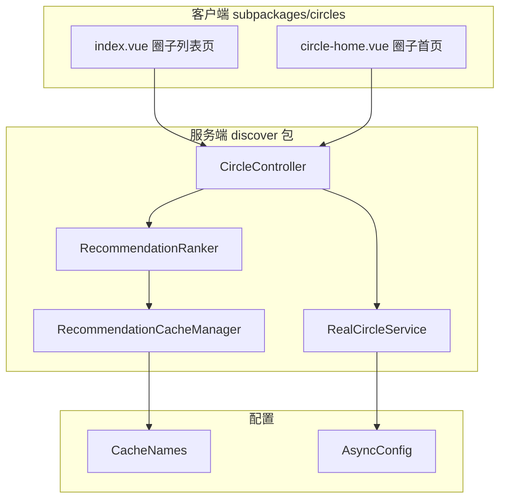

**图表来源**
- [index.vue:1-338](file://apps/client/src/subpackages/circles/circles/index.vue#L1-L338)
- [circle-home.vue:1-441](file://apps/client/src/subpackages/circles/circles/circle-home.vue#L1-L441)
- [CircleController.java:34-35](file://apps/api/src/main/java/com/campuslove/api/discover/CircleController.java#L34-L35)

**章节来源**
- [RealCircleService.java:52-53](file://apps/api/src/main/java/com/campuslove/api/discover/RealCircleService.java#L52-L53)
- [RecommendationCacheManager.java:33-34](file://apps/api/src/main/java/com/campuslove/api/discover/RecommendationCacheManager.java#L33-L34)

## 核心组件
话题广场由 6 个协作单元构成，职责边界清晰：

| 组件 | 位置 | 职责 |
| --- | --- | --- |
| 圈子列表页 | `apps/client/src/subpackages/circles/circles/index.vue` | 兴趣圈宫格展示、分类/快切 Tab 过滤、加入/退出、空态与登录引导 |
| 圈子主页 | `apps/client/src/subpackages/circles/circles/circle-home.vue` | 单圈 Hero、信息卡、多 Tab（动态/精华/活动/作品墙/成员）、动态 feed 聚合 |
| 圈子 Store | `apps/client/src/stores/circle.ts`，`defineStore("circle", ...)` | 状态中心：`circles` / `currentTopics` / `currentTopic` / `replies` / `topicPage` / `topicHasMore`，封装全部 HTTP 调用 |
| REST 控制器 | `CircleController`（`/api/v1/circles`） | 9 个端点，参数校验、限流、幂等、JWT 取用户 |
| 服务接口 | `CircleService` | 9 个方法契约，mock/real 双实现 |
| 真实实现 | `RealCircleService`（`@Profile("real")`） | JPA 读写、成员权限校验、内容安全、审核状态过滤、原子计数 |
| 热度标签 | `RecommendationRanker.buildHeatLabel` / `getDiscussionLimit` | 回复数+点赞数折算热度文案，讨论条数上限 |

服务接口 `CircleService` 声明 `getCircles / joinCircle / leaveCircle / getTopics / createTopic / getTopicDetail / replyToTopic / getReplies / getFeaturedTopics` 九个方法，与控制器端点一一对应；`RealCircleService` 以 `@Profile("real") @Service` 注册，`MockCircleService` 为非 real profile 的替身。

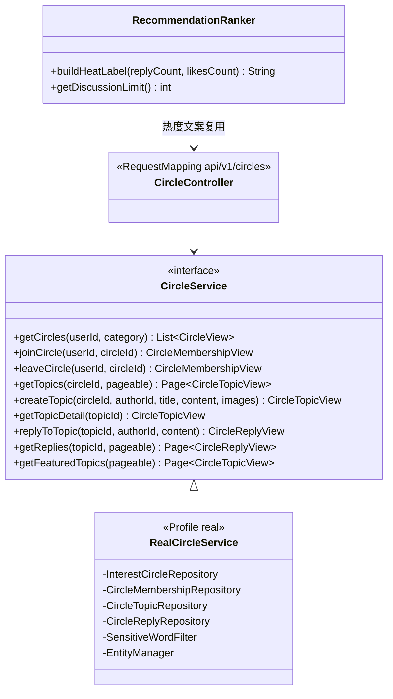

**图表来源**
- [CircleService.java:11-96](file://apps/api/src/main/java/com/campuslove/api/discover/CircleService.java#L11-L96)
- [RealCircleService.java:51-126](file://apps/api/src/main/java/com/campuslove/api/discover/RealCircleService.java#L51-L126)
- [CircleController.java:37-175](file://apps/api/src/main/java/com/campuslove/api/discover/CircleController.java#L37-L175)
- [RecommendationRanker.java:757-779](file://apps/api/src/main/java/com/campuslove/api/discover/RecommendationRanker.java#L757-L779)

**章节来源**
- [CircleService.java:11-96](file://apps/api/src/main/java/com/campuslove/api/discover/CircleService.java#L11-L96)
- [RealCircleService.java:51-126](file://apps/api/src/main/java/com/campuslove/api/discover/RealCircleService.java#L51-L126)
- [circle.ts:279-296](file://apps/client/src/stores/circle.ts#L279-L296)
- [RecommendationRanker.java:66-69](file://apps/api/src/main/java/com/campuslove/api/discover/RecommendationRanker.java#L66-L69)

## 架构总览
端到端链路为「页面 → Pinia store → HTTP 封装 → CircleController → CircleService → Repository → MySQL」，客户端只认 store，不直接拼 URL；服务端只认 JWT 主体，不接受请求体里的 `userId` / `authorId`。

`stores/circle.ts` 的请求路径均相对 `/api/v1` 前缀（如 `url: "/circles"`、`/circles/${circleId}/join`、`/circles/${circleId}/topics?page=${page - 1}`），与服务端 `@RequestMapping("/api/v1/circles")` 对齐；store 内部页码从 1 起算，出站时 `page - 1` 转成 Spring Data 的 0-based。

```mermaid
sequenceDiagram
    participant P as "index.vue / circle-home.vue"
    participant S as "useCircleStore"
    participant C as "CircleController"
    participant SV as "RealCircleService"
    participant R as "Repository / EntityManager"
    participant DB as "MySQL"

    P->>S: fetchCircles()
    S->>C: GET /api/v1/circles
    C->>SV: getCircles(userId, category)
    SV->>R: findAllByOrderBySortOrderAsc + countTopicsByCircleIds
    R->>DB: SELECT interest_circles / GROUP BY circle_id
    DB--SV: 圈子行 + 话题数
    SV--C: List<CircleView>
    C--S: ApiResponse<List<CircleView>>
    S--P: circles (mapToCircleItem)
    P->>S: joinCircle(circleId)
    S->>C: POST /api/v1/circles/{id}/join
    C->>SV: joinCircle(userId, circleId)
    SV->>DB: INSERT circle_memberships + UPDATE member_count(+1)
    SV--C: CircleMembershipView(joined, memberCount)
    C--S: ApiResponse
    S--P: 本地 isJoined / memberCount 就地更新
```

**图表来源**
- [circle.ts:302-372](file://apps/client/src/stores/circle.ts#L302-L372)
- [CircleController.java:55-84](file://apps/api/src/main/java/com/campuslove/api/discover/CircleController.java#L55-L84)
- [RealCircleService.java:138-185](file://apps/api/src/main/java/com/campuslove/api/discover/RealCircleService.java#L138-L185)
- [RealCircleService.java:243-296](file://apps/api/src/main/java/com/campuslove/api/discover/RealCircleService.java#L243-L296)

发布话题这条链路额外串了三道闸门（限流 → 成员权限 → 内容安全），且写入后不直接可见，需后台审核置为 `approved` 才出现在前台列表：

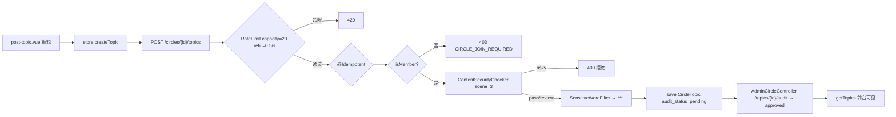

**图表来源**
- [CircleController.java:108-118](file://apps/api/src/main/java/com/campuslove/api/discover/CircleController.java#L108-L118)
- [RealCircleService.java:401-463](file://apps/api/src/main/java/com/campuslove/api/discover/RealCircleService.java#L401-L463)
- [AdminCircleController.java:396-414](file://apps/api/src/main/java/com/campuslove/api/admin/AdminCircleController.java#L396-L414)
- [circle.ts:476-537](file://apps/client/src/stores/circle.ts#L476-L537)

**章节来源**
- [circle.ts:420-469](file://apps/client/src/stores/circle.ts#L420-L469)
- [RealCircleService.java:362-387](file://apps/api/src/main/java/com/campuslove/api/discover/RealCircleService.java#L362-L387)

## 兴趣圈列表页（index.vue）
页面定位：`apps/client/src/subpackages/circles/circles/index.vue`（904 行，`<script setup lang="ts">` L1–L336，`<template>` L338 起，`<style scoped lang="scss">` L478 起）。文件头注释即声明职责——「展示所有兴趣圈，支持加入/退出操作，点击进入话题列表」。

**数据加载与自愈。** `onLoad` 读取路由 `query.category`，并在 `getToken() || useMock()` 为真时调用 `circleStore.fetchCircles()`；`onShow` 追加自愈分支——已登录（或 mock）但 `circles.length === 0 && !loading` 时补拉，用于处理「token 尚未就绪导致页面永久停在空态」的登录竞态。另有 `watch(() => sessionStore.isLoggedIn)` 在登录态翻转且列表为空时补拉。三条入口共同保证列表不会因冷启动时序而空转。

**分类导航与过滤。** 两张映射表驱动分类：`CATEGORY_KEY_MAP`（8 个分类 ID → i18n key，如 `study: "circle.catStudy"`）与 `CATEGORY_KEYWORDS`（分类 ID → 圈子名中文关键词，如 `study: "读书"`、`reading: "读书"`）。`filteredCircles` 的匹配维度为「中文关键词 ∪ 当前 locale 分类标签 ∪ 圈子名包含分类 ID 本身」，无关键词映射的未知分类回退全量；有映射但无匹配时返回空列表（诚实过滤，不静默回退）。与之正交的是页面级快捷 Tab：`QUICK_TABS` 定义 `all/photo/travel/music/sports/food/more` 七项（`photo` 用关键词「摄影」），`tabFilteredCircles` 在 `filteredCircles` 结果上再按 Tab 关键词过滤，`activeQuickTab` 默认 `all`；两者互不干扰。

**搜索功能。** 头部搜索按钮不实现页内检索，而是 `goSearch()` 跳转全局搜索页 `ROUTES.SEARCH`，与 nearby/village 入口口径一致（注释标注原实现为 toast 占位死胡同）。右上角按钮避让由 `useMenuButtonRect()` 的 `styleVars` 注入 `--capsule-right`，注入点放在本页插槽自身节点而非 `AppShell` 的 `.shell__header-right`，因为后者是子组件私有节点、页面 scoped 样式无法命中。

**加入/退出交互。** `toggleJoin(circleId, isJoined)` 按当前态调 `circleStore.leaveCircle` 或 `joinCircle`；store 只置 `errorMessage` 后 rethrow、从不出 toast，因此列表非空时失败必须在此捕获并 `uni.showToast` 给出可见反馈。`defineExpose({ toggleJoin })` 保留以适配模板 `@tap.stop` 绑定。

**状态容器与展示规则。** `pageState` 统一映射四态：`loading`（加载中且列表空）、`error`（有 errorMessage 且列表空）、`empty`（列表空）、`content`；`isGuest`（未登录且非 mock）时空态文案切为 `circle.circlesEmptyLogin` 并附「去登录」CTA（`goLogin()` → `ROUTES.LOGIN`），避免把「未拉取」伪装成「无内容」。热门徽标阈值 `HOT_THRESHOLD = 8000`（成员数达到即显示「热门」）；`formatMemberCount` 对 ≥10000 输出 `x.xw`、≥1000 输出 `toLocaleString("en-US")` 千分位、其余原值。

**社交证明取值口径。** `friendJoinedCount(circle)` 优先取后端 `CircleView.friendJoinedCount`（>0 即用）；real 模式缺字段返回 `0`，整行不渲染（不以伪造数字充当社交证明）；mock 模式按圈 id 字符和种子推导 `5 + (seed % 8)`，与 `circle-home.vue` 同式，保证两页数字一致。头像池 `FRIEND_AVATAR_POOL` 取 `IMAGE_PATHS.PEOPLE.AVATAR_1..3`，`friendAvatars(circleId)` 以 `seed % 3` 轮转三张。封面统一走 `circleCoverFor`（`config/circle-covers`），杜绝本页与主页图文不一致。

**导航出口。** `goToCircleHome(circle)` 跳 `ROUTES.CIRCLES.HOME?circleId=`；其原「校园认证圈未认证拦截」分支已作为恒假死代码删除——后端 `CircleView` 无认证圈字段、`interest_circles` 表亦无对应列（后续迁移仅补 `category`）。`goBack()` 依次尝试 `navigateBack` → `switchTab` → `reLaunch` 到 `/pages/home/index`。

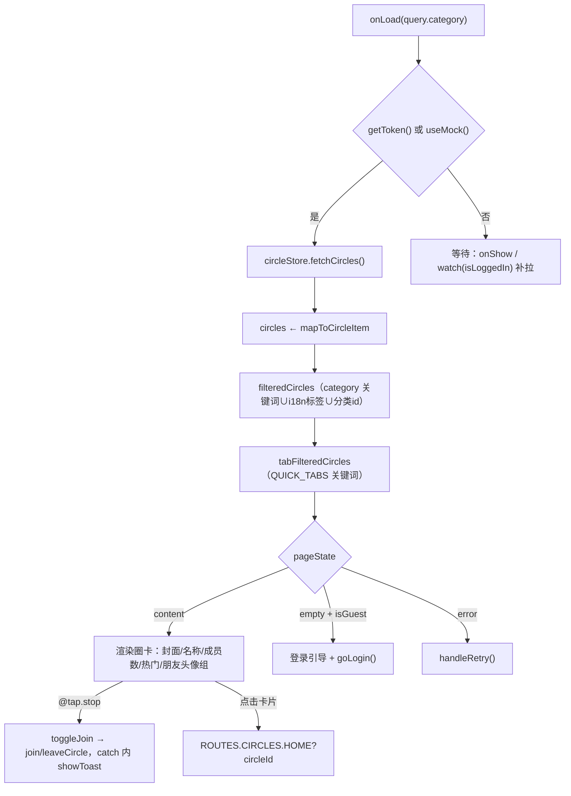

**图表来源**
- [index.vue:74-152](file://apps/client/src/subpackages/circles/circles/index.vue#L74-L152)
- [index.vue:194-253](file://apps/client/src/subpackages/circles/circles/index.vue#L194-L253)
- [index.vue:273-331](file://apps/client/src/subpackages/circles/circles/index.vue#L273-L331)

**章节来源**
- [index.vue:1-336](file://apps/client/src/subpackages/circles/circles/index.vue#L1-L336)
- [index.vue:43-72](file://apps/client/src/subpackages/circles/circles/index.vue#L43-L72)
- [index.vue:170-182](file://apps/client/src/subpackages/circles/circles/index.vue#L170-L182)
- [CircleController.java:182-196](file://apps/api/src/main/java/com/campuslove/api/discover/CircleController.java#L182-L196)

## 圈子首页与内容聚合（circle-home.vue）
页面定位：`apps/client/src/subpackages/circles/circles/circle-home.vue`（1 235 行，script L1–L439，template L441 起，其中 `v-if="activeTab === 'posts'"` 在 L546，style L636 起）。文件头注释给出自上而下的八段结构：Hero 头图、圈子信息卡、标签 chips、多 Tab 栏（动态/精华/活动/作品墙/成员）、置顶公告卡、动态 feed、「查看全部话题」链接、底部固定栏。

**Tab 模型。** `activeTab` 取值 `"posts" | "featured" | "activities" | "works" | "members"`，与 `TAB_KEYS` 常量数组一一对应；`TAB_LABEL_KEYS` 把每个 Tab 映射到语言包 key（`circle.detailFeed` / `detailHot` / `detailActivitiesTab` / `detailWorks` / `detailMembersTab`）。`tabLabel(key)` 对 `members` 额外拼接人数：`t(key) + " " + formatMemberCount(memberCount)`，与效果图「成员 1.2w」一致。

**圈子主体匹配与未知圈空态。** `circle` computed 从 `circleStore.circles` 按 `circleId` 命中，未命中回退 `FALLBACK_CIRCLE`（摄影圈演示数据，字段与 `CircleItem` 对齐）。为避免 real 包把成套虚构统计当真，`isUnknownCircle` 引入「拉取是否落定」的判定：`circlesFetchSettled` 初值取 `useMock()`，`onLoad` 中若列表为空则 `fetchCircles().finally(() => settled = true)`，若已有请求在飞则 `watch(loading)` 等其落定，否则立即置真；`useMock()` 恒 `false`（mock 保留兜底），`circleId` 为空即视为未知圈。该设计专门修复「分享卡片深链冷启动时 store 尚未拉完就误报圈子不存在」。

**动态 feed 的三级数据源。** `realFeed` 是 `ref<FeedItem[]>`，由 `watch([currentTopics, circleId], ..., { immediate: true })` 重建：过滤 `tp.circleId === circleId`，映射 `nickname ← tp.author?.name || "圈友"`、`avatar ← resolveMediaUrl(tp.author?.avatar)`、`timeText ← relativeTime(tp.createdAt)`、`images ← (tp.images ?? []).slice(0, 3).map(resolveMediaUrl)`、`comments ← tp.replyCount ?? 0`、`likes` 固定为 `0`（后端话题无点赞字段）。用 `ref` 而非 `computed` 是刻意为之——原 computed 每次重映射生成非响应式对象，`toggleLike` 原地修改不触发重渲染。`displayFeed` 的优先级为：未知圈 → `[]`；`realFeed` 非空 → 真实动态；否则仅 mock 模式回退 `feedItems`。`relativeTime(iso)` 按 刚刚 / N 分钟前 / N 小时前 / N 天前 / `M-DD` 分档。

**加入与发帖。** `toggleJoin()` 走 store 真实接口，并用 `isJoining` 守卫防连点（mock 毫秒级返回下快击五次会交替 join/leave 造成按钮态抖动），失败同样在本地 `showToast`。发帖入口 `goToPostTopic()` 跳 `ROUTES.CIRCLES.POST_TOPIC?circleId=`，`goToTopics()` 保留旧话题列表链路，`openFeedDetail(item)` 跳 `ROUTES.CIRCLES.TOPIC_DETAIL?topicId=`（非空 id 直接放行，详情页自带「话题不存在」降级）。`onShareAppMessage` 返回 `{ title: 圈名, path: ROUTES.CIRCLES.HOME?circleId= }`。热门徽章阈值此处为 `memberCount >= 10000`（`isHot`），与列表页的 8000 不同源。

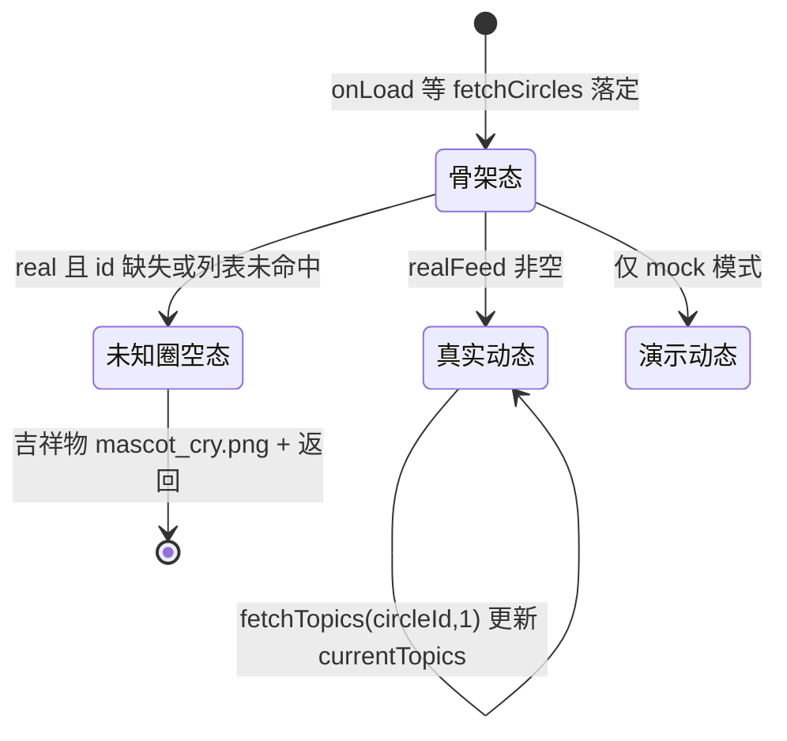

**图表来源**
- [circle-home.vue:79-120](file://apps/client/src/subpackages/circles/circles/circle-home.vue#L79-L120)
- [circle-home.vue:244-311](file://apps/client/src/subpackages/circles/circles/circle-home.vue#L244-L311)

**章节来源**
- [circle-home.vue:1-120](file://apps/client/src/subpackages/circles/circles/circle-home.vue#L1-L120)
- [circle-home.vue:142-239](file://apps/client/src/subpackages/circles/circles/circle-home.vue#L142-L239)
- [circle-home.vue:272-439](file://apps/client/src/subpackages/circles/circles/circle-home.vue#L272-L439)

## 话题广场 API 层（CircleController）
`CircleController` 标注 `@RestController @RequestMapping("/api/v1/circles") @Validated`，构造器注入单一 `CircleService`；类注释明确「用户 ID 从 JWT 认证上下文中获取，不再从请求参数获取」，因此写操作的 `userId` / `authorId` 一律由 `SecurityUtils.getCurrentUserId()` 派生。

| 方法 | 路径 | 保护 | 附加注解 | 返回 |
| --- | --- | --- | --- | --- |
| `getCircles` | `GET /api/v1/circles` | 公开（userId 可空） | `@RequestParam category` 可选 | `List<CircleView>` |
| `joinCircle` | `POST /{id}/join` | `@PreAuthorize("hasRole('USER')")` | `@Idempotent`，`@Positive` | `CircleMembershipView` |
| `leaveCircle` | `DELETE /{id}/join` | `@PreAuthorize("hasRole('USER')")` | `@Idempotent`，`@Positive` | `CircleMembershipView` |
| `getTopics` | `GET /{id}/topics` | 公开 | `page≥0`，`size` 默认 20、范围 1–100 | `Page<CircleTopicView>` |
| `createTopic` | `POST /{id}/topics` | `@PreAuthorize("hasRole('USER')")` | `@RateLimit(capacity=20, refillTokens=0.5, key="#request.remoteAddr")` + `@Idempotent` + `@Valid` | `CircleTopicView` |
| `getTopicDetail` | `GET /topics/{id}` | 公开 | `@Positive` | `CircleTopicView` |
| `getReplies` | `GET /topics/{id}/replies` | 公开 | `page≥0`，`size` 默认 20、上限 100 | `Page<CircleReplyView>` |
| `createReply` | `POST /topics/{id}/replies` | `@PreAuthorize("hasRole('USER')")` | `@RateLimit(capacity=30, refillTokens=1, key="#request.remoteAddr")` + `@Idempotent` | `CircleReplyView` |
| `getFeaturedTopics` | `GET /featured` | 公开 | `page≥0`，`size` 默认 20、上限 100 | `Page<CircleTopicView>` |

限流参数语义写在方法注释里：发帖桶容量 20、每 2 秒补充 1 个令牌（`refillTokens=0.5/s`），按客户端 IP 维度，用于防话题刷屏；回复桶容量 30、每秒补 1 个令牌，用于防垃圾回复。两个写端点均叠加 `@Idempotent`，配合 store 的防连点形成「客户端+服务端」双层重复提交防护。

分页参数由控制器组装 `PageRequest.of(page, size)` 后原样下传服务层，控制器不做二次裁剪；`size` 的 `@Min(1) @Max(100)` 是对外部调用方的硬上限。

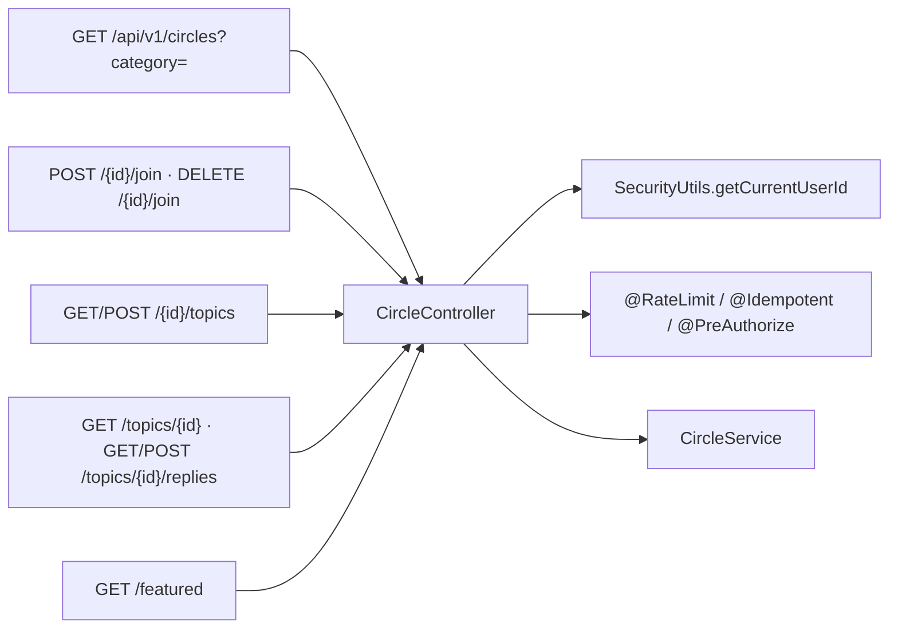

**图表来源**
- [CircleController.java:34-174](file://apps/api/src/main/java/com/campuslove/api/discover/CircleController.java#L34-L174)

**章节来源**
- [CircleController.java:29-118](file://apps/api/src/main/java/com/campuslove/api/discover/CircleController.java#L29-L118)
- [CircleController.java:120-175](file://apps/api/src/main/java/com/campuslove/api/discover/CircleController.java#L120-L175)
- [circle.ts:302-413](file://apps/client/src/stores/circle.ts#L302-L413)

## 话题服务实现（RealCircleService）
`RealCircleService` 以 `@Profile("real") @Service` 注册并实现 `CircleService`，类注释标明「使用 Repository 实现数据库查询」。构造器注入 `InterestCircleRepository`、`CircleMembershipRepository`、`CircleTopicRepository`、`CircleReplyRepository`、`UserRepository`、`ObjectMapper`、`InteractionEventService`、`SensitiveWordFilter`、`EntityManager` 九个依赖；`ContentSecurityChecker` 与 `SocialProgressService` 改用 `@Autowired(required = false)` 字段注入，以便旧单测构造器与 mock 场景传 null 时跳过（checker 自身 fail-closed）。常量 `CONTENT_PREVIEW_MAX_LENGTH = 80` 控制列表页内容预览长度。

**圈子列表（`getCircles`，`@Transactional(readOnly = true)`）。** 先 `findAllByOrderBySortOrderAsc()` 取全量并按 `sortOrder` 升序；`category` 非空非空白时 `trim()` 后在流中 `filter(c -> trimmed.equals(c.getCategory()))`（未分类圈子只在无参数时可见）；已登录时 `circleMembershipRepository.findByUserId(userId)` 映射出 `joinedCircleIds` 用于打标 `isJoined`。话题数统计走 `countTopicsByCircleIds(circleIds)`：`entityManager` 非空时执行 JPQL `SELECT t.circle.id, COUNT(t) FROM CircleTopic t WHERE t.circle.id IN :circleIds GROUP BY t.circle.id` 一次拿全（FIN-00037 消除每圈一次 `countByCircleId` 的 N+1）；`entityManager` 为 null（单测直接 new）时回退逐圈 count。`friendJoinedCount` 由 `estimateFriendJoinedCount(memberCount)` 推算：`memberCount<=0` 返回 3，否则 `round(memberCount/1000)` 并夹在 `[3, 99]`。

**加入/退出（`joinCircle` / `leaveCircle`，均为 `@Transactional`）。** `userId == null` 抛 `IllegalArgumentException(ErrorMessages.USER_ID_REQUIRED)`；`findCircleOrThrow` 不存在即抛「圈子不存在: {id}」。加入前 `findByUserIdAndCircleId` 非空则短路返回当前状态（不重复创建）；否则保存 `CircleMembership`（`joinedAt = LocalDateTime.now(TimeZones.BUSINESS)`），再用 JPQL bulk `UPDATE InterestCircle c SET c.memberCount = c.memberCount + 1 WHERE c.id = :circleId` 在数据库侧原子递增，随后 `entityManager.clear()` —— 注释标明这是 infra R2-00015：bulk 后不清上下文会让 managed 实体在提交 flush 时用旧值覆盖原子结果（脏写回归）。退出用 `deleteAllInBatch(memberships)` 批量删除（原为循环逐条 delete），递减语句带 `CASE WHEN c.memberCount > :delta THEN c.memberCount - :delta ELSE 0 END` 下限保护。加入成功后调用 `socialProgressService.recordCircleActivity(userId)` 做社交升温漏斗埋点（L5_CIRCLE），`RuntimeException` 只 `log.debug` 不影响主流程。

**话题读（`getTopics`）。** 校验圈子存在后 `findByCircleIdOrderByIsPinnedDescCreatedAtDesc(circleId, pageable)` 取得「置顶优先、时间倒序」的分页；在流中 `filter(t -> t.getAuditStatus() == CircleTopic.AuditStatus.approved)`，即前台仅展示审核通过话题；`loadAuthorMap(...)` 批量预加载作者避免 N+1，再 `toTopicView(t, authorMap)` 转换。注意返回的 `PageImpl` 以 `views.size()` 作为 total，即页内过滤后的数量。

**话题写（`createTopic`）。** 参数缺失依次抛 `AUTHOR_ID_REQUIRED` / `TITLE_REQUIRED_CN` / `CONTENT_REQUIRED_CN`；随后是 2026-08-31 补上的成员权限闸门：`circleMembershipRepository.findByUserIdAndCircleId(authorId, circle.getId())` 为空即抛 `OperationForbiddenException(ErrorMessages.CIRCLE_JOIN_REQUIRED)`（注释指出此前后端不校验，任意圈 id 皆可发帖，属越权漏洞）。内容闸门为两步：`rejectIfRisky(title/content, authorId, "3", ...)`（msgSecCheck v2 论坛场景，`risky` 直接拒绝并抛「{字段}包含违规内容，请修改后重试」，`review` 放行但记 warn）+ `sensitiveWordFilter.filterWithLog(..., "CIRCLE_TOPIC")` 把命中词替换为 `***` 而非拒发。落库时 `images` 经 `toJsonString` 序列化、`replyCount=0`、`isPinned=false`、`auditStatus=pending`（新发帖需后台审核才对前台可见）。

**回复（`replyToTopic` / `getReplies`）。** 回复内容检查顺序为 `rejectIfRisky(content, authorId, "2", "回复内容")`（scene=2 评论）→ 敏感词过滤（tag `CIRCLE_REPLY`）→ 过滤后为空白则抛 `REPLY_CONTENT_REQUIRED`；保存 `CircleReply` 后 `topic.setReplyCount(+1)` 并回写 `circleTopicRepository.save(topic)`。当回复者不是话题作者时调用 `interactionEventService.recordEvent(topic.getAuthorId(), authorId, "TOPIC_REPLIED", topicId, "TOPIC", "有人回复了你的话题")` 触发站内通知。`getReplies` 自 R4-00352 起为 SQL 侧分页（`findByTopicIdOrderByCreatedAtDesc(topicId, pageable)`），并以真实 `replyPage.getTotalElements()` 作为 total。

**精选（`getFeaturedTopics`）。** 跨圈全量：`Sort.by(DESC,"isPinned").and(Sort.by(DESC,"createdAt"))` 重建 `PageRequest` 后 `circleTopicRepository.findAll(sortedPageable)`，同样只保留 `approved`，用于村口「兴趣」分类。

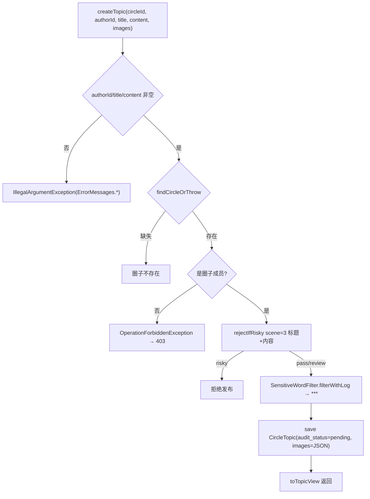

**图表来源**
- [RealCircleService.java:401-463](file://apps/api/src/main/java/com/campuslove/api/discover/RealCircleService.java#L401-L463)
- [RealCircleService.java:628-654](file://apps/api/src/main/java/com/campuslove/api/discover/RealCircleService.java#L628-L654)

**章节来源**
- [RealCircleService.java:45-126](file://apps/api/src/main/java/com/campuslove/api/discover/RealCircleService.java#L45-L126)
- [RealCircleService.java:138-229](file://apps/api/src/main/java/com/campuslove/api/discover/RealCircleService.java#L138-L229)
- [RealCircleService.java:243-350](file://apps/api/src/main/java/com/campuslove/api/discover/RealCircleService.java#L243-L350)
- [RealCircleService.java:362-463](file://apps/api/src/main/java/com/campuslove/api/discover/RealCircleService.java#L362-L463)
- [RealCircleService.java:472-615](file://apps/api/src/main/java/com/campuslove/api/discover/RealCircleService.java#L472-L615)
- [RealCircleService.java:628-666](file://apps/api/src/main/java/com/campuslove/api/discover/RealCircleService.java#L628-L666)

## 热度计算与推荐聚合
仓库中「热度」有两套互相独立但同源的计量口径，话题广场同时消费两者的输出。

**口径一：参与度热度标签（服务端）。** `RecommendationRanker`（`@Component`，1 039 行）内的 `buildHeatLabel(Integer replyCount, int likesCount)` 是唯一显式的热度文案函数：`replies = replyCount != null ? replyCount : 0`，`total = replies + likesCount`，随后按两个命名常量分档——`HEAT_HIGH_THRESHOLD = 100` 与 `HEAT_RISING_THRESHOLD = 20`（R4-01829/01830 把散落字面量收敛为常量，注释说明调优无需改数字）。返回值依次为：`total >= 100` → `"{total} 人参与"`；`total >= 20` → `"热度上升"`；`total > 0` → `"{total} 人参与"`；否则 `"新发布"`。同一组件另暴露 `getDiscussionLimit()`（委托 `recommendationConfig.getDiscussionLimit()`）作为讨论条数上限，`truncateContent(content, maxLength)` 以 `maxLength` 截断并追加 `...`。

**口径二：成员规模热门徽标（客户端）。** 列表页阈值 `HOT_THRESHOLD = 8000`（`index.vue`，注释「成员数达到即显示热门」），主页阈值 `isHot = memberCount >= 10000`（`circle-home.vue`）。两处阈值不同源，是同一徽标语义的两个实现点，页面注释已互相指认。

**话题自身的热度信号。** `CircleTopicView` 只携带 `replyCount` 与 `isPinned`，`CircleView` 只携带 `memberCount` / `topicCount` / `friendJoinedCount`；两个视图的记录体在 `CircleController.java` 的 L182–L196 与 L211–L226 完整给出，字段清单中不存在 heat / hotScore / likesCount 之类列。因此，主页 `realFeed` 的 `likes` 被硬编码为 `0`、`comments` 取 `tp.replyCount ?? 0`，`toggleLike` 只做本地翻转（源码注释标注 `TODO(后端): 点赞接口回填`）。因此「圈内话题热度」在当前实现中就是回复数 + 置顶位，未接入 `buildHeatLabel`。

**排序聚合。** 圈内话题 `findByCircleIdOrderByIsPinnedDescCreatedAtDesc`；精选话题在 `getFeaturedTopics` 内以 `Sort.by(DESC,"isPinned").and(DESC,"createdAt")` 重建分页请求；两者都只保留 `audit_status = approved`。

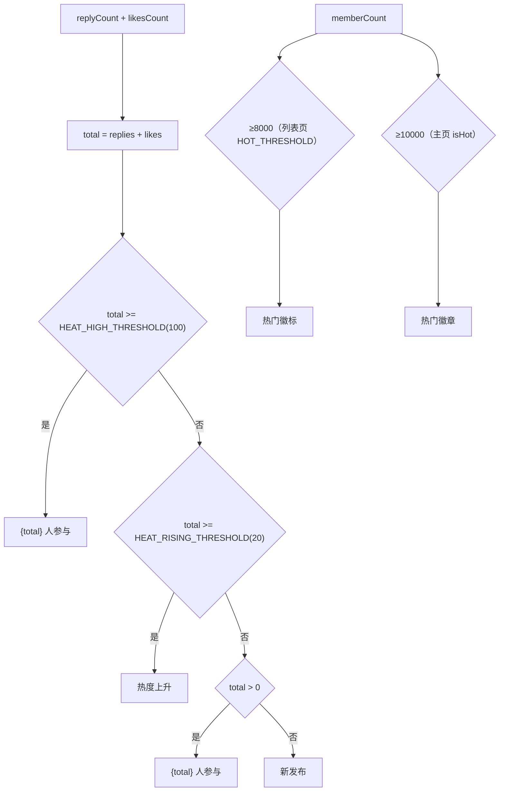

**图表来源**
- [RecommendationRanker.java:66-69](file://apps/api/src/main/java/com/campuslove/api/discover/RecommendationRanker.java#L66-L69)
- [RecommendationRanker.java:740-779](file://apps/api/src/main/java/com/campuslove/api/discover/RecommendationRanker.java#L740-L779)
- [index.vue:229-230](file://apps/client/src/subpackages/circles/circles/index.vue#L229-L230)
- [circle-home.vue:333-334](file://apps/client/src/subpackages/circles/circles/circle-home.vue#L333-L334)

**章节来源**
- [RecommendationRanker.java:66-69](file://apps/api/src/main/java/com/campuslove/api/discover/RecommendationRanker.java#L66-L69)
- [RecommendationRanker.java:740-779](file://apps/api/src/main/java/com/campuslove/api/discover/RecommendationRanker.java#L740-L779)
- [CircleController.java:182-240](file://apps/api/src/main/java/com/campuslove/api/discover/CircleController.java#L182-L240)
- [circle-home.vue:244-265](file://apps/client/src/subpackages/circles/circles/circle-home.vue#L244-L265)
- [RealCircleService.java:362-387](file://apps/api/src/main/java/com/campuslove/api/discover/RealCircleService.java#L362-L387)
- [RealCircleService.java:590-615](file://apps/api/src/main/java/com/campuslove/api/discover/RealCircleService.java#L590-L615)

## 数据模型
四张表由同一迁移 `V2026.05.23.0005__create_interest_circles.sql`（51 行）一次建齐，均为 InnoDB / utf8mb4 / `utf8mb4_0900_ai_ci`：

- `interest_circles`：`id BIGINT UNSIGNED AUTO_INCREMENT`、`name VARCHAR(64) NOT NULL`、`icon VARCHAR(16) NOT NULL DEFAULT '📋'`、`description VARCHAR(256)`、`member_count INT NOT NULL DEFAULT 0`、`sort_order INT NOT NULL DEFAULT 0`、`created_at DATETIME DEFAULT CURRENT_TIMESTAMP`；索引 `idx_interest_circles_sort(sort_order)`。
- `circle_memberships`：`circle_id` + `user_id` + `joined_at`，唯一键 `uk_circle_member(circle_id, user_id)`（重复加入在库层被挡），外键 `fk_circle_memberships_circle → interest_circles(id) ON DELETE CASCADE`。
- `circle_topics`：`circle_id`、`author_id`、`title VARCHAR(200) NOT NULL`、`content TEXT NOT NULL`、`images JSON`、`reply_count INT DEFAULT 0`、`is_pinned BOOLEAN DEFAULT FALSE`、`created_at`；三条索引 `idx_circle_topics_circle/_author/_created`，外键 `fk_circle_topics_circle` 级联删除。
- `circle_replies`：`topic_id`、`author_id`、`content TEXT`、`created_at`；索引 `idx_circle_replies_topic/_author/_created`，外键 `fk_circle_replies_topic → circle_topics(id) ON DELETE CASCADE`——这正是 `AdminCircleController.deleteTopic` 采用硬删除且无孤儿数据的依据。

两次增补迁移扩展了模型：`V2026.08.10.0032__add_category_to_interest_circles.sql`（13 行）加 `category VARCHAR(20) NULL`（注释即枚举 `study/sports/music/movie/travel/game/food/reading`，NULL=未分类），并按名称关键词回填存量行（如 `name LIKE '%篮球%' OR '%运动%' OR '%球%'` → `sports`）；`V2026.08.31.0001__add_circle_topic_audit_fields.sql`（9 行）给 `circle_topics` 加 `audit_status VARCHAR(16) NOT NULL DEFAULT 'approved'`、`audit_remark VARCHAR(500)`、`auditor_id BIGINT`、`audited_at DATETIME`，默认 `approved` 以保证存量话题免重审即可展示。

实体映射与 DDL 对齐：`InterestCircle`（`@Table(name = "interest_circles")`，`@EntityListeners(AuditingEntityListener.class)`）声明 `name length=64`、`icon` 默认 `📋`、`category length=20`、`member_count`、`sort_order` 与 `version BIGINT DEFAULT 0`（乐观锁列，另有 `V2026.07.26.0003__add_version_columns.sql`）；`CircleTopic`（`@Table(name = "circle_topics")`）声明内嵌 `enum AuditStatus`（L34）、`images` 以 `columnDefinition = "JSON DEFAULT '[]'"` 存字符串、`audit_status` 以 `VARCHAR(16) DEFAULT 'approved'` 存枚举、`created_at updatable = false`、`version` 同样为 `BIGINT DEFAULT 0`。

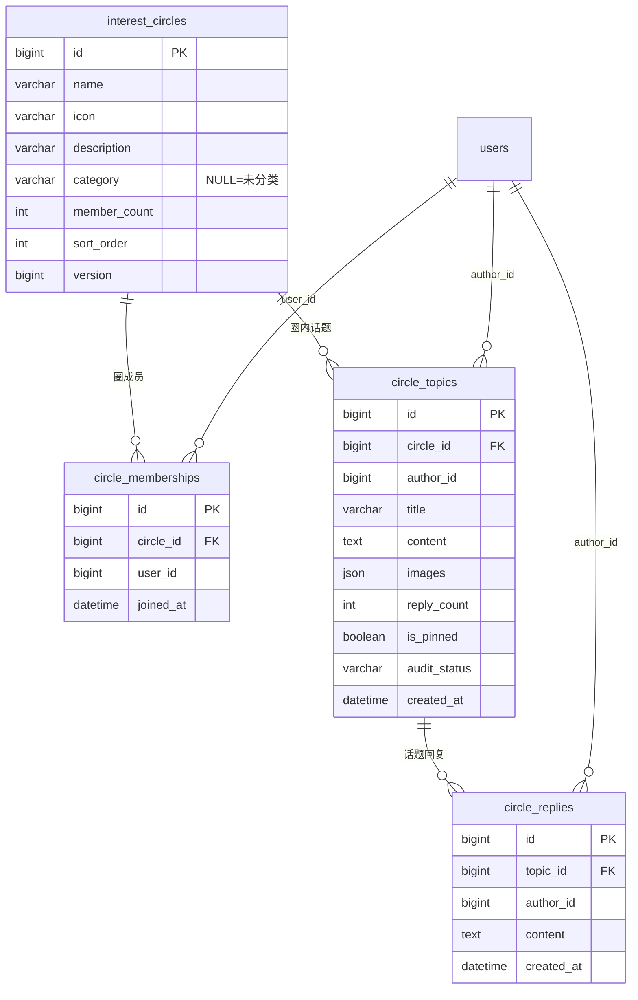

**图表来源**
- [V2026.05.23.0005__create_interest_circles.sql:1-51](file://database/flyway/sql/V2026.05.23.0005__create_interest_circles.sql#L1-L51)
- [V2026.08.10.0032__add_category_to_interest_circles.sql:1-13](file://database/flyway/sql/V2026.08.10.0032__add_category_to_interest_circles.sql#L1-L13)
- [V2026.08.31.0001__add_circle_topic_audit_fields.sql:1-9](file://database/flyway/sql/V2026.08.31.0001__add_circle_topic_audit_fields.sql#L1-L9)
- [InterestCircle.java:19-72](file://apps/api/src/main/java/com/campuslove/api/entity/InterestCircle.java#L19-L72)
- [CircleTopic.java:24-105](file://apps/api/src/main/java/com/campuslove/api/entity/CircleTopic.java#L24-L105)

客户端模型层在 `stores/circle.ts`：`CircleState` 定义 `circles / currentTopics / currentTopic / replies / loading / errorMessage / topicPage / topicHasMore` 八字段，`TopicItem` 携带 `title / content / images / author(TopicAuthor) / replyCount / createdAt`，`ReplyItem` 携带 `id / topicId / author / content / createdAt`，分页常量 `TOPIC_PAGE_SIZE = 10`；`formatCircleTime(dateStr)` 委托 `formatDateTime(dateStr, "relative", getCurrentLocale())`，与消息列表、村庄帖卡片同源，避免各页副本渲染出「NaN天前」。

**章节来源**
- [V2026.05.23.0005__create_interest_circles.sql:1-51](file://database/flyway/sql/V2026.05.23.0005__create_interest_circles.sql#L1-L51)
- [CircleTopic.java:24-105](file://apps/api/src/main/java/com/campuslove/api/entity/CircleTopic.java#L24-L105)
- [InterestCircle.java:19-72](file://apps/api/src/main/java/com/campuslove/api/entity/InterestCircle.java#L19-L72)
- [circle.ts:200-262](file://apps/client/src/stores/circle.ts#L200-L262)
- [AdminCircleController.java:354-383](file://apps/api/src/main/java/com/campuslove/api/admin/AdminCircleController.java#L354-L383)

## 缓存策略与性能优化
**服务端缓存现状。** `CacheNames`（111 行）集中声明了 11 个 Spring Cache 名称及各自 TTL 语义：`USER_PROFILE` 10 分钟、`MATCH_RECOMMEND` 5 分钟、`GUEST_RECOMMEND` 60 秒、`VILLAGE_HOT_POSTS` 15 分钟、`CAMPUS_SCHOOLS` 1 小时、`DAILY_QUESTION` 1 小时、`SENSITIVE_WORDS` 1 小时、`SYSTEM_CONFIG` 30 分钟、`USER_TAGS` 10 分钟、`CLIENT_CONFIG` 5 分钟、`ADMIN_STATS` 5 分钟。常量清单中不存在圈子/话题专用缓存名，`RealCircleService` 的九个方法也均未标注 `@Cacheable` / `@CacheEvict`——话题广场的读性能完全依赖查询写法本身，而非缓存层（该项已登记到「能力缺口登记」）。

与圈子最接近的既有范式是推荐链路 `RecommendationCacheManager`：`getCachedRecommendations` 以 `@Cacheable(cacheNames = CacheNames.MATCH_RECOMMEND, key = "'v2:' + #userId", unless = "#result == null || #result.isEmpty()")` 缓存，`unless` 空结果避免缓存穿透，且配额扣减只发生在缓存 miss 的真实计算路径；`getCachedGuestRecommendations` 用固定 key `'guest:v1'` + TTL 60 秒把「每次全量重算约 8 次 SQL」降为 1 次 Redis GET；两个失效入口分别是 `@CacheEvict(key = "'v2:' + #userId")` 的 `evictRecommendationCache` 与 `allEntries = true` 的 `evictAllRecommendationCaches`（注释提示后者清空整个 `match_recommend`，运营批量刷新时谨慎使用）。两处实现都强调返回值必须包成 `new java.util.ArrayList<>(...)`——`Stream.toList()` 产出的 `ImmutableCollections$ListN` 是 final 类，Jackson default typing（NON_FINAL）不写外层类型名，反序列化失败会让缓存永远命中不了（游客接口 300ms+ 卡顿的根因）。监控侧由 `finally` 块统一 `matchMetrics.recordRecommendLatency(durationMs)`，异常路径也记录耗时。

**话题广场已落地的查询优化。** 四条来自源码注释的实测修复：① `getCircles` 的话题数由「每圈一次 `countByCircleId`」改为 `IN :circleIds GROUP BY` 单次聚合（FIN-00037）；② `joinCircle` / `leaveCircle` 的成员数由实体读-改-写改为数据库侧 bulk `UPDATE ... memberCount ± 1`，并配合 `entityManager.clear()` 防脏写（FIN-00038 + infra R2-00015）；③ `getReplies` 由全量加载后内存分页改为 SQL 侧分页（R4-00352，注释指出原实现内存占用随回复数线性增长）；④ `getTopics` / `getReplies` / `getFeaturedTopics` 统一 `loadAuthorMap(...)` 批量预加载作者；⑤ 退出圈子用 `deleteAllInBatch(memberships)` 取代循环逐条 delete（infra R2-00265）。索引层面，`idx_circle_topics_circle` / `_author` / `_created` 与 `idx_circle_replies_topic` / `_author` / `_created` 覆盖了「圈+置顶+时间」与「话题+时间」两条排序路径。

**线程池。** `AsyncConfig` 以 `@Bean(name = "taskExecutor")` 定义 `ThreadPoolTaskExecutor`，参数由 `@Value` 注入并可覆写：`app.async.core-pool-size`、`app.async.max-pool-size`、`app.async.queue-capacity`（默认 200）、`app.async.thread-name-prefix`（默认 `async-`）、`app.async.keep-alive-seconds`（默认 60）；拒绝策略 `CallerRunsPolicy` 提供背压，`setWaitForTasksToCompleteOnShutdown(true)` + `setAwaitTerminationSeconds(30)` 实现优雅停机，初始化后打印参数日志。类尾注释说明审计日志执行器已迁至 `AuditAsyncConfig` 以避免同名 Bean 冲突。

**客户端缓存与降级。** Pinia store 常驻内存即是第一层缓存：`fetchCircles` 结果写入 `state.circles`，页面仅在「列表为空且不在加载中」时补拉（`index.vue` 的 `onShow`、`circle-home.vue` 的 `onLoad`），避免每次进入页面重复请求。话题分页以 `TOPIC_PAGE_SIZE = 10` 为单位，`page === 1` 覆盖、`page > 1` 追加进 `currentTopics`，`topicHasMore` 由 `data.content.length >= TOPIC_PAGE_SIZE` 推断。`useMock()` 为真时全部动作改走本地种子（`mockCircles` / `mockTopics` / `mockReplies` / `mockTopicDetail`），不发网络请求，用于无后端场景下的渲染自测。

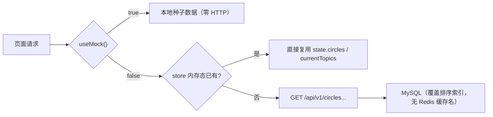

**图表来源**
- [circle.ts:302-323](file://apps/client/src/stores/circle.ts#L302-L323)
- [circle.ts:420-469](file://apps/client/src/stores/circle.ts#L420-L469)
- [CacheNames.java:18-111](file://apps/api/src/main/java/com/campuslove/api/config/CacheNames.java#L18-L111)

**章节来源**
- [CacheNames.java:18-111](file://apps/api/src/main/java/com/campuslove/api/config/CacheNames.java#L18-L111)
- [RecommendationCacheManager.java:80-192](file://apps/api/src/main/java/com/campuslove/api/discover/RecommendationCacheManager.java#L80-L192)
- [RealCircleService.java:197-229](file://apps/api/src/main/java/com/campuslove/api/discover/RealCircleService.java#L197-L229)
- [RealCircleService.java:327-343](file://apps/api/src/main/java/com/campuslove/api/discover/RealCircleService.java#L327-L343)
- [RealCircleService.java:557-579](file://apps/api/src/main/java/com/campuslove/api/discover/RealCircleService.java#L557-L579)
- [AsyncConfig.java:55-112](file://apps/api/src/main/java/com/campuslove/api/config/AsyncConfig.java#L55-L112)
- [V2026.05.23.0005__create_interest_circles.sql:1-51](file://database/flyway/sql/V2026.05.23.0005__create_interest_circles.sql#L1-L51)

## 依赖关系分析
**后端出向依赖。** `RealCircleService` 的 import 清单即其依赖全集：实体层 `CircleMembership` / `CircleReply` / `CircleTopic` / `InterestCircle` / `User`，仓库层 `CircleMembershipRepository` / `CircleReplyRepository` / `CircleTopicRepository` / `InterestCircleRepository` / `UserRepository`，跨模块 `chat.InteractionEventService`、`growth.SocialProgressService`，配置与合规 `config.ContentSecurityChecker` / `ContentSecurityVerdict` / `SensitiveWordFilter` / `DisplayConstants`，公共件 `common.ErrorMessages` / `OperationForbiddenException` / `TimeZones`，持久化侧 `jakarta.persistence.EntityManager` 与 `springframework.data.domain.*`（`Page` / `PageImpl` / `PageRequest` / `Pageable` / `Sort`）、`@Transactional`、`@Profile`。`CircleController` 只依赖 `CircleService` 一个接口，横切能力由注解提供：`common.Idempotent`、`ratelimit.RateLimit`、`config.SecurityUtils`、`springframework.security.access.prepost.PreAuthorize`、`jakarta.validation.constraints.*`。

**契约耦合点。** `CircleController.java` 在末尾直接声明六个 record 作为对外契约（`CircleView` / `CircleMembershipView` / `CircleTopicView` / `CircleReplyView` / `CreateTopicRequest` / `CreateReplyRequest`），服务层与控制器共享同一份类型，新增字段只需改一处；客户端以 `BackendCircleView` 等镜像类型 + `mapToCircleItem` / `mapToTopicItem` / `mapToReplyItem` 适配。视图字段与前端消费的差异（如 `CircleTopicView` 无 likes、`CircleView` 无认证圈字段）是「话题广场热度、认证圈」两能力缺口的根因，且 `index.vue` 的注释链里明确引用了 `CircleController.java:182-196` 与迁移文件名作为判定依据。

**前端出向依赖。** 两页共同依赖 `stores/circle`、`stores/helpers/use-mock`、`utils/navigation` 的 `openAppPath`、`constants/routes` 的 `ROUTES.CIRCLES.*`、`config/images` 的 `IMAGE_PATHS`、`config/circle-covers` 的 `circleCoverFor`、`composables/useMenuButtonRect`；列表页额外依赖 `stores/session`、`services/http` 的 `getToken`、`components/layout/AppShell`、`components/common/PageStateContainer`；主页额外依赖 `utils/media` 的 `resolveMediaUrl` 与 `components/common/SkeletonBlock`，并用 `onLoad` / `onShow` / `onShareAppMessage` 三个 uni-app 生命周期钩子。

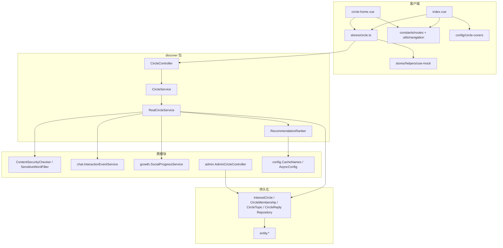

**图表来源**
- [RealCircleService.java:1-44](file://apps/api/src/main/java/com/campuslove/api/discover/RealCircleService.java#L1-L44)
- [CircleController.java:1-43](file://apps/api/src/main/java/com/campuslove/api/discover/CircleController.java#L1-L43)
- [index.vue:8-27](file://apps/client/src/subpackages/circles/circles/index.vue#L8-L27)
- [circle-home.vue:28-40](file://apps/client/src/subpackages/circles/circles/circle-home.vue#L28-L40)
- [AdminCircleController.java:63-67](file://apps/api/src/main/java/com/campuslove/api/admin/AdminCircleController.java#L63-L67)

**章节来源**
- [RealCircleService.java:1-126](file://apps/api/src/main/java/com/campuslove/api/discover/RealCircleService.java#L1-L126)
- [CircleController.java:1-43](file://apps/api/src/main/java/com/campuslove/api/discover/CircleController.java#L1-L43)
- [index.vue:8-27](file://apps/client/src/subpackages/circles/circles/index.vue#L8-L27)
- [circle-home.vue:28-40](file://apps/client/src/subpackages/circles/circles/circle-home.vue#L28-L40)
- [CircleController.java:182-240](file://apps/api/src/main/java/com/campuslove/api/discover/CircleController.java#L182-L240)

## 话题分类体系与扩展点
**分类枚举的四处落地。** 八个分类 `study / sports / music / movie / travel / game / food / reading` 在四个层次各自出现一次，构成事实上的枚举契约：

1. 库层：`interest_circles.category VARCHAR(20) NULL`，注释逐字列出八个值并声明 `NULL=未分类`；无 CHECK 约束，因此新增分类是数据变更而非 DDL 变更。迁移同时按名称关键词回填存量行（`sports` ← `%篮球%/%运动%/%球%`，`study` ← `%考研%/%读书%/%学习%`，`game` ← `%桌游%/%游戏%`，`food` ← `%美食%/%探店%`，`music`/`movie`/`travel` ← 单关键词，`reading` ← `%阅读%`）。
2. 服务层：`CircleController.getCircles` 的 `@RequestParam(name="category", required=false)` 与 `RealCircleService.getCircles` 中 `trimmed.equals(c.getCategory())` 的过滤——分类比较对 `interest_circles.category` 原值精确等值，`category` 为空串或空白时视为「全部」（未分类圈子只在「全部」下可见）。
3. 视图层：`CircleView.category` 字段透传（注释同样逐字列出八值与 `null=未分类`）。
4. 客户端：`CATEGORY_KEY_MAP`（分类 ID → `circle.catStudy` 等八个 i18n key）与 `CATEGORY_KEYWORDS`（分类 ID → 中文关键词，注意 `study` 与 `reading` 都映射到「读书」，是关键词兜底的已知重合）。当 URL 带 `?category=` 时页面用它做名称匹配；这条页内匹配是历史遗留（源码注释保留 `TODO(后端): 兴趣圈列表支持按分类服务端过滤后…改由后端查询并移除本映射`），而后端过滤（B4，2026-08-10）现已存在，两者并存。

**圈子本体运营入口。** `AdminCircleController`（`/api/v1/admin/forum/circles`，类级 `@PreAuthorize("hasRole('ADMIN')")`）提供 `GET /`、`POST /`、`PUT /{id}`、`DELETE /{id}` 四个圈子 CRUD 端点与 `GET /{id}/topics`、`POST /topics/{id}/pin`、`POST /topics/{id}/unpin`、`DELETE /topics/{id}`、`POST /topics/{id}/audit` 五个话题治理端点，配套 `AdminCircleRequest`、`AdminCircleSummaryView`、`AdminCircleTopicSummaryView` 三个记录类型。话题治理写操作均带 `@Auditable`（`AuditOperation.PIN_TOPIC` / `UNPIN_TOPIC` / `DELETE_POST` / `AUDIT_POST`，`targetType = "CIRCLE_TOPIC"`），并统一调用 `adminDataScope.assertCampusAccess(null)`——注释说明圈子是全局资源、无校区维度。列表侧 `searchForAdmin(id, authorId, normalize(keyword), pageable)` 支持按作者与关键词检索，作者昵称经 `loadAuthorNicknames` 批量预加载。

**新增一个兴趣分类的接入清单（按现有实现推导）。** ① 给目标圈行写入新的 `category` 值（或用一条 `UPDATE ... WHERE name LIKE ...` 回填，参照 `V2026.08.10.0032` 的写法）；② 前端补 `CATEGORY_KEY_MAP` 的 i18n key 与语言包词条、补 `CATEGORY_KEYWORDS` 的中文关键词；③ 若需要出现在顶部快切 Tab，在 `QUICK_TABS` 增加一项（`key` / `labelKey` / `keyword`，可选 `iconSrc`），`QuickTab` 联合类型随之扩展；④ 若需要专属封面，在 `config/circle-covers` 的 `circleCoverFor` 关键词映射里补条目——该函数是列表页、主页与首页兴趣推荐共用的单一真相源，缺失即回退默认封面并造成图文不一致；⑤ 后端无需改动，`getCircles` 的分类过滤对任意新字符串等值生效。

**视觉主题与品牌一致性。** 主页文件头注释固化了两条纪律：品牌绿取 `var(--c-brand-500, #36C99A)` 且与 tabBar `selectedColor` 同源；图标全部使用 static SVG/PNG 资产，明令禁用 emoji。`icon` 列虽在库层默认 `'📋'`（`VARCHAR(16)`），但前端渲染走的是 `circleCoverFor(name)` 与 `IMAGE_PATHS.CIRCLE_COVERS.*`，两者互不影响。分享卡片标题/路径由 `onShareAppMessage` 返回圈名与 `ROUTES.CIRCLES.HOME?circleId=` 保证一致。

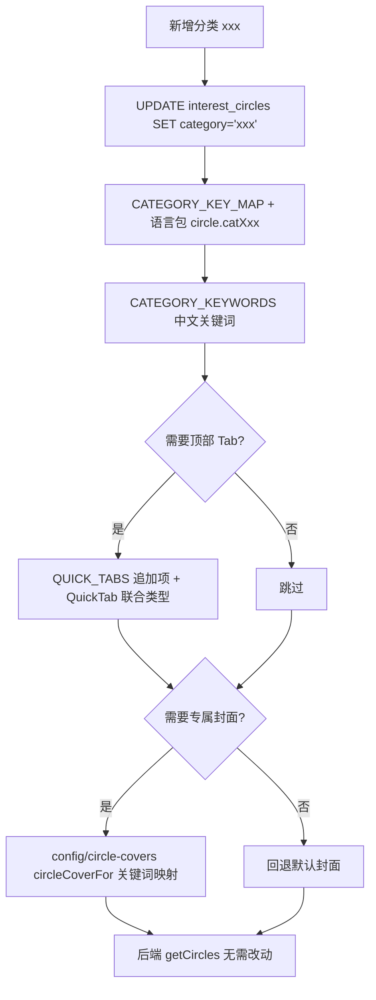

**图表来源**
- [V2026.08.10.0032__add_category_to_interest_circles.sql:1-13](file://database/flyway/sql/V2026.08.10.0032__add_category_to_interest_circles.sql#L1-L13)
- [index.vue:45-72](file://apps/client/src/subpackages/circles/circles/index.vue#L45-L72)
- [index.vue:232-253](file://apps/client/src/subpackages/circles/circles/index.vue#L232-L253)
- [RealCircleService.java:144-151](file://apps/api/src/main/java/com/campuslove/api/discover/RealCircleService.java#L144-L151)

**章节来源**
- [V2026.08.10.0032__add_category_to_interest_circles.sql:1-13](file://database/flyway/sql/V2026.08.10.0032__add_category_to_interest_circles.sql#L1-L13)
- [index.vue:45-72](file://apps/client/src/subpackages/circles/circles/index.vue#L45-L72)
- [index.vue:232-253](file://apps/client/src/subpackages/circles/circles/index.vue#L232-L253)
- [circle-home.vue:1-40](file://apps/client/src/subpackages/circles/circles/circle-home.vue#L1-L40)
- [RealCircleService.java:138-185](file://apps/api/src/main/java/com/campuslove/api/discover/RealCircleService.java#L138-L185)
- [AdminCircleController.java:60-67](file://apps/api/src/main/java/com/campuslove/api/admin/AdminCircleController.java#L60-L67)
- [AdminCircleController.java:259-414](file://apps/api/src/main/java/com/campuslove/api/admin/AdminCircleController.java#L259-L414)

## 能力缺口登记
本节逐条对照本页生成指令中的每一项要求，登记「仓库中确有实现」与「查无证据」的分界，并给出判定依据。判定一律以实际打开过的文件为准，不推测未落地能力。

| 指令要求 | 判定 | 依据 |
| --- | --- | --- |
| 兴趣圈列表架构（展示/搜索/分类导航） | 部分实现 | 展示与分类导航见 `index.vue` 的 `filteredCircles` / `tabFilteredCircles` 与后端 `getCircles` 的 category 过滤；「搜索」仅 `goSearch()` 跳全局 `ROUTES.SEARCH`，页内无关键词检索实现（`index.vue` 全文无 searchInput 状态） |
| 圈子加入/退出、状态同步 | 已实现 | `POST/DELETE /{id}/join` + `stores/circle.ts` 以返回的 `joined/memberCount` 就地更新本地圈对象；服务端 bulk 原子增减 + `entityManager.clear()` |
| 用户权限管理 | 有限实现 | 仅两层：`@PreAuthorize("hasRole('USER')")` 角色门槛、`createTopic` 的 `CIRCLE_JOIN_REQUIRED` 成员闸门；圈子层面无管理员/版主字段（`interest_circles` DDL 无对应列） |
| 话题分类系统（8 类） | 实现于圈子层 | 8 个分类是 `interest_circles.category` 的取值；`circle_topics` 表与 `CircleTopicView` 均无分类/标签列，话题只能经所属圈继承分类 |
| 话题标签 tags / favorite | 未接线 | `stores/circle.ts` 的 `createTopic` 入参含 `tags?: string[]` / `favorite?: boolean`，注释标为「Task B5：mock 本地模拟附加字段」；real 分支请求体只发 `title/content/images`，后端 `CreateTopicRequest` 亦只有这三字段 |
| 圈子首页内容聚合——热门话题 | 后端已实现，页面未消费 | `GET /api/v1/circles/featured` + `getFeaturedTopics` 完整存在；`circle-home.vue` 的 `onLoad` 仅调用 `fetchCircles()` 与 `fetchTopics(circleId, 1)`，「精华」Tab（`activeTab === 'featured'`）无独立数据源 |
| 圈子首页内容聚合——最新活动 | 查无圈内实现 | 主页 `TAB_KEYS` 含 `activities` 并映射 `circle.detailActivitiesTab`，但 `CircleController` 九个端点（L55–L174 全文核对）无圈内活动接口；`discover` 包另有 `ActivityController`/`ActivityService`，与圈子无关联字段 |
| 圈子首页内容聚合——个性化推荐 | 查无圈内接线 | `RecommendationRanker` / `RecommendationCacheManager` 服务的是推荐人物与村口链路（`MATCH_RECOMMEND` / `GUEST_RECOMMEND` 缓存名），`RealCircleService` 未调用二者任何方法 |
| 圈内动态点赞 | 未实现 | `CircleTopicView` 无 likes 字段；主页 `realFeed` 映射时 `likes: 0`，`toggleLike` 仅本地翻转，源码注释保留 `TODO(后端): 点赞接口回填`；因此 `buildHeatLabel(replyCount, likesCount)` 的第二入参在圈内无数据来源 |
| 圈内动态专用分页接口 | 未实现 | `circle-home.vue` 文件头注释 `TODO(后端): 圈内动态分页接口`；实际复用 `GET /{id}/topics`（`TOPIC_PAGE_SIZE = 10`） |
| 圈子标签 chips / 置顶公告 | 仅 mock | `circleTags` 与 `pinnedNotice` 在 `useMock()` 为假时分别返回 `[]` 与 `""`，注释标注 `TODO(后端): 圈子标签字段` / `圈公告接口` |
| 「成员」「作品墙」Tab 数据 | 查无端点 | `CircleController` 全文无 members / works 端点；`tabLabel('members')` 用 `memberCount` 拼人数，列表本体无来源 |
| 等 N 位朋友已加入 | 推算值非统计值 | `estimateFriendJoinedCount` 按 `round(memberCount/1000)` 夹在 `[3, 99]`，源码注释直说「暂无好友-圈子关系统计」；real 缺字段时前端返回 0 并不渲染 |
| 圈子数据的缓存策略 | 未接入 | `CacheNames` 11 个常量（L18–L111 全清单）无 circle/topic 专用名；`RealCircleService` 九方法均无 `@Cacheable` / `@CacheEvict`；客户端仅有 Pinia 内存态复用 |
| 离线支持 | 查无证据 | 客户端降级路径是 `useMock()` 本地种子与静默回退，未见本地持久化（storage）缓存或请求队列；本页不据此推断离线能力 |
| 后台圈子管理与审核 | 已实现 | `AdminCircleController` 的圈子 CRUD、话题列表检索、`pin`/`unpin`、硬删除、`audit`（`approved`/`rejected`）与 `@Auditable` 记录，配合 `audit_status` 迁移 |
| 数据统计与用户行为分析 | 弱实现 | 圈子侧行为埋点只有两处：`socialProgressService.recordCircleActivity(userId)`（L5_CIRCLE 计数，失败仅 `log.debug`）与 `interactionEventService.recordEvent(..., "TOPIC_REPLIED", ...)`；`AdminCircleSummaryView` / `AdminCircleTopicSummaryView` 提供后台列表，但未见圈维度指标聚合；`ADMIN_STATS` 缓存对应的是用户/活跃/匹配三类统计，不含圈子 |
| 新兴趣类别接入方案 | 可执行 | 见「话题分类体系与扩展点」一节的五步清单，其中 ①③④ 为数据/前端改动，② 需补语言包，⑤ 后端无需改动 |

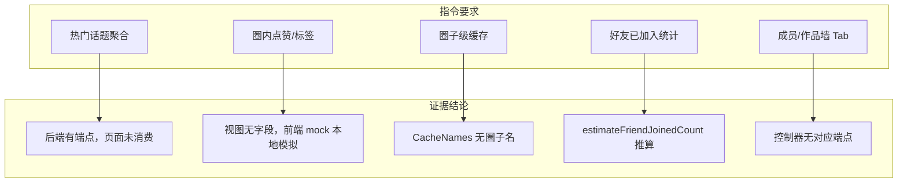

[此图为能力缺口归纳，条目分别取自上表所列源文件，不新增对应关系，故不提供图表来源]

**章节来源**
- [CircleController.java:55-175](file://apps/api/src/main/java/com/campuslove/api/discover/CircleController.java#L55-L175)
- [CircleController.java:182-260](file://apps/api/src/main/java/com/campuslove/api/discover/CircleController.java#L182-L260)
- [RealCircleService.java:187-195](file://apps/api/src/main/java/com/campuslove/api/discover/RealCircleService.java#L187-L195)
- [RealCircleService.java:590-615](file://apps/api/src/main/java/com/campuslove/api/discover/RealCircleService.java#L590-L615)
- [CacheNames.java:18-111](file://apps/api/src/main/java/com/campuslove/api/config/CacheNames.java#L18-L111)
- [circle.ts:476-537](file://apps/client/src/stores/circle.ts#L476-L537)
- [circle-home.vue:17-40](file://apps/client/src/subpackages/circles/circles/circle-home.vue#L17-L40)
- [circle-home.vue:244-334](file://apps/client/src/subpackages/circles/circles/circle-home.vue#L244-L334)
- [index.vue:306-316](file://apps/client/src/subpackages/circles/circles/index.vue#L306-L316)
- [AdminCircleController.java:259-414](file://apps/api/src/main/java/com/campuslove/api/admin/AdminCircleController.java#L259-L414)

## 故障排查指南
**列表页停在空态。** 先判 `pageState`：`loading` 说明 `fetchCircles` 在飞；`error` 说明 store 置了 `errorMessage`（文案回退 `circle.loadFailedRetry`）；`empty` 且 `isGuest` 为真时并非「无圈子」而是从未发请求——`onLoad` 的 `getToken() || useMock()` 守卫被登录竞态挡下，修复入口是 `onShow` 的补拉与 `watch(sessionStore.isLoggedIn)`。real 模式下若仍恒空，检查 `/api/v1/circles` 响应是否为空数组（`getCircles` 带 `category` 时会因等值过滤返回空）。

**加入/退出后数字异常。** 三类成因：① 按钮态抖动——连点在 mock 毫秒级返回下会交替 join/leave，`circle-home.vue` 以 `isJoining` 守卫拦截，`index.vue` 的 `toggleJoin` 依赖 store 抛错后 `showToast`；② 成员数被旧值覆盖——`joinCircle` 的 bulk `UPDATE` 之后必须 `entityManager.clear()`（infra R2-00015），否则 managed 实体在提交 flush 时把原子结果写回旧值；③ 重复加入——`findByUserIdAndCircleId` 非空即短路返回，库层唯一键 `uk_circle_member` 兜底。

**发帖失败。** 按状态码定位：`403` 对应非成员闸门 `OperationForbiddenException(ErrorMessages.CIRCLE_JOIN_REQUIRED)`（全局异常处理器透传用户可读文案）；`400` 且提示「话题标题/话题内容包含违规内容」对应 `rejectIfRisky` 的 `risky` 判定（scene=3 论坛），`review` 判定只记 warn 并放行；参数级 `400` 来自 `@NotBlank @Size(max=200)` 标题、`@Size(max=5000)` 内容与 `@Size(max=9)` 图片数；限流拒绝来自 `@RateLimit(capacity=20, refillTokens=0.5, key="#request.remoteAddr")`，按客户端 IP 计数。发布成功但前台看不到属正常：新话题 `audit_status = pending`，需后台 `POST /api/v1/admin/forum/circles/topics/{id}/audit` 置为 `approved`。

**分页总数偏小 / 提前判定无更多。** `getTopics` 与 `getFeaturedTopics` 返回的 `PageImpl` 以过滤后的 `views.size()` 作为 total，而 `getReplies` 用真实 `replyPage.getTotalElements()`；客户端 `topicHasMore = data.content.length >= TOPIC_PAGE_SIZE`（10）。当某页存在被审核过滤掉的话题时，页内条数可能小于 10 而被判「无更多」，实为过滤而非到底。

**主页误报「圈子不存在或已解散」。** 该判定来自 `isUnknownCircle`，其正确性依赖 `circlesFetchSettled`：列表为空时等 `fetchCircles().finally()`，已有请求在飞时 `watch(loading)` 等落定，否则立即置真。若分享卡片深链直达有效圈仍闪空态，检查是否在三条分支外提前把 settled 置真。相反，若 real 包看到 `12000 人加入 · 362 条动态` 这类成套数字，是 `FALLBACK_CIRCLE` 演示兜底被命中（`circleId` 未命中 store 列表且未落入未知圈分支），属数据源缺失而非统计。

**内容显示为 `***`。** `SensitiveWordFilter.filterWithLog(..., "CIRCLE_TOPIC" | "CIRCLE_REPLY")` 的策略是替换而非拒发（与 `VillagePostService` 一致），因此出现屏蔽串不代表写入失败；回复内容若被过滤至空白则抛 `REPLY_CONTENT_REQUIRED`。

**两页数字/封面不一致。** 朋友加入数须走「后端字段优先」口径（`CircleView.friendJoinedCount`），mock 两页同用圈 id 字符和种子推导 `5 + (seed % 8)`；封面必须同用 `circleCoverFor`，历史上主页副本缺「阅读/宠物/考研/天文/篮球」等关键词导致列表专属封面、进主页回退默认摄影图。热门徽标阈值两处不同（8000 / 10000），跨页徽标不一致属预期。

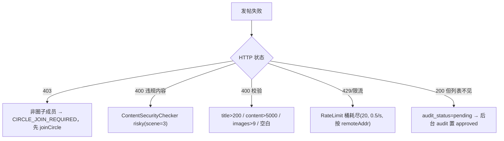

**图表来源**
- [CircleController.java:108-118](file://apps/api/src/main/java/com/campuslove/api/discover/CircleController.java#L108-L118)
- [RealCircleService.java:401-463](file://apps/api/src/main/java/com/campuslove/api/discover/RealCircleService.java#L401-L463)
- [AdminCircleController.java:385-414](file://apps/api/src/main/java/com/campuslove/api/admin/AdminCircleController.java#L385-L414)

**章节来源**
- [index.vue:74-152](file://apps/client/src/subpackages/circles/circles/index.vue#L74-L152)
- [circle-home.vue:79-120](file://apps/client/src/subpackages/circles/circles/circle-home.vue#L79-L120)
- [circle-home.vue:348-373](file://apps/client/src/subpackages/circles/circles/circle-home.vue#L348-L373)
- [RealCircleService.java:243-296](file://apps/api/src/main/java/com/campuslove/api/discover/RealCircleService.java#L243-L296)
- [RealCircleService.java:362-387](file://apps/api/src/main/java/com/campuslove/api/discover/RealCircleService.java#L362-L387)
- [RealCircleService.java:590-642](file://apps/api/src/main/java/com/campuslove/api/discover/RealCircleService.java#L590-L642)
- [circle.ts:420-469](file://apps/client/src/stores/circle.ts#L420-L469)

## 结论
话题广场的真实实现是一个「两页 + 一 store + 一控制器 + 一服务」的窄链路：`index.vue` 负责圈子的展示、分类过滤与加入/退出，`circle-home.vue` 负责单圈信息卡与动态聚合，`stores/circle.ts` 是唯一网络出口，`CircleController` 提供 9 个 `/api/v1/circles` 端点，`RealCircleService` 在 `@Profile("real")` 下把请求落到 `interest_circles` / `circle_memberships` / `circle_topics` / `circle_replies` 四张表。

三条设计取向可以从源码中直接读出。其一是身份与权限的收口：所有写操作的用户身份来自 JWT（`SecurityUtils.getCurrentUserId()`），请求体不再接受 `userId` / `authorId`，发帖额外受成员资格闸门约束；写端点统一叠加 `@Idempotent`，两个发帖/回复入口分别配 20 与 30 容量的 IP 令牌桶。其二是内容治理的分层：`ContentSecurityChecker`（msgSecCheck v2，论坛场景 3、评论场景 2）负责拒发高风险，`SensitiveWordFilter` 负责把命中词替换为 `***`，`audit_status` 负责「发布即可见 ≠ 前台可见」——新话题落 `pending`，经 `AdminCircleController` 的 `/topics/{id}/audit` 才进入前台。其三是并发与查询的工程化修补：成员数改为数据库侧原子增减并在 bulk 后 `clear()` 防脏写，话题数改为 `IN ... GROUP BY` 单查，回复列表改为 SQL 侧分页，作者信息批量预加载。

热度与聚合是本页最需要注意的边界：仓库里的热度语义住在 `RecommendationRanker`（`HEAT_HIGH_THRESHOLD = 100` / `HEAT_RISING_THRESHOLD = 20` 的 `buildHeatLabel`），而圈子话题视图只携带 `replyCount` 与 `isPinned`，既无点赞字段也未接入该组件；圈内「热门」目前由成员数徽标（8000 / 10000 两处阈值）与置顶排序共同表达。精选接口 `GET /featured` 已在后端齐备但主页尚未消费，`activities` / `works` / `members` 三个 Tab 与圈标签、置顶公告同样缺后端数据源，圈子读路径也未接入任何 `CacheNames` 声明的缓存。上述缺口均已在「能力缺口登记」逐条给出判定依据，扩展方案（新增分类五步清单）与排查路径（发帖失败状态码分流）可直接作为改造与值班手册使用。

**章节来源**
- [CircleController.java:29-175](file://apps/api/src/main/java/com/campuslove/api/discover/CircleController.java#L29-L175)
- [RealCircleService.java:401-463](file://apps/api/src/main/java/com/campuslove/api/discover/RealCircleService.java#L401-L463)
- [RealCircleService.java:590-615](file://apps/api/src/main/java/com/campuslove/api/discover/RealCircleService.java#L590-L615)
- [RecommendationRanker.java:740-779](file://apps/api/src/main/java/com/campuslove/api/discover/RecommendationRanker.java#L740-L779)
- [index.vue:74-152](file://apps/client/src/subpackages/circles/circles/index.vue#L74-L152)
- [circle-home.vue:244-276](file://apps/client/src/subpackages/circles/circles/circle-home.vue#L244-L276)
- [CacheNames.java:18-111](file://apps/api/src/main/java/com/campuslove/api/config/CacheNames.java#L18-L111)

