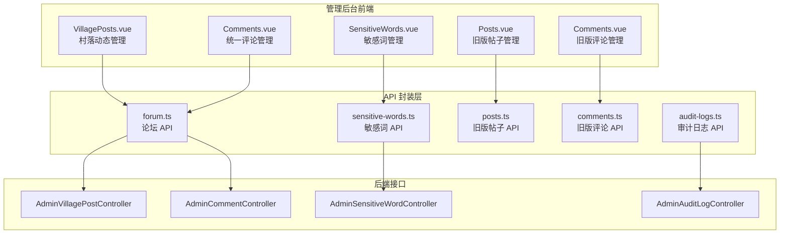
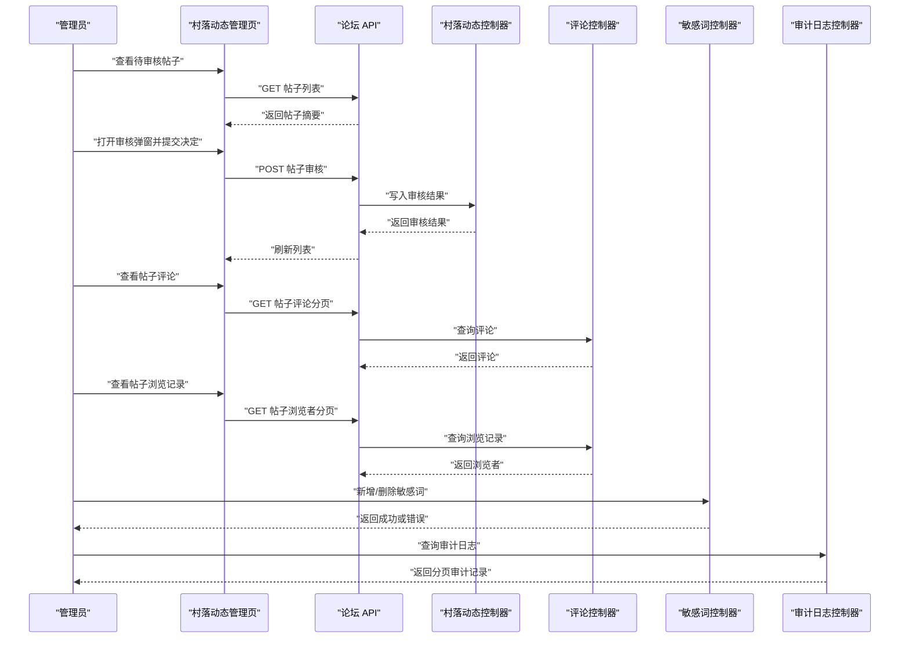
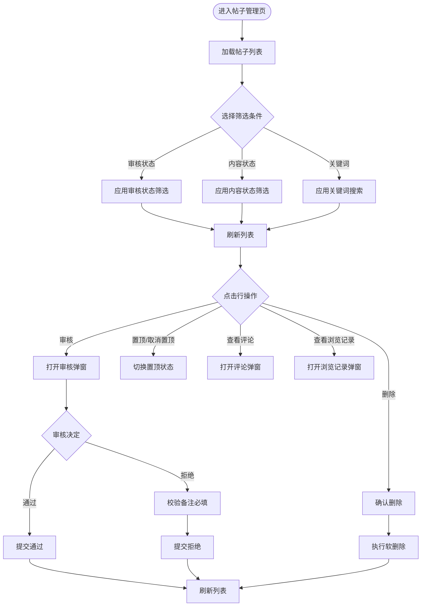
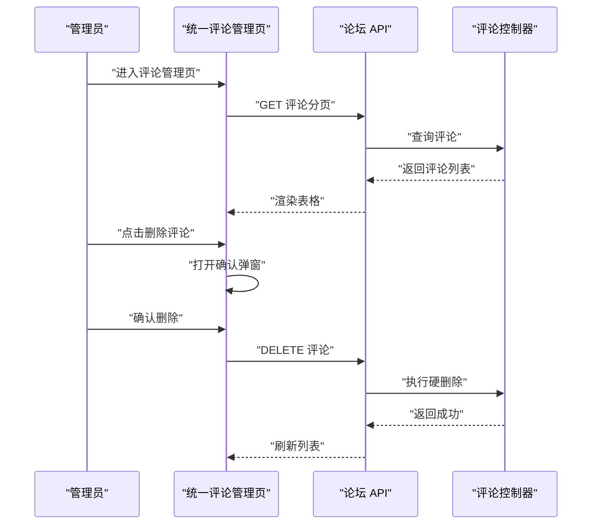
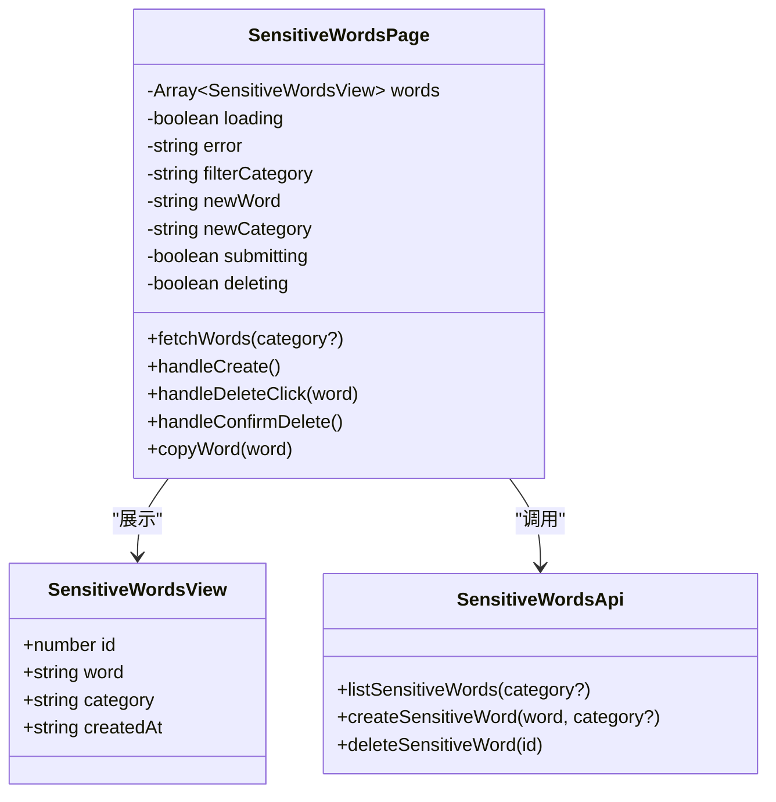
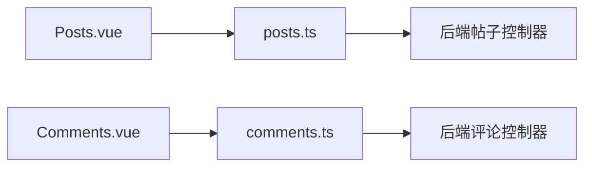
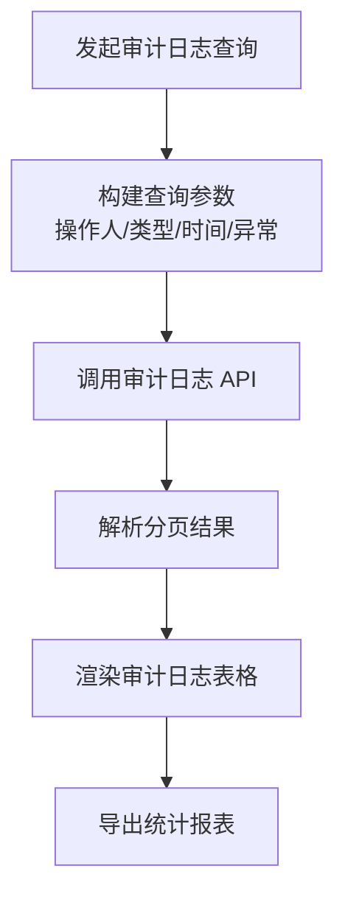
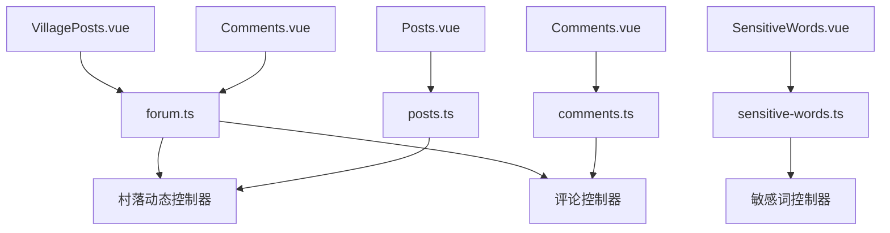

# 内容审核系统

<cite>
**本文引用的文件**   
- [apps/admin/src/api/sensitive-words.ts](file://apps/admin/src/api/sensitive-words.ts)
- [apps/admin/src/views/content/SensitiveWords.vue](file://apps/admin/src/views/content/SensitiveWords.vue)
- [apps/admin/src/api/forum.ts](file://apps/admin/src/api/forum.ts)
- [apps/admin/src/views/forum/VillagePosts.vue](file://apps/admin/src/views/forum/VillagePosts.vue)
- [apps/admin/src/views/forum/Comments.vue](file://apps/admin/src/views/forum/Comments.vue)
- [apps/admin-legacy/src/api/posts.ts](file://apps/admin-legacy/src/api/posts.ts)
- [apps/admin-legacy/src/api/comments.ts](file://apps/admin-legacy/src/api/comments.ts)
- [apps/admin-legacy/src/api/audit-logs.ts](file://apps/admin-legacy/src/api/audit-logs.ts)
- [apps/admin-legacy/src/views/Posts.vue](file://apps/admin-legacy/src/views/Posts.vue)
- [apps/admin-legacy/src/views/Comments.vue](file://apps/admin-legacy/src/views/Comments.vue)
</cite>

## 目录
1. [引言](#引言)
2. [项目结构](#项目结构)
3. [核心组件](#核心组件)
4. [架构总览](#架构总览)
5. [详细组件分析](#详细组件分析)
6. [依赖关系分析](#依赖关系分析)
7. [性能与可扩展性](#性能与可扩展性)
8. [故障排查指南](#故障排查指南)
9. [结论](#结论)

## 引言
本说明面向内容审核系统的产品与研发人员，聚焦帖子审核、评论管理与敏感内容检测的端到端流程。系统由管理后台前端页面、API 封装层和后端控制器组成，支持：
- 帖子审核队列管理、按审核状态与内容状态筛选、内容预览、审核决策留痕。
- 统一评论管理列表与删除操作。
- 敏感词库分类查询、新增与删除。
- 审计日志查询，覆盖审核、删除、敏感词变更等关键操作。

文档同时解释现有能力边界：当前实现以单条审核为主，未提供批量审核界面；内容下架为软删除，恢复与永久删除未在现有前端暴露；自动审核规则与人工复核机制通过审核状态、备注与审计日志形成闭环。

## 项目结构
内容审核相关代码分布在两个版本的管理后台中：
- 新版后台（admin v2）：论坛帖子、评论、敏感词管理集中在 `apps/admin`。
- 旧版后台（admin legacy）：帖子、评论、审计日志 API 与视图集中在 `apps/admin-legacy`，作为历史参考与迁移对照。

图表来源
- [apps/admin/src/views/forum/VillagePosts.vue:1-607](file://apps/admin/src/views/forum/VillagePosts.vue#L1-L607)
- [apps/admin/src/views/forum/Comments.vue:1-207](file://apps/admin/src/views/forum/Comments.vue#L1-L207)
- [apps/admin/src/views/content/SensitiveWords.vue:1-402](file://apps/admin/src/views/content/SensitiveWords.vue#L1-L402)
- [apps/admin/src/api/forum.ts:1-200](file://apps/admin/src/api/forum.ts#L1-L200)
- [apps/admin/src/api/sensitive-words.ts:1-47](file://apps/admin/src/api/sensitive-words.ts#L1-L47)
- [apps/admin-legacy/src/api/posts.ts:1-91](file://apps/admin-legacy/src/api/posts.ts#L1-L91)
- [apps/admin-legacy/src/api/comments.ts:1-53](file://apps/admin-legacy/src/api/comments.ts#L1-L53)
- [apps/admin-legacy/src/api/audit-logs.ts:1-89](file://apps/admin-legacy/src/api/audit-logs.ts#L1-L89)

章节来源
- [apps/admin/src/views/forum/VillagePosts.vue:1-607](file://apps/admin/src/views/forum/VillagePosts.vue#L1-L607)
- [apps/admin/src/views/forum/Comments.vue:1-207](file://apps/admin/src/views/forum/Comments.vue#L1-L207)
- [apps/admin/src/views/content/SensitiveWords.vue:1-402](file://apps/admin/src/views/content/SensitiveWords.vue#L1-L402)
- [apps/admin/src/api/forum.ts:1-200](file://apps/admin/src/api/forum.ts#L1-L200)
- [apps/admin/src/api/sensitive-words.ts:1-47](file://apps/admin/src/api/sensitive-words.ts#L1-L47)
- [apps/admin-legacy/src/api/posts.ts:1-91](file://apps/admin-legacy/src/api/posts.ts#L1-L91)
- [apps/admin-legacy/src/api/comments.ts:1-53](file://apps/admin-legacy/src/api/comments.ts#L1-L53)
- [apps/admin-legacy/src/api/audit-logs.ts:1-89](file://apps/admin-legacy/src/api/audit-logs.ts#L1-L89)

## 核心组件
本节梳理内容审核系统中的主要前端页面与 API 契约。

| 组件 | 职责 | 关键能力 | 数据模型或接口 |
|---|---|---|---|
| 村落动态管理页 | 帖子审核、置顶、删除、查看评论与浏览记录 | 按审核状态和内容状态筛选、分页、审核弹窗、内容预览 | `VillagePostSummary`、`VillagePostDetail`、`PostCommentView`、`PostViewer` |
| 统一评论管理页 | 评论列表与删除 | 分页、删除确认、作者昵称回退 | `PostCommentView` |
| 敏感词管理页 | 敏感词库维护 | 分类筛选、新增、删除、复制、权限控制 | `SensitiveWordView`、`SENSITIVE_WORD_CATEGORIES` |
| 旧版帖子管理页 | 历史帖子审核与删除 | 审核弹窗、软删除、筛选 | `AdminPostSummary`、`AdminPostAuditRequest` |
| 旧版评论管理页 | 历史评论删除 | 分页、删除确认 | `AdminCommentSummary` |
| 审计日志 API | 审计追踪 | 分页、按操作类型、时间范围、异常过滤 | `AuditLogView`、`AuditLogPageView` |

章节来源
- [apps/admin/src/api/forum.ts:1-200](file://apps/admin/src/api/forum.ts#L1-L200)
- [apps/admin/src/api/sensitive-words.ts:1-47](file://apps/admin/src/api/sensitive-words.ts#L1-L47)
- [apps/admin-legacy/src/api/posts.ts:1-91](file://apps/admin-legacy/src/api/posts.ts#L1-L91)
- [apps/admin-legacy/src/api/comments.ts:1-53](file://apps/admin-legacy/src/api/comments.ts#L1-L53)
- [apps/admin-legacy/src/api/audit-logs.ts:1-89](file://apps/admin-legacy/src/api/audit-logs.ts#L1-L89)

## 架构总览
内容审核系统采用“页面 → API 封装 → 后端控制器”的分层结构。审核流程从管理后台页面发起请求，后端写入审核结果并更新审核状态；敏感词库变更与审计日志均通过独立 API 暴露。

图表来源
- [apps/admin/src/views/forum/VillagePosts.vue:1-607](file://apps/admin/src/views/forum/VillagePosts.vue#L1-L607)
- [apps/admin/src/api/forum.ts:1-200](file://apps/admin/src/api/forum.ts#L1-L200)
- [apps/admin/src/api/sensitive-words.ts:1-47](file://apps/admin/src/api/sensitive-words.ts#L1-L47)
- [apps/admin-legacy/src/api/audit-logs.ts:1-89](file://apps/admin-legacy/src/api/audit-logs.ts#L1-L89)

## 详细组件分析

### 帖子审核流程（村落动态管理）
村落动态管理页承担帖子审核的核心交互：
- 列表加载支持按审核状态、内容状态、关键词筛选，并分页展示。
- 审核弹窗要求拒绝时填写备注，用于留痕与客户端提示。
- 行内置顶/取消置顶无需二次确认，但防止并发重复操作。
- 删除走确认弹窗，调用软删除接口。
- 可查看帖子评论分页与浏览者分页，辅助判断内容与热度。

图表来源
- [apps/admin/src/views/forum/VillagePosts.vue:1-607](file://apps/admin/src/views/forum/VillagePosts.vue#L1-L607)
- [apps/admin/src/api/forum.ts:1-200](file://apps/admin/src/api/forum.ts#L1-L200)

#### 数据结构与复杂度
- 帖子摘要视图包含标题、内容预览、分类、状态、审核状态、互动指标与时间戳，便于运营快速判断。
- 列表查询使用分页参数，避免一次性拉取全部数据；若未来增加更多筛选维度，应优先在后端索引优化，前端仅传递筛选条件。
- 审核请求体为通用结构，复用“通过/拒绝 + 可选备注”，降低接口耦合。

章节来源
- [apps/admin/src/views/forum/VillagePosts.vue:1-607](file://apps/admin/src/views/forum/VillagePosts.vue#L1-L607)
- [apps/admin/src/api/forum.ts:1-200](file://apps/admin/src/api/forum.ts#L1-L200)

### 评论管理流程（统一评论管理）
统一评论管理页提供跨帖子的评论列表与删除能力：
- 列表分页加载，显示评论 ID、关联帖子 ID、作者 ID、作者昵称、内容、创建时间。
- 删除前弹出确认对话框，防止误删。
- 作者昵称缺失时回退到用户 ID 展示，增强可追溯性。

图表来源
- [apps/admin/src/views/forum/Comments.vue:1-207](file://apps/admin/src/views/forum/Comments.vue#L1-L207)
- [apps/admin/src/api/forum.ts:1-200](file://apps/admin/src/api/forum.ts#L1-L200)

章节来源
- [apps/admin/src/views/forum/Comments.vue:1-207](file://apps/admin/src/views/forum/Comments.vue#L1-L207)
- [apps/admin/src/api/forum.ts:1-200](file://apps/admin/src/api/forum.ts#L1-L200)

### 敏感词库管理
敏感词管理页负责敏感词的分类筛选、新增与删除：
- 分类枚举包含政治、色情、辱骂、广告、其他等类别，标签使用国际化键值映射。
- 非超级管理员只读，新增与删除按钮隐藏，避免越权操作。
- 新增时进行本地校验：非空、长度上限、大小写不敏感去重。
- 删除需确认弹窗，成功后刷新列表。
- 提供复制敏感词到剪贴板的快捷入口，提升运营效率。

图表来源
- [apps/admin/src/views/content/SensitiveWords.vue:1-402](file://apps/admin/src/views/content/SensitiveWords.vue#L1-L402)
- [apps/admin/src/api/sensitive-words.ts:1-47](file://apps/admin/src/api/sensitive-words.ts#L1-L47)

章节来源
- [apps/admin/src/views/content/SensitiveWords.vue:1-402](file://apps/admin/src/views/content/SensitiveWords.vue#L1-L402)
- [apps/admin/src/api/sensitive-words.ts:1-47](file://apps/admin/src/api/sensitive-words.ts#L1-L47)

### 旧版帖子与评论管理对比
旧版后台仍保留帖子与评论管理 API 及视图，便于历史问题定位与迁移对照：
- 帖子管理 API 定义审核请求体、审核响应体、删除响应体与分页查询参数。
- 评论管理 API 定义评论摘要、分页查询与删除响应。
- 帖子管理页实现审核弹窗、软删除、筛选防抖与错误态展示。
- 评论管理页实现分页、删除确认与作者昵称回退。

图表来源
- [apps/admin-legacy/src/views/Posts.vue:1-200](file://apps/admin-legacy/src/views/Posts.vue#L1-L200)
- [apps/admin-legacy/src/api/posts.ts:1-91](file://apps/admin-legacy/src/api/posts.ts#L1-L91)
- [apps/admin-legacy/src/views/Comments.vue:1-200](file://apps/admin-legacy/src/views/Comments.vue#L1-L200)
- [apps/admin-legacy/src/api/comments.ts:1-53](file://apps/admin-legacy/src/api/comments.ts#L1-L53)

章节来源
- [apps/admin-legacy/src/views/Posts.vue:1-200](file://apps/admin-legacy/src/views/Posts.vue#L1-L200)
- [apps/admin-legacy/src/api/posts.ts:1-91](file://apps/admin-legacy/src/api/posts.ts#L1-L91)
- [apps/admin-legacy/src/views/Comments.vue:1-200](file://apps/admin-legacy/src/views/Comments.vue#L1-L200)
- [apps/admin-legacy/src/api/comments.ts:1-53](file://apps/admin-legacy/src/api/comments.ts#L1-L53)

### 审核历史记录追踪
审计日志 API 提供统一的审计查询能力，覆盖帖子审核、帖子删除、评论删除、用户禁用/启用、报告处理、配置更新、敏感词增删等关键操作：
- 支持分页、操作人、操作类型、时间范围与异常过滤。
- 操作类型枚举与国际化键值对应，便于报表统计与检索。
- 审计日志可作为质量评估与合规审查的重要依据。

图表来源
- [apps/admin-legacy/src/api/audit-logs.ts:1-89](file://apps/admin-legacy/src/api/audit-logs.ts#L1-L89)

章节来源
- [apps/admin-legacy/src/api/audit-logs.ts:1-89](file://apps/admin-legacy/src/api/audit-logs.ts#L1-L89)

## 依赖关系分析
内容审核系统的模块耦合度较低，主要通过 API 契约解耦：
- 页面层依赖 API 封装层提供的函数与类型。
- API 封装层直接映射后端控制器路径与请求/响应结构。
- 审计日志与其他业务模块相对独立，便于扩展新的审计事件。

图表来源
- [apps/admin/src/views/forum/VillagePosts.vue:1-607](file://apps/admin/src/views/forum/VillagePosts.vue#L1-L607)
- [apps/admin/src/views/forum/Comments.vue:1-207](file://apps/admin/src/views/forum/Comments.vue#L1-L207)
- [apps/admin/src/views/content/SensitiveWords.vue:1-402](file://apps/admin/src/views/content/SensitiveWords.vue#L1-L402)
- [apps/admin/src/api/forum.ts:1-200](file://apps/admin/src/api/forum.ts#L1-L200)
- [apps/admin/src/api/sensitive-words.ts:1-47](file://apps/admin/src/api/sensitive-words.ts#L1-L47)
- [apps/admin-legacy/src/views/Posts.vue:1-200](file://apps/admin-legacy/src/views/Posts.vue#L1-L200)
- [apps/admin-legacy/src/views/Comments.vue:1-200](file://apps/admin-legacy/src/views/Comments.vue#L1-L200)

章节来源
- [apps/admin/src/views/forum/VillagePosts.vue:1-607](file://apps/admin/src/views/forum/VillagePosts.vue#L1-L607)
- [apps/admin/src/views/forum/Comments.vue:1-207](file://apps/admin/src/views/forum/Comments.vue#L1-L207)
- [apps/admin/src/views/content/SensitiveWords.vue:1-402](file://apps/admin/src/views/content/SensitiveWords.vue#L1-L402)
- [apps/admin/src/api/forum.ts:1-200](file://apps/admin/src/api/forum.ts#L1-L200)
- [apps/admin/src/api/sensitive-words.ts:1-47](file://apps/admin/src/api/sensitive-words.ts#L1-L47)
- [apps/admin-legacy/src/views/Posts.vue:1-200](file://apps/admin-legacy/src/views/Posts.vue#L1-L200)
- [apps/admin-legacy/src/views/Comments.vue:1-200](file://apps/admin-legacy/src/views/Comments.vue#L1-L200)

## 性能与可扩展性
- 列表分页：帖子、评论、浏览记录均采用分页查询，避免大数据量导致的渲染与网络压力。
- 请求竞态防护：多处使用序列号与“过期响应丢弃”策略，防止翻页或筛选导致的数据错乱。
- 敏感词库规模较小，当前全量加载；若增长可切换到后端分页与前端分页组件。
- 审核流程建议：
  - 在审核弹窗中加入图片预览与完整内容加载开关，减少首屏开销。
  - 对高优先级待审核帖子提供排序字段（如创建时间倒序、举报数倒序）。
  - 批量审核可在后端提供批量接口，前端增加勾选与批量提交确认。

[本节为通用指导，不直接分析具体文件]

## 故障排查指南
常见问题与定位思路：
- 审核失败：检查审核弹窗是否填写拒绝备注；捕获 API 错误并显示国际化消息；确认后端审核接口返回状态。
- 列表为空或数据错乱：检查分页参数是否正确；确认请求竞态防护是否生效；查看 ErrorState 重试入口。
- 敏感词新增失败：检查本地校验（非空、长度、去重）；后端 409 重复资源时前端映射为重复提示。
- 删除误操作：确认 ConfirmDialog 二次确认逻辑；评论删除为硬删除不可恢复，需谨慎。
- 审计日志缺失：核对操作类型枚举与后端记录；检查时间范围与异常过滤条件。

章节来源
- [apps/admin/src/views/forum/VillagePosts.vue:1-607](file://apps/admin/src/views/forum/VillagePosts.vue#L1-L607)
- [apps/admin/src/views/content/SensitiveWords.vue:1-402](file://apps/admin/src/views/content/SensitiveWords.vue#L1-L402)
- [apps/admin/src/views/forum/Comments.vue:1-207](file://apps/admin/src/views/forum/Comments.vue#L1-L207)
- [apps/admin-legacy/src/api/audit-logs.ts:1-89](file://apps/admin-legacy/src/api/audit-logs.ts#L1-L89)

## 结论
内容审核系统在当前仓库中实现了帖子审核、评论管理与敏感词库维护的基础能力，并通过审计日志提供操作可追溯性。其设计强调分页、请求竞态防护与国际化，具备良好的可维护性与扩展空间。未来可进一步补充批量审核、自动审核规则引擎、内容下架恢复与永久删除的权限控制，以及审核统计报表与质量评估指标，以满足更复杂的运营需求。

[本节为总结性内容，不直接分析具体文件]