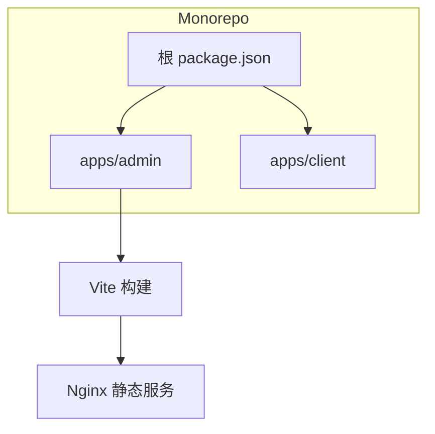
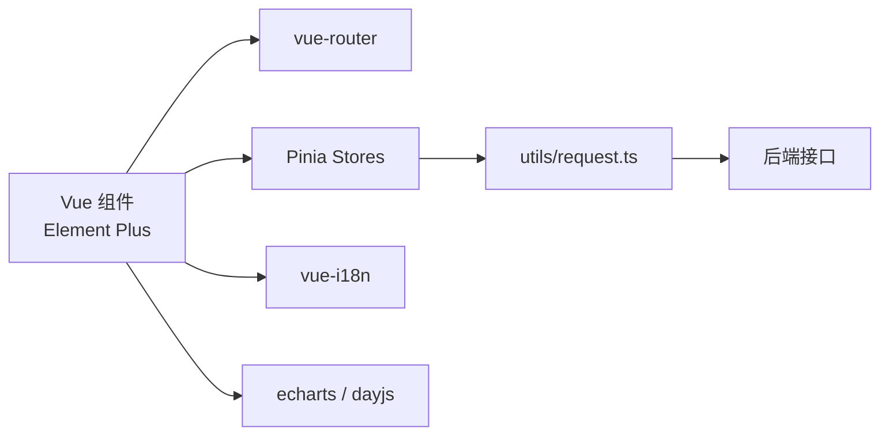
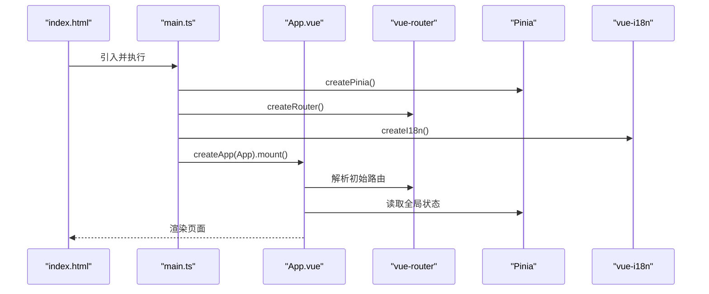
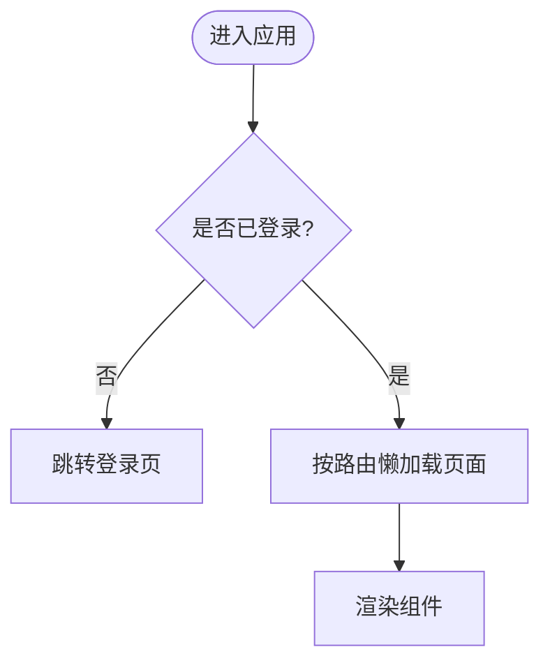
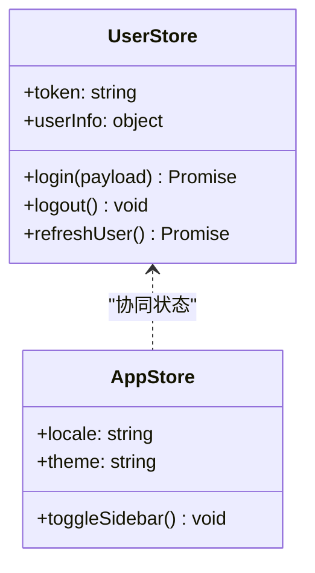
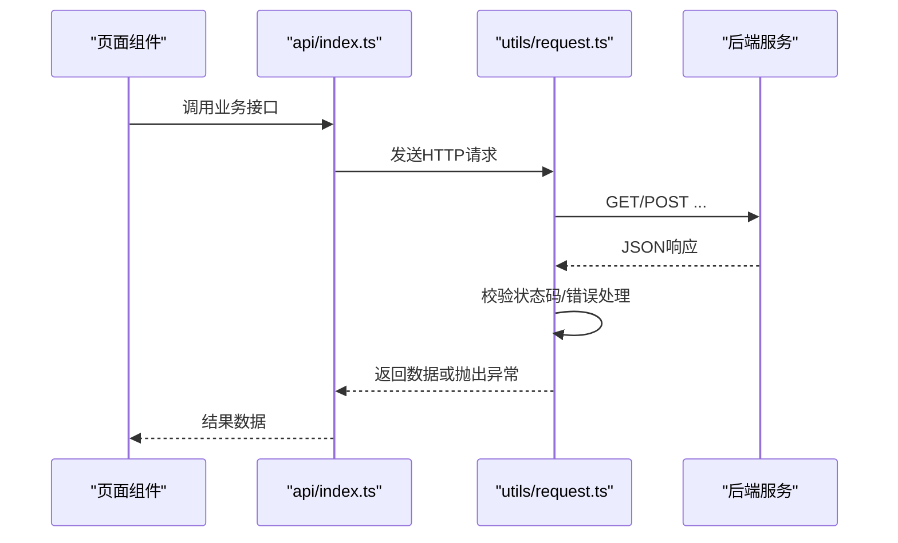
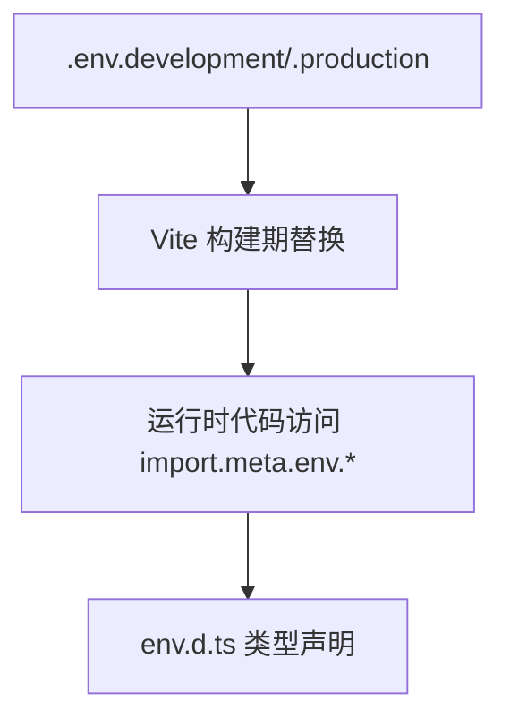
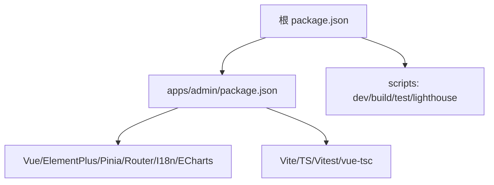
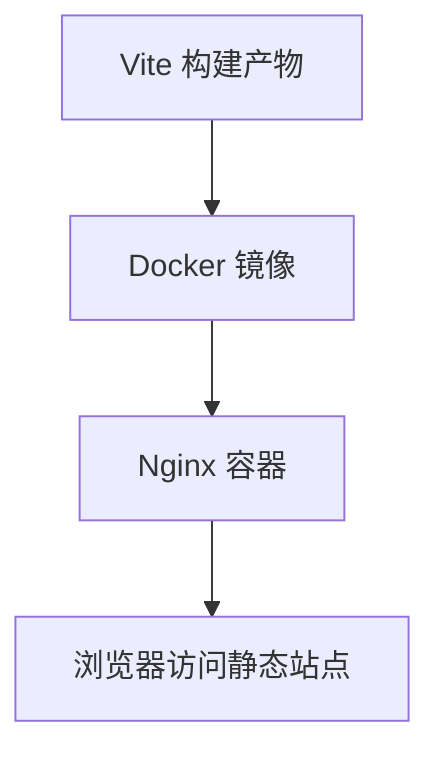

# 后台架构设计

<cite>
**本文引用的文件**
- [apps/admin/package.json](file://apps/admin/package.json)
- [apps/admin/vite.config.ts](file://apps/admin/vite.config.ts)
- [apps/admin/tsconfig.json](file://apps/admin/tsconfig.json)
- [apps/admin/tsconfig.node.json](file://apps/admin/tsconfig.node.json)
- [apps/admin/index.html](file://apps/admin/index.html)
- [apps/admin/src/main.ts](file://apps/admin/src/main.ts)
- [apps/admin/src/App.vue](file://apps/admin/src/App.vue)
- [apps/admin/src/env.d.ts](file://apps/admin/src/env.d.ts)
- [apps/admin/src/router/index.ts](file://apps/admin/src/router/index.ts)
- [apps/admin/src/stores/session.ts](file://apps/admin/src/stores/session.ts)
- [apps/admin/src/stores/menu.ts](file://apps/admin/src/stores/menu.ts)
- [apps/admin/src/api/http.ts](file://apps/admin/src/api/http.ts)
- [apps/admin/src/api/http.ts](file://apps/admin/src/api/http.ts)
- [apps/admin/Dockerfile](file://apps/admin/Dockerfile)
- [apps/admin/docker/nginx.conf](file://apps/admin/docker/nginx.conf)
- [docker-compose.yml](file://docker-compose.yml)
- [eslint.config.mjs](file://eslint.config.mjs)
- [.prettierrc.json](file://.prettierrc.json)
- [package.json](file://package.json)
</cite>

## 目录
1. [简介](#简介)
2. [项目结构](#项目结构)
3. [核心组件](#核心组件)
4. [架构总览](#架构总览)
5. [详细组件分析](#详细组件分析)
6. [依赖关系分析](#依赖关系分析)
7. [性能与构建优化](#性能与构建优化)
8. [开发工具链与调试](#开发工具链与调试)
9. [部署与Nginx配置](#部署与nginx配置)
10. [故障排查指南](#故障排查指南)
11. [结论](#结论)

## 简介
本仓库为多应用 Monorepo，管理后台位于 apps/admin，采用 Vue 3 + Element Plus + TypeScript + Vite 技术栈。本文档聚焦管理后台的架构设计、初始化配置、构建流程、路由与状态管理、API 集成、性能优化、开发工具链、容器化与 Nginx 静态服务，帮助读者快速理解并高效维护该后台系统。

## 项目结构
- 工作区根 package.json 使用 pnpm workspaces，将 apps/client 与 apps/admin 纳入统一工作区，提供统一脚本（如 lint、lighthouse 等）。
- 管理后台 apps/admin 是一个独立 Vite 工程：
  - 入口 HTML: index.html
  - 应用入口: src/main.ts
  - 根组件: src/App.vue
  - 类型声明: src/env.d.ts
  - 路由: src/router/index.ts
  - 状态: src/stores/* (Pinia)
  - HTTP 封装: src/utils/request.ts
  - API 层: src/api/*
  - 国际化: src/i18n/*
  - 主题/样式: src/theme/, src/styles/
  - 构建产物由 Vite 输出，可通过 Dockerfile 与 docker/nginx.conf 进行容器化部署。

**章节来源**
- [package.json:1-48](file://package.json#L1-L48)
- [apps/admin/package.json:1-45](file://apps/admin/package.json#L1-L45)

## 核心组件
- 框架与 UI：Vue 3 + Element Plus + @element-plus/icons-vue
- 状态管理：Pinia
- 路由：vue-router
- 构建工具：Vite + TypeScript
- 测试：Vitest（单测）
- 质量与规范：ESLint、Prettier
- 运行时能力：dayjs、echarts（图表）、vue-i18n（国际化）

**章节来源**
- [apps/admin/package.json:1-45](file://apps/admin/package.json#L1-L45)

## 架构总览
管理后台前端遵循“视图-状态-API”分层：
- 视图层：Vue 组件与页面，通过 Element Plus 提供 UI。
- 状态层：Pinia stores 管理全局与模块级状态。
- API 层：基于 axios 的请求封装，集中处理鉴权、错误、拦截器。
- 路由层：vue-router 负责页面跳转与懒加载。
- 国际化：vue-i18n 提供多语言支持。
- 构建与部署：Vite 生成静态资源，Nginx 托管；Docker 镜像包含 Nginx 配置。

**图示来源**
- [apps/admin/src/main.ts](file://apps/admin/src/main.ts)
- [apps/admin/src/App.vue](file://apps/admin/src/App.vue)
- [apps/admin/src/router/index.ts](file://apps/admin/src/router/index.ts)
- [apps/admin/src/stores/session.ts](file://apps/admin/src/stores/session.ts)
- [apps/admin/src/api/http.ts](file://apps/admin/src/api/http.ts)

**章节来源**
- [apps/admin/src/main.ts](file://apps/admin/src/main.ts)
- [apps/admin/src/App.vue](file://apps/admin/src/App.vue)
- [apps/admin/src/router/index.ts](file://apps/admin/src/router/index.ts)
- [apps/admin/src/stores/session.ts](file://apps/admin/src/stores/session.ts)
- [apps/admin/src/api/http.ts](file://apps/admin/src/api/http.ts)

## 详细组件分析

### 应用入口与插件集成
- 应用启动流程：index.html -> main.ts -> App.vue
- main.ts 中初始化 Vue 实例、注册 Pinia、Router、i18n、Element Plus 等插件，并挂载到 DOM。
- App.vue 作为根组件，承载布局与全局样式/主题。

**图示来源**
- [apps/admin/index.html](file://apps/admin/index.html)
- [apps/admin/src/main.ts](file://apps/admin/src/main.ts)
- [apps/admin/src/App.vue](file://apps/admin/src/App.vue)
- [apps/admin/src/router/index.ts](file://apps/admin/src/router/index.ts)
- [apps/admin/src/stores/menu.ts](file://apps/admin/src/stores/menu.ts)

**章节来源**
- [apps/admin/index.html](file://apps/admin/index.html)
- [apps/admin/src/main.ts](file://apps/admin/src/main.ts)
- [apps/admin/src/App.vue](file://apps/admin/src/App.vue)

### 路由与懒加载
- 路由定义在 router/index.ts，建议使用动态 import 实现页面级代码分割与懒加载。
- 可结合权限控制进行路由守卫（例如登录后重定向、菜单权限过滤）。

**图示来源**
- [apps/admin/src/router/index.ts](file://apps/admin/src/router/index.ts)

**章节来源**
- [apps/admin/src/router/index.ts](file://apps/admin/src/router/index.ts)

### 状态管理（Pinia）
- stores/user.ts：用户信息、权限、登录态等。
- stores/app.ts：应用级通用状态（如侧边栏折叠、主题、语言等）。
- 建议在请求前从 Pinia 读取 token，并在响应后更新状态。

**图示来源**
- [apps/admin/src/stores/session.ts](file://apps/admin/src/stores/session.ts)
- [apps/admin/src/stores/menu.ts](file://apps/admin/src/stores/menu.ts)

**章节来源**
- [apps/admin/src/stores/session.ts](file://apps/admin/src/stores/session.ts)
- [apps/admin/src/stores/menu.ts](file://apps/admin/src/stores/menu.ts)

### 网络请求与错误处理
- utils/request.ts 封装 axios，统一设置基础地址、超时、请求头（含 Authorization）、响应拦截（错误码、消息提示、重试策略等）。
- api/index.ts 组织业务接口方法，调用 request 并返回标准化数据。

**图示来源**
- [apps/admin/src/api/http.ts](file://apps/admin/src/api/http.ts)
- [apps/admin/src/api/http.ts](file://apps/admin/src/api/http.ts)

**章节来源**
- [apps/admin/src/api/http.ts](file://apps/admin/src/api/http.ts)
- [apps/admin/src/api/http.ts](file://apps/admin/src/api/http.ts)

### 环境变量与类型定义
- 通过 Vite 的环境变量机制注入运行时配置（如 API 基础路径、功能开关）。
- env.d.ts 提供 .env.* 的类型声明，确保类型安全。

**图示来源**
- [apps/admin/src/env.d.ts](file://apps/admin/src/env.d.ts)

**章节来源**
- [apps/admin/src/env.d.ts](file://apps/admin/src/env.d.ts)

### 构建与打包
- Vite 构建命令：build（先执行 vue-tsc 类型检查，再 vite build）。
- 生产构建建议开启代码分割、压缩、SourceMap 按需配置。
- 预览：vite preview 用于本地验证构建产物。

**章节来源**
- [apps/admin/package.json:1-45](file://apps/admin/package.json#L1-L45)

## 依赖关系分析
- 工作区根 package.json 定义了 scripts，包括 lighthouse 对 admin 的性能审计（端口 5177）。
- 管理后台依赖 Vue 3、Element Plus、Pinia、vue-router、vue-i18n、echarts、dayjs 等。
- 开发依赖包含 Vite、TypeScript、vitest、@vitejs/plugin-vue、vue-tsc。

**图示来源**
- [package.json:1-48](file://package.json#L1-L48)
- [apps/admin/package.json:1-45](file://apps/admin/package.json#L1-L45)

**章节来源**
- [package.json:1-48](file://package.json#L1-L48)
- [apps/admin/package.json:1-45](file://apps/admin/package.json#L1-L45)

## 性能与构建优化
- 路由级懒加载：将页面组件以动态 import 方式拆分，减少首屏体积。
- 组件级异步加载：对重型组件（如图表）按需引入与懒加载。
- 静态资源优化：图片压缩、字体子集化、CDN 缓存策略。
- 构建优化：开启 Tree Shaking、分包策略、缓存利用、SourceMap 按需。
- 性能监控：可使用 Lighthouse（根脚本提供 lighthouse:admin），或接入前端埋点（如性能指标上报）。

[本节为通用指导，不直接引用具体文件]

## 开发工具链与调试
- 代码规范：ESLint 与 Prettier（根目录 eslint.config.mjs 与 .prettierrc.json）。
- 类型检查：vue-tsc（构建前执行类型检查）。
- 单元测试：vitest（可参考 package.json 中的 test:unit）。
- 调试：
  - 开发服务器：vite（默认端口根据 Vite 配置）。
  - 浏览器 DevTools 与 Vue Devtools。
  - Lighthouse 性能评测（根脚本提供 lighthouse:admin）。

**章节来源**
- [eslint.config.mjs](file://eslint.config.mjs)
- [.prettierrc.json](file://.prettierrc.json)
- [apps/admin/package.json:1-45](file://apps/admin/package.json#L1-L45)
- [package.json:1-48](file://package.json#L1-L48)

## 部署与Nginx配置
- 构建产物：vite build 输出的静态资源。
- 容器镜像：apps/admin/Dockerfile 定义镜像构建步骤。
- Nginx 配置：apps/admin/docker/nginx.conf 提供静态资源服务与重写规则。
- 编排：docker-compose.yml 可用于一键启动 Nginx 等容器。

**图示来源**
- [apps/admin/Dockerfile](file://apps/admin/Dockerfile)
- [apps/admin/docker/nginx.conf](file://apps/admin/docker/nginx.conf)
- [docker-compose.yml](file://docker-compose.yml)

**章节来源**
- [apps/admin/Dockerfile](file://apps/admin/Dockerfile)
- [apps/admin/docker/nginx.conf](file://apps/admin/docker/nginx.conf)
- [docker-compose.yml](file://docker-compose.yml)

## 故障排查指南
- 构建失败：
  - 确认 Node 版本满足 engines 要求。
  - 清理缓存后重新安装依赖并执行 typecheck 与 build。
- 路由空白或 404：
  - 检查路由定义与懒加载路径是否正确。
  - 确认 Nginx 重写规则指向正确的入口文件。
- 网络请求错误：
  - 检查 request 拦截器与后端 CORS、鉴权头配置。
  - 查看响应状态码与错误消息。
- 性能问题：
  - 使用 Lighthouse 分析首屏与交互延迟。
  - 检查大资源是否被正确拆分与缓存。

[本节为通用指导，不直接引用具体文件]

## 结论
本后台系统基于 Vue 3 + Element Plus + Vite + TypeScript，采用清晰的分层架构与模块化设计，配合 Pinia 进行状态管理、vue-router 实现路由与懒加载、统一的网络请求封装与错误处理。通过容器化与 Nginx 静态服务实现稳定部署。结合 ESLint、Prettier、TypeScript 与 Vitest 形成完整的开发与质量保障体系。建议在生产环境持续进行性能监控与优化，确保用户体验与可维护性。