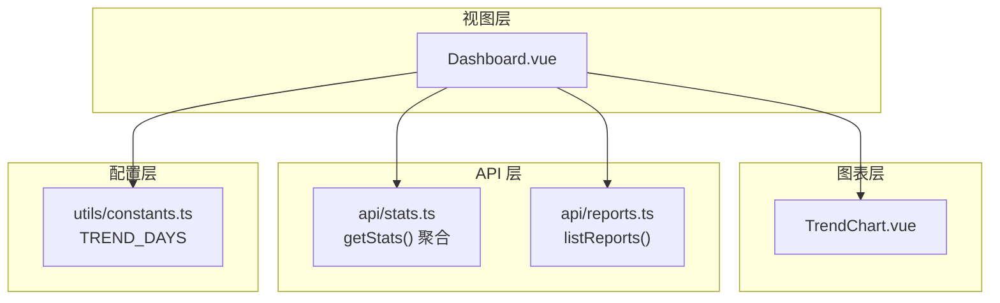
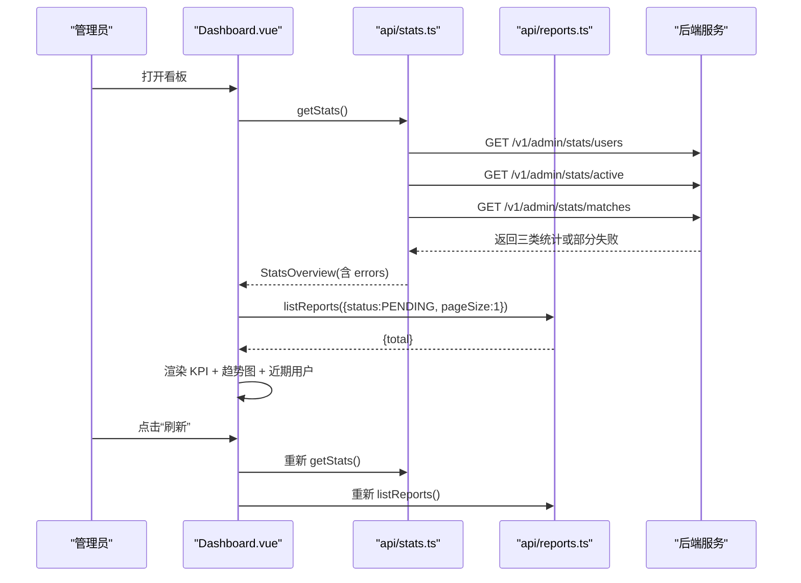
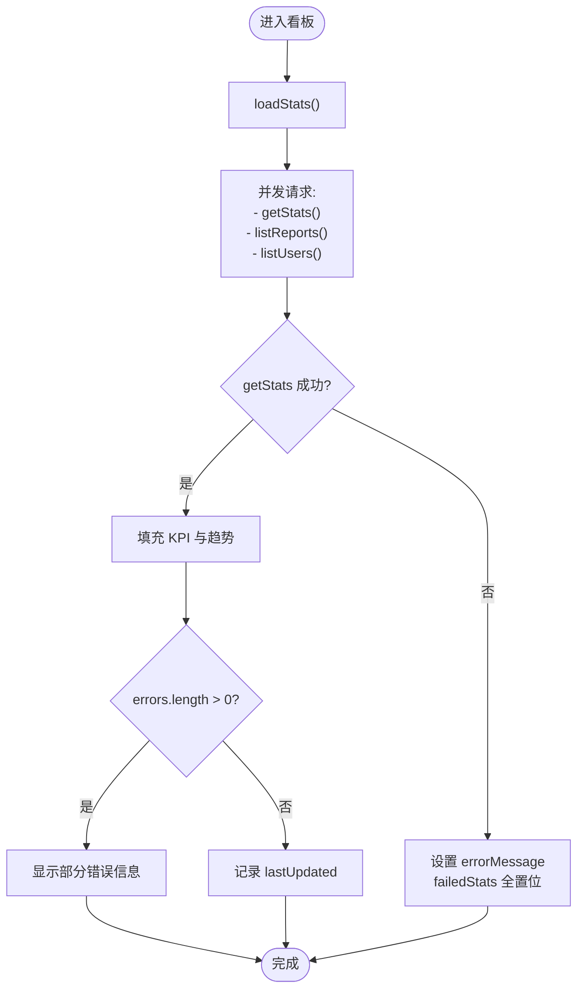
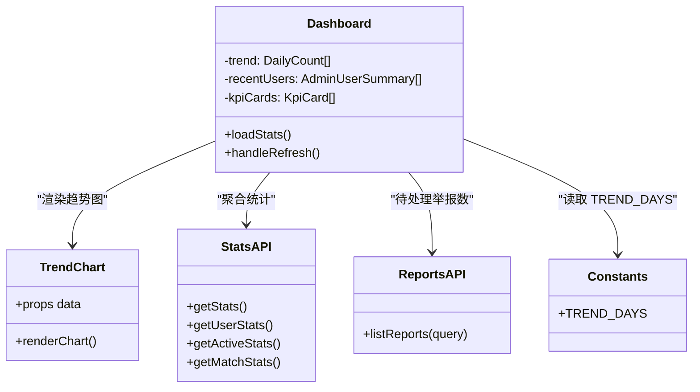

# 数据分析看板

<cite>
**本文引用的文件**
- [Dashboard.vue](file://apps/admin/src/views/Dashboard.vue)
- [TrendChart.vue](file://apps/admin/src/components/TrendChart.vue)
- [stats.ts](file://apps/admin/src/api/stats.ts)
- [constants.ts](file://apps/admin/src/utils/constants.ts)
- [reports.ts](file://apps/admin/src/api/reports.ts)
- [Dashboard.vue（旧后台）](file://apps/admin-legacy/src/views/Dashboard.vue)
- [stats.ts（旧后台）](file://apps/admin-legacy/src/api/stats.ts)
</cite>

## 目录
1. [简介](#简介)
2. [项目结构](#项目结构)
3. [核心组件](#核心组件)
4. [架构总览](#架构总览)
5. [详细组件分析](#详细组件分析)
6. [依赖关系分析](#依赖关系分析)
7. [性能与缓存策略](#性能与缓存策略)
8. [故障排查指南](#故障排查指南)
9. [结论](#结论)
10. [附录：指标定义、维度与扩展建议](#附录指标定义维度与扩展建议)

## 简介
本技术文档面向“数据分析看板”模块，聚焦管理后台的数据概览能力。当前实现包含：
- 实时总览 KPI：用户总数、今日新增、日活、待处理举报数
- 核心指标趋势：近 30 天每日匹配量柱状图
- 近期注册用户列表：按注册时间倒序的前 5 条
- 错误降级与手动刷新：子接口失败时局部降级展示，并提供一键刷新

文档同时覆盖用户活跃度分析、匹配成功率统计、消息量趋势图表的实现现状与可扩展点，并给出数据缓存、主题定制、响应式适配和刷新机制的建议方案。

## 项目结构
看板由视图层、图表组件层、API 聚合层、常量配置层组成，遵循“视图负责编排、图表专注渲染、API 负责聚合、常量收敛魔法数字”的分层组织方式。

图示来源
- [Dashboard.vue:1-200](file://apps/admin/src/views/Dashboard.vue#L1-L200)
- [TrendChart.vue:1-105](file://apps/admin/src/components/TrendChart.vue#L1-L105)
- [stats.ts:1-135](file://apps/admin/src/api/stats.ts#L1-L135)
- [reports.ts:1-113](file://apps/admin/src/api/reports.ts#L1-L113)
- [constants.ts:1-27](file://apps/admin/src/utils/constants.ts#L1-L27)

章节来源
- [Dashboard.vue:1-426](file://apps/admin/src/views/Dashboard.vue#L1-L426)
- [stats.ts:1-135](file://apps/admin/src/api/stats.ts#L1-L135)
- [constants.ts:1-27](file://apps/admin/src/utils/constants.ts#L1-L27)

## 核心组件
- Dashboard 视图：负责加载三类统计、渲染 KPI 卡片、调用趋势图、展示近期注册用户；提供错误降级与手动刷新。
- TrendChart 组件：基于 ECharts 的轻量封装，仅引入必要模块，支持自适应尺寸与无障碍标签。
- stats API：并行拉取用户统计、活跃度统计、匹配统计，使用 Promise.allSettled 保证部分失败不阻塞整体。
- reports API：提供举报列表查询，用于 KPI “待处理举报数”。
- constants：集中 TREND_DAYS 等看板相关常量，避免散落的魔法数字。

章节来源
- [Dashboard.vue:1-200](file://apps/admin/src/views/Dashboard.vue#L1-L200)
- [TrendChart.vue:1-105](file://apps/admin/src/components/TrendChart.vue#L1-L105)
- [stats.ts:1-135](file://apps/admin/src/api/stats.ts#L1-L135)
- [reports.ts:1-113](file://apps/admin/src/api/reports.ts#L1-L113)
- [constants.ts:1-27](file://apps/admin/src/utils/constants.ts#L1-L27)

## 架构总览
看板通过 getStats() 一次聚合三个子接口，分别返回用户、活跃度、匹配三类统计；同时并发获取待处理举报数与近期注册用户。任一子接口失败时，对应 KPI 或区块降级为“数据不可用”，并在顶部统一显示错误提示与重试入口。

图示来源
- [Dashboard.vue:1-200](file://apps/admin/src/views/Dashboard.vue#L1-L200)
- [stats.ts:1-135](file://apps/admin/src/api/stats.ts#L1-L135)
- [reports.ts:1-113](file://apps/admin/src/api/reports.ts#L1-L113)

章节来源
- [Dashboard.vue:1-200](file://apps/admin/src/views/Dashboard.vue#L1-L200)
- [stats.ts:1-135](file://apps/admin/src/api/stats.ts#L1-L135)

## 详细组件分析

### Dashboard 视图
职责
- 并发拉取统计数据：用户统计、活跃度统计、匹配统计、待处理举报数、近期注册用户。
- 渲染四类 KPI：总用户、今日新增、日活、待处理举报（警告色）。
- 渲染近 30 天匹配趋势：空态与图表态切换。
- 渲染近期注册用户表格：按创建时间倒序前 5。
- 错误降级：任一子接口失败则记录错误，KPI 置为“数据不可用”，顶部统一提示并支持重试。
- 刷新机制：手动刷新按钮，成功后显示“最近更新时间”。

关键流程
- loadStats：初始化 loading、清空错误与失败标记；并行调用举报计数与用户列表；try/catch 包裹 getStats；根据 userStats/activeStats/matchStats 填充 KPI 与趋势；Promise.allSettled 等待其他请求完成；errors 非空时设置 errorMessage，否则记录 lastUpdated。
- handleRefresh：再次调用 loadStats，成功时显示短暂提示并清理定时器。

错误与降级
- 子接口失败：对应 failedStats[index] 置位，卡片显示“数据不可用”，不误导为真实 0。
- 全局异常：errorMessage 设为通用错误文案，四张卡均置失败标记。

国际化与可访问性
- 文案全部走 i18n key。
- 卡片区域带 role/aria-label，图表容器带 aria-label。

图表天数
- 通过 TREND_DAYS=30 控制趋势展示长度，与后端 dailyTrend 对齐。

章节来源
- [Dashboard.vue:1-200](file://apps/admin/src/views/Dashboard.vue#L1-L200)
- [Dashboard.vue:201-426](file://apps/admin/src/views/Dashboard.vue#L201-L426)
- [constants.ts:1-27](file://apps/admin/src/utils/constants.ts#L1-L27)

#### 数据加载流程图

图示来源
- [Dashboard.vue:1-200](file://apps/admin/src/views/Dashboard.vue#L1-L200)

章节来源
- [Dashboard.vue:1-200](file://apps/admin/src/views/Dashboard.vue#L1-L200)

### TrendChart 组件
职责
- 基于 ECharts 按需引入 BarChart/Grid/Tooltip/CanvasRenderer。
- 将父级传入的日期与数值映射为柱状图。
- ResizeObserver 监听容器变化自动 resize。
- 卸载时 dispose 实例与断开 observer，防止内存泄漏。
- 空数据由父级处理，组件仅负责有数据渲染。

主题与样式
- 柱色取自令牌主色 #0064e0，网格线 #f1f4f7，轴文字 #8595a4。
- tooltip 背景白、边框浅灰，字体 12px。
- 容器高度固定，宽度 100%。

章节来源
- [TrendChart.vue:1-105](file://apps/admin/src/components/TrendChart.vue#L1-L105)

### stats API
职责
- 暴露 getUserStats/getActiveStats/getMatchStats 三个子接口方法。
- getStats 使用 Promise.allSettled 并行调用，收集 errors，返回 StatsOverview。
- 字段定义涵盖用户分布、活跃指标、匹配总量与成功率、近 30 天趋势。

数据契约
- UserStats：totalUsers/newUsersToday/newUsers7d/activeUsersToday/genderDistribution/campusDistribution
- ActiveStats：dau/mau/interactionsToday/interactions7d
- MatchStats：totalMatches/mutualMatches/successRate/pendingMatches/acceptedMatches/dailyTrend
- StatsOverview：userStats|activeStats|matchStats|errors

章节来源
- [stats.ts:1-135](file://apps/admin/src/api/stats.ts#L1-L135)

### reports API
职责
- 分页查询举报列表，支持按状态与目标类型筛选。
- 处理举报：提交结果与备注，返回处理详情。
- Dashboard 使用该接口以 page=1、pageSize=1 的方式仅取 total，作为“待处理举报数” KPI。

章节来源
- [reports.ts:1-113](file://apps/admin/src/api/reports.ts#L1-L113)

### 旧后台看板对比
旧后台 Dashboard.vue 同样实现了三类统计聚合与错误降级，并将“匹配趋势”作为活动列表展示。新版将其改为 ECharts 柱状图，视觉更直观且便于后续扩展多维度。

章节来源
- [Dashboard.vue（旧后台）:1-200](file://apps/admin-legacy/src/views/Dashboard.vue#L1-L200)
- [Dashboard.vue（旧后台）:201-453](file://apps/admin-legacy/src/views/Dashboard.vue#L201-L453)
- [stats.ts（旧后台）:1-141](file://apps/admin-legacy/src/api/stats.ts#L1-L141)

## 依赖关系分析

图示来源
- [Dashboard.vue:1-200](file://apps/admin/src/views/Dashboard.vue#L1-L200)
- [TrendChart.vue:1-105](file://apps/admin/src/components/TrendChart.vue#L1-L105)
- [stats.ts:1-135](file://apps/admin/src/api/stats.ts#L1-L135)
- [reports.ts:1-113](file://apps/admin/src/api/reports.ts#L1-L113)
- [constants.ts:1-27](file://apps/admin/src/utils/constants.ts#L1-L27)

章节来源
- [Dashboard.vue:1-200](file://apps/admin/src/views/Dashboard.vue#L1-L200)
- [stats.ts:1-135](file://apps/admin/src/api/stats.ts#L1-L135)

## 性能与缓存策略
现状
- 前端未实现本地缓存，每次刷新都会触发网络请求。
- 趋势图采用 ECharts 按需引入与 Canvas 渲染，组件在卸载时释放资源，避免内存泄漏。
- 使用 Promise.allSettled 并行请求，降低首屏等待时间。
- 趋势数据限制为近 30 天，减少图表数据量。

优化建议
- 短期缓存：对 getStats() 与 listReports() 增加短时间内存缓存（如 30~60 秒），结合版本号或时间戳失效策略，减少重复请求。
- 增量更新：对“待处理举报数”可考虑短轮询或 WebSocket 推送，实现近似实时更新。
- 图表性能：当趋势点数增多时，启用 ECharts 的数据采样与动画关闭选项；移动端优先禁用复杂阴影与渐变。
- 懒加载：仅在图表可见时 init ECharts，结合 IntersectionObserver 延迟初始化。
- 错误恢复：对频繁失败的子接口增加退避重试与熔断开关，避免雪崩。

[本节为通用性能指导，不直接分析具体文件]

## 故障排查指南
常见问题与定位
- 全部 KPI 显示“数据不可用”：检查 getStats() 是否抛出异常；查看 errorMessage 与 failedStats 标记；确认后端 /v1/admin/stats/* 路径是否正确。
- 仅某项 KPI 失败：查看 stats.ts 中 errors 数组顺序，定位具体子接口；检查网络与鉴权。
- 趋势图为空：检查 matchStats.dailyTrend 是否为空；确认 TREND_DAYS 与 slice(-TREND_DAYS) 行为。
- 待处理举报数为 0：确认 listReports 查询参数 status=PENDING 且 pageSize=1；检查后端返回 total。
- 刷新无响应：检查 handleRefresh 是否被触发；确认 loading 状态与 refreshTimer 清理逻辑。

调试建议
- 在浏览器控制台查看 Network 面板的请求与响应。
- 在日志中搜索 “[Dashboard]” 前缀的错误输出。
- 临时增大 TREND_DAYS 观察趋势是否仍有数据。

章节来源
- [Dashboard.vue:1-200](file://apps/admin/src/views/Dashboard.vue#L1-L200)
- [stats.ts:1-135](file://apps/admin/src/api/stats.ts#L1-L135)
- [reports.ts:1-113](file://apps/admin/src/api/reports.ts#L1-L113)

## 结论
当前看板已具备稳定的数据概览能力：KPI 聚合、趋势可视化、错误降级与手动刷新。围绕“用户活跃度分析、匹配成功率统计、消息量趋势”的需求，现有数据结构与接口已预留扩展空间。建议在下一迭代中加入缓存与增量更新、扩展多维分析（性别/学校/渠道）、完善报表导出与主题定制，进一步提升运营效率与体验。

[本节为总结性内容，不直接分析具体文件]

## 附录：指标定义、维度与扩展建议
关键业务指标定义
- 用户总数：累计注册账号数（来自 UserStats.totalUsers）
- 今日新增：当日新注册用户数（UserStats.newUsersToday）
- 日活：当日活跃用户数（ActiveStats.dau）
- 待处理举报数：PENDING 状态的举报总数（来自 listReports total）
- 匹配总量：累计匹配次数（MatchStats.totalMatches）
- 互选匹配：双方互选的匹配数（MatchStats.mutualMatches）
- 成功率：0~1 区间，表示匹配成功的比例（MatchStats.successRate）
- 近 30 天每日匹配量：dailyTrend 序列（TrendChart 展示）

数据计算逻辑说明
- 聚合策略：getStats() 并行拉取三类统计，任一失败不影响其他数据的返回，并以 errors 数组记录失败原因。
- 趋势切片：前端使用 slice(-TREND_DAYS) 截取近 30 天，确保与后端 dailyTrend 语义一致。
- 举报计数：仅取第 1 页 pageSize=1 的 total，避免拉取完整列表。

分析维度与扩展建议
- 活跃度分析：可叠加 MAU、互动次数（interactionsToday/interactions7d）折线图，形成多指标趋势。
- 匹配成功率：可增加成功率随时间的变化曲线，并与“互选匹配”并列展示。
- 消息量趋势：当前看板未包含消息量指标，可在后端新增 /v1/admin/stats/messages 接口，前端新增消息量图表与 KPI。
- 自定义报表：基于现有用户分布（genderDistribution、campusDistribution）构建分布报表，支持按维度筛选与排序。
- 数据导出：在后端新增 CSV/Excel 导出接口，或在纯前端将表格数据序列化导出。
- 主题定制：沿用 admin-tokens 令牌体系，通过 CSS 变量调整主色、网格线与文本色；图表颜色可通过 props 注入以实现动态主题。
- 响应式适配：TrendChart 使用 ResizeObserver 自适应；KPI 网格在宽屏下四列、窄屏下可改为两列或一列。
- 刷新机制：除手动刷新外，可增加定时刷新（如每 5 分钟）与增量推送（WebSocket）以提升时效性。

[本节为概念性与规划性内容，不直接分析具体文件]