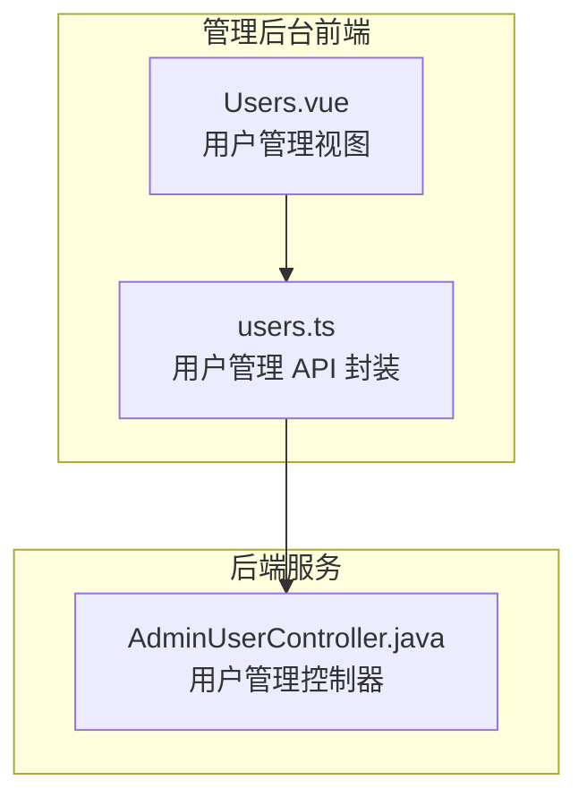
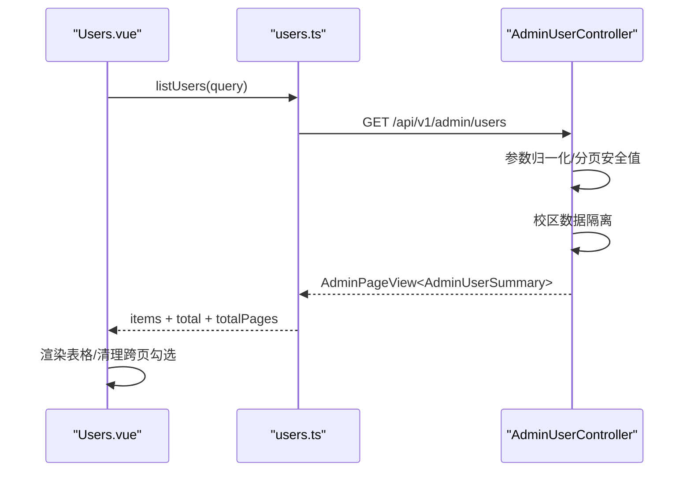
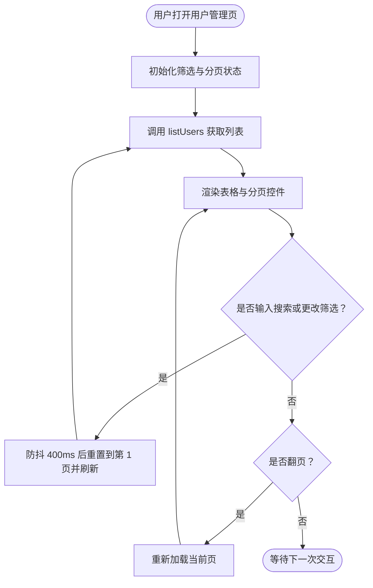
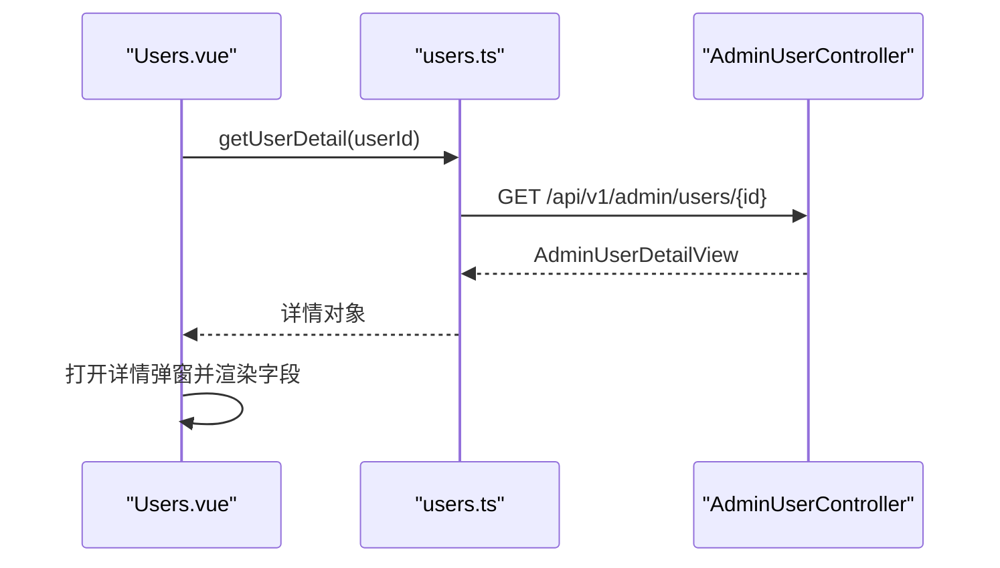
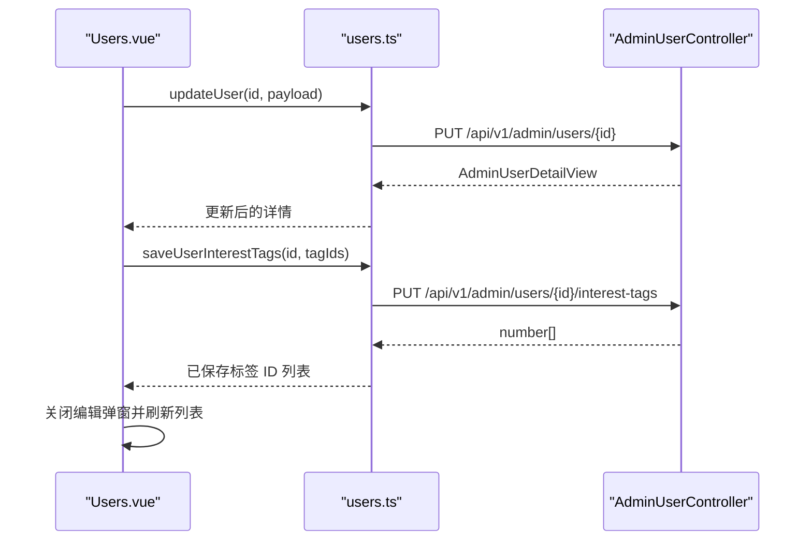
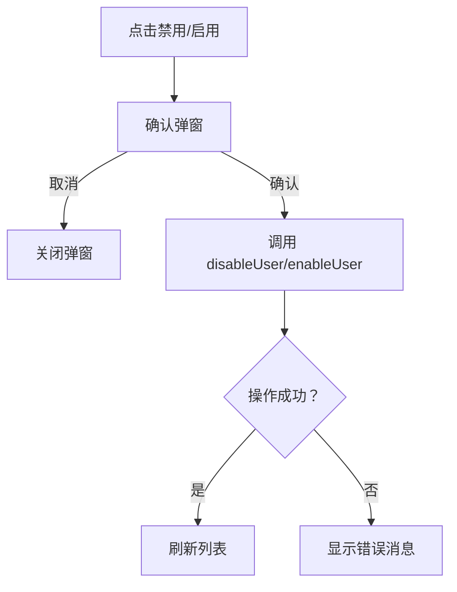
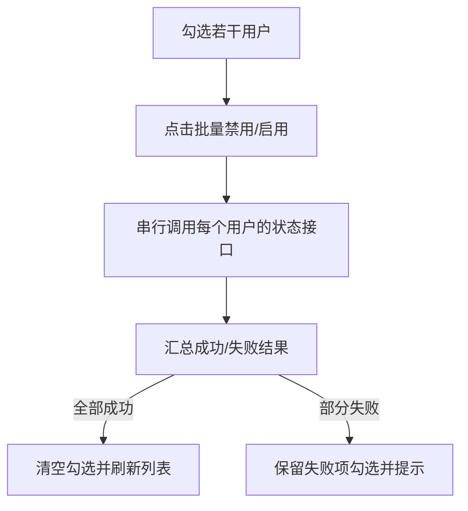
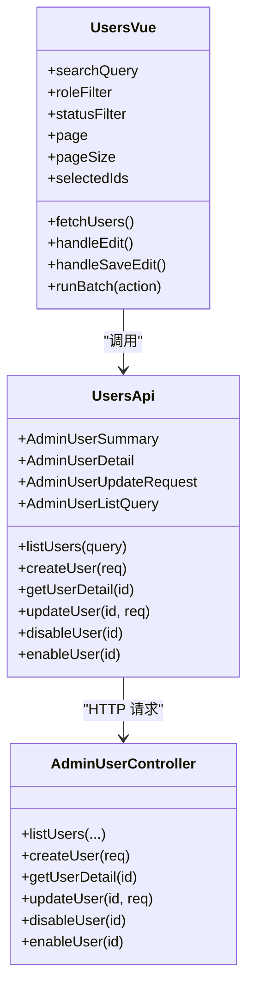

# 用户管理功能

<cite>
**本文引用的文件**
- [apps/admin/src/views/content/Users.vue](file://apps/admin/src/views/content/Users.vue)
- [apps/admin/src/api/users.ts](file://apps/admin/src/api/users.ts)
- [apps/api/src/main/java/com/campuslove/api/admin/AdminUserController.java](file://apps/api/src/main/java/com/campuslove/api/admin/AdminUserController.java)
</cite>

## 目录
1. [引言](#引言)
2. [项目结构](#项目结构)
3. [核心组件](#核心组件)
4. [架构总览](#架构总览)
5. [详细组件分析](#详细组件分析)
6. [依赖关系分析](#依赖关系分析)
7. [性能与可伸缩性](#性能与可伸缩性)
8. [故障排查指南](#故障排查指南)
9. [结论](#结论)

## 引言
本文件面向“用户管理模块”，围绕后台管理端中的用户列表展示、搜索过滤、分页加载、用户信息查看与编辑、禁用/启用状态管理、批量操作、权限控制以及数据校验与错误反馈进行系统化说明。该模块由前端 Vue 视图、前端 API 封装层和后端 Spring MVC 控制器组成，职责清晰：前端负责交互与本地状态，API 层统一处理请求包装与类型定义，后端负责业务规则、数据隔离、安全校验与审计标记。

## 项目结构
用户管理相关代码主要分布在三个位置：
- 前端页面：`apps/admin/src/views/content/Users.vue`
- 前端 API 封装：`apps/admin/src/api/users.ts`
- 后端控制器：`apps/api/src/main/java/com/campuslove/api/admin/AdminUserController.java`

**图示来源**
- [apps/admin/src/views/content/Users.vue:1-40](file://apps/admin/src/views/content/Users.vue#L1-L40)
- [apps/admin/src/api/users.ts:1-40](file://apps/admin/src/api/users.ts#L1-L40)
- [apps/api/src/main/java/com/campuslove/api/admin/AdminUserController.java:1-40](file://apps/api/src/main/java/com/campuslove/api/admin/AdminUserController.java#L1-L40)

**章节来源**
- [apps/admin/src/views/content/Users.vue:1-40](file://apps/admin/src/views/content/Users.vue#L1-L40)
- [apps/admin/src/api/users.ts:1-40](file://apps/admin/src/api/users.ts#L1-L40)
- [apps/api/src/main/java/com/campuslove/api/admin/AdminUserController.java:1-40](file://apps/api/src/main/java/com/campuslove/api/admin/AdminUserController.java#L1-L40)

## 核心组件
- 用户列表视图（`Users.vue`）
  - 负责搜索输入、角色筛选、状态筛选、分页控件、批量选择条、禁用/启用确认弹窗、新增用户弹窗、修改密码弹窗、编辑用户弹窗、详情弹窗。
  - 维护当前页数据、总记录数、总页数、选中 ID 集合、加载态与错误消息等本地状态。
  - 使用防抖合并高频搜索，使用请求竞态序号丢弃过期响应。
- 用户管理 API 封装（`users.ts`）
  - 定义用户摘要、详情、更新请求、列表查询参数、新增用户请求、兴趣标签选项等 TypeScript 类型。
  - 暴露 `listUsers`、`createUser`、`getUserDetail`、`updateUser`、`disableUser`、`enableUser`、兴趣标签相关接口。
  - 对管理员相关接口进行 re-export 收敛，避免重复实现。
- 用户管理控制器（`AdminUserController.java`）
  - 提供用户分页列表、用户详情、用户编辑、禁用/启用、新增用户、新增管理员、管理员分页列表等接口。
  - 内置手机号格式、密码长度、昵称长度、唯一性、校区管理员数据隔离、超级管理员保护、操作者自身保护等规则。
  - 对用户照片、简介、兴趣标签、身高、学历、感情状态、出生年份、期望对象、性别等基础资料字段进行部分更新。

**章节来源**
- [apps/admin/src/views/content/Users.vue:1-200](file://apps/admin/src/views/content/Users.vue#L1-L200)
- [apps/admin/src/api/users.ts:1-186](file://apps/admin/src/api/users.ts#L1-L186)
- [apps/api/src/main/java/com/campuslove/api/admin/AdminUserController.java:1-120](file://apps/api/src/main/java/com/campuslove/api/admin/AdminUserController.java#L1-L120)

## 架构总览
用户管理的端到端调用流程如下：
1. 用户在页面输入昵称、选择角色或状态后触发搜索；或者点击分页控件切换页码。
2. 前端通过 `listUsers` 发送 GET `/api/v1/admin/users` 请求，携带筛选条件与分页参数。
3. 后端控制器校验参数、应用数据隔离、调用仓储执行分页查询，返回包含条目、总数、页码的响应。
4. 前端接收响应并渲染表格；同时清理不在当前页的勾选项，避免批量误伤不可见行。

**图示来源**
- [apps/admin/src/views/content/Users.vue:220-290](file://apps/admin/src/views/content/Users.vue#L220-L290)
- [apps/admin/src/api/users.ts:110-140](file://apps/admin/src/api/users.ts#L110-L140)
- [apps/api/src/main/java/com/campuslove/api/admin/AdminUserController.java:290-360](file://apps/api/src/main/java/com/campuslove/api/admin/AdminUserController.java#L290-L360)

## 详细组件分析

### 用户列表展示、搜索过滤与分页加载
- 列表数据来源
  - 前端调用 `listUsers`，后端返回分页结果，包含用户摘要数组、总记录数、总页数。
- 搜索与筛选
  - 支持按昵称关键字、角色、状态筛选；搜索输入使用 400ms 防抖，筛选变更直接触发第一页加载。
  - 重置筛选会清空输入框与筛选器并重新拉取数据。
- 分页逻辑
  - 前端维护 `page`、`pageSize`、`total`、`totalPages`；翻页时仅触发数据加载。
  - 后端限制 page 最小为 1，pageSize 最大为 100，并转换为 0-based 分页。
- 列表渲染
  - 表格列包括：ID、头像+昵称、角色徽章、状态徽章、资料完整度、关注/粉丝数、注册时间、操作按钮。
  - 头像加载失败时隐藏图片元素，避免裂图影响布局。

**图示来源**
- [apps/admin/src/views/content/Users.vue:220-290](file://apps/admin/src/views/content/Users.vue#L220-L290)
- [apps/admin/src/views/content/Users.vue:300-340](file://apps/admin/src/views/content/Users.vue#L300-L340)
- [apps/api/src/main/java/com/campuslove/api/admin/AdminUserController.java:300-360](file://apps/api/src/main/java/com/campuslove/api/admin/AdminUserController.java#L300-L360)

**章节来源**
- [apps/admin/src/views/content/Users.vue:200-360](file://apps/admin/src/views/content/Users.vue#L200-L360)
- [apps/admin/src/api/users.ts:110-140](file://apps/admin/src/api/users.ts#L110-L140)
- [apps/api/src/main/java/com/campuslove/api/admin/AdminUserController.java:290-360](file://apps/api/src/main/java/com/campuslove/api/admin/AdminUserController.java#L290-L360)

### 用户信息查看
- 查看入口
  - 每行用户提供“查看”按钮，点击后打开详情弹窗。
- 详情数据
  - 调用 `getUserDetail(id)`，返回用户基本信息、电话脱敏值、角色、状态、资料完整度、关注/粉丝数、所属校区、认证状态、兴趣标签、相册、背景图、半身照、身高、学历、感情状态、出生年份、期望对象、性别、创建/更新时间。
- 详情展示
  - 弹窗内以键值形式展示各项信息，空值显示占位文案；认证状态使用中文文案映射。

**图示来源**
- [apps/admin/src/views/content/Users.vue:430-470](file://apps/admin/src/views/content/Users.vue#L430-L470)
- [apps/admin/src/api/users.ts:60-90](file://apps/admin/src/api/users.ts#L60-L90)
- [apps/api/src/main/java/com/campuslove/api/admin/AdminUserController.java:360-430](file://apps/api/src/main/java/com/campuslove/api/admin/AdminUserController.java#L360-L430)

**章节来源**
- [apps/admin/src/views/content/Users.vue:430-470](file://apps/admin/src/views/content/Users.vue#L430-L470)
- [apps/admin/src/api/users.ts:60-90](file://apps/admin/src/api/users.ts#L60-L90)
- [apps/api/src/main/java/com/campuslove/api/admin/AdminUserController.java:360-430](file://apps/api/src/main/java/com/campuslove/api/admin/AdminUserController.java#L360-L430)

### 用户信息编辑
- 编辑入口
  - 每行用户提供“编辑”按钮，点击后进入编辑弹窗。
- 编辑表单字段
  - 昵称、性别、简介、兴趣标签多选、身高、学历、感情状态、出生年份、期望对象。
- 保存逻辑
  - 前端校验昵称非空且不超过最大长度；调用 `updateUser` 提交部分更新字段。
  - 随后调用 `saveUserInterestTags` 保存用户兴趣标签关系。
  - 成功后关闭编辑弹窗并刷新列表，确保昵称同步。
- 后端更新策略
  - 仅允许更新指定白名单字段；敏感字段如角色、密码、openid 不允许通过此接口修改。
  - 对基础资料字段采用“存在则更新，不存在则插入”的部分更新策略。

**图示来源**
- [apps/admin/src/views/content/Users.vue:340-430](file://apps/admin/src/views/content/Users.vue#L340-L430)
- [apps/admin/src/api/users.ts:90-160](file://apps/admin/src/api/users.ts#L90-L160)
- [apps/api/src/main/java/com/campuslove/api/admin/AdminUserController.java:430-520](file://apps/api/src/main/java/com/campuslove/api/admin/AdminUserController.java#L430-L520)

**章节来源**
- [apps/admin/src/views/content/Users.vue:340-430](file://apps/admin/src/views/content/Users.vue#L340-L430)
- [apps/admin/src/api/users.ts:90-160](file://apps/admin/src/api/users.ts#L90-L160)
- [apps/api/src/main/java/com/campuslove/api/admin/AdminUserController.java:430-520](file://apps/api/src/main/java/com/campuslove/api/admin/AdminUserController.java#L430-L520)

### 用户删除与状态管理
- 禁用与启用
  - 前端提供“禁用”“启用”按钮，根据用户当前状态动态显示。
  - 点击后弹出确认对话框，确认后调用对应接口；成功则刷新列表。
- 权限模型
  - 禁止对自身账号执行禁用/启用。
  - 禁止对 SUPER_ADMIN 账号执行禁用/启用。
  - ADMIN 账号只能被 SUPER_ADMIN 操作。
- 后端实现
  - 通过 `toggleUserStatus` 统一处理禁用与启用，内部执行数据隔离与权限检查。
  - 若目标用户不存在返回 404；若违反权限规则返回 400 及错误提示。

**图示来源**
- [apps/admin/src/views/content/Users.vue:470-540](file://apps/admin/src/views/content/Users.vue#L470-L540)
- [apps/api/src/main/java/com/campuslove/api/admin/AdminUserController.java:520-620](file://apps/api/src/main/java/com/campuslove/api/admin/AdminUserController.java#L520-L620)

**章节来源**
- [apps/admin/src/views/content/Users.vue:470-540](file://apps/admin/src/views/content/Users.vue#L470-L540)
- [apps/api/src/main/java/com/campuslove/api/admin/AdminUserController.java:520-620](file://apps/api/src/main/java/com/campuslove/api/admin/AdminUserController.java#L520-L620)

### 批量操作工具
- 选择机制
  - 每行可选择；表头全选仅对可选行生效，排除自身账号与不可操作角色。
  - 翻页或筛选后自动清理不在当前页的勾选项。
- 批量动作
  - 批量禁用、批量启用；无后端批量接口时，前端串行逐个调用状态接口。
  - 聚合失败项并保留其勾选状态，便于重试。
- 结果反馈
  - 成功时显示成功数量；部分失败时显示失败数量并保留失败项。

**图示来源**
- [apps/admin/src/views/content/Users.vue:60-140](file://apps/admin/src/views/content/Users.vue#L60-L140)

**章节来源**
- [apps/admin/src/views/content/Users.vue:60-140](file://apps/admin/src/views/content/Users.vue#L60-L140)

### 数据导入导出与行为审计日志
- 导入导出
  - 在当前仓库的用户管理相关文件中未发现用户数据导入导出实现。
- 行为审计日志
  - 在用户管理控制器中未发现统一的审计日志写入逻辑；新增用户与管理员创建接口使用了审计注解，但未见具体日志持久化实现。
- 建议
  - 如需补充导入导出，可在前端增加上传/下载入口，并在后端增加对应的批量导入与 CSV/Excel 导出接口。
  - 如需完善审计日志，应在后端引入统一审计服务，记录操作人、操作时间、目标资源、操作类型与结果。

[本节为通用建议，不直接分析具体文件]

### 高级查询条件、筛选规则与排序
- 高级查询条件
  - 前端当前支持昵称关键字、角色、状态筛选。
  - 后端还支持注册时间起止范围与校区筛选。
- 筛选规则
  - 校区管理员登录时，后端强制按其管辖校区过滤，忽略前端传入的校区参数，防止越权。
  - 昵称筛选在后端采用前缀匹配，有利于走索引；长期可考虑全文检索优化中缀匹配。
- 排序选项
  - 用户列表未提供前端排序控件；后端管理员列表实现中包含按注册时间倒序语义。
  - 若需用户列表排序，可增加前端排序按钮并在后端查询中追加排序字段。

**章节来源**
- [apps/admin/src/views/content/Users.vue:220-340](file://apps/admin/src/views/content/Users.vue#L220-L340)
- [apps/api/src/main/java/com/campuslove/api/admin/AdminUserController.java:290-360](file://apps/api/src/main/java/com/campuslove/api/admin/AdminUserController.java#L290-L360)
- [apps/api/src/main/java/com/campuslove/api/admin/AdminUserController.java:200-290](file://apps/api/src/main/java/com/campuslove/api/admin/AdminUserController.java#L200-L290)

### 用户数据验证、错误处理与操作反馈
- 前端验证
  - 新增用户：手机号格式、密码长度、昵称长度。
  - 修改密码：旧密码必填、新密码长度、两次输入一致。
  - 编辑昵称：非空且不超过最大长度。
- 后端验证
  - 新增用户与管理员：手机号格式、密码长度、昵称长度、唯一性、校区管理员必须指定校区、超级管理员不得指定校区。
  - 编辑用户：状态值仅限 active/disabled；基础资料字段允许部分更新。
  - 禁用/启用：目标不存在返回 404；违反权限规则返回 400。
- 错误处理与反馈
  - 前端将网络异常或业务错误消息显示在页面顶部错误区或弹窗错误区。
  - 批量操作聚合失败项并提示失败数量。
  - 详情加载失败时关闭弹窗并显示错误消息。

**章节来源**
- [apps/admin/src/views/content/Users.vue:540-700](file://apps/admin/src/views/content/Users.vue#L540-L700)
- [apps/api/src/main/java/com/campuslove/api/admin/AdminUserController.java:120-200](file://apps/api/src/main/java/com/campuslove/api/admin/AdminUserController.java#L120-L200)
- [apps/api/src/main/java/com/campuslove/api/admin/AdminUserController.java:430-520](file://apps/api/src/main/java/com/campuslove/api/admin/AdminUserController.java#L430-L520)
- [apps/api/src/main/java/com/campuslove/api/admin/AdminUserController.java:520-620](file://apps/api/src/main/java/com/campuslove/api/admin/AdminUserController.java#L520-L620)

## 依赖关系分析
用户管理模块的前后端依赖关系如下：
- 前端视图依赖 API 封装类型与函数。
- API 封装依赖 HTTP 客户端与统一响应解包。
- 后端控制器依赖用户仓储、校园资料仓储、基础资料仓储、密码编码器、校区范围服务、数据范围校验服务。

**图示来源**
- [apps/admin/src/views/content/Users.vue:1-120](file://apps/admin/src/views/content/Users.vue#L1-L120)
- [apps/admin/src/api/users.ts:1-186](file://apps/admin/src/api/users.ts#L1-L186)
- [apps/api/src/main/java/com/campuslove/api/admin/AdminUserController.java:1-120](file://apps/api/src/main/java/com/campuslove/api/admin/AdminUserController.java#L1-L120)

**章节来源**
- [apps/admin/src/views/content/Users.vue:1-120](file://apps/admin/src/views/content/Users.vue#L1-L120)
- [apps/admin/src/api/users.ts:1-186](file://apps/admin/src/api/users.ts#L1-L186)
- [apps/api/src/main/java/com/campuslove/api/admin/AdminUserController.java:1-120](file://apps/api/src/main/java/com/campuslove/api/admin/AdminUserController.java#L1-L120)

## 性能与可伸缩性
- 列表加载
  - 使用分页减少单次数据量；前端防抖合并高频搜索，避免频繁请求。
  - 后端限制 pageSize 最大 100，防止过大分页导致数据库压力。
- 搜索性能
  - 昵称筛选采用前缀匹配，有利于走 B-Tree 索引；中长期可引入全文检索支持中缀搜索。
- 批量操作
  - 串行逐个调用状态接口，简单可靠；若数据量大，可考虑后端提供批量接口提升吞吐。
- 头像与媒体
  - 头像 URL 可能带访问令牌；加载失败时隐藏图片，避免布局抖动。

[本节为通用指导，不直接分析具体文件]

## 故障排查指南
- 列表无法加载
  - 检查前端是否正确调用 `listUsers`，后端是否返回有效分页数据。
  - 查看页面顶部错误消息是否包含网络或业务异常。
- 搜索无效
  - 确认昵称是否为前缀匹配；如需模糊匹配，需在后端引入全文检索或调整查询逻辑。
- 禁用/启用失败
  - 检查是否尝试对自己或 SUPER_ADMIN 账号执行操作。
  - 检查当前操作者是否为 SUPER_ADMIN（当目标是 ADMIN）。
  - 查看后端是否返回 400 业务错误消息。
- 编辑保存失败
  - 检查昵称长度与非空校验。
  - 检查基础资料字段是否在允许更新范围内。
- 批量操作部分失败
  - 查看批量提示中的失败数量；失败项仍保持勾选，可重试。

**章节来源**
- [apps/admin/src/views/content/Users.vue:220-540](file://apps/admin/src/views/content/Users.vue#L220-L540)
- [apps/api/src/main/java/com/campuslove/api/admin/AdminUserController.java:520-620](file://apps/api/src/main/java/com/campuslove/api/admin/AdminUserController.java#L520-L620)

## 结论
用户管理模块在前端通过清晰的视图与状态管理，提供了列表展示、搜索过滤、分页加载、查看详情、编辑用户、禁用/启用、批量操作等功能；在后端通过控制器集中实现参数校验、数据隔离、权限控制与部分更新策略。当前实现未包含用户数据导入导出与完整的行为审计日志，建议在后续迭代中补齐，以提升运营能力与安全合规性。整体而言，该模块职责边界明确、交互反馈良好，具备进一步扩展的基础。