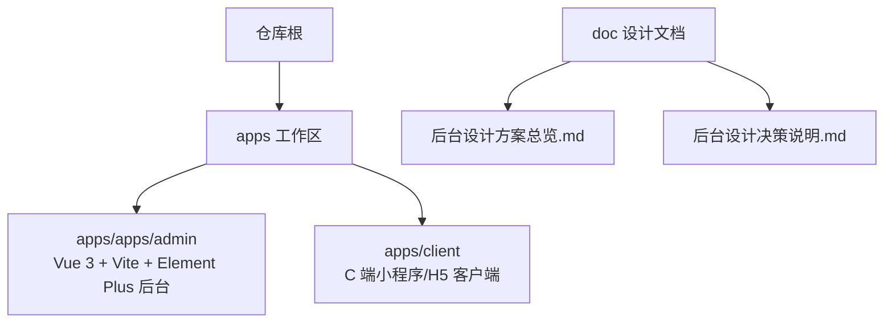
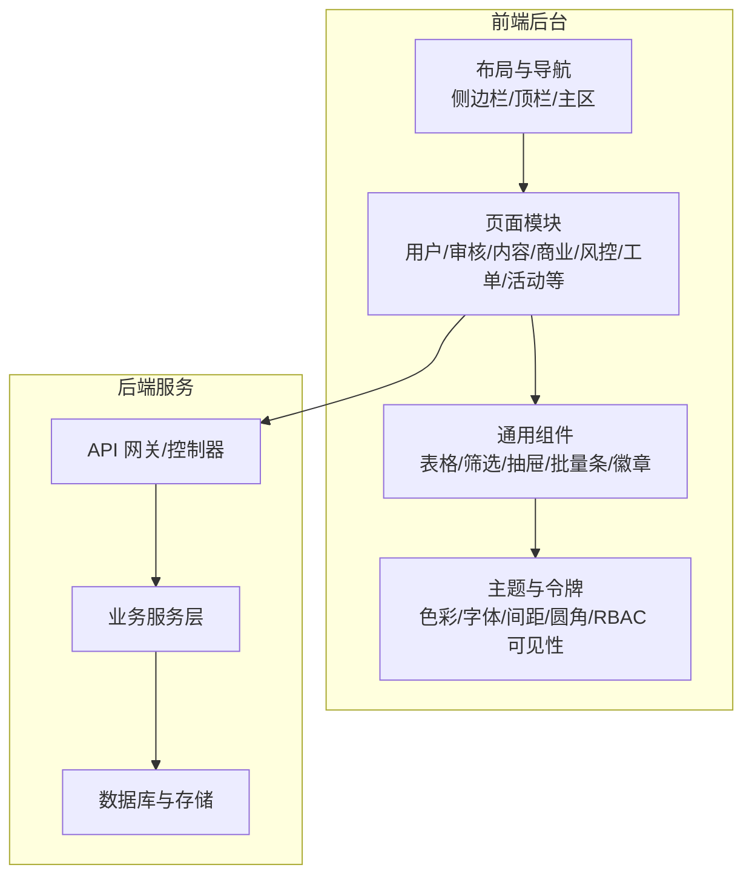
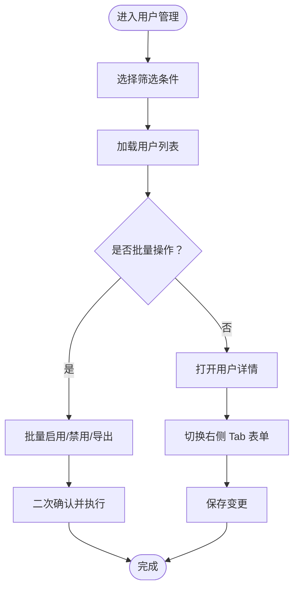
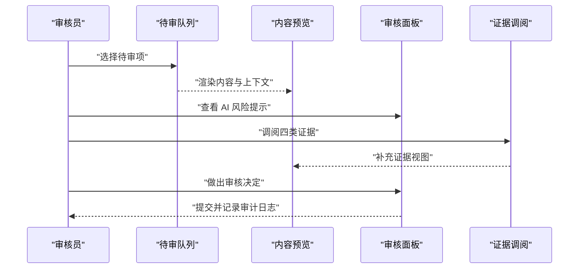
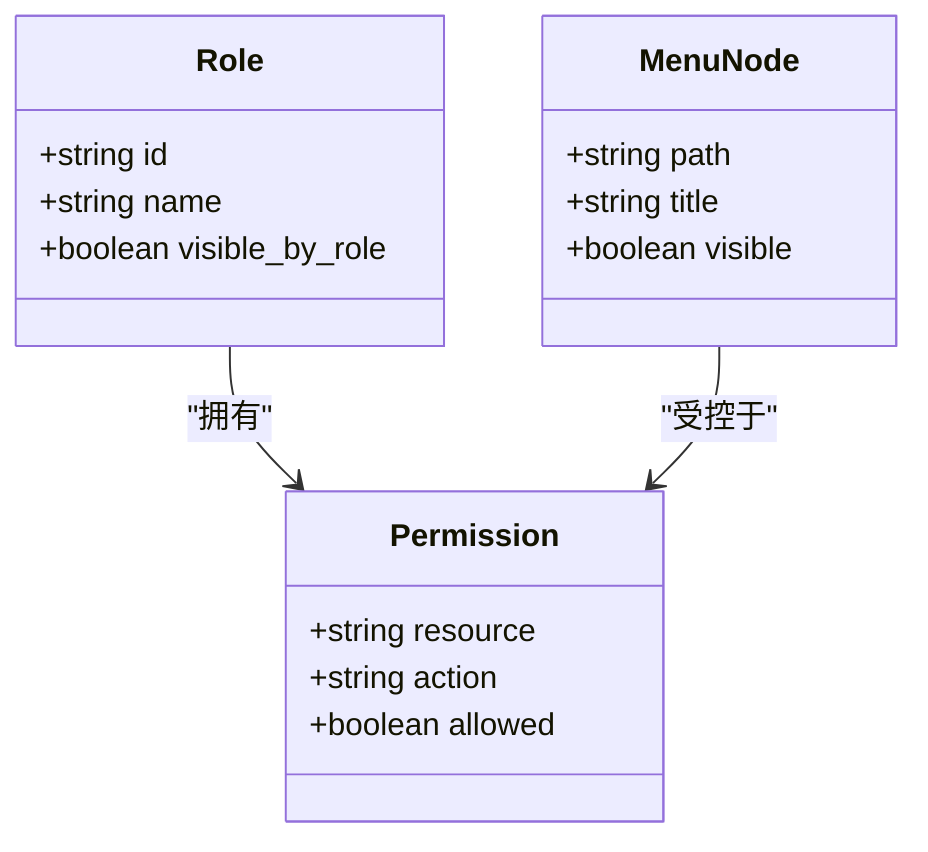
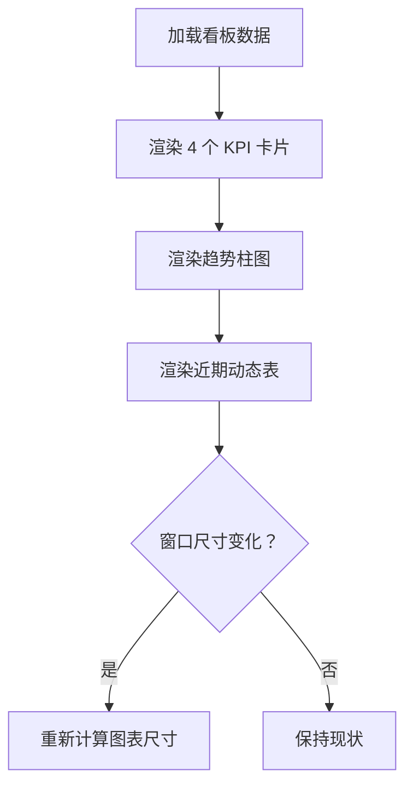
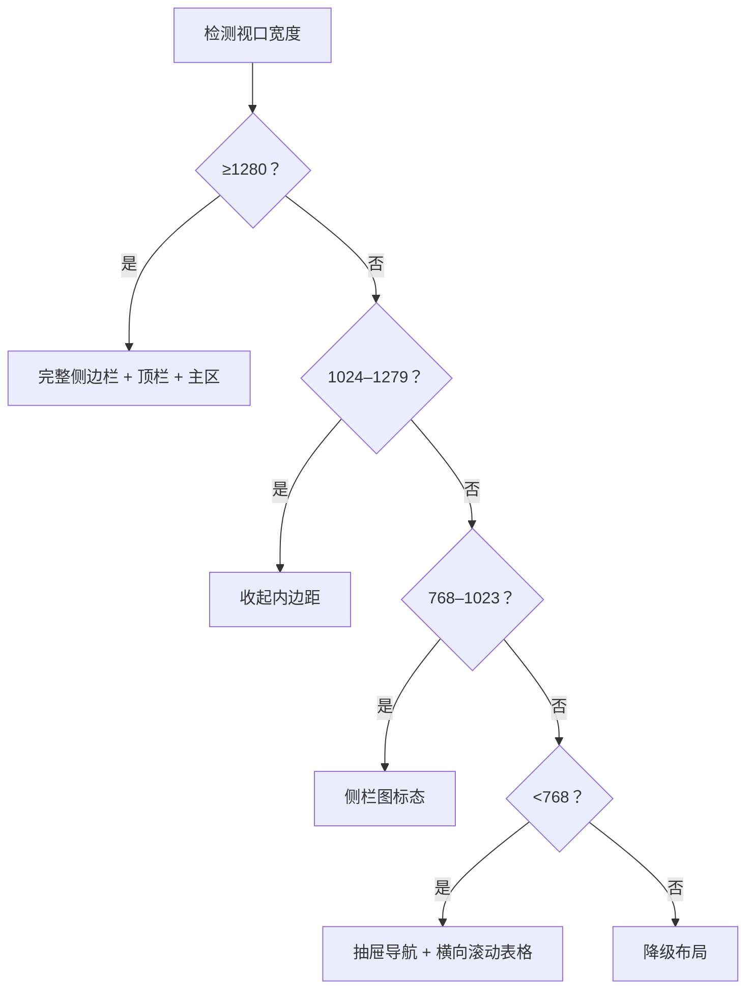
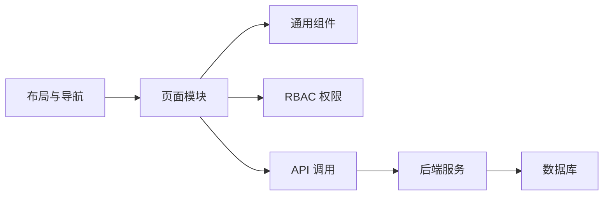

# 管理后台系统

<cite>
**本文引用的文件**   
- [后台设计方案总览.md](file://doc/后台设计方案总览.md)
- [后台设计决策说明.md](file://doc/后台设计决策说明.md)
</cite>

## 目录
1. [引言](#引言)
2. [项目结构](#项目结构)
3. [核心组件](#核心组件)
4. [架构总览](#架构总览)
5. [详细组件分析](#详细组件分析)
6. [依赖关系分析](#依赖关系分析)
7. [性能与可维护性](#性能与可维护性)
8. [故障排查指南](#故障排查指南)
9. [结论](#结论)
10. [附录：运营操作流程与清单](#附录运营操作流程与清单)

## 引言
本技术文档面向 Vue 3 + Element Plus 管理后台，围绕“用户管理、内容审核、数据分析、系统配置”等核心能力展开，覆盖架构设计、路由与权限控制、动态菜单生成、角色权限模型、操作审计日志、界面设计规范、响应式布局、数据可视化组件使用、批量操作工具、报表生成、安全配置、登录认证与会话机制等内容。文档同时以仓库中的后台设计方案为权威来源，确保前端设计与后端功能对齐。

## 项目结构
本项目采用多应用工作区组织方式，后台相关代码位于 `apps/apps/admin` 子应用内，配套的设计方案与决策说明位于 `doc` 目录。整体结构如下：

该结构中，后台应用独立于 C 端客户端，便于分别迭代；设计文档作为 UI/UX 规范来源，贯穿前后端实现。

**图表来源**
- [后台设计方案总览.md:1-15](file://doc/后台设计方案总览.md#L1-L15)
- [后台设计决策说明.md:1-15](file://doc/后台设计决策说明.md#L1-L15)

**章节来源**
- [后台设计方案总览.md:1-15](file://doc/后台设计方案总览.md#L1-L15)
- [后台设计决策说明.md:1-15](file://doc/后台设计决策说明.md#L1-L15)

## 核心组件
基于设计方案，后台系统由以下关键子系统组成：

- 布局与导航骨架：侧边栏（220px，可折叠）、顶栏（56px）、主内容区（灰底白卡）。
- 页面模块：数据概览、用户管理、用户详情、内容审核工作台、内容管理、商业化会员、系统设置/RBAC、风控举报、客服工单、运营活动与消息推送、匹配推荐与直播语音。
- 通用交互组件：筛选栏、表格卡、批量条、分页、抽屉（480/720px）、徽章、二级导航、三栏工作台。
- 主题与设计令牌：主色、中性灰阶、语义色、字体与字号、间距圆角、组件样式、RBAC 可见性开关。

这些组件共同构成“列表页统一结构 + 复杂页模块化分区 + 统一视觉语言”的后台体验。

**章节来源**
- [后台设计方案总览.md:16-40](file://doc/后台设计方案总览.md#L16-L40)
- [后台设计决策说明.md:16-41](file://doc/后台设计决策说明.md#L16-L41)

## 架构总览
后台系统遵循典型的前后端分离架构：前端通过 API 调用获取数据并渲染视图，后端提供 REST/GraphQL 接口与业务逻辑。设计方案明确了 12 个一级分类、75 个二级功能模块，并在多个重操作场景（审核、风控、工单）采用“左队列 / 中预览 / 右处理”的三栏布局，以降低误操作风险并缩短操作路径。

该图展示了从布局到页面、组件、主题的统一，以及前后端分层交互。

**图表来源**
- [后台设计方案总览.md:16-40](file://doc/后台设计方案总览.md#L16-L40)
- [后台设计决策说明.md:16-41](file://doc/后台设计决策说明.md#L16-L41)

## 详细组件分析

### 用户管理
- 列表页：筛选栏 + 用户表格（状态徽章、批量条、分页）。
- 详情页：资料卡含圈层归属链与管辖内容调阅按钮；右侧 Tab 表单用于编辑与扩展信息。
- 权限控制：依据 RBAC 模型，仅具备相应角色的管理员可查看或修改特定字段。

该流程体现了列表筛选、批量操作与详情编辑的统一模式。

**图表来源**
- [后台设计方案总览.md:20-30](file://doc/后台设计方案总览.md#L20-L30)

**章节来源**
- [后台设计方案总览.md:20-30](file://doc/后台设计方案总览.md#L20-L30)

### 内容审核工作台
- 三栏布局：左侧待审队列、中间内容预览、右侧 AI 风险与建议 + 操作面板。
- 证据调阅：支持按聊天、图片、帖子、临时聊天四类调阅管辖内容。
- 键盘流优化：减少鼠标移动，提高审核效率。

**图表来源**
- [后台设计方案总览.md:20-30](file://doc/后台设计方案总览.md#L20-L30)

**章节来源**
- [后台设计方案总览.md:20-30](file://doc/后台设计方案总览.md#L20-L30)

### 系统设置与 RBAC
- 设置分组：基础配置、三级管理圈层（公司/区域/学校）、管辖内容可见性（聊天/图片/帖子/临时聊天）。
- RBAC 模型：通过 `visible-by-role` 控制菜单与操作的可见性，危险操作统一用 danger 文字按钮表达。
- 权限校验：前端根据当前用户角色过滤菜单与按钮，后端在接口层做最终鉴权。

该类图描述了角色、权限与菜单节点之间的关系，体现 RBAC 在前端的可见性控制。

**图表来源**
- [后台设计决策说明.md:24-41](file://doc/后台设计决策说明.md#L24-L41)

**章节来源**
- [后台设计决策说明.md:24-41](file://doc/后台设计决策说明.md#L24-L41)

### 数据分析与可视化
- 数据概览 Dashboard：4 KPI 卡片 + 注册/活跃趋势柱图 + 近期动态表。
- 指标一致性：图表采用单主色 + 灰度配色，避免高饱和多色干扰。
- 响应式适配：图表容器随视口变化自适应宽度与高度。

**图表来源**
- [后台设计方案总览.md:20-30](file://doc/后台设计方案总览.md#L20-L30)

**章节来源**
- [后台设计方案总览.md:20-30](file://doc/后台设计方案总览.md#L20-L30)

### 界面设计规范与响应式布局
- 布局骨架：侧边栏 220px（可折叠至 64px）、顶栏 56px、内容主内距 24px。
- 组件规范：按钮/输入圆角 6px、卡片圆角 8px；状态/优先级使用色编码徽章。
- 响应式断点：≥1280 常驻；1024–1279 收内边距；768–1023 侧栏图标态；<768 抽屉 + 表格横滚。

**图表来源**
- [后台设计决策说明.md:24-41](file://doc/后台设计决策说明.md#L24-L41)

**章节来源**
- [后台设计决策说明.md:24-41](file://doc/后台设计决策说明.md#L24-L41)

## 依赖关系分析
- 前端内部依赖：
  - 布局与导航依赖主题与响应式断点。
  - 页面模块依赖通用组件（表格、筛选、抽屉、批量条）。
  - 权限控制依赖 RBAC 模型与菜单可见性规则。
- 前后端依赖：
  - 前端通过 API 访问用户、内容、风控、工单、活动等资源。
  - 后端在服务层执行业务规则，持久化到数据库。

该图展示前后端及内部模块之间的依赖关系。

**图表来源**
- [后台设计方案总览.md:16-40](file://doc/后台设计方案总览.md#L16-L40)
- [后台设计决策说明.md:16-41](file://doc/后台设计决策说明.md#L16-L41)

**章节来源**
- [后台设计方案总览.md:16-40](file://doc/后台设计方案总览.md#L16-L40)
- [后台设计决策说明.md:16-41](file://doc/后台设计决策说明.md#L16-L41)

## 性能与可维护性
- 组件复用：通过统一表格、筛选、抽屉等组件降低重复开发成本。
- 主题治理：集中化的设计令牌与 CSS 变量便于全局调整与维护。
- 响应式优化：按断点切换布局，避免在小屏上出现 off-canvas 溢出或裁切。
- 可视化性能：图表采用单主色与灰度，避免过多颜色导致渲染负担。

[本节为通用指导，不直接分析具体文件]

## 故障排查指南
- 列表页异常：检查筛选参数是否正确、分页状态是否同步、批量条是否触发二次确认。
- 审核工作台卡顿：确认预览内容体积、证据调阅数量是否过大；考虑分页或懒加载。
- 权限不可见：核对当前用户的角色与 `visible-by-role` 配置；检查后端接口鉴权返回码。
- 主题不一致：检查设计令牌是否被覆盖；确认响应式断点下样式是否正确加载。

[本节为通用指导，不直接分析具体文件]

## 结论
本后台系统以统一的布局骨架、组件库与设计令牌为基础，结合 RBAC 权限模型和三栏工作台，形成高可用、易维护、可拓展的管理平台。设计方案明确的功能覆盖率与质量验证结果，为后续迭代提供了清晰方向：补齐二级模块详情页、输出前端变量文件、完善自动化导出与测试闭环。

[本节为总结性内容，不直接分析具体文件]

## 附录：运营操作流程与清单
- 用户管理：
  - 列表筛选 → 批量操作 → 查看详情 → 编辑资料。
- 内容审核：
  - 选择待审项 → 预览内容 → 调阅证据 → 做出审核决定 → 提交并记录审计日志。
- 数据分析：
  - 查看 KPI 与趋势图 → 关注近期动态 → 导出报表。
- 系统配置：
  - 基础配置 → 三级管理圈层 → 管辖内容可见性 → 保存并发布。

[本节为流程概述，不直接分析具体文件]