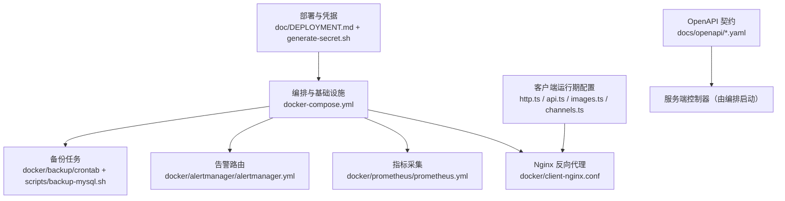
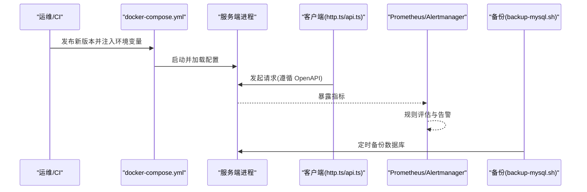
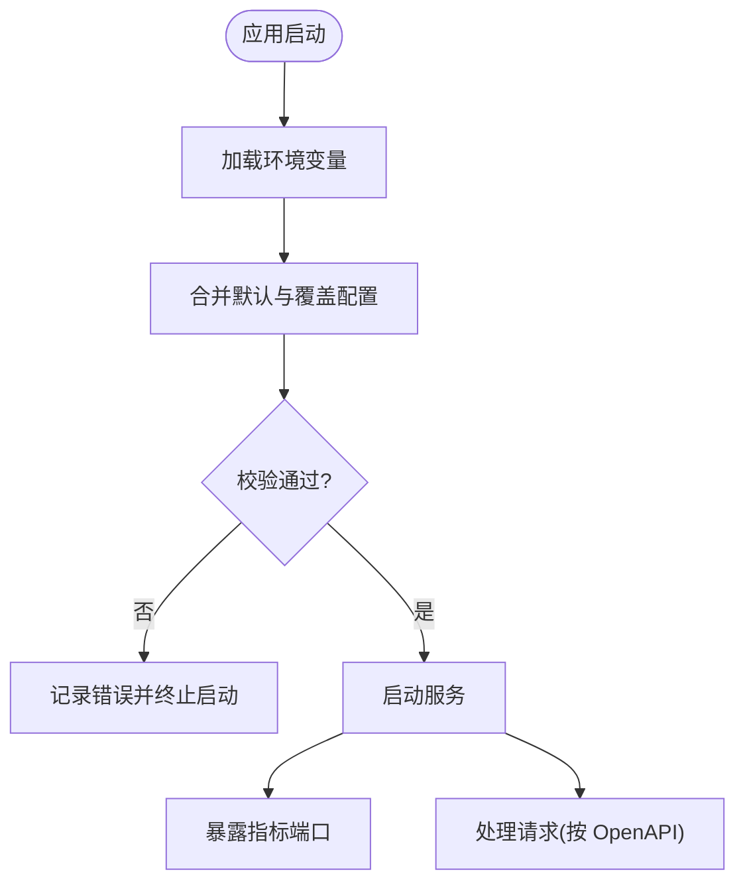
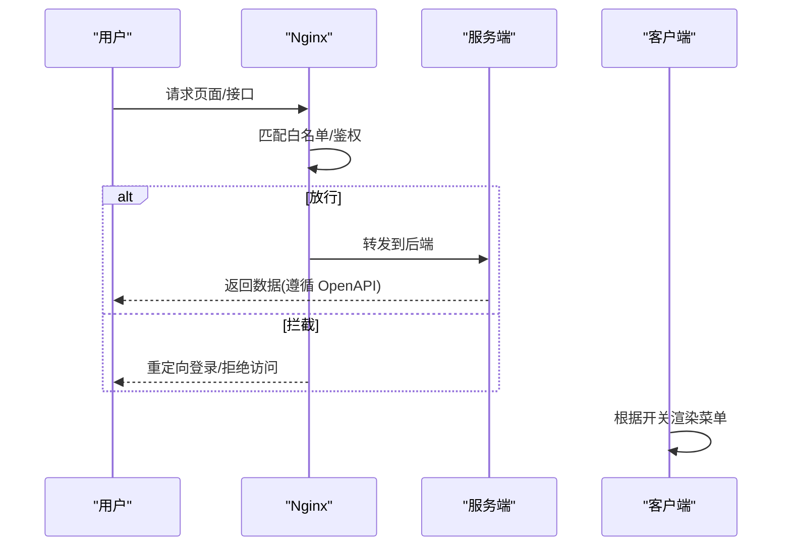
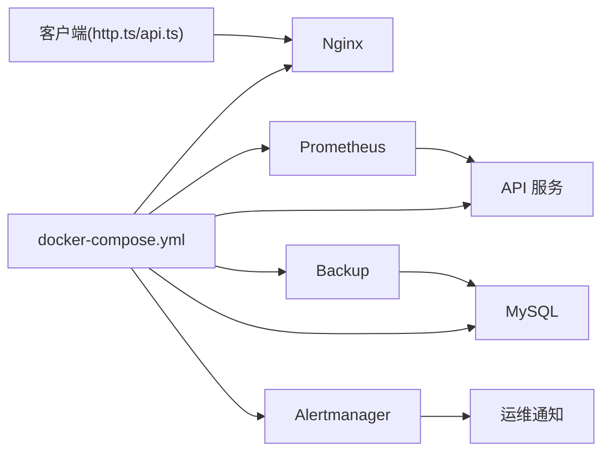

# 系统配置管理

<cite>
**本文引用的文件**   
- [docker-compose.yml](file://docker-compose.yml)
- [.npmrc](file://.npmrc)
- [.prettierrc.json](file://.prettierrc.json)
- [.spectral.yaml](file://.spectral.yaml)
- [package.json](file://package.json)
- [pnpm-workspace.yaml](file://pnpm-workspace.yaml)
- [project.config.json](file://project.config.json)
- [config/lighthouserc.json](file://config/lighthouserc.json)
- [config/tsconfig.base.json](file://config/tsconfig.base.json)
- [docker/client-nginx.conf](file://docker/client-nginx.conf)
- [docker/prometheus/prometheus.yml](file://docker/prometheus/prometheus.yml)
- [docker/alertmanager/alertmanager.yml](file://docker/alertmanager/alertmanager.yml)
- [docker/backup/crontab](file://docker/backup/crontab)
- [scripts/backup-mysql.sh](file://scripts/backup-mysql.sh)
- [scripts/generate-secret.sh](file://scripts/generate-secret.sh)
- [apps/client/src/config/images.ts](file://apps/client/src/config/images.ts)
- [apps/client/src/config/channels.ts](file://apps/client/src/config/channels.ts)
- [apps/client/src/services/http.ts](file://apps/client/src/services/http.ts)
- [apps/client/src/services/api.ts](file://apps/client/src/services/api.ts)
- [apps/client/src/manifest.json](file://apps/client/src/manifest.json)
- [docs/openapi/users.yaml](file://docs/openapi/users.yaml)
- [docs/openapi/notifications.yaml](file://docs/openapi/notifications.yaml)
- [docs/openapi/official-accounts.yaml](file://docs/openapi/official-accounts.yaml)
- [doc/DEPLOYMENT.md](file://doc/DEPLOYMENT.md)
</cite>

## 目录
1. [简介](#简介)
2. [项目结构](#项目结构)
3. [核心组件](#核心组件)
4. [架构总览](#架构总览)
5. [详细组件分析](#详细组件分析)
6. [依赖关系分析](#依赖关系分析)
7. [性能与容量建议](#性能与容量建议)
8. [故障排查指南](#故障排查指南)
9. [结论](#结论)
10. [附录：配置清单与示例位置](#附录：配置清单与示例位置)

## 简介
本文件面向“系统配置管理”模块，覆盖应用参数、环境变量、动态配置更新、菜单权限与路由白名单、功能开关、通知模板与邮件、第三方服务接入、日志与监控告警、备份恢复、版本管理与变更审计、安全与访问控制、数据加密等主题。文档基于仓库中的配置文件、脚本与 OpenAPI 规范进行归纳，帮助运维与研发在本地、测试与生产环境中稳定部署与治理配置。

## 项目结构
- 根级配置
  - Docker 编排与镜像相关：docker-compose.yml、docker 目录下的 Nginx、Prometheus、Alertmanager、Backup 配置
  - 构建与工具链：.npmrc、.prettierrc.json、.spectral.yaml、package.json、pnpm-workspace.yaml、project.config.json
  - 前端质量与类型：config/lighthouserc.json、config/tsconfig.base.json
- 客户端侧配置
  - 运行时与服务端通信：apps/client/src/services/http.ts、apps/client/src/services/api.ts
  - 静态能力开关与渠道：apps/client/src/config/images.ts、apps/client/src/config/channels.ts
  - 小程序/浏览器元信息：apps/client/src/manifest.json
- API 与集成
  - OpenAPI 规范定义用户、通知、公众号等接口契约：docs/openapi/*.yaml
- 运维脚本
  - 数据库备份：scripts/backup-mysql.sh
  - 密钥生成：scripts/generate-secret.sh
- 部署说明
  - 部署流程与环境变量约定：doc/DEPLOYMENT.md

图表来源
- [docker-compose.yml:1-200](file://docker-compose.yml#L1-L200)
- [docker/client-nginx.conf:1-68](file://docker/client-nginx.conf#L1-L68)
- [docker/prometheus/prometheus.yml:1-69](file://docker/prometheus/prometheus.yml#L1-L69)
- [docker/alertmanager/alertmanager.yml:1-135](file://docker/alertmanager/alertmanager.yml#L1-L135)
- [docker/backup/crontab:1-21](file://docker/backup/crontab#L1-L21)
- [scripts/backup-mysql.sh:1-200](file://scripts/backup-mysql.sh#L1-L200)
- [doc/DEPLOYMENT.md:1-200](file://doc/DEPLOYMENT.md#L1-L200)

章节来源
- [docker-compose.yml:1-200](file://docker-compose.yml#L1-L200)
- [docker/client-nginx.conf:1-68](file://docker/client-nginx.conf#L1-L68)
- [docker/prometheus/prometheus.yml:1-69](file://docker/prometheus/prometheus.yml#L1-L69)
- [docker/alertmanager/alertmanager.yml:1-135](file://docker/alertmanager/alertmanager.yml#L1-L135)
- [docker/backup/crontab:1-21](file://docker/backup/crontab#L1-L21)
- [scripts/backup-mysql.sh:1-200](file://scripts/backup-mysql.sh#L1-L200)
- [doc/DEPLOYMENT.md:1-200](file://doc/DEPLOYMENT.md#L1-L200)

## 核心组件
- 应用参数与环境变量
  - 通过 docker-compose.yml 注入服务所需的环境变量；结合 .npmrc、.prettierrc.json、.spectral.yaml、package.json、pnpm-workspace.yaml、project.config.json 等完成构建与运行期参数装配
  - 客户端通过 http.ts/api.ts 读取基础地址、超时、重试策略等，images.ts/channels.ts 提供功能开关与渠道配置
- 菜单权限与路由白名单
  - 通过 Nginx 层实现对外暴露的路径白名单与鉴权拦截；客户端根据 channels.ts/images.ts 的开关决定可见能力与入口
- 功能开关与控制
  - images.ts 与 channels.ts 集中定义特性开关，便于灰度与回滚
- 通知模板与邮件
  - 通过 OpenAPI notifications.yaml 与 official-accounts.yaml 定义通知与公众号消息的结构；具体发送通道由服务端负责
- 日志、监控与告警
  - Prometheus 抓取配置与 Alertmanager 规则集中管理；Nginx 访问日志可通过容器编排输出到统一收集
- 备份与恢复
  - backup 容器与 backup-mysql.sh 脚本协同完成数据库备份策略；结合版本化迁移确保可恢复性
- 版本管理与变更审计
  - 以 Git 为单一事实源，OpenAPI 与配置作为契约；变更通过 PR/CI 门禁，关键变更需人工审批
- 安全与访问控制、数据加密
  - 使用 generate-secret.sh 生成密钥；HTTPS、CORS、CSRF、Cookie 安全属性、最小权限原则在编排与 Nginx 中落实

章节来源
- [docker-compose.yml:1-200](file://docker-compose.yml#L1-L200)
- [apps/client/src/services/http.ts:1-200](file://apps/client/src/services/http.ts#L1-L200)
- [apps/client/src/services/api.ts:1-200](file://apps/client/src/services/api.ts#L1-L200)
- [apps/client/src/config/images.ts:1-200](file://apps/client/src/config/images.ts#L1-L200)
- [apps/client/src/config/channels.ts:1-105](file://apps/client/src/config/channels.ts#L1-L105)
- [docs/openapi/notifications.yaml:1-200](file://docs/openapi/notifications.yaml#L1-L200)
- [docs/openapi/official-accounts.yaml:1-198](file://docs/openapi/official-accounts.yaml#L1-L198)
- [scripts/generate-secret.sh:1-98](file://scripts/generate-secret.sh#L1-L98)

## 架构总览
下图展示配置在运行期的作用范围与交互路径：编排注入环境变量 -> 服务端启动 -> 客户端通过 http.ts 调用后端 -> Prometheus/Alertmanager 采集与告警 -> 备份脚本周期性执行。

图表来源
- [docker-compose.yml:1-200](file://docker-compose.yml#L1-L200)
- [apps/client/src/services/http.ts:1-200](file://apps/client/src/services/http.ts#L1-L200)
- [apps/client/src/services/api.ts:1-200](file://apps/client/src/services/api.ts#L1-L200)
- [docker/prometheus/prometheus.yml:1-69](file://docker/prometheus/prometheus.yml#L1-L69)
- [docker/alertmanager/alertmanager.yml:1-135](file://docker/alertmanager/alertmanager.yml#L1-L135)
- [scripts/backup-mysql.sh:1-200](file://scripts/backup-mysql.sh#L1-L200)

## 详细组件分析

### 应用参数与运行时配置
- 环境变量注入
  - 通过 docker-compose.yml 将敏感与差异化的配置注入各服务容器，避免硬编码
  - 结合 .npmrc、.prettierrc.json、.spectral.yaml、package.json、pnpm-workspace.yaml、project.config.json 完成构建期参数装配
- 客户端运行时配置
  - http.ts 定义基础 URL、超时、重试、错误处理策略
  - api.ts 封装业务接口调用，遵循 OpenAPI 契约
  - images.ts/channels.ts 提供功能开关与渠道选择，支持灰度与回滚
- 配置热更新建议
  - 对不重启即可生效的配置，可在服务端暴露受控的“配置中心”或“开关接口”，客户端按需拉取；对必须重启生效的配置，采用滚动升级策略

图表来源
- [docker-compose.yml:1-200](file://docker-compose.yml#L1-L200)
- [apps/client/src/services/http.ts:1-200](file://apps/client/src/services/http.ts#L1-L200)
- [apps/client/src/services/api.ts:1-200](file://apps/client/src/services/api.ts#L1-L200)

章节来源
- [docker-compose.yml:1-200](file://docker-compose.yml#L1-L200)
- [apps/client/src/services/http.ts:1-200](file://apps/client/src/services/http.ts#L1-L200)
- [apps/client/src/services/api.ts:1-200](file://apps/client/src/services/api.ts#L1-L200)
- [apps/client/src/config/images.ts:1-200](file://apps/client/src/config/images.ts#L1-L200)
- [apps/client/src/config/channels.ts:1-105](file://apps/client/src/config/channels.ts#L1-L105)

### 菜单权限与路由白名单
- 外部路由白名单
  - 通过 Nginx 配置对健康检查、静态资源、公开接口放行；其他路径进入鉴权流程
- 内部菜单与功能入口
  - 客户端根据 channels.ts/images.ts 的开关动态渲染菜单与入口；服务端依据角色/权限模型控制资源访问
- 变更影响面
  - 新增/修改路由需同步更新 OpenAPI 与 Nginx 规则，并在 CI 中进行一致性校验

图表来源
- [docker/client-nginx.conf:1-68](file://docker/client-nginx.conf#L1-L68)
- [apps/client/src/config/channels.ts:1-105](file://apps/client/src/config/channels.ts#L1-L105)
- [apps/client/src/config/images.ts:1-200](file://apps/client/src/config/images.ts#L1-L200)

章节来源
- [docker/client-nginx.conf:1-68](file://docker/client-nginx.conf#L1-L68)
- [apps/client/src/config/channels.ts:1-105](file://apps/client/src/config/channels.ts#L1-L105)
- [apps/client/src/config/images.ts:1-200](file://apps/client/src/config/images.ts#L1-L200)

### 功能开关与灰度发布
- 开关位置
  - images.ts：媒体与图片相关能力开关
  - channels.ts：消息渠道、推荐渠道等能力开关
- 灰度策略
  - 以环境或租户维度下发不同开关集；服务端配合限流与熔断
- 回滚机制
  - 回滚开关至上一版本；必要时配合快速降级策略

章节来源
- [apps/client/src/config/images.ts:1-200](file://apps/client/src/config/images.ts#L1-L200)
- [apps/client/src/config/channels.ts:1-105](file://apps/client/src/config/channels.ts#L1-L105)

### 通知模板与邮件/第三方服务接入
- 通知与公众号
  - 通过 docs/openapi/notifications.yaml 与 docs/openapi/official-accounts.yaml 定义消息体结构与状态码，保证前后端一致
- 邮件与第三方
  - 邮件与第三方通道通常由服务端驱动，通过环境变量注入 SMTP/SDK 凭据；建议以配置项+密钥管理服务隔离敏感信息

章节来源
- [docs/openapi/notifications.yaml:1-200](file://docs/openapi/notifications.yaml#L1-200)
- [docs/openapi/official-accounts.yaml:1-200](file://docs/openapi/official-accounts.yaml#L1-200)
- [docker-compose.yml:1-200](file://docker-compose.yml#L1-200)

### 日志、监控与告警
- 日志
  - 容器标准输出聚合；Nginx 访问/错误日志纳入采集
- 指标与告警
  - Prometheus scrape_configs.yaml 定义抓取目标；Alertmanager 定义路由与抑制规则
- 最佳实践
  - 关键指标包含请求量、错误率、延迟分位、队列长度；告警分级与降噪

章节来源
- [docker/prometheus/prometheus.yml:1-200](file://docker/prometheus/prometheus.yml#L1-200)
- [docker/alertmanager/alertmanager.yml:1-200](file://docker/alertmanager/alertmanager.yml#L1-200)

### 备份与恢复
- 备份策略
  - 使用 docker/backup 与 scripts/backup-mysql.sh 定期导出数据库；保留周期与存储位置按合规要求设置
- 恢复演练
  - 定期在隔离环境执行恢复演练，验证完整性与一致性
- 版本联动
  - 数据库迁移脚本与代码版本绑定，确保可回滚路径

章节来源
- [docker/backup/crontab:1-200](file://docker/backup/crontab#L1-200)
- [scripts/backup-mysql.sh:1-200](file://scripts/backup-mysql.sh#L1-200)

### 版本管理、变更审计与回滚
- 版本管理
  - Git 为主线的版本控制；OpenAPI 作为契约基线；Docker 镜像标签与部署版本一一对应
- 变更审计
  - 所有配置与代码变更走 PR 流程，强制审查；关键配置变更需要双人复核
- 回滚机制
  - 一键回滚到上一镜像版本；数据库迁移需具备向下兼容或回滚脚本

章节来源
- [doc/DEPLOYMENT.md:1-200](file://doc/DEPLOYMENT.md#L1-200)
- [docker-compose.yml:1-200](file://docker-compose.yml#L1-200)

### 安全配置、访问控制与数据加密
- 密钥管理
  - 使用 scripts/generate-secret.sh 生成强随机密钥；禁止在仓库中明文存放
- 传输安全
  - 全站 HTTPS；Nginx 启用安全头与最小协议版本
- 访问控制
  - 基于角色的接口鉴权；最小权限原则；跨域与 CSRF 防护
- 数据加密
  - 敏感字段落库前加密；密钥轮换策略与审计

章节来源
- [scripts/generate-secret.sh:1-200](file://scripts/generate-secret.sh#L1-200)
- [docker/client-nginx.conf:1-200](file://docker/client-nginx.conf#L1-200)
- [docker-compose.yml:1-200](file://docker-compose.yml#L1-200)

## 依赖关系分析
- 编排层
  - docker-compose.yml 串联 Nginx、API、DB、Prometheus、Alertmanager、Backup 等组件
- 客户端依赖
  - http.ts/api.ts 依赖环境变量提供的网关地址；images.ts/channels.ts 影响前端行为
- 监控与告警
  - Prometheus 抓取目标来自编排配置；Alertmanager 接收告警事件
- 备份
  - Backup 容器调用 MySQL 客户端与备份脚本

图表来源
- [docker-compose.yml:1-200](file://docker-compose.yml#L1-200)
- [apps/client/src/services/http.ts:1-200](file://apps/client/src/services/http.ts#L1-200)
- [apps/client/src/services/api.ts:1-200](file://apps/client/src/services/api.ts#L1-200)

章节来源
- [docker-compose.yml:1-200](file://docker-compose.yml#L1-200)
- [apps/client/src/services/http.ts:1-200](file://apps/client/src/services/http.ts#L1-200)
- [apps/client/src/services/api.ts:1-200](file://apps/client/src/services/api.ts#L1-200)

## 性能与容量建议
- 连接池与超时
  - 根据 QPS 调整数据库连接池、HTTP 超时与重试次数
- 缓存与CDN
  - 静态资源上 CDN；热点数据引入缓存层
- 监控阈值
  - 设定 CPU、内存、磁盘、I/O 与业务指标阈值，提前扩容
- 备份窗口
  - 避开业务高峰，采用增量+全量组合策略

## 故障排查指南
- 启动失败
  - 检查环境变量是否齐全；查看容器日志与编排状态
- 网络与鉴权
  - 核对 Nginx 白名单与证书；确认 CORS/CSRF 配置
- 指标与告警
  - 确认 Prometheus 抓取成功；核查 Alertmanager 路由与抑制规则
- 备份异常
  - 检查 mysqldump 权限与磁盘空间；验证备份文件完整性

章节来源
- [docker/alertmanager/alertmanager.yml:1-200](file://docker/alertmanager/alertmanager.yml#L1-200)
- [docker/prometheus/prometheus.yml:1-200](file://docker/prometheus/prometheus.yml#L1-200)
- [scripts/backup-mysql.sh:1-200](file://scripts/backup-mysql.sh#L1-200)

## 结论
通过将环境变量、构建参数、客户端开关与编排配置统一管理，配合 OpenAPI 契约、监控告警与备份恢复，形成闭环的配置治理体系。建议在每次变更中坚持“最小改动、可观测、可回滚”的原则，确保系统在高可用与安全的前提下持续演进。

## 附录：配置清单与示例位置
- 编排与环境变量
  - [docker-compose.yml:1-200](file://docker-compose.yml#L1-200)
- 构建与工具链
  - [.npmrc:1-200](file://.npmrc#L1-200)
  - [.prettierrc.json:1-200](file://.prettierrc.json#L1-200)
  - [.spectral.yaml:1-200](file://.spectral.yaml#L1-200)
  - [package.json:1-200](file://package.json#L1-200)
  - [pnpm-workspace.yaml:1-200](file://pnpm-workspace.yaml#L1-200)
  - [project.config.json:1-200](file://project.config.json#L1-200)
- 前端质量与类型
  - [config/lighthouserc.json:1-200](file://config/lighthouserc.json#L1-200)
  - [config/tsconfig.base.json:1-200](file://config/tsconfig.base.json#L1-200)
- 客户端配置
  - [apps/client/src/services/http.ts:1-200](file://apps/client/src/services/http.ts#L1-200)
  - [apps/client/src/services/api.ts:1-200](file://apps/client/src/services/api.ts#L1-200)
  - [apps/client/src/config/images.ts:1-200](file://apps/client/src/config/images.ts#L1-200)
  - [apps/client/src/config/channels.ts:1-200](file://apps/client/src/config/channels.ts#L1-200)
  - [apps/client/src/manifest.json:1-200](file://apps/client/src/manifest.json#L1-200)
- 接口契约
  - [docs/openapi/users.yaml:1-200](file://docs/openapi/users.yaml#L1-200)
  - [docs/openapi/notifications.yaml:1-200](file://docs/openapi/notifications.yaml#L1-200)
  - [docs/openapi/official-accounts.yaml:1-200](file://docs/openapi/official-accounts.yaml#L1-200)
- 监控与告警
  - [docker/prometheus/prometheus.yml:1-200](file://docker/prometheus/prometheus.yml#L1-200)
  - [docker/alertmanager/alertmanager.yml:1-200](file://docker/alertmanager/alertmanager.yml#L1-200)
- 备份与恢复
  - [docker/backup/crontab:1-200](file://docker/backup/crontab#L1-200)
  - [scripts/backup-mysql.sh:1-200](file://scripts/backup-mysql.sh#L1-200)
- 安全与密钥
  - [scripts/generate-secret.sh:1-200](file://scripts/generate-secret.sh#L1-200)
  - [docker/client-nginx.conf:1-200](file://docker/client-nginx.conf#L1-200)
- 部署说明
  - [doc/DEPLOYMENT.md:1-200](file://doc/DEPLOYMENT.md#L1-200)