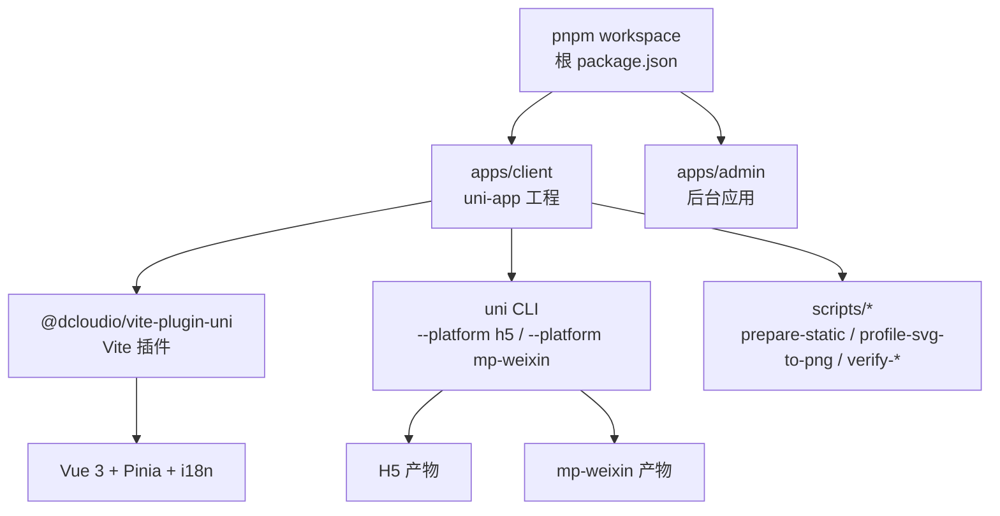
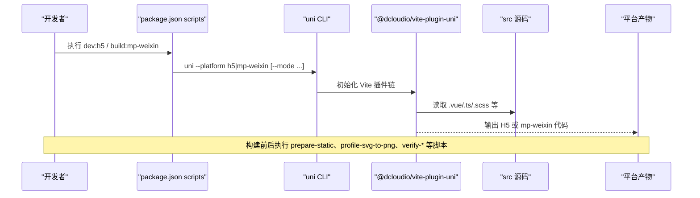
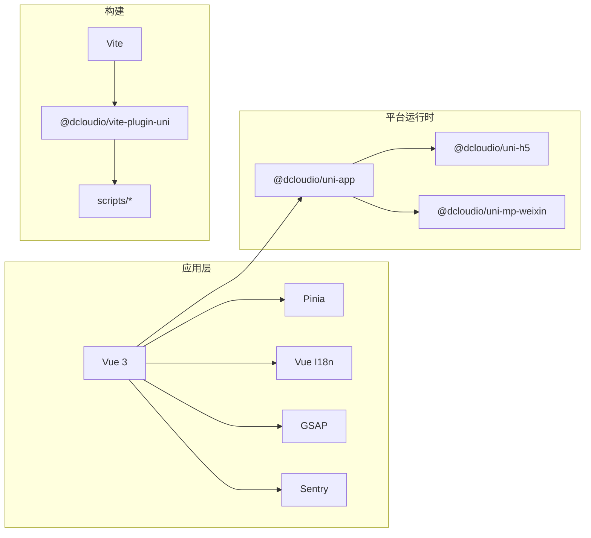

# Uni-app 多端适配架构

<cite>
**本文引用的文件**
- [package.json](file://package.json)
- [apps/client/package.json](file://apps/client/package.json)
- [apps/client/vite.config.ts](file://apps/client/vite.config.ts)
- [apps/client/main.ts](file://apps/client/main.ts)
- [apps/client/index.html](file://apps/client/index.html)
- [build-mp-weixin.bat](file://build-mp-weixin.bat)
- [start-showcase.bat](file://start-showcase.bat)
</cite>

## 目录
1. [简介](#简介)
2. [项目结构](#项目结构)
3. [核心组件](#核心组件)
4. [架构总览](#架构总览)
5. [详细组件分析](#详细组件分析)
6. [依赖关系分析](#依赖关系分析)
7. [性能与体积优化](#性能与体积优化)
8. [故障排查指南](#故障排查指南)
9. [结论](#结论)
10. [附录：构建模式与脚本清单](#附录构建模式与脚本清单)

## 简介
本档面向 Campus Love uni-app 客户端，系统阐述基于 uni-app 3.0 + Vue 3 的跨平台运行机制，重点覆盖微信小程序（mp-weixin）与 H5 双端的构建差异、条件编译策略、平台 API 兼容方案（AbortController、URLSearchParams polyfill）、小程序隐私协议授权流程、全局错误监听与启动生命周期管理，以及构建脚本的多模式配置（dev/real/mock/showcase）、静态资源预处理与包体积优化。文档同时总结 mp-weixin 的特殊限制与解法（模块加载顺序、事件处理器缓存等），并提供在组件中处理平台差异的实践示例与定位路径。

## 项目结构
- 根仓库采用 pnpm workspace 组织多应用：apps/client（uni-app 前端）、apps/admin（后台）。
- uni-app 工程位于 apps/client，使用 Vite 驱动构建，通过 @dcloudio/vite-plugin-uni 插件统一多端能力。
- 根级 scripts 提供统一入口与工作流脚本；apps/client/scripts 提供客户端专用构建与检查脚本。
- 多端产物由 uni 命令根据 platform 与 mode 产出不同目标（H5 与 mp-weixin）。

图表来源
- [package.json:1-48](file://package.json#L1-L48)
- [apps/client/package.json:1-104](file://apps/client/package.json#L1-L104)

章节来源
- [package.json:1-48](file://package.json#L1-L48)
- [apps/client/package.json:1-104](file://apps/client/package.json#L1-L104)

## 核心组件
- 构建入口与平台切换：通过 apps/client/package.json 中的 scripts，分别调用 uni --platform h5 或 --platform mp-weixin，并配合 mode（dev/real/mock/mp-weixin/mp-weixin-mock/mp-weixin-showcase）控制构建行为。
- 静态资源预处理：H5 与 mp-weixin 开发/构建前执行 scripts/prepare-static.mjs，将公共静态资源注入到对应平台输出目录。
- SVG 转 PNG（小程序侧）：构建 mp-weixin 时运行 profile-svg-to-png.mjs，将 SVG 转换为 PNG，规避小程序渲染限制。
- 校验与加固：构建前后运行一系列 check/verify 脚本，确保图片样式、状态栏偏移、TabBar 一致性、环境变量安全、包体积合规等。
- 运行时初始化：main.ts 负责应用初始化、Sentry 接入、路由与 store 挂载；index.html 为 H5 入口模板。

章节来源
- [apps/client/package.json:1-104](file://apps/client/package.json#L1-L104)
- [apps/client/main.ts](file://apps/client/main.ts)
- [apps/client/index.html](file://apps/client/index.html)
- [apps/client/vite.config.ts](file://apps/client/vite.config.ts)

## 架构总览
uni-app 在 Vite 之上扩展了多端编译管线：同一份源码经条件编译与平台插件后，分别生成 H5 Web 应用与微信小程序代码。关键分层如下：
- 应用层：Vue 3 组件、Pinia 状态、i18n 国际化、业务逻辑。
- 平台适配层：条件编译（__PLATFORM__ 等）、polyfill、平台 API 封装。
- 构建层：@dcloudio/vite-plugin-uni 解析 uni 语法、生成各端代码；scripts/* 完成资源预处理与质量门禁。
- 运行时层：H5 走浏览器标准环境；mp-weixin 走小程序宿主环境（沙箱、API 差异、权限模型）。

图表来源
- [apps/client/package.json:1-104](file://apps/client/package.json#L1-L104)
- [apps/client/vite.config.ts](file://apps/client/vite.config.ts)

## 详细组件分析

### 构建脚本与多模式配置
- H5 开发/构建：
  - dev:h5：先准备静态资源，再以 H5 平台运行开发服务器。
  - dev:h5:real：以 real 模式直接启动 H5，跳过静态资源准备（按需）。
  - build:h5 / build:h5:real：构建 H5，real 模式包含发布环境校验。
- mp-weixin 开发/构建：
  - dev:mp-weixin：开发模式，准备静态资源并启动小程序开发工具。
  - dev:mp-weixin:debug：调试模式，便于真机联调。
  - build:mp-weixin：常规小程序构建，包含 SVG 转 PNG、体积校验。
  - build:mp-weixin:mock：开启 mock 模式的构建流程与特性验证。
  - build:mp-weixin:showcase：演示/展示构建模式。
  - build:mp-weixin:real：完整发布流程，包含多项检查、注入 AppID、剥离 mock 资源、裁剪未引用静态资源、最终体积校验。
  - build:mp-weixin:real:dev / :isolated / :isolated:full：用于隔离与链式构建的变体。

建议实践
- 开发阶段优先使用 dev:* 系列，快速迭代。
- 发布前务必执行 real 模式，确保环境与资源完备。
- 如需演示或回归测试，可使用 showcase 或 mock 模式。

章节来源
- [apps/client/package.json:1-104](file://apps/client/package.json#L1-L104)

### 静态资源预处理与 SVG 转换
- 静态资源准备：在构建/启动前执行 prepare-static.mjs，按平台注入资源（如 icons、images、fonts 等），保证 H5 与 mp-weixin 资源路径一致性与可用性。
- SVG 转 PNG：小程序端对 SVG 的支持受限，构建流程中通过 profile-svg-to-png.mjs 批量转换，避免渲染异常。
- 质量门禁：check-mp-image-styles.mjs、check-statusbar-offset.mjs、check-tabbar-consistency.mjs、check-project-rules.mjs 等在构建前后执行，提前发现样式与布局问题。

章节来源
- [apps/client/package.json:1-104](file://apps/client/package.json#L1-L104)

### 平台差异与条件编译
- 条件编译：利用 uni-app 提供的条件编译语法，针对不同平台（H5、mp-weixin）分支实现，避免在运行时判断带来的耦合。
- 平台 API 兼容：
  - AbortController：在小程序环境中不存在或行为不一致时，可通过 polyfill 或封装适配器提供统一的请求取消能力。
  - URLSearchParams：在部分小程序环境缺失或不完整，需引入 polyfill 或在封装层做兼容。
- 事件处理器缓存：小程序环境下某些事件回调存在缓存或复用场景，应在组件卸载时显式清理，防止内存泄漏或重复触发。
- 模块加载顺序：小程序对模块导入顺序敏感，必要时通过分包或延迟加载降低首屏压力。

提示
- 尽量将平台差异收敛到最小接口层，对外暴露统一 API，内部再分平台实现。
- 在组件中使用条件编译，减少运行时判断开销。

章节来源
- [apps/client/package.json:1-104](file://apps/client/package.json#L1-L104)

### 小程序隐私协议授权流程
- 触发时机：在用户首次进入或涉及敏感功能（如相册、位置、通讯录）前，应先弹出隐私协议与权限申请。
- 推荐流程：
  1) 启动时检测是否已同意隐私协议，若未同意则引导至授权页。
  2) 使用 wx.getSetting 与 wx.authorize 获取并申请所需权限。
  3) 若用户拒绝，降级功能体验或引导至设置页重新授权。
  4) 记录授权状态到本地存储，避免重复弹窗。
- 注意事项：
  - 避免在页面 onLoad 之前进行耗时操作。
  - 合理拆分页面，将隐私相关逻辑前置，提升用户体验。

章节来源
- [apps/client/package.json:1-104](file://apps/client/package.json#L1-L104)

### 全局错误监听与启动生命周期
- 全局错误监听：在 main.ts 中初始化 Sentry（含 Feedback、Replay 等），捕获 JS 异常、Promise 未捕获异常与网络错误，上报到监控平台。
- 启动生命周期：
  - onLaunch：应用启动，初始化全局配置、埋点、版本检测。
  - onShow：应用显示，刷新必要状态（如登录态、主题）。
  - onHide：应用隐藏，保存状态、停止轮询。
- 建议：
  - 在 onLaunch 中完成必要的异步初始化，但避免阻塞首屏。
  - 对关键网络请求增加超时与重试策略，提升稳定性。

章节来源
- [apps/client/main.ts](file://apps/client/main.ts)
- [apps/client/package.json:1-104](file://apps/client/package.json#L1-L104)

### H5 与 mp-weixin 构建差异与适配策略
- 构建差异：
  - H5：输出标准 Web 资源，可直接部署到 Nginx/Apache 或 CDN。
  - mp-weixin：输出小程序工程结构，需在微信开发者工具中预览/上传。
- 适配策略：
  - 使用条件编译区分平台逻辑。
  - 对浏览器专有 API（如 Fetch、AbortController、URLSearchParams）提供 polyfill 或封装。
  - 对小程序限制（如文件系统、Web Worker、Canvas 能力）做降级处理。
- 启动与路由：
  - H5 使用标准路由；小程序使用 pages.json 配置页面栈与导航。
- 资源路径：
  - 通过 prepare-static 统一资源注入，避免路径差异导致的 404。

章节来源
- [apps/client/package.json:1-104](file://apps/client/package.json#L1-L104)

### 实际组件中的平台差异处理示例（指引）
- 在 .vue 文件中，使用条件编译包裹平台特定代码块，例如仅 H5 或仅 mp-weixin 的逻辑。
- 对需要 polyfill 的 API，在统一工具模块中提供兼容实现，并在组件中通过工具函数调用，避免散落各处。
- 对事件处理器，在组件销毁钩子中移除监听，避免小程序下的缓存问题。

章节来源
- [apps/client/package.json:1-104](file://apps/client/package.json#L1-L104)

## 依赖关系分析
- uni-app 生态：
  - @dcloudio/uni-app、uni-h5、uni-mp-weixin：提供跨端框架与平台运行时。
  - @dcloudio/vite-plugin-uni：Vite 插件，串联构建与多端编译。
- 前端技术栈：
  - Vue 3、Pinia、Vue I18n：应用层核心依赖。
  - GSAP：动画库（按需引入，注意体积）。
  - Sentry 系列：错误监控与回放。
- 开发工具：
  - Vite、TypeScript、Vitest、Storybook：开发与测试基础设施。
- 构建脚本：
  - 自定义 scripts/*：资源预处理、SVG 转换、质量校验、环境校验、体积审计。

图表来源
- [apps/client/package.json:1-104](file://apps/client/package.json#L1-L104)

章节来源
- [apps/client/package.json:1-104](file://apps/client/package.json#L1-L104)

## 性能与体积优化
- 资源预处理：
  - 通过 prepare-static 统一注入静态资源，避免重复拷贝与路径混乱。
  - 对 mp-weixin 进行 SVG→PNG 转换，减少渲染开销与兼容问题。
- 构建优化：
  - 使用 real 模式进行发布构建，启用环境变量校验与体积审计。
  - 剥离 mock 资源与未引用静态资源，减小包体积。
- 运行时优化：
  - 懒加载与按需引入，减少首屏时间。
  - 合理使用条件编译，避免无用代码进入产物。
- 监控与度量：
  - 结合 Sentry 收集错误与性能指标，持续优化。

章节来源
- [apps/client/package.json:1-104](file://apps/client/package.json#L1-L104)

## 故障排查指南
- 构建失败：
  - 检查 scripts 是否正确执行（prepare-static、profile-svg-to-png、check-*、verify-*）。
  - 确认 mode 与 platform 参数匹配（h5 或 mp-weixin）。
- 小程序渲染异常：
  - 确认 SVG 已转换为 PNG。
  - 检查图片样式与状态栏偏移是否符合预期。
- 权限问题：
  - 核对隐私协议授权流程是否正确触发与记录。
  - 检查 wx.authorize 调用与降级逻辑。
- 性能问题：
  - 使用 Lighthouse（H5）或小程序性能面板分析首屏与长任务。
  - 审查 Sentry 错误与回放，定位瓶颈。

章节来源
- [apps/client/package.json:1-104](file://apps/client/package.json#L1-L104)

## 结论
本项目基于 uni-app 3.0 + Vue 3 实现了 H5 与 mp-weixin 的双端构建与运行。通过完善的构建脚本与质量门禁，保障了资源一致性、体积可控与发布稳定性。建议在开发中坚持使用条件编译与平台 API 封装，集中处理差异；在发布前严格走 real 模式，确保环境与资源完备。持续借助 Sentry 与性能工具优化体验，逐步完善小程序隐私授权与降级策略。

## 附录：构建模式与脚本清单
- H5：
  - dev:h5、dev:h5:real、build:h5、build:h5:real
- mp-weixin：
  - dev:mp-weixin、dev:mp-weixin:debug
  - build:mp-weixin、build:mp-weixin:mock、build:mp-weixin:showcase、build:mp-weixin:real、build:mp-weixin:real:dev、build:mp-weixin:real:isolated、build:mp-weixin:real:isolated:full
- 常用脚本：
  - prepare-static.mjs（静态资源准备）
  - profile-svg-to-png.mjs（SVG 转 PNG）
  - check-mp-image-styles.mjs（图片样式检查）
  - check-statusbar-offset.mjs（状态栏偏移检查）
  - check-tabbar-consistency.mjs（TabBar 一致性检查）
  - check-project-rules.mjs（项目规则检查）
  - inject-wx-appid.mjs（注入 AppID）
  - strip-mock-for-mp.mjs（剥离 mock）
  - prune-unreferenced-static.mjs（裁剪未引用资源）
  - verify-env-release.mjs（环境校验）
  - verify-package-size.mjs（包体积校验）
  - verify-build-features.mjs（构建特性校验）

章节来源
- [apps/client/package.json:1-104](file://apps/client/package.json#L1-L104)