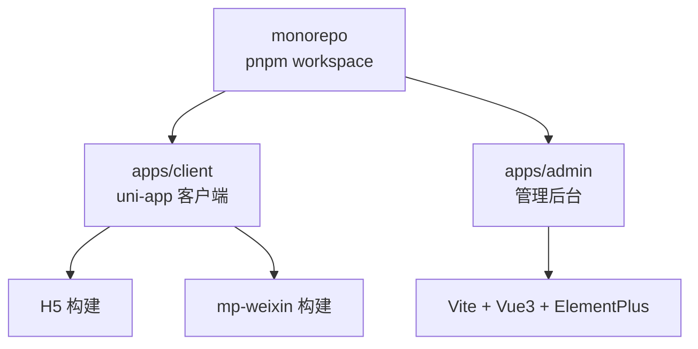
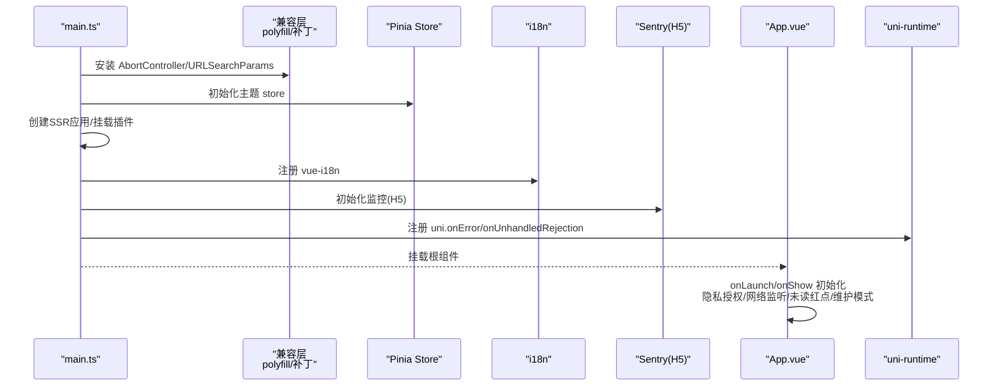
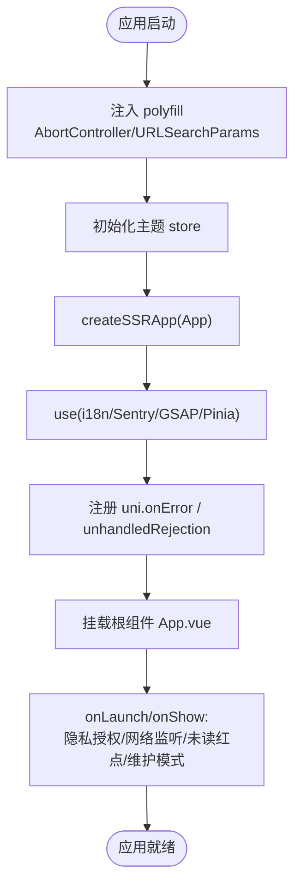
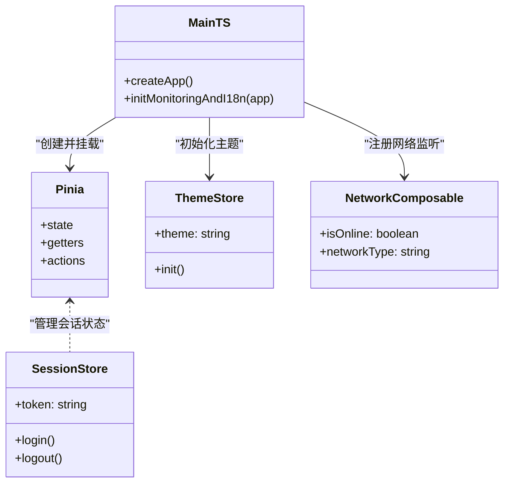
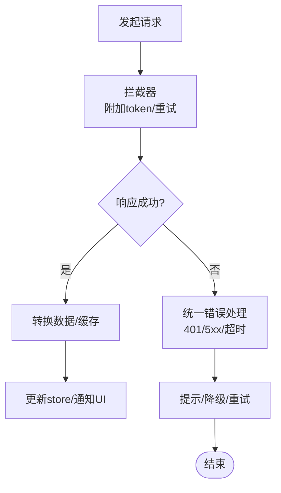
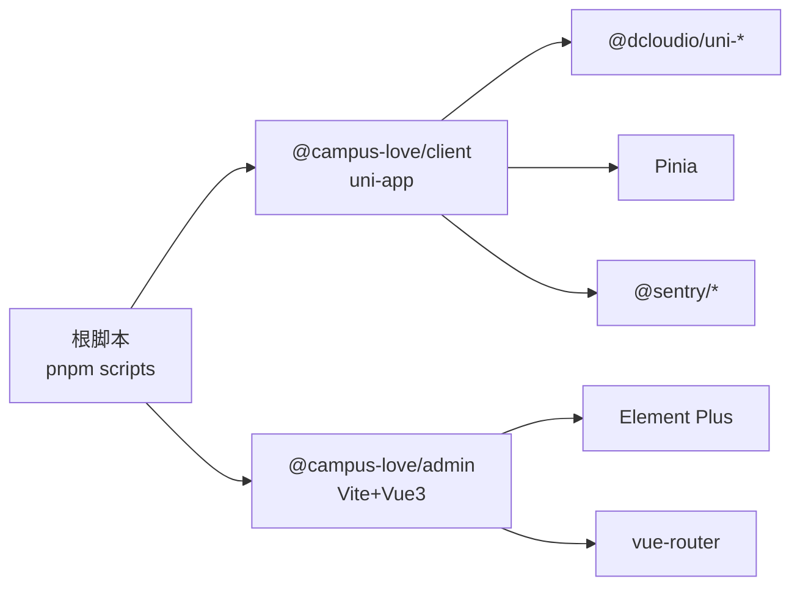

# 前端架构设计

<cite>
**本文引用的文件**
- [apps/client/package.json](file://apps/client/package.json)
- [apps/admin/package.json](file://apps/admin/package.json)
- [package.json](file://package.json)
- [apps/client/src/main.ts](file://apps/client/src/main.ts)
- [apps/client/src/App.vue](file://apps/client/src/App.vue)
</cite>

## 目录
1. [简介](#简介)
2. [项目结构](#项目结构)
3. [核心组件](#核心组件)
4. [架构总览](#架构总览)
5. [详细组件分析](#详细组件分析)
6. [依赖关系分析](#依赖关系分析)
7. [性能与优化](#性能与优化)
8. [故障排查指南](#故障排查指南)
9. [结论](#结论)
10. [附录](#附录)

## 简介
本设计文档面向 Campus Love 前端工程，覆盖 uni-app 多端适配（微信小程序与 H5）的架构实现、Vue 3 Composition API 使用模式、Pinia 状态管理、路由系统设计、组件分层与样式主题管理、跨平台 API 适配层、网络请求封装与错误处理策略，以及移动端性能优化、懒加载与资源管理。同时涵盖管理后台基于 Vue 3 + Element Plus 的架构设计与权限控制体系。

## 项目结构
本项目采用 monorepo 组织：根 package.json 通过 workspaces 管理 apps/client（uni-app 客户端）与 apps/admin（管理后台）。客户端应用以 uni-app 为核心，统一代码库输出到 H5 与 mp-weixin；管理后台为独立 Vite + Vue 3 + Element Plus 单页应用。

图表来源
- [package.json:1-20](file://package.json#L1-L20)
- [apps/client/package.json:1-30](file://apps/client/package.json#L1-L30)
- [apps/admin/package.json:1-20](file://apps/admin/package.json#L1-L20)

章节来源
- [package.json:1-20](file://package.json#L1-L20)
- [apps/client/package.json:1-30](file://apps/client/package.json#L1-L30)
- [apps/admin/package.json:1-20](file://apps/admin/package.json#L1-L20)

## 核心组件
- 启动与生命周期：uni-app 入口 main.ts 负责创建 SSR 应用、注册 Pinia、插件与监控、全局错误捕获、小程序兼容补丁与展示模式开关等。App.vue 作为根组件负责应用级初始化（隐私协议授权、网络监听、未读消息红点、维护模式遮罩、开发演示模式登录等）。
- 状态管理：Pinia store 统一管理会话、配置、主题、业务域数据（如聊天、发现、社区等），并在启动阶段完成必要初始化（如主题恢复）。
- 国际化与监控：vue-i18n 提供 $t/useI18n；Sentry 在 H5 端接入错误追踪；小程序侧通过 uni.onError/onUnhandledRejection 上报至统一出口。
- 多端运行：通过 uni-app 编译目标 H5/mp-weixin，借助 polyfill（AbortController/URLSearchParams）与条件编译解决差异。

章节来源
- [apps/client/src/main.ts:1-122](file://apps/client/src/main.ts#L1-L122)
- [apps/client/src/App.vue:1-200](file://apps/client/src/App.vue#L1-L200)
- [apps/client/package.json:1-60](file://apps/client/package.json#L1-L60)

## 架构总览
下图展示了客户端应用在启动阶段的职责划分与交互关系：main.ts 负责应用实例化、插件与监控注册、全局错误与兼容性处理；App.vue 负责运行时环境准备、用户引导与维护模式等。

图表来源
- [apps/client/src/main.ts:1-122](file://apps/client/src/main.ts#L1-L122)
- [apps/client/src/App.vue:1-200](file://apps/client/src/App.vue#L1-L200)

## 详细组件分析

### uni-app 多端适配架构（H5 与 mp-weixin）
- 构建目标与脚本：通过 scripts 定义 dev:h5、build:h5、dev:mp-weixin、build:mp-weixin 等命令，分别驱动 uni 编译到 H5 与微信小程序。
- 运行时差异补偿：在应用启动早期注入 AbortController 与 URLSearchParams polyfill，确保 mp-weixin 基础库缺失能力时的兼容性。
- 隐私合规：在 App.vue 的 onLaunch 中注册微信隐私协议授权回调，避免敏感接口调用被阻断。
- 展示模式：通过配置开关在构建期或启动前启用“全功能展示”模式，便于演示与验收。

图表来源
- [apps/client/src/main.ts:1-122](file://apps/client/src/main.ts#L1-L122)
- [apps/client/src/App.vue:1-200](file://apps/client/src/App.vue#L1-L200)
- [apps/client/package.json:1-60](file://apps/client/package.json#L1-L60)

章节来源
- [apps/client/package.json:1-60](file://apps/client/package.json#L1-L60)
- [apps/client/src/main.ts:1-122](file://apps/client/src/main.ts#L1-L122)
- [apps/client/src/App.vue:1-200](file://apps/client/src/App.vue#L1-L200)

### Vue 3 Composition API 使用模式
- 组合式函数与响应式：在 App.vue 中使用 useNetworkStatus、useUnreadBadge 等组合式函数，结合 storeToRefs 将 store 的响应式字段暴露给模板。
- 事件与生命周期：onLaunch/onMounted 配合 ref 标志位 appReady，保证在小程序环境 $scope 就绪后再渲染含事件处理器的组件，避免首次渲染异常。
- 全局副作用隔离：隐私协议弹窗防重入、维护模式遮罩等逻辑集中在 App.vue，降低页面耦合。

章节来源
- [apps/client/src/App.vue:1-200](file://apps/client/src/App.vue#L1-L200)

### Pinia 状态管理架构
- 集中式 Store：在 main.ts 中创建并挂载 Pinia，主题 store 在挂载前初始化以恢复上次主题设置。
- 领域划分：按业务域拆分 store（如 chat、discover、village、report、vip-billing 等），并通过 getter/computed 派生 UI 所需状态（如未读总数、在线状态）。
- 跨组件共享：通过 storeToRefs 将响应式状态解构到模板，避免重复订阅。

图表来源
- [apps/client/src/main.ts:1-122](file://apps/client/src/main.ts#L1-L122)

章节来源
- [apps/client/src/main.ts:1-122](file://apps/client/src/main.ts#L1-L122)

### 路由系统设计（uni-app）
- 多端统一路由：基于 uni-app 的路由机制，同一套页面在 H5 与 mp-weixin 下复用，通过 platform 条件编译适配差异。
- 导航守卫与会话：在 App.vue 或页面级守卫中结合 session 状态进行鉴权跳转；支持开发演示入口 dev-user=1 的全局注入与拦截。
- 动态菜单与权限（管理后台）：admin 端通过动态菜单与角色权限控制视图可见性，与客户端分离但遵循一致的鉴权模型。

章节来源
- [apps/client/src/App.vue:1-200](file://apps/client/src/App.vue#L1-L200)
- [apps/admin/package.json:1-45](file://apps/admin/package.json#L1-L45)

### 组件分层结构与样式组织
- 分层策略：页面组件（业务场景）、业务组件（可复用模块）、基础组件（原子 UI）。通过 stories 与测试保障质量。
- 样式与主题：基于 CSS 变量与主题 store 切换 light/dark；在 H5 通过 data-theme 控制，在小程序通过样式变量或条件编译适配。
- 资源管理：静态资源与图片按需引入，构建时通过脚本预处理（如 SVG 转 PNG）优化包体积与兼容性。

章节来源
- [apps/client/package.json:1-60](file://apps/client/package.json#L1-L60)
- [apps/client/src/main.ts:1-122](file://apps/client/src/main.ts#L1-L122)

### 跨平台 API 适配层、网络请求封装与错误处理
- 适配层：通过 polyfill 与条件编译屏蔽平台差异；在 main.ts 早期注入兼容性能力。
- 网络请求：封装统一的请求层（见 services/http 相关模块），结合 Pinia 存储 token 与刷新态，统一拦截错误码与重试策略。
- 错误处理：
  - H5：Sentry 接入错误追踪与回放。
  - 小程序：uni.onError 与 onUnhandledRejection 统一上报至 reportGlobalError。
  - Vue：app.config.errorHandler 捕获组件内异常。

[该图为概念流程，不直接映射具体文件]

章节来源
- [apps/client/src/main.ts:1-122](file://apps/client/src/main.ts#L1-L122)
- [apps/client/src/App.vue:1-200](file://apps/client/src/App.vue#L1-L200)

### 管理后台架构（Vue 3 + Element Plus）
- 技术栈：Vite 构建、Vue 3、Element Plus 组件库、Pinia、vue-router、vue-i18n。
- 权限控制：动态菜单 + 角色权限，页面与操作级权限校验，支持多标签页视图。
- 开发与构建：独立 script 命令，类型检查与单元测试集成。

章节来源
- [apps/admin/package.json:1-45](file://apps/admin/package.json#L1-L45)

## 依赖关系分析
- 客户端依赖：@dcloudio/uni-*、pinia、vue、vue-i18n、@sentry/*、@vueuse/core、gsap 等。
- 管理后台依赖：element-plus、echarts、dayjs、vue-router、pinia 等。
- Monorepo 协作：根 scripts 统一触发各子项目的 build/test/lint，确保一致性。

图表来源
- [package.json:1-48](file://package.json#L1-L48)
- [apps/client/package.json:60-104](file://apps/client/package.json#L60-L104)
- [apps/admin/package.json:20-45](file://apps/admin/package.json#L20-L45)

章节来源
- [package.json:1-48](file://package.json#L1-L48)
- [apps/client/package.json:60-104](file://apps/client/package.json#L60-L104)
- [apps/admin/package.json:20-45](file://apps/admin/package.json#L20-L45)

## 性能与优化
- 启动优化：延迟非必要初始化，尽早注入 polyfill 与 store，减少首屏阻塞。
- 资源优化：构建时 SVG 转 PNG、裁剪未引用静态资源、按需引入与懒加载组件。
- 渲染优化：虚拟列表、骨架屏与空状态占位，减少长列表卡顿。
- 监控与度量：Sentry 错误追踪与 Lighthouse 性能评测，CI 中集成报告生成。

[本节为通用指导，不直接分析具体文件]

## 故障排查指南
- 启动报错：确认 polyfill 已注入（AbortController/URLSearchParams），检查 App.vue 的 appReady 标志是否生效。
- 隐私协议弹窗异常：检查 onNeedPrivacyAuthorization 回调注册与防重入逻辑，确保 modal 不会叠弹。
- 网络状态与红点：验证 useNetworkStatus 与 useUnreadBadge 是否正确挂载与监听。
- 错误上报：H5 端查看 Sentry 面板；小程序端确认 uni.onError/unhandledRejection 已上报至 reportGlobalError。

章节来源
- [apps/client/src/main.ts:1-122](file://apps/client/src/main.ts#L1-L122)
- [apps/client/src/App.vue:1-200](file://apps/client/src/App.vue#L1-L200)

## 结论
本方案以 uni-app 为基础，通过主入口与根组件的职责划分，实现了 H5 与 mp-weixin 的双端统一构建与差异化适配；结合 Pinia、i18n、Sentry 构建了稳定的状态、国际化与监控体系；通过 polyfill、条件编译与构建脚本解决了多端兼容与资源优化问题；管理后台采用 Vue 3 + Element Plus，具备完善的权限控制与可视化能力。整体架构清晰、扩展性强，满足业务演进与团队协作需求。

## 附录
- 构建命令参考：dev/h5、build/h5、dev/build mp-weixin 等脚本位于 apps/client/package.json。
- 监控与测试：根脚本集成 Lighthouse、Lint、OpenAPI 校验与单元测试，确保质量基线。

章节来源
- [apps/client/package.json:1-60](file://apps/client/package.json#L1-L60)
- [package.json:1-48](file://package.json#L1-L48)