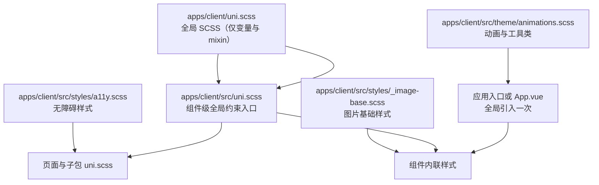
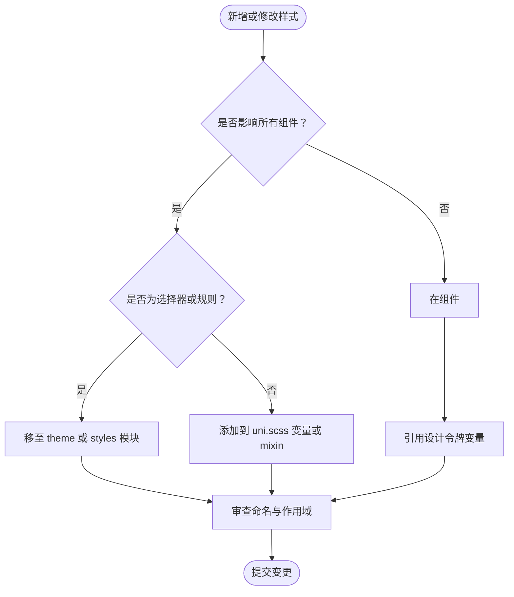
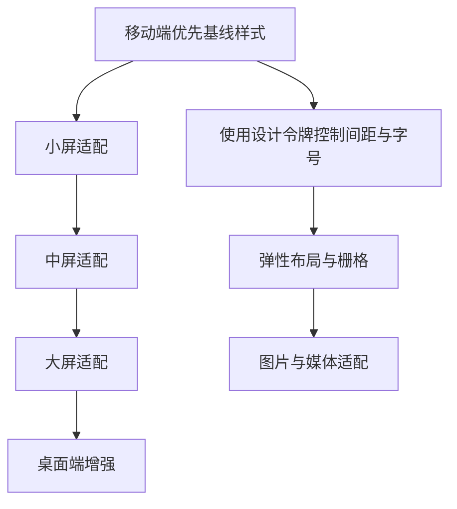
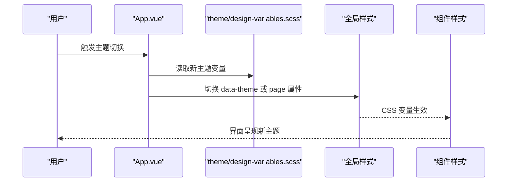
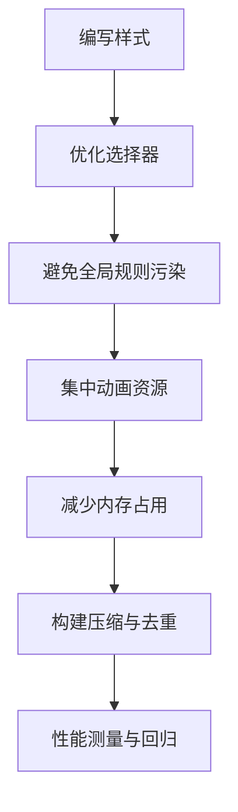
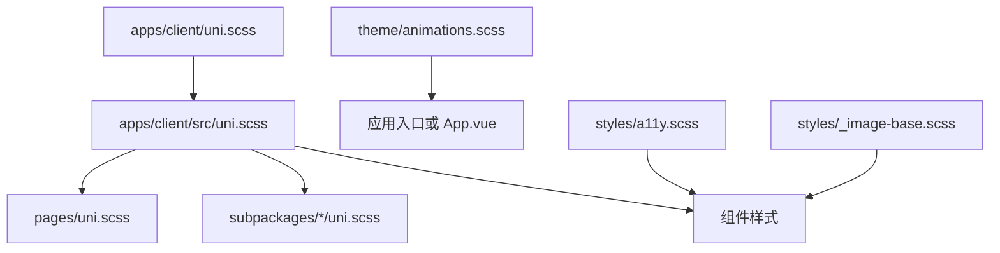

# 样式与主题系统

<cite>
**本文引用的文件**   
- [apps/client/src/uni.scss](file://apps/client/src/uni.scss)
- [apps/client/uni.scss](file://apps/client/uni.scss)
- [apps/client/vite.config.ts](file://apps/client/vite.config.ts)
- [apps/client/main.ts](file://apps/client/main.ts)
- [apps/client/src/theme/animations.scss](file://apps/client/src/theme/animations.scss)
- [apps/client/src/styles/a11y.scss](file://apps/client/src/styles/a11y.scss)
- [apps/client/src/styles/_image-base.scss](file://apps/client/src/styles/_image-base.scss)
- [apps/client/src/components/common/Button.vue](file://apps/client/src/components/common/Button.vue)
- [apps/client/src/components/common/SectionCard.vue](file://apps/client/src/components/common/SectionCard.vue)
- [apps/client/src/components/home/ActivityCard.vue](file://apps/client/src/components/home/ActivityCard.vue)
- [apps/client/src/pages/uni.scss](file://apps/client/src/pages/uni.scss)
- [apps/client/src/subpackages/discover/uni.scss](file://apps/client/src/subpackages/discover/uni.scss)
- [apps/client/src/subpackages/setup/uni.scss](file://apps/client/src/subpackages/setup/uni.scss)
- [apps/client/src/subpackages/support/uni.scss](file://apps/client/src/subpackages/support/uni.scss)
</cite>

## 目录
1. [引言](#引言)
2. [项目结构与样式组织](#项目结构与样式组织)
3. [设计令牌与变量体系](#设计令牌与变量体系)
4. [SCSS 命名规范与组件样式隔离](#scss-命名规范与组件样式隔离)
5. [响应式设计策略](#响应式设计策略)
6. [主题切换机制](#主题切换机制)
7. [CSS 性能优化](#css-性能优化)
8. [样式开发规范与最佳实践](#样式开发规范与最佳实践)
9. [依赖关系分析](#依赖关系分析)
10. [故障排查指南](#故障排查指南)
11. [结论](#结论)

## 引言
本文件面向 Campus Love 前端应用的样式与主题系统，目标是帮助开发者理解 SCSS 组织结构、设计令牌管理、组件样式隔离、响应式策略、主题切换机制以及 CSS 性能优化方式。文档以仓库中实际存在的样式文件为依据，并补充通用的工程化建议，便于不同经验水平的团队成员快速上手和长期维护。

## 项目结构与样式组织
当前前端应用基于 uni-app 构建，样式主要使用 SCSS。样式组织遵循“全局变量与混合宏 + 主题资源 + 页面/子包样式入口 + 组件内联样式”的分层模式：

- 根级全局 SCSS：`apps/client/uni.scss` 是 uni-app 的全局 SCSS 入口，只应包含变量与 mixin，避免注入到每个组件后产生冗余规则。
- 组件级全局约束入口：`apps/client/src/uni.scss` 通过 `@use "../uni.scss" as *;` 引入根级 SCSS，并在注释中明确禁止在此放置 CSS 规则，避免微信开发者工具警告和体积膨胀。
- 主题资源：`apps/client/src/theme/animations.scss` 集中存放动画 keyframes 与动画工具类，由应用入口或 App.vue 全局引入一次。
- 通用样式片段：`apps/client/src/styles/a11y.scss` 与 `apps/client/src/styles/_image-base.scss` 分别承担无障碍相关样式与图片基础样式等可复用片段。
- 页面与子包样式入口：各页面与子包目录下存在 `uni.scss`，例如 `apps/client/src/pages/uni.scss`、`apps/client/src/subpackages/*/uni.scss`，用于在该作用域下复用全局变量与 mixin。
- 组件样式：组件内部通常使用 Vue 单文件组件的 `<style>`，结合 SCSS 实现局部样式；共享样式优先提取到公共组件或样式模块。

**图表来源**
- [apps/client/uni.scss:1-9](file://apps/client/uni.scss#L1-L9)
- [apps/client/src/uni.scss:1-16](file://apps/client/src/uni.scss#L1-L16)
- [apps/client/src/theme/animations.scss](file://apps/client/src/theme/animations.scss)
- [apps/client/src/styles/a11y.scss](file://apps/client/src/styles/a11y.scss)
- [apps/client/src/styles/_image-base.scss](file://apps/client/src/styles/_image-base.scss)
- [apps/client/src/pages/uni.scss](file://apps/client/src/pages/uni.scss)
- [apps/client/src/subpackages/discover/uni.scss](file://apps/client/src/subpackages/discover/uni.scss)
- [apps/client/src/subpackages/setup/uni.scss](file://apps/client/src/subpackages/setup/uni.scss)
- [apps/client/src/subpackages/support/uni.scss](file://apps/client/src/subpackages/support/uni.scss)

**章节来源**
- [apps/client/uni.scss:1-9](file://apps/client/uni.scss#L1-L9)
- [apps/client/src/uni.scss:1-16](file://apps/client/src/uni.scss#L1-L16)
- [apps/client/src/theme/animations.scss](file://apps/client/src/theme/animations.scss)
- [apps/client/src/styles/a11y.scss](file://apps/client/src/styles/a11y.scss)
- [apps/client/src/styles/_image-base.scss](file://apps/client/src/styles/_image-base.scss)
- [apps/client/src/pages/uni.scss](file://apps/client/src/pages/uni.scss)
- [apps/client/src/subpackages/discover/uni.scss](file://apps/client/src/subpackages/discover/uni.scss)
- [apps/client/src/subpackages/setup/uni.scss](file://apps/client/src/subpackages/setup/uni.scss)
- [apps/client/src/subpackages/support/uni.scss](file://apps/client/src/subpackages/support/uni.scss)

## 设计令牌与变量体系
设计令牌是样式系统的核心，包括颜色、字体、间距、阴影、圆角、动效时长等。在当前代码库中，可以观察到以下组织方式：

- 根级全局 SCSS：`apps/client/uni.scss` 明确说明不要放 CSS 规则，只保留变量与 mixin。这表明设计令牌应集中在该文件或与之关联的主题文件中。
- 组件级全局约束入口：`apps/client/src/uni.scss` 通过 `@use "../uni.scss" as *;` 引用根级 SCSS，使每个组件都能访问统一的设计令牌。
- 主题动画资源：`apps/client/src/theme/animations.scss` 集中管理动画，属于动态视觉令牌的一部分。
- 通用样式片段：`a11y.scss` 与 `_image-base.scss` 作为可复用的样式片段，承载非主题类的通用样式。

虽然仓库未直接展示完整的颜色与字体变量定义，但根据现有文件的注释与结构，可以推断设计令牌的管理原则如下：

| 类别 | 建议命名前缀或分类 | 用途 | 示例说明 |
| --- | --- | --- | --- |
| 颜色令牌 | `$color-*` 或 `--td-*` | 主题色、中性色、状态色、语义色 | 按钮主色、禁用色、成功/失败提示色 |
| 字体令牌 | `$font-*` 或 `--font-*` | 字号、字重、行高、字族 | 标题字号、正文行高、系统字体回退 |
| 间距令牌 | `$space-*` 或 `--space-*` | 内外边距、栅格间距 | 组件内边距、卡片间距、布局网格 |
| 尺寸令牌 | `$size-*` 或 `--size-*` | 圆角、边框宽度、图标尺寸 | 按钮圆角、头像尺寸、分割线粗细 |
| 动效令牌 | `$duration-*` / `$ease-*` | 动画时长与缓动函数 | 淡入时长、弹跳曲线 |
| 阴影令牌 | `$shadow-*` | 投影层级 | 浮层阴影、卡片阴影 |

**章节来源**
- [apps/client/uni.scss:1-9](file://apps/client/uni.scss#L1-L9)
- [apps/client/src/uni.scss:1-16](file://apps/client/src/uni.scss#L1-L16)
- [apps/client/src/theme/animations.scss](file://apps/client/src/theme/animations.scss)
- [apps/client/src/styles/a11y.scss](file://apps/client/src/styles/a11y.scss)
- [apps/client/src/styles/_image-base.scss](file://apps/client/src/styles/_image-base.scss)

## SCSS 命名规范与组件样式隔离
组件样式隔离是 uni-app 与微信小程序环境下的关键问题。当前代码库已经体现出明确的约束：

- 在 `apps/client/src/uni.scss` 中明确禁止放置 CSS 规则，因为 uni-app 会把该文件自动注入每个组件的 wxss 编译；若放入选择器，会导致微信开发者工具报出“某些选择器不允许在组件 wxss 中”的警告，并造成组件体积膨胀。
- 根级 `apps/client/uni.scss` 同样强调只放变量与 mixin，不写 CSS 规则。
- 动画与工具类迁移到 `apps/client/src/theme/animations.scss`，由应用入口或 App.vue 全局引入一次，而不是重复注入组件。

推荐命名规范：

| 场景 | 命名建议 | 说明 |
| --- | --- | --- |
| 组件根类 | `.xunmi-card`、`.xunmi-button` | 使用业务前缀避免冲突 |
| 组件子元素 | `.xunmi-card__title`、`.xunmi-button--primary` | BEM 风格或清晰后缀 |
| 状态类 | `.xunmi-status--loading`、`.xunmi-status--error` | 用修饰符表达状态 |
| 工具类 | `.u-flex`、`.u-text-truncate` | 小写短名，仅限工具类使用 |
| 页面级类 | `.page-home`、`.page-profile` | 仅在页面根容器使用，避免污染组件 |

组件样式隔离的最佳实践：

1. 不要在 `src/uni.scss` 或 `uni.scss` 中写选择器，只声明变量与 mixin。
2. 将动画 keyframes 与动画工具类放到 `theme/animations.scss`，由应用入口全局引入一次。
3. 组件内部使用 `<style scoped>`，并通过唯一类名控制样式，避免全局污染。
4. 跨组件复用的样式优先提取为公共组件或样式模块，例如 `Button.vue`、`SectionCard.vue`。
5. 页面与子包通过各自的 `uni.scss` 复用全局变量，但不要引入重复的规则。

**图表来源**
- [apps/client/src/uni.scss:1-16](file://apps/client/src/uni.scss#L1-L16)
- [apps/client/uni.scss:1-9](file://apps/client/uni.scss#L1-L9)
- [apps/client/src/theme/animations.scss](file://apps/client/src/theme/animations.scss)

**章节来源**
- [apps/client/src/uni.scss:1-16](file://apps/client/src/uni.scss#L1-L16)
- [apps/client/uni.scss:1-9](file://apps/client/uni.scss#L1-L9)
- [apps/client/src/theme/animations.scss](file://apps/client/src/theme/animations.scss)
- [apps/client/src/components/common/Button.vue](file://apps/client/src/components/common/Button.vue)
- [apps/client/src/components/common/SectionCard.vue](file://apps/client/src/components/common/SectionCard.vue)
- [apps/client/src/components/home/ActivityCard.vue](file://apps/client/src/components/home/ActivityCard.vue)

## 响应式设计策略
uni-app 多端适配的核心在于移动端优先、断点抽象与布局适配。当前仓库中未直接给出完整断点定义，但从样式组织可以看出：

- 页面与子包各自拥有 `uni.scss`，适合按页面维度配置差异样式。
- 根级 `uni.scss` 与 `src/uni.scss` 只放变量与 mixin，这为统一断点变量提供空间。
- 动画与通用样式被抽离到主题与 styles 模块，有利于在不同屏幕尺寸下保持一致体验。

推荐的响应式策略：

| 策略 | 做法 | 收益 |
| --- | --- | --- |
| 移动端优先 | 先写手机样式，再用媒体查询扩展平板与桌面 | 减少冗余，优先保证小屏体验 |
| 断点抽象 | 使用 `$breakpoint-sm`、`$breakpoint-md`、`$breakpoint-lg` 等变量 | 统一调整断点，降低维护成本 |
| 弹性布局 | 使用 flex、grid 与百分比、min/max-width | 提升不同设备下的自适应能力 |
| 图片与媒体 | 使用响应式图片、懒加载与占位图 | 降低带宽压力 |
| 触摸交互 | 针对触摸设备增大点击区域与反馈 | 改善移动端可用性 |

[此图为概念性流程图，不直接映射具体源码，因此无图表来源]

**章节来源**
- [apps/client/uni.scss:1-9](file://apps/client/uni.scss#L1-L9)
- [apps/client/src/uni.scss:1-16](file://apps/client/src/uni.scss#L1-L16)
- [apps/client/src/pages/uni.scss](file://apps/client/src/pages/uni.scss)
- [apps/client/src/subpackages/discover/uni.scss](file://apps/client/src/subpackages/discover/uni.scss)
- [apps/client/src/subpackages/setup/uni.scss](file://apps/client/src/subpackages/setup/uni.scss)
- [apps/client/src/subpackages/support/uni.scss](file://apps/client/src/subpackages/support/uni.scss)

## 主题切换机制
当前仓库中关于主题的关键线索是：

- `apps/client/uni.scss` 注释提到 `--td-*` 等 CSS 变量已移至 `theme/design-variables.scss`，并由 `App.vue` 在全局样式中引入，且处理了 mp-weixin 中 `page` 替代 `:root` 的兼容逻辑。
- `apps/client/src/uni.scss` 通过 `@use "../uni.scss" as *;` 引入根级 SCSS，确保组件能访问统一变量。
- `apps/client/src/theme/animations.scss` 集中动画，可作为主题视觉的一部分。

主题切换的技术方案建议如下：

1. **设计令牌以 CSS 变量为主**：颜色、字体、间距等通过 `--td-color-*`、`--td-font-*`、`--td-space-*` 等变量暴露给组件。
2. **浅色与深色主题分离**：在 `theme/design-variables.scss` 或对应主题文件中定义浅色与深色两套变量集。
3. **运行时切换**：在 `App.vue` 或应用入口处根据用户设置、系统偏好或配置动态切换根节点的 class，例如 `data-theme="light"` 与 `data-theme="dark"`。
4. **mp-weixin 兼容**：小程序环境下使用 `page` 作为根节点，需要在 `App.vue` 全局样式中处理 `page` 与 `:root` 的差异。
5. **动画与过渡**：通过 `animations.scss` 提供统一的入场、过渡动画，配合主题切换时平滑过渡。

**图表来源**
- [apps/client/uni.scss:1-9](file://apps/client/uni.scss#L1-L9)
- [apps/client/src/uni.scss:1-16](file://apps/client/src/uni.scss#L1-L16)
- [apps/client/src/theme/animations.scss](file://apps/client/src/theme/animations.scss)

**章节来源**
- [apps/client/uni.scss:1-9](file://apps/client/uni.scss#L1-L9)
- [apps/client/src/uni.scss:1-16](file://apps/client/src/uni.scss#L1-L16)
- [apps/client/src/theme/animations.scss](file://apps/client/src/theme/animations.scss)

## CSS 性能优化
样式性能直接影响首屏渲染与滚动流畅度。结合当前项目的样式组织，建议关注以下方面：

- **选择器优化**：避免过深嵌套、过度使用通配符；优先使用语义化类名，减少浏览器匹配开销。
- **避免全局规则污染**：遵循 `src/uni.scss` 与 `uni.scss` 的约束，不在全局文件写选择器，防止组件 wxss 注入重复规则。
- **动画性能**：将动画 keyframes 与工具类集中到 `theme/animations.scss`，并仅全局引入一次，避免重复计算。
- **内存管理**：及时移除不再使用的样式；避免大量隐藏但仍参与计算的 DOM；合理使用 `will-change` 与硬件加速属性，但谨慎使用以防内存增长。
- **构建与打包**：通过 Vite 与 uni-app 的构建流程，确保样式按需引入、压缩与去重。

[此图为概念性流程图，不直接映射具体源码，因此无图表来源]

**章节来源**
- [apps/client/src/uni.scss:1-16](file://apps/client/src/uni.scss#L1-L16)
- [apps/client/uni.scss:1-9](file://apps/client/uni.scss#L1-L9)
- [apps/client/src/theme/animations.scss](file://apps/client/src/theme/animations.scss)

## 样式开发规范与最佳实践
为确保样式系统长期可维护，建议团队遵循以下规范：

1. **变量优先**：颜色、字体、间距、尺寸等必须通过设计令牌变量使用，禁止硬编码魔法值。
2. **混合宏封装**：将重复样式逻辑封装为 mixin，提高复用性与一致性。
3. **组件样式隔离**：组件内部使用 `<style scoped>`，并通过唯一类名控制样式，避免全局污染。
4. **主题驱动**：所有视觉差异通过主题变量与 class 切换实现，而不是在组件内写死颜色或尺寸。
5. **响应式抽象**：断点、栅格、间距等统一抽象，避免页面级重复实现。
6. **动画集中管理**：动画 keyframes 与工具类集中在 `theme/animations.scss`，由应用入口全局引入一次。
7. **无障碍优先**：通过 `a11y.scss` 与组件内语义化标签提升可访问性。
8. **图片与媒体优化**：使用响应式图片、懒加载与占位图，避免大图阻塞首屏。

**章节来源**
- [apps/client/src/uni.scss:1-16](file://apps/client/src/uni.scss#L1-L16)
- [apps/client/uni.scss:1-9](file://apps/client/uni.scss#L1-L9)
- [apps/client/src/theme/animations.scss](file://apps/client/src/theme/animations.scss)
- [apps/client/src/styles/a11y.scss](file://apps/client/src/styles/a11y.scss)
- [apps/client/src/styles/_image-base.scss](file://apps/client/src/styles/_image-base.scss)

## 依赖关系分析
样式系统与构建入口之间的依赖关系如下：

- `apps/client/uni.scss` 是根级全局 SCSS，提供变量与 mixin。
- `apps/client/src/uni.scss` 通过 `@use "../uni.scss" as *;` 引用根级 SCSS，供组件与页面使用。
- `apps/client/src/theme/animations.scss` 由应用入口或 App.vue 全局引入，集中动画资源。
- `apps/client/src/styles/a11y.scss` 与 `apps/client/src/styles/_image-base.scss` 作为通用样式片段，被页面或组件引用。
- 页面与子包的 `uni.scss` 复用全局变量，形成页面级样式入口。
- 组件如 `Button.vue`、`SectionCard.vue`、`ActivityCard.vue` 使用自身 `<style>` 与公共样式模块协作。

**图表来源**
- [apps/client/uni.scss:1-9](file://apps/client/uni.scss#L1-L9)
- [apps/client/src/uni.scss:1-16](file://apps/client/src/uni.scss#L1-L16)
- [apps/client/src/theme/animations.scss](file://apps/client/src/theme/animations.scss)
- [apps/client/src/styles/a11y.scss](file://apps/client/src/styles/a11y.scss)
- [apps/client/src/styles/_image-base.scss](file://apps/client/src/styles/_image-base.scss)
- [apps/client/src/pages/uni.scss](file://apps/client/src/pages/uni.scss)
- [apps/client/src/subpackages/discover/uni.scss](file://apps/client/src/subpackages/discover/uni.scss)
- [apps/client/src/subpackages/setup/uni.scss](file://apps/client/src/subpackages/setup/uni.scss)
- [apps/client/src/subpackages/support/uni.scss](file://apps/client/src/subpackages/support/uni.scss)
- [apps/client/src/components/common/Button.vue](file://apps/client/src/components/common/Button.vue)
- [apps/client/src/components/common/SectionCard.vue](file://apps/client/src/components/common/SectionCard.vue)
- [apps/client/src/components/home/ActivityCard.vue](file://apps/client/src/components/home/ActivityCard.vue)

**章节来源**
- [apps/client/uni.scss:1-9](file://apps/client/uni.scss#L1-L9)
- [apps/client/src/uni.scss:1-16](file://apps/client/src/uni.scss#L1-L16)
- [apps/client/src/theme/animations.scss](file://apps/client/src/theme/animations.scss)
- [apps/client/src/styles/a11y.scss](file://apps/client/src/styles/a11y.scss)
- [apps/client/src/styles/_image-base.scss](file://apps/client/src/styles/_image-base.scss)
- [apps/client/src/pages/uni.scss](file://apps/client/src/pages/uni.scss)
- [apps/client/src/subpackages/discover/uni.scss](file://apps/client/src/subpackages/discover/uni.scss)
- [apps/client/src/subpackages/setup/uni.scss](file://apps/client/src/subpackages/setup/uni.scss)
- [apps/client/src/subpackages/support/uni.scss](file://apps/client/src/subpackages/support/uni.scss)
- [apps/client/src/components/common/Button.vue](file://apps/client/src/components/common/Button.vue)
- [apps/client/src/components/common/SectionCard.vue](file://apps/client/src/components/common/SectionCard.vue)
- [apps/client/src/components/home/ActivityCard.vue](file://apps/client/src/components/home/ActivityCard.vue)

## 故障排查指南
常见样式问题与排查方法：

| 问题现象 | 可能原因 | 排查步骤 |
| --- | --- | --- |
| 微信开发者工具报“某些选择器不允许在组件 wxss 中” | 在 `src/uni.scss` 或 `uni.scss` 中写了 CSS 规则 | 检查这两个文件，移除选择器，仅保留变量与 mixin |
| 组件体积异常增大 | 全局样式被重复注入到每个组件 | 确认动画与工具类只在全局引入一次，避免重复 |
| 主题切换无效 | CSS 变量未正确挂载到根节点或小程序根节点 | 检查 `App.vue` 全局样式与 mp-weixin 兼容逻辑 |
| 动画闪烁或卡顿 | 动画过多或使用不当属性 | 检查 `theme/animations.scss`，减少复杂动画，合理使用硬件加速 |
| 页面样式互相污染 | 组件或页面使用了全局类名 | 使用组件内 scoped 样式与唯一类名，避免全局污染 |
| 图片显示异常 | 未使用基础图片样式或响应式图片 | 检查 `_image-base.scss` 与组件内图片样式 |

**章节来源**
- [apps/client/src/uni.scss:1-16](file://apps/client/src/uni.scss#L1-L16)
- [apps/client/uni.scss:1-9](file://apps/client/uni.scss#L1-L9)
- [apps/client/src/theme/animations.scss](file://apps/client/src/theme/animations.scss)
- [apps/client/src/styles/_image-base.scss](file://apps/client/src/styles/_image-base.scss)

## 结论
Campus Love 前端应用的样式与主题系统以 uni-app 为基础，通过根级全局 SCSS、组件级约束入口、主题动画模块与通用样式片段构建了清晰的层次结构。设计令牌、组件样式隔离、响应式策略与主题切换机制共同保证了样式的一致性与可维护性。遵循本文档中的规范与实践，可以帮助团队减少样式冲突、提升性能，并更好地支持浅色/深色主题与多端适配。