# 会话管理 Store（session）

<cite>
**本文引用的文件**   
- [apps/client/src/stores/session.ts](file://apps/client/src/stores/session.ts)
- [apps/client/src/services/auth.ts](file://apps/client/src/services/auth.ts)
- [apps/client/src/services/websocket.ts](file://apps/client/src/services/websocket.ts)
- [apps/client/src/config/schools.ts](file://apps/client/src/config/schools.ts)
- [apps/client/src/utils/cache-ttl.ts](file://apps/client/src/utils/cache-ttl.ts)
- [apps/client/src/services/sentry.ts](file://apps/client/src/services/sentry.ts)
- [apps/client/src/services/http.ts](file://apps/client/src/services/http.ts)
- [apps/client/src/view-models/login.ts](file://apps/client/src/view-models/login.ts)
- [apps/client/src/features/login/hero.ts](file://apps/client/src/features/login/hero.ts)
- [apps/client/src/stores/helpers/use-mock.ts](file://apps/client/src/stores/helpers/use-mock.ts)
</cite>

## 目录

1. [引言](#引言)
2. [项目结构定位](#项目结构定位)
3. [核心状态字段与数据模型](#核心状态字段与数据模型)
4. [系统架构总览](#系统架构总览)
5. [登录态生命周期](#登录态生命周期)
6. [详细组件分析](#详细组件分析)
7. [依赖关系分析](#依赖关系分析)
8. [错误处理模式](#错误处理模式)
9. [性能与资源清理](#性能与资源清理)
10. [调试技巧与常见问题](#调试技巧与常见问题)
11. [结论](#结论)

## 引言

本模块是 Campus Love 前端应用的会话管理核心，负责：

- 维护用户是否已登录、当前用户身份和资料完善度。
- 协调微信登录、体验账号登录、手机号注册等登录链路。
- 管理 JWT Token 的存取、失效检测与登出清理。
- 在真实登录态下自动连接或断开 WebSocket 实时通道。
- 将 Sentry 用户上下文与会话状态同步。
- 通过 TTL 缓存清理防止跨账号数据泄漏。
- 支持 Mock 登录模式和 dev-user=1 演示入口。
- 提供学校绑定、城市兜底、功能开关拉取等扩展能力。

从工程视角看，`stores/session.ts` 是 Pinia store，`services/auth.ts` 是认证服务，`services/websocket.ts` 是 WebSocket 入口，三者共同构成“会话建立 → 资源连接 → 状态持久化 → 安全退出”的完整闭环。

## 项目结构定位

会话管理主要分布在以下路径：

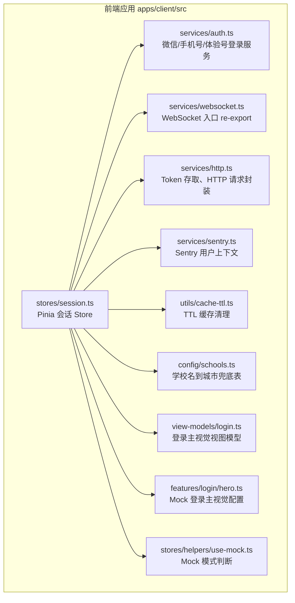

**图表来源**   
- [apps/client/src/stores/session.ts:1-30](file://apps/client/src/stores/session.ts#L1-L30)
- [apps/client/src/services/auth.ts:1-40](file://apps/client/src/services/auth.ts#L1-L40)
- [apps/client/src/services/websocket.ts:1-19](file://apps/client/src/services/websocket.ts#L1-L19)

**章节来源**   
- [apps/client/src/stores/session.ts:1-30](file://apps/client/src/stores/session.ts#L1-L30)
- [apps/client/src/services/auth.ts:1-40](file://apps/client/src/services/auth.ts#L1-L40)
- [apps/client/src/services/websocket.ts:1-19](file://apps/client/src/services/websocket.ts#L1-L19)

## 核心状态字段与数据模型

### 外部会话数据模型

Session Store 使用的会话类型来自后端生成的 `UserSession` 类型，典型字段包括：

| 字段 | 含义 | 默认值或行为 |
|---|---|---|
| `userId` | 当前用户唯一标识 | 真实环境由后端返回；Mock 使用 `"user-1001"` |
| `loggedIn` | 是否已登录 | 用于全局登录态判断 |
| `loginMethod` | 登录方式 | 如 `"wechat"`，也用于 Sentry 扩展字段 |
| `displayName` | 显示昵称 | 空字符串时视为未完成 |
| `phoneBound` | 是否绑定手机号 | 用于资料完善度展示 |
| `profileCompleted` | 个人资料是否完成 | 核心硬门槛判定依据 |
| `campusVerified` | 校园是否已认证 | 在校生功能守卫相关 |
| `scheduleCompleted` | 课表任务是否完成 | 学生流程相关 |
| `campusName` | 校园名称 | 未绑定时可为空 |
| `schoolId` | 学校 ID | 与 `config/schools.ts` 中的学校体系对齐 |
| `schoolBound` | 学校是否已绑定 | 非 schema 直接暴露字段时以类型断言访问 |
| `featureFlags` | 功能开关 | 如 `chat_ai_enabled` |
| `profileBackgroundUrl` | 个人主页背景图 URL | 额外持久化字段 |

### Store 内部状态

| 字段 | 类型 | 职责 |
|---|---|---|
| `loading` | `boolean` | 初始化或刷新时的加载态 |
| `isOffline` | `boolean` | 是否处于离线状态 |
| `userSession` | `UserSession \| null` | 当前会话数据 |
| `loginHero` | `LoginHeroView \| null` | 登录页主视觉配置 |
| `profileBackgroundUrl` | `string` | 本地持久化的主页背景图 URL |
| `errorMessage` | `string \| null` | 最近一次会话操作错误信息 |

### 资料字段完善状态

Session Store 定义了一个细粒度资料字段状态接口：

| 字段 | 判定逻辑 |
|---|---|
| `avatar` | 后端尚未下发字段级状态时以 `profileCompleted` 代理 |
| `nickname` | `displayName` 存在且非空白 |
| `gender` | 以 `profileCompleted` 代理 |
| `birthday` | 以 `profileCompleted` 代理 |
| `school` | `campusName` 存在且非空白 |
| `major` | 以 `profileCompleted` 代理 |
| `interestTags` | 以 `profileCompleted` 代理 |
| `bio` | 以 `profileCompleted` 代理 |

权重分配如下：

| 字段 | 权重 |
|---|---:|
| 头像 | 20 |
| 昵称 | 10 |
| 性别 | 10 |
| 生日 | 10 |
| 学校 | 20 |
| 专业 | 10 |
| 兴趣标签 | 10 |
| 个人简介 | 10 |

最终完善度为加权总和，并限制在 0 到 100。

**章节来源**   
- [apps/client/src/stores/session.ts:31-110](file://apps/client/src/stores/session.ts#L31-L110)
- [apps/client/src/stores/session.ts:110-200](file://apps/client/src/stores/session.ts#L110-L200)
- [apps/client/src/stores/session.ts:201-260](file://apps/client/src/stores/session.ts#L201-L260)
- [apps/client/src/stores/session.ts:260-360](file://apps/client/src/stores/session.ts#L260-L360)
- [apps/client/src/stores/session.ts:360-440](file://apps/client/src/stores/session.ts#L360-L440)

## 系统架构总览

会话管理不是孤立模块，它同时承担以下职责：

1. **会话读取与刷新**：冷启动、页面恢复、在线恢复后调用 `refreshSession`。
2. **登录流程编排**：微信登录、体验账号登录、手机号登录、注册。
3. **Token 管理**：JWT 存取、失效检测、登出清理。
4. **实时通道管理**：根据登录态连接或断开 WebSocket。
5. **监控关联**：将 `userId`、`displayName`、`loginMethod` 同步到 Sentry。
6. **数据隔离**：登出或新账号登录时清空 TTL 缓存，避免跨账号数据泄漏。
7. **扩展能力**：学校绑定、城市兜底、功能开关拉取、背景图持久化。

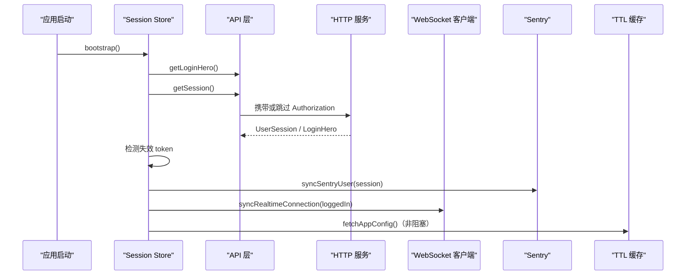

**图表来源**   
- [apps/client/src/stores/session.ts:601-720](file://apps/client/src/stores/session.ts#L601-L720)
- [apps/client/src/services/websocket.ts:1-19](file://apps/client/src/services/websocket.ts#L1-L19)
- [apps/client/src/services/sentry.ts:1-200](file://apps/client/src/services/sentry.ts#L1-L200)
- [apps/client/src/utils/cache-ttl.ts:1-124](file://apps/client/src/utils/cache-ttl.ts#L1-L124)

**章节来源**   
- [apps/client/src/stores/session.ts:601-720](file://apps/client/src/stores/session.ts#L601-L720)
- [apps/client/src/services/websocket.ts:1-19](file://apps/client/src/services/websocket.ts#L1-L19)

## 登录态生命周期

### 生命周期阶段

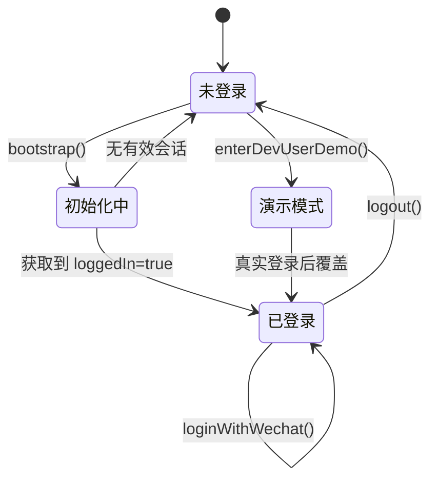

### 关键阶段说明

| 阶段 | 触发点 | 行为 |
|---|---|---|
| 未登录 | 初始状态、token 失效、登出成功 | `userSession=null`，`isLoggedIn=false` |
| 初始化中 | `bootstrap()` | 并行拉取登录主视觉与会话 |
| 已登录 | 微信登录、体验账号登录、历史有效会话 | 设置 `userSession`，连接 WebSocket，同步 Sentry |
| 演示模式 | `enterDevUserDemo()` | 注入 mock 会话，不发起真实后端请求 |
| 登出 | `logout()` | 调用后端登出、清空本地状态、清理缓存、断开 WS |

**章节来源**   
- [apps/client/src/stores/session.ts:601-720](file://apps/client/src/stores/session.ts#L601-L720)
- [apps/client/src/stores/session.ts:720-780](file://apps/client/src/stores/session.ts#L720-L780)
- [apps/client/src/stores/session.ts:780-840](file://apps/client/src/stores/session.ts#L780-L840)

## 详细组件分析

### 微信登录流程

微信登录由 `stores/session.ts` 的 `loginWithWechat` 委托给 `services/auth.ts` 的 `loginWithWechat`，形成两层职责分离：

- `stores/session.ts`：编排登录结果、清理缓存、同步 Sentry、连接 WebSocket。
- `services/auth.ts`：封装 `uni.login`、发送 `/v1/auth/wechat`、保存 token、抛出结构化业务错误。

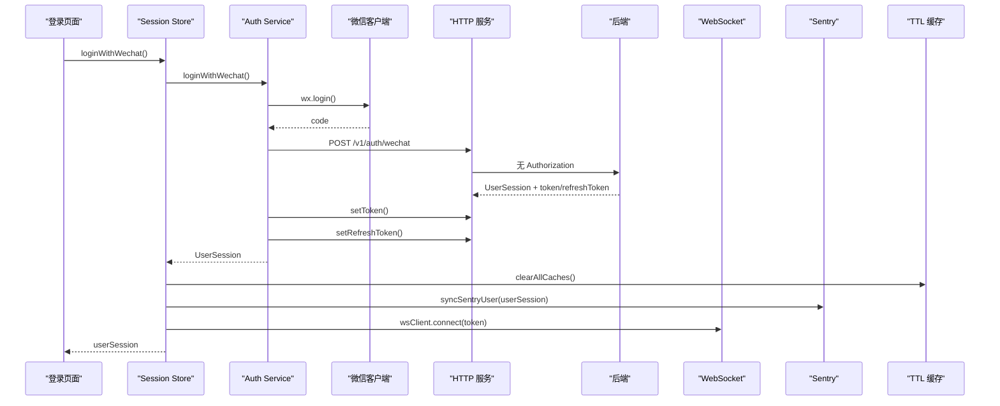

**图表来源**   
- [apps/client/src/stores/session.ts:720-780](file://apps/client/src/stores/session.ts#L720-L780)
- [apps/client/src/services/auth.ts:201-280](file://apps/client/src/services/auth.ts#L201-L280)
- [apps/client/src/services/websocket.ts:1-19](file://apps/client/src/services/websocket.ts#L1-L19)
- [apps/client/src/services/sentry.ts:1-200](file://apps/client/src/services/sentry.ts#L1-L200)
- [apps/client/src/utils/cache-ttl.ts:1-124](file://apps/client/src/utils/cache-ttl.ts#L1-L124)

#### 微信登录关键点

1. `wx.login` 有 15 秒超时保护。
2. 用户拒绝授权时抛出 `WechatLoginError(CLIENT_ERROR)`。
3. 后端返回的业务错误码被映射为统一错误类。
4. 登录成功后保存 `token` 和 `refreshToken`。
5. 登录成功后清空 TTL 缓存，避免旧账号数据残留。
6. 登录成功后同步 Sentry 用户上下文。
7. 登录成功后尝试连接 WebSocket。

**章节来源**   
- [apps/client/src/stores/session.ts:720-780](file://apps/client/src/stores/session.ts#L720-L780)
- [apps/client/src/services/auth.ts:201-320](file://apps/client/src/services/auth.ts#L201-L320)

### JWT Token 存取与失效处理

Token 存取由 `services/http.ts` 提供：

- `setToken`：登录成功后写入。
- `setRefreshToken`：登录成功后写入。
- `getToken`：后续请求携带。
- `clearTokens`：登出或检测到失效 token 时清除。

Bootstrap 的失效 token 处理逻辑如下：

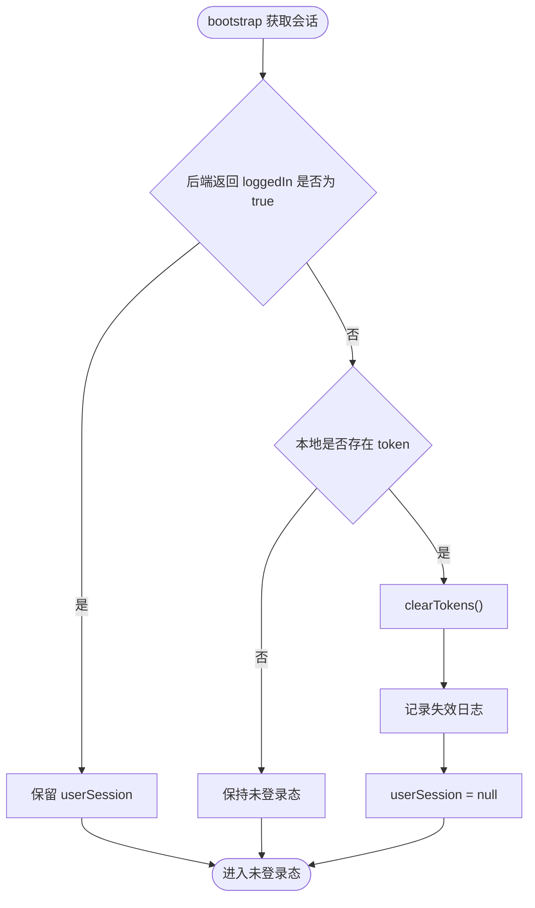

**图表来源**   
- [apps/client/src/stores/session.ts:640-680](file://apps/client/src/stores/session.ts#L640-L680)
- [apps/client/src/services/http.ts:1-200](file://apps/client/src/services/http.ts#L1-L200)

**章节来源**   
- [apps/client/src/stores/session.ts:640-680](file://apps/client/src/stores/session.ts#L640-L680)
- [apps/client/src/services/http.ts:1-200](file://apps/client/src/services/http.ts#L1-L200)

### 登出清理

`logout()` 是会话退出的单一入口，职责包括：

1. 调用 `clientApi.logout()`，先向后端通知登出，再清理本地 token 并跳转登录页。
2. 清理 TTL 缓存。
3. 清空 `userSession`、`loginHero`、`isOffline`、`errorMessage`、`profileBackgroundUrl`。
4. 清除 Sentry 用户上下文。
5. 断开 WebSocket。
6. 清除本地持久化的 `profileBackgroundUrl`。

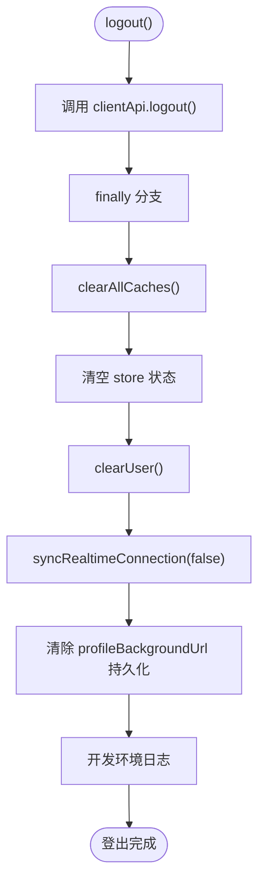

**图表来源**   
- [apps/client/src/stores/session.ts:520-600](file://apps/client/src/stores/session.ts#L520-L600)

**章节来源**   
- [apps/client/src/stores/session.ts:520-600](file://apps/client/src/stores/session.ts#L520-L600)

### 会话持久化策略

Session Store 没有使用 `pinia-plugin-persistedstate`，而是手动通过 `uni.setStorageSync` 持久化必要字段。

当前持久化键名为 `session:persistent-fields`，仅持久化：

| 字段 | 原因 |
|---|---|
| `profileBackgroundUrl` | H5 刷新或小程序冷启动后仍需显示上次上传的背景图 |

注意：这里有意避免持久化完整 `userSession`，以降低隐私泄漏风险。

**章节来源**   
- [apps/client/src/stores/session.ts:140-200](file://apps/client/src/stores/session.ts#L140-L200)
- [apps/client/src/stores/session.ts:440-520](file://apps/client/src/stores/session.ts#L440-L520)

### Mock 登录模式与真实登录模式切换

Session Store 支持两种运行模式：

| 模式 | 条件 | 行为 |
|---|---|---|
| Mock 模式 | `useMock()` 为真 | 使用 `mockUserSession` 和 `mockLoginHero`，不调用真实后端会话 |
| 真实模式 | `useMock()` 为假 | 调用 `clientApi.getLoginHero()` 和 `clientApi.getSession()` |

此外还有演示入口：

| 入口 | 触发方式 | 行为 |
|---|---|---|
| `dev-user=1` 冷启动参数 | `uni.getLaunchOptionsSync().query.dev-user === "1"` | bootstrap 跳过真实会话获取，保留已注入的 mock 会话 |
| `enterDevUserDemo()` | 任意页面主动调用 | 注入 mock 会话，幂等：已登录则不覆盖 |

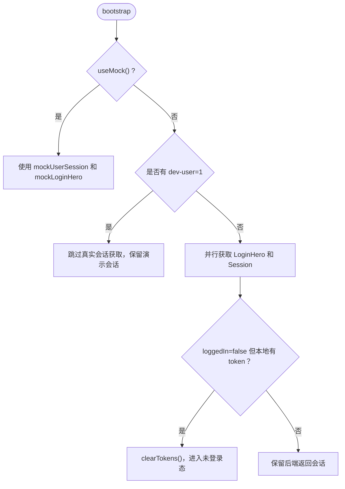

**图表来源**   
- [apps/client/src/stores/session.ts:601-680](file://apps/client/src/stores/session.ts#L601-L680)
- [apps/client/src/stores/session.ts:780-840](file://apps/client/src/stores/session.ts#L780-L840)
- [apps/client/src/stores/helpers/use-mock.ts:1-25](file://apps/client/src/stores/helpers/use-mock.ts#L1-L25)

**章节来源**   
- [apps/client/src/stores/session.ts:31-110](file://apps/client/src/stores/session.ts#L31-L110)
- [apps/client/src/stores/session.ts:601-680](file://apps/client/src/stores/session.ts#L601-L680)
- [apps/client/src/stores/session.ts:780-840](file://apps/client/src/stores/session.ts#L780-L840)

### WebSocket 自动连接与断开

Session Store 通过 `syncRealtimeConnection` 统一管理 WebSocket 连接：

| 条件 | 行为 |
|---|---|
| 未登录 | 断开 WebSocket |
| Mock 模式 | 断开 WebSocket，因为不存在后端实时通道 |
| 已登录且有 token | 调用 `wsClient.connect(token)` |
| 已登录但无 token | 断开 WebSocket |

登出时也会显式断开：

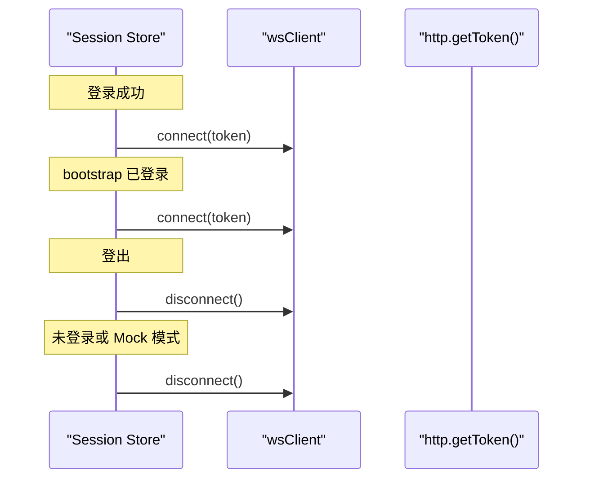

**图表来源**   
- [apps/client/src/stores/session.ts:260-320](file://apps/client/src/stores/session.ts#L260-L320)
- [apps/client/src/stores/session.ts:520-600](file://apps/client/src/stores/session.ts#L520-L600)
- [apps/client/src/services/websocket.ts:1-19](file://apps/client/src/services/websocket.ts#L1-L19)

**章节来源**   
- [apps/client/src/stores/session.ts:260-320](file://apps/client/src/stores/session.ts#L260-L320)
- [apps/client/src/stores/session.ts:520-600](file://apps/client/src/stores/session.ts#L520-L600)
- [apps/client/src/services/websocket.ts:1-19](file://apps/client/src/services/websocket.ts#L1-L19)

### Sentry 用户上下文关联

Session Store 通过 `syncSentryUser` 将会话与 Sentry 关联：

| 场景 | 行为 |
|---|---|
| 已登录且 `userId` 非空 | 设置 Sentry 用户 `id`、`username=displayName`、扩展字段 `loginMethod` |
| 未登录或会话为空 | 调用 `clearUser()` 清除上一个用户的上下文 |
| Sentry 调用失败 | 静默忽略，不影响会话流程 |

这保证异常上报时可区分不同用户，同时避免登出后仍残留前一个用户的身份信息。

**章节来源**   
- [apps/client/src/stores/session.ts:200-260](file://apps/client/src/stores/session.ts#L200-L260)
- [apps/client/src/stores/session.ts:680-720](file://apps/client/src/stores/session.ts#L680-L720)
- [apps/client/src/stores/session.ts:720-780](file://apps/client/src/stores/session.ts#L720-L780)
- [apps/client/src/services/sentry.ts:1-200](file://apps/client/src/services/sentry.ts#L1-L200)

### TTL 缓存清理与跨账号数据隔离

Session Store 在两个关键位置调用 `clearAllCaches()`：

1. 新账号登录成功时。
2. 登出时。

这是为了防止：

- 上一个账号的数据残留在内存缓存中。
- 下一个账号登录后看到上一个账号的列表、消息或推荐数据。
- 多账号切换场景下的数据串号。

**章节来源**   
- [apps/client/src/stores/session.ts:520-600](file://apps/client/src/stores/session.ts#L520-L600)
- [apps/client/src/stores/session.ts:720-780](file://apps/client/src/stores/session.ts#L720-L780)
- [apps/client/src/utils/cache-ttl.ts:1-124](file://apps/client/src/utils/cache-ttl.ts#L1-L124)

### 学校绑定与城市兜底

`bindSchool` 支持学校一次性绑定，并在真实模式中调用后端保存校园档案：

| 模式 | 行为 |
|---|---|
| Mock 模式 | 本地写入 `schoolId`、`schoolBound`、`campusName` |
| 真实模式 | 调用 `clientApi.getCampusProfile()` 获取已有城市和专业；若缺失则按学校名查 `SCHOOLS` 表兜底；最后调用 `clientApi.saveCampusProfile()` |

城市兜底逻辑优先使用已认证校园资料，其次查找 `config/schools.ts` 中的城市映射。

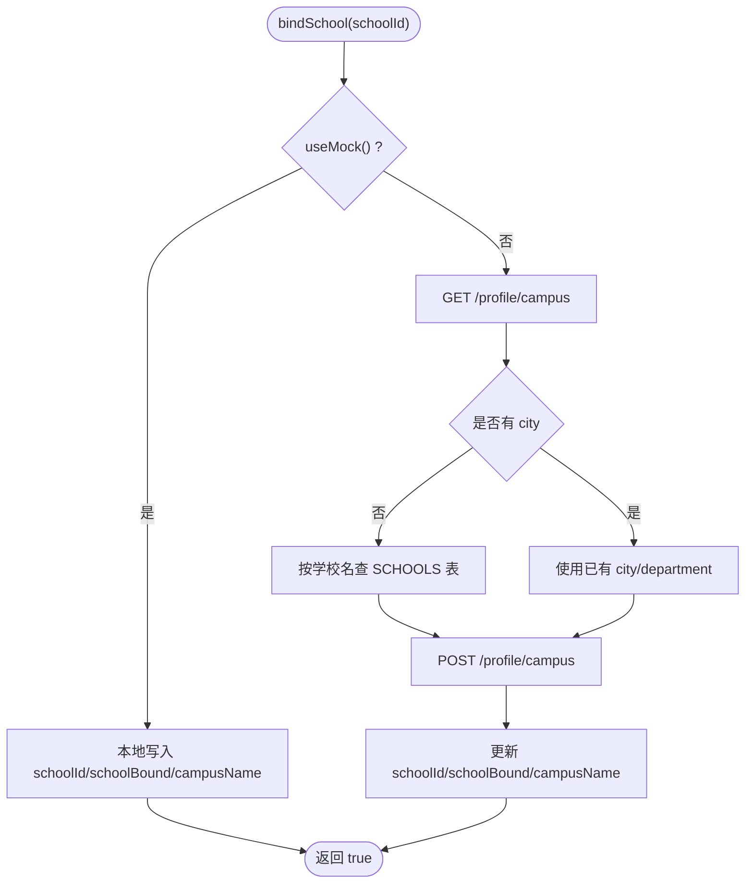

**图表来源**   
- [apps/client/src/stores/session.ts:840-896](file://apps/client/src/stores/session.ts#L840-L896)
- [apps/client/src/config/schools.ts:1-143](file://apps/client/src/config/schools.ts#L1-L143)

**章节来源**   
- [apps/client/src/stores/session.ts:840-896](file://apps/client/src/stores/session.ts#L840-L896)
- [apps/client/src/config/schools.ts:1-143](file://apps/client/src/config/schools.ts#L1-L143)

### 功能开关与启动期配置拉取

Session Store 在 `bootstrap` 中非阻塞拉取应用配置：

- 调用 `useAppConfigStore().fetchAppConfig()`。
- 失败仅记录开发环境日志，不阻塞应用启动。
- 功能开关默认开放，`App.vue onShow` 会按 TTL 重试。

这使维护模式、功能开关等后台配置具备“启动期可失败、运行时可重试”的特性。

**章节来源**   
- [apps/client/src/stores/session.ts:680-720](file://apps/client/src/stores/session.ts#L680-L720)

## 详细组件分析

### Session Store 类与方法结构

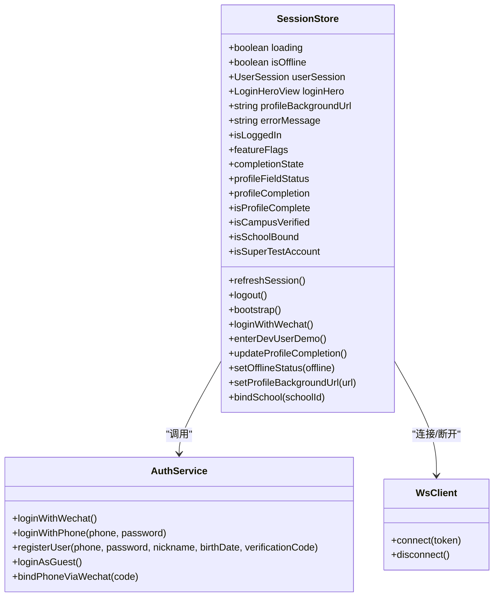

**图表来源**   
- [apps/client/src/stores/session.ts:320-896](file://apps/client/src/stores/session.ts#L320-L896)
- [apps/client/src/services/auth.ts:201-447](file://apps/client/src/services/auth.ts#L201-L447)
- [apps/client/src/services/websocket.ts:1-19](file://apps/client/src/services/websocket.ts#L1-L19)

**章节来源**   
- [apps/client/src/stores/session.ts:320-896](file://apps/client/src/stores/session.ts#L320-L896)
- [apps/client/src/services/auth.ts:201-447](file://apps/client/src/services/auth.ts#L201-L447)

### 登录流程时序图

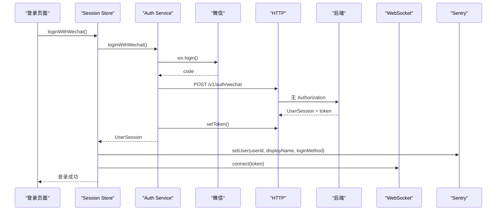

**图表来源**   
- [apps/client/src/stores/session.ts:720-780](file://apps/client/src/stores/session.ts#L720-L780)
- [apps/client/src/services/auth.ts:201-320](file://apps/client/src/services/auth.ts#L201-L320)
- [apps/client/src/services/sentry.ts:1-200](file://apps/client/src/services/sentry.ts#L1-L200)
- [apps/client/src/services/websocket.ts:1-19](file://apps/client/src/services/websocket.ts#L1-L19)

**章节来源**   
- [apps/client/src/stores/session.ts:720-780](file://apps/client/src/stores/session.ts#L720-L780)
- [apps/client/src/services/auth.ts:201-320](file://apps/client/src/services/auth.ts#L201-L320)

### 复杂逻辑流程图：刷新会话

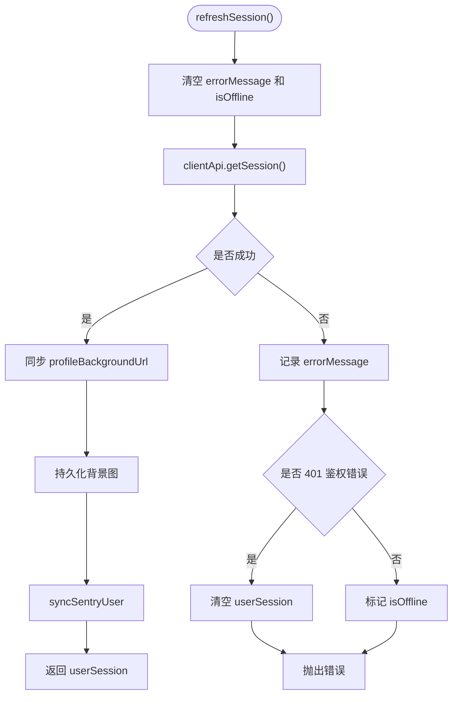

**图表来源**   
- [apps/client/src/stores/session.ts:440-520](file://apps/client/src/stores/session.ts#L440-L520)

**章节来源**   
- [apps/client/src/stores/session.ts:440-520](file://apps/client/src/stores/session.ts#L440-L520)

## 依赖关系分析

### 直接依赖

| 依赖 | 用途 | 耦合程度 |
|---|---|---|
| `services/api` | 获取会话、登录主视觉、登出、校园档案 | 高 |
| `services/auth` | 微信登录、手机号登录、体验账号登录 | 高 |
| `services/http` | Token 存取、HTTP 请求 | 高 |
| `services/websocket` | 实时连接管理 | 中 |
| `services/sentry` | 用户上下文 | 中 |
| `utils/cache-ttl` | TTL 缓存清理 | 中 |
| `view-models/login` | 登录主视觉视图模型 | 低 |
| `features/login/hero` | Mock 登录主视觉配置 | 低 |
| `stores/helpers/use-mock` | Mock 模式判断 | 中 |
| `config/schools` | 学校城市兜底 | 低 |

### 潜在耦合点

1. **Session Store 与 API 层**：刷新、登出、校园档案都依赖 API。
2. **Session Store 与 WebSocket**：登录成功、bootstrap、登出都会影响连接状态。
3. **Session Store 与 Sentry**：用户上下文必须与会话状态一致。
4. **Session Store 与缓存层**：新账号和登出时必须清理缓存。
5. **Session Store 与配置层**：功能开关拉取失败不应阻塞启动。

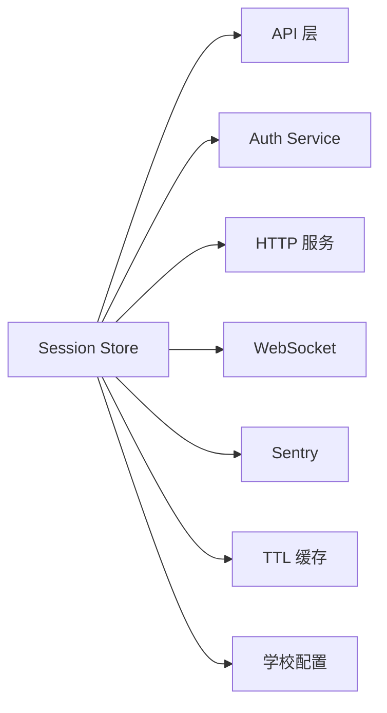

**图表来源**   
- [apps/client/src/stores/session.ts:1-30](file://apps/client/src/stores/session.ts#L1-L30)

**章节来源**   
- [apps/client/src/stores/session.ts:1-30](file://apps/client/src/stores/session.ts#L1-L30)

## 错误处理模式

### 微信登录错误

`services/auth.ts` 定义了统一的 `WechatLoginError`，包含业务错误码：

| 错误码 | HTTP 状态 | 含义 | 建议处理 |
|---|---|---|---|
| `INVALID_CODE` | 401 | 微信 code 失效或过期 | 重新拉起 `wx.login` |
| `WECHAT_API_ERROR` | 502 | 微信 API 不可用 | 提示稍后重试 |
| `USER_DISABLED` | 403 | 用户被禁用 | 提示联系管理员 |
| `CLIENT_ERROR` | 0 或其他 | 超时、拒绝授权、网络错误 | 显示具体客户端错误 |

Session Store 在登录失败时还会：

- 设置 `errorMessage`。
- 设置 `isOffline=true`。
- 输出开发环境日志。
- 向上抛出错误，供 UI 展示。

### 刷新会话错误

`refreshSession` 区分两类错误：

| 类型 | 行为 |
|---|---|
| 鉴权错误（401） | 清空 `userSession`，强制重新登录 |
| 网络或其他错误 | 设置 `isOffline=true`，保留 `userSession` 支持离线浏览 |

### 登出错误

`logout` 对后端通知失败做 best-effort 处理：

- 捕获异常并记录日志。
- `finally` 分支仍执行本地状态清理、缓存清理、Sentry 清理和 WebSocket 断开。

### 错误分类矩阵

| 操作 | 正常结果 | 失败表现 | 用户可见信息 |
|---|---|---|---|
| `loginWithWechat` | 设置会话、连接 WS、同步 Sentry | 抛出 `WechatLoginError` | `errorMessage` 或业务错误消息 |
| `refreshSession` | 更新会话、持久化背景图 | 设置 `errorMessage` 和 `isOffline` | 刷新失败提示 |
| `logout` | 清理所有状态 | 仅记录日志 | 通常跳转到登录页 |
| `bootstrap` | 建立初始会话 | 进入离线模式，不清空已有数据 | 初始化失败日志 |

**章节来源**   
- [apps/client/src/services/auth.ts:1-200](file://apps/client/src/services/auth.ts#L1-L200)
- [apps/client/src/services/auth.ts:201-320](file://apps/client/src/services/auth.ts#L201-L320)
- [apps/client/src/stores/session.ts:440-520](file://apps/client/src/stores/session.ts#L440-L520)
- [apps/client/src/stores/session.ts:520-600](file://apps/client/src/stores/session.ts#L520-L600)
- [apps/client/src/stores/session.ts:720-780](file://apps/client/src/stores/session.ts#L720-L780)

## 性能与资源清理

### 性能优化点

1. **并行请求**：bootstrap 中并行拉取 `getLoginHero` 和 `getSession`。
2. **非阻塞配置拉取**：功能开关拉取失败不阻塞启动。
3. **getter 高频日志移除**：生产环境移除 `isDev console.warn`。
4. **最小化持久化字段**：只持久化 `profileBackgroundUrl`，不持久化完整会话。
5. **Mock 模式短路**：Mock 模式下不发起真实会话请求。

### 资源清理清单

| 资源 | 清理时机 | 清理方式 |
|---|---|---|
| JWT Token | 登出、失效 token 检测 | `clearTokens()` |
| Refresh Token | 登出 | `clearTokens()` |
| TTL 缓存 | 新账号登录、登出 | `clearAllCaches()` |
| WebSocket 连接 | 未登录、Mock 模式、登出 | `wsClient.disconnect()` |
| Sentry 用户上下文 | 未登录、登出 | `clearUser()` |
| 背景图持久化 | 登出 | 清空 `profileBackgroundUrl` |
| 错误信息 | 成功刷新、成功登录 | 重置为 `null` |

**章节来源**   
- [apps/client/src/stores/session.ts:440-720](file://apps/client/src/stores/session.ts#L440-L720)
- [apps/client/src/stores/session.ts:720-840](file://apps/client/src/stores/session.ts#L720-L840)

## 调试技巧与常见问题

### 启用演示模式

| 方式 | 用法 |
|---|---|
| Mock 构建模式 | 整个应用使用 mock 数据和 mock 会话 |
| `dev-user=1` 冷启动参数 | 小程序启动参数携带 `dev-user=1` |
| `enterDevUserDemo()` | 任意页面主动注入 mock 会话 |

演示模式适合第五轮 QA 验收截图，可跳过登录锁和资料二级锁。

### 查看会话状态

建议在开发环境中关注以下状态：

- `userSession.loggedIn`
- `userSession.userId`
- `userSession.displayName`
- `userSession.profileCompleted`
- `userSession.campusVerified`
- `userSession.schoolBound`
- `isOffline`
- `errorMessage`
- `profileCompletion`

### 常见问题排查

| 问题 | 可能原因 | 排查方向 |
|---|---|---|
| 登录成功但无法聊天 | WebSocket 未连接 | 检查 `syncRealtimeConnection` 是否被调用 |
| 登出后仍看到旧数据 | TTL 缓存未清理 | 检查 `clearAllCaches()` 是否在登出路径执行 |
| 刷新后用户身份丢失 | Sentry 上下文未同步 | 检查 `syncSentryUser` 调用点 |
| 401 后仍显示已登录 | 鉴权错误未清空 `userSession` | 检查 `refreshSession` 的 401 分支 |
| 学校绑定失败 | 城市或专业为空 | 检查 `getCampusProfile` 和 `SCHOOLS` 兜底 |
| 背景图刷新后消失 | 未持久化 `profileBackgroundUrl` | 检查 `savePersistedFields` |
| 微信登录超时 | `wx.login` 超过 15 秒 | 检查网络和微信客户端状态 |

**章节来源**   
- [apps/client/src/stores/session.ts:601-840](file://apps/client/src/stores/session.ts#L601-L840)
- [apps/client/src/services/auth.ts:1-200](file://apps/client/src/services/auth.ts#L1-L200)

## 结论

Session Store 是 Campus Love 前端应用中承上启下的核心状态模块：

- 对外暴露 `loginWithWechat`、`refreshSession`、`logout`、`bootstrap`、`bindSchool` 等清晰方法。
- 对内串联 HTTP 鉴权、Token 管理、WebSocket 连接、Sentry 监控、TTL 缓存和本地持久化。
- 通过 Mock 模式和演示入口兼顾开发与验收效率。
- 通过结构化错误处理和资源清理保障用户体验和数据安全。

在实际使用中，应始终通过 Session Store 的方法修改会话状态，而不是直接赋值 `userSession`；这样能确保 WebSocket、Sentry、缓存和持久化等副作用保持一致。