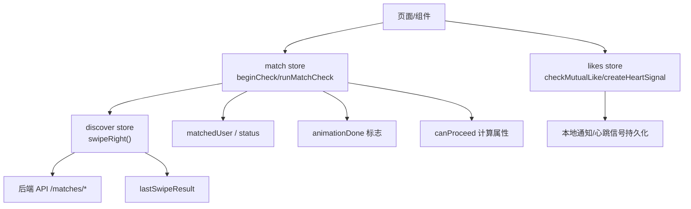
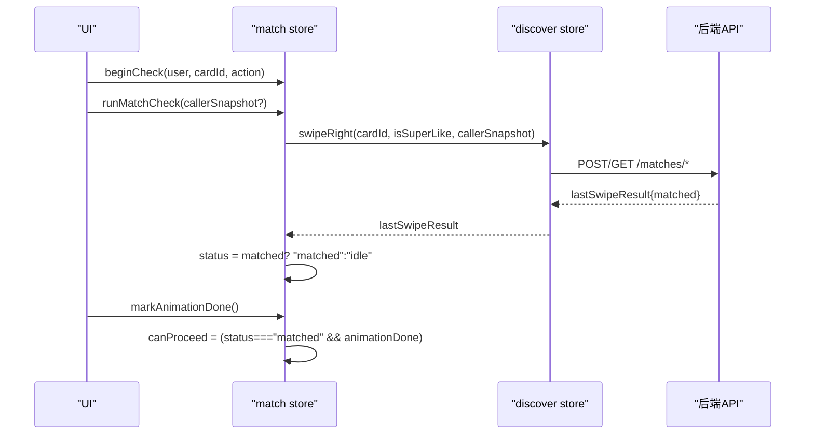
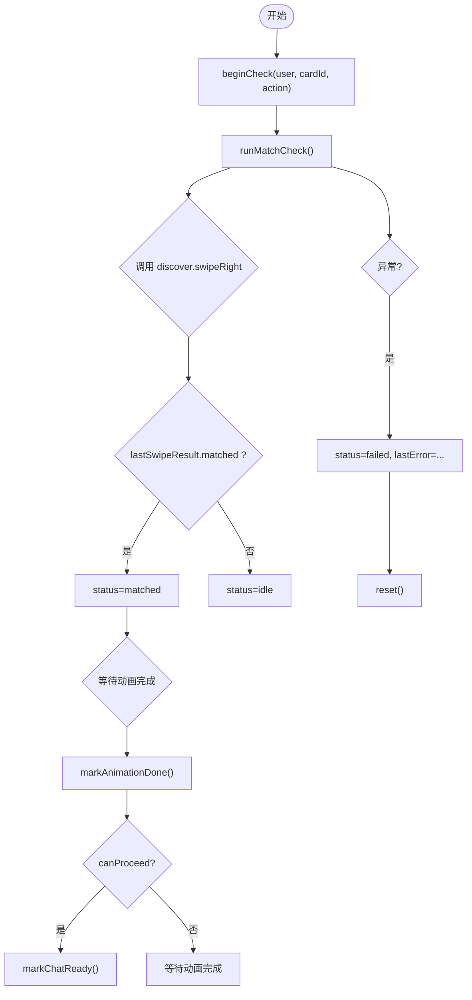
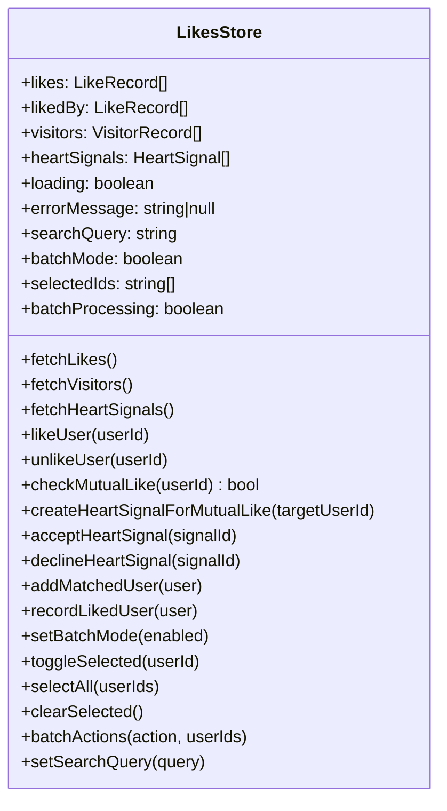
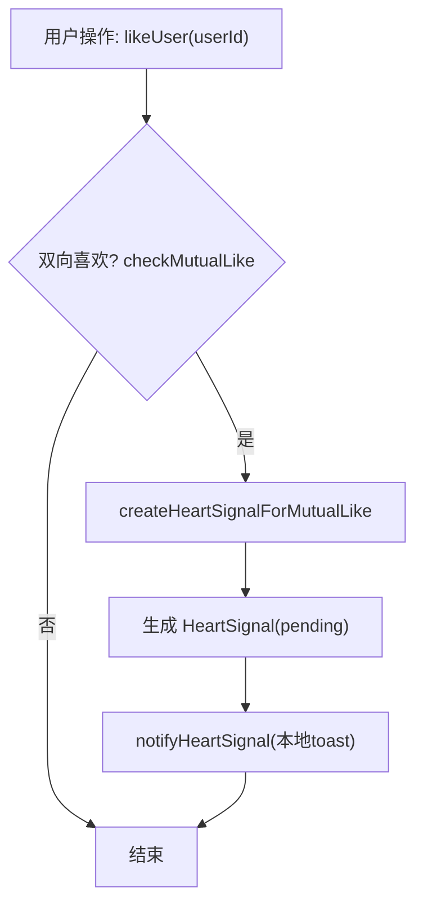
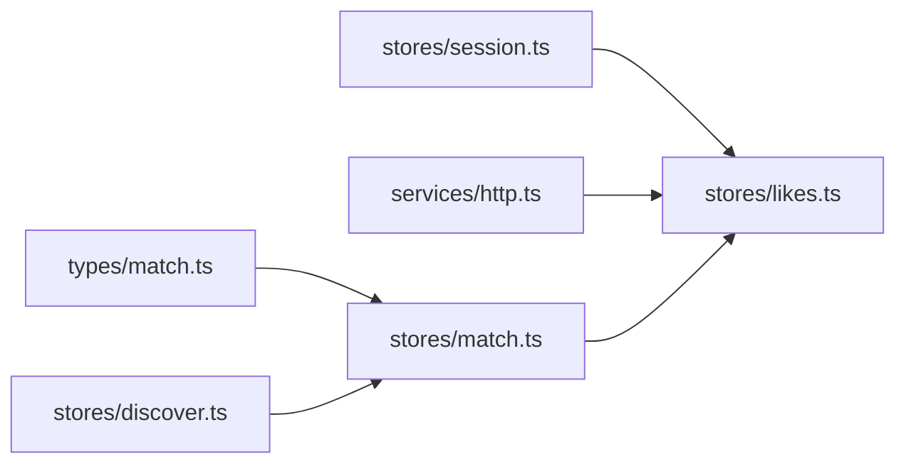

# 匹配状态 Store（match）

<cite>
**本文引用的文件**
- [apps/client/src/stores/match.ts](file://apps/client/src/stores/match.ts)
- [apps/client/src/stores/likes.ts](file://apps/client/src/stores/likes.ts)
- [apps/client/src/stores/discover.ts](file://apps/client/src/stores/discover.ts)
- [apps/client/src/types/match.ts](file://apps/client/src/types/match.ts)
</cite>

## 目录
1. [简介](#简介)
2. [项目结构](#项目结构)
3. [核心组件](#核心组件)
4. [架构总览](#架构总览)
5. [详细组件分析](#详细组件分析)
6. [依赖关系分析](#依赖关系分析)
7. [性能考量](#性能考量)
8. [故障排查指南](#故障排查指南)
9. [结论](#结论)
10. [附录](#附录)

## 简介
本章节聚焦 Campus Love 前端应用的“匹配状态管理”模块，围绕以下目标展开：
- 解释匹配流程的状态机与动画完成约束；
- 说明喜欢/超级喜欢的触发、校验与结果回写；
- 阐述双向匹配检测机制与心动信号创建；
- 文档化 likes store 中的喜欢列表管理、匹配结果处理与状态同步策略；
- 明确 match store 与 discover store 的协作边界；
- 覆盖匹配历史、统计展示与用户体验优化点；
- 提供代码级流程图、时序图与调试建议。

## 项目结构
与匹配状态相关的核心文件组织如下：
- stores/match.ts：匹配流程状态机（checking → matched → chat_ready），封装 beginCheck/runMatchCheck/markAnimationDone/reset 等动作；
- stores/likes.ts：喜欢/访客/心动信号数据层，包含双向匹配检测、心动信号创建、批量操作与搜索过滤；
- stores/discover.ts：发现页卡片滑动与右滑（喜欢/超级喜欢）实现，lastSwipeResult 作为匹配结果来源；
- types/match.ts：匹配相关类型定义（如 MatchStatus、MatchActionType、MatchCardUser）。

图示来源
- [apps/client/src/stores/match.ts:1-112](file://apps/client/src/stores/match.ts#L1-L112)
- [apps/client/src/stores/likes.ts:400-700](file://apps/client/src/stores/likes.ts#L400-L700)
- [apps/client/src/stores/discover.ts:1-17](file://apps/client/src/stores/discover.ts#L1-L17)

小节来源
- [apps/client/src/stores/match.ts:1-112](file://apps/client/src/stores/match.ts#L1-L112)
- [apps/client/src/stores/likes.ts:1-200](file://apps/client/src/stores/likes.ts#L1-L200)
- [apps/client/src/types/match.ts:1-60](file://apps/client/src/types/match.ts#L1-L60)

## 核心组件
- match store：维护匹配流程状态机与动画完成标志，负责在用户点击“喜欢/超级喜欢”后驱动 discover store 执行右滑并读取 lastSwipeResult，决定进入 matched 或 idle；当动画完成后，canProceed 变为真，允许继续下一步（如进入聊天）。
- likes store：管理“我发出的喜欢”“喜欢我的”“访客”“心动信号”，并提供双向匹配检测、心动信号创建、批量操作、搜索过滤等功能；通过 addMatchedUser/recordLikedUser 与 discover/match 侧联动更新本地列表，避免重复请求。

小节来源
- [apps/client/src/stores/match.ts:1-112](file://apps/client/src/stores/match.ts#L1-L112)
- [apps/client/src/stores/likes.ts:200-500](file://apps/client/src/stores/likes.ts#L200-L500)

## 架构总览
匹配流程由 match store 驱动，调用 discover store 的 swipeRight 发起一次右滑（喜欢或超级喜欢），discover store 负责与后端交互并返回 lastSwipeResult；match store 根据 result.matched 将状态切换为 matched 或回到 idle。随后，当动画完成时，canProceed 置真，可进入聊天。

图示来源
- [apps/client/src/stores/match.ts:1-112](file://apps/client/src/stores/match.ts#L1-L112)
- [apps/client/src/stores/discover.ts:1-17](file://apps/client/src/stores/discover.ts#L1-L17)

## 详细组件分析

### match store 分析
- 状态字段
  - status：idle/checking/matched/chat_ready/failed
  - matchedUser：当前匹配到的用户信息
  - pendingAction/pendingCardId：临时保存本次操作的卡片与动作
  - animationDone：动画是否完成
  - lastError：错误消息
  - canProceed：computed(status === "matched" && animationDone)
- 关键方法
  - beginCheck：设置 matchedUser、pendingCardId、pendingAction，重置 animationDone/lastError，进入 checking；
  - runMatchCheck：调用 discover.store.swipeRight，依据 lastSwipeResult?.matched 设置状态；异常则 failed；
  - markAnimationDone：标记动画完成；
  - setMatchedUser：统一写入 matchedUser（原旁路直写已移除）；
  - markChatReady：从 matched 进入 chat_ready；
  - reset：清空所有临时状态。

图示来源
- [apps/client/src/stores/match.ts:1-112](file://apps/client/src/stores/match.ts#L1-L112)

小节来源
- [apps/client/src/stores/match.ts:1-112](file://apps/client/src/stores/match.ts#L1-L112)

### likes store 分析
- 数据模型
  - LikeRecord：我发出的喜欢记录；
  - VisitorRecord：访客记录；
  - HeartSignalView/HeartSignal：心动信号（含状态：pending/accepted/expired/declined）；
  - LikesState：包含 likes、likedBy、visitors、heartSignals、loading、searchQuery、batchMode、selectedIds、batchProcessing 等。
- 核心能力
  - fetchLikes/fetchVisitors/fetchHeartSignals：带 AbortController 防竞态；失败清空列表并抛出错误；
  - likeUser/unlikeUser：乐观更新 + 失败回滚；
  - checkMutualLike：判断双方互相喜欢，若成立则 createHeartSignalForMutualLike；
  - createHeartSignalForMutualLike：生成本地心动信号并发送本地通知；
  - acceptHeartSignal/declineHeartSignal：接受/拒绝心动信号；
  - addMatchedUser/recordLikedUser：与 discover/match 联动，新增匹配或记录喜欢，避免重复；
  - 批量操作 batchActions：支持 like/skip/cancel 三种批量动作，分批并发（每批5个），失败聚合提示；
  - 搜索过滤 filteredLikedBy/filteredLikes/filteredVisitors：按昵称/headline 模糊匹配。

图示来源
- [apps/client/src/stores/likes.ts:1-1102](file://apps/client/src/stores/likes.ts#L1-L1102)

小节来源
- [apps/client/src/stores/likes.ts:1-1102](file://apps/client/src/stores/likes.ts#L1-L1102)

### 双向匹配检测与心动信号
- 检测逻辑：checkMutualLike 会比对 likes 与 likedBy 中是否存在同一 userId；若存在且非自喜欢，则判定为双向喜欢；
- 心动信号：createHeartSignalForMutualLike 生成 pending 状态的 HeartSignal，并调用 notifyHeartSignal 推送本地 toast；
- 幂等保护：避免重复创建 pending 的心动信号；
- 后续扩展：可与后端心跳接口同步，持久化到服务端。

图示来源
- [apps/client/src/stores/likes.ts:600-760](file://apps/client/src/stores/likes.ts#L600-L760)

小节来源
- [apps/client/src/stores/likes.ts:600-760](file://apps/client/src/stores/likes.ts#L600-L760)

### 与 discover store 的协作
- match store 在运行匹配检查时，调用 discover.store.swipeRight 并传入 callerSnapshot（用于冷启动/URL直达场景）；
- discover store 执行右滑并返回 lastSwipeResult，match store 据此设置状态；
- likes store 提供 addMatchedUser/recordLikedUser 供 discover/match 侧直接更新本地列表，减少重复请求。

小节来源
- [apps/client/src/stores/match.ts:1-112](file://apps/client/src/stores/match.ts#L1-L112)
- [apps/client/src/stores/likes.ts:900-1102](file://apps/client/src/stores/likes.ts#L900-L1102)

## 依赖关系分析
- match store 依赖 discover store 的 swipeRight 与 lastSwipeResult；
- likes store 依赖 session store（获取当前用户ID）、http request（网络请求）、i18n（错误文案）；
- 类型层面依赖 types/match.ts 的 MatchStatus、MatchActionType、MatchCardUser；
- 业务耦合点：
  - match ↔ discover：匹配流程控制与结果消费；
  - likes ↔ match/discover：匹配成功后本地列表同步。

图示来源
- [apps/client/src/stores/match.ts:1-112](file://apps/client/src/stores/match.ts#L1-L112)
- [apps/client/src/stores/likes.ts:1-200](file://apps/client/src/stores/likes.ts#L1-L200)
- [apps/client/src/types/match.ts:1-60](file://apps/client/src/types/match.ts#L1-L60)

小节来源
- [apps/client/src/stores/match.ts:1-112](file://apps/client/src/stores/match.ts#L1-L112)
- [apps/client/src/stores/likes.ts:1-200](file://apps/client/src/stores/likes.ts#L1-L200)

## 性能考量
- 防竞态：fetchLikes/fetchVisitors/fetchHeartSignals 使用 AbortController 取消旧请求，避免快速切换导致的数据覆盖；
- 乐观更新：likeUser/unlikeUser 先更新本地再调后端，失败回滚，提升交互响应速度；
- 批量并发：batchActions 对 like/cancel 采用分批并发（每批5个），缩短耗时；
- 列表去重：addMatchedUser/recordLikedUser 内部做存在性检查，避免重复插入；
- 动画与状态：match store 用 animationDone 限制立即跳转，避免未渲染完成导致 UI 错乱。

小节来源
- [apps/client/src/stores/likes.ts:400-600](file://apps/client/src/stores/likes.ts#L400-L600)
- [apps/client/src/stores/likes.ts:900-1102](file://apps/client/src/stores/likes.ts#L900-L1102)
- [apps/client/src/stores/match.ts:1-112](file://apps/client/src/stores/match.ts#L1-L112)

## 故障排查指南
- 匹配失败
  - 现象：status=failed，lastError 有值；
  - 排查：检查 discover.store.lastSwipeResult 是否为空、是否有网络异常；确认 callerSnapshot 是否正确透传；
  - 参考路径：[runMatchCheck](file://apps/client/src/stores/match.ts#L1-L112)
- 双向匹配未创建心动信号
  - 现象：likedBy 与 likes 均存在对方但未出现心动信号；
  - 排查：确认 checkMutualLike 是否被调用、是否命中自喜欢或 ID 不匹配；查看 createHeartSignalForMutualLike 是否重复跳过；
  - 参考路径：[checkMutualLike/createHeartSignalForMutualLike](file://apps/client/src/stores/likes.ts#L600-L760)
- 列表陈旧或为空
  - 现象：加载失败后仍显示旧数据；
  - 排查：确保 catch 分支清空列表并抛出错误；检查 finally 中 loading 清理是否仅针对当前 controller；
  - 参考路径：[fetchLikes/fetchVisitors/fetchHeartSignals](file://apps/client/src/stores/likes.ts#L400-L600)
- 批量操作部分失败
  - 现象：部分成功，部分失败；
  - 排查：查看 batchActions 的分批结果收集与 errorMessage 聚合；确认 each likeUser/unlikeUser 的回滚逻辑；
  - 参考路径：[batchActions](file://apps/client/src/stores/likes.ts#L900-L1102)

小节来源
- [apps/client/src/stores/match.ts:1-112](file://apps/client/src/stores/match.ts#L1-L112)
- [apps/client/src/stores/likes.ts:400-1102](file://apps/client/src/stores/likes.ts#L400-L1102)

## 结论
本模块以 match store 为核心状态机，结合 discover store 的右滑能力与 likes store 的数据管理，实现了从“喜欢/超级喜欢”到“双向匹配检测与心动信号”的完整链路。通过乐观更新、AbortController 防竞态、批量并发与动画完成约束，兼顾了用户体验与稳定性。后续可在心动信号持久化、服务端匹配统计等方面进一步扩展。

## 附录
- 匹配流程关键函数路径
  - beginCheck/runMatchCheck/markAnimationDone：[match store](file://apps/client/src/stores/match.ts#L1-L112)
  - swipeRight/lastSwipeResult：[discover store](file://apps/client/src/stores/discover.ts#L1-L17)
  - likeUser/unlikeUser/addMatchedUser/recordLikedUser/batchActions：[likes store](file://apps/client/src/stores/likes.ts#L400-L1102)
  - checkMutualLike/createHeartSignalForMutualLike：[likes store](file://apps/client/src/stores/likes.ts#L600-L760)
- 类型定义路径
  - MatchStatus/MatchActionType/MatchCardUser：[types/match.ts](file://apps/client/src/types/match.ts#L1-L60)