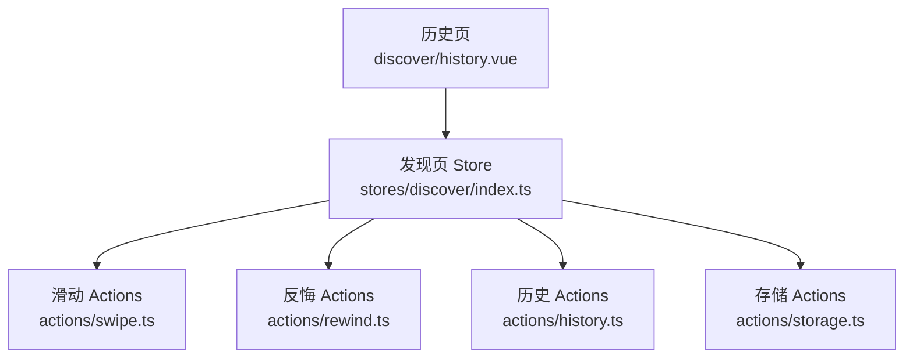
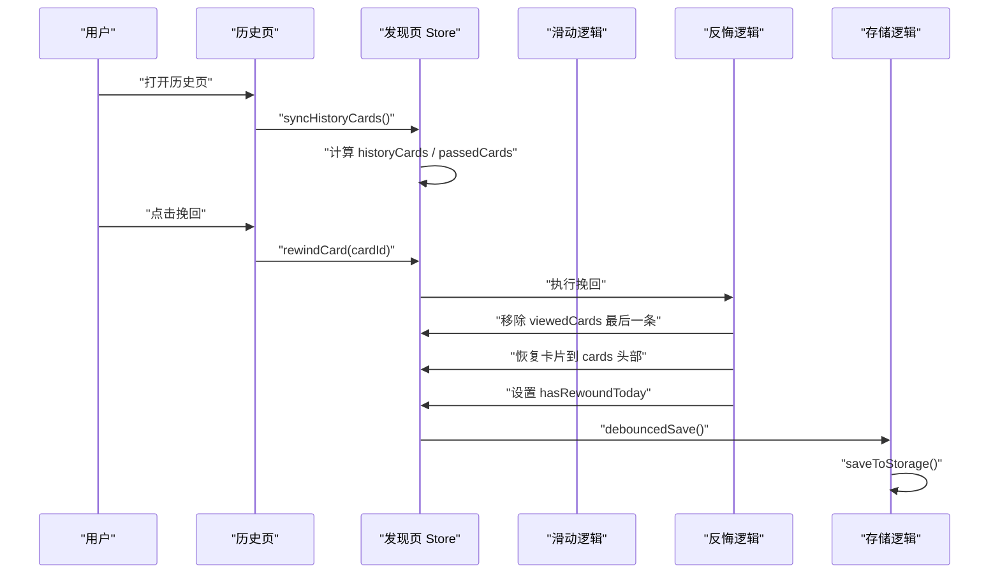
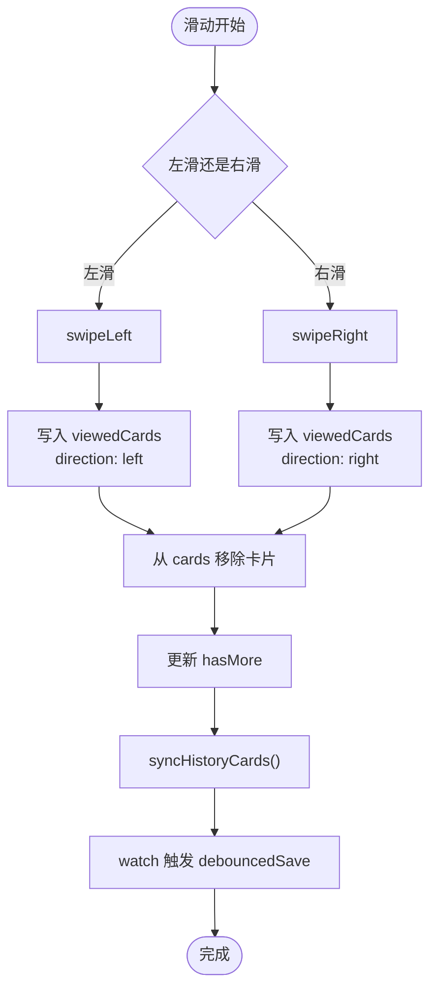
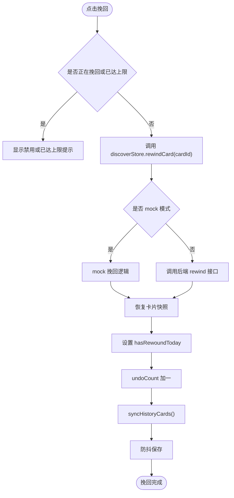
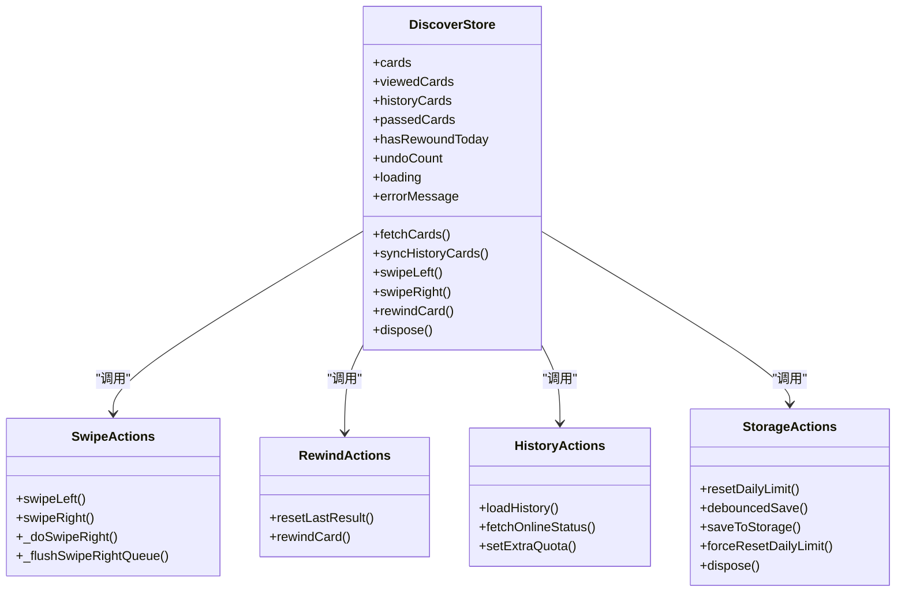

# 历史记录动作（history actions）

<cite>
**本文引用的文件**   
- [apps/client/src/subpackages/discover-extra/discover/history.vue](file://apps/client/src/subpackages/discover-extra/discover/history.vue)
- [apps/client/src/stores/discover/index.ts](file://apps/client/src/stores/discover/index.ts)
- [apps/client/src/stores/discover/actions/history.ts](file://apps/client/src/stores/discover/actions/history.ts)
- [apps/client/src/stores/discover/actions/swipe.ts](file://apps/client/src/stores/discover/actions/swipe.ts)
- [apps/client/src/stores/discover/actions/rewind.ts](file://apps/client/src/stores/discover/actions/rewind.ts)
- [apps/client/src/stores/discover/actions/storage.ts](file://apps/client/src/stores/discover/actions/storage.ts)
</cite>

## 目录

1. [引言](#引言)
2. [项目结构定位](#项目结构定位)
3. [核心组件与职责](#核心组件与职责)
4. [架构总览](#架构总览)
5. [详细组件分析](#详细组件分析)
6. [依赖关系分析](#依赖关系分析)
7. [性能与存储优化](#性能与存储优化)
8. [错误处理与故障排查](#错误处理与故障排查)
9. [最佳实践](#最佳实践)
10. [结论](#结论)

## 引言

本文件面向“发现页历史记录”功能，重点解释用户交互历史的记录、查询、展示与管理逻辑。该系统由前端页面、Pinia store、滑动操作、反悔操作和本地存储策略共同组成：

- 用户在发现页左滑或右滑后，store 将操作结果写入 `viewedCards`。
- 历史页从 store 的 `historyCards` 和 `passedCards` 中读取今日已看卡片及已拒绝卡片。
- 历史页支持对“最后一张已拒绝卡片”进行挽回；挽回成功后恢复卡片并更新本地状态。
- 本地存储通过防抖机制合并写入，限制 `viewedCards` 长度，避免小程序存储膨胀。
- 跨天自动重置每日限额和历史相关状态。

该功能的核心目标是：**可回溯当日推荐浏览轨迹，提供有限挽回能力，并在本地存储受限环境下保持性能和稳定性。**

## 项目结构定位

历史记录功能位于客户端小程序/应用的前端代码中，主要涉及两个入口：

| 路径 | 角色 | 说明 |
|---|---|---|
| `apps/client/src/subpackages/discover-extra/discover/history.vue` | 历史页视图 | 展示今日已看卡片、统计信息、已拒绝卡片和挽回按钮 |
| `apps/client/src/stores/discover/index.ts` | Store 主体 | 定义 state、getters、装配各拆分 action |
| `apps/client/src/stores/discover/actions/history.ts` | 历史加载与在线状态 | 加载后端历史、查询在线状态、设置额外配额 |
| `apps/client/src/stores/discover/actions/swipe.ts` | 滑动操作 | 左滑不感兴趣、右滑喜欢，并记录 `viewedCards` |
| `apps/client/src/stores/discover/actions/rewind.ts` | 反悔与重置 | 清除上次滑动结果、执行挽回 |
| `apps/client/src/stores/discover/actions/storage.ts` | 存储与清理 | 每日限额重置、防抖保存、强制清理资源 |

**图表来源**   
- [apps/client/src/subpackages/discover-extra/discover/history.vue:1-200](file://apps/client/src/subpackages/discover-extra/discover/history.vue#L1-L200)
- [apps/client/src/stores/discover/index.ts:1-120](file://apps/client/src/stores/discover/index.ts#L1-L120)
- [apps/client/src/stores/discover/actions/history.ts:1-109](file://apps/client/src/stores/discover/actions/history.ts#L1-L109)
- [apps/client/src/stores/discover/actions/swipe.ts:1-200](file://apps/client/src/stores/discover/actions/swipe.ts#L1-L200)
- [apps/client/src/stores/discover/actions/rewind.ts:1-116](file://apps/client/src/stores/discover/actions/rewind.ts#L1-L116)
- [apps/client/src/stores/discover/actions/storage.ts:1-170](file://apps/client/src/stores/discover/actions/storage.ts#L1-L170)

**章节来源**   
- [apps/client/src/subpackages/discover-extra/discover/history.vue:1-200](file://apps/client/src/subpackages/discover-extra/discover/history.vue#L1-L200)
- [apps/client/src/stores/discover/index.ts:1-120](file://apps/client/src/stores/discover/index.ts#L1-L120)

## 核心组件与职责

### 历史页视图

历史页是用户查看“今日已看推荐卡片”的界面。它主要负责：

1. 从 `useDiscoverStore()` 获取 `historyCards`、`passedCards`、`hasRewoundToday`。
2. 根据 `record.direction` 判断卡片是“喜欢”还是“跳过”。
3. 根据当前卡片 ID 查找完整卡片详情，优先使用快照，否则回退到默认占位数据。
4. 仅对“最后一张已拒绝卡片”显示挽回按钮。
5. 在页面挂载时调用 `discoverStore.syncHistoryCards()` 确保历史记录同步。
6. 在页面卸载时调用 `discoverStore.dispose()` 清理定时器与请求资源。

历史页还包含错误重试、空状态展示、导航兜底等健壮性逻辑。

**章节来源**   
- [apps/client/src/subpackages/discover-extra/discover/history.vue:1-200](file://apps/client/src/subpackages/discover-extra/discover/history.vue#L1-L200)
- [apps/client/src/subpackages/discover-extra/discover/history.vue:201-558](file://apps/client/src/subpackages/discover-extra/discover/history.vue#L201-L558)

### 发现页 Store

Store 是历史记录功能的中央状态管理器。其关键职责包括：

- 维护 `cards`、`viewedCards`、`historyCards`、`passedCards`。
- 维护每日限额、额外配额、是否已挽回、是否还有更多卡片。
- 暴露 `fetchCards`、`syncHistoryCards`、`swipeLeft`、`swipeRight`、`rewindCard`、`dispose` 等方法。
- 通过 Pinia `watch` 监听 `viewedCards`、`hasRewoundToday`、`lastRefreshTime`，自动触发防抖存储。

Store 采用模块化拆分：业务逻辑分散到 `actions/fetch`、`actions/swipe`、`actions/rewind`、`actions/storage`、`actions/history` 等文件中，主文件只负责装配。

**章节来源**   
- [apps/client/src/stores/discover/index.ts:1-120](file://apps/client/src/stores/discover/index.ts#L1-L120)
- [apps/client/src/stores/discover/index.ts:201-294](file://apps/client/src/stores/discover/index.ts#L201-L294)

### 历史 Actions

`actions/history.ts` 主要负责：

- `loadHistory`：从后端加载推荐历史，或在 mock 模式下直接同步本地历史。
- `fetchOnlineStatus`：批量查询在线状态并映射到卡片。
- `setExtraQuota`：为签到等场景增加额外推荐配额。

历史加载完成后，会将后端数据映射为 `ViewedCardRecord`，方向统一为“right”，表示这些是已浏览的历史推荐。

**章节来源**   
- [apps/client/src/stores/discover/actions/history.ts:1-109](file://apps/client/src/stores/discover/actions/history.ts#L1-L109)

### 滑动 Actions

`actions/swipe.ts` 是历史记录写入的主要入口：

- `swipeLeft`：左滑不感兴趣，记录 `direction: "left"`。
- `swipeRight`：右滑喜欢，记录 `direction: "right"`。
- `_doSwipeRight`：实际执行右滑逻辑，含 mock 匹配、like 接口调用、likes store 联动。
- `_flushSwipeRightQueue`：串行执行防抖窗口内排队的右滑。

每次滑动都会向 `viewedCards` 推入一条记录，并调用 `syncHistoryCards()` 更新历史列表。

**章节来源**   
- [apps/client/src/stores/discover/actions/swipe.ts:1-200](file://apps/client/src/stores/discover/actions/swipe.ts#L1-L200)
- [apps/client/src/stores/discover/actions/swipe.ts:201-432](file://apps/client/src/stores/discover/actions/swipe.ts#L201-L432)

### 反悔 Actions

`actions/rewind.ts` 负责：

- `resetLastResult`：清除上次滑动结果。
- `rewindCard`：对最后一次已拒绝卡片执行挽回。

挽回逻辑包括：

- 客户端会话级挽回次数限制。
- mock 模式下的单日一次挽回校验。
- 从 `viewedCards` 末尾恢复卡片快照。
- 成功后设置 `hasRewoundToday = true` 并累加 `undoCount`。
- 真实模式下调用后端 rewind 接口。

**章节来源**   
- [apps/client/src/stores/discover/actions/rewind.ts:1-116](file://apps/client/src/stores/discover/actions/rewind.ts#L1-L116)

### 存储 Actions

`actions/storage.ts` 负责：

- `resetDailyLimit`：跨天时清空 `viewedCards`、`historyCards`、`passedCards`、`hasRewoundToday` 等。
- `debouncedSave`：300ms 防抖保存。
- `saveToStorage`：截断 `viewedCards` 至最近 200 条后持久化。
- `forceResetDailyLimit`：测试用强制重置。
- `dispose`：清理定时器、搜索防抖、右滑队列、请求控制器。

**章节来源**   
- [apps/client/src/stores/discover/actions/storage.ts:1-170](file://apps/client/src/stores/discover/actions/storage.ts#L1-L170)

## 架构总览

历史记录功能的数据流可以概括为以下阶段：

1. **滑动产生交互历史**：用户左滑或右滑，store 将操作写入 `viewedCards`。
2. **历史列表同步**：滑动后调用 `syncHistoryCards()`，更新 `historyCards` 和 `passedCards`。
3. **历史页展示**：历史页读取 `historyCards`，并根据最后一条拒绝记录决定是否显示挽回按钮。
4. **挽回更新状态**：挽回成功后移除最后一条 `viewedCards`，把卡片恢复到列表头部，并标记当天已挽回。
5. **本地存储落盘**：通过 watch + debouncedSave 合并写入，限制最大长度，防止存储爆炸。
6. **跨天清理**：检测到跨天后清空历史与限额相关状态。

**图表来源**   
- [apps/client/src/subpackages/discover-extra/discover/history.vue:1-200](file://apps/client/src/subpackages/discover-extra/discover/history.vue#L1-L200)
- [apps/client/src/stores/discover/actions/rewind.ts:1-116](file://apps/client/src/stores/discover/actions/rewind.ts#L1-L116)
- [apps/client/src/stores/discover/actions/storage.ts:1-170](file://apps/client/src/stores/discover/actions/storage.ts#L1-L170)

## 详细组件分析

### 历史记录记录流程

用户滑动卡片时，历史记录记录流程如下：

**图表来源**   
- [apps/client/src/stores/discover/actions/swipe.ts:1-200](file://apps/client/src/stores/discover/actions/swipe.ts#L1-L200)
- [apps/client/src/stores/discover/index.ts:201-294](file://apps/client/src/stores/discover/index.ts#L201-L294)

**章节来源**   
- [apps/client/src/stores/discover/actions/swipe.ts:1-200](file://apps/client/src/stores/discover/actions/swipe.ts#L1-L200)

### 历史数据查询与展示

历史页通过 computed 属性读取 store 中的历史数据：

| 数据来源 | 用途 | 行为 |
|---|---|---|
| `discoverStore.historyCards` | 今日已看卡片列表 | 用于渲染历史卡片 |
| `discoverStore.passedCards` | 已拒绝卡片列表 | 用于判断是否可挽回 |
| `discoverStore.hasRewoundToday` | 今天是否已挽回 | 控制挽回按钮是否可用 |
| `discoverStore.loading` | 加载中状态 | 控制骨架屏 |
| `discoverStore.errorMessage` | 错误信息 | 控制错误提示与重试 |

历史页在 `onMounted` 中调用 `syncHistoryCards()`，确保进入页面时历史数据已经同步。

**章节来源**   
- [apps/client/src/subpackages/discover-extra/discover/history.vue:1-200](file://apps/client/src/subpackages/discover-extra/discover/history.vue#L1-L200)

### 挽回流程

挽回流程的关键约束是：

- 只能挽回“最后一张已拒绝卡片”。
- 每天只能挽回一次。
- 单次会话最多挽回指定次数。
- 挽回成功后卡片回到 `cards` 头部，并从 `viewedCards` 末尾移除。
- 真实模式下需要调用后端 rewind 接口。

**图表来源**   
- [apps/client/src/stores/discover/actions/rewind.ts:1-116](file://apps/client/src/stores/discover/actions/rewind.ts#L1-L116)
- [apps/client/src/subpackages/discover-extra/discover/history.vue:1-200](file://apps/client/src/subpackages/discover-extra/discover/history.vue#L1-L200)

**章节来源**   
- [apps/client/src/stores/discover/actions/rewind.ts:1-116](file://apps/client/src/stores/discover/actions/rewind.ts#L1-L116)
- [apps/client/src/subpackages/discover-extra/discover/history.vue:1-200](file://apps/client/src/subpackages/discover-extra/discover/history.vue#L1-L200)

### 历史数据模型

虽然本文不直接展示代码内容，但从实现中可以归纳出历史记录相关数据结构的核心字段：

| 字段 | 类型 | 含义 |
|---|---|---|
| `cardId` | 字符串 | 卡片唯一标识 |
| `userId` | 字符串 | 被浏览用户的标识 |
| `direction` | `"left"` 或 `"right"` | 滑动方向，左滑为跳过，右滑为喜欢 |
| `viewedAt` | ISO 时间字符串 | 查看时间 |
| `card` | 可选对象 | 卡片快照，用于挽回和详情页展示 |

`viewedCards` 是历史记录的源头，`historyCards` 是历史页展示用的衍生列表，`passedCards` 是已拒绝卡片的子集。

**章节来源**   
- [apps/client/src/stores/discover/actions/swipe.ts:1-200](file://apps/client/src/stores/discover/actions/swipe.ts#L1-L200)
- [apps/client/src/stores/discover/actions/rewind.ts:1-116](file://apps/client/src/stores/discover/actions/rewind.ts#L1-L116)

## 依赖关系分析

### Store 内部依赖

**图表来源**   
- [apps/client/src/stores/discover/index.ts:1-120](file://apps/client/src/stores/discover/index.ts#L1-L120)
- [apps/client/src/stores/discover/actions/swipe.ts:1-200](file://apps/client/src/stores/discover/actions/swipe.ts#L1-L200)
- [apps/client/src/stores/discover/actions/rewind.ts:1-116](file://apps/client/src/stores/discover/actions/rewind.ts#L1-L116)
- [apps/client/src/stores/discover/actions/history.ts:1-109](file://apps/client/src/stores/discover/actions/history.ts#L1-L109)
- [apps/client/src/stores/discover/actions/storage.ts:1-170](file://apps/client/src/stores/discover/actions/storage.ts#L1-L170)

### 页面与 Store 的耦合点

历史页对 Store 的依赖集中在以下方法：

| 调用方 | 被调方法 | 目的 |
|---|---|---|
| `history.vue` | `discoverStore.syncHistoryCards()` | 同步历史数据 |
| `history.vue` | `discoverStore.fetchCards()` | 重试加载推荐卡片 |
| `history.vue` | `discoverStore.rewindCard(cardId)` | 挽回最后一条拒绝记录 |
| `history.vue` | `discoverStore.dispose()` | 页面卸载时清理资源 |

这种耦合是单向的：页面消费 Store 状态和方法，Store 不反向依赖具体页面。

**章节来源**   
- [apps/client/src/subpackages/discover-extra/discover/history.vue:1-200](file://apps/client/src/subpackages/discover-extra/discover/history.vue#L1-L200)

## 性能与存储优化

### 防抖存储

Store 通过 `watch` 监听三个关键状态：

- `viewedCards`
- `hasRewoundToday`
- `lastRefreshTime`

任一状态变化都会触发 `debouncedSave()`，在 300ms 内合并多次写入。这避免了快速滑动、连续刷新导致的频繁本地存储 IO。

### 历史数据截断

`saveToStorage` 会检查 `viewedCards.length`，如果超过 200 条，则只保留最近 200 条。这样可以防止：

- 小程序本地存储空间被撑爆。
- 历史快照无限增长。
- 旧历史失去挽回价值却持续占用内存。

### 跨天清理

`resetDailyLimit` 在检测到跨天后会清空：

- `viewedCards`
- `historyCards`
- `passedCards`
- `hasRewoundToday`
- 其他与当日推荐相关的状态

这是历史记录生命周期管理的关键保障。

### 页面销毁清理

`dispose()` 清理内容包括：

- 防抖保存定时器
- 搜索防抖定时器
- 右滑防抖定时器
- 右滑幂等队列
- fetchCards 请求控制器

这解决了 HMR、页面切换、账号切换等场景下的内存泄漏和竞态问题。

**章节来源**   
- [apps/client/src/stores/discover/actions/storage.ts:1-170](file://apps/client/src/stores/discover/actions/storage.ts#L1-L170)
- [apps/client/src/stores/discover/index.ts:201-294](file://apps/client/src/stores/discover/index.ts#L201-L294)

## 错误处理与故障排查

### 历史页错误处理

历史页在加载失败时会：

1. 设置 `discoverStore.errorMessage`。
2. 展示错误文案。
3. 提供重试按钮。
4. 使用统一错误分类 toast 展示友好提示。

挽回失败时，页面会捕获异常并通过 `showErrorToast` 展示用户可理解的消息，而不是直接暴露技术细节。

### 滑动错误处理

滑动逻辑会区分多种错误：

- 卡片 ID 无效
- 卡片不存在
- 推荐配额耗尽
- 喜欢或超级喜欢失败
- 游客模式下跳过后端调用但仍记录本地历史

### 挽回错误处理

挽回逻辑会处理：

- 客户端会话挽回次数用完
- mock 模式下当天已挽回
- 不是最后一张已拒绝卡片
- 卡片快照缺失
- 后端接口失败

### 常见问题排查建议

| 现象 | 可能原因 | 排查方向 |
|---|---|---|
| 历史页为空 | 尚未滑动卡片或历史未同步 | 检查 `syncHistoryCards()` 是否调用 |
| 无法挽回 | 不是最后一张拒绝卡片或当天已挽回 | 检查 `passedCards` 和 `hasRewoundToday` |
| 挽回后仍显示已用完 | 客户端 `undoCount` 达到上限 | 检查会话级挽回次数限制 |
| 历史数据丢失 | 跨天清理或本地存储异常 | 检查 `resetDailyLimit` 和存储日志 |
| 页面卡顿或内存增长 | 定时器或请求未清理 | 检查 `dispose()` 是否调用 |

**章节来源**   
- [apps/client/src/subpackages/discover-extra/discover/history.vue:1-200](file://apps/client/src/subpackages/discover-extra/discover/history.vue#L1-L200)
- [apps/client/src/stores/discover/actions/rewind.ts:1-116](file://apps/client/src/stores/discover/actions/rewind.ts#L1-L116)
- [apps/client/src/stores/discover/actions/storage.ts:1-170](file://apps/client/src/stores/discover/actions/storage.ts#L1-L170)

## 最佳实践

### 记录历史时应遵循的原则

1. **以 `viewedCards` 为权威源**：所有滑动操作都应先写入 `viewedCards`，再更新 UI。
2. **保存卡片快照**：快照用于挽回和详情页展示，避免因后续数据刷新导致历史展示退化。
3. **区分 mock 与真实模式**：mock 模式走本地逻辑，真实模式调用后端接口。
4. **避免重复请求**：右滑使用幂等队列，同一卡片在防抖窗口内只执行一次。
5. **限制历史长度**：不要无界增长 `viewedCards`，应结合截断策略。

### 历史页开发建议

1. **进入页面时同步历史**：在 `onMounted` 中调用 `syncHistoryCards()`。
2. **离开页面时清理资源**：在 `onUnload` 中调用 `dispose()`。
3. **挽回前做防御性判断**：检查是否正在挽回、是否已达到次数上限。
4. **展示降级数据**：当快照缺失时，回退到默认用户名和头像。
5. **统一错误展示**：使用错误分类 toast，避免暴露技术堆栈。

### 存储与迁移建议

1. **始终使用防抖保存**：不要在每个 action 中直接写本地存储。
2. **保留最近 N 条记录**：建议至少保留 200 条，兼顾挽回实用性与存储成本。
3. **跨天状态必须重置**：避免历史状态污染新一天。
4. **兼容旧数据**：当快照缺失时，尝试从当前卡片列表或重新拉取数据。
5. **页面销毁时 flush 存储**：避免最后一段操作丢失。

**章节来源**   
- [apps/client/src/stores/discover/actions/storage.ts:1-170](file://apps/client/src/stores/discover/actions/storage.ts#L1-L170)
- [apps/client/src/subpackages/discover-extra/discover/history.vue:1-200](file://apps/client/src/subpackages/discover-extra/discover/history.vue#L1-L200)

## 结论

发现页历史记录功能是一个典型的“前端交互追踪 + 有限恢复 + 本地存储优化”的组合：

- 用户滑动产生 `viewedCards`，这是历史记录的权威来源。
- 历史页基于 `historyCards` 和 `passedCards` 展示浏览轨迹。
- 挽回功能允许用户对最后一次拒绝记录进行有限恢复。
- 本地存储通过防抖、截断、跨天清理和页面销毁清理，保证性能和稳定性。
- Store 采用模块化拆分，便于维护、测试和扩展。

对于后续演进，建议继续围绕以下方向改进：

- 明确历史数据的版本迁移策略。
- 为历史页添加单元测试用例。
- 量化历史数据大小与挽回成功率。
- 在埋点中记录滑动、挽回、历史访问等行为，辅助算法与运营分析。