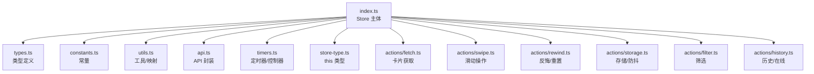
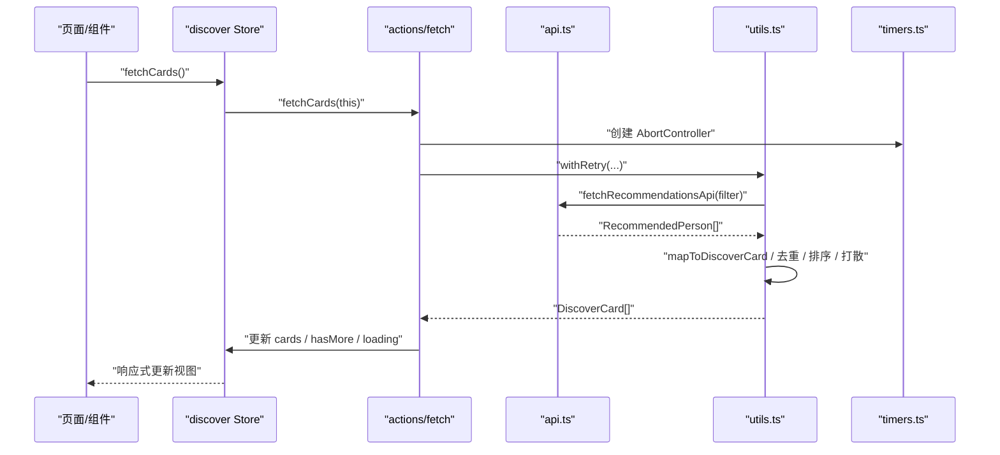
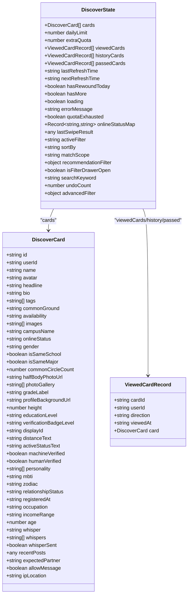
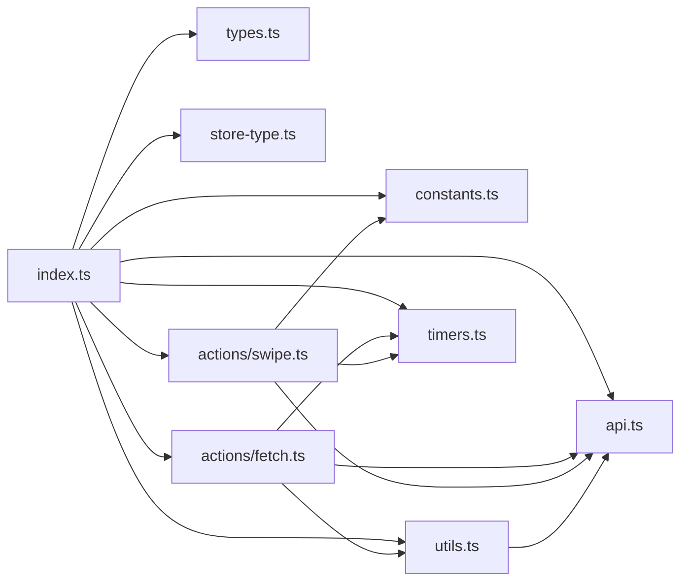
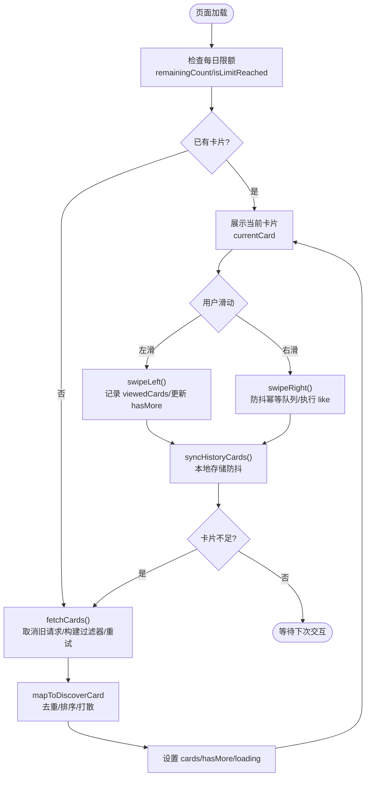
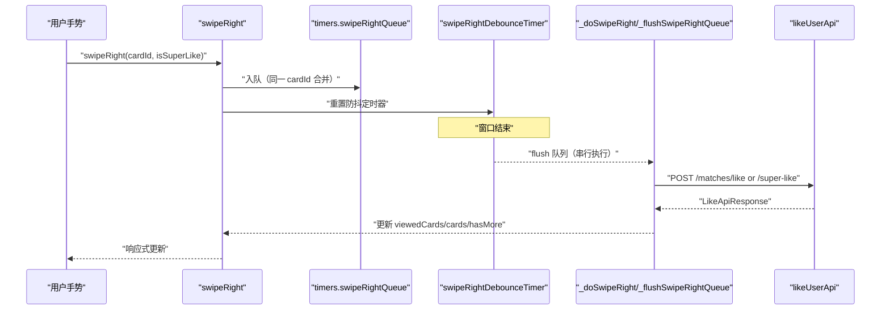

# 发现页状态 Store（discover）

<cite>
**本文引用的文件**
- [apps/client/src/stores/discover/index.ts](file://apps/client/src/stores/discover/index.ts)
- [apps/client/src/stores/discover/types.ts](file://apps/client/src/stores/discover/types.ts)
- [apps/client/src/stores/discover/constants.ts](file://apps/client/src/stores/discover/constants.ts)
- [apps/client/src/stores/discover/utils.ts](file://apps/client/src/stores/discover/utils.ts)
- [apps/client/src/stores/discover/api.ts](file://apps/client/src/stores/discover/api.ts)
- [apps/client/src/stores/discover/timers.ts](file://apps/client/src/stores/discover/timers.ts)
- [apps/client/src/stores/discover/store-type.ts](file://apps/client/src/stores/discover/store-type.ts)
- [apps/client/src/stores/discover/actions/fetch.ts](file://apps/client/src/stores/discover/actions/fetch.ts)
- [apps/client/src/stores/discover/actions/swipe.ts](file://apps/client/src/stores/discover/actions/swipe.ts)
</cite>

## 目录
1. [简介](#简介)
2. [项目结构](#项目结构)
3. [核心组件](#核心组件)
4. [架构总览](#架构总览)
5. [详细组件分析](#详细组件分析)
6. [依赖关系分析](#依赖关系分析)
7. [性能考量](#性能考量)
8. [故障排查指南](#故障排查指南)
9. [结论](#结论)
10. [附录](#附录)

## 简介
本文件为 Campus Love 前端应用的“发现页”状态管理模块的完整技术文档。该模块基于单一职责原则进行了模块化重构，将原单文件拆分为 types、constants、utils、api、timers、store-type 与 actions 子模块，分别承担类型定义、常量配置、数据映射/工具函数、API 封装、定时器与请求控制器、Store 实例类型以及按业务关注点划分的 Action 实现。

文档重点覆盖：
- 核心数据类型：DiscoverCard、DiscoverState、SwipeDirection 等
- 业务规则：每日滑动限制、防抖保存、右滑幂等队列、搜索防抖、配额耗尽标记
- 数据流：卡片获取、本地存储、在线状态查询、历史同步
- 类型安全：通过 store-type 显式声明 this 类型，避免拆分后的类型推断失效
- 错误处理：统一错误消息、i18n 回退、重试与取消竞态
- 可视化：状态流程图、时序图、类图与依赖图
- 优化建议与测试策略

## 项目结构
发现页 Store 采用“按职责分文件 + 按业务聚合 action”的组织方式：
- index.ts：Store 主体（state/getters/actions 装配），re-export 各子模块以兼容旧 import
- types.ts：实体与状态类型（DiscoverCard、ViewedCardRecord、DiscoverState、SortBy、MatchScope 等）
- constants.ts：常量（每日限额、防抖延迟、重试次数、Mock 匹配概率等）
- utils.ts：数据映射 mapToDiscoverCard、排序/过滤、本地记录读写、重试执行器 withRetry、useMock
- api.ts：后端 API 封装（passUserApi、likeUserApi、rewindCardApi、fetchRecommendationHistoryApi、fetchOnlineStatusApi）
- timers.ts：模块级定时器与请求控制器（保存防抖、搜索防抖、右滑防抖队列、AbortController）
- store-type.ts：DiscoverStoreThis 接口，供拆分 action 使用 this 类型
- actions/*：按业务拆分
  - fetch.ts：卡片获取、去重、排序、历史同步
  - swipe.ts：左滑/右滑（含幂等队列）、联动 likes store、游客模式分支
  - rewind.ts：反悔与结果重置
  - storage.ts：本地存储防抖与持久化
  - filter.ts：筛选条件设置与抽屉开关
  - history.ts：历史加载与在线状态、额外配额

**图表来源**
- [apps/client/src/stores/discover/index.ts:1-200](file://apps/client/src/stores/discover/index.ts#L1-L200)
- [apps/client/src/stores/discover/types.ts:1-200](file://apps/client/src/stores/discover/types.ts#L1-L200)
- [apps/client/src/stores/discover/constants.ts:1-179](file://apps/client/src/stores/discover/constants.ts#L1-L179)
- [apps/client/src/stores/discover/utils.ts:1-200](file://apps/client/src/stores/discover/utils.ts#L1-L200)
- [apps/client/src/stores/discover/api.ts:1-200](file://apps/client/src/stores/discover/api.ts#L1-L200)
- [apps/client/src/stores/discover/timers.ts:1-65](file://apps/client/src/stores/discover/timers.ts#L1-L65)
- [apps/client/src/stores/discover/store-type.ts:1-97](file://apps/client/src/stores/discover/store-type.ts#L1-L97)
- [apps/client/src/stores/discover/actions/fetch.ts:1-200](file://apps/client/src/stores/discover/actions/fetch.ts#L1-L200)
- [apps/client/src/stores/discover/actions/swipe.ts:1-200](file://apps/client/src/stores/discover/actions/swipe.ts#L1-L200)

**章节来源**
- [apps/client/src/stores/discover/index.ts:1-200](file://apps/client/src/stores/discover/index.ts#L1-L200)

## 核心组件
- DiscoverCard：推荐卡片前端视图对象，包含用户信息、图片、认证徽章、MBTI、星座、职业、收入区间、悄悄话、动态预览、IP 属地等扩展字段
- ViewedCardRecord：已查看卡片记录，含方向、时间戳与卡片快照（用于 rewind 恢复）
- DiscoverState：Store 状态，包括卡片列表、每日限额、额外配额、已查看/历史/拒绝卡片、刷新时间、是否还有更多、加载与错误、配额耗尽标记、在线状态映射、最近滑动结果、筛选状态与高级筛选、undo 计数等
- SwipeDirection：left | right
- SortBy：match | latest | active
- MatchScope：all | nearby | same_city | same_school

这些类型被 constants、utils、api、actions 共享，保证跨模块类型一致性。

**章节来源**
- [apps/client/src/stores/discover/types.ts:1-200](file://apps/client/src/stores/discover/types.ts#L1-L200)
- [apps/client/src/stores/discover/types.ts:201-350](file://apps/client/src/stores/discover/types.ts#L201-L350)

## 架构总览
发现页 Store 通过 Pinia defineStore 组织，state 初始化时从本地读取每日记录，getters 提供当前卡片、用量统计、倒计时、是否达到上限等；actions 由拆分文件提供，并通过 method shorthand 挂载到 store 实例。模块级 timers 维护防抖与请求控制，确保并发安全与资源清理。

**图表来源**
- [apps/client/src/stores/discover/index.ts:1-200](file://apps/client/src/stores/discover/index.ts#L1-L200)
- [apps/client/src/stores/discover/actions/fetch.ts:1-200](file://apps/client/src/stores/discover/actions/fetch.ts#L1-L200)
- [apps/client/src/stores/discover/api.ts:1-200](file://apps/client/src/stores/discover/api.ts#L1-L200)
- [apps/client/src/stores/discover/utils.ts:1-200](file://apps/client/src/stores/discover/utils.ts#L1-L200)
- [apps/client/src/stores/discover/timers.ts:1-65](file://apps/client/src/stores/discover/timers.ts#L1-L65)

## 详细组件分析

### Store 主体与装配（index.ts）
- state：初始化 dailyLimit、extraQuota、viewedCards、historyCards、passedCards、刷新时间、quotaExhausted、onlineStatusMap、lastSwipeResult、筛选状态、undoCount、advancedFilter 等
- getters：currentCard、usedCount、remainingCount、isLimitReached、likedUserIds、countdownSeconds、countdownText
- actions：通过 import 引入拆分 actions 并直接赋值方法名，Pinia 自动绑定 this，使拆分文件能访问 state/getters
- re-export：保持外部可从 "@/stores/discover" 导入 types/constants/utils/api

**章节来源**
- [apps/client/src/stores/discover/index.ts:1-200](file://apps/client/src/stores/discover/index.ts#L1-L200)

### 类型系统（types.ts）
- DiscoverCard：丰富字段覆盖 Phase D 新增展示需求（半身照、照片墙、年级标签、背景图、身高、学历、认证徽章、显示 ID、距离文案、活跃文案、机审/人审、性格、MBTI、星座、婚况、注册时间、职业、收入区间、年龄、悄悄话、动态预览、期待画像、私信权限、IP 属地）
- ViewedCardRecord：direction、viewedAt、可选 card 快照（用于 rewind）
- DiscoverState：全面的状态字段，含配额耗尽标记、在线状态映射、最近滑动结果、筛选与高级筛选、undo 计数
- SwipeDirection、SortBy、MatchScope：枚举型类型约束

**章节来源**
- [apps/client/src/stores/discover/types.ts:1-200](file://apps/client/src/stores/discover/types.ts#L1-L200)
- [apps/client/src/stores/discover/types.ts:201-350](file://apps/client/src/stores/discover/types.ts#L201-L350)

### 常量配置（constants.ts）
- EMPTY_RECOMMENDATION_FILTER：空筛选模板，Object.freeze 防止污染
- DAILY_LIMIT_TOTAL：每日限量总数
- STORAGE_KEY：本地存储键
- MAX_RETRIES / RETRY_DELAY_MS：重试参数
- SAVE_DEBOUNCE_MS / SEARCH_DEBOUNCE_MS / SWIPE_RIGHT_DEBOUNCE_MS：防抖延迟
- MAX_UNDO_COUNT_PER_SESSION：单次会话 rewind 最大次数
- SUPER_TEST_UNLIMITED_REMAINING：超级测试账号无限次数旁路
- MOCK_MATCH_PROBABILITY：Mock 模式下匹配概率，支持环境变量覆盖

**章节来源**
- [apps/client/src/stores/discover/constants.ts:1-179](file://apps/client/src/stores/discover/constants.ts#L1-L179)

### 工具函数（utils.ts）
- mapToDiscoverCard：后端 RecommendedPerson → 前端 DiscoverCard，透传扩展字段
- useMock：复用 stores/helpers/use-mock 判断 mock 模式
- filterNearby：附近筛选（≤20km，同校始终保留）
- sortNearbyFirst：附近卡片排序（同校优先，其次距离升序）
- sortCards：按 match/latest/active 排序，active 优先用 onlineStatus 回填
- spreadIdenticalNeighbors：相邻同形象打散（昵称+头像相同）
- withRetry：重试执行器（结合 AbortController 可取消）
- 日期/本地存储工具：getTodayString、getNextNoonString、loadDailyRecord/saveDailyRecord

**章节来源**
- [apps/client/src/stores/discover/utils.ts:1-200](file://apps/client/src/stores/discover/utils.ts#L1-L200)
- [apps/client/src/stores/discover/utils.ts:201-383](file://apps/client/src/stores/discover/utils.ts#L201-L383)

### API 封装（api.ts）
- fetchRecommendationsApi：统一通过 clientApi.getRecommendations 分发 mock/real
- passUserApi：左滑不感兴趣（query 传 passedUserId）
- likeUserApi：右滑喜欢/超级喜欢，返回 LikeApiResponse（matched/matchId/partnerName）
- rewindCardApi：反悔上一张，带 Idempotency-Key 头
- fetchRecommendationHistoryApi：获取推荐历史
- fetchOnlineStatusApi：批量查询在线状态（POST /users/online-status/batch）

**章节来源**
- [apps/client/src/stores/discover/api.ts:1-200](file://apps/client/src/stores/discover/api.ts#L1-L200)

### 定时器与请求控制器（timers.ts）
- saveTimer：存储防抖
- searchDebounceTimer：搜索防抖
- swipeRightDebounceTimer：右滑防抖窗口定时器
- swipeRightQueue：幂等队列项 PendingSwipeRightItem（cardId、isSuperLike、card 快照、resolvers/rejecters）
- fetchCardsController：当前 fetchCards 请求的 AbortController

设计要点：
- 定时器句柄不属于业务状态，避免响应式追踪与序列化污染
- 模块级变量保证全局唯一性，便于多文件共享与统一清理

**章节来源**
- [apps/client/src/stores/discover/timers.ts:1-65](file://apps/client/src/stores/discover/timers.ts#L1-L65)

### Store 实例类型（store-type.ts）
- DiscoverStoreThis：显式声明 this 类型，包含 state + getters + actions 全部成员
- 用途：拆分 action 文件中 this 类型推断失效时，提供强类型保障
- 别名：DiscoverStoreInstance 兼容未来 ReturnType 推断

**章节来源**
- [apps/client/src/stores/discover/store-type.ts:1-97](file://apps/client/src/stores/discover/store-type.ts#L1-L97)

### 卡片获取 Actions（actions/fetch.ts）
关键流程：
- 取消在途旧请求（AbortController）
- 首次无卡进入 loading，已有卡保持旧展示避免闪烁
- 组装 RecommendationFilter（keyword 优先 searchKeyword，excludeIds 去重已看）
- 调用 fetchRecommendationsApi，重试机制 withRetry
- mapToDiscoverCard → 去重（dedupByUserId）→ 附近过滤（matchScope）→ 同校加权 → 排序（sortBy）→ 相邻打散（spreadIdenticalNeighbors）
- 写入 cards/hasMore，处理 mock 兜底乱序
- 历史同步与在线状态回填（由其他 action 配合）

复杂度与优化：
- 去重 O(n)，排序 O(n log n)，打散近似线性
- AbortController 避免竞态与无效状态覆盖
- 首屏保持旧卡减少骨架屏闪烁

**章节来源**
- [apps/client/src/stores/discover/actions/fetch.ts:1-200](file://apps/client/src/stores/discover/actions/fetch.ts#L1-L200)

### 滑动操作 Actions（actions/swipe.ts）
- swipeLeft：参数校验、移除幂等队列中同卡片的待执行右滑、检查配额、游客模式本地放行、调用 passUserApi、记录 viewedCards、更新 cards/hasMore、同步历史、不足时自动补卡
- swipeRight：300ms 防抖窗口内幂等队列合并重复触发；不同卡片各自入队；窗口结束逐张 flush 串行执行；入队时快照卡片避免“卡片不存在”误报；调用 _doSwipeRight/_flushSwipeRightQueue
- _doSwipeRight/_flushSwipeRightQueue：实际执行 like/super-like 与状态更新
- 联动 likes store，处理匹配成功/失败反馈

错误处理：
- i18n 错误消息回退
- 配额耗尽、卡片不存在等明确提示
- 并发冲突（左滑取消待执行的右滑）

**章节来源**
- [apps/client/src/stores/discover/actions/swipe.ts:1-200](file://apps/client/src/stores/discover/actions/swipe.ts#L1-L200)

### 类型关系图

**图表来源**
- [apps/client/src/stores/discover/types.ts:1-200](file://apps/client/src/stores/discover/types.ts#L1-L200)
- [apps/client/src/stores/discover/types.ts:201-350](file://apps/client/src/stores/discover/types.ts#L201-L350)

## 依赖关系分析
- Store 主体依赖 types/constants/utils/api/timers/store-type
- actions/fetch 依赖 utils/mapToDiscoverCard、sortCards、filterNearby、spreadIdenticalNeighbors、withRetry、useMock；依赖 api/fetchRecommendationsApi；依赖 timers 的 AbortController
- actions/swipe 依赖 constants 防抖与 Mock 概率；依赖 api/passUserApi、likeUserApi；依赖 timers 的右滑队列；依赖 session/likes store
- utils 依赖 services/generated/api-types-supplement 的类型；依赖 config/env 的环境判断
- api 依赖 services/http.request 与 services/api.clientApi

**图表来源**
- [apps/client/src/stores/discover/index.ts:1-200](file://apps/client/src/stores/discover/index.ts#L1-L200)
- [apps/client/src/stores/discover/actions/fetch.ts:1-200](file://apps/client/src/stores/discover/actions/fetch.ts#L1-L200)
- [apps/client/src/stores/discover/actions/swipe.ts:1-200](file://apps/client/src/stores/discover/actions/swipe.ts#L1-L200)
- [apps/client/src/stores/discover/utils.ts:1-200](file://apps/client/src/stores/discover/utils.ts#L1-L200)
- [apps/client/src/stores/discover/api.ts:1-200](file://apps/client/src/stores/discover/api.ts#L1-L200)
- [apps/client/src/stores/discover/timers.ts:1-65](file://apps/client/src/stores/discover/timers.ts#L1-L65)

**章节来源**
- [apps/client/src/stores/discover/index.ts:1-200](file://apps/client/src/stores/discover/index.ts#L1-L200)

## 性能考量
- 首屏体验：已有卡片时不进入 loading，避免骨架屏卸载与图片重载链
- 去重与排序：dedupByUserId 与 sortCards 保证列表质量与性能
- 相邻打散：spreadIdenticalNeighbors 提升观感
- 并发控制：AbortController 取消在途请求，避免竞态覆盖
- 防抖优化：SAVE_DEBOUNCE_MS/SEARCH_DEBOUNCE_MS/SWIPE_RIGHT_DEBOUNCE_MS 降低 IO 与网络压力
- 幂等队列：右滑防抖窗口内合并重复触发，避免重复请求与状态错乱
- 配额与计时：remainingCount/isLimitReached/countdownSeconds/countdownText 提供准确限额与倒计时

[本节为通用性能讨论，无需特定文件引用]

## 故障排查指南
常见问题与定位思路：
- 卡片不存在错误：检查 swipeLeft/swipeRight 的参数校验与快照逻辑；确认是否在防抖队列中正确移除或执行
- 配额耗尽误判：核对 remainingCount 计算分支（session.isSuperTestAccount 旁路）、dailyLimit/extraQuota/viewedCards 一致性
- 推荐列表为空：检查 excludeIds 是否正确传入、mock 兜底乱序是否生效、matchScope 过滤是否过严
- 在线状态未回填：确认 fetchOnlineStatusApi 调用与 onlineStatusMap 更新逻辑
- 存储同步频繁：检查 debouncedSave 是否触发、saveTimer 是否被正确清理
- 请求竞态：确认 AbortController 是否正确 abort 并在回调中忽略 aborted 结果

**章节来源**
- [apps/client/src/stores/discover/actions/swipe.ts:1-200](file://apps/client/src/stores/discover/actions/swipe.ts#L1-L200)
- [apps/client/src/stores/discover/actions/fetch.ts:1-200](file://apps/client/src/stores/discover/actions/fetch.ts#L1-L200)
- [apps/client/src/stores/discover/constants.ts:1-179](file://apps/client/src/stores/discover/constants.ts#L1-L179)
- [apps/client/src/stores/discover/timers.ts:1-65](file://apps/client/src/stores/discover/timers.ts#L1-L65)

## 结论
发现页 Store 通过模块化拆分实现了清晰的职责边界与高内聚低耦合：types/constants/utils/api/timers/store-type 各司其职，actions 按业务聚合（fetch/swipe/rewind/storage/filter/history）。核心数据类型与业务规则（每日限额、防抖保存、右滑幂等队列、搜索防抖、配额耗尽标记）得到系统化实现；API 封装与数据映射工具提升了健壮性与可维护性；定时器与请求控制器保障了并发安全与资源清理。整体架构兼顾了性能优化与错误处理，适合大规模迭代与团队协作。

[本节为总结性内容，无需特定文件引用]

## 附录

### 发现页状态流程图

**图表来源**
- [apps/client/src/stores/discover/index.ts:1-200](file://apps/client/src/stores/discover/index.ts#L1-L200)
- [apps/client/src/stores/discover/actions/fetch.ts:1-200](file://apps/client/src/stores/discover/actions/fetch.ts#L1-L200)
- [apps/client/src/stores/discover/actions/swipe.ts:1-200](file://apps/client/src/stores/discover/actions/swipe.ts#L1-L200)

### 右滑幂等队列时序图

**图表来源**
- [apps/client/src/stores/discover/actions/swipe.ts:1-200](file://apps/client/src/stores/discover/actions/swipe.ts#L1-L200)
- [apps/client/src/stores/discover/timers.ts:1-65](file://apps/client/src/stores/discover/timers.ts#L1-L65)
- [apps/client/src/stores/discover/api.ts:1-200](file://apps/client/src/stores/discover/api.ts#L1-L200)

### 测试策略建议
- 单元测试
  - utils：mapToDiscoverCard、filterNearby、sortCards、spreadIdenticalNeighbors、withRetry、useMock
  - constants：MOCK_MATCH_PROBABILITY 环境变量解析分支
  - timers：防抖定时器启停、队列入队/出队行为
- 集成测试
  - fetchCards：AbortController 取消、重试、去重、排序、mock 兜底乱序
  - swipeLeft/swipeRight：参数校验、配额检查、游客模式、幂等队列、历史同步、自动补卡
  - api：passUserApi、likeUserApi、rewindCardApi、fetchOnlineStatusApi 的请求体/响应体映射
- 端到端测试
  - 发现页主流程：加载卡片 → 滑动 → 限额耗尽 → 历史回看 → 筛选/搜索
- 边界与异常
  - 卡片不存在、配额耗尽、网络错误、超时、abort 后回调忽略
  - 同批重复用户、相邻同形象、附近距离解析异常

[本节为测试策略建议，无需特定文件引用]