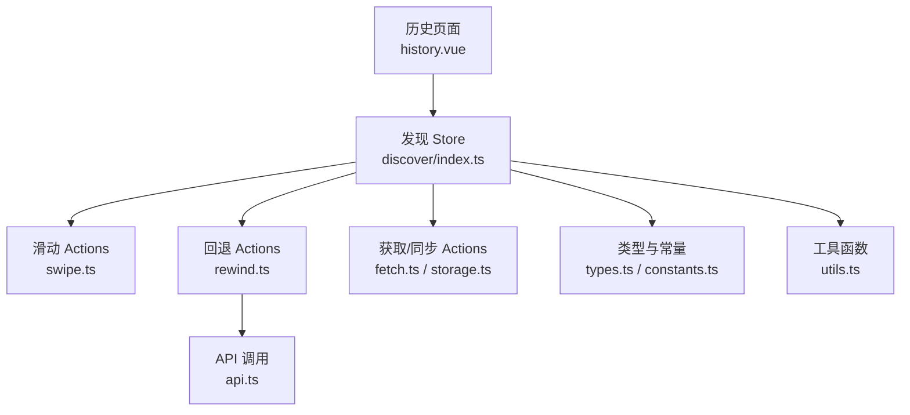
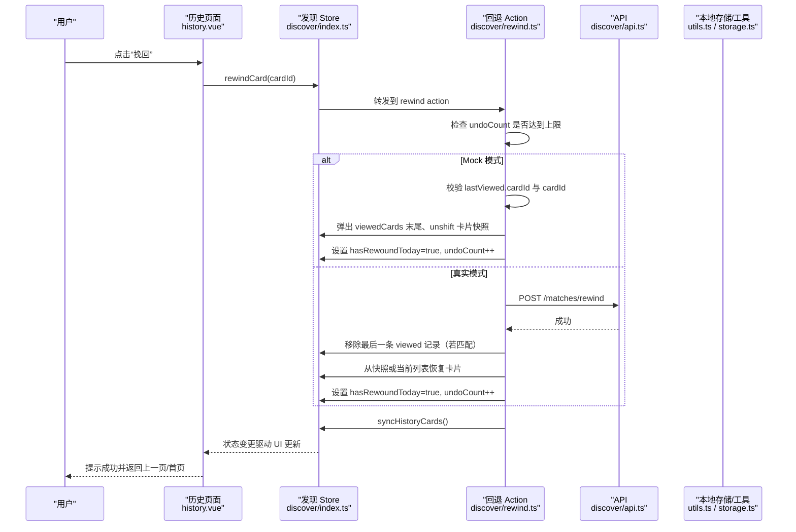
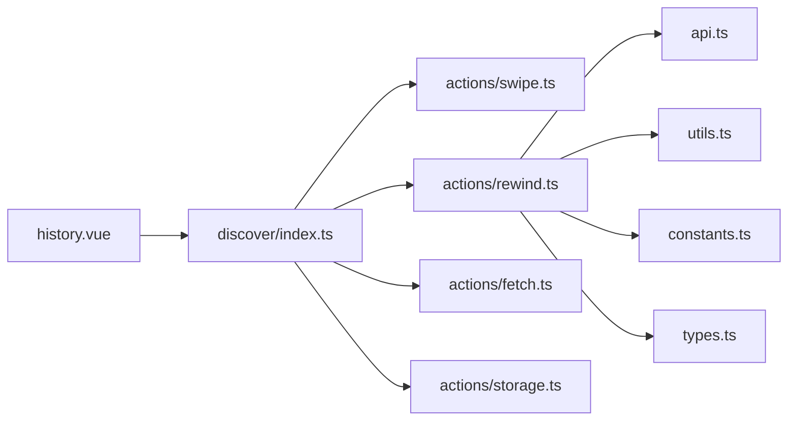
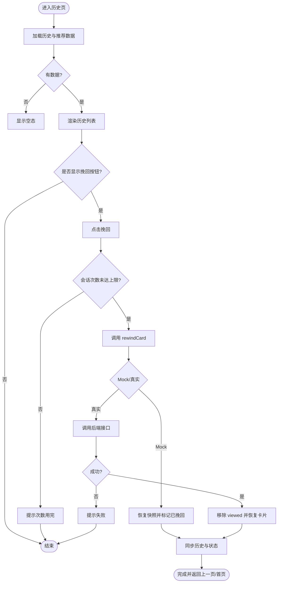

# 回退撤销动作（rewind actions）

<cite>
**本文引用的文件**
- [history.vue](file://apps/client/src/subpackages/discover-extra/discover/history.vue)
- [apps/client/src/stores/discover/index.ts](file://apps/client/src/stores/discover/index.ts)
- [apps/client/src/stores/discover/actions/rewind.ts](file://apps/client/src/stores/discover/actions/rewind.ts)
- [apps/client/src/stores/discover/constants.ts](file://apps/client/src/stores/discover/constants.ts)
- [apps/client/src/stores/discover/utils.ts](file://apps/client/src/stores/discover/utils.ts)
- [apps/client/src/stores/discover/api.ts](file://apps/client/src/stores/discover/api.ts)
- [apps/client/src/stores/discover/types.ts](file://apps/client/src/stores/discover/types.ts)
- [apps/client/src/stores/discover/actions/swipe.ts](file://apps/client/src/stores/discover/actions/swipe.ts)
- [apps/client/src/stores/discover/actions/fetch.ts](file://apps/client/src/stores/discover/actions/fetch.ts)
- [apps/client/src/stores/discover/actions/storage.ts](file://apps/client/src/stores/discover/actions/storage.ts)
</cite>

## 目录
1. [简介](#简介)
2. [项目结构](#项目结构)
3. [核心组件](#核心组件)
4. [架构总览](#架构总览)
5. [详细组件分析](#详细组件分析)
6. [依赖关系分析](#依赖关系分析)
7. [性能与一致性](#性能与一致性)
8. [故障排查指南](#故障排查指南)
9. [结论](#结论)
10. [附录：数据模型与交互流程](#附录数据模型与交互流程)

## 简介
本文件围绕“发现页回退撤销”功能，系统化梳理滑动历史记录、撤销操作与状态回滚的业务逻辑。重点说明：
- 历史记录的存储结构与更新时机
- 撤销操作的约束条件与边界处理
- 与滑动操作的协作关系和数据一致性保障
- 用户体验设计要点与代码级实现路径

该功能允许用户在发现页的“历史”中撤回最近一次拒绝操作，将对应卡片重新放回推荐队列顶部，并在当日限制仅可挽回一次。

## 项目结构
回退撤销能力横跨页面、Store、API 与本地持久化四个层次：
- 页面层：历史列表展示、挽回按钮触发、错误提示与返回兜底
- Store 层：状态管理、滑动记录、每日限流、会话内次数限制、同步与清理
- API 层：调用后端挽回接口
- 工具与常量：本地存储读写、重试策略、全局常量（如最大撤销次数）

**图示来源**
- [history.vue:1-200](file://apps/client/src/subpackages/discover-extra/discover/history.vue#L1-L200)
- [apps/client/src/stores/discover/index.ts:1-200](file://apps/client/src/stores/discover/index.ts#L1-L200)
- [apps/client/src/stores/discover/actions/rewind.ts:1-116](file://apps/client/src/stores/discover/actions/rewind.ts#L1-L116)
- [apps/client/src/stores/discover/actions/swipe.ts](file://apps/client/src/stores/discover/actions/swipe.ts)
- [apps/client/src/stores/discover/actions/fetch.ts](file://apps/client/src/stores/discover/actions/fetch.ts)
- [apps/client/src/stores/discover/actions/storage.ts](file://apps/client/src/stores/discover/actions/storage.ts)
- [apps/client/src/stores/discover/api.ts](file://apps/client/src/stores/discover/api.ts)
- [apps/client/src/stores/discover/types.ts](file://apps/client/src/stores/discover/types.ts)
- [apps/client/src/stores/discover/constants.ts](file://apps/client/src/stores/discover/constants.ts)
- [apps/client/src/stores/discover/utils.ts](file://apps/client/src/stores/discover/utils.ts)

**章节来源**
- [history.vue:1-200](file://apps/client/src/subpackages/discover-extra/discover/history.vue#L1-L200)
- [apps/client/src/stores/discover/index.ts:1-200](file://apps/client/src/stores/discover/index.ts#L1-L200)

## 核心组件
- 历史页面（history.vue）
  - 负责渲染今日已浏览卡片、统计信息、错误与空态
  - 提供“挽回”按钮，仅对最后一张被拒绝的卡片显示；请求中禁用防连点
  - 处理返回逻辑：栈深度为 1 时走 switchTab 回到寻觅页
- Store（discover/index.ts）
  - 维护 cards、viewedCards、historyCards、passedCards、hasRewoundToday、undoCount 等状态
  - 聚合各 Action（滑动、获取、回退、存储、筛选、历史与在线状态）
- 回退 Action（discover/rewind.ts）
  - 执行客户端次数限制（会话内最多 N 次）
  - Mock/真实模式分支：Mock 直接恢复快照；真实调用后端 rewind 接口并恢复视图
  - 更新 hasRewoundToday、undoCount，并同步历史与列表
- 工具与常量
  - 本地存储读写（日维度记录）、重试封装、日期门控等
  - 常量：每日上限、会话内最大撤销次数等

**章节来源**
- [history.vue:1-200](file://apps/client/src/subpackages/discover-extra/discover/history.vue#L1-L200)
- [apps/client/src/stores/discover/index.ts:1-200](file://apps/client/src/stores/discover/index.ts#L1-L200)
- [apps/client/src/stores/discover/actions/rewind.ts:1-116](file://apps/client/src/stores/discover/actions/rewind.ts#L1-L116)

## 架构总览
回退撤销的整体时序如下：用户点击“挽回”→ 页面校验 → Store 进行次数与业务规则检查 → 调用后端或执行 Mock 恢复 → 更新状态并刷新 UI。

**图示来源**
- [history.vue:1-200](file://apps/client/src/subpackages/discover-extra/discover/history.vue#L1-L200)
- [apps/client/src/stores/discover/actions/rewind.ts:1-116](file://apps/client/src/stores/discover/actions/rewind.ts#L1-L116)
- [apps/client/src/stores/discover/index.ts:1-200](file://apps/client/src/stores/discover/index.ts#L1-L200)
- [apps/client/src/stores/discover/api.ts](file://apps/client/src/stores/discover/api.ts)
- [apps/client/src/stores/discover/utils.ts](file://apps/client/src/stores/discover/utils.ts)
- [apps/client/src/stores/discover/actions/storage.ts](file://apps/client/src/stores/discover/actions/storage.ts)

## 详细组件分析

### 历史页面（history.vue）
- 数据绑定
  - 使用 computed 暴露 historyCards、passedCards、hasRewoundToday
  - getCardDetail 优先从当前 cards 查找，否则从 viewedCards 中的快照恢复，避免默认占位数据
- 交互逻辑
  - handleRewind 调用 discoverStore.rewindCard，成功后根据页面栈选择 navigateBack 或 switchTab
  - goBack 在栈深为 1 时 fallback 到首页 tab，避免裸返回异常
  - rewinding 状态防止连点并发触发后端限流
- 展示细节
  - 仅对 direction 为 left 且是 passedCards 最后一张的卡片显示挽回按钮
  - 已使用挽回时显示“已用完”提示
  - 错误与空态分别通过 SkeletonBlock、EmptyState 呈现

**章节来源**
- [history.vue:1-200](file://apps/client/src/subpackages/discover-extra/discover/history.vue#L1-L200)

### Store 主体（discover/index.ts）
- State
  - cards：待推荐卡片队列
  - viewedCards：已查看记录（含方向与完整快照）
  - historyCards：历史列表（用于页面展示）
  - passedCards：被拒绝的卡片序列
  - hasRewoundToday：当日是否已挽回
  - undoCount：会话内挽回次数计数
  - quotaExhausted：配额耗尽标记，配合前端文案
- Getters
  - currentCard、usedCount、remainingCount、isLimitReached、countdownSeconds/Text、likedUserIds 等
- Actions 装配
  - 聚合 fetch/swipe/rewind/storage/filter/history 等模块方法，统一对外暴露

**章节来源**
- [apps/client/src/stores/discover/index.ts:1-200](file://apps/client/src/stores/discover/index.ts#L1-L200)

### 回退 Action（discover/rewind.ts）
- 客户端限制
  - 会话内最多 N 次挽回（由常量控制），超出则抛出错误并设置 errorMessage
- Mock 模式
  - 校验 hasRewoundToday 与 lastViewed.cardId
  - 从 viewedCards 末尾弹出一条记录，将其 card 快照 unshift 至 cards 头部
  - 标记 hasRewoundToday=true，累加 undoCount，调用 syncHistoryCards
- 真实模式
  - 调用后端 rewind 接口
  - 若最后一条 viewed 记录 cardId 匹配则弹出
  - 优先用快照恢复，否则在当前 cards 查找；若找不到则重新拉取
  - 设置 hasRewoundToday=true，累加 undoCount，同步历史

**章节来源**
- [apps/client/src/stores/discover/actions/rewind.ts:1-116](file://apps/client/src/stores/discover/actions/rewind.ts#L1-L116)

### 滑动与历史同步（discover/swipe.ts / discover/fetch.ts）
- swipeLeft/swipeRight
  - 在滑动后记录 direction，写入 viewedCards，并更新 passedCards
  - 必要时刷新下一页或调整 hasMore
- fetch/syncHistoryCards
  - 拉取推荐与历史数据，确保历史页能正确渲染
  - 与 undoCount、hasRewoundToday 等状态保持同步

**章节来源**
- [apps/client/src/stores/discover/actions/swipe.ts](file://apps/client/src/stores/discover/actions/swipe.ts)
- [apps/client/src/stores/discover/actions/fetch.ts](file://apps/client/src/stores/discover/actions/fetch.ts)

### 本地存储与工具（discover/storage.ts / discover/utils.ts）
- debouncedSave/saveToStorage
  - 监听关键状态变更，将 viewedCards、hasRewoundToday 等持久化到本地
- loadDailyRecord/getNextNoonString
  - 读取/计算日维度记录与时间门控

**章节来源**
- [apps/client/src/stores/discover/actions/storage.ts](file://apps/client/src/stores/discover/actions/storage.ts)
- [apps/client/src/stores/discover/utils.ts](file://apps/client/src/stores/discover/utils.ts)

## 依赖关系分析
- 页面依赖 Store 提供的 computed 与 actions
- Store 内部按关注点拆分：swipe/rewind/fetch/storage/filter/history
- rewind 依赖 api、utils、constants 与 types
- 滑动与回退共享 viewedCards 作为“快照源”，保证历史页展示的准确性

**图示来源**
- [history.vue:1-200](file://apps/client/src/subpackages/discover-extra/discover/history.vue#L1-L200)
- [apps/client/src/stores/discover/index.ts:1-200](file://apps/client/src/stores/discover/index.ts#L1-L200)
- [apps/client/src/stores/discover/actions/rewind.ts:1-116](file://apps/client/src/stores/discover/actions/rewind.ts#L1-L116)
- [apps/client/src/stores/discover/actions/swipe.ts](file://apps/client/src/stores/discover/actions/swipe.ts)
- [apps/client/src/stores/discover/actions/fetch.ts](file://apps/client/src/stores/discover/actions/fetch.ts)
- [apps/client/src/stores/discover/actions/storage.ts](file://apps/client/src/stores/discover/actions/storage.ts)
- [apps/client/src/stores/discover/api.ts](file://apps/client/src/stores/discover/api.ts)
- [apps/client/src/stores/discover/utils.ts](file://apps/client/src/stores/discover/utils.ts)
- [apps/client/src/stores/discover/constants.ts](file://apps/client/src/stores/discover/constants.ts)
- [apps/client/src/stores/discover/types.ts](file://apps/client/src/stores/discover/types.ts)

## 性能与一致性
- 防连点与限流
  - 页面层 rewinding 状态阻止重复触发
  - Store 层 undoCount 限制会话内挽回次数，降低后端压力
- 快照优先
  - 历史页优先使用 viewedCards 中的完整快照，减少二次请求与数据不一致
- 幂等性
  - 回退前校验 lastViewed.cardId，避免误恢复
  - 真实模式下先弹 viewed 记录再恢复卡片，避免重复入队
- 资源清理
  - 页面卸载时 dispose，释放定时器与请求资源

[本节为通用性能建议，不直接分析具体代码行]

## 故障排查指南
- 挽回按钮未显示
  - 检查是否为左侧拒绝的最后一张卡片
  - 确认 hasRewoundToday 是否已被置为 true
  - 验证 passedCards 长度与顺序是否正确
- 挽回失败
  - 检查 undoCount 是否已达上限
  - 网络错误时查看错误分类提示
  - 真实模式下确认后端接口响应
- 历史页数据为空或异常
  - 确认 fetchCards/syncHistoryCards 是否正常执行
  - 检查 viewedCards 快照是否完整
  - 页面栈深度为 1 时使用 switchTab 返回，避免裸返回异常

**章节来源**
- [history.vue:1-200](file://apps/client/src/subpackages/discover-extra/discover/history.vue#L1-L200)
- [apps/client/src/stores/discover/actions/rewind.ts:1-116](file://apps/client/src/stores/discover/actions/rewind.ts#L1-L116)

## 结论
回退撤销功能通过“滑动记录 + 快照 + 会话次数限制”的组合，实现了安全、可控的挽回体验。页面层聚焦交互与反馈，Store 层负责状态与规则，API 层提供后端能力，工具与常量保障一致性与可维护性。建议在后续迭代中继续强化：
- 更细粒度的错误分类与国际化文案
- 更完善的日志埋点以定位边界情况
- 对旧版本数据兼容性的持续优化

[本节为总结性内容，无需引用具体代码行]

## 附录：数据模型与交互流程

### 数据结构要点
- viewedCards：每条记录包含 cardId、direction、以及完整的 card 快照（昵称、头像、简介等）
- historyCards：用于历史页渲染的只读列表
- passedCards：被拒绝的卡片序列，用于判断“最后一张可挽回”
- hasRewoundToday：当日是否已挽回
- undoCount：会话内挽回次数计数器
- cards：推荐队列，首元素为当前展示卡片

这些字段由 Store 统一管理，并通过 watch 与 debouncedSave 持久化。

**章节来源**
- [apps/client/src/stores/discover/index.ts:1-200](file://apps/client/src/stores/discover/index.ts#L1-L200)
- [apps/client/src/stores/discover/actions/rewind.ts:1-116](file://apps/client/src/stores/discover/actions/rewind.ts#L1-L116)

### 交互流程图（算法视角）

**图示来源**
- [history.vue:1-200](file://apps/client/src/subpackages/discover-extra/discover/history.vue#L1-L200)
- [apps/client/src/stores/discover/actions/rewind.ts:1-116](file://apps/client/src/stores/discover/actions/rewind.ts#L1-L116)
- [apps/client/src/stores/discover/index.ts:1-200](file://apps/client/src/stores/discover/index.ts#L1-L200)