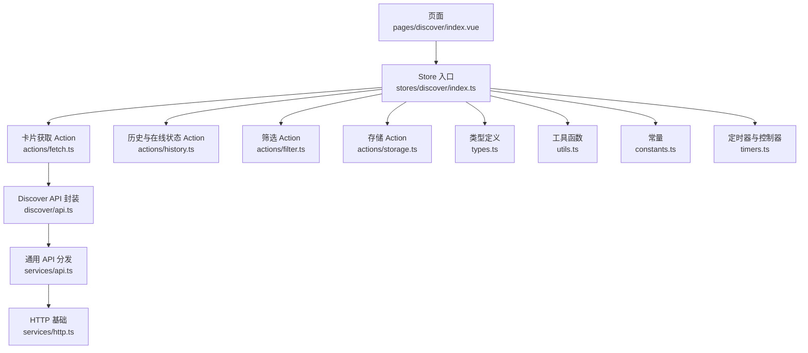
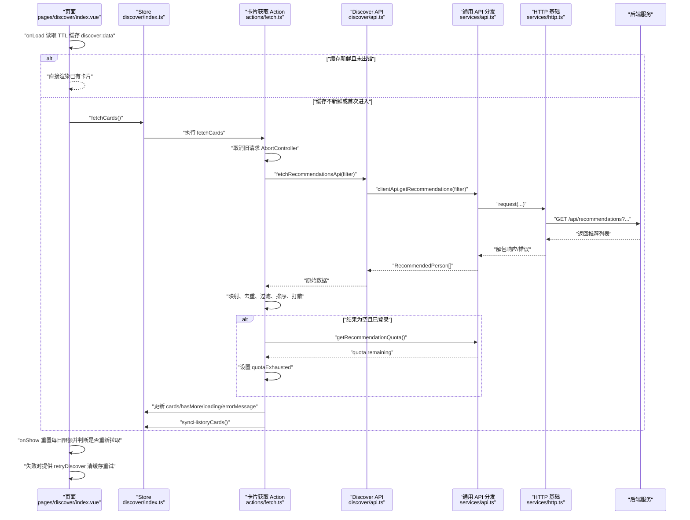
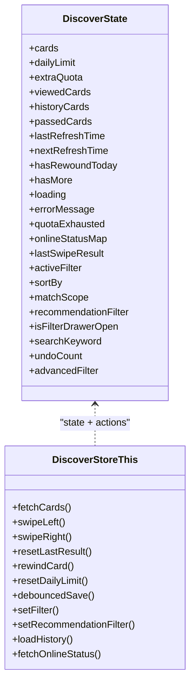
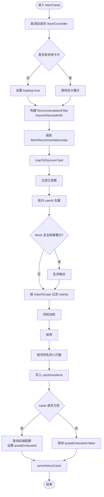
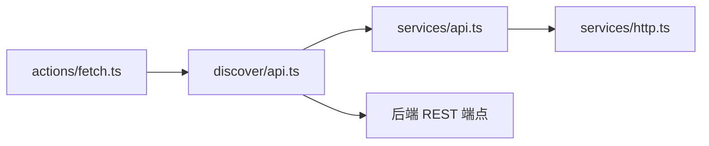
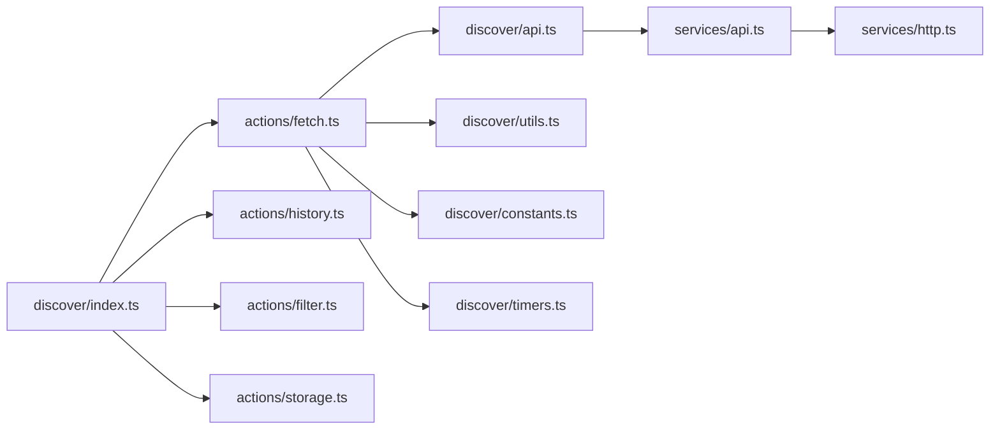

# 数据获取动作（fetch actions）

<cite>
**本文引用的文件**   
- [apps/client/src/stores/discover/index.ts](file://apps/client/src/stores/discover/index.ts)
- [apps/client/src/stores/discover/actions/fetch.ts](file://apps/client/src/stores/discover/actions/fetch.ts)
- [apps/client/src/stores/discover/types.ts](file://apps/client/src/stores/discover/types.ts)
- [apps/client/src/stores/discover/utils.ts](file://apps/client/src/stores/discover/utils.ts)
- [apps/client/src/stores/discover/constants.ts](file://apps/client/src/stores/discover/constants.ts)
- [apps/client/src/stores/discover/api.ts](file://apps/client/src/stores/discover/api.ts)
- [apps/client/src/stores/discover/timers.ts](file://apps/client/src/stores/discover/timers.ts)
- [apps/client/src/stores/discover/actions/history.ts](file://apps/client/src/stores/discover/actions/history.ts)
- [apps/client/src/stores/discover/actions/filter.ts](file://apps/client/src/stores/discover/actions/filter.ts)
- [apps/client/src/stores/discover/actions/storage.ts](file://apps/client/src/stores/discover/actions/storage.ts)
- [apps/client/src/services/http.ts](file://apps/client/src/services/http.ts)
- [apps/client/src/services/api.ts](file://apps/client/src/services/api.ts)
- [apps/client/src/pages/discover/index.vue](file://apps/client/src/pages/discover/index.vue)
</cite>

## 目录
1. [简介](#简介)
2. [项目结构](#项目结构)
3. [核心组件](#核心组件)
4. [架构总览](#架构总览)
5. [详细组件分析](#详细组件分析)
6. [依赖关系分析](#依赖关系分析)
7. [性能与缓存策略](#性能与缓存策略)
8. [错误处理与降级方案](#错误处理与降级方案)
9. [监控指标与排障指南](#监控指标与排障指南)
10. [结论](#结论)

## 简介
本文件围绕“发现页”的用户卡片数据获取能力，系统性文档化以下内容：
- 用户卡片异步加载、分页与去重
- API 调用封装、重试机制、请求取消
- 本地缓存、预加载与懒加载
- 数据排序、过滤、在线状态回填等后处理
- 错误处理、配额耗尽识别与降级展示
- 可观测性指标与常见问题排查

该功能的核心由 Pinia store `discover` 驱动，页面 `pages/discover/index.vue` 负责触发、展示与交互；API 层通过 `services/api.ts` 统一分发 mock/real 模式，底层 HTTP 由 `services/http.ts` 提供。

## 项目结构
发现页数据获取链路主要涉及以下模块：
- Store 入口：`stores/discover/index.ts`
- 卡片获取 Action：`stores/discover/actions/fetch.ts`
- 类型定义：`stores/discover/types.ts`
- 工具函数：`stores/discover/utils.ts`
- 常量配置：`stores/discover/constants.ts`
- 领域 API 封装：`stores/discover/api.ts`
- 定时器与控制器：`stores/discover/timers.ts`
- 历史与在线状态：`stores/discover/actions/history.ts`
- 筛选 Action：`stores/discover/actions/filter.ts`
- 存储与防抖：`stores/discover/actions/storage.ts`
- HTTP 基础：`services/http.ts`
- 通用 API 分发：`services/api.ts`
- 页面入口：`pages/discover/index.vue`

**图示来源**
- [apps/client/src/stores/discover/index.ts:1-200](file://apps/client/src/stores/discover/index.ts#L1-L200)
- [apps/client/src/stores/discover/actions/fetch.ts:1-200](file://apps/client/src/stores/discover/actions/fetch.ts#L1-L200)
- [apps/client/src/stores/discover/api.ts:1-200](file://apps/client/src/stores/discover/api.ts#L1-L200)
- [apps/client/src/services/api.ts:1-200](file://apps/client/src/services/api.ts#L1-L200)
- [apps/client/src/services/http.ts:1-200](file://apps/client/src/services/http.ts#L1-L200)

**章节来源**
- [apps/client/src/stores/discover/index.ts:1-200](file://apps/client/src/stores/discover/index.ts#L1-L200)
- [apps/client/src/stores/discover/actions/fetch.ts:1-200](file://apps/client/src/stores/discover/actions/fetch.ts#L1-L200)
- [apps/client/src/stores/discover/api.ts:1-200](file://apps/client/src/stores/discover/api.ts#L1-L200)
- [apps/client/src/services/api.ts:1-200](file://apps/client/src/services/api.ts#L1-L200)
- [apps/client/src/services/http.ts:1-200](file://apps/client/src/services/http.ts#L1-L200)
- [apps/client/src/pages/discover/index.vue:1-260](file://apps/client/src/pages/discover/index.vue#L1-L260)

## 核心组件
- Store 主体：管理卡片列表、每日限量、已查看记录、历史与在线状态、错误信息、配额耗尽标记、排序和匹配范围等状态，并提供 getters 计算剩余次数、倒计时、是否达到上限等。
- 卡片获取 Action：负责构建推荐筛选、调用后端接口、批内去重、附近过滤、同校加权、排序、相邻打散、写入 cards 与 hasMore，并在空结果时查询后端配额区分“暂无推荐”和“今日次数已用完”。
- API 封装：将推荐列表、滑动、反悔、历史、在线状态等 API 集中封装；推荐列表通过 clientApi 统一走 mock/real。
- HTTP 基础：统一路径归一化、拦截器、错误分类、Token 管理、超时与 Sentry 集成。
- 页面：在 onLoad/onShow 中根据 TTL 缓存决定是否拉取，失败时允许重试，登录态变化时自动刷新。

**章节来源**
- [apps/client/src/stores/discover/index.ts:1-294](file://apps/client/src/stores/discover/index.ts#L1-L294)
- [apps/client/src/stores/discover/actions/fetch.ts:1-252](file://apps/client/src/stores/discover/actions/fetch.ts#L1-L252)
- [apps/client/src/stores/discover/api.ts:1-211](file://apps/client/src/stores/discover/api.ts#L1-L211)
- [apps/client/src/services/http.ts:1-200](file://apps/client/src/services/http.ts#L1-L200)
- [apps/client/src/pages/discover/index.vue:1-260](file://apps/client/src/pages/discover/index.vue#L1-L260)

## 架构总览
下图展示了从页面到后端的数据获取时序，包括缓存短路、TTL、重试、AbortController、配额检查、历史同步与错误处理。

**图示来源**
- [apps/client/src/pages/discover/index.vue:150-260](file://apps/client/src/pages/discover/index.vue#L150-L260)
- [apps/client/src/stores/discover/actions/fetch.ts:60-252](file://apps/client/src/stores/discover/actions/fetch.ts#L60-L252)
- [apps/client/src/stores/discover/api.ts:80-120](file://apps/client/src/stores/discover/api.ts#L80-L120)
- [apps/client/src/services/api.ts:1-200](file://apps/client/src/services/api.ts#L1-L200)
- [apps/client/src/services/http.ts:1-200](file://apps/client/src/services/http.ts#L1-L200)

## 详细组件分析

### Store 主体与状态装配
- Store 暴露 `cards`、`viewedCards`、`historyCards`、`passedCards`、`loading`、`errorMessage`、`quotaExhausted`、`onlineStatusMap`、`sortBy`、`matchScope`、`recommendationFilter`、`advancedFilter`、`isFilterDrawerOpen`、`searchKeyword` 等状态。
- Getters 提供 `currentCard`、`usedCount`、`remainingCount`、`isLimitReached`、`countdownSeconds`、`countdownText` 等派生值。
- Actions 按职责拆分到 `actions/fetch.ts`、`actions/swipe.ts`、`actions/rewind.ts`、`actions/storage.ts`、`actions/filter.ts`、`actions/history.ts`，本文件仅做装配与 re-export。
- Store 启动后通过 `watch` 监听 `viewedCards`、`hasRewoundToday`、`lastRefreshTime`，触发 `debouncedSave()`，实现“状态变更 → 防抖存储”的解耦。

**图示来源**
- [apps/client/src/stores/discover/index.ts:1-200](file://apps/client/src/stores/discover/index.ts#L1-L200)
- [apps/client/src/stores/discover/types.ts:1-200](file://apps/client/src/stores/discover/types.ts#L1-L200)

**章节来源**
- [apps/client/src/stores/discover/index.ts:1-294](file://apps/client/src/stores/discover/index.ts#L1-L294)
- [apps/client/src/stores/discover/types.ts:1-200](file://apps/client/src/stores/discover/types.ts#L1-L200)

### 卡片获取 Action：fetchCards
职责：
- 取消旧请求，避免竞态覆盖。
- 首次无卡才显示 loading，已有卡片静默替换，减少骨架屏闪烁与图片重载。
- 构建 `RecommendationFilter`，包含搜索关键字、排除已看用户 ID（最多 200）。
- 调用 `fetchRecommendationsApi`，走 clientApi 分发 mock/real。
- 对原始数据进行：
  - 映射为前端 `DiscoverCard`
  - 过滤已查看卡片
  - 批内 userId 去重
  - Mock 模式下全部被看过则乱序输出打破相邻重复
  - 按匹配范围过滤（nearby ≤20km）
  - 同校加权
  - 排序（匹配度/最新注册/最活跃）
  - 相邻同名同人打散
- 写回 `cards`、`hasMore`，空结果时查询后端配额区分“暂无推荐”与“今日次数已用完”。
- 同步历史与拒绝记录。
- 使用 `withRetry` 重试，最多 2 次，延迟 1 秒；若被 abort 则跳过后续逻辑。
- finally 中仅当当前 controller 仍是全局 controller 时才关闭 loading 并清空控制器。

**图示来源**
- [apps/client/src/stores/discover/actions/fetch.ts:60-252](file://apps/client/src/stores/discover/actions/fetch.ts#L60-L252)

**章节来源**
- [apps/client/src/stores/discover/actions/fetch.ts:1-252](file://apps/client/src/stores/discover/actions/fetch.ts#L1-L252)

### API 调用封装
- `fetchRecommendationsApi`：统一通过 `clientApi.getRecommendations`，由 `services/api.ts` 根据 `appEnv.apiMode` 选择 mock/real。
- `passUserApi`、`likeUserApi`、`rewindCardApi`：分别对应左滑、右滑/超级喜欢、反悔。
- `fetchRecommendationHistoryApi`：获取历史推荐。
- `fetchOnlineStatusApi`：批量查询在线状态，转换为客户端视图供 store 回填 `onlineStatusMap` 与卡片字段。

**图示来源**
- [apps/client/src/stores/discover/actions/fetch.ts:1-60](file://apps/client/src/stores/discover/actions/fetch.ts#L1-L60)
- [apps/client/src/stores/discover/api.ts:1-211](file://apps/client/src/stores/discover/api.ts#L1-L211)
- [apps/client/src/services/api.ts:1-200](file://apps/client/src/services/api.ts#L1-L200)
- [apps/client/src/services/http.ts:1-200](file://apps/client/src/services/http.ts#L1-L200)

**章节来源**
- [apps/client/src/stores/discover/api.ts:1-211](file://apps/client/src/stores/discover/api.ts#L1-L211)
- [apps/client/src/services/api.ts:1-200](file://apps/client/src/services/api.ts#L1-L200)

### 历史与在线状态
- `loadHistory`：mock 下用本地记录；real 下调用 `/recommendations/history`，并将历史映射为 `ViewedCardRecord`，方向固定为 right。
- `fetchOnlineStatus`：收集当前卡片 userIds，批量查询在线状态，构建映射表并回填卡片 `onlineStatus`。
- `setExtraQuota`：签到额外配额设置。

**章节来源**
- [apps/client/src/stores/discover/actions/history.ts:1-109](file://apps/client/src/stores/discover/actions/history.ts#L1-L109)

### 筛选与排序
- `setFilter`、`setNearbyScope`、`setDiscoverMode`、`setSortBy`、`setMatchScope`、`applyQuickFilter`、`setRecommendationFilter`、`resetFilter`、`setAdvancedFilter`、`resetAdvancedFilter` 均会更新 store 状态并触发 `fetchCards`。
- 工具函数提供：
  - `filterNearby`：≤20km 过滤，同校保留
  - `sortNearbyFirst`：同校优先，再按距离升序
  - `sortCards`：匹配度/最新注册/最活跃
  - `spreadIdenticalNeighbors`：相邻同名同人打散

**章节来源**
- [apps/client/src/stores/discover/actions/filter.ts:1-200](file://apps/client/src/stores/discover/actions/filter.ts#L1-L200)
- [apps/client/src/stores/discover/utils.ts:1-200](file://apps/client/src/stores/discover/utils.ts#L1-L200)

### 存储与生命周期
- `resetDailyLimit`：跨天重置 viewedCards/historyCards/passedCards/hasRewoundToday 等，并更新 lastRefreshTime 与 nextRefreshTime。
- `debouncedSave`：300ms 防抖合并多次状态变更。
- `saveToStorage`：限制 viewedCards 最大 200 条，避免存储膨胀。
- `dispose`：清理所有定时器、幂等队列、AbortController，并在销毁前强制 flush 一次存储。

**章节来源**
- [apps/client/src/stores/discover/actions/storage.ts:1-170](file://apps/client/src/stores/discover/actions/storage.ts#L1-L170)
- [apps/client/src/stores/discover/timers.ts:1-65](file://apps/client/src/stores/discover/timers.ts#L1-L65)

## 依赖关系分析
- `discover/index.ts` 聚合各 action 文件，并通过 `useDiscoverStore` 包装注入 watch。
- `discover/actions/fetch.ts` 依赖：
  - `discover/api.ts`：API 调用
  - `discover/utils.ts`：mapToDiscoverCard、withRetry、useMock、filterNearby、sortCards、spreadIdenticalNeighbors
  - `discover/constants.ts`：MAX_RETRIES、RETRY_DELAY_MS
  - `discover/timers.ts`：AbortController
  - `discover/types.ts`：DiscoverCard
  - `../../session`：当前用户 campusName、会话信息
- `discover/api.ts` 依赖 `services/api.ts` 与 `services/http.ts`。
- `services/api.ts` 负责 buildRecommendationsQuery、上传、鉴权错误判断等。
- `services/http.ts` 提供 request、normalizeApiPath、错误分类、Token、拦截器、Sentry 集成。

**图示来源**
- [apps/client/src/stores/discover/index.ts:1-200](file://apps/client/src/stores/discover/index.ts#L1-L200)
- [apps/client/src/stores/discover/actions/fetch.ts:1-60](file://apps/client/src/stores/discover/actions/fetch.ts#L1-L60)
- [apps/client/src/stores/discover/api.ts:1-80](file://apps/client/src/stores/discover/api.ts#L1-L80)
- [apps/client/src/services/api.ts:1-200](file://apps/client/src/services/api.ts#L1-L200)
- [apps/client/src/services/http.ts:1-200](file://apps/client/src/services/http.ts#L1-L200)

**章节来源**
- [apps/client/src/stores/discover/index.ts:1-200](file://apps/client/src/stores/discover/index.ts#L1-L200)
- [apps/client/src/stores/discover/actions/fetch.ts:1-60](file://apps/client/src/stores/discover/actions/fetch.ts#L1-L60)
- [apps/client/src/stores/discover/api.ts:1-80](file://apps/client/src/stores/discover/api.ts#L1-L80)
- [apps/client/src/services/api.ts:1-200](file://apps/client/src/services/api.ts#L1-L200)
- [apps/client/src/services/http.ts:1-200](file://apps/client/src/services/http.ts#L1-L200)

## 性能与缓存策略

### 预加载与懒加载
- 页面在 `onLoad` 时尝试读取 TTL 缓存 `discover:data`，若新鲜则不发起网络请求；若不新鲜则调用 `fetchCards`。
- 成功写入缓存后才标记新鲜；失败不会短路成“暂无推荐”。
- `onShow` 时先 `resetDailyLimit`，若缓存不新鲜则清除上一会话错误横幅并重新拉取。
- 切换“推荐/附近”分段时，使用 `setDiscoverMode` 统一更新 activeFilter、matchScope、recommendationFilter.distanceMax，只触发一次 `fetchCards`。
- “附近”模式在页面层复用推荐卡片样式，先本地过滤 ≤20km，再按同校→距离升序排序，无需额外网络请求即可即时切换。

**章节来源**
- [apps/client/src/pages/discover/index.vue:1-260](file://apps/client/src/pages/discover/index.vue#L1-L260)
- [apps/client/src/stores/discover/actions/filter.ts:1-120](file://apps/client/src/stores/discover/actions/filter.ts#L1-L120)
- [apps/client/src/stores/discover/utils.ts:120-200](file://apps/client/src/stores/discover/utils.ts#L120-L200)

### 分页与去重
- 后端推荐批次由服务端控制；前端通过 `hasMore` 表达是否还有更多。
- 前端对同一批结果进行 userId 去重，避免上下相邻出现同一人。
- Mock 模式下若一批全部被看过，则乱序输出以打破相邻重复观感。

**章节来源**
- [apps/client/src/stores/discover/actions/fetch.ts:1-120](file://apps/client/src/stores/discover/actions/fetch.ts#L1-L120)

### 缓存策略
- TTL 缓存键 `discover:data`，默认有效期 30 秒，用于减少频繁刷新。
- 本地存储 `discover_daily_record` 保存每日 viewedCards、hasRewoundToday、lastRefreshTime，采用 300ms 防抖合并写入，viewedCards 最大保留 200 条。
- Token 变更时清理媒体 URL 缓存与 TTL 缓存，防止跨账号数据泄漏。

**章节来源**
- [apps/client/src/stores/discover/constants.ts:1-80](file://apps/client/src/stores/discover/constants.ts#L1-L80)
- [apps/client/src/stores/discover/actions/storage.ts:60-170](file://apps/client/src/stores/discover/actions/storage.ts#L60-L170)
- [apps/client/src/services/http.ts:120-200](file://apps/client/src/services/http.ts#L120-L200)

### 预取与优化
- 已有卡片时不进入 loading，避免骨架屏卸载与图片重载链。
- 同校加权优先展示同校用户。
- 相邻同名同人打散提升用户体验。
- 在线状态批量查询并回填，避免逐张查询。

**章节来源**
- [apps/client/src/stores/discover/actions/fetch.ts:120-200](file://apps/client/src/stores/discover/actions/fetch.ts#L120-L200)
- [apps/client/src/stores/discover/actions/history.ts:60-109](file://apps/client/src/stores/discover/actions/history.ts#L60-L109)

## 错误处理与降级方案

### 重试机制
- `withRetry` 包装推荐请求，最多重试 2 次，每次延迟 1 秒。
- 每次重试前检查 AbortController 是否已取消，避免无效请求。
- 最终异常落入 catch，仅在未被 abort 时设置 `errorMessage`。

**章节来源**
- [apps/client/src/stores/discover/actions/fetch.ts:60-252](file://apps/client/src/stores/discover/actions/fetch.ts#L60-L252)
- [apps/client/src/stores/discover/constants.ts:60-80](file://apps/client/src/stores/discover/constants.ts#L60-L80)

### 请求取消与竞态防护
- 每次 `fetchCards` 创建新 AbortController，替换全局 `timers.fetchCardsController`。
- 在 map、过滤、排序、写入状态前后多次检查 `controller.signal.aborted`，确保旧请求不会覆盖新请求。
- finally 中仅当前 controller 仍为全局 controller 时才关闭 loading 并清空控制器。

**章节来源**
- [apps/client/src/stores/discover/actions/fetch.ts:60-120](file://apps/client/src/stores/discover/actions/fetch.ts#L60-L120)
- [apps/client/src/stores/discover/timers.ts:1-65](file://apps/client/src/stores/discover/timers.ts#L1-L65)

### 数据降级
- 空结果且已登录时查询后端配额，若 `remaining <= 0` 则设置 `quotaExhausted=true`，页面展示“今日次数已用完”，而非误导性的“暂无推荐+刷新”。
- 游客不查询配额，直接按“暂无推荐”展示。
- Mock 模式下全部被看过则乱序输出，避免相邻重复。
- 在线状态查询失败不影响主流程，store 捕获错误并设置 errorMessage。

**章节来源**
- [apps/client/src/stores/discover/actions/fetch.ts:200-252](file://apps/client/src/stores/discover/actions/fetch.ts#L200-L252)
- [apps/client/src/stores/discover/actions/history.ts:1-109](file://apps/client/src/stores/discover/actions/history.ts#L1-L109)
- [apps/client/src/pages/discover/index.vue:100-200](file://apps/client/src/pages/discover/index.vue#L100-L200)

### HTTP 层错误分类与 Token 管理
- `EnhancedApiError` 增加 category：network/auth/business。
- 401/403 归类为 auth，0 归类为 network，其他为 business。
- Token 写入时清理媒体 token 缓存与 TTL 缓存，登出时清除所有 Token。
- 路径统一补齐 `/v1` 前缀，避免 real/showcase 模式 404。

**章节来源**
- [apps/client/src/services/http.ts:1-200](file://apps/client/src/services/http.ts#L1-L200)

## 监控指标与排障指南

### 关键指标建议
- 请求成功率与失败率（按 category 分类：network/auth/business）
- 平均请求耗时与 P95/P99 耗时
- 重试次数分布
- 配额耗尽比例（quotaExhausted 为 true 的比例）
- 空结果比例及其中配额耗尽占比
- 本地缓存命中率（discover:data TTL）
- 存储写入失败率
- AbortController 取消次数（竞态防护有效性）

### 常见排障步骤
- 页面显示“加载失败”：
  - 检查 `errorMessage` 是否被设置；确认是否因 abort 导致不更新错误。
  - 检查网络层错误分类是否为 network。
- 反复刷新仍为空：
  - 检查后端配额是否耗尽；确认 `quotaExhausted` 是否正确设置。
  - 检查是否游客模式未查询配额。
- 相邻用户重复：
  - 检查批内 userId 去重与相邻打散逻辑是否生效。
- 滑动后卡片顺序错乱：
  - 检查是否并发右滑导致状态不一致；确认防抖与幂等队列是否工作。
- 页面销毁后仍有状态更新：
  - 检查是否在 onUnload 调用 `dispose()`，清理定时器与控制器。

**章节来源**
- [apps/client/src/stores/discover/actions/fetch.ts:60-252](file://apps/client/src/stores/discover/actions/fetch.ts#L60-L252)
- [apps/client/src/stores/discover/actions/storage.ts:100-170](file://apps/client/src/stores/discover/actions/storage.ts#L100-L170)
- [apps/client/src/stores/discover/timers.ts:1-65](file://apps/client/src/stores/discover/timers.ts#L1-L65)
- [apps/client/src/services/http.ts:1-200](file://apps/client/src/services/http.ts#L1-L200)
- [apps/client/src/pages/discover/index.vue:150-260](file://apps/client/src/pages/discover/index.vue#L150-L260)

## 结论
发现页数据获取以 Pinia store 为中心，通过统一的 API 分发与 HTTP 基础，实现了可靠的异步加载、重试、取消与降级策略。页面层结合 TTL 缓存与 onShow 钩子实现预加载与懒加载；Store 层通过去重、过滤、排序、打散、在线状态回填等后处理保证卡片质量与体验。配额耗尽场景与服务端计数同源，避免误导性提示。整体架构职责清晰，便于扩展与监控。