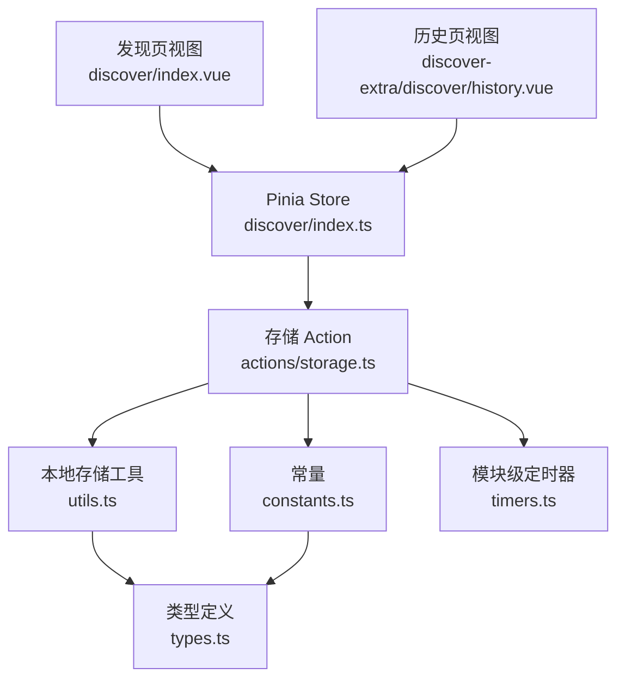
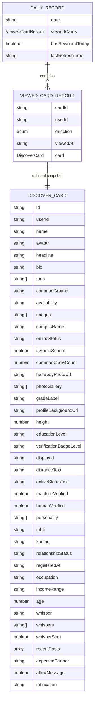
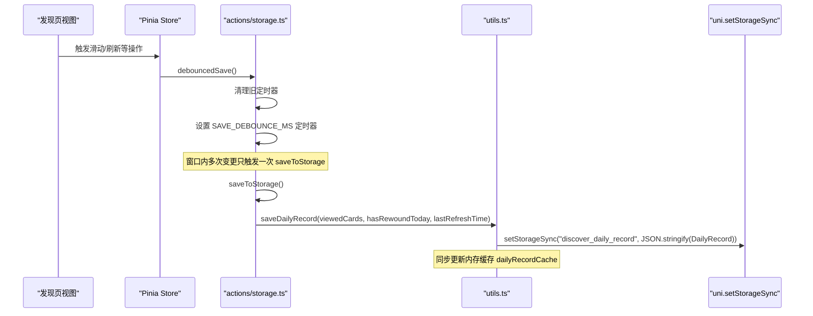
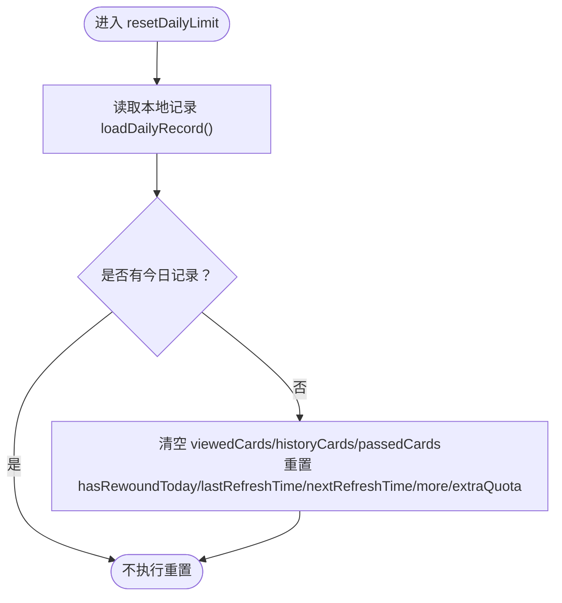
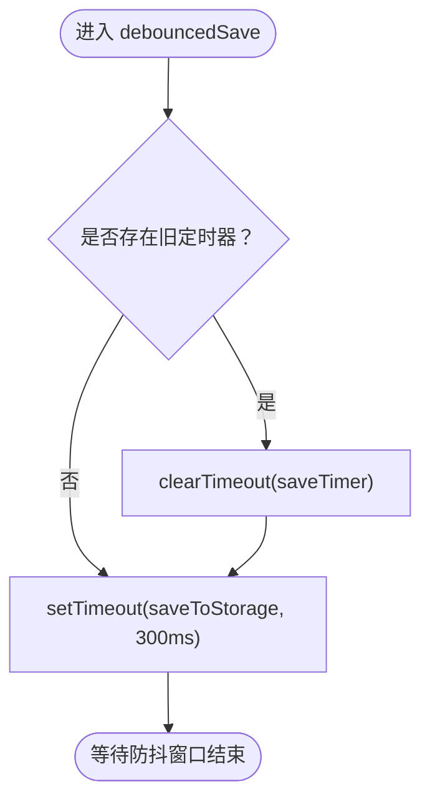
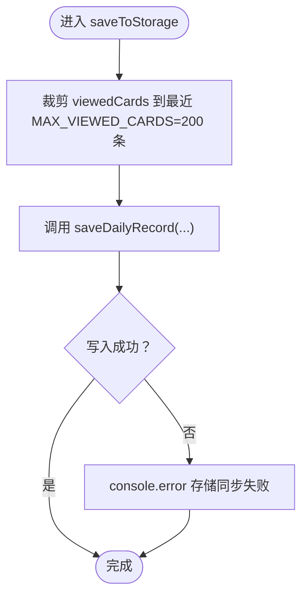
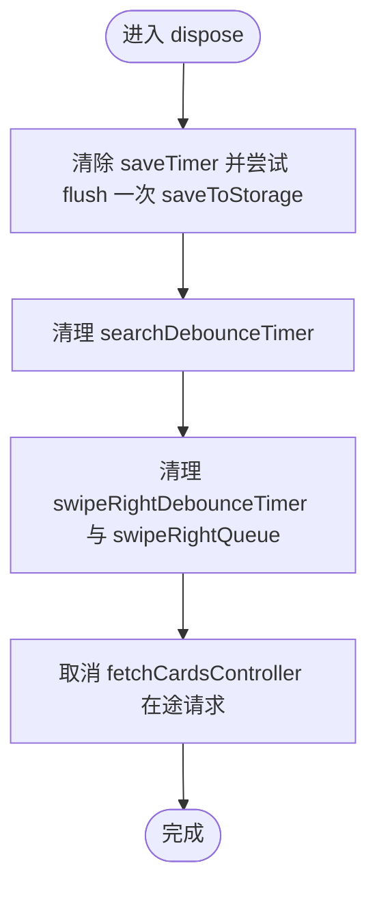
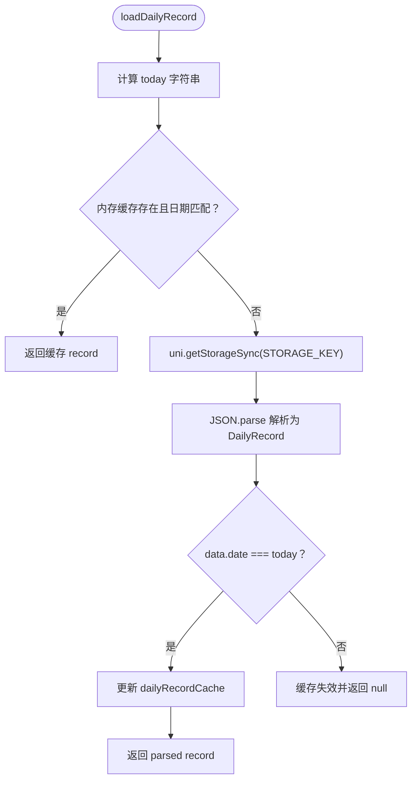
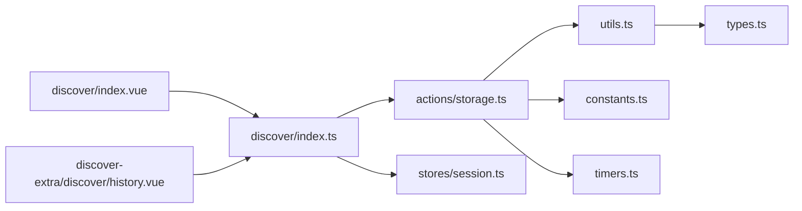

# 本地存储动作（storage actions）

<cite>
**本文引用的文件**   
- [apps/client/src/stores/discover/index.ts](file://apps/client/src/stores/discover/index.ts)
- [apps/client/src/stores/discover/actions/storage.ts](file://apps/client/src/stores/discover/actions/storage.ts)
- [apps/client/src/stores/discover/utils.ts](file://apps/client/src/stores/discover/utils.ts)
- [apps/client/src/stores/discover/constants.ts](file://apps/client/src/stores/discover/constants.ts)
- [apps/client/src/stores/discover/types.ts](file://apps/client/src/stores/discover/types.ts)
- [apps/client/src/stores/discover/timers.ts](file://apps/client/src/stores/discover/timers.ts)
- [apps/client/src/pages/discover/index.vue](file://apps/client/src/pages/discover/index.vue)
- [apps/client/src/subpackages/discover-extra/discover/history.vue](file://apps/client/src/subpackages/discover-extra/discover/history.vue)
</cite>

## 目录
1. [引言](#引言)
2. [项目结构与职责边界](#项目结构与职责边界)
3. [核心组件与持久化模型](#核心组件与持久化模型)
4. [架构总览：发现页本地存储流](#架构总览发现页本地存储流)
5. [详细组件分析](#详细组件分析)
6. [依赖关系与耦合分析](#依赖关系与耦合分析)
7. [性能特征与优化策略](#性能特征与优化策略)
8. [数据一致性保证](#数据一致性保证)
9. [故障恢复与排错指南](#故障恢复与排错指南)
10. [结论](#结论)

## 引言
本文聚焦“发现页”的本地存储动作，系统性说明其数据持久化策略、缓存管理、存储键值设计、数据格式与版本兼容性处理，以及与 Pinia 状态同步机制。文档同时给出关键流程图示、代码片段路径和故障恢复方案，帮助开发者理解“今日推荐次数、已查看卡片、挽回标记”等数据为何以及如何落盘。

## 项目结构与职责边界
发现页的本地存储逻辑并非集中在单一文件中，而是围绕 Pinia store 拆分后的 action 模块组织：

- `stores/discover/index.ts`：Pinia store 主体，负责 state/getters 装配，并导入各业务 action。
- `stores/discover/actions/storage.ts`：本地存储相关 action，包括每日限量重置、防抖保存、强制清理和资源释放。
- `stores/discover/utils.ts`：纯工具函数，包含本地存储读写 `loadDailyRecord` / `saveDailyRecord`、内存缓存、日期工具等。
- `stores/discover/constants.ts`：常量定义，包括存储键 `STORAGE_KEY`、防抖间隔、每日限额等。
- `stores/discover/types.ts`：类型定义，包括 `DiscoverCard`、`ViewedCardRecord`、`DiscoverState`。
- `stores/discover/timers.ts`：模块级定时器与请求控制器集合，避免污染响应式状态并可统一清理。
- `pages/discover/index.vue`：发现页主视图，消费 store，并在页面卸载时调用 `dispose`。
- `subpackages/discover-extra/discover/history.vue`：历史页，消费 `historyCards`/`passedCards`，并在卸载时触发 dispose。

**图表来源** 
- [apps/client/src/pages/discover/index.vue:1-200](file://apps/client/src/pages/discover/index.vue#L1-L200)
- [apps/client/src/subpackages/discover-extra/discover/history.vue:1-200](file://apps/client/src/subpackages/discover-extra/discover/history.vue#L1-L200)
- [apps/client/src/stores/discover/index.ts:1-200](file://apps/client/src/stores/discover/index.ts#L1-L200)
- [apps/client/src/stores/discover/actions/storage.ts:1-170](file://apps/client/src/stores/discover/actions/storage.ts#L1-L170)
- [apps/client/src/stores/discover/utils.ts:200-383](file://apps/client/src/stores/discover/utils.ts#L200-L383)
- [apps/client/src/stores/discover/constants.ts:1-179](file://apps/client/src/stores/discover/constants.ts#L1-L179)
- [apps/client/src/stores/discover/timers.ts:1-65](file://apps/client/src/stores/discover/timers.ts#L1-L65)
- [apps/client/src/stores/discover/types.ts:1-200](file://apps/client/src/stores/discover/types.ts#L1-L200)

**章节来源**
- [apps/client/src/stores/discover/index.ts:1-200](file://apps/client/src/stores/discover/index.ts#L1-L200)
- [apps/client/src/stores/discover/actions/storage.ts:1-170](file://apps/client/src/stores/discover/actions/storage.ts#L1-L170)
- [apps/client/src/stores/discover/utils.ts:200-383](file://apps/client/src/stores/discover/utils.ts#L200-L383)
- [apps/client/src/stores/discover/constants.ts:1-179](file://apps/client/src/stores/discover/constants.ts#L1-L179)
- [apps/client/src/stores/discover/timers.ts:1-65](file://apps/client/src/stores/discover/timers.ts#L1-L65)

## 核心组件与持久化模型
### 存储键值与数据结构
- 存储键：`discover_daily_record`。
- 存储对象（`DailyRecord`）字段：
  - `date`：YYYY-MM-DD，用于跨天判定。
  - `viewedCards`：`ViewedCardRecord[]`，记录每次滑动方向、时间戳及可选完整卡片快照。
  - `hasRewoundToday`：是否已使用挽回。
  - `lastRefreshTime`：上次刷新时间。

**图表来源**
- [apps/client/src/stores/discover/utils.ts:200-383](file://apps/client/src/stores/discover/utils.ts#L200-L383)
- [apps/client/src/stores/discover/types.ts:1-200](file://apps/client/src/stores/discover/types.ts#L1-L200)

### 存储键值设计与用途
| 键 | 位置 | 用途 | 备注 |
|---|---|---|---|
| `discover_daily_record` | `utils.ts` | 持久化当日滑动记录、挽回标记、刷新时间 | 跨天失效，仅保留当天有效数据 |
| 临时频控键 `greet:count:${targetId}` | `discover/index.vue` | 控制对同一目标打招呼次数（本地计数按日失效） | 非核心持久化键，用于交互限流 |

**章节来源**
- [apps/client/src/stores/discover/constants.ts:1-179](file://apps/client/src/stores/discover/constants.ts#L1-L179)
- [apps/client/src/pages/discover/index.vue:120-200](file://apps/client/src/pages/discover/index.vue#L120-L200)

## 架构总览：发现页本地存储流
发现页的本地存储写入不是直接由视图触发，而是通过 Pinia store 的 action 组合完成；写操作被防抖合并，并在页面销毁前强制 flush。

**图表来源**
- [apps/client/src/stores/discover/actions/storage.ts:40-120](file://apps/client/src/stores/discover/actions/storage.ts#L40-L120)
- [apps/client/src/stores/discover/utils.ts:300-383](file://apps/client/src/stores/discover/utils.ts#L300-L383)
- [apps/client/src/stores/discover/constants.ts:40-80](file://apps/client/src/stores/discover/constants.ts#L40-L80)

## 详细组件分析

### 存储 Action：`resetDailyLimit`
- 职责：判断是否跨天，若跨天则清空 `viewedCards`、`historyCards`、`passedCards`、`hasRewoundToday`，并重置刷新时间与配额。
- 关键点：
  - 通过 `loadDailyRecord()` 获取本地记录；若返回 null，视为跨天。
  - 重置后依赖 watch 自动触发后续存储同步。

**图表来源**
- [apps/client/src/stores/discover/actions/storage.ts:20-60](file://apps/client/src/stores/discover/actions/storage.ts#L20-L60)
- [apps/client/src/stores/discover/utils.ts:200-260](file://apps/client/src/stores/discover/utils.ts#L200-L260)

**章节来源**
- [apps/client/src/stores/discover/actions/storage.ts:20-60](file://apps/client/src/stores/discover/actions/storage.ts#L20-L60)

### 存储 Action：`debouncedSave`
- 职责：以 `SAVE_DEBOUNCE_MS=300ms` 防抖合并多次状态变更，最终调用 `saveToStorage()`。
- 关键点：
  - 复用模块级 `timers.saveTimer`，避免重复定时器堆积。
  - 防抖结束后清空定时器句柄，避免残留。

**图表来源**
- [apps/client/src/stores/discover/actions/storage.ts:60-90](file://apps/client/src/stores/discover/actions/storage.ts#L60-L90)
- [apps/client/src/stores/discover/constants.ts:60-100](file://apps/client/src/stores/discover/constants.ts#L60-L100)
- [apps/client/src/stores/discover/timers.ts:1-65](file://apps/client/src/stores/discover/timers.ts#L1-L65)

**章节来源**
- [apps/client/src/stores/discover/actions/storage.ts:60-90](file://apps/client/src/stores/discover/actions/storage.ts#L60-L90)

### 存储 Action：`saveToStorage`
- 职责：将当前 `viewedCards`、`hasRewoundToday`、`lastRefreshTime` 写入本地存储。
- 优化点：
  - 截断 `viewedCards` 至最近 200 条，防止存储无限增长。
  - try-catch 包裹，失败仅记录日志，不影响主流程。

**图表来源**
- [apps/client/src/stores/discover/actions/storage.ts:90-130](file://apps/client/src/stores/discover/actions/storage.ts#L90-L130)
- [apps/client/src/stores/discover/utils.ts:300-383](file://apps/client/src/stores/discover/utils.ts#L300-L383)

**章节来源**
- [apps/client/src/stores/discover/actions/storage.ts:90-130](file://apps/client/src/stores/discover/actions/storage.ts#L90-L130)

### 存储 Action：`forceResetDailyLimit`
- 职责：测试用强制重置，无视跨天判断，直接清空状态。
- 注意：业务代码不应调用，仅供测试场景。

**章节来源**
- [apps/client/src/stores/discover/actions/storage.ts:130-150](file://apps/client/src/stores/discover/actions/storage.ts#L130-L150)

### 资源释放 Action：`dispose`
- 职责：清理所有定时器、右滑队列、AbortController，并在清理前强制 flush 一次防抖存储。
- 调用时机：
  - 页面 `onUnload` / `onUnmounted`。
  - HMR 热更新或应用退出时。

**图表来源**
- [apps/client/src/stores/discover/actions/storage.ts:150-170](file://apps/client/src/stores/discover/actions/storage.ts#L150-L170)
- [apps/client/src/stores/discover/timers.ts:1-65](file://apps/client/src/stores/discover/timers.ts#L1-L65)

**章节来源**
- [apps/client/src/stores/discover/actions/storage.ts:150-170](file://apps/client/src/stores/discover/actions/storage.ts#L150-L170)

### 本地存储工具：`loadDailyRecord` / `saveDailyRecord`
- `loadDailyRecord`：
  - 读取 `discover_daily_record`，解析为 `DailyRecord`。
  - 仅返回与今日日期匹配的记录；跨天记录视为过期。
  - 维护 `dailyRecordCache`，同日免重复 `getStorageSync` + `JSON.parse`。
- `saveDailyRecord`：
  - 序列化 `DailyRecord` 并写入 `uni.setStorageSync`。
  - 写成功后同步更新内存缓存，保证下次读取命中新值。
  - 读写均 try-catch，失败静默忽略。

**图表来源**
- [apps/client/src/stores/discover/utils.ts:260-340](file://apps/client/src/stores/discover/utils.ts#L260-L340)

**章节来源**
- [apps/client/src/stores/discover/utils.ts:260-383](file://apps/client/src/stores/discover/utils.ts#L260-L383)

## 依赖关系与耦合分析
- `actions/storage.ts` 依赖：
  - `constants.ts`：`DAILY_LIMIT_TOTAL`、`SAVE_DEBOUNCE_MS`、`STORAGE_KEY`。
  - `utils.ts`：`getNextNoonString`、`loadDailyRecord`、`saveDailyRecord`。
  - `timers.ts`：共享定时器与请求控制器。
  - `types.ts`：`DiscoverStoreThis`（this 类型）。
- `utils.ts` 依赖：
  - `constants.ts`：`STORAGE_KEY`。
  - `types.ts`：`DiscoverCard`、`ViewedCardRecord`。
- `index.ts`（store 主体）依赖：
  - 各拆分 action 模块（fetch/swipe/rewind/storage/filter/history）。
  - `session.ts`：用于超级测试账号旁路。
- 视图层依赖：
  - `discover/index.vue`：消费 store getters/actions，并在需要时触发 `dispose`。
  - `history.vue`：消费历史数据，并在卸载时触发 `dispose`。

**图表来源**
- [apps/client/src/stores/discover/index.ts:1-200](file://apps/client/src/stores/discover/index.ts#L1-L200)
- [apps/client/src/stores/discover/actions/storage.ts:1-170](file://apps/client/src/stores/discover/actions/storage.ts#L1-L170)
- [apps/client/src/stores/discover/utils.ts:200-383](file://apps/client/src/stores/discover/utils.ts#L200-L383)
- [apps/client/src/stores/discover/constants.ts:1-179](file://apps/client/src/stores/discover/constants.ts#L1-L179)
- [apps/client/src/stores/discover/timers.ts:1-65](file://apps/client/src/stores/discover/timers.ts#L1-L65)
- [apps/client/src/pages/discover/index.vue:1-200](file://apps/client/src/pages/discover/index.vue#L1-L200)
- [apps/client/src/subpackages/discover-extra/discover/history.vue:1-200](file://apps/client/src/subpackages/discover-extra/discover/history.vue#L1-L200)

**章节来源**
- [apps/client/src/stores/discover/index.ts:1-200](file://apps/client/src/stores/discover/index.ts#L1-L200)
- [apps/client/src/stores/discover/actions/storage.ts:1-170](file://apps/client/src/stores/discover/actions/storage.ts#L1-L170)

## 性能特征与优化策略
- 防抖写入：`SAVE_DEBOUNCE_MS=300ms` 合并频繁滑动导致的多次写入，降低 I/O 压力。
- 内存缓存：`dailyRecordCache` 在同日内避免重复 `getStorageSync` 与 `JSON.parse`，缓解卡顿。
- 数据截断：`viewedCards` 最多保留最近 200 条，避免小程序存储空间溢出。
- 资源清理：`dispose` 主动清理定时器、队列与 AbortController，避免 HMR 或页面切换造成泄漏。
- 错误隔离：存储失败不阻断主业务流程，仅记录日志或静默忽略。

[本节为通用性能讨论，不直接分析具体文件]

## 数据一致性保证
- 跨天一致性：通过 `DailyRecord.date` 判断跨天，跨天后重置全部相关状态，确保新的一天从零开始。
- 读一致：`loadDailyRecord` 优先返回内存缓存，写路径同步更新缓存，保证同进程内读最新值。
- 写一致：`saveDailyRecord` 在成功写入后立即更新内存缓存，避免后续读取读到旧值。
- 幂等与容错：读写均 try-catch，异常不抛出，避免影响用户交互。
- 配额一致性：`remainingCount` getter 基于 `dailyLimit + extraQuota - viewedCards.length` 计算，签到额外配额变化可自动反映。

**章节来源**
- [apps/client/src/stores/discover/utils.ts:260-383](file://apps/client/src/stores/discover/utils.ts#L260-L383)
- [apps/client/src/stores/discover/index.ts:120-200](file://apps/client/src/stores/discover/index.ts#L120-L200)

## 故障恢复与排错指南

### 常见问题与修复思路
| 问题 | 可能原因 | 建议排查 |
|---|---|---|
| 本地存储未写入 | `setStorageSync` 失败或被禁用 | 检查 `saveDailyRecord` try-catch 日志；确认小程序存储权限 |
| 滑动后存储未刷新 | 防抖窗口未结束 | 等待 300ms 或检查 `timers.saveTimer` 是否被清理 |
| 页面销毁后仍修改状态 | 未调用 `dispose` | 在页面 `onUnload`/`onUnmounted` 中调用 `discoverStore.dispose()` |
| 历史页展示默认昵称 | `viewedCards` 快照缺失 | 检查 swipe 时是否写入 `card` 快照；兼容旧数据回退 |
| 配额显示异常 | `extraQuota` 或 `viewedCards` 不同步 | 核对签到逻辑与 `remainingCount` getter |

### 恢复步骤
1. **手动清理本地存储**  
   可通过小程序调试工具或脚本清理 `discover_daily_record`，然后重新进入发现页以重建记录。
2. **强制重置每日限额（测试）**  
   调用 `forceResetDailyLimit()` 重置状态，观察是否恢复预期行为。
3. **确认 dispose 调用**  
   在发现页和历史页的卸载钩子中确认调用了 `discoverStore.dispose()`。
4. **检查防抖与定时器**  
   通过控制台或调试输出确认 `timers.saveTimer` 是否被正确创建和清理。

**章节来源**
- [apps/client/src/stores/discover/actions/storage.ts:90-170](file://apps/client/src/stores/discover/actions/storage.ts#L90-L170)
- [apps/client/src/subpackages/discover-extra/discover/history.vue:120-200](file://apps/client/src/subpackages/discover-extra/discover/history.vue#L120-L200)

## 结论
发现页的本地存储动作围绕 Pinia store 的拆分 action 实现，采用防抖写入、内存缓存、数据截断和资源清理等手段，在保证用户体验的同时提升存储效率与稳定性。`discover_daily_record` 作为唯一持久化键，承载了当日滑动记录、挽回标记与刷新时间，并通过跨天判定保障状态一致性。配合 `dispose` 生命周期清理，系统在页面切换、HMR 与异常情况下具备较好的健壮性。

[本节为总结性内容，不直接分析具体文件]