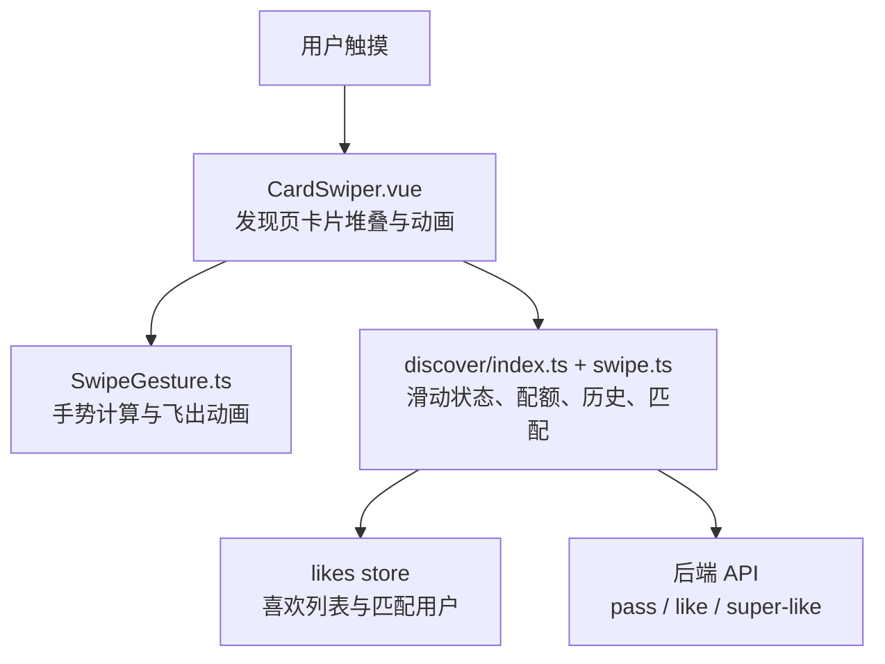
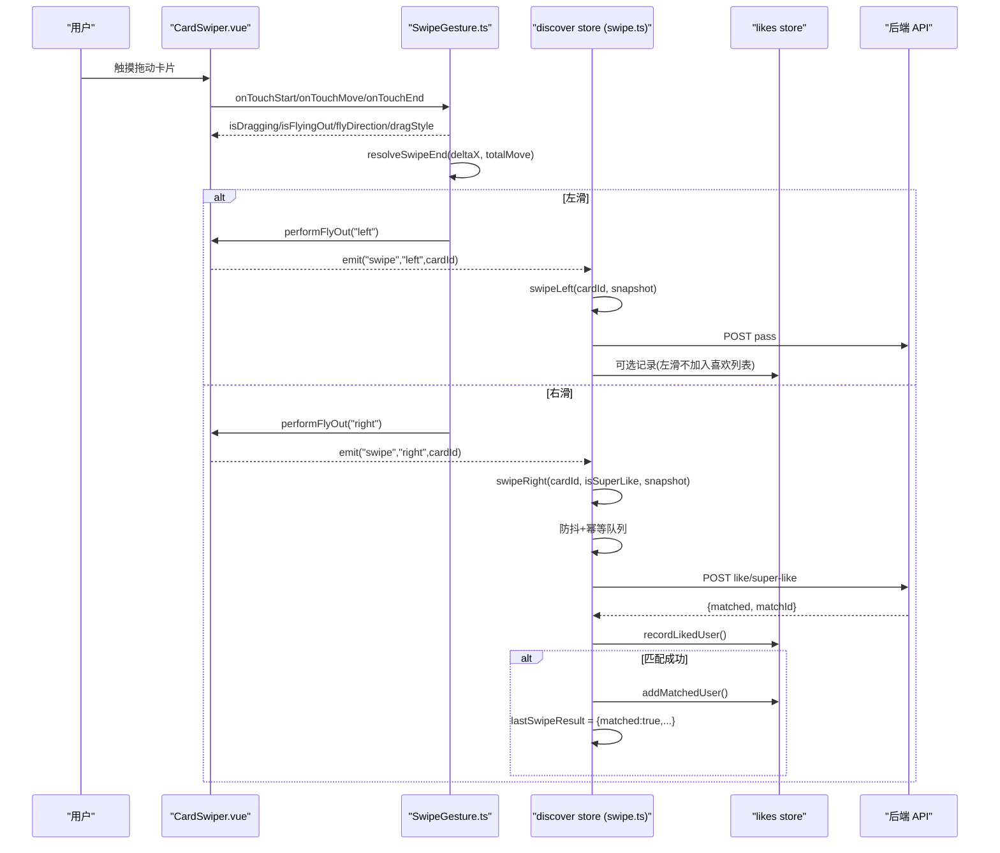
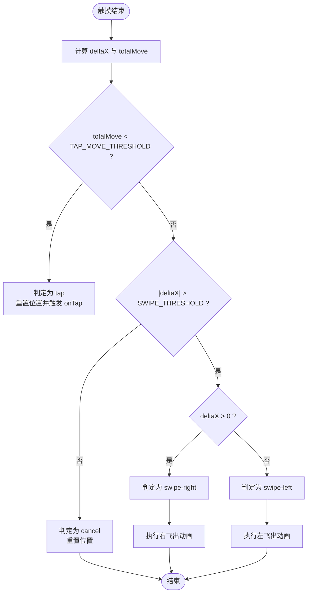
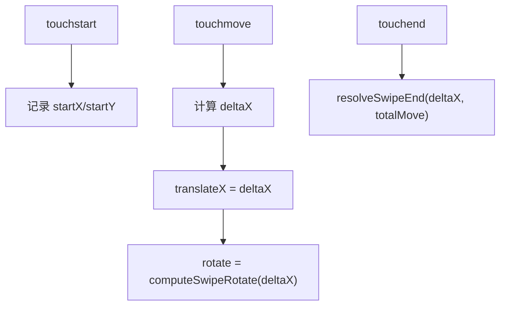
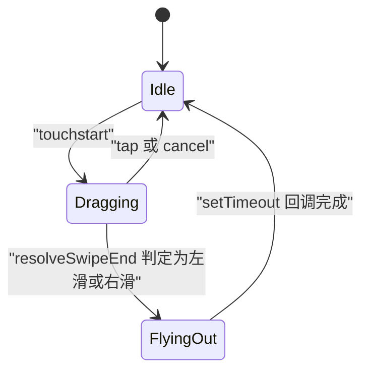
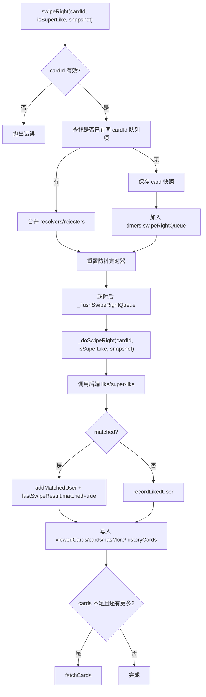
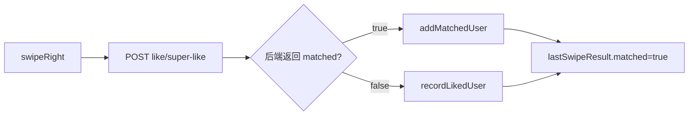

# 滑动操作动作（swipe actions）

<cite>
**本文引用的文件**
- [SwipeContainer.vue](file://apps/client/src/components/common/swipe/SwipeContainer.vue)
- [SwipeGesture.ts](file://apps/client/src/components/common/swipe/SwipeGesture.ts)
- [CardSwiper.vue](file://apps/client/src/components/discover/CardSwiper.vue)
- [swipe.ts](file://apps/client/src/stores/discover/actions/swipe.ts)
- [apps/client/src/stores/discover/index.ts](file://apps/client/src/stores/discover/index.ts)
- [apps/client/src/stores/discover/types.ts](file://apps/client/src/stores/discover/types.ts)
- [match.ts](file://apps/client/src/constants/match.ts)
- [requirements.md](file://specs/discover-ui-polish/requirements.md)
</cite>

## 目录
1. [引言](#引言)
2. [项目结构定位](#项目结构定位)
3. [核心组件与职责](#核心组件与职责)
4. [架构总览](#架构总览)
5. [手势处理与动画控制](#手势处理与动画控制)
6. [业务状态与数据一致性](#业务状态与数据一致性)
7. [匹配算法集成方式](#匹配算法集成方式)
8. [边界检测与用户体验优化](#边界检测与用户体验优化)
9. [代码示例路径](#代码示例路径)
10. [性能调优建议](#性能调优建议)
11. [故障排查指南](#故障排查指南)
12. [结论](#结论)

## 引言
本文件聚焦“发现页”卡片滑动匹配功能的完整实现文档，覆盖左右滑动手势识别、方向判断、动画控制、状态更新、防抖与幂等队列、与后端匹配接口及本地 likes store 的集成，以及性能与可维护性要点。目标是让前端开发者、测试人员和产品验收人员都能准确理解“左滑拒绝、右滑喜欢”这一交互链路从触摸事件到持久化记录的全过程。

## 项目结构定位
滑动功能横跨三个层次：
- 通用手势层：`SwipeGesture.ts` 提供可复用的触摸拖拽、旋转、飞出动画与点击判定逻辑。
- 页面组件层：`CardSwiper.vue` 是发现页主卡片堆叠展示与滑动入口；`SwipeContainer.vue` 是轻量容器封装，用于简单卡片或子场景复用。
- Store 层：`stores/discover/actions/swipe.ts` 集中实现左滑、右滑、防抖、快照、历史记录、配额校验与匹配结果联动。

**图表来源**
- [CardSwiper.vue:1-200](file://apps/client/src/components/discover/CardSwiper.vue#L1-L200)
- [SwipeGesture.ts:1-173](file://apps/client/src/components/common/swipe/SwipeGesture.ts#L1-L173)
- [apps/client/src/stores/discover/index.ts:130-270](file://apps/client/src/stores/discover/index.ts#L130-L270)
- [swipe.ts:1-200](file://apps/client/src/stores/discover/actions/swipe.ts#L1-L200)

**章节来源**
- [CardSwiper.vue:1-200](file://apps/client/src/components/discover/CardSwiper.vue#L1-L200)
- [SwipeContainer.vue:1-91](file://apps/client/src/components/common/swipe/SwipeContainer.vue#L1-L91)
- [SwipeGesture.ts:1-173](file://apps/client/src/components/common/swipe/SwipeGesture.ts#L1-L173)
- [apps/client/src/stores/discover/index.ts:130-270](file://apps/client/src/stores/discover/index.ts#L130-L270)
- [swipe.ts:1-200](file://apps/client/src/stores/discover/actions/swipe.ts#L1-L200)

## 核心组件与职责
| 模块 | 主要职责 | 关键输出/副作用 |
|---|---|---|
| `SwipeGesture.ts` | 统一处理 touchstart/touchmove/touchend，计算位移、旋转、透明度，并返回 dragStyle；在松手时判定 tap、cancel、swipe-left、swipe-right，执行飞出动画后回调 onSwipeLeft/onSwipeRight。 | `isDragging`、`isFlyingOut`、`flyDirection`、`dragStyle`、手势回调 |
| `SwipeContainer.vue` | 轻量容器，绑定触摸事件，转发 swipe-left、swipe-right、card-tap，并提供 disabled 开关。 | 对外 emit swipe-left、swipe-right、card-tap |
| `CardSwiper.vue` | 发现页主卡片 UI，维护 translateX、rotate、下一张卡片缩放/偏移/不透明度、长按菜单、详情弹窗，并在飞出后通过 emit("swipe") 通知上层 store。 | 触发 store swipeLeft/swipeRight、显示匹配提示、调用 haptic |
| `swipe.ts` | 左滑 pass、右滑 like/super-like 的业务实现；含参数校验、配额检查、游客模式、Mock 模式、防抖窗口、幂等队列、快照恢复、历史记录、自动补卡、匹配结果写入 lastSwipeResult。 | viewedCards、cards、hasMore、historyCards、lastSwipeResult、errorMessage |
| `discover/index.ts` | Pinia store 装配，暴露 currentCard、remainingCount、isLimitReached、fetchCards、swipeLeft、swipeRight、rewindCard 等；watch viewedCards 触发 debouncedSave。 | 全局 discover 状态与跨组件共享行为 |
| `discover/types.ts` | DiscoverCard、SwipeDirection、ViewedCardRecord、DiscoverState 等类型定义。 | 类型契约 |
| `constants/match.ts` | 手势阈值、动画时长、飞出距离、倾斜角度、匹配度常量。 | SWIPE_THRESHOLD、CARD_FLY_OUT_DURATION_MS、MATCH_SCORE_* 等 |

**章节来源**
- [SwipeGesture.ts:1-173](file://apps/client/src/components/common/swipe/SwipeGesture.ts#L1-L173)
- [SwipeContainer.vue:1-91](file://apps/client/src/components/common/swipe/SwipeContainer.vue#L1-L91)
- [CardSwiper.vue:1-200](file://apps/client/src/components/discover/CardSwiper.vue#L1-L200)
- [swipe.ts:1-200](file://apps/client/src/stores/discover/actions/swipe.ts#L1-L200)
- [apps/client/src/stores/discover/index.ts:130-270](file://apps/client/src/stores/discover/index.ts#L130-L270)
- [apps/client/src/stores/discover/types.ts:1-200](file://apps/client/src/stores/discover/types.ts#L1-L200)
- [match.ts:1-101](file://apps/client/src/constants/match.ts#L1-L101)

## 架构总览
滑动操作整体分为三层：

1. **手势层**
   - 由 `useSwipeGesture` 计算 deltaX、totalMove，决定 tap/cancel/left/right。
   - 飞出阶段设置 translateX、rotate、opacity，并通过 setTimeout 延迟回调业务方法。

2. **组件层**
   - `CardSwiper.vue` 使用手势计算结果驱动卡片视觉变化，并在飞出完成后向上 emit("swipe", direction, cardId)。
   - `SwipeContainer.vue` 为简单卡片提供轻量封装，屏蔽原生冒泡问题，仅透传 swipe-left/swipe-right/card-tap。

3. **Store 层**
   - `swipeLeft`：记录 left 查看记录，移除当前卡片，必要时 fetchCards 补充。
   - `swipeRight`：进入 300ms 防抖窗口，按 cardId 合并重复请求；flush 时串行执行 `_doSwipeRight`，调用后端 like/super-like，保存 likedUser 和 matchedUser，更新 lastSwipeResult。

**图表来源**
- [SwipeGesture.ts:60-173](file://apps/client/src/components/common/swipe/SwipeGesture.ts#L60-L173)
- [CardSwiper.vue:814-890](file://apps/client/src/components/discover/CardSwiper.vue#L814-L890)
- [swipe.ts:1-200](file://apps/client/src/stores/discover/actions/swipe.ts#L1-L200)
- [swipe.ts:200-432](file://apps/client/src/stores/discover/actions/swipe.ts#L200-L432)

## 手势处理与动画控制

### 方向判断逻辑
方向判断由 `resolveSwipeEnd` 完成：
- 如果总移动距离小于 `TAP_MOVE_THRESHOLD`，视为点击。
- 如果水平位移绝对值超过 `SWIPE_THRESHOLD`，根据 deltaX 正负判定右滑或左滑。
- 否则回弹 cancel。

**图表来源**
- [SwipeGesture.ts:28-59](file://apps/client/src/components/common/swipe/SwipeGesture.ts#L28-L59)
- [match.ts:14-26](file://apps/client/src/constants/match.ts#L14-L26)

**章节来源**
- [SwipeGesture.ts:28-59](file://apps/client/src/components/common/swipe/SwipeGesture.ts#L28-L59)
- [match.ts:14-26](file://apps/client/src/constants/match.ts#L14-L26)

### 拖动跟随与旋转
- 拖动时实时设置 `translateX` 与 `rotate`。
- 旋转角度由 `computeSwipeRotate(deltaX)` 计算，上限为 `SWIPE_ROTATION_MAX`，比例分母为 `SWIPE_ROTATION_DIVISOR`。
- 拖动期间 `transition` 为 none，避免跟随卡顿；松开后由 CSS transition 控制飞出与回弹。

**图表来源**
- [SwipeGesture.ts:60-95](file://apps/client/src/components/common/swipe/SwipeGesture.ts#L60-L95)
- [SwipeGesture.ts:10-26](file://apps/client/src/components/common/swipe/SwipeGesture.ts#L10-L26)
- [match.ts:14-35](file://apps/client/src/constants/match.ts#L14-L35)

**章节来源**
- [SwipeGesture.ts:60-95](file://apps/client/src/components/common/swipe/SwipeGesture.ts#L60-L95)
- [SwipeGesture.ts:10-26](file://apps/client/src/components/common/swipe/SwipeGesture.ts#L10-L26)
- [match.ts:14-35](file://apps/client/src/constants/match.ts#L14-L35)

### 飞出动画与状态清理
- 飞出时设置 `isFlyingOut=true`、`flyDirection`、目标 translateX、rotate、opacity=0。
- 动画结束后清除定时器、回调 onSwipeLeft/onSwipeRight，并将 `isFlyingOut=false`、`flyDirection=null`、translateX/rotate/opacity 复位。
- `dragStyle` 在拖动时关闭 transition，非拖动时使用 cubic-bezier 曲线提升飞出手感。

**图表来源**
- [SwipeGesture.ts:96-173](file://apps/client/src/components/common/swipe/SwipeGesture.ts#L96-L173)

**章节来源**
- [SwipeGesture.ts:96-173](file://apps/client/src/components/common/swipe/SwipeGesture.ts#L96-L173)

## 业务状态与数据一致性

### 左滑流程
- 参数校验：cardId 必须非空。
- 同卡片右滑防抖队列冲突处理：若同一卡片在右滑防抖窗口内存在待执行项，则取消该 pending 项，避免 later left 与 delayed like 矛盾。
- 快照优先：优先使用调用方传入的 cardSnapshot，再回退到 store.cards。
- 游客模式：未登录用户本地放行，不调后端 pass，也不自动补卡，避免 401 强制登录。
- 已登录用户：调用 `passUserApi`，写入 `viewedCards`，移除 cards，更新 hasMore，同步 historyCards，不足时自动 fetchCards。

**章节来源**
- [swipe.ts:28-120](file://apps/client/src/stores/discover/actions/swipe.ts#L28-L120)

### 右滑流程与幂等队列
- 防抖窗口：`SWIPE_RIGHT_DEBOUNCE_MS` 内多次触发不会丢弃，而是按 cardId 合并为幂等队列项。
- 快照入队：入队时保存 callerSnapshot，解决 flush 时卡片已被移除导致的“卡片不存在”。
- flush 串行执行：`_flushSwipeRightQueue` 逐个 await `_doSwipeRight`，保证并发状态竞争最小化。
- Mock 模式：按 `MOCK_MATCH_PROBABILITY` 模拟匹配结果，并记录 likedUser 与 matchedUser。
- 真实模式：调用 `likeUserApi` 或 `super-like`，失败直接抛异常，不再用随机数兜底；成功后更新 lastSwipeResult、viewedCards、cards、hasMore、historyCards，并联动 likes store。

**图表来源**
- [swipe.ts:200-432](file://apps/client/src/stores/discover/actions/swipe.ts#L200-L432)
- [swipe.ts:1-200](file://apps/client/src/stores/discover/actions/swipe.ts#L1-L200)

**章节来源**
- [swipe.ts:200-432](file://apps/client/src/stores/discover/actions/swipe.ts#L200-L432)
- [swipe.ts:1-200](file://apps/client/src/stores/discover/actions/swipe.ts#L1-L200)

### Store 状态与配额
- `currentCard`：未查看的第一张卡片。
- `remainingCount`：dailyLimit + extraQuota - viewedCards.length，超级测试账号可绕过。
- `isLimitReached`：达到每日上限时禁止继续滑动。
- `viewedCards`：记录每次查看的 direction、userId、viewedAt、card 快照。
- `lastSwipeResult`：最近一次右滑的匹配结果，供页面展示匹配成功动画。

**章节来源**
- [apps/client/src/stores/discover/index.ts:130-270](file://apps/client/src/stores/discover/index.ts#L130-L270)
- [apps/client/src/stores/discover/types.ts:1-200](file://apps/client/src/stores/discover/types.ts#L1-L200)

## 匹配算法集成方式
本项目中，“匹配算法”主要通过后端 `/api/matches/like` 或 `/api/matches/super-like` 响应中的 `matched`、`matchId` 字段体现：
- Store 层不实现具体匹配公式，只负责把右滑结果映射为 `lastSwipeResult`。
- Mock 模式下按 `MOCK_MATCH_PROBABILITY` 生成随机匹配，便于调试与演示。
- 真实模式下，后端决定是否匹配；客户端仅在 matched 时为对方加入 likes store 的“喜欢我的”列表，并始终记录“我发出的喜欢”。

**图表来源**
- [swipe.ts:250-432](file://apps/client/src/stores/discover/actions/swipe.ts#L250-L432)

**章节来源**
- [swipe.ts:250-432](file://apps/client/src/stores/discover/actions/swipe.ts#L250-L432)

## 边界检测与用户体验优化

### 手势边界
- 点击判定：`TAP_MOVE_THRESHOLD=8px`，防止微小抖动被误判为滑动。
- 滑动判定：`SWIPE_THRESHOLD=120px`，避免轻触即触发飞出。
- 长按取消：`LONG_PRESS_MOVE_THRESHOLD=10px`，长按过程中移动超过阈值取消长按菜单。
- 飞行态保护：`isFlyingOut` 期间忽略新的触摸输入，防止动画中途叠加新手势。

**章节来源**
- [match.ts:14-26](file://apps/client/src/constants/match.ts#L14-L26)
- [SwipeGesture.ts:60-173](file://apps/client/src/components/common/swipe/SwipeGesture.ts#L60-L173)

### 动画体验
- 拖动时禁用 transition，确保跟随流畅。
- 飞出使用 `cubic-bezier(0.34, 1.56, 0.64, 1)` 曲线，配合 400ms 时长与 1100px 位移、36° 旋转，形成明确的方向反馈。
- 卡片倾斜与旋转分离：`CardSwiper` 额外增加 Y 轴倾斜，增强 3D 质感。

**章节来源**
- [SwipeGesture.ts:150-173](file://apps/client/src/components/common/swipe/SwipeGesture.ts#L150-L173)
- [CardSwiper.vue:432-477](file://apps/client/src/components/discover/CardSwiper.vue#L432-L477)
- [match.ts:44-53](file://apps/client/src/constants/match.ts#L44-L53)

### 用户故事与验收标准对齐
需求文档明确要求：
- 照片更明亮、信息区简洁、色彩统一、按钮协调、匹配弹窗美观。
- 性能要求不因样式改动影响滑动流畅度（60fps）。
- 不改动 props/emits 接口，不影响父组件 discover/index.vue 与 messages/index.vue。

这些约束说明滑动交互的核心行为应保持向后兼容，UI 美化不应引入额外手势分支或阻塞主线程。

**章节来源**
- [requirements.md:1-70](file://specs/discover-ui-polish/requirements.md#L1-L70)

## 代码示例路径
以下为常用实现片段的引用路径，避免直接粘贴源码：

| 场景 | 参考路径 |
|---|---|
| 手势初始化与拖动跟随 | [SwipeGesture.ts:60-95](file://apps/client/src/components/common/swipe/SwipeGesture.ts#L60-L95) |
| 松手方向判定 | [SwipeGesture.ts:28-59](file://apps/client/src/components/common/swipe/SwipeGesture.ts#L28-L59) |
| 飞出动画与回调 | [SwipeGesture.ts:96-149](file://apps/client/src/components/common/swipe/SwipeGesture.ts#L96-L149) |
| 容器事件转发与 catchtap 防御 | [SwipeContainer.vue:1-91](file://apps/client/src/components/common/swipe/SwipeContainer.vue#L1-L91) |
| 卡片拖拽、倾斜、飞出与 emit | [CardSwiper.vue:814-890](file://apps/client/src/components/discover/CardSwiper.vue#L814-L890) |
| 左滑 pass 与游客模式 | [swipe.ts:28-120](file://apps/client/src/stores/discover/actions/swipe.ts#L28-L120) |
| 右滑防抖与幂等队列 | [swipe.ts:200-270](file://apps/client/src/stores/discover/actions/swipe.ts#L200-L270) |
| 右滑实际执行与匹配联动 | [swipe.ts:270-432](file://apps/client/src/stores/discover/actions/swipe.ts#L270-L432) |
| 手势与动画常量 | [match.ts:14-53](file://apps/client/src/constants/match.ts#L14-L53) |
| Store 配额与视图 | [discover/index.ts:130-270](file://apps/client/src/stores/discover/index.ts#L130-L270) |

## 性能调优建议
- 保持手势计算在 JS 层轻量：当前实现仅做位移、旋转、透明度计算，符合 60fps 预期。
- 拖动时禁用 CSS transition：避免浏览器合成层重排与插值开销，已在 `dragStyle` 中处理。
- 飞出动画使用 transform 与 opacity：这两个属性可由 GPU 加速，减少 layout/paint。
- 防抖窗口串行 flush：避免多个 right swipe 并发写 store 导致状态竞争。
- 快照优先：右滑入队时保存 card 快照，减少 flush 时因卡片已被移除而重新查询。
- 自动补卡条件严格：仅在 `cards.length < 2 && hasMore && !isLimitReached` 时触发 fetchCards，避免频繁网络请求。
- 长任务卸载清理：`SwipeGesture` 使用 `onUnmounted` 清理定时器；`CardSwiper` 维护 `animTimers` 集合，防止组件销毁后仍修改响应式状态。

[本节为通用性能指导，不直接分析具体文件行号]

## 故障排查指南

| 现象 | 可能原因 | 排查与修复建议 |
|---|---|---|
| 快速右滑 A 后右滑 B，A 的喜欢丢失 | 旧实现采用“最后一击”防抖 | 确认当前使用幂等队列：同 cardId 合并，不同 cardId 各自入队；参考 [swipe.ts:200-270](file://apps/client/src/stores/discover/actions/swipe.ts#L200-L270) |
| 右滑 A 后立刻左滑 B，A 的 like 报“卡片不存在” | flush 时卡片已从 cards 移除 | 使用入队时的 card 快照；参考 [swipe.ts:270-320](file://apps/client/src/stores/discover/actions/swipe.ts#L270-L320) |
| 左滑与右滑冲突导致状态不一致 | 同一卡片在右滑防抖窗口内又左滑 | `swipeLeft` 会取消 pending 右滑项；参考 [swipe.ts:48-80](file://apps/client/src/stores/discover/actions/swipe.ts#L48-L80) |
| 游客左滑后触发 401 跳转登录 | 未正确跳过后端 pass 请求 | 确认游客分支不调后端且不自动补卡；参考 [swipe.ts:60-120](file://apps/client/src/stores/discover/actions/swipe.ts#L60-L120) |
| 滑动飞出后还能继续拖动 | isFlyingOut 未阻止新触摸 | 检查 `onTouchStart` 中 `if (isFlyingOut.value) return`；参考 [SwipeGesture.ts:72-85](file://apps/client/src/components/common/swipe/SwipeGesture.ts#L72-L85) |
| 点击卡片触发两次业务逻辑 | 原生 tap 与手势 emit 双通道命中 | 使用 `SwipeContainer` 的 catchtap 阻断冒泡，并改用 card-tap；参考 [SwipeContainer.vue:1-91](file://apps/client/src/components/common/swipe/SwipeContainer.vue#L1-L91) |
| 滑动流畅但 UI 模糊或掉帧 | 使用了布局相关属性而非 transform/opacity | 检查动画是否只改 transform 与 opacity；参考 [SwipeGesture.ts:150-173](file://apps/client/src/components/common/swipe/SwipeGesture.ts#L150-L173) |
| 匹配成功却未出现在“喜欢我的”列表 | likes store 不可用或匹配逻辑未触发 | 检查 mock 或真实分支中 `addMatchedUser` 调用；参考 [swipe.ts:300-432](file://apps/client/src/stores/discover/actions/swipe.ts#L300-L432) |

**章节来源**
- [swipe.ts:28-432](file://apps/client/src/stores/discover/actions/swipe.ts#L28-L432)
- [SwipeGesture.ts:60-173](file://apps/client/src/components/common/swipe/SwipeGesture.ts#L60-L173)
- [SwipeContainer.vue:1-91](file://apps/client/src/components/common/swipe/SwipeContainer.vue#L1-L91)

## 结论
发现页滑动操作以 `SwipeGesture.ts` 为核心手势引擎，以 `CardSwiper.vue` 为可视化入口，以 `discover/store` 为状态与业务中枢。其设计优点包括：
- 手势与业务解耦：手势层只负责方向判定与动画，store 专注数据一致性与后端集成。
- 防抖与幂等：右滑防抖窗口内按 cardId 合并请求，避免快速滑动丢失操作。
- 快照兜底：右滑入队时保存卡片快照，避免异步 flush 时卡片状态变化引发错误。
- 游客与 Mock 友好：未登录不强制登录，Mock 模式可配置匹配概率。
- 动画性能可控：拖动禁用 transition，飞出使用 transform/opacity，契合 60fps 体验目标。

后续改进可关注：
- 将手势阈值、动画参数进一步抽取为可配置主题变量，便于 A/B 测试。
- 对弱网场景下的 like/super-like 重试策略进行显式设计，避免用户重复提交。
- 在自动化测试中增加滑动阈值、飞出时长、防抖窗口的断言，保障交互稳定性。

[本节为总结性内容，不直接分析具体文件行号]