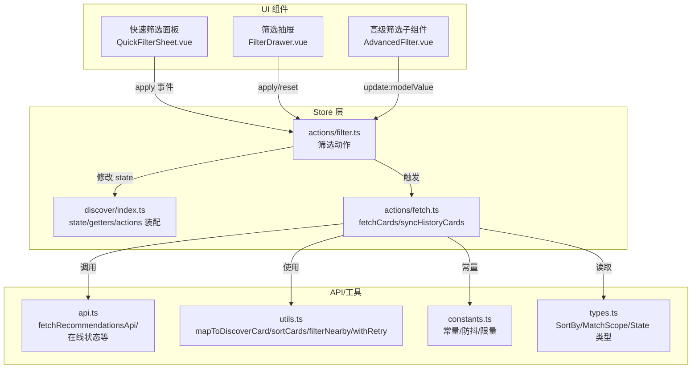
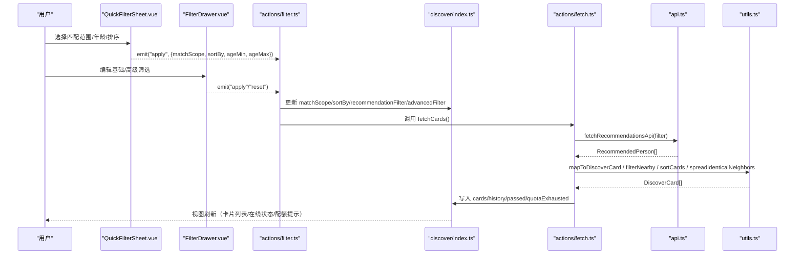
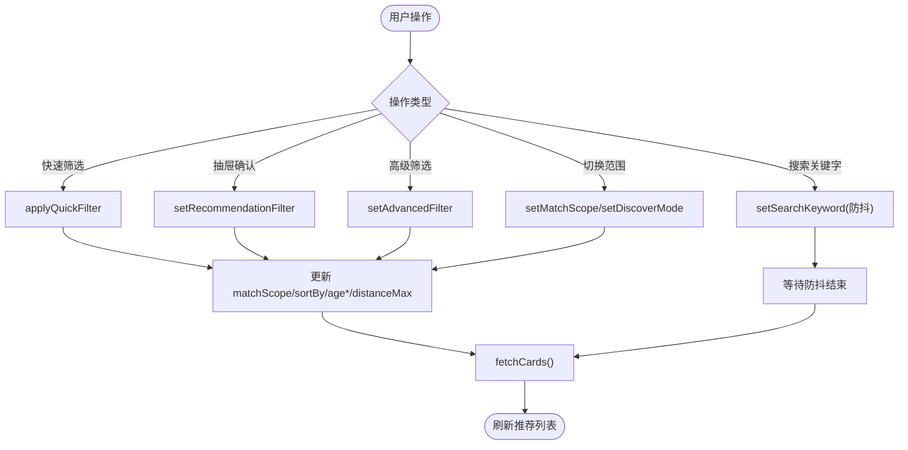
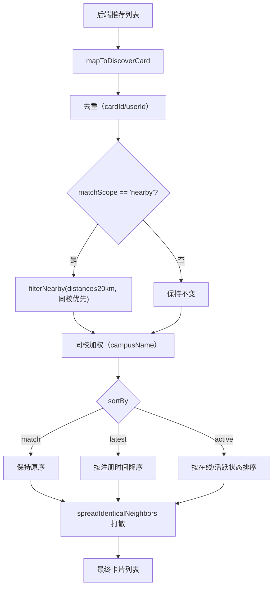
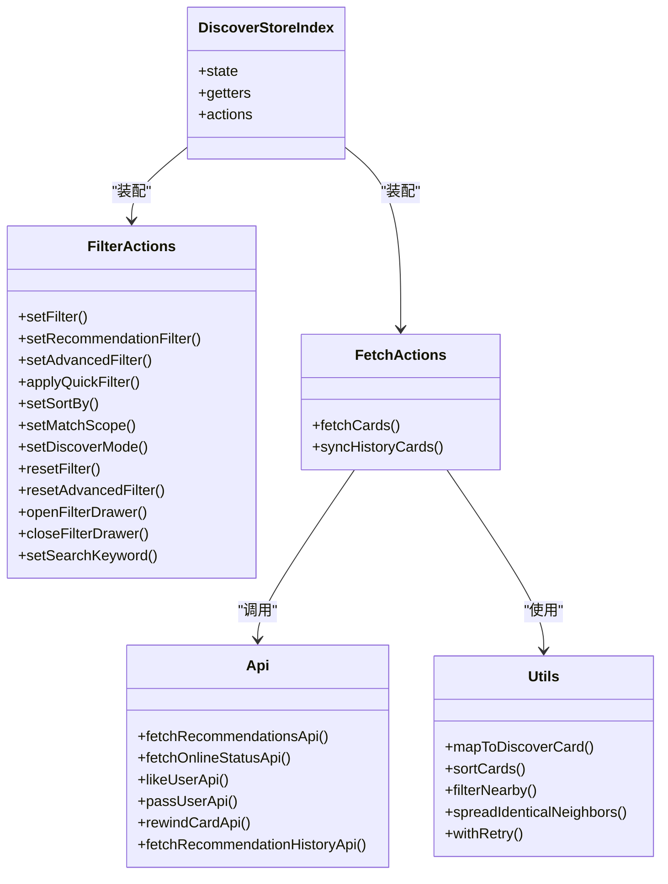
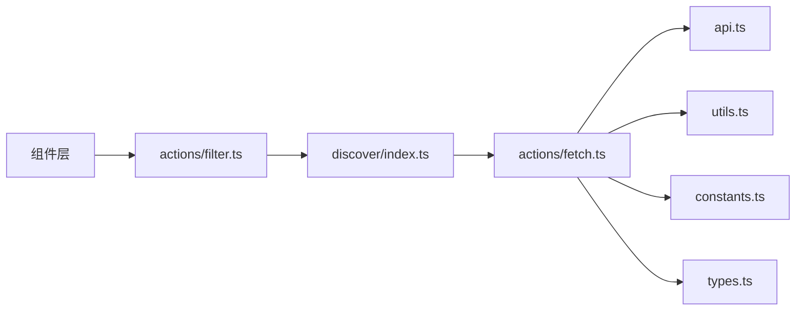

# 筛选过滤动作（filter actions）

<cite>
**本文引用的文件**
- [apps/client/src/stores/discover/index.ts](file://apps/client/src/stores/discover/index.ts)
- [apps/client/src/stores/discover/actions/filter.ts](file://apps/client/src/stores/discover/actions/filter.ts)
- [apps/client/src/stores/discover/actions/fetch.ts](file://apps/client/src/stores/discover/actions/fetch.ts)
- [apps/client/src/stores/discover/api.ts](file://apps/client/src/stores/discover/api.ts)
- [apps/client/src/stores/discover/types.ts](file://apps/client/src/stores/discover/types.ts)
- [apps/client/src/stores/discover/constants.ts](file://apps/client/src/stores/discover/constants.ts)
- [apps/client/src/stores/discover/utils.ts](file://apps/client/src/stores/discover/utils.ts)
- [apps/client/src/components/discover/FilterDrawer.vue](file://apps/client/src/components/discover/FilterDrawer.vue)
- [apps/client/src/components/discover/AdvancedFilter.vue](file://apps/client/src/components/discover/AdvancedFilter.vue)
- [apps/client/src/components/discover/QuickFilterSheet.vue](file://apps/client/src/components/discover/QuickFilterSheet.vue)
- [apps/client/src/services/generated/api-types-supplement.ts](file://apps/client/src/services/generated/api-types-supplement.ts)
</cite>

## 目录
1. [简介](#简介)
2. [项目结构](#项目结构)
3. [核心组件](#核心组件)
4. [架构总览](#架构总览)
5. [详细组件分析](#详细组件分析)
6. [依赖关系分析](#依赖关系分析)
7. [性能考量](#性能考量)
8. [故障排查指南](#故障排查指南)
9. [结论](#结论)
10. [附录：配置与扩展示例](#附录：配置与扩展示例)

## 简介
本文件聚焦“发现页”的筛选过滤能力，围绕用户偏好筛选、条件匹配与结果排序展开，系统性说明筛选条件的数据结构、计算规则、与用户资料的关联方式、动态筛选实现，以及可配置项与扩展方法。目标是让读者既能理解端到端的数据流，也能在实际开发中安全地扩展筛选维度或调整排序策略。

## 项目结构
发现页筛选功能由“Store 层 + UI 组件层 + API/工具层”协同完成：
- Store 层：维护筛选状态、执行筛选动作、驱动数据获取与刷新
- UI 组件层：提供快速筛选面板、高级筛选抽屉、搜索关键字输入等交互入口
- API/工具层：封装推荐列表请求、在线状态批量查询、本地存储与重试机制、排序与距离过滤等纯函数

**图表来源**
- [apps/client/src/stores/discover/index.ts:1-294](file://apps/client/src/stores/discover/index.ts#L1-L294)
- [apps/client/src/stores/discover/actions/filter.ts:1-293](file://apps/client/src/stores/discover/actions/filter.ts#L1-L293)
- [apps/client/src/stores/discover/actions/fetch.ts:1-252](file://apps/client/src/stores/discover/actions/fetch.ts#L1-L252)
- [apps/client/src/stores/discover/api.ts:1-211](file://apps/client/src/stores/discover/api.ts#L1-L211)
- [apps/client/src/stores/discover/utils.ts:1-383](file://apps/client/src/stores/discover/utils.ts#L1-L383)
- [apps/client/src/stores/discover/constants.ts:1-179](file://apps/client/src/stores/discover/constants.ts#L1-L179)
- [apps/client/src/stores/discover/types.ts:1-350](file://apps/client/src/stores/discover/types.ts#L1-L350)

**章节来源**
- [apps/client/src/stores/discover/index.ts:1-294](file://apps/client/src/stores/discover/index.ts#L1-L294)
- [apps/client/src/stores/discover/actions/filter.ts:1-293](file://apps/client/src/stores/discover/actions/filter.ts#L1-L293)
- [apps/client/src/stores/discover/actions/fetch.ts:1-252](file://apps/client/src/stores/discover/actions/fetch.ts#L1-L252)
- [apps/client/src/stores/discover/api.ts:1-211](file://apps/client/src/stores/discover/api.ts#L1-L211)
- [apps/client/src/stores/discover/utils.ts:1-383](file://apps/client/src/stores/discover/utils.ts#L1-L383)
- [apps/client/src/stores/discover/constants.ts:1-179](file://apps/client/src/stores/discover/constants.ts#L1-L179)
- [apps/client/src/stores/discover/types.ts:1-350](file://apps/client/src/stores/discover/types.ts#L1-L350)

## 核心组件
- 快速筛选面板（QuickFilterSheet.vue）：提供匹配范围、年龄区间、排序规则的快速选择，确认后通过 apply 事件提交。
- 筛选抽屉（FilterDrawer.vue）：承载基础筛选（身高、学历、感情状态、籍贯/未来城市、关键词）与高级筛选（性别、年龄、学校、距离、兴趣、仅在线），支持即时应用与确认应用两种模式。
- 高级筛选子组件（AdvancedFilter.vue）：专注高级字段的双向绑定与校验（年龄互斥、数量上限等）。
- Store 筛选动作（actions/filter.ts）：集中处理 setFilter、setRecommendationFilter、setAdvancedFilter、applyQuickFilter、setSortBy、setMatchScope、setDiscoverMode、resetFilter、resetAdvancedFilter、open/closeFilterDrawer、setSearchKeyword 等。
- 卡片获取动作（actions/fetch.ts）：fetchCards 统一组装筛选参数、去重、同校加权、排序、相邻打散，并写入 store；同时同步历史与拒绝记录。
- 工具与常量（utils.ts、constants.ts、types.ts）：定义 SortBy/MatchScope、空筛选模板、每日限量、防抖延迟、排序算法、距离过滤、重试执行器等。
- API 封装（api.ts）：封装推荐列表、在线状态批量查询、左滑/右滑、反悔、历史等接口调用。

**章节来源**
- [apps/client/src/components/discover/QuickFilterSheet.vue:1-437](file://apps/client/src/components/discover/QuickFilterSheet.vue#L1-L437)
- [apps/client/src/components/discover/FilterDrawer.vue:1-200](file://apps/client/src/components/discover/FilterDrawer.vue#L1-L200)
- [apps/client/src/components/discover/AdvancedFilter.vue:1-200](file://apps/client/src/components/discover/AdvancedFilter.vue#L1-L200)
- [apps/client/src/stores/discover/actions/filter.ts:1-293](file://apps/client/src/stores/discover/actions/filter.ts#L1-L293)
- [apps/client/src/stores/discover/actions/fetch.ts:1-252](file://apps/client/src/stores/discover/actions/fetch.ts#L1-L252)
- [apps/client/src/stores/discover/utils.ts:1-383](file://apps/client/src/stores/discover/utils.ts#L1-L383)
- [apps/client/src/stores/discover/constants.ts:1-179](file://apps/client/src/stores/discover/constants.ts#L1-L179)
- [apps/client/src/stores/discover/types.ts:1-350](file://apps/client/src/stores/discover/types.ts#L1-L350)
- [apps/client/src/stores/discover/api.ts:1-211](file://apps/client/src/stores/discover/api.ts#L1-L211)

## 架构总览
下图展示了从用户操作到数据返回再到界面渲染的关键流程，包括筛选条件如何被组合、传递和生效。

**图表来源**
- [apps/client/src/components/discover/QuickFilterSheet.vue:1-437](file://apps/client/src/components/discover/QuickFilterSheet.vue#L1-L437)
- [apps/client/src/components/discover/FilterDrawer.vue:1-200](file://apps/client/src/components/discover/FilterDrawer.vue#L1-L200)
- [apps/client/src/stores/discover/actions/filter.ts:1-293](file://apps/client/src/stores/discover/actions/filter.ts#L1-L293)
- [apps/client/src/stores/discover/actions/fetch.ts:1-252](file://apps/client/src/stores/discover/actions/fetch.ts#L1-L252)
- [apps/client/src/stores/discover/api.ts:1-211](file://apps/client/src/stores/discover/api.ts#L1-L211)
- [apps/client/src/stores/discover/utils.ts:1-383](file://apps/client/src/stores/discover/utils.ts#L1-L383)

## 详细组件分析

### 筛选条件数据结构
- 推荐筛选对象 RecommendationFilter：用于透传给后端的完整筛选条件，包含基础与高级字段（如身高、学历、感情状态、籍贯/未来城市、关键词、性别、年龄、学校、距离、兴趣、仅在线等）。空筛选模板 EMPTY_RECOMMENDATION_FILTER 将所有字段置为 undefined，表示“不限”。
- 排序规则 SortBy：match（保持推荐算法原始顺序）、latest（按注册时间降序）、active（按活跃程度排序，优先使用在线状态回填值，其次回退到 activeStatusText）。
- 匹配范围 MatchScope：all（不限）、nearby（附近，限定 distanceMax）、same_city、same_school。
- 其他状态：
  - activeFilter：当前 chip 高亮 ID（如 nearby/all），仅影响 UI，不直接决定 API 参数。
  - recommendationFilter：实际透传给后端的筛选对象。
  - advancedFilter：独立的高级筛选 slice，便于 AdvancedFilter 组件双向绑定。
  - searchKeyword：搜索关键字，优先级高于 recommendationFilter.keyword。
  - isFilterDrawerOpen：控制筛选抽屉显隐。

**章节来源**
- [apps/client/src/stores/discover/types.ts:1-350](file://apps/client/src/stores/discover/types.ts#L1-L350)
- [apps/client/src/stores/discover/constants.ts:1-179](file://apps/client/src/stores/discover/constants.ts#L1-L179)
- [apps/client/src/services/generated/api-types-supplement.ts:1-260](file://apps/client/src/services/generated/api-types-supplement.ts#L1-L260)

### 用户偏好筛选与动态筛选实现
- 快速筛选：QuickFilterSheet 在用户确认后 emit apply，由 actions/filter.ts 的 applyQuickFilter 一次性设置 matchScope、sortBy 与 ageMin/ageMax，并在必要时注入 distanceMax（当 matchScope=nearby），随后触发一次 fetchCards。
- 抽屉筛选：FilterDrawer 在基础/高级 Tab 下维护 draft，点击“确认”时 emit apply，actions/filter.ts 的 setRecommendationFilter 将完整 filter 覆盖至 recommendationFilter，并同步 advancedFilter，再触发 fetchCards。
- 高级筛选：AdvancedFilter 仅关注高级字段，通过 update:modelValue 回传，actions/filter.ts 的 setAdvancedFilter 合并到 recommendationFilter 并刷新。
- 搜索关键字：setSearchKeyword 带 300ms 防抖，避免频繁刷新；keyword 优先级高于 recommendationFilter.keyword。
- 匹配范围与模式：setMatchScope 在 nearb y 时注入 distanceMax；setDiscoverMode 提供“推荐/附近”分段切换的统一入口，内部同步 activeFilter、matchScope 与 distanceMax。

**图表来源**
- [apps/client/src/stores/discover/actions/filter.ts:1-293](file://apps/client/src/stores/discover/actions/filter.ts#L1-L293)
- [apps/client/src/stores/discover/actions/fetch.ts:1-252](file://apps/client/src/stores/discover/actions/fetch.ts#L1-L252)
- [apps/client/src/components/discover/QuickFilterSheet.vue:1-437](file://apps/client/src/components/discover/QuickFilterSheet.vue#L1-L437)
- [apps/client/src/components/discover/FilterDrawer.vue:1-200](file://apps/client/src/components/discover/FilterDrawer.vue#L1-L200)
- [apps/client/src/components/discover/AdvancedFilter.vue:1-200](file://apps/client/src/components/discover/AdvancedFilter.vue#L1-L200)

**章节来源**
- [apps/client/src/stores/discover/actions/filter.ts:1-293](file://apps/client/src/stores/discover/actions/filter.ts#L1-L293)
- [apps/client/src/stores/discover/actions/fetch.ts:1-252](file://apps/client/src/stores/discover/actions/fetch.ts#L1-L252)
- [apps/client/src/components/discover/QuickFilterSheet.vue:1-437](file://apps/client/src/components/discover/QuickFilterSheet.vue#L1-L437)
- [apps/client/src/components/discover/FilterDrawer.vue:1-200](file://apps/client/src/components/discover/FilterDrawer.vue#L1-L200)
- [apps/client/src/components/discover/AdvancedFilter.vue:1-200](file://apps/client/src/components/discover/AdvancedFilter.vue#L1-L200)

### 条件匹配与结果排序
- 条件匹配：
  - 附近过滤：matchScope=nearby 时，前端对卡片执行 filterNearby，保留同校用户并按 distanceText ≤ 20km 过滤。
  - 同校加权：根据当前用户 campusName，将同校卡片前置，提升展示优先级。
  - 已查看去重：基于 viewedCards 的 cardId 过滤；同一批内还会按 userId 去重，避免重复推荐。
- 结果排序：
  - match：保持后端推荐算法原始顺序（稳定排序）。
  - latest：按 registeredAt 降序，缺失时间者置末尾。
  - active：优先使用 onlineStatus（批量回填），其次使用 activeStatusText，按预定义权重排序。
- 相邻同形象打散：在排序后进行 spreadIdenticalNeighbors，将视觉上相同的相邻卡片交错排列，降低孪生账号相邻出现的观感。

**图表来源**
- [apps/client/src/stores/discover/actions/fetch.ts:1-252](file://apps/client/src/stores/discover/actions/fetch.ts#L1-L252)
- [apps/client/src/stores/discover/utils.ts:1-383](file://apps/client/src/stores/discover/utils.ts#L1-L383)

**章节来源**
- [apps/client/src/stores/discover/actions/fetch.ts:1-252](file://apps/client/src/stores/discover/actions/fetch.ts#L1-L252)
- [apps/client/src/stores/discover/utils.ts:1-383](file://apps/client/src/stores/discover/utils.ts#L1-L383)

### 与用户资料的关联方式
- 在线状态回填：通过 api.ts 中的 fetchOnlineStatusApi 批量查询用户在线状态，并在卡片映射时回填 onlineStatus，以改善 active 排序准确性。
- 同校加权：依据 session 中的 userSession.campusName 与卡片的 campusName 对比进行同校优先。
- 匹配范围联动：当选择“附近”时，distanceMax 会注入到 recommendationFilter，后端据此限制距离；前端也做 filterNearby 兜底。

**章节来源**
- [apps/client/src/stores/discover/api.ts:1-211](file://apps/client/src/stores/discover/api.ts#L1-L211)
- [apps/client/src/stores/discover/actions/fetch.ts:1-252](file://apps/client/src/stores/discover/actions/fetch.ts#L1-L252)
- [apps/client/src/stores/discover/utils.ts:1-383](file://apps/client/src/stores/discover/utils.ts#L1-L383)

### 类/模块关系图

**图表来源**
- [apps/client/src/stores/discover/index.ts:1-294](file://apps/client/src/stores/discover/index.ts#L1-L294)
- [apps/client/src/stores/discover/actions/filter.ts:1-293](file://apps/client/src/stores/discover/actions/filter.ts#L1-L293)
- [apps/client/src/stores/discover/actions/fetch.ts:1-252](file://apps/client/src/stores/discover/actions/fetch.ts#L1-L252)
- [apps/client/src/stores/discover/utils.ts:1-383](file://apps/client/src/stores/discover/utils.ts#L1-L383)
- [apps/client/src/stores/discover/api.ts:1-211](file://apps/client/src/stores/discover/api.ts#L1-L211)

## 依赖关系分析
- 组件到 Store：QuickFilterSheet、FilterDrawer、AdvancedFilter 通过事件或 v-model 与 actions/filter.ts 交互，改变状态并触发 fetchCards。
- Store 到 API：actions/fetch.ts 调用 api.ts 的推荐列表与在线状态接口，结合 utils.ts 的工具函数完成数据处理。
- 常量与类型：constants.ts 提供防抖延迟、每日限量、空筛选模板等；types.ts 定义状态与枚举类型，保证类型安全。
- 外部依赖：session 与 mock 模式判断（useMock）影响同校加权与兜底逻辑；uni-app 本地存储用于每日记录持久化。

**图表来源**
- [apps/client/src/stores/discover/actions/filter.ts:1-293](file://apps/client/src/stores/discover/actions/filter.ts#L1-L293)
- [apps/client/src/stores/discover/actions/fetch.ts:1-252](file://apps/client/src/stores/discover/actions/fetch.ts#L1-L252)
- [apps/client/src/stores/discover/index.ts:1-294](file://apps/client/src/stores/discover/index.ts#L1-L294)
- [apps/client/src/stores/discover/api.ts:1-211](file://apps/client/src/stores/discover/api.ts#L1-L211)
- [apps/client/src/stores/discover/utils.ts:1-383](file://apps/client/src/stores/discover/utils.ts#L1-L383)
- [apps/client/src/stores/discover/constants.ts:1-179](file://apps/client/src/stores/discover/constants.ts#L1-L179)
- [apps/client/src/stores/discover/types.ts:1-350](file://apps/client/src/stores/discover/types.ts#L1-L350)

**章节来源**
- [apps/client/src/stores/discover/actions/filter.ts:1-293](file://apps/client/src/stores/discover/actions/filter.ts#L1-L293)
- [apps/client/src/stores/discover/actions/fetch.ts:1-252](file://apps/client/src/stores/discover/actions/fetch.ts#L1-L252)
- [apps/client/src/stores/discover/index.ts:1-294](file://apps/client/src/stores/discover/index.ts#L1-L294)
- [apps/client/src/stores/discover/api.ts:1-211](file://apps/client/src/stores/discover/api.ts#L1-L211)
- [apps/client/src/stores/discover/utils.ts:1-383](file://apps/client/src/stores/discover/utils.ts#L1-L383)
- [apps/client/src/stores/discover/constants.ts:1-179](file://apps/client/src/stores/discover/constants.ts#L1-L179)
- [apps/client/src/stores/discover/types.ts:1-350](file://apps/client/src/stores/discover/types.ts#L1-L350)

## 性能考量
- 防抖优化：
  - 搜索关键字：setSearchKeyword 使用 300ms 防抖，避免每次按键都触发刷新。
  - 存储同步：watch 监听 viewedCards、hasRewoundToday、lastRefreshTime，通过 debouncedSave 合并写入，减少本地存储 IO。
  - 右滑防抖：SWIPE_RIGHT_DEBOUNCE_MS 防止并发右滑导致状态错乱。
- 请求控制：
  - AbortController：fetchCards 在发起新请求前取消旧请求，避免竞态覆盖。
  - withRetry：失败自动重试，但鉴权错误（401/403）不重试，避免放大错误风暴。
- 数据预处理：
  - 同批去重：dedupByUserId 避免同一批出现重复用户。
  - 相邻打散：spreadIdenticalNeighbors 降低视觉重复。
  - 在线状态批量回填：减少多次查询开销。
- 内存缓存：
  - 每日记录内存缓存：loadDailyRecord/saveDailyRecord 在同日内复用解析结果，避免重复 storage 读/写。

**章节来源**
- [apps/client/src/stores/discover/actions/filter.ts:1-293](file://apps/client/src/stores/discover/actions/filter.ts#L1-L293)
- [apps/client/src/stores/discover/actions/fetch.ts:1-252](file://apps/client/src/stores/discover/actions/fetch.ts#L1-L252)
- [apps/client/src/stores/discover/utils.ts:1-383](file://apps/client/src/stores/discover/utils.ts#L1-L383)
- [apps/client/src/stores/discover/constants.ts:1-179](file://apps/client/src/stores/discover/constants.ts#L1-L179)
- [apps/client/src/stores/discover/index.ts:1-294](file://apps/client/src/stores/discover/index.ts#L1-L294)

## 故障排查指南
- 推荐列表为空且无法刷新：
  - 检查 quotaExhausted：当 availableCards 为空时，非游客会查询后端配额，若 remaining<=0 则显示“今日次数已用完”。
  - 检查是否误用 abort：新请求发起会取消旧请求，确保未意外中断。
- 筛选未生效：
  - 确认 setRecommendationFilter/applyQuickFilter 是否正确触发 fetchCards。
  - 检查 keyword 优先级：searchKeyword 优先于 recommendationFilter.keyword。
  - 检查 matchScope 与 distanceMax：nearby 需注入 distanceMax 才生效。
- 排序异常：
  - active 排序优先使用 onlineStatus，确认是否调用了 fetchOnlineStatusApi 回填。
  - latest 排序依赖 registeredAt，若缺失会排末尾。
- 存储卡顿：
  - 检查 watch 是否重复注册（_watchInitialized 控制单次初始化）。
  - 确认 SAVE_DEBOUNCE_MS 防抖窗口合理。

**章节来源**
- [apps/client/src/stores/discover/actions/fetch.ts:1-252](file://apps/client/src/stores/discover/actions/fetch.ts#L1-L252)
- [apps/client/src/stores/discover/actions/filter.ts:1-293](file://apps/client/src/stores/discover/actions/filter.ts#L1-L293)
- [apps/client/src/stores/discover/utils.ts:1-383](file://apps/client/src/stores/discover/utils.ts#L1-L383)
- [apps/client/src/stores/discover/index.ts:1-294](file://apps/client/src/stores/discover/index.ts#L1-L294)

## 结论
发现页筛选过滤功能通过清晰的 Store 动作与组件解耦，实现了用户偏好筛选、条件匹配与结果排序的完整闭环。其优势在于：
- 数据结构明确：RecommendationFilter、SortBy、MatchScope 等类型集中管理，前后端契约清晰。
- 动态筛选灵活：快速筛选与抽屉筛选并存，支持即时与确认两种模式，搜索关键字带防抖。
- 性能优化到位：防抖、AbortController、重试、内存缓存与批量回填共同保障流畅体验。
- 可扩展性强：新增筛选维度只需扩展 RecommendationFilter 与对应 UI/Store 逻辑，不影响现有流程。

## 附录：配置与扩展示例
- 新增筛选维度（例如“收入范围”）：
  - 在 RecommendationFilter 中增加字段（需在 api-types 中补充类型）。
  - 在 FilterDrawer/AdvancedFilter 中添加控件与校验。
  - 在 actions/filter.ts 的 setRecommendationFilter/setAdvancedFilter 中处理新字段。
  - 在 actions/fetch.ts 中确保 keyword/excludeIds 外，新字段透传给后端。
  - 如需前端额外过滤或排序，可在 utils.ts 中新增函数并在 fetchCards 中调用。
- 调整排序策略：
  - 在 utils.ts 的 sortCards 中新增分支或调整权重。
  - 在 QuickFilterSheet 中暴露新的排序选项。
- 调整匹配范围：
  - 在 types.ts 的 MatchScope 中增加新值。
  - 在 actions/filter.ts 的 setMatchScope/setDiscoverMode 中处理新范围。
  - 在 utils.ts 中新增对应的过滤逻辑（如 same_city）。
- 调整每日限量与配额提示：
  - constants.ts 中 DAILY_LIMIT_TOTAL 与 SUPER_TEST_UNLIMITED_REMAINING。
  - actions/fetch.ts 中 quotaExhausted 的判定逻辑。
- 调试与监控：
  - 使用 withRetry 的重试日志（仅在 dev 环境输出）。
  - 观察 quotaExhausted 与 errorMessage 的变化，定位网络/认证问题。

**章节来源**
- [apps/client/src/stores/discover/types.ts:1-350](file://apps/client/src/stores/discover/types.ts#L1-L350)
- [apps/client/src/stores/discover/constants.ts:1-179](file://apps/client/src/stores/discover/constants.ts#L1-L179)
- [apps/client/src/stores/discover/actions/filter.ts:1-293](file://apps/client/src/stores/discover/actions/filter.ts#L1-L293)
- [apps/client/src/stores/discover/actions/fetch.ts:1-252](file://apps/client/src/stores/discover/actions/fetch.ts#L1-L252)
- [apps/client/src/stores/discover/utils.ts:1-383](file://apps/client/src/stores/discover/utils.ts#L1-L383)
- [apps/client/src/components/discover/FilterDrawer.vue:1-200](file://apps/client/src/components/discover/FilterDrawer.vue#L1-L200)
- [apps/client/src/components/discover/AdvancedFilter.vue:1-200](file://apps/client/src/components/discover/AdvancedFilter.vue#L1-L200)
- [apps/client/src/components/discover/QuickFilterSheet.vue:1-437](file://apps/client/src/components/discover/QuickFilterSheet.vue#L1-L437)
- [apps/client/src/services/generated/api-types-supplement.ts:1-260](file://apps/client/src/services/generated/api-types-supplement.ts#L1-L260)