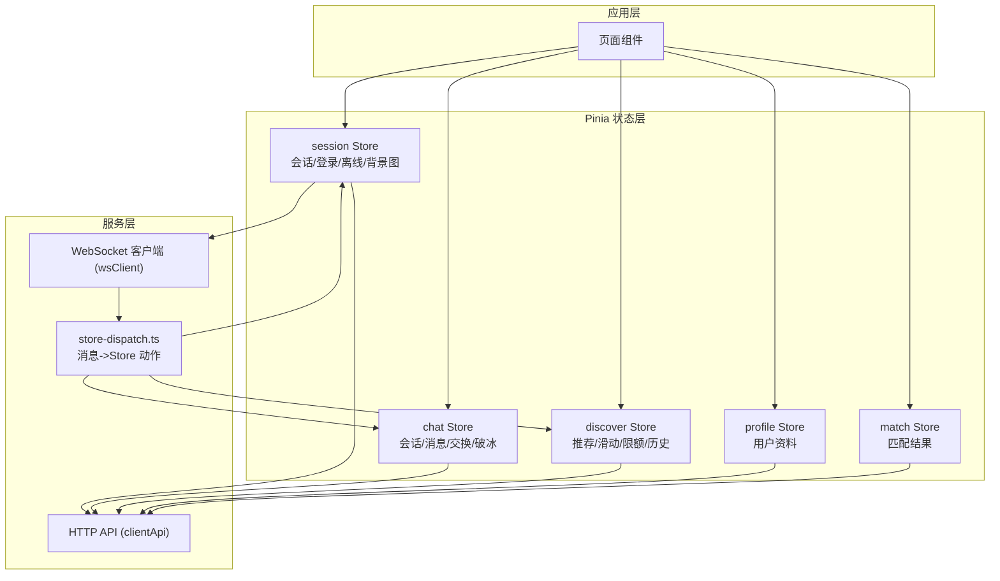
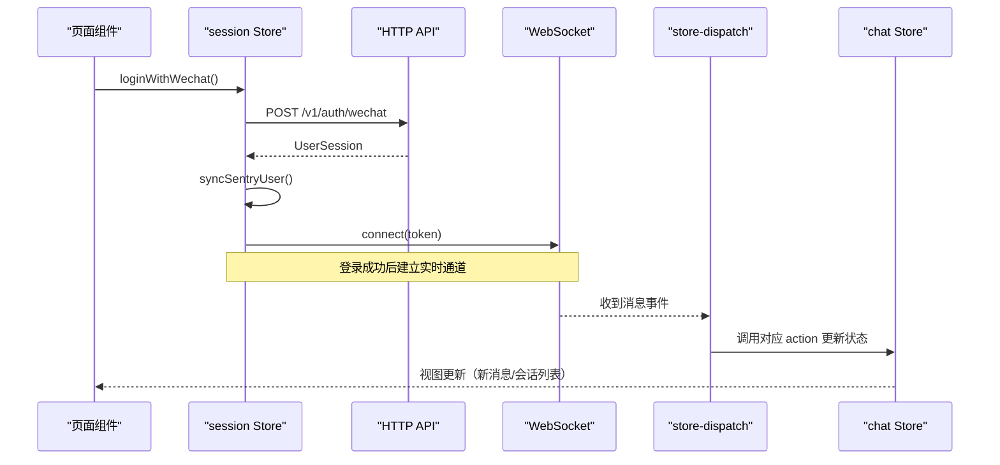
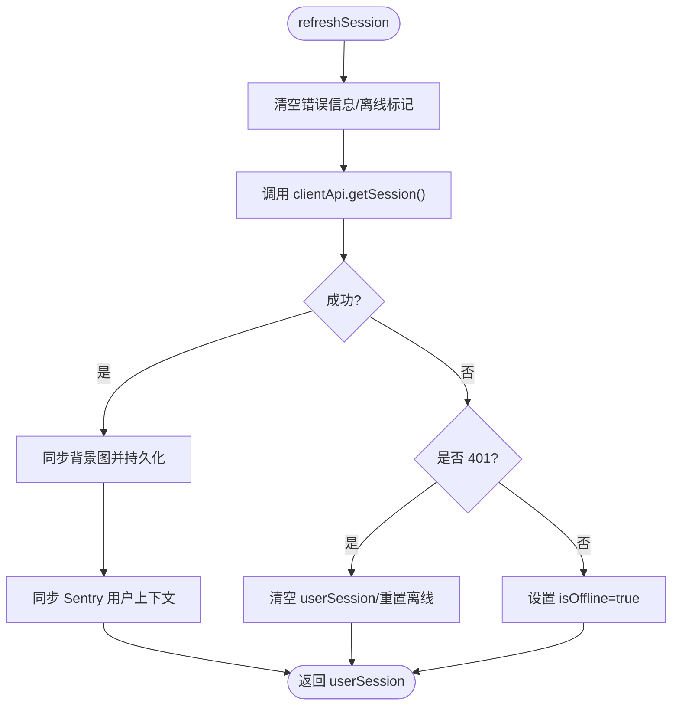
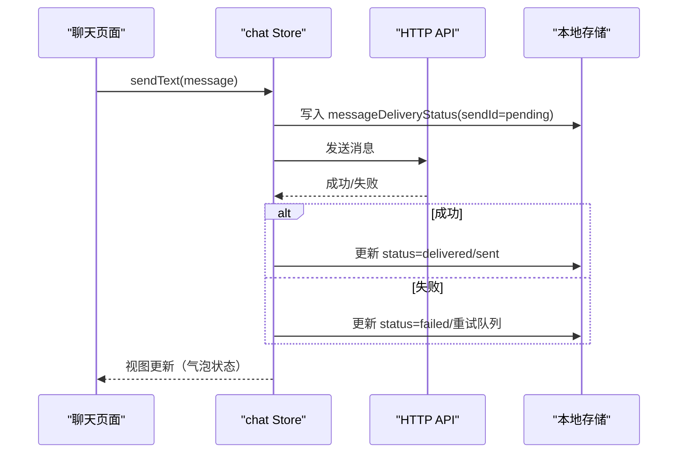
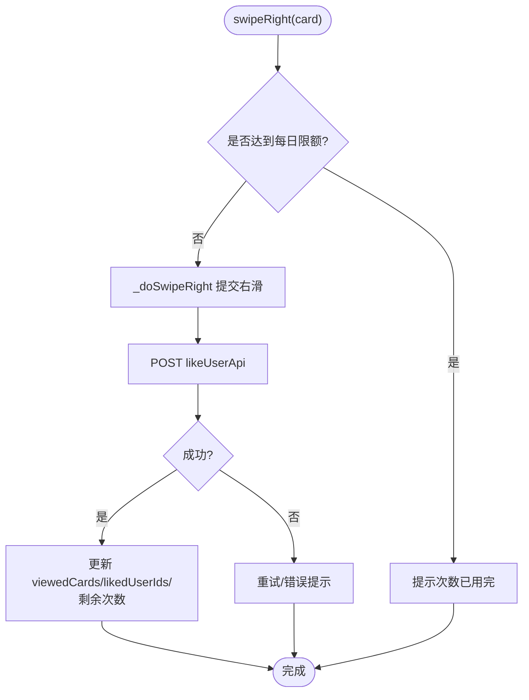
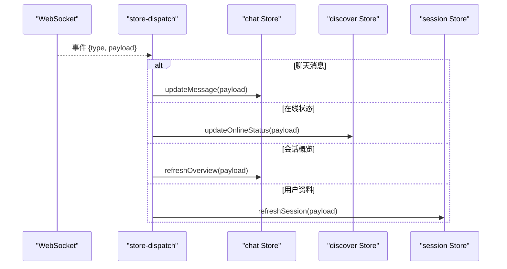
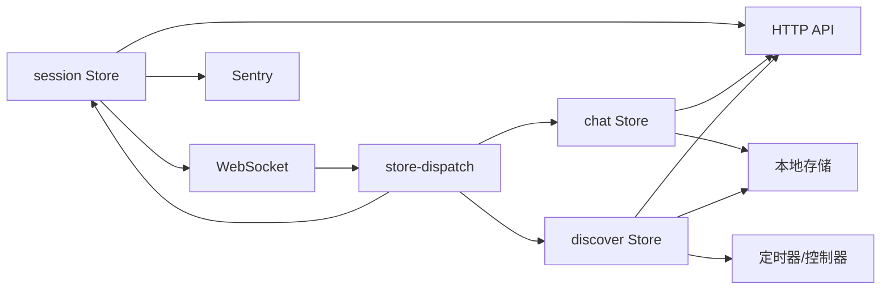
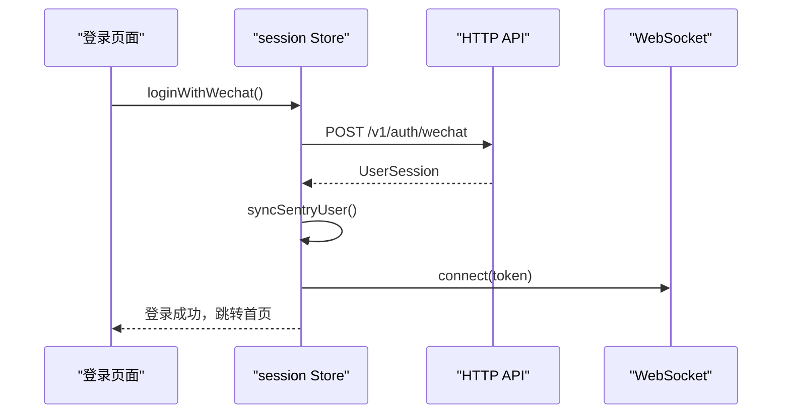
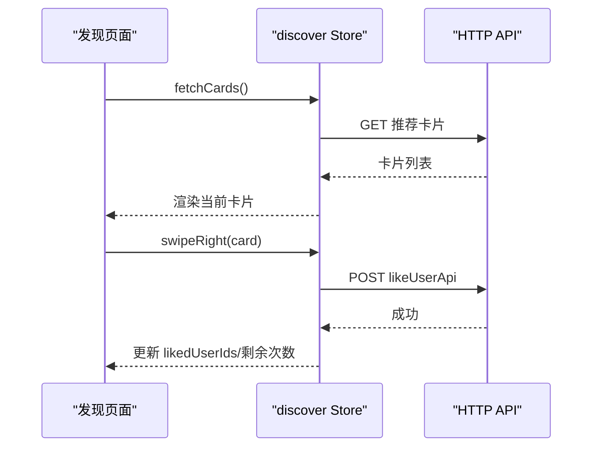
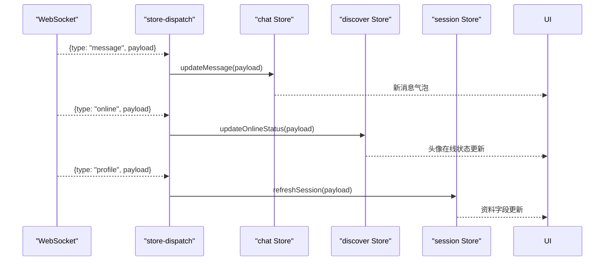

# 状态管理架构

<cite>
**本文引用的文件**   
- [apps/client/src/stores/session.ts](file://apps/client/src/stores/session.ts)
- [apps/client/src/stores/chat/index.ts](file://apps/client/src/stores/chat/index.ts)
- [apps/client/src/stores/chat/types.ts](file://apps/client/src/stores/chat/types.ts)
- [apps/client/src/stores/chat/utils.ts](file://apps/client/src/stores/chat/utils.ts)
- [apps/client/src/stores/chat/actions/messaging.ts](file://apps/client/src/stores/chat/actions/messaging.ts)
- [apps/client/src/stores/chat/actions/session.ts](file://apps/client/src/stores/chat/actions/session.ts)
- [apps/client/src/stores/discover/index.ts](file://apps/client/src/stores/discover/index.ts)
- [apps/client/src/stores/discover/constants.ts](file://apps/client/src/stores/discover/constants.ts)
- [apps/client/src/stores/discover/utils.ts](file://apps/client/src/stores/discover/utils.ts)
- [apps/client/src/stores/discover/actions/fetch.ts](file://apps/client/src/stores/discover/actions/fetch.ts)
- [apps/client/src/stores/discover/actions/swipe.ts](file://apps/client/src/stores/discover/actions/swipe.ts)
- [apps/client/src/stores/discover/actions/storage.ts](file://apps/client/src/stores/discover/actions/storage.ts)
- [apps/client/src/stores/profile.ts](file://apps/client/src/stores/profile.ts)
- [apps/client/src/stores/match.ts](file://apps/client/src/stores/match.ts)
- [apps/client/src/services/websocket/store-dispatch.ts](file://apps/client/src/services/websocket/store-dispatch.ts)
- [apps/client/src/tests/profile-store.spec.ts](file://apps/client/src/tests/profile-store.spec.ts)
- [apps/client/src/tests/ws-store-dispatch.spec.ts](file://apps/client/src/tests/ws-store-dispatch.spec.ts)
</cite>

## 目录
1. [简介](#简介)
2. [项目结构](#项目结构)
3. [核心组件](#核心组件)
4. [架构总览](#架构总览)
5. [详细组件分析](#详细组件分析)
6. [依赖关系分析](#依赖关系分析)
7. [性能考虑](#性能考虑)
8. [故障排查指南](#故障排查指南)
9. [结论](#结论)
10. [附录：使用示例与数据流图](#附录使用示例与数据流图)

## 简介
本文件为 Campus Love 前端应用的 Pinia 状态管理架构文档，聚焦基于 TypeScript 的状态管理模式、Store 的组织结构与类型定义、模块化设计，以及 session、chat、profile、discover、match 等核心 Store 的职责划分。文档还覆盖状态持久化策略、异步操作处理、错误恢复机制、WebSocket 消息到状态的映射与实时同步方案，并给出调试工具使用建议、单元测试策略与性能优化技巧。最后提供具体 Store 使用示例与数据流图，帮助读者快速理解并正确使用该状态管理体系。

## 项目结构
前端应用采用按业务域划分的模块式 Store 组织方式，每个 Store 通常包含入口 re-export 与子目录拆分（如 chat、discover），以提升可维护性与可测试性。核心目录与职责概览：
- stores/session.ts：会话与会话持久化、登录/登出、Sentry 身份关联、离线态处理、学校绑定等
- stores/chat：聊天状态管理，按 actions 拆分为 session、messaging、exchange、icebreakers 等子模块
- stores/discover：发现页推荐卡片与滑动逻辑，按 actions 拆分为 fetch、swipe、rewind、storage、filter、history 等子模块
- stores/profile.ts：用户资料相关状态
- stores/match.ts：匹配相关状态
- services/websocket/store-dispatch.ts：WebSocket 消息分发至各 Store 的桥接层

**图表来源**
- [apps/client/src/stores/session.ts:1-896](file://apps/client/src/stores/session.ts#L1-L896)
- [apps/client/src/stores/chat/index.ts:1-131](file://apps/client/src/stores/chat/index.ts#L1-L131)
- [apps/client/src/stores/discover/index.ts:1-294](file://apps/client/src/stores/discover/index.ts#L1-L294)
- [apps/client/src/services/websocket/store-dispatch.ts:1-200](file://apps/client/src/services/websocket/store-dispatch.ts#L1-L200)

**章节来源**
- [apps/client/src/stores/session.ts:1-896](file://apps/client/src/stores/session.ts#L1-L896)
- [apps/client/src/stores/chat/index.ts:1-131](file://apps/client/src/stores/chat/index.ts#L1-L131)
- [apps/client/src/stores/discover/index.ts:1-294](file://apps/client/src/stores/discover/index.ts#L1-L294)

## 核心组件
- session Store：负责用户会话生命周期、登录/登出、离线检测、Sentry 用户上下文、个人资料完善度计算、个人主页背景图持久化、学校绑定、启动初始化 bootstrap、以及 WebSocket 连接的生命周期同步。
- chat Store：负责聊天概览、活跃会话、消息发送、联系方式交换、破冰话题，以及消息投递状态本地持久化与重试。
- discover Store：负责推荐卡片获取、滑动操作（左滑/右滑）、每日限额与配额耗尽标记、倒计时刷新、回看/反悔、筛选条件、历史与在线状态、存储与定时器。
- profile Store：用户资料状态（字段完善度、上传、保存）。
- match Store：匹配结果与匹配流程状态。

上述 Store 通过 Pinia defineStore 创建，以 TypeScript 严格类型约束，actions 模块化拆分，getters 暴露派生状态，state 保持最小必要视图状态。

**章节来源**
- [apps/client/src/stores/session.ts:1-896](file://apps/client/src/stores/session.ts#L1-L896)
- [apps/client/src/stores/chat/index.ts:1-131](file://apps/client/src/stores/chat/index.ts#L1-L131)
- [apps/client/src/stores/discover/index.ts:1-294](file://apps/client/src/stores/discover/index.ts#L1-L294)
- [apps/client/src/stores/profile.ts:1-200](file://apps/client/src/stores/profile.ts#L1-L200)
- [apps/client/src/stores/match.ts:1-112](file://apps/client/src/stores/match.ts#L1-L112)

## 架构总览
整体状态管理遵循“单一事实源 + 模块化 action + 类型驱动”的设计：
- 数据流向：UI 触发 store action -> HTTP/WS 调用 -> 更新 state -> 组件响应式更新
- 持久化：session 背景图、chat 消息投递状态、discover 每日限额与历史记录通过本地存储实现冷启动恢复
- 实时同步：WebSocket 消息经 store-dispatch 分发给对应 store 的 action 进行状态更新
- 错误恢复：session 区分网络错误与鉴权错误；chat 支持消息发送重试；discover 支持配额耗尽与失败重试

**图表来源**
- [apps/client/src/stores/session.ts:600-896](file://apps/client/src/stores/session.ts#L600-L896)
- [apps/client/src/services/websocket/store-dispatch.ts:1-200](file://apps/client/src/services/websocket/store-dispatch.ts#L1-L200)
- [apps/client/src/stores/chat/index.ts:1-131](file://apps/client/src/stores/chat/index.ts#L1-L131)

## 详细组件分析

### session Store 分析
职责与能力：
- 登录/登出：微信登录链路封装，登出清理 token、缓存、Sentry 上下文与 WebSocket 连接
- 会话刷新：区分网络错误与鉴权错误，记录 errorMessage，支持离线浏览
- 启动初始化：bootstrap 并行拉取登录主视觉与用户会话，检测失效 token 并清理
- 资料完善度：加权算法计算完善度百分比，字段完成状态统一收敛
- 背景图持久化：H5 刷新/小程序冷启动后恢复
- 学校绑定：真实模式调用后端接口保存校园档案，mock 模式本地改写
- WebSocket 同步：根据登录态连接或断开

关键状态与 getter：
- userSession、isOffline、errorMessage、profileBackgroundUrl
- isLoggedIn、featureFlags、completionState、profileFieldStatus、profileCompletion、isProfileComplete、isCampusVerified、isSchoolBound、isSuperTestAccount

关键 action：
- refreshSession、logout、bootstrap、loginWithWechat、enterDevUserDemo、updateProfileCompletion、setOfflineStatus、setProfileBackgroundUrl、bindSchool

**图表来源**
- [apps/client/src/stores/session.ts:400-896](file://apps/client/src/stores/session.ts#L400-L896)

**章节来源**
- [apps/client/src/stores/session.ts:1-896](file://apps/client/src/stores/session.ts#L1-L896)

### chat Store 分析
职责与能力：
- 会话生命周期：加载概览、从推荐/匹配/信号开启会话、加载会话、置顶/结束会话
- 消息发送：文本/语音消息发送，消息投递状态本地持久化与重试
- 联系方式交换：接受/拒绝交换
- 破冰话题：加载与发送破冰话题

状态与 getter：
- overview、overviewView、activeSession、icebreakerTopics、icebreakerItems、loadingIcebreakers、messageDeliveryStatus

关键 action：
- loadOverview、startFromRecommendation/startFromMatch/startFromSignal、loadSession、setSessionPinned、endSession
- sendText、sendVoice、_setMessageStatus
- acceptExchange、rejectExchange
- loadIcebreakers、sendIcebreaker、fetchIcebreakers

**图表来源**
- [apps/client/src/stores/chat/index.ts:1-131](file://apps/client/src/stores/chat/index.ts#L1-L131)
- [apps/client/src/stores/chat/actions/messaging.ts:1-200](file://apps/client/src/stores/chat/actions/messaging.ts#L1-L200)
- [apps/client/src/stores/chat/utils.ts:1-97](file://apps/client/src/stores/chat/utils.ts#L1-L97)

**章节来源**
- [apps/client/src/stores/chat/index.ts:1-131](file://apps/client/src/stores/chat/index.ts#L1-L131)
- [apps/client/src/stores/chat/types.ts:1-86](file://apps/client/src/stores/chat/types.ts#L1-L86)
- [apps/client/src/stores/chat/utils.ts:1-97](file://apps/client/src/stores/chat/utils.ts#L1-L97)
- [apps/client/src/stores/chat/actions/messaging.ts:1-200](file://apps/client/src/stores/chat/actions/messaging.ts#L1-L200)
- [apps/client/src/stores/chat/actions/session.ts:1-200](file://apps/client/src/stores/chat/actions/session.ts#L1-L200)

### discover Store 分析
职责与能力：
- 卡片获取：拉取推荐卡片、同步历史卡片
- 滑动操作：左滑/右滑、批量刷新右滑队列
- 限额与配额：每日限额、额外配额、配额耗尽标记、倒计时刷新
- 回看与反悔：重置上次结果、回看卡片
- 筛选：推荐筛选、高级筛选、搜索关键词、模式切换
- 历史与在线：加载历史、查询在线状态、设置额外配额
- 存储：本地持久化、防抖保存、销毁资源

状态与 getter：
- cards、viewedCards、historyCards、passedCards、dailyLimit、extraQuota、quotaExhausted、onlineStatusMap、lastSwipeResult、sortBy、matchScope、recommendationFilter、advancedFilter、undoCount
- currentCard、usedCount、remainingCount、isLimitReached、likedUserIds、countdownSeconds、countdownText

关键 action：
- fetchCards、syncHistoryCards
- swipeLeft、swipeRight、_doSwipeRight、_flushSwipeRightQueue
- resetLastResult、rewindCard
- resetDailyLimit、debouncedSave、saveToStorage、forceResetDailyLimit、dispose
- setFilter、setRecommendationFilter、setSortBy、setMatchScope、setNearbyScope、setDiscoverMode、resetFilter、setAdvancedFilter、resetAdvancedFilter、openFilterDrawer、closeFilterDrawer、setSearchKeyword、applyQuickFilter
- loadHistory、fetchOnlineStatus、setExtraQuota

**图表来源**
- [apps/client/src/stores/discover/index.ts:1-294](file://apps/client/src/stores/discover/index.ts#L1-L294)
- [apps/client/src/stores/discover/actions/swipe.ts:1-200](file://apps/client/src/stores/discover/actions/swipe.ts#L1-L200)
- [apps/client/src/stores/discover/actions/fetch.ts:1-200](file://apps/client/src/stores/discover/actions/fetch.ts#L1-L200)
- [apps/client/src/stores/discover/constants.ts:1-179](file://apps/client/src/stores/discover/constants.ts#L1-L179)
- [apps/client/src/stores/discover/utils.ts:1-200](file://apps/client/src/stores/discover/utils.ts#L1-L200)

**章节来源**
- [apps/client/src/stores/discover/index.ts:1-294](file://apps/client/src/stores/discover/index.ts#L1-L294)
- [apps/client/src/stores/discover/constants.ts:1-179](file://apps/client/src/stores/discover/constants.ts#L1-L179)
- [apps/client/src/stores/discover/utils.ts:1-200](file://apps/client/src/stores/discover/utils.ts#L1-L200)
- [apps/client/src/stores/discover/actions/fetch.ts:1-200](file://apps/client/src/stores/discover/actions/fetch.ts#L1-L200)
- [apps/client/src/stores/discover/actions/swipe.ts:1-200](file://apps/client/src/stores/discover/actions/swipe.ts#L1-L200)
- [apps/client/src/stores/discover/actions/storage.ts:1-170](file://apps/client/src/stores/discover/actions/storage.ts#L1-L170)

### WebSocket 消息到状态更新的映射
store-dispatch 作为 WebSocket 消息的分发中枢，将不同事件路由到对应 Store 的 action，确保实时数据与状态一致。例如：
- 新消息到达 -> chat Store 更新 activeSession 与消息列表
- 会话概览变更 -> chat Store 刷新 overview/overviewView
- 在线状态变化 -> discover Store 更新 onlineStatusMap
- 用户资料变更 -> session/profile Store 刷新相关字段

**图表来源**
- [apps/client/src/services/websocket/store-dispatch.ts:1-200](file://apps/client/src/services/websocket/store-dispatch.ts#L1-L200)

**章节来源**
- [apps/client/src/services/websocket/store-dispatch.ts:1-200](file://apps/client/src/services/websocket/store-dispatch.ts#L1-L200)

### 状态持久化策略
- session Store：个人主页背景图通过 uni.setStorageSync 持久化，冷启动/H5 刷新时恢复；登出时清除避免跨账号残留
- chat Store：消息投递状态（sendId -> status）持久化到本地存储，确保跨会话/刷新后可恢复展示
- discover Store：每日观看记录、历史卡片、配额与刷新时间等通过本地存储实现冷启动恢复；防抖保存减少 I/O

这些策略保证应用在异常退出、冷启动或刷新后仍能维持必要的视图状态，提升用户体验。

**章节来源**
- [apps/client/src/stores/session.ts:1-896](file://apps/client/src/stores/session.ts#L1-L896)
- [apps/client/src/stores/chat/utils.ts:1-97](file://apps/client/src/stores/chat/utils.ts#L1-L97)
- [apps/client/src/stores/discover/utils.ts:1-200](file://apps/client/src/stores/discover/utils.ts#L1-L200)

### 异步操作处理与错误恢复
- session Store：refreshSession 区分网络错误与鉴权错误；登录失败记录 errorMessage 并抛出明确错误；bootstrap 检测失效 token 并清理
- chat Store：消息发送失败时记录投递状态并支持重试；高可用传输层 withErrorHandling
- discover Store：配额耗尽时展示友好提示；请求失败时支持重试与降级

错误恢复机制确保在弱网或服务异常情况下，应用仍能提供基本功能与良好反馈。

**章节来源**
- [apps/client/src/stores/session.ts:400-896](file://apps/client/src/stores/session.ts#L400-L896)
- [apps/client/src/stores/chat/actions/messaging.ts:1-200](file://apps/client/src/stores/chat/actions/messaging.ts#L1-L200)
- [apps/client/src/stores/discover/actions/fetch.ts:1-200](file://apps/client/src/stores/discover/actions/fetch.ts#L1-L200)

## 依赖关系分析
- session Store 依赖 HTTP API、WebSocket、Sentry、TTL 缓存清理工具
- chat Store 依赖 HTTP API、本地存储、高阶函数与传输层实例
- discover Store 依赖 HTTP API、本地存储、定时器与请求控制器
- WebSocket 分发层依赖 wsClient，并将事件路由到 chat、discover、session 等 Store

**图表来源**
- [apps/client/src/stores/session.ts:1-896](file://apps/client/src/stores/session.ts#L1-L896)
- [apps/client/src/stores/chat/index.ts:1-131](file://apps/client/src/stores/chat/index.ts#L1-L131)
- [apps/client/src/stores/discover/index.ts:1-294](file://apps/client/src/stores/discover/index.ts#L1-L294)
- [apps/client/src/services/websocket/store-dispatch.ts:1-200](file://apps/client/src/services/websocket/store-dispatch.ts#L1-L200)

**章节来源**
- [apps/client/src/stores/session.ts:1-896](file://apps/client/src/stores/session.ts#L1-L896)
- [apps/client/src/stores/chat/index.ts:1-131](file://apps/client/src/stores/chat/index.ts#L1-L131)
- [apps/client/src/stores/discover/index.ts:1-294](file://apps/client/src/stores/discover/index.ts#L1-L294)
- [apps/client/src/services/websocket/store-dispatch.ts:1-200](file://apps/client/src/services/websocket/store-dispatch.ts#L1-L200)

## 性能考虑
- 使用 getters 计算派生状态，避免重复计算
- 对高频操作的 action 进行防抖/节流（如 discover 的 debouncedSave）
- 本地存储读写最小化，仅持久化必要字段（如 session 背景图、chat 消息状态、discover 每日记录）
- 并行请求（如 bootstrap 中并行拉取登录主视觉与用户会话）
- WebSocket 重连由 wsClient 内部处理，store 侧仅在登录态变化时连接/断开

[本节为通用指导，不直接分析具体文件]

## 故障排查指南
常见问题与定位方法：
- 登录后仍显示未登录：检查 session.refreshSession 是否捕获 401 并清理 token；确认 bootstrap 失效 token 清理逻辑
- 消息发送后状态不正确：查看 chat 的 messageDeliveryStatus 本地存储与重试逻辑
- 发现页提示“次数已用完”：检查 discover 的 dailyLimit、extraQuota、viewedCards 与 quotaExhausted 标记
- WebSocket 无实时数据：确认 session 登录成功后是否调用 wsClient.connect；检查 store-dispatch 是否正确路由事件

定位建议：
- 使用 Vue DevTools 查看 Pinia 状态树，确认 state/getters/actions 执行路径
- 结合 console.warn 日志（开发环境）定位异常分支
- 通过单元测试验证关键行为（如 profile-store.spec.ts、ws-store-dispatch.spec.ts）

**章节来源**
- [apps/client/src/stores/session.ts:400-896](file://apps/client/src/stores/session.ts#L400-L896)
- [apps/client/src/stores/chat/utils.ts:1-97](file://apps/client/src/stores/chat/utils.ts#L1-L97)
- [apps/client/src/stores/discover/index.ts:1-294](file://apps/client/src/stores/discover/index.ts#L1-L294)
- [apps/client/src/tests/profile-store.spec.ts:1-200](file://apps/client/src/tests/profile-store.spec.ts#L1-L200)
- [apps/client/src/tests/ws-store-dispatch.spec.ts:1-146](file://apps/client/src/tests/ws-store-dispatch.spec.ts#L1-L146)

## 结论
本项目采用模块化、类型驱动的 Pinia 状态管理架构，围绕 session、chat、discover、profile、match 等核心 Store 构建了清晰的数据流与职责边界。通过本地持久化、异步重试、错误恢复与 WebSocket 实时同步，保证了应用在不同网络环境与生命周期场景下的稳定性与用户体验。配合调试工具与单元测试，开发者可高效定位问题并持续优化性能。

[本节为总结，不直接分析具体文件]

## 附录：使用示例与数据流图

### Session Store 使用示例
- 启动初始化：调用 useSessionStore().bootstrap() 并行拉取登录主视觉与用户会话，检测失效 token 并清理
- 微信登录：调用 useSessionStore().loginWithWechat()，成功后同步 Sentry 并建立 WebSocket 连接
- 刷新会话：调用 useSessionStore().refreshSession()，区分网络错误与鉴权错误，记录 errorMessage
- 登出：调用 useSessionStore().logout()，清理 token、缓存、Sentry 上下文与 WebSocket 连接

**图表来源**
- [apps/client/src/stores/session.ts:600-896](file://apps/client/src/stores/session.ts#L600-L896)

### Discover Store 使用示例
- 拉取推荐卡片：调用 useDiscoverStore().fetchCards()
- 右滑喜欢：调用 useDiscoverStore().swipeRight(currentCard)
- 查看剩余次数：读取 getter remainingCount 或 isLimitReached
- 回看上次：调用 useDiscoverStore().rewindCard()

**图表来源**
- [apps/client/src/stores/discover/index.ts:1-294](file://apps/client/src/stores/discover/index.ts#L1-L294)
- [apps/client/src/stores/discover/actions/swipe.ts:1-200](file://apps/client/src/stores/discover/actions/swipe.ts#L1-L200)
- [apps/client/src/stores/discover/actions/fetch.ts:1-200](file://apps/client/src/stores/discover/actions/fetch.ts#L1-L200)

### WebSocket 实时数据流
- 登录成功后建立 WebSocket 连接
- 收到消息事件后，store-dispatch 路由到 chat Store 更新会话与消息列表
- 收到在线状态事件后，路由到 discover Store 更新 onlineStatusMap
- 收到用户资料变更后，路由到 session/profile Store 刷新相关字段

**图表来源**
- [apps/client/src/services/websocket/store-dispatch.ts:1-200](file://apps/client/src/services/websocket/store-dispatch.ts#L1-L200)