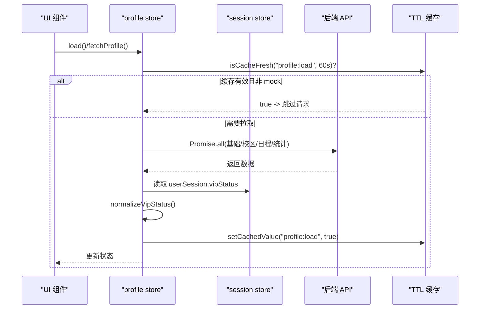
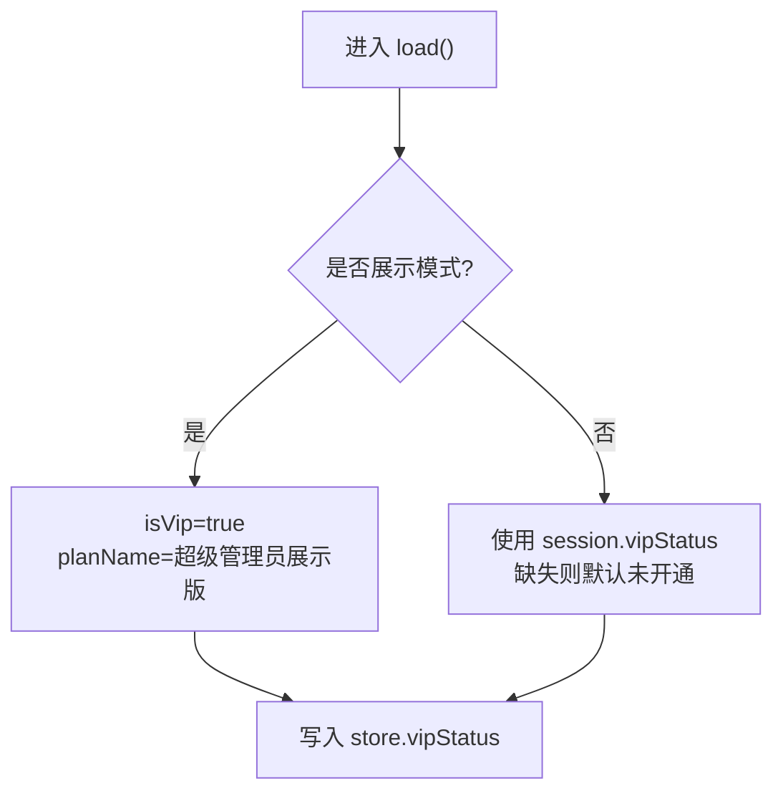
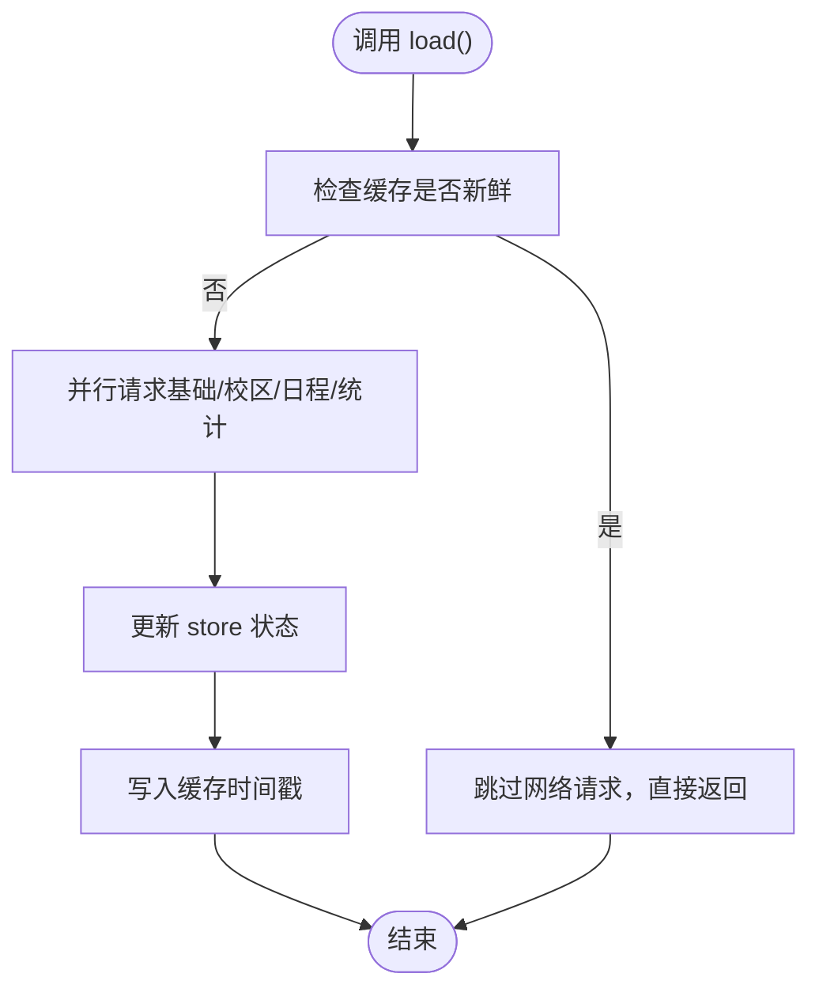
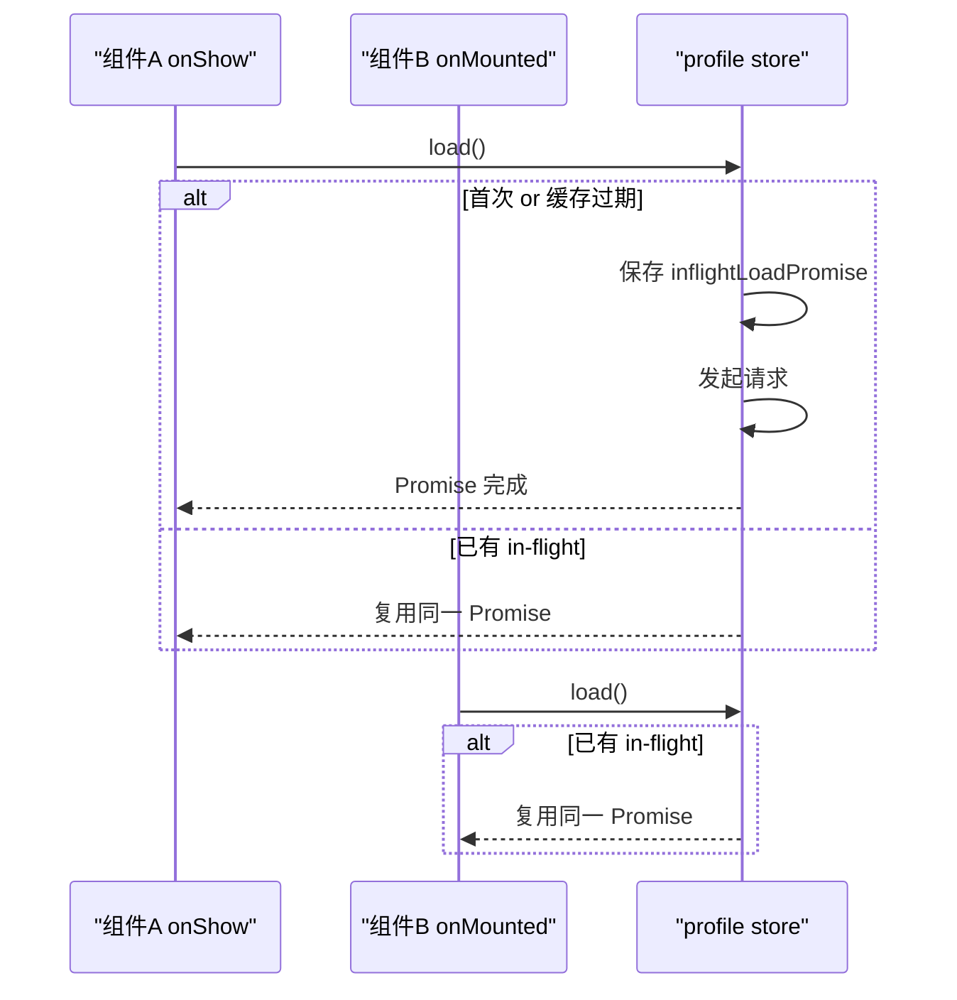
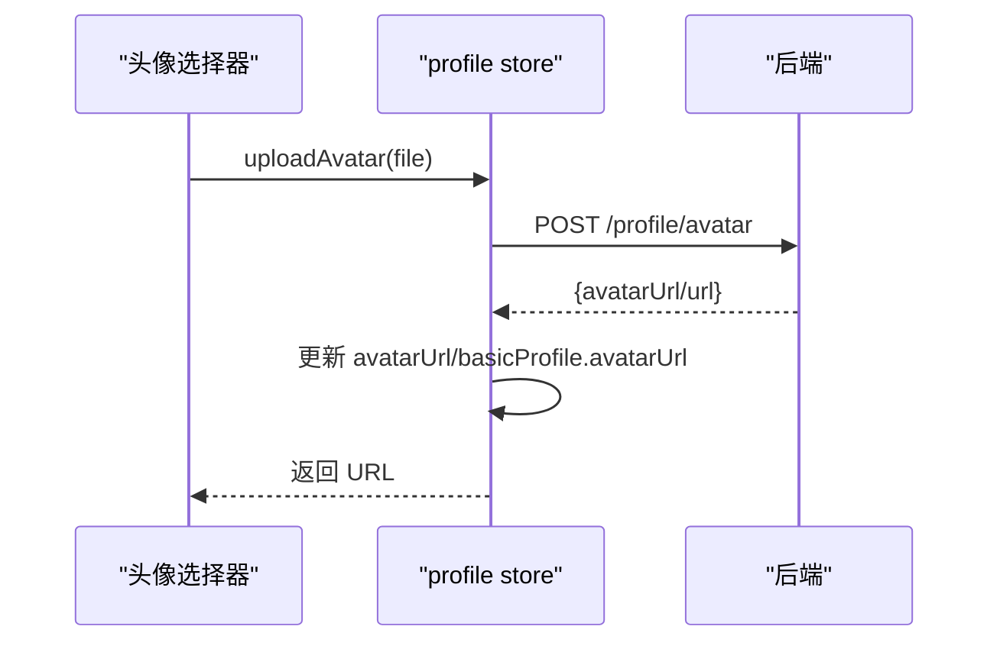
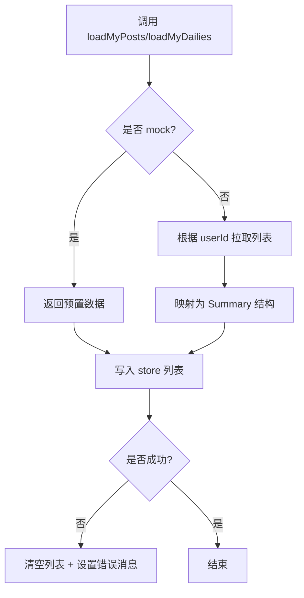
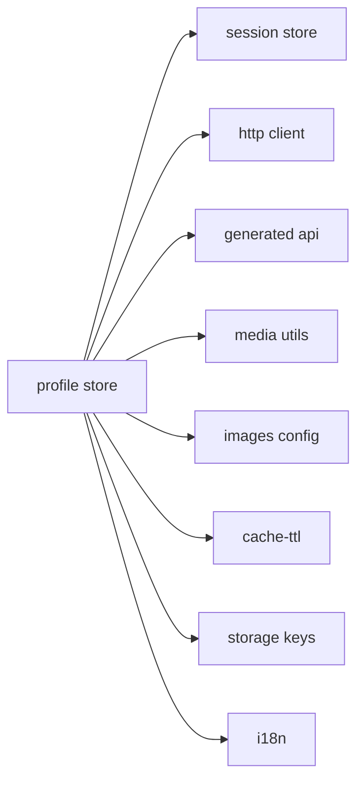

# 用户资料 Store（profile）

<cite>
**本文引用的文件**
- [apps/client/src/stores/profile.ts](file://apps/client/src/stores/profile.ts)
- [apps/client/src/stores/session.ts](file://apps/client/src/stores/session.ts)
- [apps/client/src/services/api.ts](file://apps/client/src/services/api.ts)
- [apps/client/src/utils/media.ts](file://apps/client/src/utils/media.ts)
- [apps/client/src/config/images.ts](file://apps/client/src/config/images.ts)
- [apps/client/src/constants/storage-keys.ts](file://apps/client/src/constants/storage-keys.ts)
- [apps/client/src/config/showcase.ts](file://apps/client/src/config/showcase.ts)
- [apps/client/src/utils/cache-ttl.ts](file://apps/client/src/utils/cache-ttl.ts)
- [apps/client/src/domain/profile.dto.ts](file://apps/client/src/domain/profile.dto.ts)
- [apps/client/src/domain/profile.status.ts](file://apps/client/src/domain/profile.status.ts)
- [apps/client/src/domain/profile.content.ts](file://apps/client/src/domain/profile.content.ts)
- [apps/client/src/types/profile.ts](file://apps/client/src/types/profile.ts)
- [apps/client/src/services/http.ts](file://apps/client/src/services/http.ts)
- [apps/client/src/i18n/index.ts](file://apps/client/src/i18n/index.ts)
</cite>

## 目录
1. [简介](#简介)
2. [项目结构](#项目结构)
3. [核心组件](#核心组件)
4. [架构总览](#架构总览)
5. [详细组件分析](#详细组件分析)
6. [依赖关系分析](#依赖关系分析)
7. [性能考虑](#性能考虑)
8. [故障排查指南](#故障排查指南)
9. [结论](#结论)
10. [附录：API 与状态速查](#附录api-与状态速查)

## 简介
本模块是 Campus Love 前端应用的用户资料状态管理核心，基于 Pinia store 统一管理个人资料、VIP 状态、头像与照片墙、语音名片、统计数据、个人动态与“我的日常”等能力。文档聚焦以下要点：
- VipStatus 接口定义与展示模式下 VIP 全亮策略
- TTL 缓存策略（60s）避免频繁请求
- 与 session store 的集成（会话中的 vipStatus、userId、刷新机制）
- 图片路径解析与媒体资源管理（头像、背景图、照片墙）
- 校园圈与个人主页相关状态
- 更新流程示例、错误处理与性能优化建议

## 项目结构
该模块位于 apps/client/src/stores/profile.ts，围绕一个统一的 profile store 组织数据与行为；配合类型定义、领域模型、配置与工具完成端到端的数据流与展示。

```mermaid
graph TB
  A["profile store<br/>apps/client/src/stores/profile.ts"] --> B["session store<br/>apps/client/src/stores/session.ts"]
  A --> C["HTTP 客户端<br/>apps/client/src/services/http.ts"]
  A --> D["生成 API 封装<br/>apps/client/src/services/api.ts"]
  A --> E["媒体路径解析<br/>apps/client/src/utils/media.ts"]
  A --> F["图片常量<br/>apps/client/src/config/images.ts"]
  A --> G["本地存储键<br/>apps/client/src/constants/storage-keys.ts"]
  A --> H["展示模式开关<br/>apps/client/src/config/showcase.ts"]
  A --> I["TTL 缓存工具<br/>apps/client/src/utils/cache-ttl.ts"]
  A --> J["i18n 翻译<br/>apps/client/src/i18n/index.ts"]
  A --> K["领域模型<br/>apps/client/src/domain/*.ts"]
  A --> L["类型契约<br/>apps/client/src/types/profile.ts"]
```

图表来源
- [apps/client/src/stores/profile.ts:1-120](file://apps/client/src/stores/profile.ts#L1-L120)
- [apps/client/src/stores/session.ts:1-200](file://apps/client/src/stores/session.ts#L1-L200)
- [apps/client/src/services/http.ts:1-100](file://apps/client/src/services/http.ts#L1-L100)
- [apps/client/src/services/api.ts:1-200](file://apps/client/src/services/api.ts#L1-L200)
- [apps/client/src/utils/media.ts:1-100](file://apps/client/src/utils/media.ts#L1-L100)
- [apps/client/src/config/images.ts:1-100](file://apps/client/src/config/images.ts#L1-L100)
- [apps/client/src/constants/storage-keys.ts:1-100](file://apps/client/src/constants/storage-keys.ts#L1-L100)
- [apps/client/src/config/showcase.ts:1-77](file://apps/client/src/config/showcase.ts#L1-L77)
- [apps/client/src/utils/cache-ttl.ts:1-100](file://apps/client/src/utils/cache-ttl.ts#L1-L100)
- [apps/client/src/domain/profile.dto.ts:1-37](file://apps/client/src/domain/profile.dto.ts#L1-L37)
- [apps/client/src/types/profile.ts:1-172](file://apps/client/src/types/profile.ts#L1-L172)

章节来源
- [apps/client/src/stores/profile.ts:1-120](file://apps/client/src/stores/profile.ts#L1-L120)

## 核心组件
- 个人资料 Store（useProfileStore）
  - 状态：基本资料、校区资料、日程资料、统计数据、VIP 状态、我的动态/日常、照片墙、语音名片、头像、隐私开关、加载与错误信息
  - 动作：load/fetchProfile/loadMyPosts/loadMyDailies/loadStats/save*、上传头像/背景/语音/照片墙、清理语音、设置隐私开关
  - 计算属性：照片墙审核项、头像审核状态与备注
- 会话 Store（useSessionStore）
  - 提供当前用户标识、vipStatus、会话刷新能力
- 领域模型与类型
  - domain/profile.* 定义 DTO、内容类型、可见性与状态枚举
  - types/profile.ts 定义页面消费的统一契约

章节来源
- [apps/client/src/stores/profile.ts:120-955](file://apps/client/src/stores/profile.ts#L120-L955)
- [apps/client/src/domain/profile.dto.ts:1-37](file://apps/client/src/domain/profile.dto.ts#L1-L37)
- [apps/client/src/domain/profile.status.ts:1-6](file://apps/client/src/domain/profile.status.ts#L1-L6)
- [apps/client/src/domain/profile.content.ts:1-18](file://apps/client/src/domain/profile.content.ts#L1-L18)
- [apps/client/src/types/profile.ts:1-172](file://apps/client/src/types/profile.ts#L1-L172)

## 架构总览
profile store 作为统一入口，协调网络请求、本地缓存、会话状态与 UI 展示。关键流程如下：

图表来源
- [apps/client/src/stores/profile.ts:120-260](file://apps/client/src/stores/profile.ts#L120-L260)
- [apps/client/src/utils/cache-ttl.ts:1-100](file://apps/client/src/utils/cache-ttl.ts#L1-L100)
- [apps/client/src/stores/session.ts:1-200](file://apps/client/src/stores/session.ts#L1-L200)

## 详细组件分析

### 数据模型与类型
- VipStatus
  - 字段：isVip、planName、expireDate
  - 用途：个人主页 VIP 徽章与卡片展示
- 个人资料状态 ProfileState
  - 包含 basic/campus/schedule/stats/vipStatus/myPosts/myDailies/photoGallery/voiceStatus/avatarUrl/隐私开关/loading/errorMessage
- 领域 DTO
  - ProfileDTO/ProfileContentItem/ProfileRelation/ProfileState 等用于更高层聚合展示

章节来源
- [apps/client/src/stores/profile.ts:1-120](file://apps/client/src/stores/profile.ts#L1-L120)
- [apps/client/src/domain/profile.dto.ts:1-37](file://apps/client/src/domain/profile.dto.ts#L1-L37)
- [apps/client/src/domain/profile.status.ts:1-6](file://apps/client/src/domain/profile.status.ts#L1-L6)
- [apps/client/src/types/profile.ts:1-172](file://apps/client/src/types/profile.ts#L1-L172)

### VIP 状态规范化与展示模式
- normalizeVipStatus
  - 展示模式（VITE_SHOWCASE_MODE=true）时强制 isVip=true，并赋予展示版 planName
  - 非展示模式透传后端或默认未开通状态
- 数据来源
  - 优先从 session.userSession.vipStatus 解析
  - 若缺失则回退为默认未开通，保证 UI 稳定

图表来源
- [apps/client/src/stores/profile.ts:1-120](file://apps/client/src/stores/profile.ts#L1-L120)
- [apps/client/src/config/showcase.ts:1-77](file://apps/client/src/config/showcase.ts#L1-L77)

章节来源
- [apps/client/src/stores/profile.ts:1-120](file://apps/client/src/stores/profile.ts#L1-L120)

### 60s TTL 缓存策略
- 在真实模式下，若 60s 内已加载过且有数据，直接跳过重复请求
- 成功后写缓存时间戳，保障切换 tab 秒开体验

图表来源
- [apps/client/src/stores/profile.ts:200-320](file://apps/client/src/stores/profile.ts#L200-L320)
- [apps/client/src/utils/cache-ttl.ts:1-100](file://apps/client/src/utils/cache-ttl.ts#L1-L100)

章节来源
- [apps/client/src/stores/profile.ts:200-320](file://apps/client/src/stores/profile.ts#L200-L320)

### 并发守卫与加载流程
- inflightLoadPromise 防止 onShow/onMounted 同时触发导致的重复请求与响应覆盖
- 所有 load 分支完成后统一清理 in-flight 标记

图表来源
- [apps/client/src/stores/profile.ts:180-260](file://apps/client/src/stores/profile.ts#L180-L260)

章节来源
- [apps/client/src/stores/profile.ts:180-260](file://apps/client/src/stores/profile.ts#L180-L260)

### 头像上传与媒体资源管理
- uploadAvatar
  - 调用后端上传接口，返回 avatarUrl
  - 同步更新 store.avatarUrl 与 basicProfile.avatarUrl，确保多位置一致显示
- uploadBackground
  - 上传后通过 session store 设置背景 URL，驱动顶部背景渲染
- 照片墙
  - uploadPhotoAtIndex/removePhotoAtIndex 维护稠密数组，并同步 basicProfile.photoGalleryItems 以保留审核语义
- 媒体路径
  - 使用 resolveMediaUrl 统一解析图片路径，mock 模式使用本地素材常量

图表来源
- [apps/client/src/stores/profile.ts:600-720](file://apps/client/src/stores/profile.ts#L600-L720)
- [apps/client/src/utils/media.ts:1-100](file://apps/client/src/utils/media.ts#L1-L100)
- [apps/client/src/config/images.ts:1-100](file://apps/client/src/config/images.ts#L1-L100)

章节来源
- [apps/client/src/stores/profile.ts:600-720](file://apps/client/src/stores/profile.ts#L600-L720)

### 兴趣标签与个人主页相关状态
- 个人主页展示依赖 basicProfile、campusProfile、scheduleProfile、profileStats、vipStatus、myPosts/myDailies、photoGallery、语音名片
- 兴趣标签由 basicProfile.tags（或其他来源）驱动，结合 domain.types 中统一契约进行展示
- 校园圈（circles）与匹配度/社交证明字段用于他人主页或推荐卡片

章节来源
- [apps/client/src/types/profile.ts:1-172](file://apps/client/src/types/profile.ts#L1-L172)
- [apps/client/src/domain/profile.dto.ts:1-37](file://apps/client/src/domain/profile.dto.ts#L1-L37)

### 个人动态与“我的日常”
- loadMyPosts
  - Mock 模式直接返回预置列表
  - Real 模式通过作者 ID 拉取最近 3 条，映射为 MyPostSummary
- loadMyDailies
  - 拉取 visibility=friends 的动态，映射为 MyDailySummary
- 失败时清空对应列表并记录 errorMessage，不阻塞主流程

图表来源
- [apps/client/src/stores/profile.ts:320-520](file://apps/client/src/stores/profile.ts#L320-L520)

章节来源
- [apps/client/src/stores/profile.ts:320-520](file://apps/client/src/stores/profile.ts#L320-L520)

### 语音名片（语音状态）
- setVoiceStatus/uploadVoice/clearVoiceStatus
  - 支持设置本地或远程音频 URL，限制时长 ≤60s
  - 上传失败时记录错误消息
  - 空 URL 视为清除状态

章节来源
- [apps/client/src/stores/profile.ts:720-800](file://apps/client/src/stores/profile.ts#L720-L800)

### 隐私开关与持久化
- allowSameSchoolRecommend/receiveSameSchoolInfo
  - 修改时写入本地 storage（STORAGE_KEYS.PRIVACY_SETTINGS），重启后恢复
  - real/mask 模式均回填本地持久化值，保证 UI 一致性

章节来源
- [apps/client/src/stores/profile.ts:800-900](file://apps/client/src/stores/profile.ts#L800-L900)
- [apps/client/src/constants/storage-keys.ts:1-100](file://apps/client/src/constants/storage-keys.ts#L1-L100)

### 与 session store 的集成
- 读取 userSession.userId 用于“我的动态”拉取
- 读取 userSession.vipStatus 用于 VIP 状态解析
- 保存资料后调用 refreshSession 保持前后端一致

章节来源
- [apps/client/src/stores/profile.ts:260-360](file://apps/client/src/stores/profile.ts#L260-L360)
- [apps/client/src/stores/session.ts:1-200](file://apps/client/src/stores/session.ts#L1-L200)

## 依赖关系分析
- 内部依赖
  - 会话：useSessionStore（用户标识、VIP 状态、刷新）
  - 网络：clientApi、request（HTTP 请求）
  - 资源：resolveMediaUrl、IMAGE_PATHS（媒体与图片）
  - 配置：showcase（展示模式）、storage-keys（本地键）
  - 缓存：cache-ttl（TTL 控制）
  - i18n：错误消息国际化
- 外部依赖
  - 后端 API：个人资料、帖子、媒体上传、会话刷新等

图表来源
- [apps/client/src/stores/profile.ts:1-120](file://apps/client/src/stores/profile.ts#L1-L120)
- [apps/client/src/services/http.ts:1-100](file://apps/client/src/services/http.ts#L1-L100)
- [apps/client/src/services/api.ts:1-200](file://apps/client/src/services/api.ts#L1-L200)

章节来源
- [apps/client/src/stores/profile.ts:1-120](file://apps/client/src/stores/profile.ts#L1-L120)

## 性能考虑
- 60s TTL 缓存：减少切换 Tab 时的重复请求，提升首屏速度
- 并发守卫：避免 onShow/onMounted 并发导致的多重请求与状态覆盖
- 分步加载：主流程仅拉取必要资料，动态/日常按需懒加载
- 本地持久化：隐私开关等轻量配置落盘，避免每次启动重新询问
- 图片与媒体：统一路径解析与常量引用，减少无效请求

[本节为通用指导，不直接分析具体文件]

## 故障排查指南
- 常见问题定位
  - 资料未更新：检查 TTL 缓存是否命中；必要时强制刷新
  - VIP 状态异常：确认展示模式开关与 session.vipStatus 是否正确传入
  - 头像/背景/照片墙不生效：确认上传接口返回值结构与 store 同步逻辑
  - “我的动态”为空：检查 userId 是否存在、后端接口是否返回数据
  - 错误提示：查看 errorMessage，必要时通过 i18n key 定位
- 调试建议
  - 打印 store 状态快照
  - 拦截 HTTP 请求，确认参数与响应
  - 在 mock 模式下验证 UI 分支

章节来源
- [apps/client/src/stores/profile.ts:260-955](file://apps/client/src/stores/profile.ts#L260-L955)
- [apps/client/src/i18n/index.ts:1-119](file://apps/client/src/i18n/index.ts#L1-L119)

## 结论
profile store 以清晰的职责边界与稳健的错误处理，提供了完整的用户资料管理能力。通过 TTL 缓存、并发守卫、与 session store 的深度集成，兼顾了性能与一致性。建议在后续迭代中继续完善错误上报、埋点与更细粒度的缓存失效策略。

[本节为总结性内容，不直接分析具体文件]

## 附录：API 与状态速查
- 主要动作
  - load/fetchProfile：加载基础/校区/日程/统计，解析 VIP 状态，写入 TTL 缓存
  - loadMyPosts/loadMyDailies：懒加载个人动态与日常
  - saveBasicProfile/saveCampusProfile/saveScheduleProfile：保存并刷新会话
  - uploadAvatar/uploadBackground/uploadProfilePhoto：上传头像/背景/照片墙
  - setVoiceStatus/uploadVoice/clearVoiceStatus：语音名片管理
  - setAllowSameSchoolRecommend/setReceiveSameSchoolInfo：隐私开关与持久化
- 关键状态
  - basicProfile/campusProfile/scheduleProfile/profileStats
  - vipStatus（isVip/planName/expireDate）
  - myPosts/myDailies/photoGallery/voiceStatusUrl/voiceStatusDuration
  - avatarUrl/allowSameSchoolRecommend/receiveSameSchoolInfo/loading/errorMessage

章节来源
- [apps/client/src/stores/profile.ts:120-955](file://apps/client/src/stores/profile.ts#L120-L955)