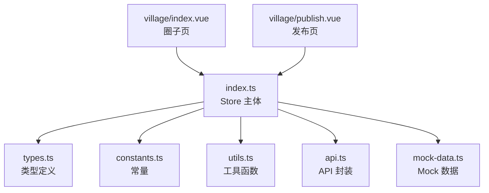
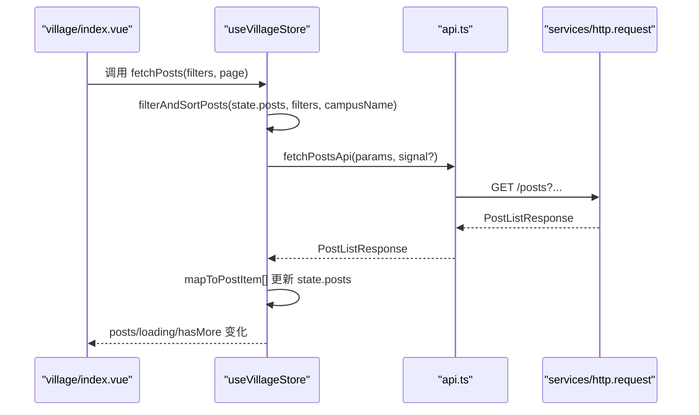
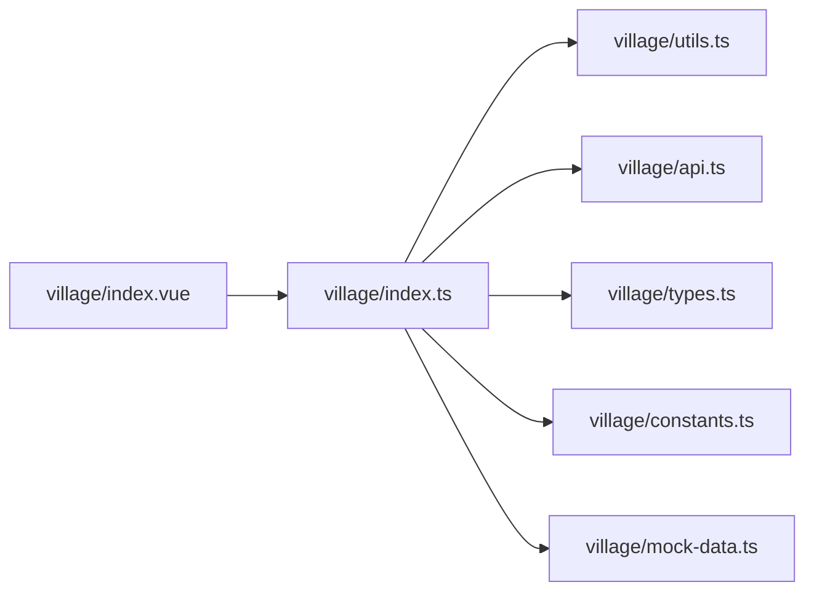

# 社区圈子 Store（village）

<cite>
**本文引用的文件**
- [apps/client/src/stores/village/index.ts](file://apps/client/src/stores/village/index.ts)
- [apps/client/src/stores/village/types.ts](file://apps/client/src/stores/village/types.ts)
- [apps/client/src/stores/village/constants.ts](file://apps/client/src/stores/village/constants.ts)
- [apps/client/src/stores/village/utils.ts](file://apps/client/src/stores/village/utils.ts)
- [apps/client/src/stores/village/api.ts](file://apps/client/src/stores/village/api.ts)
- [apps/client/src/stores/village/mock-data.ts](file://apps/client/src/stores/village/mock-data.ts)
- [apps/client/src/subpackages/village/village/index.vue](file://apps/client/src/subpackages/village/village/index.vue)
- [apps/client/src/subpackages/village/village/publish.vue](file://apps/client/src/subpackages/village/village/publish.vue)
</cite>

## 目录
1. [简介](#简介)
2. [项目结构](#项目结构)
3. [核心组件](#核心组件)
4. [架构总览](#架构总览)
5. [详细组件分析](#详细组件分析)
6. [依赖关系分析](#依赖关系分析)
7. [性能考虑](#性能考虑)
8. [故障排查指南](#故障排查指南)
9. [结论](#结论)
10. [附录：代码示例与测试策略](#附录代码示例与测试策略)

## 简介
本模块为 Campus Love 前端应用的“社区圈子”状态管理实现，采用单一职责原则进行模块化重构。Store 将类型、常量、工具函数、API 调用与 Mock 数据拆分为独立子模块，保证高内聚、低耦合。覆盖社区帖子列表/详情、评论、互动（点赞/收藏/转发）、话题广场、活动关联、同校动态流、相似作者推荐等能力，并提供完善的类型安全、Mock 支持与错误处理机制。

## 项目结构
按单一职责拆分后的目录组织如下：
- types.ts：集中定义所有领域类型（帖子、评论、作者、筛选条件、状态等）
- constants.ts：集中维护常量（内容长度限制、分页大小、分类 ID、排序选项等）
- utils.ts：纯函数工具（数据映射、过滤排序、时间格式化、Mock 数据辅助）
- api.ts：封装后端 API 调用（请求参数构建、统一 request 调用、错误解包）
- mock-data.ts：Mock 数据（用户、帖子、评论、活动等，仅用于 mock 分支）
- index.ts：Store 主体实现（Pinia store，组合上述模块完成业务逻辑）

图表来源
- [apps/client/src/stores/village/index.ts:1-120](file://apps/client/src/stores/village/index.ts#L1-L120)
- [apps/client/src/stores/village/types.ts:1-60](file://apps/client/src/stores/village/types.ts#L1-L60)
- [apps/client/src/stores/village/constants.ts:1-59](file://apps/client/src/stores/village/constants.ts#L1-L59)
- [apps/client/src/stores/village/utils.ts:1-60](file://apps/client/src/stores/village/utils.ts#L1-L60)
- [apps/client/src/stores/village/api.ts:1-60](file://apps/client/src/stores/village/api.ts#L1-L60)
- [apps/client/src/stores/village/mock-data.ts:1-40](file://apps/client/src/stores/village/mock-data.ts#L1-L40)
- [apps/client/src/subpackages/village/village/index.vue:1-60](file://apps/client/src/subpackages/village/village/index.vue#L1-L60)
- [apps/client/src/subpackages/village/village/publish.vue:1-60](file://apps/client/src/subpackages/village/village/publish.vue#L1-L60)

章节来源
- [apps/client/src/stores/village/index.ts:1-120](file://apps/client/src/stores/village/index.ts#L1-L120)

## 核心组件
- VillageStore（index.ts）：Pinia Store 主体，负责帖子/评论/分类/同校动态/相似作者/浏览记录/附近动态等状态管理与副作用处理。包含防抖、幂等守卫、AbortController 取消在途请求等健壮性机制。
- 类型体系（types.ts）：PostItem、CommentItem、PostAuthor、ActivitySummaryView、PostFilters、VillageState 等，保障前后端数据结构一致性与 IDE 提示。
- 常量体系（constants.ts）：MAX_CONTENT_LENGTH、PAGE_SIZE、SORT_OPTIONS、各分类 ID 等，统一配置入口。
- 工具函数（utils.ts）：mapToPostItem、mapDetailToPostItem、mapToCommentItem、filterAndSortPosts、toNumber、isBuddyPost、formatRelativeTime 等纯函数。
- API 封装（api.ts）：fetchPostsApi、createPostApi、likePostApi、sharePostApi、favoritePostApi、fetchCommentsApi、createCommentApi、likeCommentApi、followUserApi、getHotBoardApi、getPostRecommendApi、searchPostsApi、getHotSearchApi、fetchCampusFeedApi、fetchSimilarAuthorsApi、fetchPostHistoryApi、clearPostHistoryApi 等。
- Mock 数据（mock-data.ts）：mockPosts、mockComments、mockCategories、mockActivities、mockTagPosts、mockSimilarAuthors、MOCK_CURRENT_USER_ID 等，仅在 useMock() 分支使用。

章节来源
- [apps/client/src/stores/village/types.ts:1-200](file://apps/client/src/stores/village/types.ts#L1-L200)
- [apps/client/src/stores/village/constants.ts:1-59](file://apps/client/src/stores/village/constants.ts#L1-L59)
- [apps/client/src/stores/village/utils.ts:1-120](file://apps/client/src/stores/village/utils.ts#L1-L120)
- [apps/client/src/stores/village/api.ts:1-120](file://apps/client/src/stores/village/api.ts#L1-L120)
- [apps/client/src/stores/village/mock-data.ts:1-120](file://apps/client/src/stores/village/mock-data.ts#L1-L120)
- [apps/client/src/stores/village/index.ts:1-200](file://apps/client/src/stores/village/index.ts#L1-L200)

## 架构总览
Store 通过 Pinia 管理全局状态，UI 页面（圈子首页、详情页、发布页）通过 storeToRefs 订阅响应式数据并触发 actions。API 层封装 HTTP 请求，工具层负责数据映射与过滤排序，Mock 数据用于本地开发或开关场景。

图表来源
- [apps/client/src/stores/village/index.ts:120-220](file://apps/client/src/stores/village/index.ts#L120-L220)
- [apps/client/src/stores/village/api.ts:120-220](file://apps/client/src/stores/village/api.ts#L120-L220)
- [apps/client/src/stores/village/utils.ts:120-220](file://apps/client/src/stores/village/utils.ts#L120-L220)
- [apps/client/src/subpackages/village/village/index.vue:60-160](file://apps/client/src/subpackages/village/village/index.vue#L60-L160)

## 详细组件分析

### 类型与状态（types.ts）
- 实体类型：PostCategory、PostAuthor、PostItem、CommentItem、SimilarAuthor、ActivitySummaryView
- 视图类型：PostSummaryView、PostDetailView、CommentItemView 等
- 筛选条件：PostFilters（categoryId、keyword、sortBy、userId、city、discoverSub）
- 状态类型：VillageState（posts、currentPost、comments、categories、loading、page、hasMore、campusFeedPosts/Activities/Topics、similarAuthors、historyPosts、nearbyPosts、selfPendingPosts 等）

作用：为 Store、API、UI 提供统一的契约，避免散落的 any/string 类型导致运行时错误。

章节来源
- [apps/client/src/stores/village/types.ts:1-200](file://apps/client/src/stores/village/types.ts#L1-L200)

### 常量（constants.ts）
- 内容限制：MAX_CONTENT_LENGTH=500，MAX_IMAGES_COUNT=9
- 防抖：COMMENT_DEBOUNCE_MS=500
- 分页：PAGE_SIZE=20
- 排序：SORT_OPTIONS=["latest","hot"]
- 分类 ID：CATEGORY_ALL_ID、CATEGORY_CAMPUS_ID、FOLLOWING_CATEGORY_ID、SAME_CITY_CATEGORY_ID、DISCOVER_CATEGORY_ID、MINE_CATEGORY_ID、CATEGORY_PREFIX="cat-"

作用：统一管理业务阈值与枚举值，便于全局调整与一致性校验。

章节来源
- [apps/client/src/stores/village/constants.ts:1-59](file://apps/client/src/stores/village/constants.ts#L1-L59)

### 工具函数（utils.ts）
- 数据映射：mapAuthorView、mapCommentAuthorView、mapToPostItem、mapDetailToPostItem、mapToCommentItem
- 过滤排序：filterAndSortPosts（结合当前校园名做同校匹配；支持 categoryId、keyword、sortBy、city、discoverSub 等）
- 鲁棒转换：toNumber（防止 NaN 污染排序/统计）
- 业务判断：isBuddyPost（基于 buddyTags、标签含“搭子”、作者兴趣关键词判定）
- 时间格式化：复用共享的 formatRelativeTime，随语言切换文案

作用：将后端返回的视图对象转换为前端展示所需的数据结构，同时保持无副作用、可测试的纯函数特性。

章节来源
- [apps/client/src/stores/village/utils.ts:1-200](file://apps/client/src/stores/village/utils.ts#L1-L200)

### API 封装（api.ts）
- 统一请求：基于 services/http.request，封装 get/post/delete 等方法
- 参数构建：buildPostListParams（将 PostFilters 转为 query string，含 category、tag、city、discoverSub、sortBy、userId、page、pageSize）
- 核心接口：
  - 列表：fetchPostsApi、getHotBoardApi、getPostRecommendApi、searchPostsApi、getHotSearchApi
  - 详情：fetchPostDetailApi
  - 互动：likePostApi、favoritePostApi、sharePostApi、likeCommentApi
  - 评论：fetchCommentsApi、createCommentApi
  - 关注：followUserApi
  - 同校动态：fetchCampusFeedApi
  - 相似作者：fetchSimilarAuthorsApi
  - 历史：fetchPostHistoryApi、clearPostHistoryApi

作用：隔离网络细节，使 Store 只关心业务动作与状态变更。

章节来源
- [apps/client/src/stores/village/api.ts:1-200](file://apps/client/src/stores/village/api.ts#L1-L200)

### Mock 数据（mock-data.ts）
- 内容：mockPosts、mockComments、mockCategories、mockActivities、mockTagPosts、mockSimilarAuthors、MOCK_CURRENT_USER_ID
- 隔离：仅被 useMock() 分支引用，real 模式不读取任何 mock 用户 ID，避免跨模块身份污染

作用：在无网/联调/演示场景下提供稳定数据源，提升开发效率。

章节来源
- [apps/client/src/stores/village/mock-data.ts:1-200](file://apps/client/src/stores/village/mock-data.ts#L1-L200)

### Store 主体（index.ts）
- 状态字段：帖子、评论、分类、加载态、分页、同校动态、相似作者、浏览记录、附近动态、审核中自发布等
- Getters：filteredPosts（委托 filterAndSortPosts，确保与 fetchPosts 一致的过滤语义）、currentPostComments
- Actions：
  - 列表：fetchPosts（AbortController 取消旧请求，避免竞态覆盖）
  - 详情：fetchPostDetail
  - 评论：fetchComments、commentPost（防抖 Map，每帖独立定时器，避免重复提交）
  - 互动：likePost/favoritePost/sharePost（Set 幂等守卫，防止并发重复请求）
  - 关注：followUser
  - 同校动态：fetchCampusFeed
  - 相似作者：fetchSimilarAuthors
  - 历史：fetchPostHistory、clearPostHistory
  - 附近：fetchNearbyPosts
- 副作用与健壮性：
  - AbortController：解决切换分类/搜索时旧请求覆盖新结果的问题
  - 评论防抖：500ms 窗口合并快速点击，避免重复评论
  - 幂等守卫：likingPostIds、likingCommentIds、favoritingPostIds 阻止重复操作
  - i18n：错误回退消息使用 t() 翻译
  - 头像资源：统一走 IMAGE_PATHS 体系

章节来源
- [apps/client/src/stores/village/index.ts:1-200](file://apps/client/src/stores/village/index.ts#L1-L200)
- [apps/client/src/stores/village/index.ts:200-400](file://apps/client/src/stores/village/index.ts#L200-L400)

### 页面集成
- 圈子首页（village/index.vue）：频道 Tab（今日广场/兴趣圈/学校圈/活动），订阅 store 的 posts、categories、activities、topics 等，调用 store 的 actions 拉取数据，处理认证门、缓存 TTL、空态/错误态展示
- 发布页（village/publish.vue）：统一发布动态页，对接 circle/campus/general 目标，校验字数（MAX_CONTENT_LENGTH）、图片上限、标题长度，草稿本地持久化与恢复，发布成功后清理

章节来源
- [apps/client/src/subpackages/village/village/index.vue:1-120](file://apps/client/src/subpackages/village/village/index.vue#L1-L120)
- [apps/client/src/subpackages/village/village/publish.vue:1-120](file://apps/client/src/subpackages/village/village/publish.vue#L1-L120)

## 依赖关系分析
- Store 对 utils 的依赖：数据映射与过滤排序
- Store 对 api 的依赖：网络请求
- Store 对 constants 的依赖：分页、分类、排序等配置
- Store 对 mock-data 的依赖：仅在 useMock() 分支引入，避免 real 模式开销
- 页面依赖 Store：通过 Pinia storeToRefs 订阅响应式状态并触发 actions

图表来源
- [apps/client/src/stores/village/index.ts:1-120](file://apps/client/src/stores/village/index.ts#L1-L120)
- [apps/client/src/stores/village/utils.ts:1-60](file://apps/client/src/stores/village/utils.ts#L1-L60)
- [apps/client/src/stores/village/api.ts:1-60](file://apps/client/src/stores/village/api.ts#L1-L60)
- [apps/client/src/stores/village/constants.ts:1-59](file://apps/client/src/stores/village/constants.ts#L1-L59)
- [apps/client/src/stores/village/mock-data.ts:1-40](file://apps/client/src/stores/village/mock-data.ts#L1-L40)
- [apps/client/src/subpackages/village/village/index.vue:1-60](file://apps/client/src/subpackages/village/village/index.vue#L1-L60)

章节来源
- [apps/client/src/stores/village/index.ts:1-120](file://apps/client/src/stores/village/index.ts#L1-L120)

## 性能考虑
- 列表加载优化
  - AbortController：切换分类/搜索时取消旧请求，减少无效渲染与覆盖
  - 分页 PAGE_SIZE=20：控制单次加载量，配合 hasMore 无限滚动
  - 缓存 TTL：圈子频道数据 30s 缓存（onShow 免重复全量重拉）
- 交互优化
  - 评论防抖：500ms 窗口合并快速点击，降低服务端压力
  - 幂等守卫：点赞/收藏/评论点赞使用 Set 跟踪 in-flight，避免重复请求
- 数据映射优化
  - 纯函数映射：mapToPostItem/mapToCommentItem 只做必要字段转换，减少多余计算
  - toNumber：防止 NaN 污染排序与统计
- 资源优化
  - 统一头像路径：IMAGE_PATHS 体系，便于缓存与替换
  - 图片上限：MAX_IMAGES_COUNT=9，避免大图上传导致性能问题

[本节为通用性能建议，无需具体文件来源]

## 故障排查指南
- 列表为空/错乱
  - 检查是否传入了正确的 categoryId、keyword、sortBy、city、discoverSub
  - 确认 filteredPosts getter 与 fetchPosts 使用的过滤逻辑一致（均委托 filterAndSortPosts）
  - 查看 AbortController 是否正确 cancel 旧请求
- 评论重复提交
  - 检查 commentDebounceTimers 映射表是否正常工作（按 postId 隔离）
  - 确认 COMMENT_DEBOUNCE_MS 设置合理
- 点赞/收藏重复
  - 检查 likingPostIds/likingCommentIds/favoritingPostIds 集合是否正确使用
- 错误信息未显示/语言不一致
  - 确认 t() 已正确引入并在 catch 分支使用
- Mock 数据未生效
  - 确认 useMock() 分支是否启用，且 mock-data.ts 仅在该分支引用
- 发布失败
  - 检查 MAX_CONTENT_LENGTH、POST_TITLE_MAX_LENGTH、POST_MAX_IMAGES 等约束
  - 确认草稿存储键 PUBLISH_DRAFT_STORAGE_KEY 与 localStorage 读写正常

章节来源
- [apps/client/src/stores/village/index.ts:1-200](file://apps/client/src/stores/village/index.ts#L1-L200)
- [apps/client/src/stores/village/constants.ts:1-59](file://apps/client/src/stores/village/constants.ts#L1-L59)
- [apps/client/src/subpackages/village/village/publish.vue:1-120](file://apps/client/src/subpackages/village/village/publish.vue#L1-L120)

## 结论
本模块以单一职责原则重构了社区圈子的状态管理，实现了清晰的模块化边界与高内聚的业务逻辑。通过类型安全、API 封装、Mock 支持以及多种健壮性机制（AbortController、防抖、幂等守卫），保障了社区功能的稳定性与可维护性。后续可在以下方面继续优化：
- 进一步抽象 API 层错误码到统一异常模型
- 增加单元测试覆盖关键纯函数（map*、filterAndSortPosts、toNumber、isBuddyPost）
- 完善 E2E 用例覆盖发帖、评论、互动全流程

[本节为总结，无需具体文件来源]

## 附录：代码示例与测试策略

### 示例一：获取帖子列表（含筛选与分页）
- 页面侧调用：从 village/index.vue 触发 store.fetchPosts(filters, page)
- Store 内部：
  - 使用 buildPostListParams 构建查询参数
  - 调用 fetchPostsApi 发起请求
  - 使用 mapToPostItem 映射后端数据
  - 更新 state.posts、state.page、state.hasMore
- 关键点：AbortController 取消旧请求，filteredPosts getter 与 fetchPosts 保持一致的过滤语义

章节来源
- [apps/client/src/stores/village/api.ts:120-220](file://apps/client/src/stores/village/api.ts#L120-L220)
- [apps/client/src/stores/village/utils.ts:120-220](file://apps/client/src/stores/village/utils.ts#L120-L220)
- [apps/client/src/stores/village/index.ts:120-220](file://apps/client/src/stores/village/index.ts#L120-L220)
- [apps/client/src/subpackages/village/village/index.vue:60-160](file://apps/client/src/subpackages/village/village/index.vue#L60-L160)

### 示例二：发表评论（防抖与去重）
- 页面侧：用户在详情页输入评论内容并提交
- Store 内部：
  - 使用 per-post 防抖定时器（commentDebounceTimers）合并多次点击
  - 调用 createCommentApi 发送评论
  - 使用 mapToCommentItem 映射并追加到 comments 列表
- 关键点：不同帖子互不影响；Promise 覆盖时使用 resolve 引用修复永不 settle 的问题

章节来源
- [apps/client/src/stores/village/index.ts:200-400](file://apps/client/src/stores/village/index.ts#L200-L400)
- [apps/client/src/stores/village/api.ts:200-320](file://apps/client/src/stores/village/api.ts#L200-L320)

### 示例三：发布帖子（校验与草稿）
- 页面侧：publish.vue 收集内容、图片、话题、可见范围等
- 校验：
  - 内容长度 ≤ MAX_CONTENT_LENGTH
  - 标题长度在 POST_TITLE_MIN_LENGTH~POST_TITLE_MAX_LENGTH
  - 图片数量 ≤ POST_MAX_IMAGES
- 草稿：
  - 本地 storage 键 PUBLISH_DRAFT_STORAGE_KEY 持久化
  - 进入页面自动恢复草稿；发布成功后清理
- 提交：调用 store.createPostApi 或直接 clientApi 提交

章节来源
- [apps/client/src/subpackages/village/village/publish.vue:1-120](file://apps/client/src/subpackages/village/village/publish.vue#L1-L120)
- [apps/client/src/stores/village/constants.ts:1-59](file://apps/client/src/stores/village/constants.ts#L1-L59)

### 示例四：互动（点赞/收藏/转发）与幂等
- Store 内部：
  - 使用 Set 跟踪正在进行的互动（likingPostIds、likingCommentIds、favoritingPostIds）
  - 同一帖子/评论的并发请求直接跳过，避免重复
  - 调用 likePostApi/favoritePostApi/sharePostApi/likeCommentApi
  - 根据服务端结果乐观更新 state（applyOptimisticLike/Favorite 等）
- 关键点：并发保护 + 乐观更新 + 回滚（rollbackLike/Favorite）

章节来源
- [apps/client/src/stores/village/index.ts:200-400](file://apps/client/src/stores/village/index.ts#L200-L400)
- [apps/client/src/stores/village/utils.ts:200-320](file://apps/client/src/stores/village/utils.ts#L200-L320)

### 测试策略
- 单元测试
  - 纯函数：mapToPostItem、mapToCommentItem、filterAndSortPosts、toNumber、isBuddyPost
  - 参数构建：buildPostListParams 的多分支输入输出
- 集成测试
  - Store actions：fetchPosts、commentPost、likePost、favoritePost、sharePost
  - Mock 分支：useMock() 模式下数据加载与渲染
- E2E
  - 发布流程：校验、草稿保存/恢复、提交成功/失败
  - 互动流程：点赞/收藏/评论/转发的状态同步与幂等
  - 列表流程：筛选、排序、分页、错误态、空态

[本节为测试方法论，无需具体文件来源]