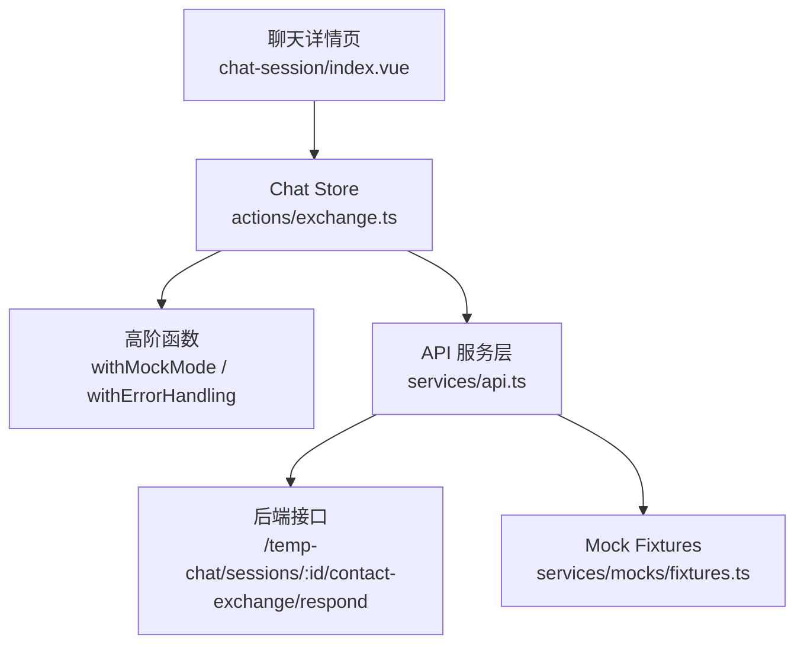
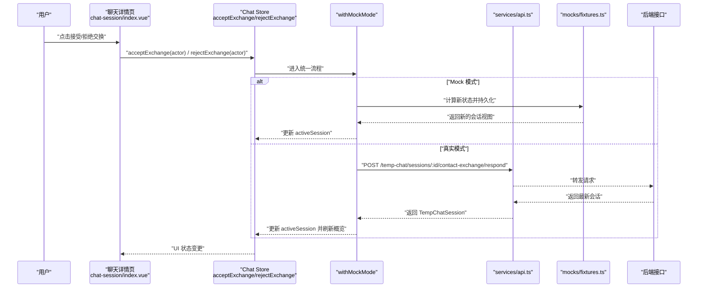
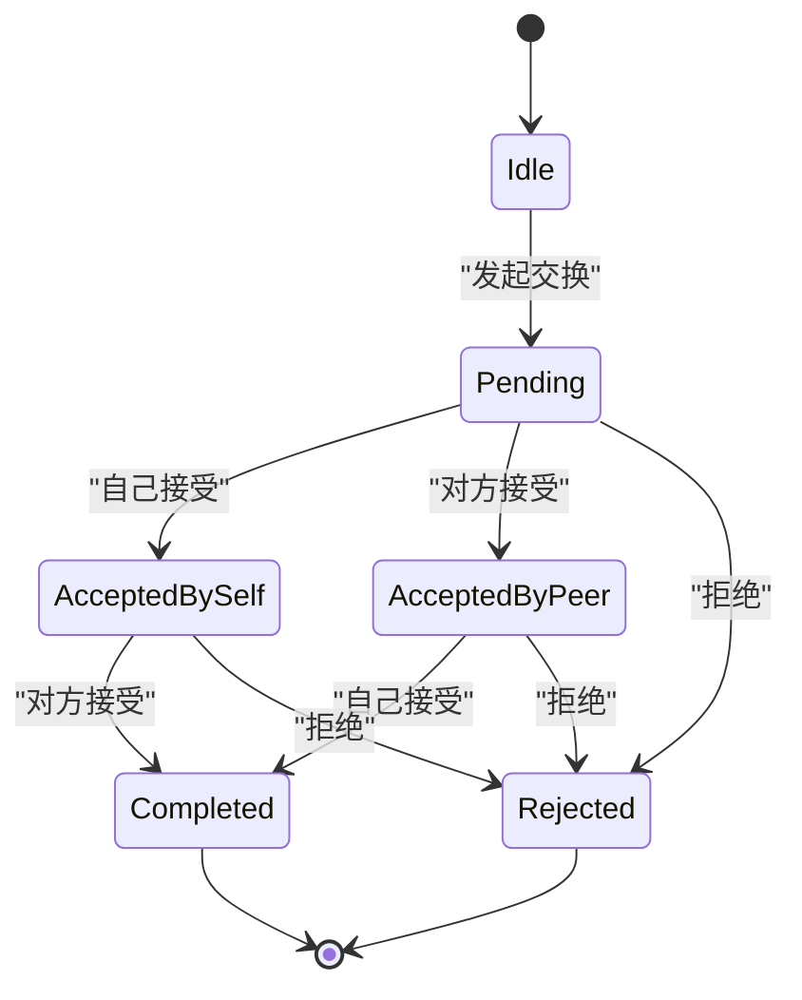
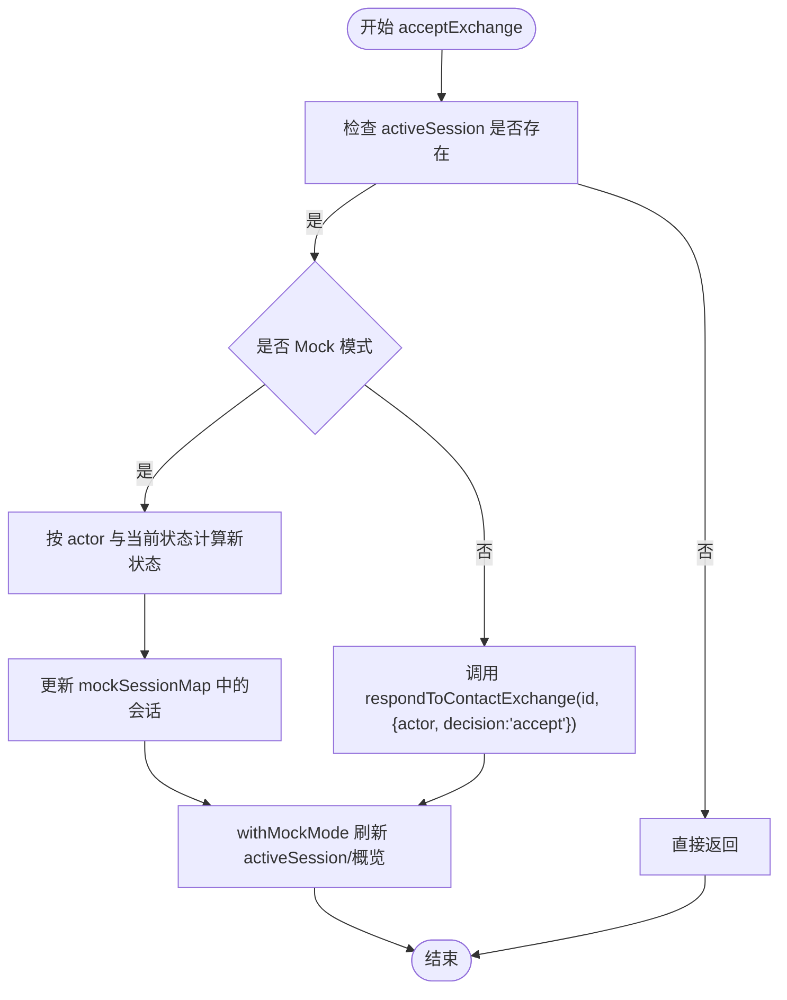
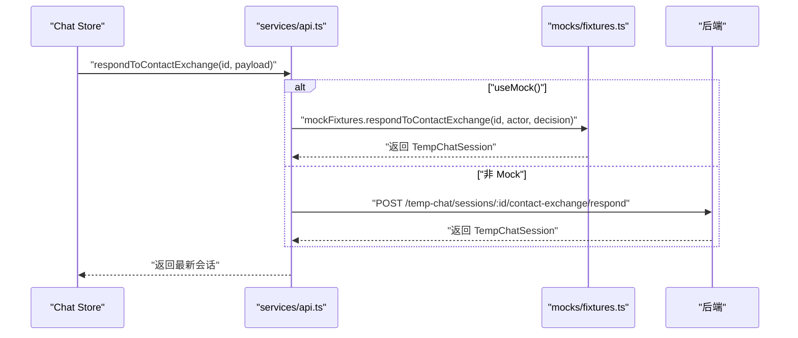
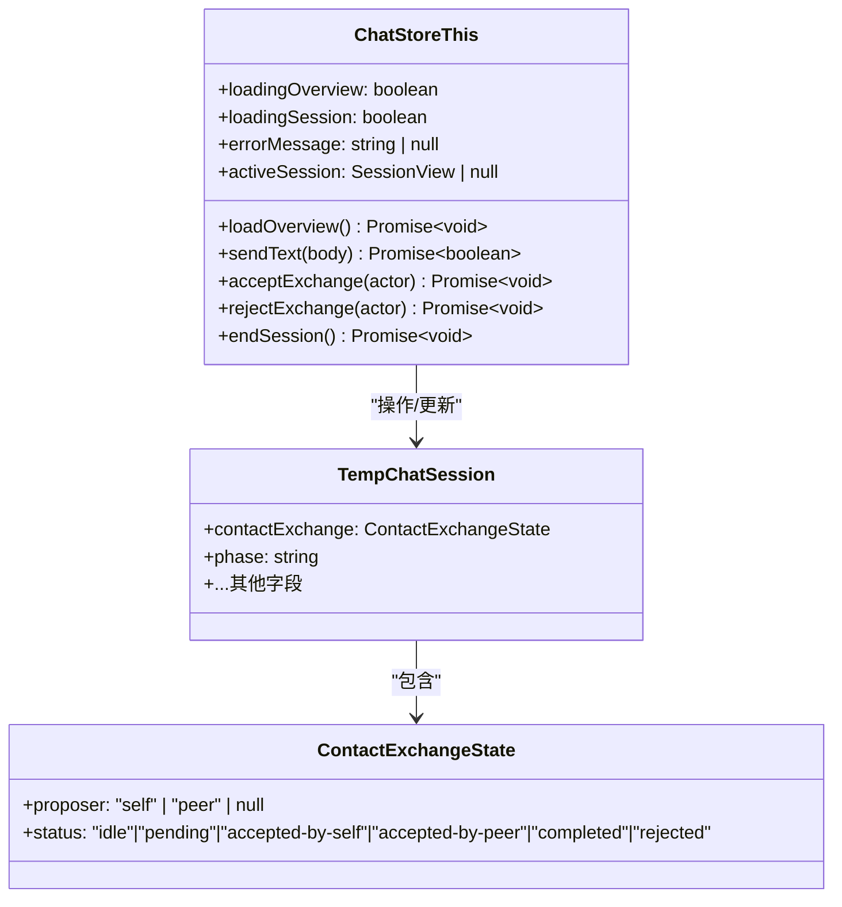
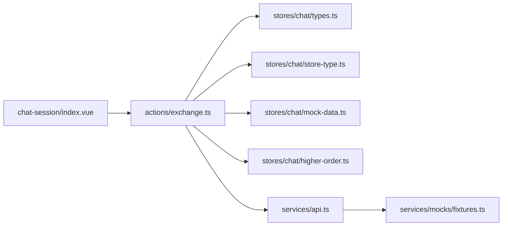

# 交换机制动作（exchange actions）

<cite>
**本文引用的文件**   
- [apps/client/src/stores/chat/actions/exchange.ts](file://apps/client/src/stores/chat/actions/exchange.ts)
- [apps/client/src/stores/chat/store-type.ts](file://apps/client/src/stores/chat/store-type.ts)
- [apps/client/src/stores/chat/types.ts](file://apps/client/src/stores/chat/types.ts)
- [apps/client/src/services/api.ts](file://apps/client/src/services/api.ts)
- [apps/client/src/services/mocks/fixtures.ts](file://apps/client/src/services/mocks/fixtures.ts)
- [apps/client/src/subpackages/chat/chat-session/index.vue](file://apps/client/src/subpackages/chat/chat-session/index.vue)
</cite>

## 目录
1. [引言](#引言)
2. [项目结构与定位](#项目结构与定位)
3. [核心组件](#核心组件)
4. [架构总览](#架构总览)
5. [详细组件分析](#详细组件分析)
6. [依赖关系分析](#依赖关系分析)
7. [性能与一致性考虑](#性能与一致性考虑)
8. [错误处理与排障指南](#错误处理与排障指南)
9. [结论](#结论)

## 引言
本文件聚焦“聊天会话中的联系方式交换机制”，围绕用户间交换匹配的业务流程展开，包括：
- 交换请求发起与确认流程；
- 交换状态机与状态同步；
- 前端 Store Action、API 调用与 Mock 模式行为；
- 与聊天会话页面集成的交互方式；
- 数据一致性与异常处理策略。

目标是让后端、前端与测试同学都能据此理解交换功能的完整链路，并快速定位问题。

## 项目结构与定位
交换机制属于“临时聊天会话”能力的一部分，位于客户端 chat store 的独立 action 文件中，并通过服务层 API 与后端契约对接；Mock 模式下由 fixtures 提供本地状态模拟。

**图示来源**
- [apps/client/src/subpackages/chat/chat-session/index.vue:1-50](file://apps/client/src/subpackages/chat/chat-session/index.vue#L1-L50)
- [apps/client/src/stores/chat/actions/exchange.ts:1-110](file://apps/client/src/stores/chat/actions/exchange.ts#L1-L110)
- [apps/client/src/services/api.ts:590-610](file://apps/client/src/services/api.ts#L590-L610)
- [apps/client/src/services/mocks/fixtures.ts:1589-1620](file://apps/client/src/services/mocks/fixtures.ts#L1589-L1620)

**章节来源**
- [apps/client/src/stores/chat/actions/exchange.ts:1-20](file://apps/client/src/stores/chat/actions/exchange.ts#L1-L20)
- [apps/client/src/services/api.ts:590-610](file://apps/client/src/services/api.ts#L590-L610)

## 核心组件
- Chat Store 交换 Actions：封装接受与拒绝交换的统一逻辑，包含状态机判断与 Mock/Real 分支。
- Store 类型约束：为拆分后的 action 提供 this 类型，保证类型安全。
- API 服务层：暴露 respondToContactExchange，统一走 request 或 Mock。
- Mock Fixtures：在开发/测试环境下维护 contactExchange 状态与 proposer。
- 聊天会话页面：承载用户触发交换操作的入口与展示状态。

**章节来源**
- [apps/client/src/stores/chat/actions/exchange.ts:21-110](file://apps/client/src/stores/chat/actions/exchange.ts#L21-L110)
- [apps/client/src/stores/chat/store-type.ts:88-129](file://apps/client/src/stores/chat/store-type.ts#L88-L129)
- [apps/client/src/services/api.ts:597-610](file://apps/client/src/services/api.ts#L597-L610)
- [apps/client/src/services/mocks/fixtures.ts:1589-1620](file://apps/client/src/services/mocks/fixtures.ts#L1589-L1620)
- [apps/client/src/subpackages/chat/chat-session/index.vue:1-50](file://apps/client/src/subpackages/chat/chat-session/index.vue#L1-L50)

## 架构总览
交换机制采用“Store Action → 服务层 API → 后端接口/Mock”的分层结构，并通过高阶函数统一处理 Mock 模式、活跃会话更新与概览刷新。

**图示来源**
- [apps/client/src/stores/chat/actions/exchange.ts:21-110](file://apps/client/src/stores/chat/actions/exchange.ts#L21-L110)
- [apps/client/src/services/api.ts:597-610](file://apps/client/src/services/api.ts#L597-L610)
- [apps/client/src/services/mocks/fixtures.ts:1589-1620](file://apps/client/src/services/mocks/fixtures.ts#L1589-L1620)

## 详细组件分析

### 交换状态机
交换状态用于描述双方对“交换联系方式”的共识进度，支持以下关键状态：
- idle：未发起或未处理；
- pending：已发起等待对方响应；
- accepted-by-self：自己已接受；
- accepted-by-peer：对方已接受；
- completed：双方均已接受，交换完成；
- rejected：任一方拒绝后终止。

**图示来源**
- [apps/client/src/stores/chat/actions/exchange.ts:33-68](file://apps/client/src/stores/chat/actions/exchange.ts#L33-L68)
- [apps/client/src/services/mocks/fixtures.ts:1589-1620](file://apps/client/src/services/mocks/fixtures.ts#L1589-L1620)

#### 接受交换逻辑
- 若当前会话不存在，直接返回；
- Mock 模式下根据 actor 与当前 status 查表得到新状态；
- Real 模式下调用 API 提交决策；
- 使用 withMockMode 统一更新 activeSession 并刷新概览。

**图示来源**
- [apps/client/src/stores/chat/actions/exchange.ts:21-68](file://apps/client/src/stores/chat/actions/exchange.ts#L21-L68)

#### 拒绝交换逻辑
- 若当前会话不存在，直接返回；
- Mock 模式下将状态置为 rejected；
- Real 模式下调用 API 提交拒绝决策；
- 同样通过 withMockMode 更新 UI 与概览。

**图示来源**
- [apps/client/src/stores/chat/actions/exchange.ts:70-110](file://apps/client/src/stores/chat/actions/exchange.ts#L70-L110)

### API 与服务层
- 服务层 expose respondToContactExchange，接收会话 ID 与决策载荷；
- Mock 模式下委托给 fixtures.respondToContactExchange；
- 真实模式下 POST 到 /temp-chat/sessions/:id/contact-exchange/respond。

**图示来源**
- [apps/client/src/services/api.ts:597-610](file://apps/client/src/services/api.ts#L597-L610)
- [apps/client/src/services/mocks/fixtures.ts:1589-1620](file://apps/client/src/services/mocks/fixtures.ts#L1589-L1620)

### 类型与数据结构
- TempChatSession 来源于 OpenAPI 生成类型，包含 contactExchange 字段；
- ChatStoreThis 显式声明 acceptExchange 与 rejectExchange 方法签名；
- 消息投递状态等其它类型不直接参与交换，但同属 chat store 的类型体系。

**图示来源**
- [apps/client/src/stores/chat/store-type.ts:88-129](file://apps/client/src/stores/chat/store-type.ts#L88-L129)
- [apps/client/src/stores/chat/types.ts:15-35](file://apps/client/src/stores/chat/types.ts#L15-L35)
- [apps/client/src/services/generated/api-types.ts:1134-1202](file://apps/client/src/services/generated/api-types.ts#L1134-L1202)

**章节来源**
- [apps/client/src/stores/chat/types.ts:15-35](file://apps/client/src/stores/chat/types.ts#L15-L35)
- [apps/client/src/stores/chat/store-type.ts:88-129](file://apps/client/src/stores/chat/store-type.ts#L88-L129)
- [apps/client/src/services/api.ts:597-610](file://apps/client/src/services/api.ts#L597-L610)

## 依赖关系分析
- exchange.ts 依赖：
  - higher-order（withMockMode 等）用于统一 Mock/Real 切换与副作用；
  - mock-data 提供默认会话数据；
  - types 定义会话类型；
  - store-type 提供 this 类型约束。
- services/api.ts 依赖：
  - generated api-types 提供请求/响应类型；
  - mocks/fixtures.ts 提供 Mock 实现；
  - http 模块进行真实请求。
- chat-session/index.vue 依赖：
  - stores/chat 提供的 acceptExchange/rejectExchange；
  - view-models 等用于渲染交换状态。

**图示来源**
- [apps/client/src/stores/chat/actions/exchange.ts:1-20](file://apps/client/src/stores/chat/actions/exchange.ts#L1-L20)
- [apps/client/src/services/api.ts:597-610](file://apps/client/src/services/api.ts#L597-L610)
- [apps/client/src/subpackages/chat/chat-session/index.vue:1-50](file://apps/client/src/subpackages/chat/chat-session/index.vue#L1-L50)

**章节来源**
- [apps/client/src/stores/chat/actions/exchange.ts:1-20](file://apps/client/src/stores/chat/actions/exchange.ts#L1-L20)
- [apps/client/src/services/api.ts:597-610](file://apps/client/src/services/api.ts#L597-L610)
- [apps/client/src/subpackages/chat/chat-session/index.vue:1-50](file://apps/client/src/subpackages/chat/chat-session/index.vue#L1-L50)

## 性能与一致性考虑
- 状态机查表替代深层三元嵌套，提升可读性与可维护性；
- withMockMode 集中处理活跃会话更新与概览刷新，避免重复逻辑；
- Mock 模式与真实模式共用同一套 action，降低实现差异带来的不一致；
- 建议在后续优化中：
  - 对网络失败增加重试与降级提示；
  - 对并发接受/拒绝请求做去抖或锁；
  - 对过期会话关闭后禁止继续交换操作。

[本节为通用建议，不直接分析具体代码文件]

## 错误处理与排障指南
常见异常场景与建议处理方式：
- activeSession 为空：action 直接返回，不会触发无效 API 调用；
- 会话已关闭：Mock 侧会直接返回原会话，不做状态变更；
- 网络请求失败：应捕获 AppApiError，结合 i18n 展示错误信息；
- 状态非法：如从 completed 再次接受/拒绝，应在状态机中明确拒绝或忽略；
- 前后端状态不一致：优先以服务端返回为准，并在 UI 显示加载中/同步中。

排查步骤建议：
1. 打开聊天详情页，确认 contactExchange 初始状态；
2. 触发 acceptExchange/rejectExchange，观察 isMockMode 分支；
3. 检查 services/api.ts 中 respondToContactExchange 的请求路径与载荷；
4. 在 Mock 模式下验证 fixtures.respondToContactExchange 的状态转移是否符合预期；
5. 查看后端日志或数据库记录，确认最终状态与 proposer 是否正确。

**章节来源**
- [apps/client/src/stores/chat/actions/exchange.ts:21-35](file://apps/client/src/stores/chat/actions/exchange.ts#L21-L35)
- [apps/client/src/services/mocks/fixtures.ts:1589-1600](file://apps/client/src/services/mocks/fixtures.ts#L1589-L1600)
- [apps/client/src/services/api.ts:597-610](file://apps/client/src/services/api.ts#L597-L610)

## 结论
交换机制通过 Chat Store 的 acceptExchange 与 rejectExchange 动作，将用户意图转化为统一的状态机变更与 API 调用。其设计优点在于：
- 业务规则（状态机）清晰且可扩展；
- Mock/Real 双通道保持一致的用户体验；
- 与聊天会话页面解耦良好，便于复用与维护。

后续可在幂等性、并发控制、失败回退与可观测性方面进一步增强，以提升系统鲁棒性与可维护性。