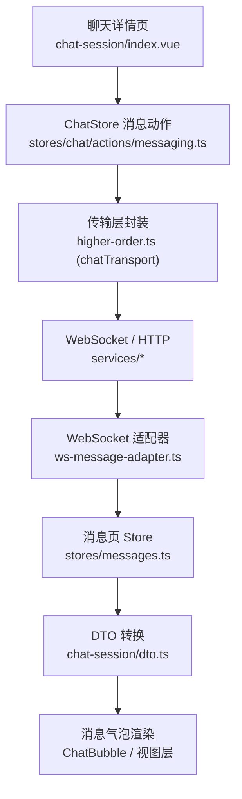
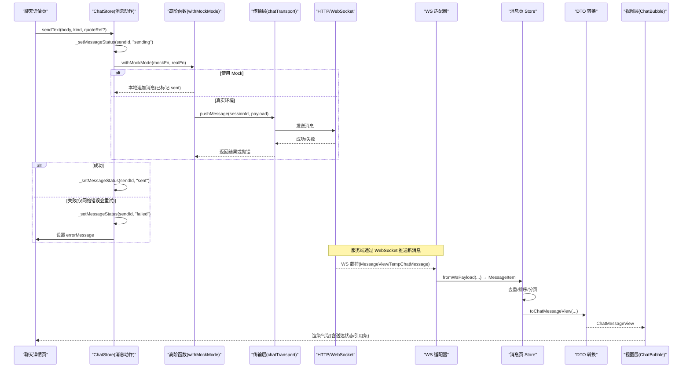
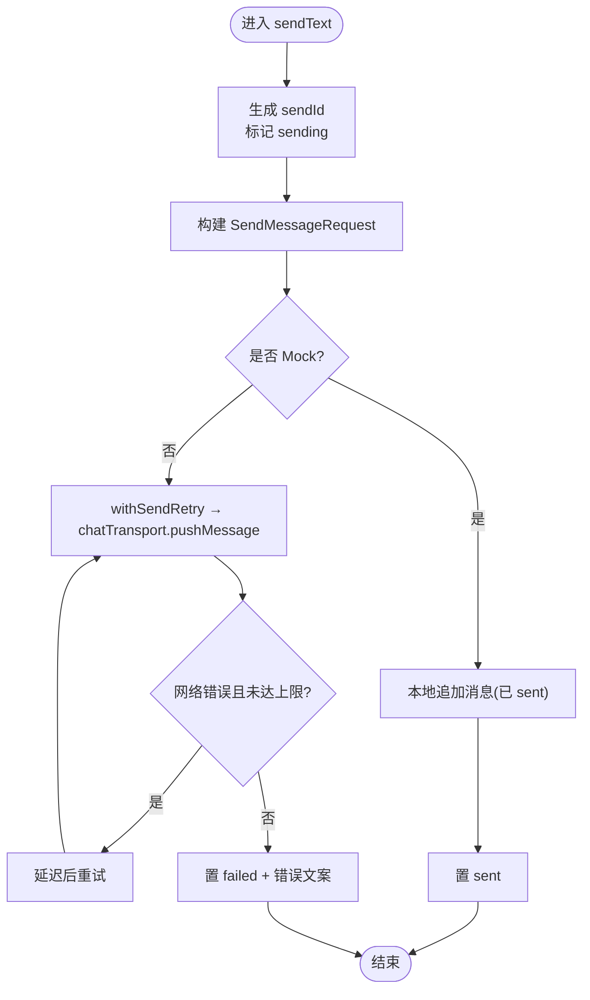
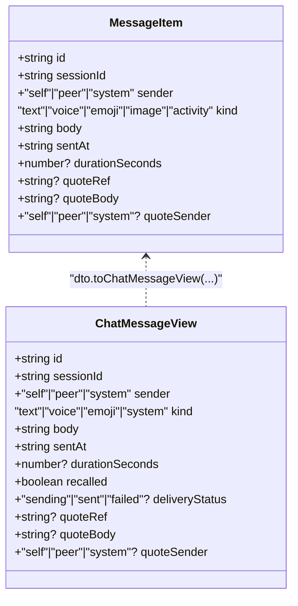
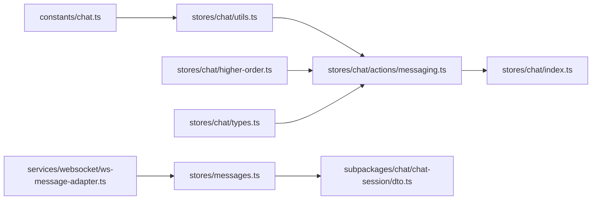

# 消息收发动作（messaging actions）

<cite>
**本文引用的文件**
- [apps/client/src/stores/chat/actions/messaging.ts](file://apps/client/src/stores/chat/actions/messaging.ts)
- [apps/client/src/stores/chat/index.ts](file://apps/client/src/stores/chat/index.ts)
- [apps/client/src/stores/chat/types.ts](file://apps/client/src/stores/chat/types.ts)
- [apps/client/src/stores/chat/store-type.ts](file://apps/client/src/stores/chat/store-type.ts)
- [apps/client/src/stores/chat/utils.ts](file://apps/client/src/stores/chat/utils.ts)
- [apps/client/src/stores/chat/higher-order.ts](file://apps/client/src/stores/chat/higher-order.ts)
- [apps/client/src/constants/chat.ts](file://apps/client/src/constants/chat.ts)
- [apps/client/src/constants/storage-keys.ts](file://apps/client/src/constants/storage-keys.ts)
- [apps/client/src/subpackages/chat/chat-session/dto.ts](file://apps/client/src/subpackages/chat/chat-session/dto.ts)
- [apps/client/src/subpackages/chat/chat-session/api.ts](file://apps/client/src/subpackages/chat/chat-session/api.ts)
- [apps/client/src/services/websocket/ws-message-adapter.ts](file://apps/client/src/services/websocket/ws-message-adapter.ts)
- [apps/client/src/stores/messages.ts](file://apps/client/src/stores/messages.ts)
- [apps/client/src/subpackages/chat/chat-session/index.vue](file://apps/client/src/subpackages/chat/chat-session/index.vue)
</cite>

## 目录
1. [简介](#简介)
2. [项目结构](#项目结构)
3. [核心组件](#核心组件)
4. [架构总览](#架构总览)
5. [详细组件分析](#详细组件分析)
6. [依赖关系分析](#依赖关系分析)
7. [性能与优化](#性能与优化)
8. [故障排查指南](#故障排查指南)
9. [结论](#结论)
10. [附录：关键配置与示例路径](#附录关键配置与示例路径)

## 简介
本文围绕聊天消息的“发送、接收、存储、渲染”全链路，系统梳理客户端侧的消息收发动作实现。重点覆盖：
- 消息格式标准化与类型约束
- 发送重试机制与失败回退
- 送达状态追踪与本地持久化
- 离线/历史消息加载与排序
- WebSocket 实时接收与去重
- 分页加载与性能优化策略
- 调试技巧与常见陷阱

## 项目结构
本功能涉及三层协作：
- Store 层（chat store）：负责消息发送、投递状态、会话切换等动作
- 数据适配层（messages store + ws-message-adapter + dto）：统一后端消息形态到前端内部模型
- 页面层（chat-session 页面）：触发发送、展示消息、处理交互

图表来源
- [apps/client/src/subpackages/chat/chat-session/index.vue:1-120](file://apps/client/src/subpackages/chat/chat-session/index.vue#L1-L120)
- [apps/client/src/stores/chat/actions/messaging.ts:1-120](file://apps/client/src/stores/chat/actions/messaging.ts#L1-L120)
- [apps/client/src/stores/chat/higher-order.ts:1-80](file://apps/client/src/stores/chat/higher-order.ts#L1-L80)
- [apps/client/src/services/websocket/ws-message-adapter.ts:1-114](file://apps/client/src/services/websocket/ws-message-adapter.ts#L1-L114)
- [apps/client/src/stores/messages.ts:180-420](file://apps/client/src/stores/messages.ts#L180-L420)
- [apps/client/src/subpackages/chat/chat-session/dto.ts:1-200](file://apps/client/src/subpackages/chat/chat-session/dto.ts#L1-L200)

章节来源
- [apps/client/src/stores/chat/index.ts:1-131](file://apps/client/src/stores/chat/index.ts#L1-L131)
- [apps/client/src/subpackages/chat/chat-session/index.vue:1-260](file://apps/client/src/subpackages/chat/chat-session/index.vue#L1-L260)

## 核心组件
- ChatStore 消息动作（sendText/sendVoice/_setMessageStatus）：生成 sendId、设置 sending、调用传输层并带重试、成功后置 sent、失败置 failed
- 工具函数（loadMessageStatus/saveMessageStatus/withSendRetry）：读写本地持久化键、网络错误自动重试
- 常量（MESSAGE_STATUS_STORAGE_KEY/MAX_SEND_RETRIES/SEND_RETRY_DELAY_MS）：定义存储键名与重试策略
- WebSocket 适配器（fromWsPayload/mapWsKind/resolveWsSessionId）：将后端 WS 推送转为内部 MessageItem，并归因会话
- DTO 转换（toChatMessageView/fromTempChatMessageDto）：统一不同来源消息为视图层可用结构
- 消息页 Store（messages.ts）：负责历史消息加载、去重、排序、分页、typing 状态、引用回复解析

章节来源
- [apps/client/src/stores/chat/actions/messaging.ts:1-200](file://apps/client/src/stores/chat/actions/messaging.ts#L1-L200)
- [apps/client/src/stores/chat/utils.ts:1-97](file://apps/client/src/stores/chat/utils.ts#L1-L97)
- [apps/client/src/constants/chat.ts:1-54](file://apps/client/src/constants/chat.ts#L1-L54)
- [apps/client/src/services/websocket/ws-message-adapter.ts:1-114](file://apps/client/src/services/websocket/ws-message-adapter.ts#L1-L114)
- [apps/client/src/subpackages/chat/chat-session/dto.ts:1-200](file://apps/client/src/subpackages/chat/chat-session/dto.ts#L1-L200)
- [apps/client/src/stores/messages.ts:180-420](file://apps/client/src/stores/messages.ts#L180-L420)

## 架构总览
下图展示了从用户点击“发送”到消息落库、渲染的完整流程，包括 Mock/Real 模式分支、重试、状态持久化与 WebSocket 实时到达。

图表来源
- [apps/client/src/stores/chat/actions/messaging.ts:1-200](file://apps/client/src/stores/chat/actions/messaging.ts#L1-L200)
- [apps/client/src/stores/chat/higher-order.ts:1-142](file://apps/client/src/stores/chat/higher-order.ts#L1-L142)
- [apps/client/src/services/websocket/ws-message-adapter.ts:1-114](file://apps/client/src/services/websocket/ws-message-adapter.ts#L1-L114)
- [apps/client/src/stores/messages.ts:180-420](file://apps/client/src/stores/messages.ts#L180-L420)
- [apps/client/src/subpackages/chat/chat-session/dto.ts:1-200](file://apps/client/src/subpackages/chat/chat-session/dto.ts#L1-L200)

## 详细组件分析

### 消息发送流程（sendText/sendVoice）
- 发送入口
  - sendText：构造强类型请求体（sender/kind/body/durationSeconds/quoteRef），生成唯一 sendId，标记 sending，调用 withMockMode 分派 Mock/Real 分支，成功后置 sent，失败置 failed 并设置错误文案
  - sendVoice：优先上传语音文件获取 URL，再按 kind="voice" 发送；H5 或缺失路径时降级占位文本
- 重试机制
  - 仅对网络层错误进行 1 次重试（MAX_SEND_RETRIES=1），延迟 SEND_RETRY_DELAY_MS 毫秒后重试
  - 业务错误不重试，直接失败
- 持久化
  - 使用 MESSAGE_STATUS_STORAGE_KEY 持久化消息投递状态映射表（sendId→status），刷新/切会话后可恢复展示
- 引用回复
  - quoteRef 经过长度校验后透传，保持与后端契约一致

图表来源
- [apps/client/src/stores/chat/actions/messaging.ts:1-200](file://apps/client/src/stores/chat/actions/messaging.ts#L1-L200)
- [apps/client/src/stores/chat/utils.ts:1-97](file://apps/client/src/stores/chat/utils.ts#L1-L97)
- [apps/client/src/constants/chat.ts:1-54](file://apps/client/src/constants/chat.ts#L1-L54)

章节来源
- [apps/client/src/stores/chat/actions/messaging.ts:1-200](file://apps/client/src/stores/chat/actions/messaging.ts#L1-L200)
- [apps/client/src/stores/chat/utils.ts:1-97](file://apps/client/src/stores/chat/utils.ts#L1-L97)
- [apps/client/src/constants/chat.ts:1-54](file://apps/client/src/constants/chat.ts#L1-L54)

### 消息接收与渲染（WebSocket 适配与 DTO）
- WS 载荷归一化
  - fromWsPayload：识别私信/临时会话/mock 三种形态，统一转换为内部 MessageItem
  - mapWsKind：后端 messageKind 大小写无关映射到前端 kind
  - resolveWsSessionId：临时会话无 sessionId 时，基于当前活跃会话与 sender 归因
- 消息映射与引用解析
  - messages.ts 中 mapToMessageItem：将后端 MessageView 映射为 MessageItem，支持 voice/emoji/activity/image/text，并解析引用快照 quoteContext
  - dto.ts 中 toChatMessageView：将多种来源消息转换为视图层 ChatMessageView，处理 id/sentAt/sender/kind 默认值与 null 转 undefined
- 渲染
  - 页面通过 toChatMessageViewList 批量转换后，交由 ChatBubble 渲染，支持撤回/送达状态/引用条

图表来源
- [apps/client/src/stores/messages.ts:180-420](file://apps/client/src/stores/messages.ts#L180-L420)
- [apps/client/src/subpackages/chat/chat-session/dto.ts:1-200](file://apps/client/src/subpackages/chat/chat-session/dto.ts#L1-L200)
- [apps/client/src/services/websocket/ws-message-adapter.ts:1-114](file://apps/client/src/services/websocket/ws-message-adapter.ts#L1-L114)

章节来源
- [apps/client/src/services/websocket/ws-message-adapter.ts:1-114](file://apps/client/src/services/websocket/ws-message-adapter.ts#L1-L114)
- [apps/client/src/stores/messages.ts:180-420](file://apps/client/src/stores/messages.ts#L180-L420)
- [apps/client/src/subpackages/chat/chat-session/dto.ts:1-200](file://apps/client/src/subpackages/chat/chat-session/dto.ts#L1-L200)

### 存储与持久化（状态键与草稿）
- 消息投递状态
  - KEY：MESSAGE_STATUS_STORAGE_KEY（值为 "chat:message-delivery-status"）
  - 作用：持久化每条消息的 sending/sent/failed 状态，跨刷新/会话恢复展示
  - 读写：loadMessageStatus/saveMessageStatus 安全包装，异常静默忽略
- 草稿
  - STORAGE_KEYS.CHAT_DRAFT：按会话隔离的输入框草稿持久化
  - 页面内以 CHAT_DRAFT_PREFIX + sessionId 作为 key 维护草稿，监听变化写入，进入恢复，离开清理

章节来源
- [apps/client/src/constants/chat.ts:1-54](file://apps/client/src/constants/chat.ts#L1-L54)
- [apps/client/src/constants/storage-keys.ts:1-133](file://apps/client/src/constants/storage-keys.ts#L1-L133)
- [apps/client/src/stores/chat/utils.ts:1-97](file://apps/client/src/stores/chat/utils.ts#L1-L97)
- [apps/client/src/subpackages/chat/chat-session/index.vue:1-260](file://apps/client/src/subpackages/chat/chat-session/index.vue#L1-L260)

### 离线消息与历史加载（分页与排序）
- 分页游标
  - messagesStore 维护 messagePage/messageHasMore，上拉加载更早历史（正序分页）
- 排序与去重
  - 历史消息按时间正序排列；新增消息通过 ID 去重，避免重复渲染
- 正在输入状态
  - typingMap 记录对方“正在输入”，WS /queue/typing 驱动，超时自动复位

章节来源
- [apps/client/src/stores/messages.ts:180-420](file://apps/client/src/stores/messages.ts#L180-L420)

### 消息去重、排序与分页加载
- 去重策略
  - 基于消息 id 判断是否已存在，避免 WS 推送与历史拉取导致重复
- 排序规则
  - 按 sentAt 正序排列，保证时间轴正确
- 分页加载
  - 首次加载基础消息集，上拉继续加载更早历史，直到 messageHasMore=false

章节来源
- [apps/client/src/stores/messages.ts:180-420](file://apps/client/src/stores/messages.ts#L180-L420)

### 性能优化策略
- 列表渲染
  - 使用虚拟滚动/长列表优化（由页面组件实现）
- 缓存与并发
  - 消息页 bootstrap 采用 TTL 缓存（30s/60s）减少重复请求
  - 并发加载会话/信号/通知/互动事件，独立 loading 标志避免竞态卡死
- 图片与媒体
  - 图片消息通过 image kind 正确渲染，避免降级为 URL 文本气泡
- 重试与错误收敛
  - 网络错误自动重试一次，非网络错误快速失败，降低无效等待

章节来源
- [apps/client/src/stores/messages.ts:180-420](file://apps/client/src/stores/messages.ts#L180-L420)
- [apps/client/src/stores/chat/actions/messaging.ts:1-200](file://apps/client/src/stores/chat/actions/messaging.ts#L1-L200)

## 依赖关系分析
- ChatStore 消息动作依赖：
  - 常量：MESSAGE_STATUS_STORAGE_KEY、MAX_SEND_RETRIES、SEND_RETRY_DELAY_MS
  - 工具：loadMessageStatus/saveMessageStatus、withSendRetry
  - 高阶：withMockMode（决定 Mock/Real 分支）、chatTransport（传输层单例）
  - 类型：SendMessageRequest、MessageDeliveryStatus
- 消息接收链依赖：
  - WS 适配器 → messagesStore → DTO 转换 → 视图层

图表来源
- [apps/client/src/constants/chat.ts:1-54](file://apps/client/src/constants/chat.ts#L1-L54)
- [apps/client/src/stores/chat/utils.ts:1-97](file://apps/client/src/stores/chat/utils.ts#L1-L97)
- [apps/client/src/stores/chat/actions/messaging.ts:1-200](file://apps/client/src/stores/chat/actions/messaging.ts#L1-L200)
- [apps/client/src/stores/chat/higher-order.ts:1-142](file://apps/client/src/stores/chat/higher-order.ts#L1-L142)
- [apps/client/src/stores/chat/types.ts:1-86](file://apps/client/src/stores/chat/types.ts#L1-L86)
- [apps/client/src/stores/chat/index.ts:1-131](file://apps/client/src/stores/chat/index.ts#L1-L131)
- [apps/client/src/services/websocket/ws-message-adapter.ts:1-114](file://apps/client/src/services/websocket/ws-message-adapter.ts#L1-L114)
- [apps/client/src/stores/messages.ts:180-420](file://apps/client/src/stores/messages.ts#L180-L420)
- [apps/client/src/subpackages/chat/chat-session/dto.ts:1-200](file://apps/client/src/subpackages/chat/chat-session/dto.ts#L1-L200)

章节来源
- [apps/client/src/stores/chat/index.ts:1-131](file://apps/client/src/stores/chat/index.ts#L1-L131)
- [apps/client/src/stores/chat/actions/messaging.ts:1-200](file://apps/client/src/stores/chat/actions/messaging.ts#L1-L200)

## 性能与优化
- 发送端
  - 重试仅在 network 错误触发，避免业务错误反复重试造成雪崩
  - 状态持久化确保弱网下用户体验（loading/sent/failed 可恢复）
- 接收端
  - WS 载荷统一映射，避免多次 if/else 分支判断
  - 临时会话 sessionId 归因在适配器完成，减少上层复杂度
- 列表端
  - 分页加载与去重避免冗余渲染
  - TTL 缓存减少频繁请求
- 资源端
  - 图片消息走专用 kind，避免 URL 文本气泡导致的样式问题

[本节为通用指导，无需特定文件来源]

## 故障排查指南
- 发送失败
  - 检查 withSendRetry 的重试条件（仅网络错误）与次数（MAX_SEND_RETRIES）
  - 确认 MESSAGE_STATUS_STORAGE_KEY 是否正确写入，刷新后状态是否恢复
  - 查看 errorMessage 是否为技术细节，需在前端友好化处理
- 消息未显示/未读红点不更新
  - 检查 WS 适配器 fromWsPayload 是否能正确识别消息形态并归因 sessionId
  - 确认 mapWsKind 是否包含 image/emoji/activity 等分支
  - 验证 messagesStore 的去重逻辑是否误删了新消息
- 引用回复不显示
  - 检查 parsePrivateQuoteContext 能否解析 quoteContext JSON
  - 确认 dto.toChatMessageView 是否将 quoteRef/quoteBody/quoteSender 正确传递
- 临时会话 sessionId 为空
  - 检查 resolveWsSessionId 是否在 temp-chat 队列且 sender=peer 时命中 activeSession.id

章节来源
- [apps/client/src/stores/chat/utils.ts:1-97](file://apps/client/src/stores/chat/utils.ts#L1-L97)
- [apps/client/src/services/websocket/ws-message-adapter.ts:1-114](file://apps/client/src/services/websocket/ws-message-adapter.ts#L1-L114)
- [apps/client/src/stores/messages.ts:180-420](file://apps/client/src/stores/messages.ts#L180-L420)
- [apps/client/src/subpackages/chat/chat-session/dto.ts:1-200](file://apps/client/src/subpackages/chat/chat-session/dto.ts#L1-L200)

## 结论
本实现通过明确的职责拆分（store/action/utils/higher-order/dto/ws-adapter），实现了消息发送、接收、存储、渲染的全链路闭环。借助重试、持久化、去重与分页等策略，兼顾了用户体验与系统稳定性。后续可在以下方面持续优化：
- 扩展更多消息类型与富媒体渲染
- 完善离线消息补偿策略（如断线重连后的增量同步）
- 增强错误上报与可观测性（Sentry 等）

[本节为总结，无需特定文件来源]

## 附录：关键配置与示例路径
- 常量配置
  - MESSAGE_STATUS_STORAGE_KEY：用于消息投递状态的本地存储键（见 constants/chat.ts）
  - MAX_SEND_RETRIES：消息发送最大重试次数（见 constants/chat.ts）
  - SEND_RETRY_DELAY_MS：重试间隔毫秒数（见 constants/chat.ts）
  - STORAGE_KEYS.CHAT_DRAFT：草稿存储键（见 constants/storage-keys.ts）
- 代码示例路径
  - 发送文本/表情：sendText 实现路径（见 stores/chat/actions/messaging.ts）
  - 发送语音：sendVoice 实现路径（见 stores/chat/actions/messaging.ts）
  - 重试执行器：withSendRetry 实现路径（见 stores/chat/utils.ts）
  - WS 载荷转换：fromWsPayload/mapWsKind 实现路径（见 services/websocket/ws-message-adapter.ts）
  - DTO 转换：toChatMessageView/fromTempChatMessageDto 实现路径（见 subpackages/chat/chat-session/dto.ts）
  - 消息页历史与分页：messagesStore 相关逻辑（见 stores/messages.ts）
  - 撤回临时会话消息：recallTempChatMessageApi 实现路径（见 subpackages/chat/chat-session/api.ts）

章节来源
- [apps/client/src/constants/chat.ts:1-54](file://apps/client/src/constants/chat.ts#L1-L54)
- [apps/client/src/constants/storage-keys.ts:1-133](file://apps/client/src/constants/storage-keys.ts#L1-L133)
- [apps/client/src/stores/chat/actions/messaging.ts:1-200](file://apps/client/src/stores/chat/actions/messaging.ts#L1-L200)
- [apps/client/src/stores/chat/utils.ts:1-97](file://apps/client/src/stores/chat/utils.ts#L1-L97)
- [apps/client/src/services/websocket/ws-message-adapter.ts:1-114](file://apps/client/src/services/websocket/ws-message-adapter.ts#L1-L114)
- [apps/client/src/subpackages/chat/chat-session/dto.ts:1-200](file://apps/client/src/subpackages/chat/chat-session/dto.ts#L1-L200)
- [apps/client/src/stores/messages.ts:180-420](file://apps/client/src/stores/messages.ts#L180-L420)
- [apps/client/src/subpackages/chat/chat-session/api.ts:1-32](file://apps/client/src/subpackages/chat/chat-session/api.ts#L1-L32)