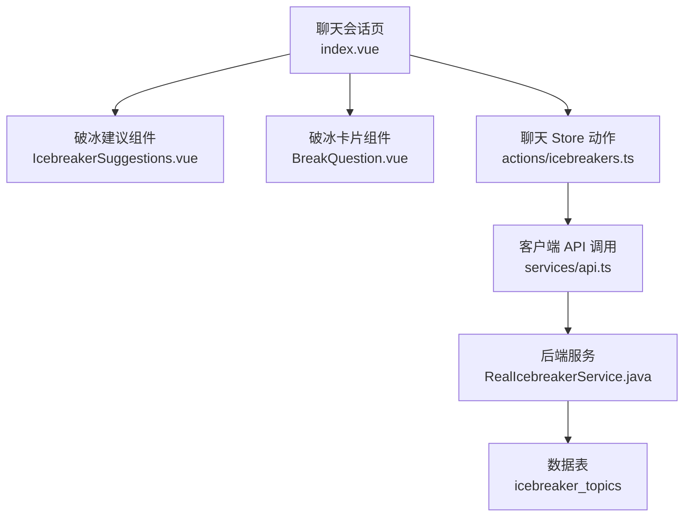
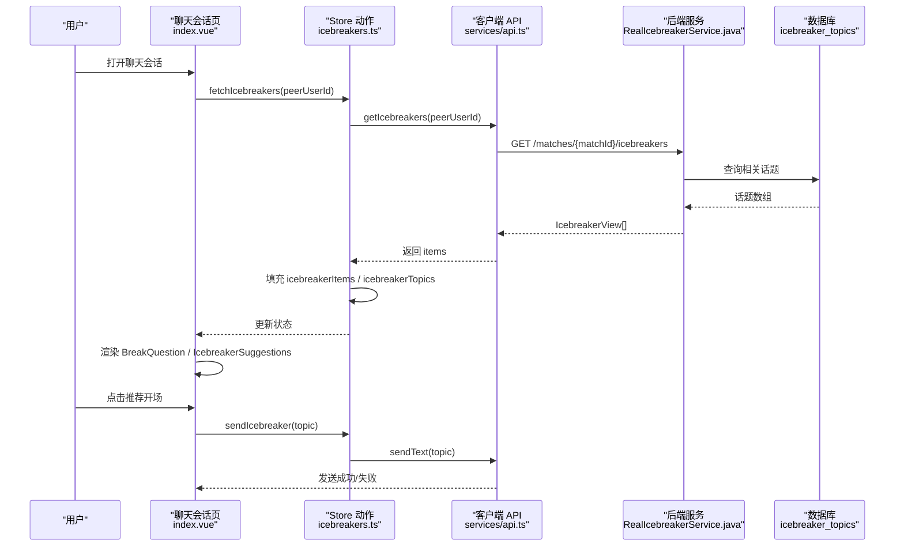
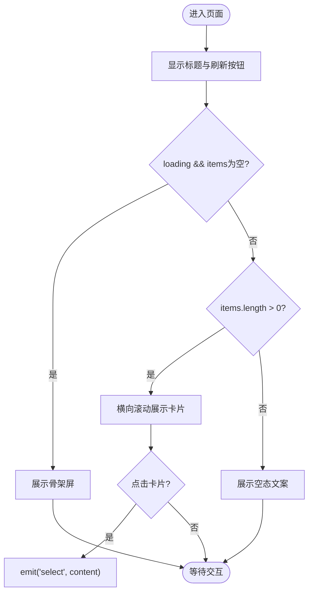
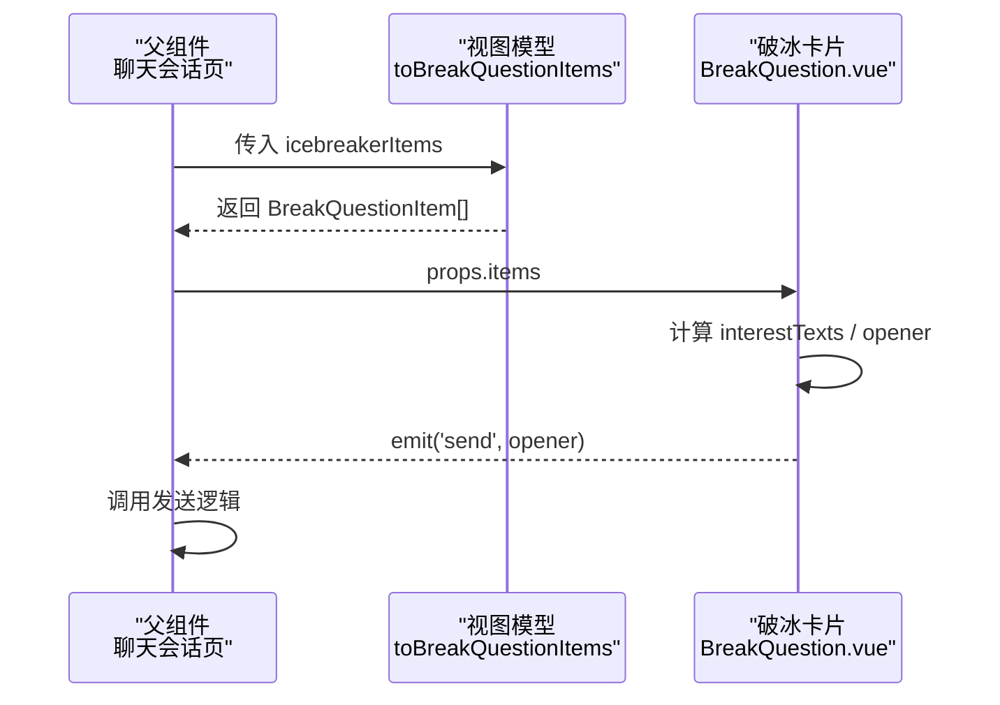
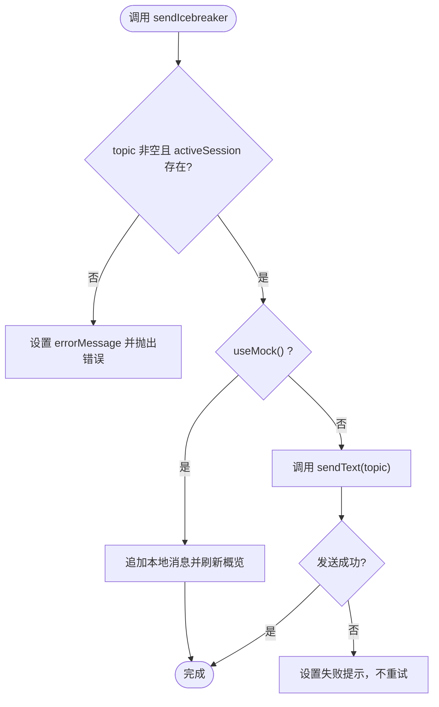
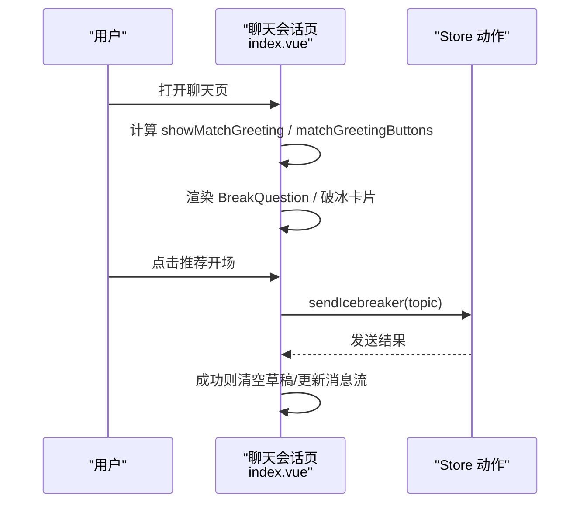
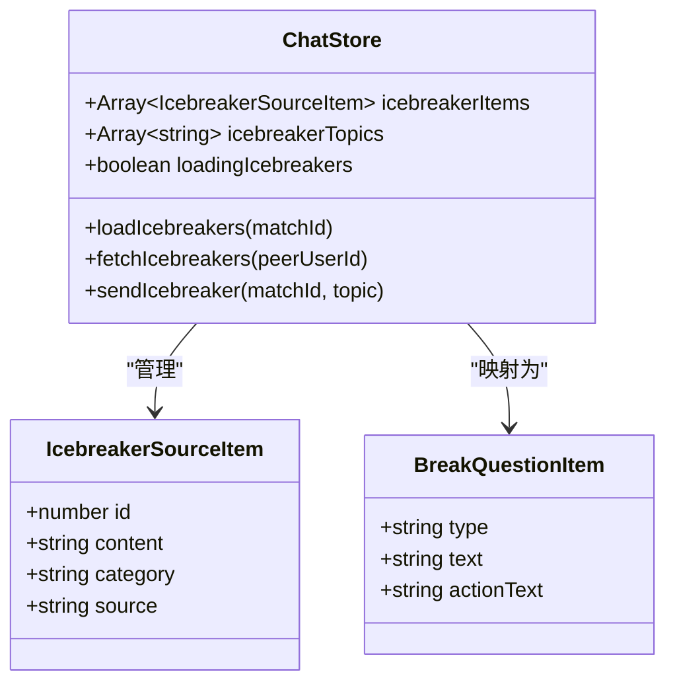
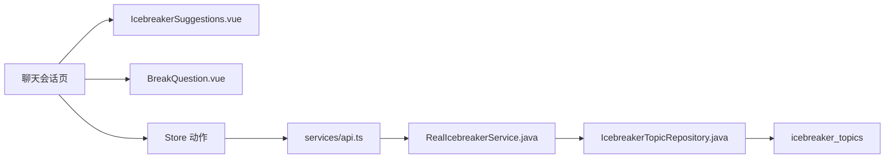

# 破冰消息动作（icebreakers actions）

<cite>
**本文引用的文件**
- [IcebreakerSuggestions.vue](file://apps/client/src/components/chat/IcebreakerSuggestions.vue)
- [icebreakers.ts](file://apps/client/src/stores/chat/actions/icebreakers.ts)
- [index.vue（聊天会话页）](file://apps/client/src/subpackages/chat/chat-session/index.vue)
- [BreakQuestion.vue](file://apps/client/src/components/chat/BreakQuestion.vue)
- [chat.ts（视图模型）](file://apps/client/src/view-models/chat.ts)
- [chat.ts（类型定义）](file://apps/client/src/types/chat.ts)
- [messages.ts（消息 store）](file://apps/client/src/stores/messages.ts)
- [api.ts（客户端 API）](file://apps/client/src/services/api.ts)
- [RealIcebreakerService.java](file://apps/api/src/main/java/com/campuslove/api/match/RealIcebreakerService.java)
- [IcebreakerView.java](file://apps/api/src/main/java/com/campuslove/api/match/IcebreakerView.java)
- [IcebreakerTopicRepository.java](file://apps/api/src/main/java/com/campuslove/api/repository/IcebreakerTopicRepository.java)
- [V2026.05.30.0003__create_icebreaker_topics.sql](file://database/flyway/sql/V2026.05.30.0003__create_icebreaker_topics.sql)
</cite>

## 目录
1. [简介](#简介)
2. [项目结构与定位](#项目结构与定位)
3. [核心组件与职责](#核心组件与职责)
4. [架构总览](#架构总览)
5. [详细组件分析](#详细组件分析)
6. [依赖关系分析](#依赖关系分析)
7. [性能与体验优化](#性能与体验优化)
8. [故障排查指南](#故障排查指南)
9. [配置与扩展](#配置与扩展)
10. [结论](#结论)

## 简介
本文件系统化梳理“破冰消息”功能的生成、展示与用户交互逻辑，覆盖：
- 消息模板系统：基于对方资料与兴趣的个性化话题项。
- 推荐策略：从服务端拉取并映射为前端可渲染结构。
- 点击行为处理：一键发送开场白到当前聊天会话。
- 数据结构、触发条件与显示规则。
- 与聊天会话的集成方式及用户体验优化点。
- 配置示例与自定义扩展方法。

## 项目结构与定位
破冰功能横跨客户端与后端：
- 客户端：聊天会话页作为主入口；输入区上方展示“共同喜欢 + 推荐开场”卡片；同时提供独立的“破冰建议”组件用于横向滚动浏览。
- Store：集中管理破冰话题的加载、发送、刷新与错误状态。
- 后端：按匹配或对方用户维度返回破冰话题列表，支持分类与来源标注。

**图表来源**
- [index.vue（聊天会话页）:215-240](file://apps/client/src/subpackages/chat/chat-session/index.vue#L215-L240)
- [IcebreakerSuggestions.vue:1-288](file://apps/client/src/components/chat/IcebreakerSuggestions.vue#L1-L288)
- [BreakQuestion.vue:1-112](file://apps/client/src/components/chat/BreakQuestion.vue#L1-L112)
- [icebreakers.ts:1-188](file://apps/client/src/stores/chat/actions/icebreakers.ts#L1-L188)
- [RealIcebreakerService.java](file://apps/api/src/main/java/com/campuslove/api/match/RealIcebreakerService.java)
- [V2026.05.30.0003__create_icebreaker_topics.sql](file://database/flyway/sql/V2026.05.30.0003__create_icebreaker_topics.sql)

**章节来源**
- [index.vue（聊天会话页）:215-240](file://apps/client/src/subpackages/chat/chat-session/index.vue#L215-L240)
- [IcebreakerSuggestions.vue:1-288](file://apps/client/src/components/chat/IcebreakerSuggestions.vue#L1-L288)
- [BreakQuestion.vue:1-112](file://apps/client/src/components/chat/BreakQuestion.vue#L1-L112)
- [icebreakers.ts:1-188](file://apps/client/src/stores/chat/actions/icebreakers.ts#L1-L188)

## 核心组件与职责
- 聊天会话页（index.vue）
  - 负责在会话无用户消息时展示首条破冰提示，以及输入区上方的“破冰卡片”。
  - 维护破冰按钮文案（优先使用个性化话题前两条）。
  - 监听破冰快捷按钮点击，直接发送文本消息。
- 破冰建议组件（IcebreakerSuggestions.vue）
  - 展示横向滚动的 3 个破冰话题卡片，支持“换话题”刷新。
  - 通过事件将选中话题内容回传给父级，由父级发送到输入框或直接发送。
- 破冰卡片组件（BreakQuestion.vue）
  - 展示“共同喜欢”标签与“推荐开场”按钮。
  - 点击后向上 emit 发送动作文本。
- Store 动作（actions/icebreakers.ts）
  - loadIcebreakers：根据匹配 ID 拉取话题（Mock/Real 分支）。
  - sendIcebreaker：校验参数，复用现有私信发送链路发送破冰话题。
  - fetchIcebreakers：按对方用户 ID 拉取完整话题项，填充 items 与 topics。
- 视图模型（view-models/chat.ts）
  - toBreakQuestionItems：将后端话题项映射为 BreakQuestionItem[]，用于 BreakQuestion 组件渲染。
- 类型定义（types/chat.ts）
  - BreakQuestionType、BreakQuestionItem 等基础类型。

**章节来源**
- [index.vue（聊天会话页）:215-240](file://apps/client/src/subpackages/chat/chat-session/index.vue#L215-L240)
- [IcebreakerSuggestions.vue:1-288](file://apps/client/src/components/chat/IcebreakerSuggestions.vue#L1-L288)
- [BreakQuestion.vue:1-112](file://apps/client/src/components/chat/BreakQuestion.vue#L1-L112)
- [icebreakers.ts:1-188](file://apps/client/src/stores/chat/actions/icebreakers.ts#L1-L188)
- [chat.ts（视图模型）:1-159](file://apps/client/src/view-models/chat.ts#L1-L159)
- [chat.ts（类型定义）:1-19](file://apps/client/src/types/chat.ts#L1-L19)

## 架构总览
破冰消息从后端获取话题项，经 Store 统一调度，再由不同 UI 组件按需渲染与交互。

**图表来源**
- [icebreakers.ts:1-188](file://apps/client/src/stores/chat/actions/icebreakers.ts#L1-L188)
- [index.vue（聊天会话页）:215-240](file://apps/client/src/subpackages/chat/chat-session/index.vue#L215-L240)
- [RealIcebreakerService.java](file://apps/api/src/main/java/com/campuslove/api/match/RealIcebreakerService.java)
- [V2026.05.30.0003__create_icebreaker_topics.sql](file://database/flyway/sql/V2026.05.30.0003__create_icebreaker_topics.sql)

## 详细组件分析

### 破冰建议组件（IcebreakerSuggestions.vue）
- 作用：在输入框上方以横向滚动方式展示 3 个个性化破冰话题，支持“换话题”刷新。
- 关键特性：
  - 标题行含“换话题”按钮，点击触发 refresh 事件。
  - 加载骨架屏与空态文案。
  - 每个话题卡片包含类别徽章、内容摘要与提示文案。
  - 点击卡片触发 select 事件，传递 content 给父组件。
- 交互流程：
  - 父组件传入 items（含 id/content/category/source）。
  - 子组件 emit('select', content) 交由父组件决定是插入输入框还是直接发送。

**图表来源**
- [IcebreakerSuggestions.vue:1-288](file://apps/client/src/components/chat/IcebreakerSuggestions.vue#L1-L288)

**章节来源**
- [IcebreakerSuggestions.vue:1-288](file://apps/client/src/components/chat/IcebreakerSuggestions.vue#L1-L288)

### 破冰卡片组件（BreakQuestion.vue）
- 作用：展示“你们共同喜欢”的若干标签，并提供一个“推荐开场”的可点击按钮。
- 关键特性：
  - 从 items 中抽取最多 3 条 text 作为兴趣标签。
  - 第一个 item 的 actionText 作为推荐开场文案。
  - 点击按钮 emit('send', text) 供父组件处理发送。
- 与 Store 的协作：
  - 父组件通过 view-model 将后端话题项转换为 BreakQuestionItem[] 后传入。

**图表来源**
- [BreakQuestion.vue:1-112](file://apps/client/src/components/chat/BreakQuestion.vue#L1-L112)
- [chat.ts（视图模型）:1-159](file://apps/client/src/view-models/chat.ts#L1-L159)

**章节来源**
- [BreakQuestion.vue:1-112](file://apps/client/src/components/chat/BreakQuestion.vue#L1-L112)
- [chat.ts（视图模型）:1-159](file://apps/client/src/view-models/chat.ts#L1-L159)

### Store 动作（actions/icebreakers.ts）
- loadIcebreakers(matchId)
  - Mock 模式：根据 matchId 返回本地预设话题。
  - Real 模式：调用 GET /matches/{matchId}/icebreakers，解析为内容数组并写入 icebreakerTopics。
- sendIcebreaker(_matchId, topic)
  - 校验 topic 非空与 activeSession 存在。
  - Mock 模式：追加消息到本地会话并刷新概览。
  - Real 模式：复用现有 sendText 能力发送话题内容，失败时设置明确错误提示且不向上抛出，避免重复发送。
- fetchIcebreakers(peerUserId)
  - 调用 clientApi.getIcebreakers(peerUserId)，填充 icebreakerItems 与 icebreakerTopics（前 3 条 content）。

**图表来源**
- [icebreakers.ts:1-188](file://apps/client/src/stores/chat/actions/icebreakers.ts#L1-L188)

**章节来源**
- [icebreakers.ts:1-188](file://apps/client/src/stores/chat/actions/icebreakers.ts#L1-L188)

### 聊天会话页集成（index.vue）
- 展示条件：当用户消息数为 0 且无页面错误与加载中，则展示首条破冰提示。
- 按钮文案：优先使用 icebreakerItems 的前两条 content，不足时用固定文案补齐。
- 输入区上方卡片：通过 toBreakQuestionItems 转换后的 BreakQuestionItem[] 渲染。
- 破冰快捷按钮：点击后直接发送该文案，成功后清空草稿。
- 参数注入：可从 URL query 携带 icebreaker 预填为草稿，发送即发出。

**图表来源**
- [index.vue（聊天会话页）:215-240](file://apps/client/src/subpackages/chat/chat-session/index.vue#L215-L240)
- [icebreakers.ts:1-188](file://apps/client/src/stores/chat/actions/icebreakers.ts#L1-L188)

**章节来源**
- [index.vue（聊天会话页）:215-240](file://apps/client/src/subpackages/chat/chat-session/index.vue#L215-L240)

### 数据类型与映射
- 类型定义（types/chat.ts）
  - BreakQuestionType：common_interest / same_school / same_activity / icebreaker。
  - BreakQuestionItem：type / text / actionText。
- 视图模型（view-models/chat.ts）
  - toBreakQuestionItems(items): 将后端话题项映射为去重后的 BreakQuestionItem[]，source/category 决定 type，content 决定 actionText。
  - toChatOverviewView / toContactExchangeLabel 等用于整体聊天概览（与破冰无关但同属聊天模块）。

**图表来源**
- [chat.ts（类型定义）:1-19](file://apps/client/src/types/chat.ts#L1-L19)
- [chat.ts（视图模型）:1-159](file://apps/client/src/view-models/chat.ts#L1-L159)
- [icebreakers.ts:1-188](file://apps/client/src/stores/chat/actions/icebreakers.ts#L1-L188)

**章节来源**
- [chat.ts（类型定义）:1-19](file://apps/client/src/types/chat.ts#L1-L19)
- [chat.ts（视图模型）:1-159](file://apps/client/src/view-models/chat.ts#L1-L159)
- [icebreakers.ts:1-188](file://apps/client/src/stores/chat/actions/icebreakers.ts#L1-L188)

## 依赖关系分析
- 组件层
  - 聊天会话页依赖两个破冰 UI 组件，并通过 Store 动作进行状态管理与发送。
  - IcebreakerSuggestions 与 BreakQuestion 均依赖 i18n 文案。
- Store 层
  - 依赖 services/api 与 http request 封装。
  - 依赖 higher-order withErrorHandling 统一错误处理。
  - 依赖 messages store 刷新概览（Mock 场景）。
- 后端层
  - RealIcebreakerService 提供话题获取能力。
  - IcebreakerView 定义返回字段（content/category/source/topicId）。
  - IcebreakerTopicRepository 访问数据表 icebreaker_topics。

**图表来源**
- [index.vue（聊天会话页）:215-240](file://apps/client/src/subpackages/chat/chat-session/index.vue#L215-L240)
- [IcebreakerSuggestions.vue:1-288](file://apps/client/src/components/chat/IcebreakerSuggestions.vue#L1-L288)
- [BreakQuestion.vue:1-112](file://apps/client/src/components/chat/BreakQuestion.vue#L1-L112)
- [icebreakers.ts:1-188](file://apps/client/src/stores/chat/actions/icebreakers.ts#L1-L188)
- [RealIcebreakerService.java](file://apps/api/src/main/java/com/campuslove/api/match/RealIcebreakerService.java)
- [IcebreakerTopicRepository.java](file://apps/api/src/main/java/com/campuslove/api/repository/IcebreakerTopicRepository.java)
- [V2026.05.30.0003__create_icebreaker_topics.sql](file://database/flyway/sql/V2026.05.30.0003__create_icebreaker_topics.sql)

**章节来源**
- [index.vue（聊天会话页）:215-240](file://apps/client/src/subpackages/chat/chat-session/index.vue#L215-L240)
- [icebreakers.ts:1-188](file://apps/client/src/stores/chat/actions/icebreakers.ts#L1-L188)

## 性能与体验优化
- 渐进式加载
  - 先展示骨架屏，再渲染真实卡片，降低感知延迟。
  - 仅在需要时加载破冰话题（如 onShow 后等待消息加载完成再启动加载），避免空列表导致的闪烁。
- 渲染优化
  - 横向滚动使用 scroll-view 减少不必要的布局开销。
  - 对兴趣标签与推荐开场做去重，避免重复渲染。
- 交互优化
  - 点击反馈与无障碍标签（aria-label）提升可访问性。
  - 发送失败时给出友好提示且不重复重试，防止消息重复。
- 网络优化
  - 使用统一的 withErrorHandling 包装请求，简化错误处理与状态切换。
  - Mock/Real 分支清晰，便于本地开发与回归测试。

[本节为通用指导，不直接分析具体文件]

## 故障排查指南
- 破冰话题恒为空
  - 检查后端响应是否为数组（修复历史：原按对象解析导致 topics 为 undefined）。
  - 确认 fetchIcebreakers 是否正确填充 icebreakerItems 与 icebreakerTopics。
- 发送失败
  - 确认 activeSession 是否存在。
  - 查看 sendText 的错误信息，Store 会设置 errorMessage 并提示“破冰话题发送失败”。
- 未登录或权限问题
  - 未登录时页面应展示引导，避免发起 401 请求。
- 接口异常
  - 确认后端端点 /matches/{matchId}/icebreakers 是否可用。
  - 检查数据库 icebreaker_topics 是否有对应记录。

**章节来源**
- [icebreakers.ts:1-188](file://apps/client/src/stores/chat/actions/icebreakers.ts#L1-L188)
- [index.vue（聊天会话页）:215-240](file://apps/client/src/subpackages/chat/chat-session/index.vue#L215-L240)

## 配置与扩展
- 数据源配置
  - 后端服务：RealIcebreakerService 可按匹配或用户维度生成话题，支持分类与来源标注。
  - 数据表：icebreaker_topics 存储话题元数据（可通过 Flyway 脚本创建与维护）。
- 前端映射扩展
  - 在 view-models/chat.ts 的 toBreakQuestionItems 中增加新的 source/category 到 BreakQuestionType 的映射规则。
  - 如需新增 UI 样式或交互，可在 IcebreakerSuggestions.vue 或 BreakQuestion.vue 中扩展。
- Store 行为扩展
  - 在 actions/icebreakers.ts 中添加新的动作（例如：按时间段限制话题、A/B 分组、埋点上报等）。
  - 可结合 useMock 快速验证新逻辑。
- 聊天会话页集成扩展
  - 在 index.vue 中调整展示条件（如仅在新匹配时展示）、文案优先级或点击行为（如打开详情页而非直接发送）。
- 示例配置要点（文字说明）
  - 后端返回结构需包含 content、category、source、可选 topicId。
  - 前端 Store 会将 items 前 3 条作为 topics 显示于输入区上方。
  - 聊天会话页默认在无用户消息时展示首条破冰提示，并可从 URL query 注入 prefill icebreaker。

**章节来源**
- [chat.ts（视图模型）:1-159](file://apps/client/src/view-models/chat.ts#L1-L159)
- [icebreakers.ts:1-188](file://apps/client/src/stores/chat/actions/icebreakers.ts#L1-L188)
- [index.vue（聊天会话页）:215-240](file://apps/client/src/subpackages/chat/chat-session/index.vue#L215-L240)
- [V2026.05.30.0003__create_icebreaker_topics.sql](file://database/flyway/sql/V2026.05.30.0003__create_icebreaker_topics.sql)

## 结论
破冰消息功能通过前后端协作实现了“基于资料的个性化话题推荐”，并以两种 UI 形态融入聊天会话：首条破冰提示与输入区上方的破冰卡片。Store 统一负责数据加载、发送与错误处理，确保体验一致性与可维护性。未来可按业务需求扩展推荐策略、UI 表现与埋点分析，进一步提升对话转化率与用户满意度。