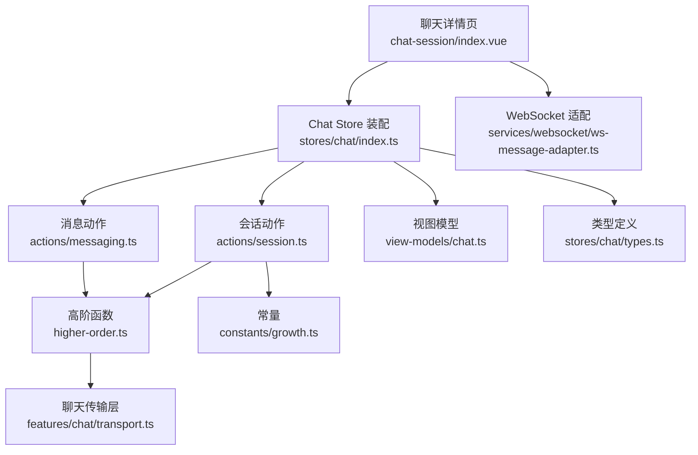
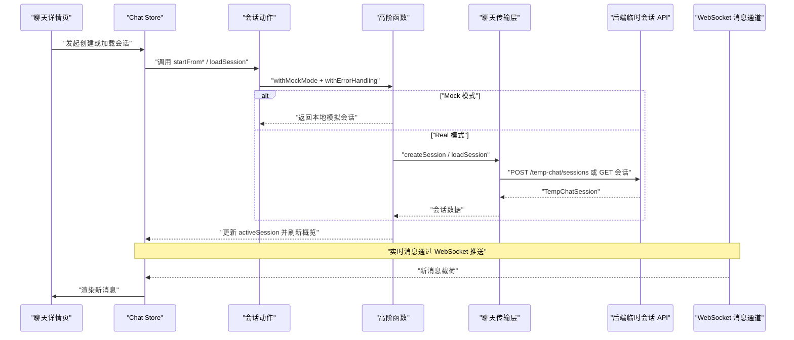
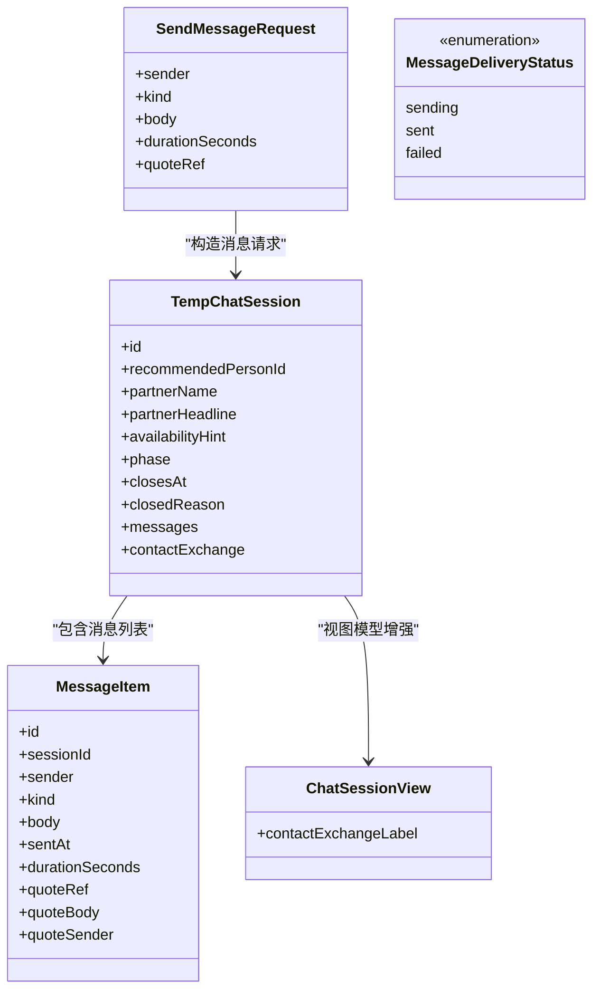
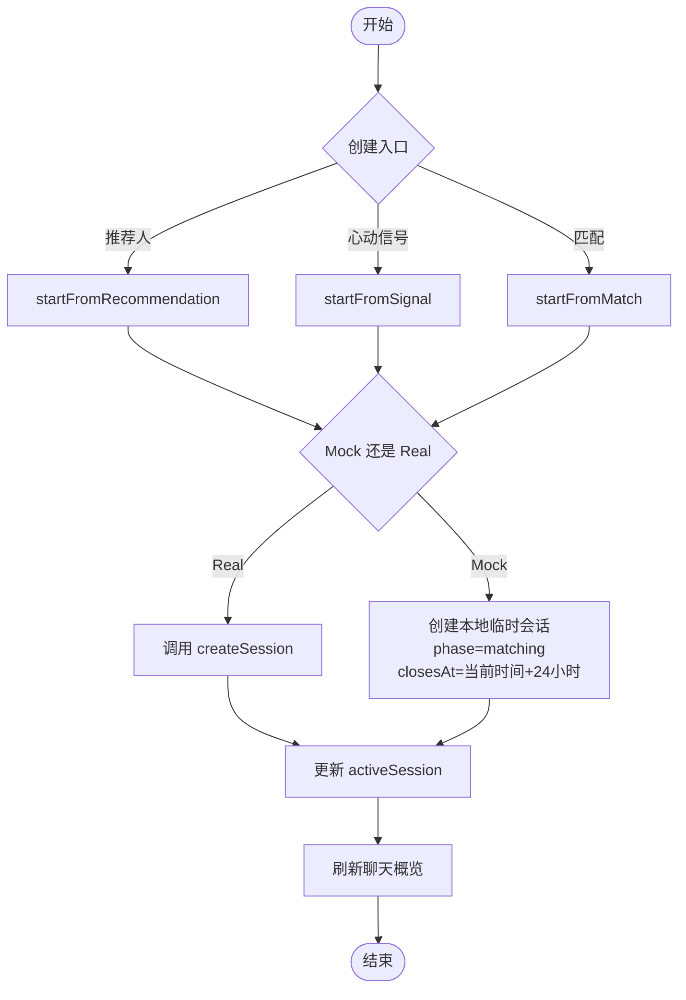
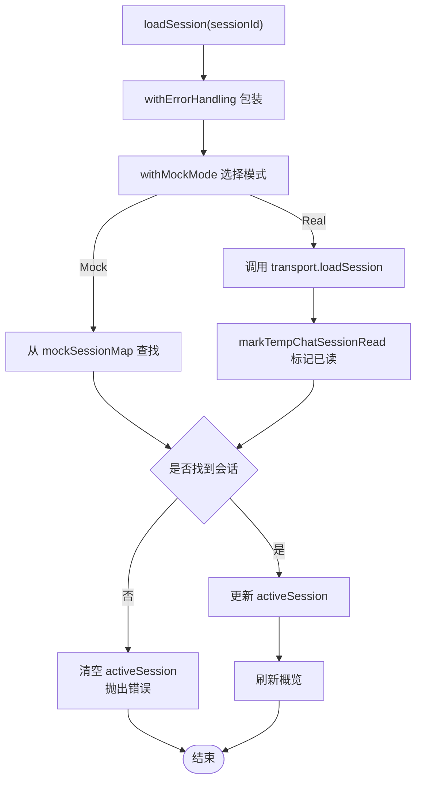
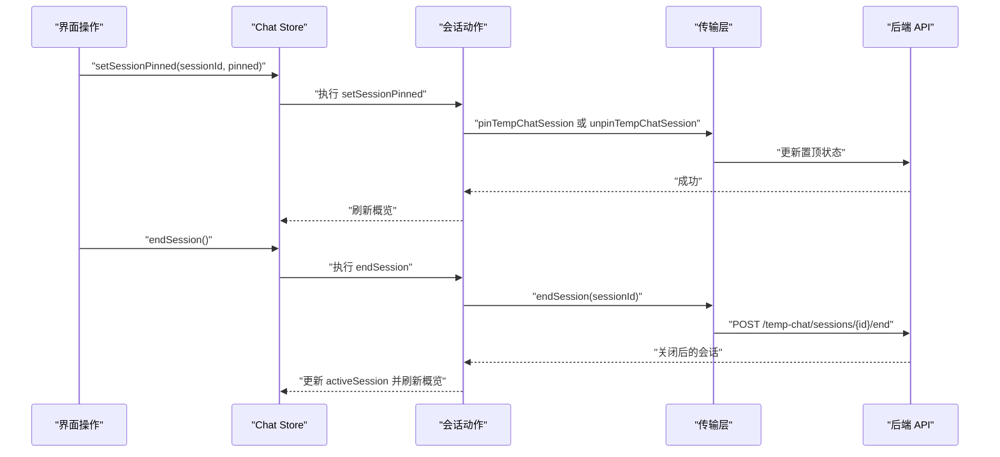
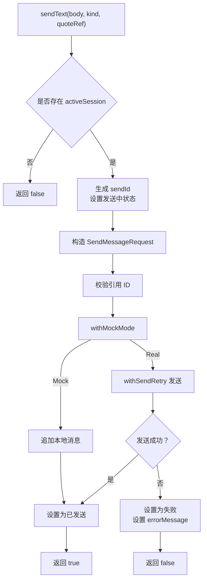
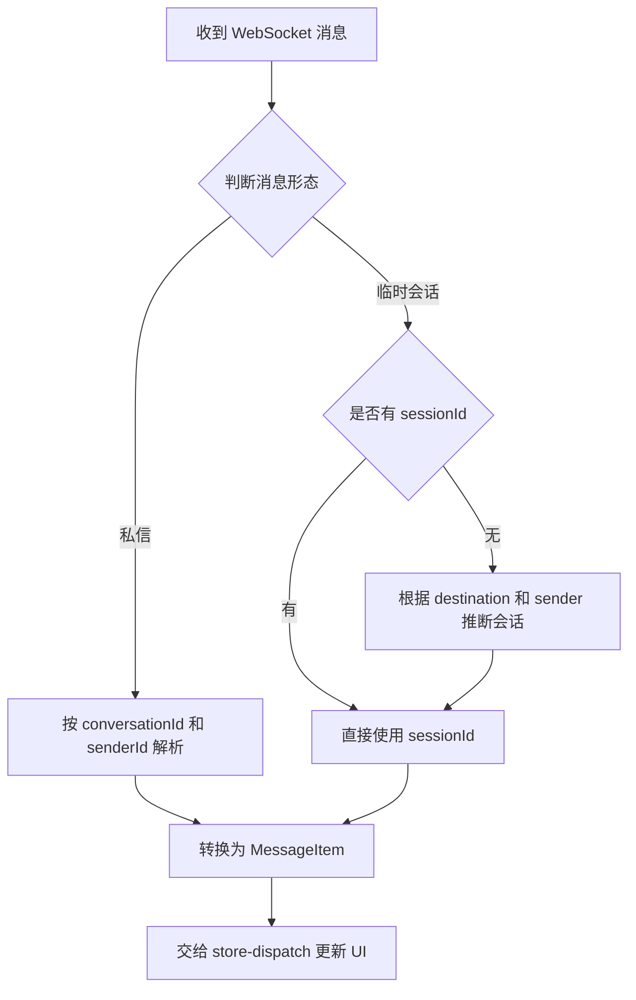
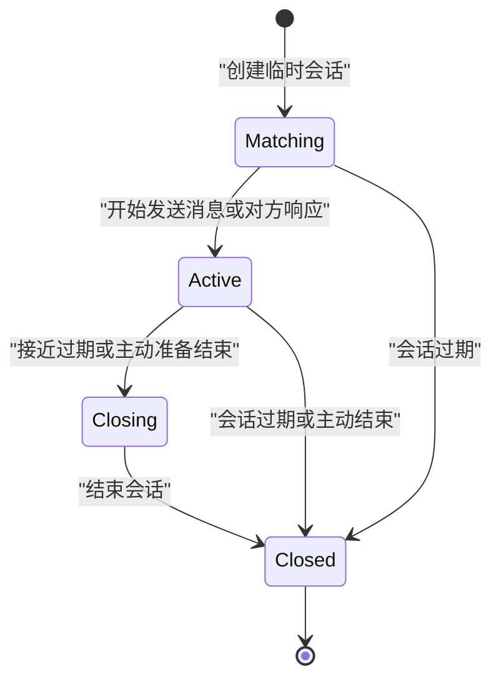
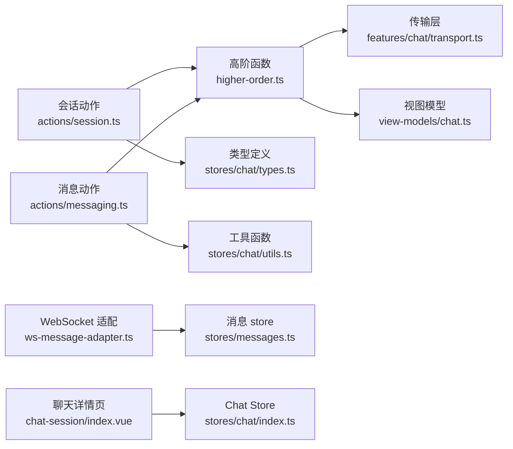

# 聊天会话动作（session actions）

<cite>
**本文引用的文件**   
- [apps/client/src/stores/chat/actions/session.ts](file://apps/client/src/stores/chat/actions/session.ts)
- [apps/client/src/stores/chat/actions/messaging.ts](file://apps/client/src/stores/chat/actions/messaging.ts)
- [apps/client/src/stores/chat/higher-order.ts](file://apps/client/src/stores/chat/higher-order.ts)
- [apps/client/src/stores/chat/index.ts](file://apps/client/src/stores/chat/index.ts)
- [apps/client/src/stores/chat/types.ts](file://apps/client/src/stores/chat/types.ts)
- [apps/client/src/stores/chat/utils.ts](file://apps/client/src/stores/chat/utils.ts)
- [apps/client/src/features/chat/transport.ts](file://apps/client/src/features/chat/transport.ts)
- [apps/client/src/view-models/chat.ts](file://apps/client/src/view-models/chat.ts)
- [apps/client/src/services/websocket/ws-message-adapter.ts](file://apps/client/src/services/websocket/ws-message-adapter.ts)
- [apps/client/src/subpackages/chat/chat-session/index.vue](file://apps/client/src/subpackages/chat/chat-session/index.vue)
- [apps/client/src/constants/growth.ts](file://apps/client/src/constants/growth.ts)
- [apps/client/src/stores/messages.ts](file://apps/client/src/stores/messages.ts)
</cite>

## 目录
1. [引言](#引言)
2. [项目结构定位](#项目结构定位)
3. [核心组件](#核心组件)
4. [架构总览](#架构总览)
5. [详细组件分析](#详细组件分析)
6. [依赖关系分析](#依赖关系分析)
7. [性能与可靠性特征](#性能与可靠性特征)
8. [故障排查指南](#故障排查指南)
9. [最佳实践与代码示例](#最佳实践与代码示例)
10. [结论](#结论)

## 引言
本文聚焦“临时匿名聊天会话”的客户端管理动作，即 `chat session actions`。文档围绕以下目标展开：
- 解释临时匿名会话的创建、加载、置顶、结束和销毁流程；
- 梳理会话状态机转换、超时语义和生命周期钩子；
- 定义会话数据结构、状态枚举及消息投递状态；
- 说明与后端 HTTP API 和 WebSocket 的交互模式；
- 给出错误恢复策略、资源清理路径和可复用的实现范式。

临时匿名会话的核心特征是：由推荐人、心动信号或匹配结果触发，具有默认时长（24 小时），在创建后进入匹配阶段，随后进入活跃对话阶段，最终因过期或主动结束而关闭。

## 项目结构定位
聊天会话动作属于前端 client 应用中的 Pinia chat store 层，按职责拆分为多个 action 文件：
- `stores/chat/actions/session.ts`：会话生命周期动作；
- `stores/chat/actions/messaging.ts`：消息发送动作；
- `stores/chat/higher-order.ts`：高阶函数与传输层单例；
- `stores/chat/index.ts`：store 装配入口；
- `features/chat/transport.ts`：HTTP 传输适配；
- `services/websocket/ws-message-adapter.ts`：WebSocket 消息适配；
- `subpackages/chat/chat-session/index.vue`：聊天详情页页面逻辑；
- `view-models/chat.ts`：后端视图到前端展示模型的转换；
- `constants/growth.ts`：包含临时会话默认时长常量。

**图示来源**
- [apps/client/src/subpackages/chat/chat-session/index.vue:1-60](file://apps/client/src/subpackages/chat/chat-session/index.vue#L1-L60)
- [apps/client/src/stores/chat/index.ts:1-131](file://apps/client/src/stores/chat/index.ts#L1-L131)
- [apps/client/src/stores/chat/actions/session.ts:1-314](file://apps/client/src/stores/chat/actions/session.ts#L1-L314)
- [apps/client/src/stores/chat/actions/messaging.ts:1-229](file://apps/client/src/stores/chat/actions/messaging.ts#L1-L229)
- [apps/client/src/stores/chat/higher-order.ts:1-142](file://apps/client/src/stores/chat/higher-order.ts#L1-L142)
- [apps/client/src/features/chat/transport.ts:1-125](file://apps/client/src/features/chat/transport.ts#L1-L125)
- [apps/client/src/services/websocket/ws-message-adapter.ts:1-114](file://apps/client/src/services/websocket/ws-message-adapter.ts#L1-L114)
- [apps/client/src/view-models/chat.ts:1-159](file://apps/client/src/view-models/chat.ts#L1-L159)
- [apps/client/src/constants/growth.ts:1-40](file://apps/client/src/constants/growth.ts#L1-L40)

**章节来源**
- [apps/client/src/stores/chat/index.ts:1-131](file://apps/client/src/stores/chat/index.ts#L1-L131)
- [apps/client/src/stores/chat/actions/session.ts:1-314](file://apps/client/src/stores/chat/actions/session.ts#L1-L314)

## 核心组件
本节梳理会话管理涉及的核心模块及其职责。

| 组件 | 主要职责 | 关键接口或行为 |
|---|---|---|
| Chat Store 装配 | 聚合会话、消息、联系方式交换、破冰话题等 action | 暴露 `useChatStore` 及所有 action |
| 会话动作 | 创建、加载、置顶、结束临时会话 | `loadOverview`、`startFromRecommendation`、`startFromSignal`、`startFromMatch`、`loadSession`、`setSessionPinned`、`endSession` |
| 消息动作 | 发送文本、表情、语音消息，并维护投递状态 | `sendText`、`sendVoice`、`_setMessageStatus` |
| 高阶函数 | 统一错误处理、Mock/Real 模式切换、活跃会话更新、概览刷新 | `withErrorHandling`、`withMockMode` |
| 传输层 | 封装临时会话相关 HTTP 调用，区分 Mock 与 Real | `createSession`、`loadSession`、`pushMessage`、`endSession` |
| WebSocket 适配 | 将后端 WS 载荷转换为内部 `MessageItem` | `fromWsPayload`、`resolveWsSessionId` |
| 视图模型 | 将后端会话数据转为前端展示对象 | `toChatSessionView`、`toChatOverviewView` |
| 常量 | 提供临时会话默认时长等配置 | `TEMP_SESSION_DURATION_MS` |

**章节来源**
- [apps/client/src/stores/chat/index.ts:1-131](file://apps/client/src/stores/chat/index.ts#L1-L131)
- [apps/client/src/stores/chat/actions/session.ts:1-314](file://apps/client/src/stores/chat/actions/session.ts#L1-L314)
- [apps/client/src/stores/chat/actions/messaging.ts:1-229](file://apps/client/src/stores/chat/actions/messaging.ts#L1-L229)
- [apps/client/src/stores/chat/higher-order.ts:1-142](file://apps/client/src/stores/chat/higher-order.ts#L1-L142)
- [apps/client/src/features/chat/transport.ts:1-125](file://apps/client/src/features/chat/transport.ts#L1-L125)
- [apps/client/src/services/websocket/ws-message-adapter.ts:1-114](file://apps/client/src/services/websocket/ws-message-adapter.ts#L1-L114)
- [apps/client/src/view-models/chat.ts:1-159](file://apps/client/src/view-models/chat.ts#L1-L159)
- [apps/client/src/constants/growth.ts:1-40](file://apps/client/src/constants/growth.ts#L1-L40)

## 架构总览
临时匿名聊天会话的生命周期贯穿页面、store、传输层、后端 API 和 WebSocket。

**图示来源**
- [apps/client/src/stores/chat/actions/session.ts:60-200](file://apps/client/src/stores/chat/actions/session.ts#L60-L200)
- [apps/client/src/stores/chat/higher-order.ts:60-142](file://apps/client/src/stores/chat/higher-order.ts#L60-L142)
- [apps/client/src/features/chat/transport.ts:50-125](file://apps/client/src/features/chat/transport.ts#L50-L125)
- [apps/client/src/services/websocket/ws-message-adapter.ts:30-114](file://apps/client/src/services/websocket/ws-message-adapter.ts#L30-L114)

## 详细组件分析

### 会话数据结构与状态模型
临时匿名会话使用 OpenAPI 生成的 `TempChatSession` 作为核心数据结构，并通过视图模型增加前端展示字段。消息侧同时存在两个相关模型：
- 临时会话消息：由 `TempChatSession.messages` 承载；
- 通用消息项：`MessageItem`，用于消息列表与 WebSocket 消息的统一渲染。

**图示来源**
- [apps/client/src/stores/chat/types.ts:1-86](file://apps/client/src/stores/chat/types.ts#L1-L86)
- [apps/client/src/view-models/chat.ts:110-159](file://apps/client/src/view-models/chat.ts#L110-L159)
- [apps/client/src/stores/messages.ts:120-210](file://apps/client/src/stores/messages.ts#L120-L210)

会话状态主要由 `phase` 表达：
- `matching`：匹配阶段，刚创建的临时会话通常处于该状态；
- `active`：活跃阶段，双方可正常发消息；
- `closing`：关闭过渡阶段；
- `closed`：已结束或已过期。

消息投递状态为独立的三态：
- `sending`：正在发送；
- `sent`：已成功发送；
- `failed`：发送失败。

**章节来源**
- [apps/client/src/stores/chat/types.ts:1-86](file://apps/client/src/stores/chat/types.ts#L1-L86)
- [apps/client/src/view-models/chat.ts:110-159](file://apps/client/src/view-models/chat.ts#L110-L159)
- [apps/client/src/stores/messages.ts:120-210](file://apps/client/src/stores/messages.ts#L120-L210)

### 会话创建流程
临时匿名会话支持三种创建入口：
1. 从推荐人创建；
2. 从心动信号创建；
3. 从匹配结果创建。

无论哪种入口，real 模式都调用传输层的 `createSession`，mock 模式则生成带默认 24 小时时长的本地会话。

**图示来源**
- [apps/client/src/stores/chat/actions/session.ts:60-200](file://apps/client/src/stores/chat/actions/session.ts#L60-L200)
- [apps/client/src/constants/growth.ts:35-40](file://apps/client/src/constants/growth.ts#L35-L40)
- [apps/client/src/features/chat/transport.ts:50-75](file://apps/client/src/features/chat/transport.ts#L50-L75)

关键点：
- 三个创建方法都通过 `withMockMode` 统一走 mock 或 real 分支；
- mock 会话设置 `phase="matching"`，并使用 `TEMP_SESSION_DURATION_MS` 计算 `closesAt`；
- real 模式下，创建成功后会更新 `activeSession` 并刷新概览；
- 返回值为当前活跃会话视图模型。

**章节来源**
- [apps/client/src/stores/chat/actions/session.ts:60-200](file://apps/client/src/stores/chat/actions/session.ts#L60-L200)
- [apps/client/src/constants/growth.ts:35-40](file://apps/client/src/constants/growth.ts#L35-L40)
- [apps/client/src/features/chat/transport.ts:50-75](file://apps/client/src/features/chat/transport.ts#L50-L75)

### 会话加载与深链兜底
`loadSession` 负责根据 `sessionId` 加载会话：
- mock 模式下从本地映射表查找，找不到返回空；
- real 模式下调用 `chatTransport.loadSession`，并在成功后调用 `clientApi.markTempChatSessionRead` 标记已读；
- 如果会话不存在或已失效，显式清空 `activeSession`，避免旧会话残留。

**图示来源**
- [apps/client/src/stores/chat/actions/session.ts:180-260](file://apps/client/src/stores/chat/actions/session.ts#L180-L260)

异常处理要点：
- real 加载失败时，必须先清空 `activeSession`，否则页面可能继续渲染上一个会话；
- mock 未知 `sessionId` 不再回退到固定 mock 会话，避免 A 会话数据错成 B 会话；
- 加载失败后抛出的错误会被 `withErrorHandling` 转为 `errorMessage`，并由页面友好化显示。

**章节来源**
- [apps/client/src/stores/chat/actions/session.ts:180-260](file://apps/client/src/stores/chat/actions/session.ts#L180-L260)

### 置顶与会话结束
置顶操作不改变活跃会话，只影响会话列表排序和概览展示：
- mock 模式更新本地会话摘要的 `pinned`；
- real 模式调用 pin 或 unpin 端点；
- 操作完成后刷新概览。

结束会话：
- mock 模式将 `phase` 改为 `closed`，记录 `closedReason="ended"`；
- real 模式调用 `endSession`；
- 结束后仍会更新 `activeSession` 并刷新概览。

**图示来源**
- [apps/client/src/stores/chat/actions/session.ts:260-314](file://apps/client/src/stores/chat/actions/session.ts#L260-L314)
- [apps/client/src/features/chat/transport.ts:90-125](file://apps/client/src/features/chat/transport.ts#L90-L125)

**章节来源**
- [apps/client/src/stores/chat/actions/session.ts:260-314](file://apps/client/src/stores/chat/actions/session.ts#L260-L314)
- [apps/client/src/features/chat/transport.ts:90-125](file://apps/client/src/features/chat/transport.ts#L90-L125)

### 消息发送与会话活跃度
消息发送动作不仅负责把消息推送到后端，还负责：
- 生成客户端 `sendId`；
- 维护消息投递状态；
- 在 real 模式下进行网络错误重试；
- 在 mock 模式下直接追加本地消息；
- 发送成功后更新会话 `phase` 为 `active`。

**图示来源**
- [apps/client/src/stores/chat/actions/messaging.ts:40-160](file://apps/client/src/stores/chat/actions/messaging.ts#L40-L160)
- [apps/client/src/stores/chat/utils.ts:60-97](file://apps/client/src/stores/chat/utils.ts#L60-L97)

语音消息额外步骤：
- 先上传录音文件获取音频 URL；
- 再发送 `kind="voice"` 的消息；
- H5 或 mock 场景下使用占位正文，保持流程可验证。

**章节来源**
- [apps/client/src/stores/chat/actions/messaging.ts:1-229](file://apps/client/src/stores/chat/actions/messaging.ts#L1-L229)
- [apps/client/src/stores/chat/utils.ts:60-97](file://apps/client/src/stores/chat/utils.ts#L60-L97)

### WebSocket 事件监听与消息归因
临时会话消息通过 WebSocket 推送，但后端 `TempChatViewMapper` 在部分场景不携带 `sessionId`。适配层通过以下方式处理：
- 形态 A：私信消息，按 `conversationId` 和 `senderId` 解析；
- 形态 B：临时会话消息，若缺少 `sessionId`，则用当前 `chatStore.activeSession.id` 做兜底归因；
- 形态 C：mock 载荷，直接透传。

**图示来源**
- [apps/client/src/services/websocket/ws-message-adapter.ts:1-114](file://apps/client/src/services/websocket/ws-message-adapter.ts#L1-L114)

重要约束：
- 临时会话未读以服务端计数为准，进入会话时 `loadSession` 全量刷新；
- 仅当用户正停留在某临时会话页且消息来自对端时，才用活跃会话做兜底；
- 消息时间戳可能为数字，需要转换为 ISO 字符串，保证时间条逻辑正确。

**章节来源**
- [apps/client/src/services/websocket/ws-message-adapter.ts:1-114](file://apps/client/src/services/websocket/ws-message-adapter.ts#L1-L114)

### 会话状态机与生命周期钩子
临时匿名会话的状态机可从代码中归纳如下：

对应生命周期钩子与副作用：
- 创建：初始化 `phase="matching"`，设置 `closesAt`，更新 `activeSession`，刷新概览；
- 加载：标记已读，填充消息列表，更新 `activeSession`；
- 置顶：仅刷新概览，不影响活跃会话；
- 发送消息：real 模式下可能推进到 `active`，更新投递状态；
- 结束：标记 `closed`，清理活跃会话上下文；
- WebSocket 推送：增量更新消息，必要时重新渲染会话。

**图示来源**
- [apps/client/src/stores/chat/actions/session.ts:60-314](file://apps/client/src/stores/chat/actions/session.ts#L60-L314)
- [apps/client/src/stores/chat/actions/messaging.ts:40-229](file://apps/client/src/stores/chat/actions/messaging.ts#L40-L229)

**章节来源**
- [apps/client/src/stores/chat/actions/session.ts:60-314](file://apps/client/src/stores/chat/actions/session.ts#L60-L314)
- [apps/client/src/stores/chat/actions/messaging.ts:40-229](file://apps/client/src/stores/chat/actions/messaging.ts#L40-L229)

### 超时处理与资源清理
- 默认时长：临时会话默认 24 小时，由 `TEMP_SESSION_DURATION_MS` 控制；
- 过期语义：后端可在会话过期时返回 404 或其他失败，前端通过 `loadSession` 的错误分支清空 `activeSession`；
- 主动结束：调用 `endSession` 后，会话进入 `closed` 状态；
- 资源清理：
  - 页面离开时不应保留旧 `activeSession`；
  - 草稿按会话隔离持久化，发送成功或离开时清理；
  - 消息投递状态持久化到本地存储，刷新后可恢复；
  - WebSocket 新消息不会污染其他会话，因为 `sessionId` 或会话归因逻辑严格。

**章节来源**
- [apps/client/src/constants/growth.ts:35-40](file://apps/client/src/constants/growth.ts#L35-L40)
- [apps/client/src/stores/chat/actions/session.ts:180-314](file://apps/client/src/stores/chat/actions/session.ts#L180-L314)
- [apps/client/src/subpackages/chat/chat-session/index.vue:1-200](file://apps/client/src/subpackages/chat/chat-session/index.vue#L1-L200)
- [apps/client/src/stores/chat/utils.ts:20-59](file://apps/client/src/stores/chat/utils.ts#L20-L59)

## 依赖关系分析
聊天会话动作依赖多层抽象，耦合集中在传输层和高阶函数上。

**图示来源**
- [apps/client/src/stores/chat/actions/session.ts:1-314](file://apps/client/src/stores/chat/actions/session.ts#L1-L314)
- [apps/client/src/stores/chat/actions/messaging.ts:1-229](file://apps/client/src/stores/chat/actions/messaging.ts#L1-L229)
- [apps/client/src/stores/chat/higher-order.ts:1-142](file://apps/client/src/stores/chat/higher-order.ts#L1-L142)
- [apps/client/src/features/chat/transport.ts:1-125](file://apps/client/src/features/chat/transport.ts#L1-L125)
- [apps/client/src/services/websocket/ws-message-adapter.ts:1-114](file://apps/client/src/services/websocket/ws-message-adapter.ts#L1-L114)
- [apps/client/src/stores/messages.ts:120-210](file://apps/client/src/stores/messages.ts#L120-L210)
- [apps/client/src/subpackages/chat/chat-session/index.vue:1-60](file://apps/client/src/subpackages/chat/chat-session/index.vue#L1-L60)

依赖特点：
- action 文件不直接依赖 HTTP 请求实现，而是通过 `chatTransport`；
- `withMockMode` 屏蔽了 mock 和 real 的差异；
- WebSocket 适配独立于 store，避免 store 与消息队列强耦合；
- 类型集中在 `types.ts`，减少重复内联类型。

潜在风险：
- WebSocket 适配与 store-dispatch 存在循环依赖历史注释，需避免新增 value import 时序问题；
- 临时会话缺失 `sessionId` 时的兜底依赖当前活跃会话，若页面快速切换可能造成短暂归因失败，应由后端补字段长期解决。

**章节来源**
- [apps/client/src/stores/chat/actions/session.ts:1-314](file://apps/client/src/stores/chat/actions/session.ts#L1-L314)
- [apps/client/src/stores/chat/actions/messaging.ts:1-229](file://apps/client/src/stores/chat/actions/messaging.ts#L1-L229)
- [apps/client/src/services/websocket/ws-message-adapter.ts:1-114](file://apps/client/src/services/websocket/ws-message-adapter.ts#L1-L114)

## 性能与可靠性特征
- 幂等键：每次临时会话消息发送都会生成随机幂等键，降低重发冲突概率；
- 重试机制：网络层错误自动重试一次，非网络错误直接失败；
- 状态持久化：消息投递状态写入本地存储，刷新后仍可感知发送结果；
- 概览刷新：大多数动作完成后刷新聊天概览，保证列表预览一致；
- Mock 优先：开发期可通过 mock 快速验证链路，生产环境透明切换到 real；
- 视图模型分离：后端数据与前端展示解耦，便于扩展状态标签和文案。

优化建议：
- 对于高频概览刷新，可考虑合并刷新或防抖；
- WebSocket 消息批量更新时可合并多次 DOM 重绘；
- 临时会话 `sessionId` 缺失问题应推动后端补齐，减少对活跃会话的隐式依赖。

[本节为通用性能讨论，不直接分析具体代码片段]

## 故障排查指南
常见问题与定位方式：

| 现象 | 可能原因 | 排查位置 |
|---|---|---|
| 加载临时会话后仍显示旧会话 | `loadSession` 失败但未清空 `activeSession` | [会话加载分支](file://apps/client/src/stores/chat/actions/session.ts#L180-L260) |
| 发送消息后立即刷新看不到发送结果 | 未持久化或恢复消息投递状态 | [消息投递状态工具](file://apps/client/src/stores/chat/utils.ts#L20-L59) |
| 连续发送相同内容被后端拒绝 | 幂等键未真正生效或重复请求 | [传输层消息发送](file://apps/client/src/features/chat/transport.ts#L80-L100) |
| WebSocket 新消息不显示或未读红点不动 | WS 载荷无法转换为 `MessageItem` | [WebSocket 适配](file://apps/client/src/services/websocket/ws-message-adapter.ts#L1-L114) |
| 临时会话消息归属到其他会话 | `sessionId` 缺失且当前活跃会话不正确 | [会话归因逻辑](file://apps/client/src/services/websocket/ws-message-adapter.ts#L80-L114) |
| 语音消息发送失败 | 录音路径为空或上传失败 | [语音发送动作](file://apps/client/src/stores/chat/actions/messaging.ts#L160-L229) |

错误处理统一由 `withErrorHandling` 管理：
- 设置 loading；
- 清理上一次错误；
- try-catch-finally；
- 非 Error 异常使用 i18n 兜底文案；
- 可选择是否 rethrow 让上层感知。

**章节来源**
- [apps/client/src/stores/chat/actions/session.ts:180-314](file://apps/client/src/stores/chat/actions/session.ts#L180-L314)
- [apps/client/src/stores/chat/actions/messaging.ts:40-229](file://apps/client/src/stores/chat/actions/messaging.ts#L40-L229)
- [apps/client/src/stores/chat/higher-order.ts:20-60](file://apps/client/src/stores/chat/higher-order.ts#L20-L60)
- [apps/client/src/features/chat/transport.ts:80-100](file://apps/client/src/features/chat/transport.ts#L80-L100)
- [apps/client/src/services/websocket/ws-message-adapter.ts:1-114](file://apps/client/src/services/websocket/ws-message-adapter.ts#L1-L114)

## 最佳实践与代码示例
以下示例以“如何正确使用临时会话动作”为主，不直接粘贴源码，而是给出调用路径和注意事项。

### 从推荐人创建临时会话
调用路径：
- 页面触发 → `useChatStore().startFromRecommendation(recommendedPersonId)`；
- 内部 → `withMockMode` → mock 创建本地会话或 real 调用 `chatTransport.createSession`；
- 成功后 → 更新 `activeSession` → 刷新概览。

注意事项：
- 返回值是当前活跃会话视图模型；
- mock 模式下会复用推荐人信息，而不是硬编码名称；
- 创建失败时错误文案走 i18n。

参考位置：
- [会话创建入口](file://apps/client/src/stores/chat/actions/session.ts#L60-L110)
- [传输层创建接口](file://apps/client/src/features/chat/transport.ts#L50-L75)

### 加载并进入临时会话
调用路径：
- 页面跳转 → `useChatStore().loadSession(sessionId)`；
- 内部 → `withErrorHandling` + `withMockMode`；
- real 模式 → 调用 `loadSession` → `markTempChatSessionRead`；
- 失败 → 清空 `activeSession` → 页面展示错误态。

注意事项：
- 不要假设 `loadSession` 一定返回有效会话；
- 深链打开过期会话时应展示“会话不存在或已失效”。

参考位置：
- [会话加载逻辑](file://apps/client/src/stores/chat/actions/session.ts#L180-L260)

### 结束临时会话
调用路径：
- 用户点击结束 → `useChatStore().endSession()`；
- 内部 → mock 更新为 `closed`，real 调用 `endSession`；
- 结束后刷新概览。

注意事项：
- 没有 `activeSession` 时直接返回；
- 结束不是静默操作，应配合 UI 反馈。

参考位置：
- [结束会话逻辑](file://apps/client/src/stores/chat/actions/session.ts#L260-L314)

### 发送消息并处理失败
调用路径：
- 输入框提交 → `useChatStore().sendText(body, kind, quoteRef)`；
- 内部 → 生成 `sendId` → 设置 `sending` → 发送 → 更新为 `sent` 或 `failed`；
- real 模式 → `withSendRetry` 重试网络错误。

注意事项：
- 没有 `activeSession` 时直接返回失败；
- 引用 ID 必须合法，否则会置空；
- 失败时设置 `errorMessage`，页面应友好提示而非暴露技术细节。

参考位置：
- [消息发送逻辑](file://apps/client/src/stores/chat/actions/messaging.ts#L40-L160)
- [重试工具](file://apps/client/src/stores/chat/utils.ts#L60-L97)

### WebSocket 新消息处理
调用路径：
- WebSocket 连接建立 → 订阅 `/queue/temp-chat/messages`；
- 收到消息 → `fromWsPayload` 转换 → 更新 store；
- 临时会话缺失 `sessionId` → 使用当前活跃会话兜底。

注意事项：
- 不要自行拼接 `MessageItem`，统一经过适配层；
- 临时会话未读应以服务端为准，不能仅靠本地计数；
- 时间戳可能需要转换，避免时间条错乱。

参考位置：
- [WebSocket 适配层](file://apps/client/src/services/websocket/ws-message-adapter.ts#L1-L114)

## 结论
聊天会话动作通过清晰的分层设计，将临时匿名会话的创建、加载、置顶、结束、消息发送和 WebSocket 接收统一到一套可测试、可维护的动作体系中。其关键优势包括：
- 使用 `withMockMode` 和 `withErrorHandling` 消除重复样板代码；
- 使用 `chatTransport` 隐藏 HTTP 差异；
- 使用 `SendMessageRequest` 强化类型契约；
- 使用本地持久化提升消息发送体验；
- 使用 WebSocket 适配层统一外部消息形状。

未来改进重点应放在：
- 后端补充临时会话消息的 `sessionId`；
- 对概览刷新和 WebSocket 消息合并进行性能优化；
- 对会话过期策略提供更明确的客户端提示；
- 在端到端测试中覆盖临时会话生命周期边界条件。