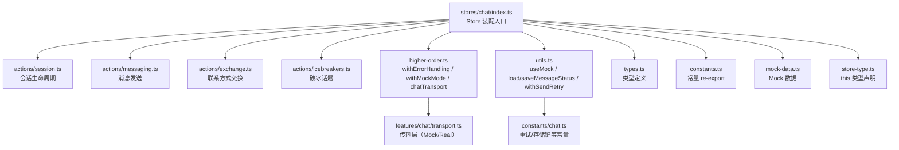
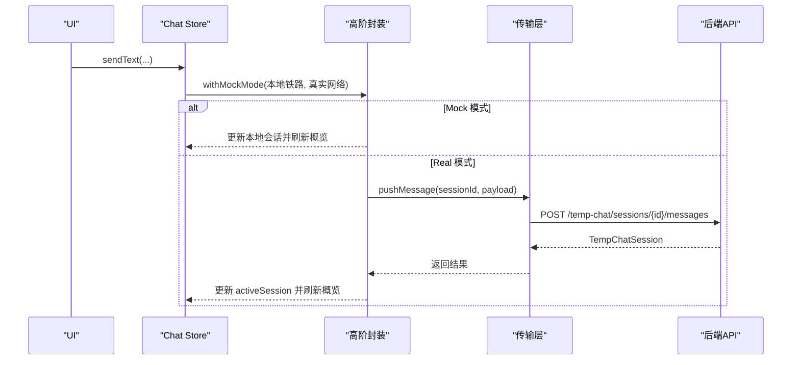
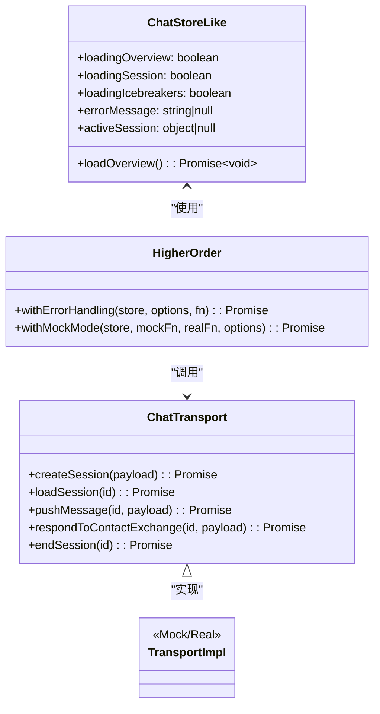
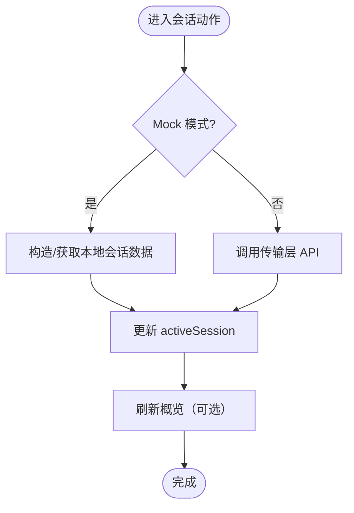
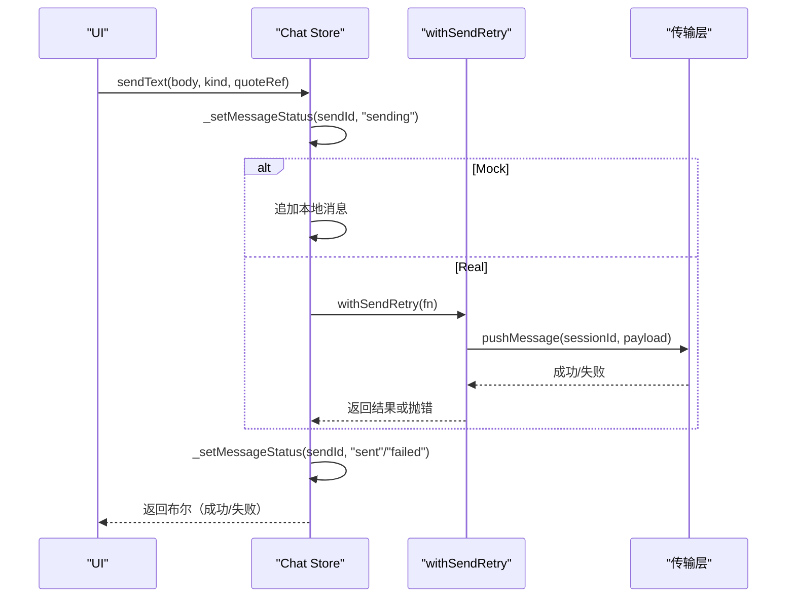
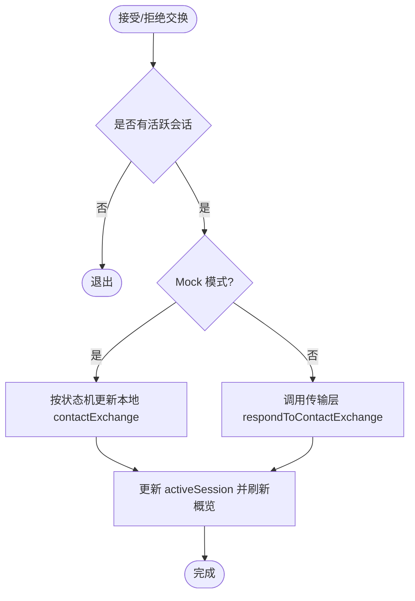
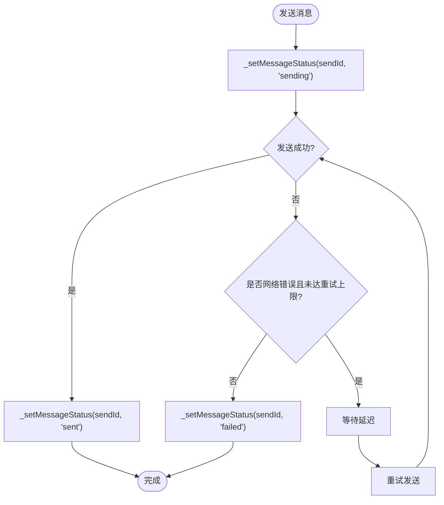
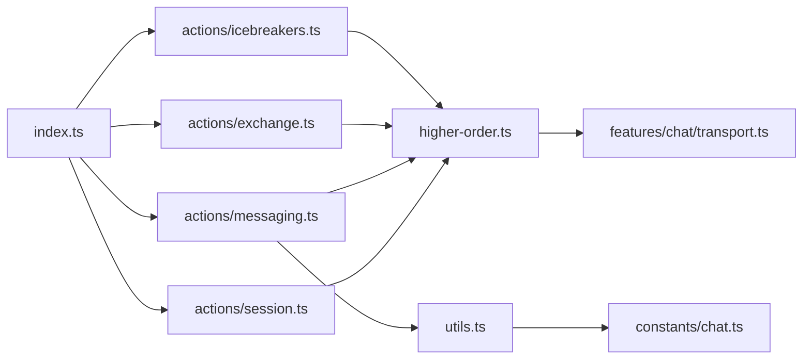

# 聊天状态 Store（chat）

<cite>
**本文引用的文件**
- [apps/client/src/stores/chat/index.ts](file://apps/client/src/stores/chat/index.ts)
- [apps/client/src/stores/chat/types.ts](file://apps/client/src/stores/chat/types.ts)
- [apps/client/src/stores/chat/constants.ts](file://apps/client/src/stores/chat/constants.ts)
- [apps/client/src/stores/chat/utils.ts](file://apps/client/src/stores/chat/utils.ts)
- [apps/client/src/stores/chat/higher-order.ts](file://apps/client/src/stores/chat/higher-order.ts)
- [apps/client/src/stores/chat/store-type.ts](file://apps/client/src/stores/chat/store-type.ts)
- [apps/client/src/stores/chat/mock-data.ts](file://apps/client/src/stores/chat/mock-data.ts)
- [apps/client/src/stores/chat/actions/session.ts](file://apps/client/src/stores/chat/actions/session.ts)
- [apps/client/src/stores/chat/actions/messaging.ts](file://apps/client/src/stores/chat/actions/messaging.ts)
- [apps/client/src/stores/chat/actions/exchange.ts](file://apps/client/src/stores/chat/actions/exchange.ts)
- [apps/client/src/stores/chat/actions/icebreakers.ts](file://apps/client/src/stores/chat/actions/icebreakers.ts)
- [apps/client/src/features/chat/transport.ts](file://apps/client/src/features/chat/transport.ts)
- [apps/client/src/constants/chat.ts](file://apps/client/src/constants/chat.ts)
</cite>

## 目录
1. [简介](#简介)
2. [项目结构](#项目结构)
3. [核心组件](#核心组件)
4. [架构总览](#架构总览)
5. [详细组件分析](#详细组件分析)
6. [依赖关系分析](#依赖关系分析)
7. [性能考量](#性能考量)
8. [故障排查指南](#故障排查指南)
9. [结论](#结论)
10. [附录](#附录)

## 简介
本模块为 Campus Love 前端应用的聊天状态管理，采用单一职责原则重构为模块化 Chat Store：类型、常量、工具函数、高阶封装与按职责拆分的 actions。其目标是统一会话生命周期、消息收发、联系方式交换、破冰话题等能力，并通过 Mock/Real 模式无缝切换、错误处理模板化、消息投递状态持久化与重试机制，提供稳定可靠的聊天体验。

## 项目结构
Chat Store 以 Pinia store 为中心，围绕“单一职责”拆分为多个子模块：
- types：集中定义聊天相关类型（如 MessageDeliveryStatus、ChatStoreLike、TempChatSession、SendMessageRequest 等）。
- constants：复用聊天常量（通过 re-export 指向全局 chat 常量），便于统一调整。
- utils：纯工具函数（Mock 模式判断、本地存储读写、带重试的执行器）。
- higher-order：高阶函数与传输层实例（withErrorHandling、withMockMode、chatTransport 单例）。
- actions：按业务领域拆分 session（会话）、messaging（消息）、exchange（交换）、icebreakers（破冰）。
- mock-data：Mock 数据与映射表，支撑开发测试。
- store-type：供拆分 action 使用的 this 类型声明，确保跨文件类型安全。

图表来源
- [apps/client/src/stores/chat/index.ts:1-131](file://apps/client/src/stores/chat/index.ts#L1-L131)
- [apps/client/src/stores/chat/higher-order.ts:1-142](file://apps/client/src/stores/chat/higher-order.ts#L1-L142)
- [apps/client/src/stores/chat/utils.ts:1-97](file://apps/client/src/stores/chat/utils.ts#L1-L97)
- [apps/client/src/features/chat/transport.ts:1-125](file://apps/client/src/features/chat/transport.ts#L1-L125)
- [apps/client/src/constants/chat.ts:1-54](file://apps/client/src/constants/chat.ts#L1-L54)

章节来源
- [apps/client/src/stores/chat/index.ts:1-131](file://apps/client/src/stores/chat/index.ts#L1-L131)

## 核心组件
- Store 装配入口：聚合 state、装配各 actions，并导出类型与工具函数。
- 类型与常量：集中维护类型与常量，避免散落实现耦合。
- 高阶封装：统一错误处理与 Mock/Real 模式切换，消除重复样板代码。
- 传输层：抽象后端通信接口，提供 Mock/Real 两套实现，屏蔽底层差异。
- Actions：按职责拆分会话、消息、交换、破冰四大块，保证高内聚低耦合。

章节来源
- [apps/client/src/stores/chat/types.ts:1-86](file://apps/client/src/stores/chat/types.ts#L1-L86)
- [apps/client/src/stores/chat/constants.ts:1-17](file://apps/client/src/stores/chat/constants.ts#L1-L17)
- [apps/client/src/stores/chat/utils.ts:1-97](file://apps/client/src/stores/chat/utils.ts#L1-L97)
- [apps/client/src/stores/chat/higher-order.ts:1-142](file://apps/client/src/stores/chat/higher-order.ts#L1-L142)
- [apps/client/src/stores/chat/store-type.ts:1-129](file://apps/client/src/stores/chat/store-type.ts#L1-L129)
- [apps/client/src/features/chat/transport.ts:1-125](file://apps/client/src/features/chat/transport.ts#L1-L125)

## 架构总览
Chat Store 通过 Pinia defineStore 组织状态与动作；action 调用高阶函数 withErrorHandling/withMockMode，再经由传输层 chatTransport 与后端交互或在 Mock 模式下操作本地数据。消息发送具备重试与状态持久化，错误处理统一且可配置。

图表来源
- [apps/client/src/stores/chat/actions/messaging.ts:1-229](file://apps/client/src/stores/chat/actions/messaging.ts#L1-L229)
- [apps/client/src/stores/chat/higher-order.ts:1-142](file://apps/client/src/stores/chat/higher-order.ts#L1-L142)
- [apps/client/src/features/chat/transport.ts:1-125](file://apps/client/src/features/chat/transport.ts#L1-L125)

## 详细组件分析

### 类型与常量
- MessageDeliveryStatus：三态 tracking（sending/sent/failed），用于消息投递状态追踪。
- ChatStoreLike：高阶函数所需的最小 store 接口约束，避免循环依赖。
- TempChatSession：临时聊天会话数据结构，含消息列表与联系方式交换状态。
- SendMessageRequest：强类型发送载荷，对齐后端 ChatMessageRequest 契约，消除隐式 any。
- 常量：消息长度限制、重试次数与延迟、存储键等，统一在 constants/chat.ts，由 stores/chat/constants.ts re-export 保持兼容。

章节来源
- [apps/client/src/stores/chat/types.ts:1-86](file://apps/client/src/stores/chat/types.ts#L1-L86)
- [apps/client/src/stores/chat/constants.ts:1-17](file://apps/client/src/stores/chat/constants.ts#L1-L17)
- [apps/client/src/constants/chat.ts:1-54](file://apps/client/src/constants/chat.ts#L1-L54)

### 工具函数
- useMock：共享的 Mock 模式判断，统一决策点。
- loadMessageStatus/saveMessageStatus：将消息投递状态映射持久化到本地存储，支持跨会话/刷新恢复。
- withSendRetry：仅对网络层错误进行重试，失败时抛出错误，避免业务错误被误重试。

章节来源
- [apps/client/src/stores/chat/utils.ts:1-97](file://apps/client/src/stores/chat/utils.ts#L1-L97)

### 高阶函数与传输层
- withErrorHandling：统一 try-catch-finally，设置 loading、errorMessage，支持是否重新抛出错误。
- withMockMode：根据 useMock() 选择 Mock/Real 分支，统一更新 activeSession 和刷新概览。
- chatTransport：模块级单例，封装创建会话、加载会话、发送消息、语音、交换响应、结束会话等能力；内部提供 Mock 与 Real 两种实现。

图表来源
- [apps/client/src/stores/chat/types.ts:1-86](file://apps/client/src/stores/chat/types.ts#L1-L86)
- [apps/client/src/stores/chat/higher-order.ts:1-142](file://apps/client/src/stores/chat/higher-order.ts#L1-L142)
- [apps/client/src/features/chat/transport.ts:1-125](file://apps/client/src/features/chat/transport.ts#L1-L125)

章节来源
- [apps/client/src/stores/chat/higher-order.ts:1-142](file://apps/client/src/stores/chat/higher-order.ts#L1-L142)
- [apps/client/src/features/chat/transport.ts:1-125](file://apps/client/src/features/chat/transport.ts#L1-L125)

### 会话管理动作（session）
- loadOverview：加载聊天概览，Mock/Real 模式切换，转换为视图模型。
- startFromRecommendation/startFromMatch/startFromSignal：从不同入口创建临时会话，Mock 模式构造占位数据，Real 模式调用传输层。
- loadSession：加载指定会话，Mock/Real 切换，未知会话在 Mock 下不再回退导致张冠李戴。
- setSessionPinned/endSession：置顶与结束会话。

图表来源
- [apps/client/src/stores/chat/actions/session.ts:1-314](file://apps/client/src/stores/chat/actions/session.ts#L1-L314)
- [apps/client/src/stores/chat/higher-order.ts:1-142](file://apps/client/src/stores/chat/higher-order.ts#L1-L142)

章节来源
- [apps/client/src/stores/chat/actions/session.ts:1-314](file://apps/client/src/stores/chat/actions/session.ts#L1-L314)

### 消息收发动作（messaging）
- sendText：生成客户端 sendId，记录 sending，执行 Mock/Real 发送，成功标记 sent，失败标记 failed 并设置错误提示；支持 quoteRef 引用回复与 emoji 类型。
- sendVoice：上传音频（Real 模式），构造 voice 消息发送；H5 或 Mock 降级为占位文案。
- _setMessageStatus：更新 messageDeliveryStatus 并持久化到本地存储。

图表来源
- [apps/client/src/stores/chat/actions/messaging.ts:1-229](file://apps/client/src/stores/chat/actions/messaging.ts#L1-L229)
- [apps/client/src/stores/chat/utils.ts:1-97](file://apps/client/src/stores/chat/utils.ts#L1-L97)

章节来源
- [apps/client/src/stores/chat/actions/messaging.ts:1-229](file://apps/client/src/stores/chat/actions/messaging.ts#L1-L229)

### 交换机制动作（exchange）
- acceptExchange/rejectExchange：依据当前 contactExchange 状态机转换，Mock 直接修改本地数据，Real 调用传输层接口。

图表来源
- [apps/client/src/stores/chat/actions/exchange.ts:1-110](file://apps/client/src/stores/chat/actions/exchange.ts#L1-L110)
- [apps/client/src/stores/chat/higher-order.ts:1-142](file://apps/client/src/stores/chat/higher-order.ts#L1-L142)

章节来源
- [apps/client/src/stores/chat/actions/exchange.ts:1-110](file://apps/client/src/stores/chat/actions/exchange.ts#L1-L110)

### 破冰消息动作（icebreakers）
- loadIcebreakers：根据 matchId 拉取推荐话题列表，Mock 提供预设数据，Real 调用 GET /matches/{matchId}/icebreakers。
- sendIcebreaker：校验参数后，Mock 直接追加消息；Real 复用 sendText 发送，包含失败保护，不向上抛错以避免重复发送。
- fetchIcebreakers：基于对方用户 ID 拉取完整话题项，填充 items 与 topics。

章节来源
- [apps/client/src/stores/chat/actions/icebreakers.ts:1-188](file://apps/client/src/stores/chat/actions/icebreakers.ts#L1-L188)

### 消息投递状态流程图

图表来源
- [apps/client/src/stores/chat/actions/messaging.ts:1-229](file://apps/client/src/stores/chat/actions/messaging.ts#L1-L229)
- [apps/client/src/stores/chat/utils.ts:1-97](file://apps/client/src/stores/chat/utils.ts#L1-L97)
- [apps/client/src/constants/chat.ts:1-54](file://apps/client/src/constants/chat.ts#L1-L54)

章节来源
- [apps/client/src/stores/chat/actions/messaging.ts:1-229](file://apps/client/src/stores/chat/actions/messaging.ts#L1-L229)

### STOMP WebSocket 协议的消息映射与实时同步说明
当前 Chat Store 的传输层通过 HTTP 与临时会话 API 交互（如创建会话、发送消息、交换响应、结束会话），并未在本模块中直接实现 STOMP WebSocket 协议的消息映射。若需接入 STOMP 实时通道，建议在 transport 层增加 WebSocket 适配器，将服务端推送的 STOMP 消息映射为 TempChatSession 增量变更，再由 withMockMode 或 store 订阅者触发 activeSession 更新与概览刷新。该扩展点可在现有架构上平滑接入，无需改动高层 actions。

[本节为概念性说明，不涉及具体源码]

## 依赖关系分析
- Store 装配入口依赖各 actions、高阶封装、类型与常量，并通过 re-export 暴露公共符号。
- actions 依赖高阶封装与传输层，以及 Mock 数据；session 还依赖全局增长常量与 i18n。
- messaging 依赖 utils 的重试与本地存储读写、i18n 与语音上传服务。
- exchange 与 icebreakers 依赖传输层与 Mock 数据。
- 传输层提供 Mock/Real 双实现，屏蔽后端差异；Real 实现使用 http request 并携带幂等键。

图表来源
- [apps/client/src/stores/chat/index.ts:1-131](file://apps/client/src/stores/chat/index.ts#L1-L131)
- [apps/client/src/stores/chat/actions/session.ts:1-314](file://apps/client/src/stores/chat/actions/session.ts#L1-L314)
- [apps/client/src/stores/chat/actions/messaging.ts:1-229](file://apps/client/src/stores/chat/actions/messaging.ts#L1-L229)
- [apps/client/src/stores/chat/actions/exchange.ts:1-110](file://apps/client/src/stores/chat/actions/exchange.ts#L1-L110)
- [apps/client/src/stores/chat/actions/icebreakers.ts:1-188](file://apps/client/src/stores/chat/actions/icebreakers.ts#L1-L188)
- [apps/client/src/stores/chat/utils.ts:1-97](file://apps/client/src/stores/chat/utils.ts#L1-L97)
- [apps/client/src/features/chat/transport.ts:1-125](file://apps/client/src/features/chat/transport.ts#L1-L125)

章节来源
- [apps/client/src/stores/chat/index.ts:1-131](file://apps/client/src/stores/chat/index.ts#L1-L131)

## 性能考量
- 传输层幂等键：每次发送独立随机幂等键，避免同文案重发撞锁。
- 重试策略：仅网络层错误重试一次，避免无效重试放大开销。
- 本地存储读写：消息投递状态读写包裹 try/catch，失败不阻塞流程。
- 视图模型转换：会话加载后统一转为视图模型，减少渲染层计算。
- Mock 模式优化：开发期快速验证链路，减少不必要网络请求。

[本节提供通用指导，不直接分析具体文件]

## 故障排查指南
- 发送失败：检查 errorMessage 与 messageDeliveryStatus 中对应 sendId 的状态；确认是否触发重试逻辑及网络错误分类。
- 会话错位：loadSession 在 Mock 模式下对未知 sessionId 不再回退默认会话，避免张冠李戴；如需调试可查看 mockSessionMap 映射。
- 破冰话题为空：确认 loadIcebreakers 的响应结构与解析逻辑；Real 模式期望数组而非对象包装。
- 语音发送异常：检查 uploadVoiceFile 是否成功返回 URL；H5 端 tempFilePath 为空会降级为占位文案。
- 错误兜底文案：非 Error 异常经 i18n 兜底文案渲染，便于多语言一致性与可读性。

章节来源
- [apps/client/src/stores/chat/actions/messaging.ts:1-229](file://apps/client/src/stores/chat/actions/messaging.ts#L1-L229)
- [apps/client/src/stores/chat/actions/icebreakers.ts:1-188](file://apps/client/src/stores/chat/actions/icebreakers.ts#L1-L188)
- [apps/client/src/stores/chat/higher-order.ts:1-142](file://apps/client/src/stores/chat/higher-order.ts#L1-L142)

## 结论
Chat Store 通过明确的职责划分与高阶封装，实现了可扩展、可测试、易维护的聊天状态管理。类型与常量集中、Mock/Real 模式统一、错误处理模板化、消息投递状态持久化与重试机制，有效提升了健壮性与用户体验。未来可在此基础上接入 STOMP WebSocket 实时通道，进一步丰富实时同步能力。

[本节总结性内容，不引用具体文件]

## 附录
- 核心数据类型速查
  - MessageDeliveryStatus：sending | sent | failed
  - ChatStoreLike：最小 store 接口约束（loading flags、errorMessage、activeSession、loadOverview）
  - TempChatSession：临时会话数据结构（含 messages、contactExchange）
  - SendMessageRequest：发送载荷（sender/kind/body/durationSeconds/quoteRef）
- 关键流程参考
  - 消息发送序列图与重试流程图见上文
  - 会话生命周期流程图见上文
  - 交换状态机转换见 exchange 动作

[本节为补充信息，不引用具体文件]