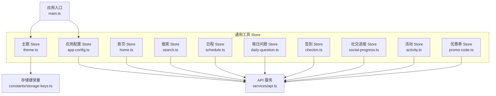
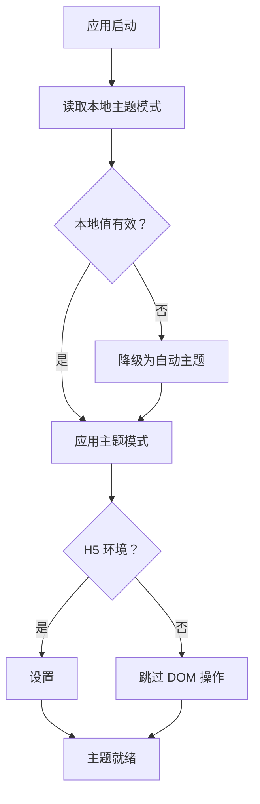
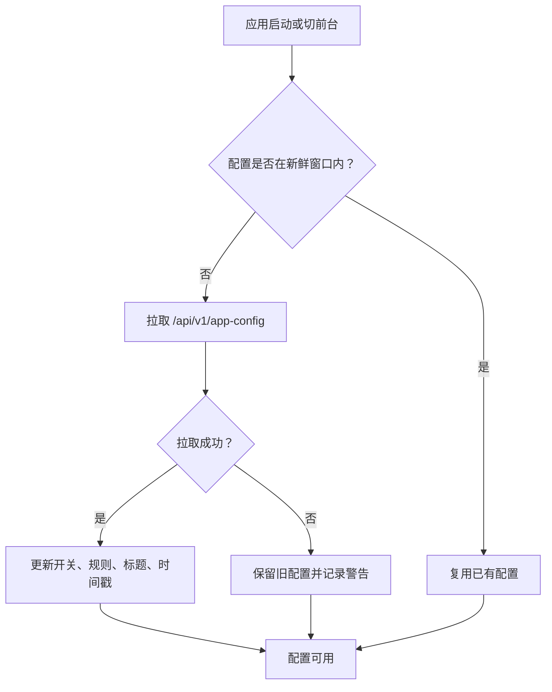
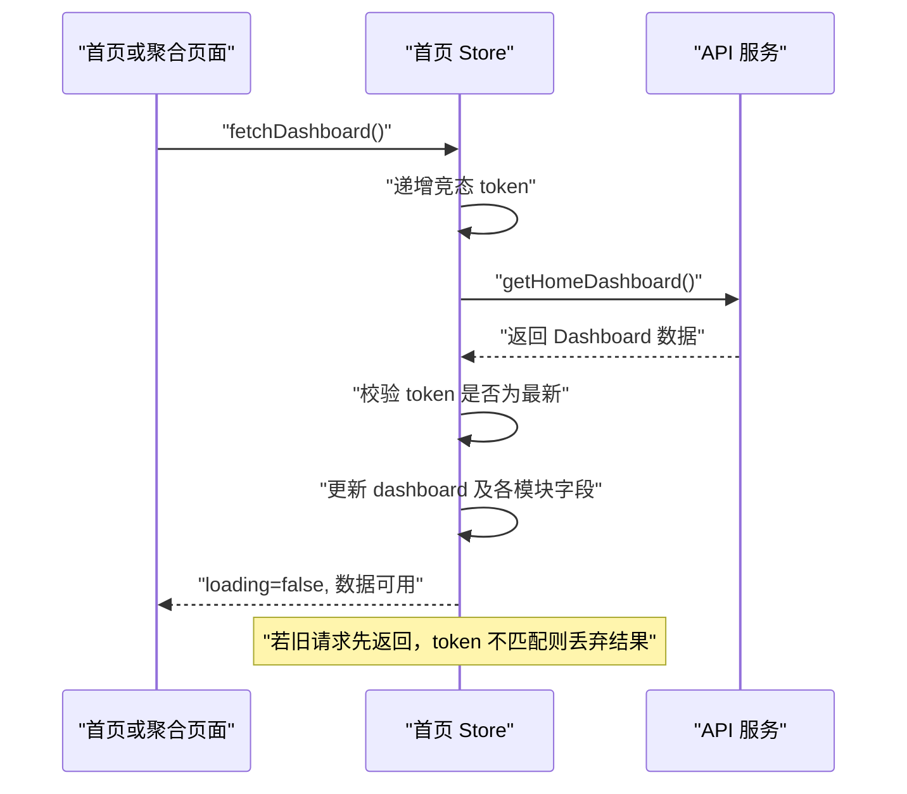
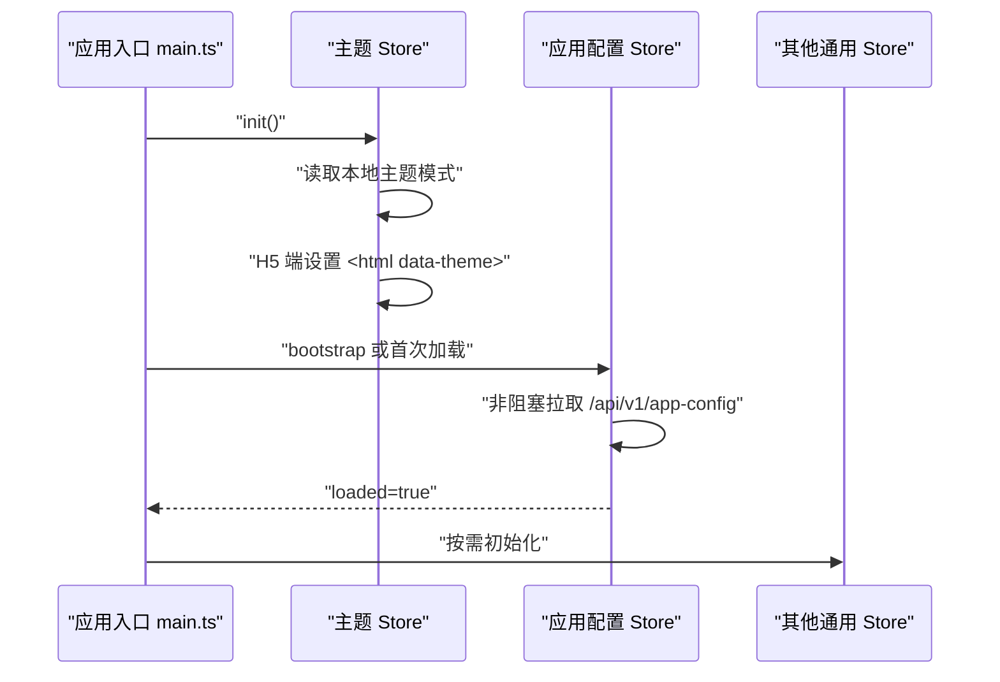
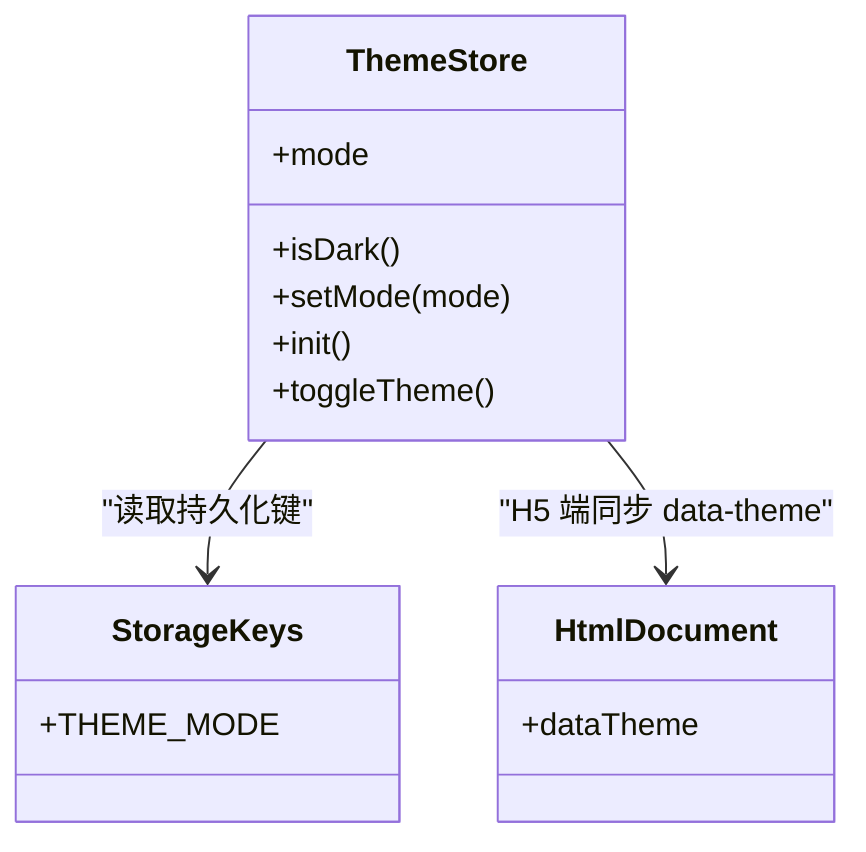
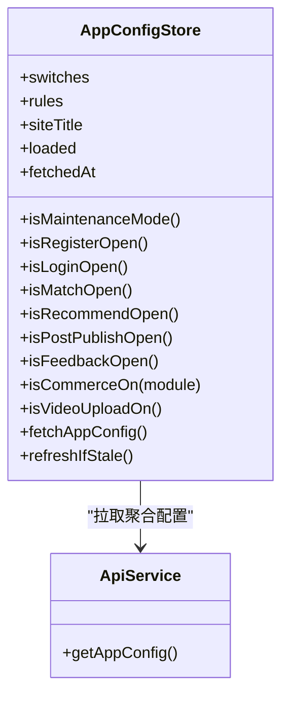
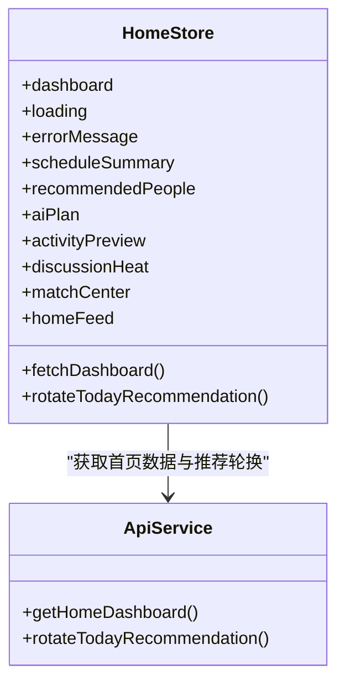
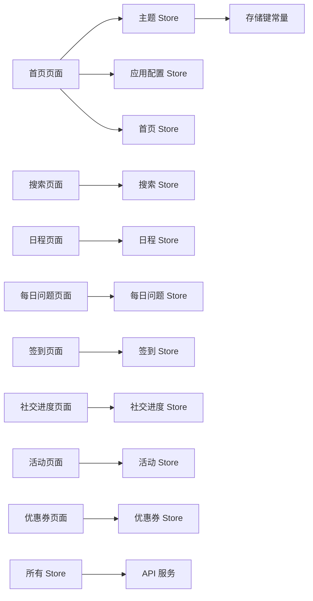

# 通用工具 Store

<cite>
**本文引用的文件**   
- [apps/client/src/stores/theme.ts](file://apps/client/src/stores/theme.ts)
- [apps/client/src/stores/app-config.ts](file://apps/client/src/stores/app-config.ts)
- [apps/client/src/stores/home.ts](file://apps/client/src/stores/home.ts)
- [apps/client/src/stores/search.ts](file://apps/client/src/stores/search.ts)
- [apps/client/src/stores/schedule.ts](file://apps/client/src/stores/schedule.ts)
- [apps/client/src/stores/daily-question.ts](file://apps/client/src/stores/daily-question.ts)
- [apps/client/src/stores/checkin.ts](file://apps/client/src/stores/checkin.ts)
- [apps/client/src/stores/social-progress.ts](file://apps/client/src/stores/social-progress.ts)
- [apps/client/src/stores/activity.ts](file://apps/client/src/stores/activity.ts)
- [apps/client/src/stores/promo-code.ts](file://apps/client/src/stores/promo-code.ts)
- [apps/client/src/main.ts](file://apps/client/src/main.ts)
- [apps/client/src/constants/storage-keys.ts](file://apps/client/src/constants/storage-keys.ts)
- [apps/client/src/services/api.ts](file://apps/client/src/services/api.ts)
</cite>

## 目录

1. [引言](#引言)
2. [项目结构与定位](#项目结构与定位)
3. [核心 Store 总览](#核心-store-总览)
4. [架构与生命周期](#架构与生命周期)
5. [详细组件分析](#详细组件分析)
6. [依赖关系与初始化顺序](#依赖关系与初始化顺序)
7. [使用示例与扩展模式](#使用示例与扩展模式)
8. [性能与稳定性设计](#性能与稳定性设计)
9. [故障排查指南](#故障排查指南)
10. [结论](#结论)

## 引言

本文面向 Campus Love 前端应用的“通用工具状态管理模块”，重点围绕 Pinia Store 中承担全局能力与跨页面共享状态的通用模块展开。目标包括：

- 解释主题管理、应用配置、首页状态、搜索、日程安排、每日问题、签到、社交进度、活动管理与优惠券等 Store 的职责边界。
- 梳理全局配置管理、UI 主题切换、用户进度跟踪等通用能力的实现模式。
- 说明 Store 间的依赖关系、初始化顺序和生命周期管理。
- 提供 Store 的使用示例、扩展方法和最佳实践，帮助开发者在不破坏既有行为的前提下扩展通用能力。

本模块的共同特点是：**不直接对应单一业务页面，而是为多个页面或子包提供可复用的状态、副作用处理与数据缓存策略**。

## 项目结构与定位

在客户端应用中，通用工具 Store 位于 `apps/client/src/stores` 目录下，通常以单文件形式定义一个 Store。典型命名约定如下：

| 文件名 | 主要职责 | 是否全局共享 | 是否涉及网络请求 |
|---|---|---:|---:|
| `theme.ts` | 主题模式、深色/浅色切换、持久化与 H5 DOM 属性同步 | 是 | 否 |
| `app-config.ts` | 后台功能开关、业务规则、站点标题、TTL 缓存刷新 | 是 | 是 |
| `home.ts` | 首页 Dashboard、推荐人、AI 计划、活动预览、讨论热度、今日推荐轮换 | 部分（首页及相关聚合） | 是 |
| `search.ts` | 搜索关键词、结果、分页、加载态、错误信息 | 部分（搜索相关页面） | 通常由调用方控制 |
| `schedule.ts` | 日程、课表摘要、当前日程项 | 部分（日程、首页、校园相关页面） | 可能由调用方组合 |
| `daily-question.ts` | 每日问题、答题状态、历史答案 | 部分（每日问题页面） | 通常是 |
| `checkin.ts` | 签到状态、连续签到、签到奖励 | 部分（签到、任务、成长相关页面） | 通常是 |
| `social-progress.ts` | 社交进度、互动指标、等级或阶段 | 部分（社交、成长、个人资料相关页面） | 通常是 |
| `activity.ts` | 活动列表、详情、参与状态 | 部分（活动、发现、校园相关页面） | 通常是 |
| `promo-code.ts` | 优惠券、兑换码、折扣信息 | 部分（市场、钱包、VIP 相关页面） | 通常是 |

**图示来源**   
- [apps/client/src/stores/theme.ts](file://apps/client/src/stores/theme.ts)
- [apps/client/src/stores/app-config.ts](file://apps/client/src/stores/app-config.ts)
- [apps/client/src/stores/home.ts](file://apps/client/src/stores/home.ts)
- [apps/client/src/services/api.ts](file://apps/client/src/services/api.ts)
- [apps/client/src/constants/storage-keys.ts](file://apps/client/src/constants/storage-keys.ts)
- [apps/client/src/main.ts](file://apps/client/src/main.ts)

**章节来源**   
- [apps/client/src/stores/theme.ts](file://apps/client/src/stores/theme.ts)
- [apps/client/src/stores/app-config.ts](file://apps/client/src/stores/app-config.ts)
- [apps/client/src/stores/home.ts](file://apps/client/src/stores/home.ts)

## 核心 Store 总览

### 主题 Store

主题 Store 负责：

- 维护当前主题模式：自动、深色、浅色。
- 将主题模式持久化到本地存储。
- 在 H5 端同步 `<html data-theme>` 属性。
- 根据系统偏好判断是否处于深色模式。
- 提供切换开关和初始化方法。

关键特性：

- 读取本地失败时降级为自动主题。
- `matchMedia` 查询失败时降级为浅色语义。
- 存储失败时保留内存中的临时值并记录诊断日志。
- mp-weixin 端通过 CSS 媒体查询跟随系统，JS 设置仅做持久化，不强制覆盖渲染。

**图示来源**   
- [apps/client/src/stores/theme.ts](file://apps/client/src/stores/theme.ts)

**章节来源**   
- [apps/client/src/stores/theme.ts](file://apps/client/src/stores/theme.ts)
- [apps/client/src/constants/storage-keys.ts](file://apps/client/src/constants/storage-keys.ts)

### 应用配置 Store

应用配置 Store 负责：

- 拉取后端聚合配置：功能开关、业务规则、站点标题。
- 提供默认开放的业务开关 getter。
- 提供商业化模块开关判断逻辑。
- 使用 TTL 新鲜度窗口限制频繁拉取。
- 在切前台时按需刷新配置。

关键特性：

- 未加载时多数开关默认开放，避免后端缺失导致前端功能被误封。
- 商业化模块默认封存，需要显式开启。
- 配置拉取失败时保留旧值，不影响主流程。
- 首次加载完成后才展示维护遮罩等依赖配置的状态。

**图示来源**   
- [apps/client/src/stores/app-config.ts](file://apps/client/src/stores/app-config.ts)
- [apps/client/src/services/api.ts](file://apps/client/src/services/api.ts)

**章节来源**   
- [apps/client/src/stores/app-config.ts](file://apps/client/src/stores/app-config.ts)
- [apps/client/src/services/api.ts](file://apps/client/src/services/api.ts)

### 首页 Store

首页 Store 负责：

- 获取首页 Dashboard 数据。
- 暴露课表摘要、推荐人、AI 计划、活动预览、讨论热度、匹配中心、首页 Feed 等字段。
- 支持旋转今日推荐。
- 处理竞态请求，避免旧请求覆盖新请求。

关键特性：

- 使用递增 token 解决快速切换页面或下拉刷新时的竞态问题。
- 对类型宽松的后端字段做防御性数组检查。
- 错误信息仅在最新请求中生效。
- loading 状态仅在最新请求结束时清理。

**图示来源**   
- [apps/client/src/stores/home.ts](file://apps/client/src/stores/home.ts)
- [apps/client/src/services/api.ts](file://apps/client/src/services/api.ts)

**章节来源**   
- [apps/client/src/stores/home.ts](file://apps/client/src/stores/home.ts)
- [apps/client/src/services/api.ts](file://apps/client/src/services/api.ts)

### 搜索 Store

搜索 Store 通常承担以下职责：

- 保存搜索关键词。
- 保存搜索结果集合。
- 管理搜索加载状态和错误信息。
- 提供重置、清空、更新关键词等方法。
- 与具体 API 解耦，由调用方决定是否发起网络请求。

典型状态结构：

| 字段 | 含义 | 常见类型 |
|---|---|---|
| keyword | 当前搜索词 | 字符串 |
| results | 搜索结果 | 数组 |
| loading | 是否正在搜索 | 布尔值 |
| error | 搜索错误信息 | 字符串或空 |

典型方法：

| 方法 | 行为 |
|---|---|
| setKeyword | 更新关键词并可选触发搜索 |
| setSearchResults | 替换搜索结果 |
| clearSearch | 清空关键词和结果 |
| setLoading | 设置加载状态 |
| setError | 设置错误信息 |

**章节来源**   
- [apps/client/src/stores/search.ts](file://apps/client/src/stores/search.ts)

### 日程 Store

日程 Store 通常承担以下职责：

- 维护日程列表或课表数据。
- 暴露当前日程或即将开始的日程。
- 提供按日、按周、按课程维度筛选的能力。
- 与首页 Store 的课表摘要形成互补：首页侧重摘要，日程 Store 侧重完整日程交互。

典型状态结构：

| 字段 | 含义 | 常见类型 |
|---|---|---|
| scheduleList | 日程列表 | 数组 |
| currentSchedule | 当前日程 | 对象或空 |
| selectedDate | 选中日期 | 日期或字符串 |
| loading | 加载状态 | 布尔值 |
| error | 错误信息 | 字符串或空 |

典型方法：

| 方法 | 行为 |
|---|---|
| fetchSchedule | 拉取日程数据 |
| setCurrentSchedule | 设置当前日程 |
| selectDate | 切换选中日期 |
| clearError | 清除错误 |

**章节来源**   
- [apps/client/src/stores/schedule.ts](file://apps/client/src/stores/schedule.ts)

### 每日问题 Store

每日问题 Store 通常承担以下职责：

- 维护当日问题、选项、用户选择、提交状态。
- 记录历史答题结果。
- 提供提交答案、刷新问题、重置状态等方法。
- 与用户成长、签到、社交进度等模块联动。

典型状态结构：

| 字段 | 含义 | 常见类型 |
|---|---|---|
| question | 今日问题 | 对象或空 |
| selectedOption | 用户选择的选项 | 字符串或空 |
| submitted | 是否已提交 | 布尔值 |
| history | 历史答题记录 | 数组 |
| loading | 加载状态 | 布尔值 |
| error | 错误信息 | 字符串或空 |

典型方法：

| 方法 | 行为 |
|---|---|
| loadDailyQuestion | 加载今日问题 |
| selectOption | 选择选项 |
| submitAnswer | 提交答案 |
| resetToday | 重置今日答题状态 |

**章节来源**   
- [apps/client/src/stores/daily-question.ts](file://apps/client/src/stores/daily-question.ts)

### 签到 Store

签到 Store 通常承担以下职责：

- 维护今日签到状态。
- 维护连续签到天数。
- 维护签到奖励记录。
- 提供签到、撤销签到、刷新状态等方法。
- 与任务、成长、社交进度等模块联动。

典型状态结构：

| 字段 | 含义 | 常见类型 |
|---|---|---|
| checkedIn | 今日是否签到 | 布尔值 |
| consecutiveDays | 连续签到天数 | 数字 |
| lastCheckInTime | 上次签到时间 | 时间戳或空 |
| rewards | 签到奖励列表 | 数组 |
| loading | 加载状态 | 布尔值 |
| error | 错误信息 | 字符串或空 |

典型方法：

| 方法 | 行为 |
|---|---|
| checkIn | 执行签到 |
| revokeCheckIn | 撤销签到 |
| refreshStatus | 刷新签到状态 |
| clearHistory | 清理本地历史 |

**章节来源**   
- [apps/client/src/stores/checkin.ts](file://apps/client/src/stores/checkin.ts)

### 社交进度 Store

社交进度 Store 通常承担以下职责：

- 维护用户在社交维度的进度指标。
- 暴露等级、阶段、经验值、里程碑等状态。
- 提供刷新、计算进度、更新指标的方法。
- 作为个人资料、成长页、社交反馈等页面的统一数据源。

典型状态结构：

| 字段 | 含义 | 常见类型 |
|---|---|---|
| level | 当前等级 | 数字 |
| stage | 当前阶段 | 字符串 |
| experience | 经验值 | 数字 |
| milestones | 里程碑记录 | 数组 |
| loading | 加载状态 | 布尔值 |
| error | 错误信息 | 字符串或空 |

典型方法：

| 方法 | 行为 |
|---|---|
| loadProgress | 加载社交进度 |
| addExperience | 增加经验值 |
| updateMilestone | 更新里程碑 |
| resetProgress | 重置进度 |

**章节来源**   
- [apps/client/src/stores/social-progress.ts](file://apps/client/src/stores/social-progress.ts)

### 活动 Store

活动 Store 通常承担以下职责：

- 维护活动列表、活动详情、参与状态。
- 提供创建活动、报名活动、退出活动等动作。
- 与首页活动预览、校园、发现等页面联动。
- 处理活动过期、已结束、名额已满等状态。

典型状态结构：

| 字段 | 含义 | 常见类型 |
|---|---|---|
| activities | 活动列表 | 数组 |
| activeActivity | 当前活动详情 | 对象或空 |
| participationStatus | 参与状态 | 枚举或字符串 |
| loading | 加载状态 | 布尔值 |
| error | 错误信息 | 字符串或空 |

典型方法：

| 方法 | 行为 |
|---|---|
| fetchActivities | 拉取活动列表 |
| fetchActivityDetail | 拉取活动详情 |
| joinActivity | 报名参加活动 |
| leaveActivity | 退出活动 |

**章节来源**   
- [apps/client/src/stores/activity.ts](file://apps/client/src/stores/activity.ts)

### 优惠券 Store

优惠券 Store 通常承担以下职责：

- 维护可用优惠券、已使用优惠券、失效优惠券。
- 支持兑换码输入与校验。
- 与钱包、市场、VIP、订单等模块联动。
- 处理优惠券数量、折扣金额、有效期等业务规则。

典型状态结构：

| 字段 | 含义 | 常见类型 |
|---|---|---|
| coupons | 优惠券列表 | 数组 |
| selectedCoupon | 当前选中优惠券 | 对象或空 |
| promoCodeInput | 兑换码输入 | 字符串 |
| loading | 加载状态 | 布尔值 |
| error | 错误信息 | 字符串或空 |

典型方法：

| 方法 | 行为 |
|---|---|
| fetchCoupons | 拉取优惠券列表 |
| redeemPromoCode | 兑换优惠券 |
| selectCoupon | 选择优惠券 |
| clearSelection | 清空选择 |

**章节来源**   
- [apps/client/src/stores/promo-code.ts](file://apps/client/src/stores/promo-code.ts)

## 架构与生命周期

### 初始化流程

通用工具 Store 的初始化通常遵循以下顺序：

1. **应用入口初始化**：`main.ts` 创建 Pinia 实例并挂载应用。
2. **主题 Store 初始化**：读取本地主题模式，并在 H5 端同步 DOM 属性。
3. **应用配置 Store 初始化**：非阻塞拉取一次后台配置；切前台时按 TTL 刷新。
4. **其他 Store 按需初始化**：首页、搜索、日程、每日问题、签到、社交进度、活动、优惠券等 Store 通常在进入对应页面或触发对应动作时加载数据。

**图示来源**   
- [apps/client/src/main.ts](file://apps/client/src/main.ts)
- [apps/client/src/stores/theme.ts](file://apps/client/src/stores/theme.ts)
- [apps/client/src/stores/app-config.ts](file://apps/client/src/stores/app-config.ts)

### 生命周期管理

| Store | 主要生命周期阶段 | 说明 |
|---|---|---|
| 主题 Store | 应用启动、主题切换 | 启动时应用主题，切换时持久化并同步 DOM |
| 应用配置 Store | 应用启动、切前台 | 启动时拉取配置，切前台时按 TTL 刷新 |
| 首页 Store | 进入首页、下拉刷新 | 拉取 Dashboard，处理竞态请求 |
| 搜索 Store | 输入关键词、清空搜索 | 更新状态，通常由调用方控制网络请求 |
| 日程 Store | 进入日程页、切换日期 | 拉取日程数据，更新当前日程 |
| 每日问题 Store | 进入每日问题页、提交答案 | 加载问题并提交答案 |
| 签到 Store | 进入签到相关页、点击签到 | 执行签到或撤销签到 |
| 社交进度 Store | 进入成长相关页 | 加载并展示进度 |
| 活动 Store | 进入活动相关页 | 拉取活动列表和详情 |
| 优惠券 Store | 进入市场或钱包相关页 | 拉取优惠券并支持兑换 |

**章节来源**   
- [apps/client/src/stores/theme.ts](file://apps/client/src/stores/theme.ts)
- [apps/client/src/stores/app-config.ts](file://apps/client/src/stores/app-config.ts)
- [apps/client/src/stores/home.ts](file://apps/client/src/stores/home.ts)

## 详细组件分析

### 主题 Store 内部结构

主题 Store 的核心结构包括：

- **state**：`mode`，表示当前主题模式。
- **getters**：`isDark`，根据模式与系统偏好判断是否深色。
- **actions**：`setMode`、`init`、`toggleTheme`。
- **外部函数**：`applyThemeAttribute`，负责 H5 端 DOM 属性同步。

**图示来源**   
- [apps/client/src/stores/theme.ts](file://apps/client/src/stores/theme.ts)
- [apps/client/src/constants/storage-keys.ts](file://apps/client/src/constants/storage-keys.ts)

**章节来源**   
- [apps/client/src/stores/theme.ts](file://apps/client/src/stores/theme.ts)
- [apps/client/src/constants/storage-keys.ts](file://apps/client/src/constants/storage-keys.ts)

### 应用配置 Store 内部结构

应用配置 Store 的核心结构包括：

- **state**：`switches`、`rules`、`siteTitle`、`loaded`、`fetchedAt`。
- **getters**：各业务开关判断、商业化模块开关判断、视频上传开关判断。
- **actions**：`fetchAppConfig`、`refreshIfStale`。

**图示来源**   
- [apps/client/src/stores/app-config.ts](file://apps/client/src/stores/app-config.ts)
- [apps/client/src/services/api.ts](file://apps/client/src/services/api.ts)

**章节来源**   
- [apps/client/src/stores/app-config.ts](file://apps/client/src/stores/app-config.ts)
- [apps/client/src/services/api.ts](file://apps/client/src/services/api.ts)

### 首页 Store 内部结构

首页 Store 使用响应式 ref 管理 Dashboard 及其子模块数据，并通过竞态 token 保证请求一致性。

**图示来源**   
- [apps/client/src/stores/home.ts](file://apps/client/src/stores/home.ts)
- [apps/client/src/services/api.ts](file://apps/client/src/services/api.ts)

**章节来源**   
- [apps/client/src/stores/home.ts](file://apps/client/src/stores/home.ts)
- [apps/client/src/services/api.ts](file://apps/client/src/services/api.ts)

## 依赖关系与初始化顺序

### Store 间依赖

通用工具 Store 之间的依赖关系可以概括为：

- **主题 Store** 依赖本地存储键常量，不依赖业务 API。
- **应用配置 Store** 依赖 API 服务，用于拉取全局配置。
- **首页 Store** 依赖 API 服务，用于拉取首页 Dashboard。
- **其他 Store** 通常也依赖 API 服务，但具体接口因模块而异。
- **业务页面** 依赖多个通用 Store，例如首页页面同时依赖主题、应用配置、首页 Store。

**图示来源**   
- [apps/client/src/stores/theme.ts](file://apps/client/src/stores/theme.ts)
- [apps/client/src/stores/app-config.ts](file://apps/client/src/stores/app-config.ts)
- [apps/client/src/stores/home.ts](file://apps/client/src/stores/home.ts)
- [apps/client/src/stores/search.ts](file://apps/client/src/stores/search.ts)
- [apps/client/src/stores/schedule.ts](file://apps/client/src/stores/schedule.ts)
- [apps/client/src/stores/daily-question.ts](file://apps/client/src/stores/daily-question.ts)
- [apps/client/src/stores/checkin.ts](file://apps/client/src/stores/checkin.ts)
- [apps/client/src/stores/social-progress.ts](file://apps/client/src/stores/social-progress.ts)
- [apps/client/src/stores/activity.ts](file://apps/client/src/stores/activity.ts)
- [apps/client/src/stores/promo-code.ts](file://apps/client/src/stores/promo-code.ts)
- [apps/client/src/services/api.ts](file://apps/client/src/services/api.ts)
- [apps/client/src/constants/storage-keys.ts](file://apps/client/src/constants/storage-keys.ts)

### 初始化顺序

推荐的初始化顺序如下：

1. **应用入口**：注册 Pinia、插件、路由、国际化等基础设施。
2. **主题 Store**：立即初始化，确保 UI 主题在首帧渲染前正确。
3. **应用配置 Store**：异步拉取配置，不阻塞主流程。
4. **首页 Store**：进入首页时拉取 Dashboard。
5. **其他 Store**：进入对应页面或触发对应动作时初始化。

**章节来源**   
- [apps/client/src/main.ts](file://apps/client/src/main.ts)
- [apps/client/src/stores/theme.ts](file://apps/client/src/stores/theme.ts)
- [apps/client/src/stores/app-config.ts](file://apps/client/src/stores/app-config.ts)
- [apps/client/src/stores/home.ts](file://apps/client/src/stores/home.ts)

## 使用示例与扩展模式

### 在页面中使用主题 Store

典型用法：

- 在页面中通过 Pinia 获取主题 Store。
- 监听 `isDark` 判断当前是否为深色模式。
- 调用 `toggleTheme` 或 `setMode` 切换主题。
- 在 H5 端观察 `<html data-theme>` 变化以验证主题同步。

注意事项：

- mp-weixin 端不要假设 JS 设置的 `page.theme` 能完全控制原生渲染。
- 主题持久化失败时仍可使用内存中的临时值。

### 在页面中使用应用配置 Store

典型用法：

- 在页面中通过 Pinia 获取应用配置 Store。
- 使用 `isMaintenanceMode` 判断是否显示维护遮罩。
- 使用 `isRegisterOpen`、`isLoginOpen` 控制登录注册入口。
- 使用 `isCommerceOn` 控制商业化模块展示。
- 在 App.vue 的 `onShow` 中调用 `refreshIfStale`。

注意事项：

- 未加载时开关默认开放，避免后端缺失导致前端误封。
- 商业化模块默认封存，需要显式开启。
- 配置拉取失败时保留旧值，不影响主流程。

### 在页面中使用首页 Store

典型用法：

- 在首页或聚合页面中调用 `fetchDashboard`。
- 监听 `loading` 显示骨架屏或加载提示。
- 监听 `errorMessage` 显示错误提示。
- 调用 `rotateTodayRecommendation` 轮换今日推荐。

注意事项：

- 不要在重复快速刷新时手动取消请求，应依赖竞态 token。
- 对后端返回的灵活字段使用防御性数组检查。

### 扩展通用 Store 的最佳实践

| 原则 | 说明 |
|---|---|
| 单一职责 | 每个 Store 只负责一个领域，避免把无关状态堆在一起 |
| 明确 state | state 只存必要数据，复杂计算放在 getters |
| 可控副作用 | actions 中处理副作用，如网络请求、本地存储、导航 |
| 防御性编程 | 对后端返回的不稳定字段做类型守卫和默认值 |
| 可测试性 | 尽量让 store 方法纯函数化，便于单元测试 |
| 可扩展性 | 新增模块时优先复用现有 Store，而不是复制状态 |
| 可观测性 | 在开发环境下输出诊断日志，生产环境保持安静 |

**章节来源**   
- [apps/client/src/stores/theme.ts](file://apps/client/src/stores/theme.ts)
- [apps/client/src/stores/app-config.ts](file://apps/client/src/stores/app-config.ts)
- [apps/client/src/stores/home.ts](file://apps/client/src/stores/home.ts)

## 性能与稳定性设计

### 主题 Store 的性能考虑

- 本地存储读取失败时直接降级，不抛出异常。
- `matchMedia` 查询失败时忽略并返回浅色语义。
- H5 端 DOM 操作只在必要时设置或移除 `data-theme`。
- mp-weixin 端避免无意义的 JS 主题覆盖。

### 应用配置 Store 的性能考虑

- 使用 TTL 新鲜度窗口限制频繁拉取。
- 切前台时先判断是否新鲜，再决定是否拉取。
- 拉取失败静默处理，避免弱网下卡顿。
- 首次加载完成后才展示依赖配置的状态。

### 首页 Store 的性能考虑

- 使用竞态 token 避免旧请求覆盖新请求。
- 只对最新请求更新 loading 和 errorMessage。
- 对后端返回的灵活字段进行防御性处理。
- 推荐轮换单独调用接口，不污染 Dashboard 主数据。

### 通用稳定性建议

- 所有网络请求都应考虑失败路径。
- 所有本地存储操作都应捕获异常。
- 所有用户输入都应做基本校验。
- 所有后端返回数据都应做运行时守卫。
- 所有敏感诊断日志应在开发环境输出。

**章节来源**   
- [apps/client/src/stores/theme.ts](file://apps/client/src/stores/theme.ts)
- [apps/client/src/stores/app-config.ts](file://apps/client/src/stores/app-config.ts)
- [apps/client/src/stores/home.ts](file://apps/client/src/stores/home.ts)

## 故障排查指南

### 主题无法切换

常见问题：

- 本地存储读取失败，主题回退为自动。
- H5 端 DOM 操作被浏览器安全策略阻止。
- mp-weixin 端手动切换仅持久化，实际渲染跟随系统。

排查步骤：

1. 检查本地存储中主题模式键是否存在。
2. 在 H5 控制台查看 `<html data-theme>` 是否正确。
3. 在 mp-weixin 端确认是否期望跟随系统。
4. 查看开发环境诊断日志。

**章节来源**   
- [apps/client/src/stores/theme.ts](file://apps/client/src/stores/theme.ts)

### 应用配置未生效

常见问题：

- 后端未返回预期开关。
- TTL 缓存导致旧配置未及时刷新。
- 配置拉取失败后保留旧值。

排查步骤：

1. 检查 `/api/v1/app-config` 返回结构。
2. 确认 `loaded` 是否为 true。
3. 检查 `fetchedAt` 是否超过新鲜窗口。
4. 查看 `refreshIfStale` 是否被调用。

**章节来源**   
- [apps/client/src/stores/app-config.ts](file://apps/client/src/stores/app-config.ts)

### 首页数据错乱

常见问题：

- 快速刷新导致旧请求覆盖新请求。
- 后端返回字段与类型不一致。
- 错误信息被后续请求覆盖。

排查步骤：

1. 检查竞态 token 是否递增。
2. 确认 loading 是否在最后清理。
3. 检查 `errorMessage` 是否仅由最新请求设置。
4. 对后端灵活字段加防御性数组检查。

**章节来源**   
- [apps/client/src/stores/home.ts](file://apps/client/src/stores/home.ts)

## 结论

Campus Love 前端应用的通用工具 Store 模块以 Pinia 为核心，围绕主题管理、应用配置、首页状态以及搜索、日程、每日问题、签到、社交进度、活动和优惠券等通用能力构建。其设计强调：

- **职责清晰**：每个 Store 聚焦一个领域。
- **默认安全**：后端缺失时采用默认开放或默认封存策略。
- **容错性强**：本地存储、网络请求、DOM 操作均有降级路径。
- **可扩展性好**：新增模块可复用现有模式，避免重复造轮子。
- **可维护性高**：通过 getters、actions 和防御性编程降低耦合。

对于后续扩展，建议优先复用现有 Store 的模式，尤其是状态组织、错误处理、TTL 缓存、竞态控制和平台兼容性处理。这样可以在保证用户体验的同时，降低长期维护成本。