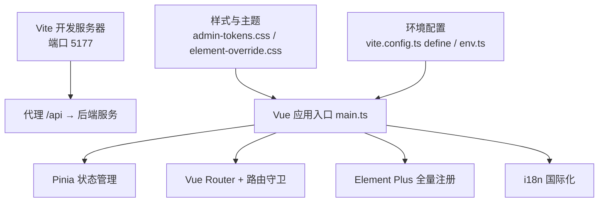
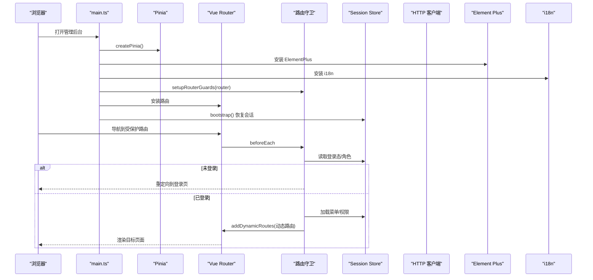
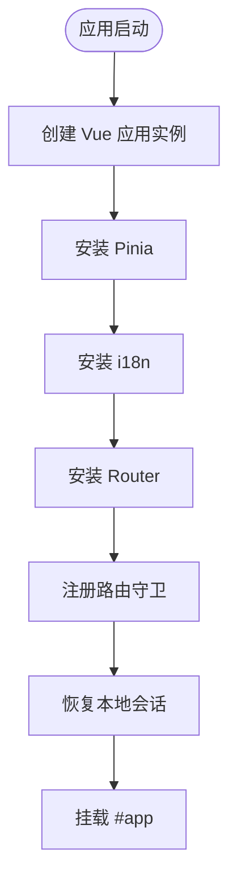
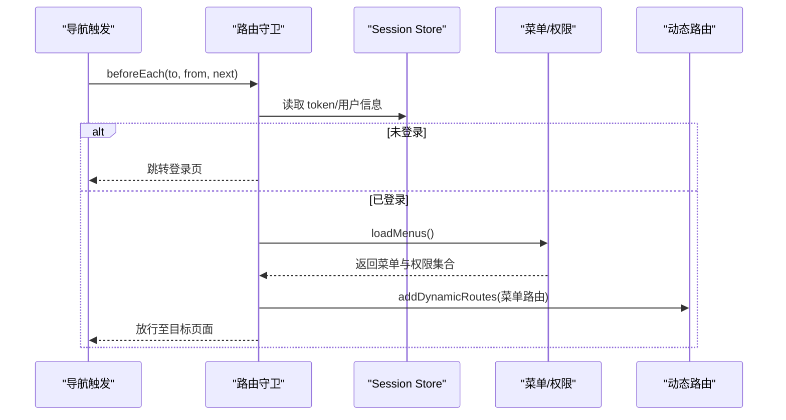
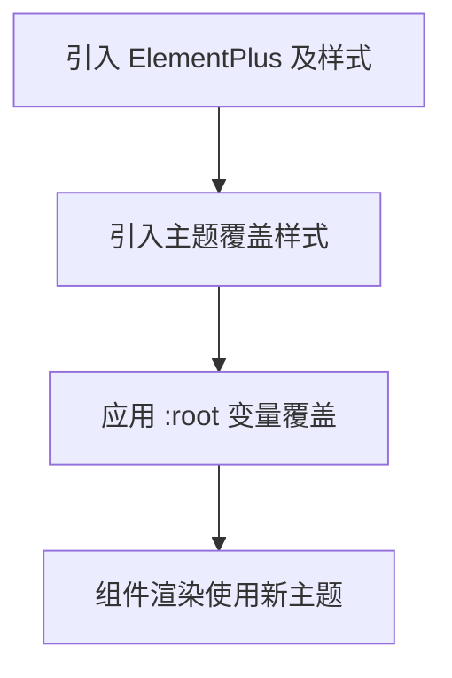
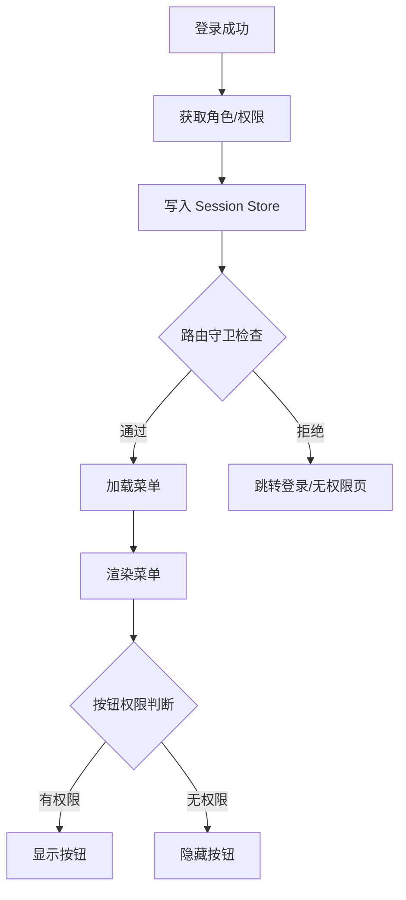
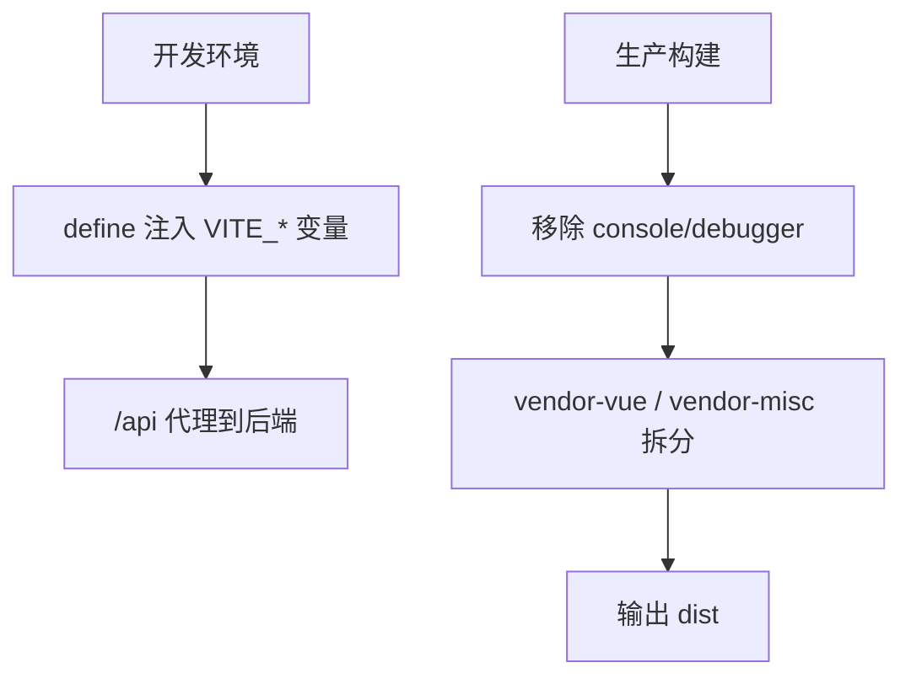
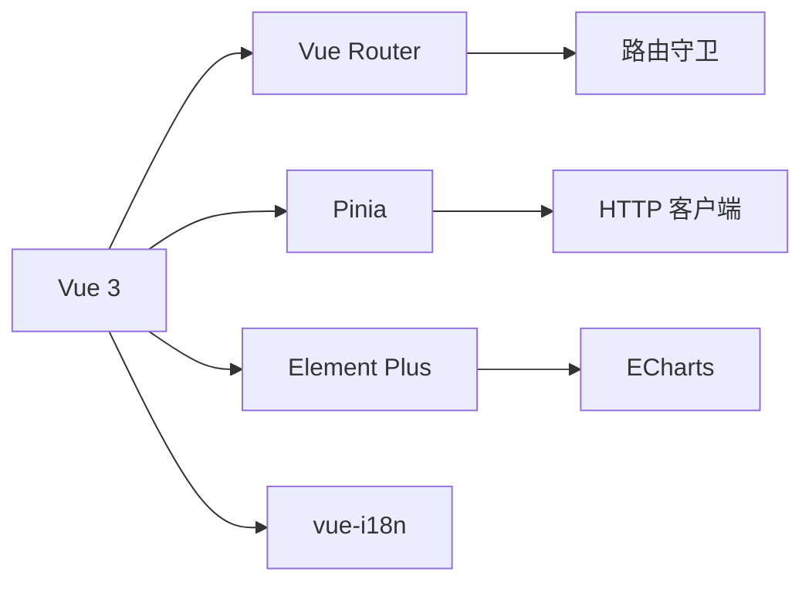

# 管理后台前端架构

<cite>
**本文引用的文件**
- [apps/admin/package.json](file://apps/admin/package.json)
- [apps/admin/vite.config.ts](file://apps/admin/vite.config.ts)
- [apps/admin/tsconfig.json](file://apps/admin/tsconfig.json)
- [apps/admin/src/main.ts](file://apps/admin/src/main.ts)
- [apps/admin/src/router/guards.ts](file://apps/admin/src/router/guards.ts)
- [apps/admin/src/stores/session.ts](file://apps/admin/src/stores/session.ts)
- [apps/admin/src/config/env.ts](file://apps/admin/src/config/env.ts)
- [apps/admin/src/api/http.ts](file://apps/admin/src/api/http.ts)
- [apps/admin/src/i18n/index.ts](file://apps/admin/src/i18n/index.ts)
- [apps/admin/src/styles/element-override.css](file://apps/admin/src/styles/element-override.css)
- [apps/admin/src/views/Login.vue](file://apps/admin/src/views/Login.vue)
- [apps/admin/src/views/Forbidden.vue](file://apps/admin/src/views/Forbidden.vue)
- [apps/admin/src/views/NotFound.vue](file://apps/admin/src/views/NotFound.vue)
- [apps/admin/src/components/ConfirmDialog.vue](file://apps/admin/src/components/ConfirmDialog.vue)
- [apps/admin/src/utils/logger.ts](file://apps/admin/src/utils/logger.ts)
- [apps/admin/src/utils/format.ts](file://apps/admin/src/utils/format.ts)
- [apps/admin/src/utils/constants.ts](file://apps/admin/src/utils/constants.ts)
- [database/flyway/sql/V2026.08.07.0011__create_menus.sql](file://database/flyway/sql/V2026.08.07.0011__create_menus.sql)
</cite>

## 目录
1. [简介](#简介)
2. [项目结构](#项目结构)
3. [核心组件](#核心组件)
4. [架构总览](#架构总览)
5. [详细组件分析](#详细组件分析)
6. [依赖关系分析](#依赖关系分析)
7. [性能考量](#性能考量)
8. [故障排查指南](#故障排查指南)
9. [结论](#结论)
10. [附录](#附录)

## 简介
本仓库包含 Campus Love 管理后台（基于 Vue 3 + Element Plus）的前端实现。管理后台采用单页应用（SPA）架构，通过 Vite 构建、Pinia 状态管理、Vue Router 动态路由与权限守卫、Element Plus 全量引入与主题覆盖，以及 i18n 国际化能力，提供菜单驱动的页面加载、按钮级权限控制、数据可视化与表单表格操作等典型后台功能。

## 项目结构
- 根 monorepo 通过 pnpm workspaces 管理多子项目；admin 为独立子工程，位于 apps/admin。
- admin 子项目使用 Vite 作为开发与构建工具，端口 5177，并通过代理将 /api 请求转发到后端服务。
- TypeScript 严格模式，路径别名 @ → src，统一类型检查与编译选项。
- 资源与样式：全局设计令牌 CSS、Element Plus 主题覆盖、组件与视图按功能域组织。
- 运行时配置与环境变量：VITE_ 前缀环境变量在构建时注入，API 基础地址由 env 模块暴露。

**图示来源**
- [apps/admin/vite.config.ts:1-109](file://apps/admin/vite.config.ts#L1-L109)
- [apps/admin/src/main.ts:1-47](file://apps/admin/src/main.ts#L1-L47)

**章节来源**
- [apps/admin/package.json:1-45](file://apps/admin/package.json#L1-L45)
- [apps/admin/vite.config.ts:1-109](file://apps/admin/vite.config.ts#L1-L109)
- [apps/admin/tsconfig.json:1-23](file://apps/admin/tsconfig.json#L1-L23)

## 核心组件
- 应用初始化与插件注册
  - Vue 3 应用创建，依次安装 Pinia、i18n、Element Plus、Router，并在 Pinia 就绪后注册路由守卫。
  - 启动时从本地存储恢复会话，确保登录态在守卫外可用。
- 动态路由系统
  - 菜单驱动：首次进入受保护路由时加载菜单并动态注册路由。
  - 权限控制：路由守卫依据用户角色/权限决定放行或跳转。
  - 懒加载：路由与页面组件按需加载，减少首屏体积。
- Element Plus 全量引入与主题定制
  - 全量注册避免按需引入的复杂度与遗漏风险。
  - 通过 CSS 变量覆盖默认主题，统一品牌色与尺寸。
- 权限控制系统
  - 用户角色与菜单权限：由后端菜单表驱动前端可见性。
  - 按钮级权限：在模板中基于当前用户权限进行条件渲染。
- 数据可视化、表单与表格
  - 图表：集成 ECharts 用于报表与监控展示。
  - 表单：基于 Element Plus Form 的统一校验与提交封装。
  - 表格：统一分页、筛选、排序与批量操作。

**章节来源**
- [apps/admin/src/main.ts:1-47](file://apps/admin/src/main.ts#L1-L47)
- [apps/admin/src/router/guards.ts](file://apps/admin/src/router/guards.ts)
- [apps/admin/src/stores/session.ts](file://apps/admin/src/stores/session.ts)
- [apps/admin/src/i18n/index.ts](file://apps/admin/src/i18n/index.ts)
- [apps/admin/src/styles/element-override.css](file://apps/admin/src/styles/element-override.css)

## 架构总览
下图展示了管理后台的运行时结构与关键交互：应用入口负责插件装配与守卫注册；路由守卫协调权限与动态路由；状态管理维护会话与菜单；HTTP 客户端统一封装网络请求；样式层完成主题覆盖。

**图示来源**
- [apps/admin/src/main.ts:1-47](file://apps/admin/src/main.ts#L1-L47)
- [apps/admin/src/router/guards.ts](file://apps/admin/src/router/guards.ts)
- [apps/admin/src/stores/session.ts](file://apps/admin/src/stores/session.ts)
- [apps/admin/src/api/http.ts](file://apps/admin/src/api/http.ts)

## 详细组件分析

### 应用入口与插件注册
- 初始化顺序保证依赖正确：先创建 Pinia，再注册 i18n 与路由守卫，最后挂载路由与应用实例。
- 启动时从本地存储恢复会话，使登录态在守卫之外也可用。
- Element Plus 全量注册，确保所有组件可用且样式一致。

**图示来源**
- [apps/admin/src/main.ts:1-47](file://apps/admin/src/main.ts#L1-L47)

**章节来源**
- [apps/admin/src/main.ts:1-47](file://apps/admin/src/main.ts#L1-L47)

### 动态路由与权限守卫
- 路由守卫在 beforeEach 中校验登录态与权限，必要时加载菜单并动态添加路由。
- 菜单驱动：菜单数据来自后端（数据库脚本定义了菜单表），前端据此生成可访问的路由树。
- 懒加载策略：页面组件通过函数式 import 实现路由级懒加载，降低首屏体积。

**图示来源**
- [apps/admin/src/router/guards.ts](file://apps/admin/src/router/guards.ts)
- [apps/admin/src/stores/session.ts](file://apps/admin/src/stores/session.ts)
- [database/flyway/sql/V2026.08.07.0011__create_menus.sql](file://database/flyway/sql/V2026.08.07.0011__create_menus.sql)

**章节来源**
- [apps/admin/src/router/guards.ts](file://apps/admin/src/router/guards.ts)
- [apps/admin/src/stores/session.ts](file://apps/admin/src/stores/session.ts)
- [database/flyway/sql/V2026.08.07.0011__create_menus.sql](file://database/flyway/sql/V2026.08.07.0011__create_menus.sql)

### Element Plus 全量引入与主题定制
- 全量引入：在入口文件中一次性安装 ElementPlus 及其样式，避免按需引入带来的遗漏与复杂度。
- 主题覆盖：通过自定义 CSS 变量覆盖 Element Plus 默认变量，实现品牌化主题。
- 覆盖时机：必须在 Element Plus 样式之后引入，以确保变量生效。

**图示来源**
- [apps/admin/src/main.ts:1-47](file://apps/admin/src/main.ts#L1-L47)
- [apps/admin/src/styles/element-override.css](file://apps/admin/src/styles/element-override.css)

**章节来源**
- [apps/admin/src/main.ts:1-47](file://apps/admin/src/main.ts#L1-L47)
- [apps/admin/src/styles/element-override.css](file://apps/admin/src/styles/element-override.css)

### 权限控制系统
- 用户角色管理：登录后从服务端获取用户角色与权限，写入 Session Store。
- 菜单权限控制：根据权限过滤菜单项，仅显示具备访问权限的菜单。
- 按钮级权限验证：在模板中使用指令或计算属性控制按钮显隐，确保最小权限原则。

**图示来源**
- [apps/admin/src/stores/session.ts](file://apps/admin/src/stores/session.ts)
- [apps/admin/src/router/guards.ts](file://apps/admin/src/router/guards.ts)

**章节来源**
- [apps/admin/src/stores/session.ts](file://apps/admin/src/stores/session.ts)
- [apps/admin/src/router/guards.ts](file://apps/admin/src/router/guards.ts)

### 数据可视化、表单与表格最佳实践
- 数据可视化
  - 使用 ECharts 渲染统计图，结合 Pinia 缓存数据，避免重复请求。
  - 图表容器响应式适配，resize 时自动重绘。
- 表单处理
  - 统一校验规则与错误提示，提交前进行二次确认。
  - 支持分步表单与条件字段显示。
- 表格操作
  - 统一分页、排序、筛选与导出；批量选择与删除需二次确认。
  - 长列表虚拟滚动或分页加载，提升性能。

[本节为通用实践说明，不直接分析具体代码文件]

### 环境配置与构建优化
- 环境变量：通过 Vite define 注入 VITE_ 前缀变量，运行期统一访问。
- 代理配置：开发环境下 /api 代理到后端，移除 Origin 头避免 CORS 误判。
- 构建优化：生产模式移除 console/debugger，拆分 vendor chunk（vue 生态与其他第三方依赖分离）。

**图示来源**
- [apps/admin/vite.config.ts:1-109](file://apps/admin/vite.config.ts#L1-L109)

**章节来源**
- [apps/admin/vite.config.ts:1-109](file://apps/admin/vite.config.ts#L1-L109)

## 依赖关系分析
- 框架与库
  - Vue 3、Vue Router、Pinia、Element Plus、ECharts、dayjs、vue-i18n。
- 构建与工具
  - Vite、TypeScript、vue-tsc、vitest。
- 工程化
  - ESLint、Prettier、Lighthouse（根脚本）、OpenAPI 规范（根文档）。

**图示来源**
- [apps/admin/package.json:1-45](file://apps/admin/package.json#L1-L45)
- [apps/admin/src/api/http.ts](file://apps/admin/src/api/http.ts)
- [apps/admin/src/router/guards.ts](file://apps/admin/src/router/guards.ts)

**章节来源**
- [apps/admin/package.json:1-45](file://apps/admin/package.json#L1-L45)

## 性能考量
- 首屏优化
  - 路由与组件懒加载，减少初始包体。
  - 生产构建移除 console/debugger，压缩代码。
  - 第三方依赖按生态拆分（vendor-vue、vendor-misc），提升缓存命中。
- 运行时优化
  - 静态资源与图标按需加载。
  - 图表仅在需要时初始化与销毁，避免内存泄漏。
  - 列表分页与虚拟滚动，降低 DOM 压力。
- 构建与部署
  - 开启 Source Map（开发环境），隐藏 Source Map（生产）。
  - 合理设置 chunkSizeWarningLimit，避免过大包体。
  - 代理去除 Origin 头，避免后端 CORS 校验失败导致的额外重试。

[本节为通用指导，不直接分析具体代码文件]

## 故障排查指南
- 登录与会话
  - 检查本地存储是否写入 token 与用户信息。
  - 路由守卫是否正确读取并刷新会话。
- 路由与权限
  - 动态路由是否成功注册，是否存在重复或冲突路径。
  - 菜单权限是否与后端返回一致，无权限页面是否跳转到 Forbidden。
- 网络请求
  - 代理配置是否正确，后端地址是否可达。
  - 请求头是否被修改（如 Origin），导致 CORS 问题。
- 样式与主题
  - 主题覆盖样式是否在 Element Plus 样式之后引入。
  - CSS 变量是否生效，是否存在优先级冲突。
- 构建与运行
  - 环境变量是否注入成功，API 基础地址是否正确。
  - 构建产物是否包含必要资源，端口是否被占用。

**章节来源**
- [apps/admin/src/stores/session.ts](file://apps/admin/src/stores/session.ts)
- [apps/admin/src/router/guards.ts](file://apps/admin/src/router/guards.ts)
- [apps/admin/src/api/http.ts](file://apps/admin/src/api/http.ts)
- [apps/admin/src/styles/element-override.css](file://apps/admin/src/styles/element-override.css)
- [apps/admin/vite.config.ts:1-109](file://apps/admin/vite.config.ts#L1-L109)

## 结论
该管理后台以 Vue 3 + Element Plus 为核心，配合 Vite、Pinia、Vue Router 与 i18n，形成了稳定、可扩展的前端架构。通过菜单驱动的动态路由、完善的权限守卫与主题覆盖机制，满足了后台系统的典型需求。结合懒加载、依赖拆分与构建优化，兼顾了性能与维护性。建议在后续迭代中持续完善按钮级权限控制、表单与表格的复用封装，并加强测试覆盖率与监控告警。

## 附录
- 相关视图与组件
  - 登录页、无权限页、404 页、通用确认对话框等。
- 工具与常量
  - 日志、格式化、常量定义等辅助模块。
- 国际化
  - i18n 索引与语言包组织方式。

**章节来源**
- [apps/admin/src/views/Login.vue](file://apps/admin/src/views/Login.vue)
- [apps/admin/src/views/Forbidden.vue](file://apps/admin/src/views/Forbidden.vue)
- [apps/admin/src/views/NotFound.vue](file://apps/admin/src/views/NotFound.vue)
- [apps/admin/src/components/ConfirmDialog.vue](file://apps/admin/src/components/ConfirmDialog.vue)
- [apps/admin/src/utils/logger.ts](file://apps/admin/src/utils/logger.ts)
- [apps/admin/src/utils/format.ts](file://apps/admin/src/utils/format.ts)
- [apps/admin/src/utils/constants.ts](file://apps/admin/src/utils/constants.ts)
- [apps/admin/src/i18n/index.ts](file://apps/admin/src/i18n/index.ts)