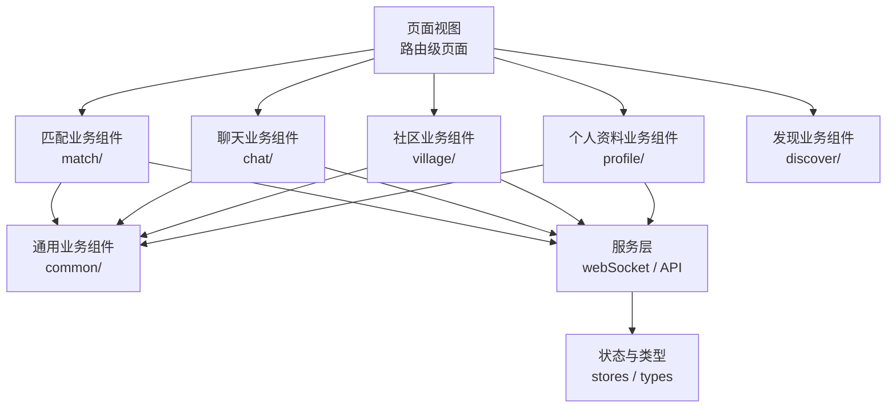
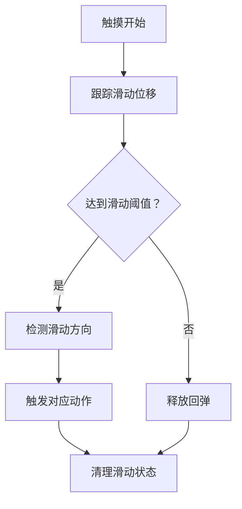
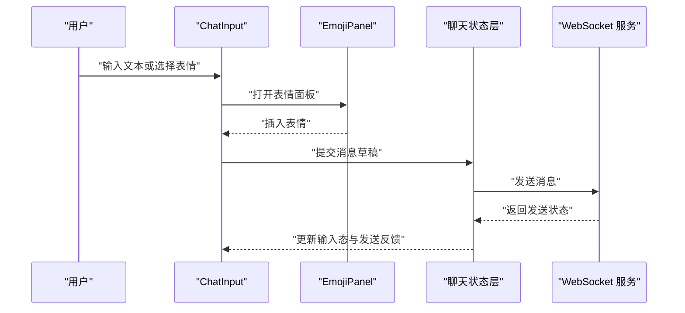
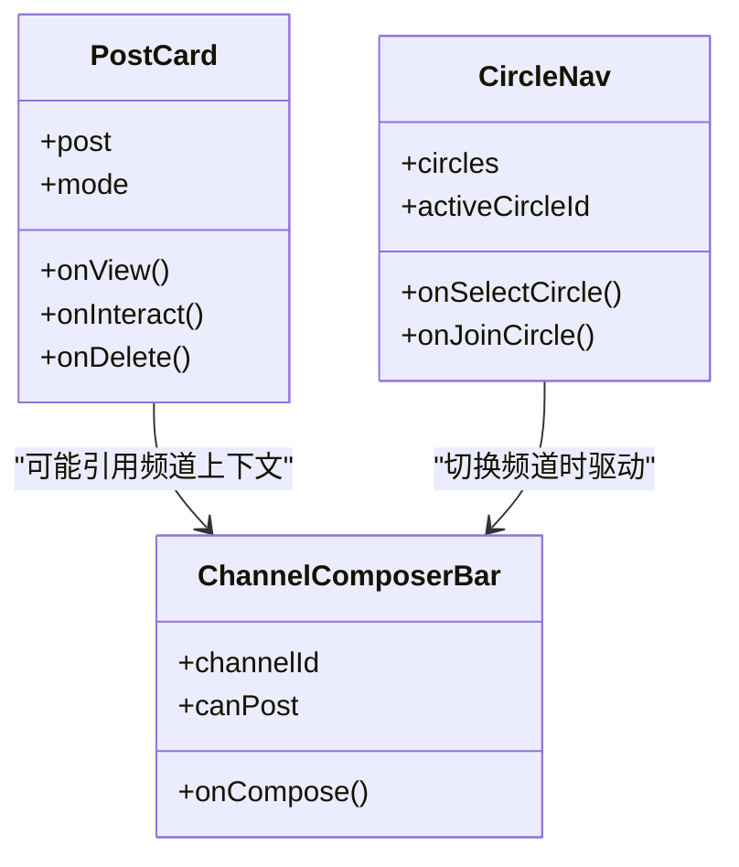
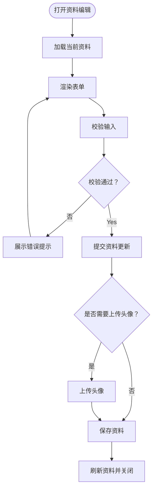
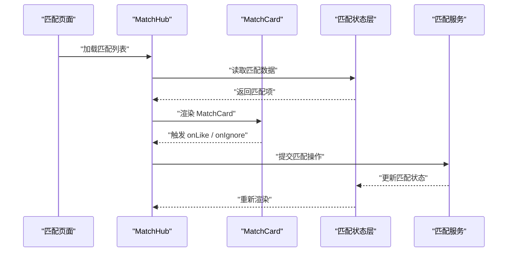
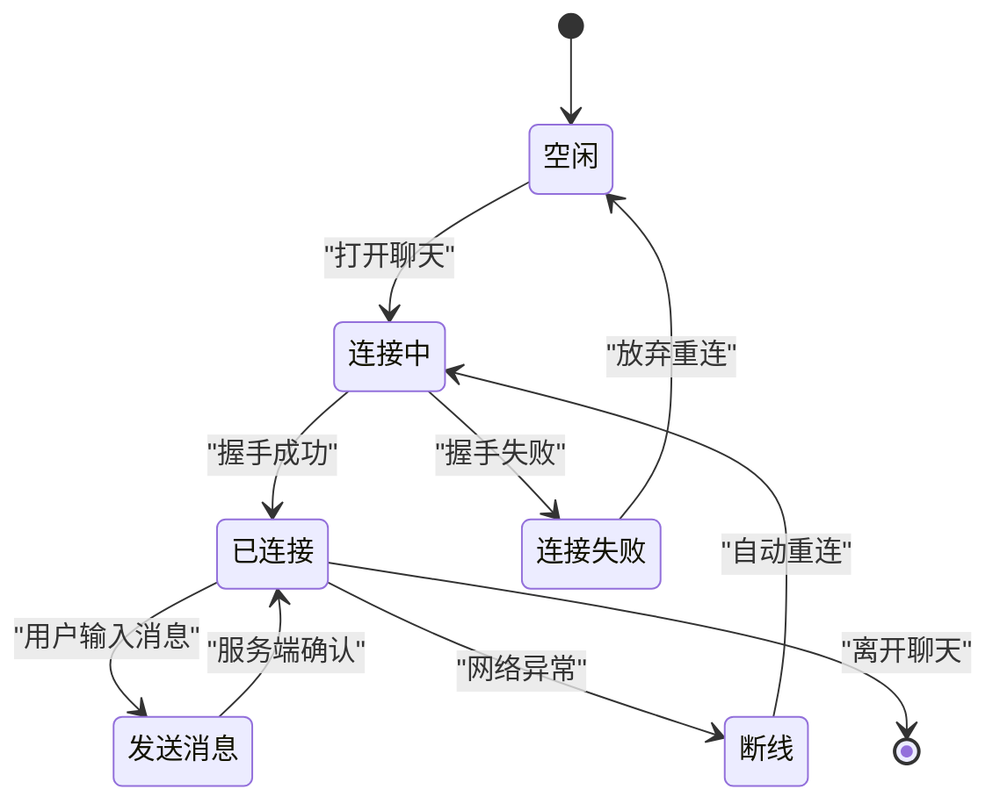
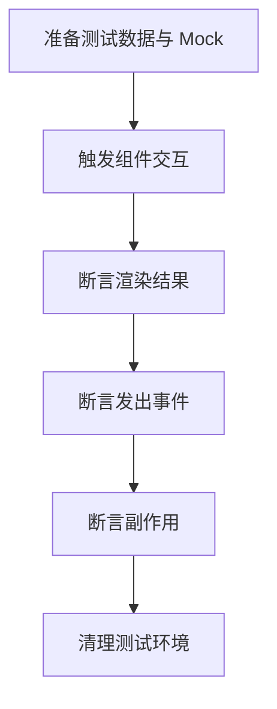
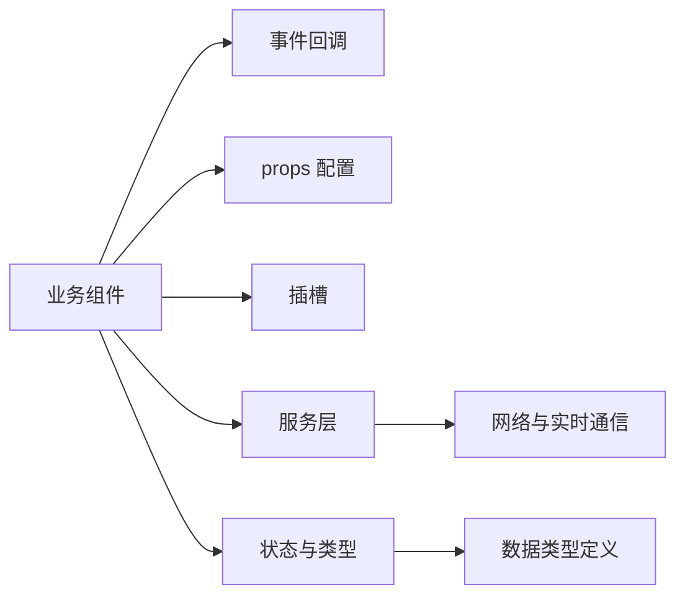

# 业务组件设计

<cite>
**本文引用的文件**   
- [MatchCard.vue](file://apps/client/src/components/match/MatchCard.vue)
- [SwipeGesture.ts](file://apps/client/src/components/common/swipe/SwipeGesture.ts)
- [ChatItem.vue](file://apps/client/src/components/chat/ChatItem.vue)
- [EmojiPanel.vue](file://apps/client/src/components/chat/EmojiPanel.vue)
- [PostCard.vue](file://apps/client/src/components/village/ChannelComposerBar.vue)
- [CircleNav.vue](file://apps/client/src/components/village/SchoolCircleGate.vue)
- [AvatarUploader.vue](file://apps/client/src/components/profile/common/PhotoCard.vue)
- [ProfileForm.vue](file://apps/client/src/components/profile/ProfileTabs.vue)
- [MatchHub.vue](file://apps/client/src/components/match/MatchHub.vue)
- [SessionMachine.ts](file://apps/client/src/features/chat/session-machine.ts)
- [WebSocketService.ts](file://apps/client/src/services/websocket.ts)
- [ChatTypes.ts](file://apps/client/src/stores/chat/types.ts)
</cite>

## 目录
1. [引言](#引言)
2. [项目结构与业务组件分层](#项目结构与业务组件分层)
3. [核心业务组件职责边界](#核心业务组件职责边界)
4. [数据传递与状态共享模式](#数据传递与状态共享模式)
5. [生命周期与资源清理机制](#生命周期与资源清理机制)
6. [可测试性与 Mock 策略](#可测试性与-mock-策略)
7. [组件使用示例与扩展指南](#组件使用示例与扩展指南)
8. [依赖关系与架构总览](#依赖关系与架构总览)
9. [常见问题排查](#常见问题排查)
10. [结论](#结论)

## 引言

本设计文档面向 Campus Love 前端应用的业务组件层，目标是帮助开发者理解并正确使用匹配、聊天、社区、个人资料等场景中的业务组件。文档从“分层结构、职责边界、接口契约、数据流、生命周期、可测试性”六个维度展开，并给出可视化架构图和可操作的扩展建议。

业务组件不是 UI 原子控件，也不是完整页面；它围绕一个明确的用户任务组织代码，例如：
- “浏览并处理一次匹配结果”
- “打开并维护一条聊天会话”
- “在社区频道中阅读或发布内容”
- “上传头像并编辑公开资料”

这些组件通常由页面级视图组合，同时向上暴露稳定的 props、事件和插槽，向下委托给通用组件、服务层和状态管理模块。

## 项目结构与业务组件分层

Campus Love 前端采用按“领域 + 能力”划分的组件目录组织方式：

- `components/match`：匹配相关组件，负责展示匹配对象、匹配进度、匹配操作入口。
- `components/chat`：聊天相关组件，负责消息列表、消息气泡、表情面板、语音录制等。
- `components/village`：社区相关组件，负责频道入口、置顶帖子、学校圈子门等。
- `components/profile`：个人资料相关组件，负责头像上传、公开资料展示、资料标签等。
- `components/common`：跨领域通用业务组件，如卡片容器、骨架屏、空状态、徽章、手势工具等。
- `components/layout`：布局型组件，如 TabBar、聊天头部等。
- `components/discover`：发现页相关组件，如筛选、快速操作、解锁面板等。
- `features`、`services`、`stores`：非视图层能力，为业务组件提供状态机、网络通信和数据类型。

**图表来源**  
- [MatchCard.vue:1-200](file://apps/client/src/components/match/MatchCard.vue#L1-L200)
- [ChatItem.vue:1-200](file://apps/client/src/components/chat/ChatItem.vue#L1-L157)
- [ChannelComposerBar.vue:1-200](file://apps/client/src/components/village/ChannelComposerBar.vue#L1-L153)
- [PhotoCard.vue:1-200](file://apps/client/src/components/profile/common/PhotoCard.vue#L1-L85)

**章节来源**  
- [MatchCard.vue:1-200](file://apps/client/src/components/match/MatchCard.vue#L1-L200)
- [ChatItem.vue:1-200](file://apps/client/src/components/chat/ChatItem.vue#L1-L157)
- [ChannelComposerBar.vue:1-200](file://apps/client/src/components/village/ChannelComposerBar.vue#L1-L153)
- [PhotoCard.vue:1-200](file://apps/client/src/components/profile/common/PhotoCard.vue#L1-L85)

## 核心业务组件职责边界

### 匹配相关组件

#### MatchCard

MatchCard 是匹配场景的核心展示与操作组件，典型职责包括：
- 渲染匹配对象的头像、基础信息、匹配标签。
- 展示匹配状态，例如待确认、已匹配、未通过等。
- 触发匹配动作，例如喜欢、忽略、查看详情。
- 与上层页面协作完成匹配流程导航。

MatchCard 应尽量避免直接调用底层 API，而是通过事件向父级页面报告用户意图；若需要本地状态（例如加载态、交互禁用），应在组件内部维护。

| 属性类别 | 典型字段 | 说明 |
|---|---|---|
| 输入数据 | `user`、`matchState`、`displayMode` | 匹配对象、匹配状态、展示模式 |
| 行为回调 | `onLike`、`onIgnore`、`onViewDetail` | 用户操作回调 |
| 展示配置 | `showTags`、`showActions`、`size` | 控制是否显示标签、操作按钮和尺寸 |
| 插槽 | `header`、`footer`、`extraInfo` | 允许父组件注入额外内容 |

**章节来源**  
- [MatchCard.vue:1-200](file://apps/client/src/components/match/MatchCard.vue#L1-L200)

#### SwipeActions 与滑动交互

SwipeActions 并不是单一 Vue 组件名，而是以滑动手势为基础的操作模式。仓库中存在滑动手势工具 `SwipeGesture.ts`，配合匹配卡片、消息列表或社区卡片时，可以实现左滑、右滑触发动作。

推荐职责划分：
- `SwipeGesture.ts`：封装滑动方向、距离阈值、防抖、触摸事件兼容等。
- 具体业务组件：决定哪些区域支持滑动、滑动后触发什么业务逻辑。
- 上层页面：处理业务副作用，例如跳转详情页、发送系统通知。

**图表来源**  
- [SwipeGesture.ts:1-200](file://apps/client/src/components/common/swipe/SwipeGesture.ts#L1-L173)

**章节来源**  
- [SwipeGesture.ts:1-200](file://apps/client/src/components/common/swipe/SwipeGesture.ts#L1-L173)

### 聊天相关组件

#### ChatItem

ChatItem 表示聊天列表中的一条会话条目，常见职责包括：
- 展示联系人头像、昵称、最近消息摘要。
- 展示未读数量、在线状态、认证标识。
- 点击后进入聊天详情页面。
- 根据角色区分自己与对方消息的视觉样式。

ChatItem 不应自行维护聊天消息历史，只负责把当前会话摘要渲染出来，并把点击事件交给页面或路由层处理。

#### MessageBubble

MessageBubble 用于渲染单条消息内容，包括文本、图片、语音、系统提示等。其职责边界包括：
- 解析消息类型并选择对应渲染模板。
- 处理消息时间戳、发送者身份、状态标记。
- 触发消息相关操作，例如长按菜单、转发、举报。
- 避免直接修改全局聊天记录，只抛出事件。

#### ChatInput

ChatInput 是聊天输入区组件，负责：
- 接收用户输入文本。
- 切换输入模式，例如文本、表情、语音。
- 校验输入长度、敏感词、媒体限制。
- 将输入转换为消息模型后提交给聊天服务。

**图表来源**  
- [EmojiPanel.vue:1-200](file://apps/client/src/components/chat/EmojiPanel.vue#L1-L114)
- [ChatItem.vue:1-200](file://apps/client/src/components/chat/ChatItem.vue#L1-L157)
- [SessionMachine.ts:1-200](file://apps/client/src/features/chat/session-machine.ts#L1-L112)
- [WebSocketService.ts:1-200](file://apps/client/src/services/websocket.ts#L1-L19)

**章节来源**  
- [ChatItem.vue:1-200](file://apps/client/src/components/chat/ChatItem.vue#L1-L157)
- [EmojiPanel.vue:1-200](file://apps/client/src/components/chat/EmojiPanel.vue#L1-L114)
- [SessionMachine.ts:1-200](file://apps/client/src/features/chat/session-machine.ts#L1-L112)
- [WebSocketService.ts:1-200](file://apps/client/src/services/websocket.ts#L1-L19)

### 社区相关组件

#### PostCard

在仓库中，社区相关内容分布在 village 子目录，例如频道 composer 栏和学校圈子门。PostCard 的职责通常是：
- 渲染社区帖子的标题、摘要、作者、发布时间。
- 展示点赞、评论、收藏等互动指标。
- 触发查看帖子详情、举报、编辑等操作。
- 根据权限控制编辑、删除按钮的可见性。

#### CircleNav

CircleNav 负责社区圈子的导航入口，例如学校圈子、兴趣圈子、官方账号等。职责包括：
- 渲染圈子列表或入口卡片。
- 根据用户是否加入圈子显示不同状态。
- 处理加入、退出、切换圈子等交互。
- 与频道、帖子列表协同工作。

**图表来源**  
- [ChannelComposerBar.vue:1-200](file://apps/client/src/components/village/ChannelComposerBar.vue#L1-L153)
- [SchoolCircleGate.vue:1-200](file://apps/client/src/components/village/SchoolCircleGate.vue#L1-L200)

**章节来源**  
- [ChannelComposerBar.vue:1-200](file://apps/client/src/components/village/ChannelComposerBar.vue#L1-L153)
- [SchoolCircleGate.vue:1-200](file://apps/client/src/components/village/SchoolCircleGate.vue#L1-L200)

### 个人资料相关组件

#### AvatarUploader

AvatarUploader 负责头像上传流程，职责包括：
- 触发相册或相机选择。
- 压缩、裁剪、预览头像。
- 上传到服务端并处理失败重试。
- 同步更新本地头像缓存和用户状态。

#### ProfileForm

ProfileForm 负责个人资料编辑，职责包括：
- 表单绑定用户资料字段。
- 执行字段校验，例如必填、格式、长度。
- 提交变更并展示保存状态。
- 处理权限不足、登录过期等错误分支。

**图表来源**  
- [PhotoCard.vue:1-200](file://apps/client/src/components/profile/common/PhotoCard.vue#L1-L85)
- [ProfileTabs.vue:1-200](file://apps/client/src/components/profile/ProfileTabs.vue#L1-L92)

**章节来源**  
- [PhotoCard.vue:1-200](file://apps/client/src/components/profile/common/PhotoCard.vue#L1-L85)
- [ProfileTabs.vue:1-200](file://apps/client/src/components/profile/ProfileTabs.vue#L1-L92)

## 数据传递与状态共享模式

业务组件的数据传递主要采用以下模式：

| 模式 | 适用场景 | 优点 | 注意事项 |
|---|---|---|---|
| props 配置 | 展示型数据、开关、尺寸、主题 | 单向数据流清晰 | 避免 props 爆炸，必要时拆分子组件 |
| 事件回调 | 用户操作、副作用入口 | 解耦组件与业务逻辑 | 命名语义化，避免匿名函数重复创建 |
| 插槽 | 局部定制渲染、组合式布局 | 灵活复用 | 不要过度使用插槽导致可读性下降 |
| 全局状态 | 聊天会话、用户信息、匹配进度 | 多组件共享 | 明确状态所有权，避免循环更新 |
| 服务层 | 网络请求、实时通信、持久化 | 可测试、可替换 | 组件不直接写 fetch 或 WebSocket 细节 |

### 匹配组件的数据流

MatchHub 作为匹配页面的聚合组件，通常会：
- 从状态层拉取匹配列表。
- 将单个匹配项传给 MatchCard。
- 收集 MatchCard 发出的 like、ignore、view 事件。
- 调用匹配服务更新后端状态。

**图表来源**  
- [MatchHub.vue:1-200](file://apps/client/src/components/match/MatchHub.vue#L1-L200)
- [MatchCard.vue:1-200](file://apps/client/src/components/match/MatchCard.vue#L1-L200)

### 聊天组件的状态流

聊天组件通常依赖会话状态机和 WebSocket 服务：
- 会话状态机管理连接、消息队列、离线重连、错误恢复。
- WebSocket 服务负责消息收发和心跳。
- 业务组件只消费状态和抛出事件。

**图表来源**  
- [SessionMachine.ts:1-200](file://apps/client/src/features/chat/session-machine.ts#L1-L112)
- [WebSocketService.ts:1-200](file://apps/client/src/services/websocket.ts#L1-L19)

**章节来源**  
- [MatchHub.vue:1-200](file://apps/client/src/components/match/MatchHub.vue#L1-L200)
- [SessionMachine.ts:1-200](file://apps/client/src/features/chat/session-machine.ts#L1-L112)
- [WebSocketService.ts:1-200](file://apps/client/src/services/websocket.ts#L1-L19)

## 生命周期与资源清理机制

业务组件的生命周期管理应遵循“谁申请、谁释放”的原则：

| 阶段 | 常见资源 | 处理方式 |
|---|---|---|
| 初始化 | 计算属性、订阅状态、监听器 | 使用框架提供的初始化钩子 |
| 运行期 | WebSocket 连接、定时器、滚动监听 | 仅在组件活跃时保持 |
| 销毁期 | 事件监听、定时器、动画、内存引用 | 在销毁钩子中主动清理 |

### 聊天组件的资源清理

聊天组件可能持有：
- WebSocket 连接。
- 消息滚动位置。
- 音频播放器实例。
- 表情面板临时状态。

建议在组件销毁时：
- 断开 WebSocket。
- 清除定时器。
- 停止音频播放。
- 释放大对象引用。

### 匹配组件的资源清理

匹配组件通常较轻量，但仍需注意：
- 如果使用了滑动手势，需在组件销毁时移除触摸监听。
- 如果加载了长图或视频，需避免保留不必要的 DOM 引用。
- 如果触发了动画，应在组件离开前取消动画。

**章节来源**  
- [ChatItem.vue:1-200](file://apps/client/src/components/chat/ChatItem.vue#L1-L157)
- [SwipeGesture.ts:1-200](file://apps/client/src/components/common/swipe/SwipeGesture.ts#L1-L173)

## 可测试性与 Mock 策略

### 单元测试目标

业务组件的单测应覆盖：
- props 变化对渲染的影响。
- 用户交互触发的事件是否正确。
- 插槽内容是否正确透传。
- 错误状态和空状态是否可重现。
- 与状态层或服务层的交互是否符合预期。

### Mock 策略

| 被测依赖 | Mock 方式 | 目的 |
|---|---|---|
| 网络服务 | 模拟 HTTP 响应 | 验证加载、成功、失败分支 |
| WebSocket | 模拟消息收发、断线重连 | 验证聊天状态机 |
| 路由 | 模拟跳转参数 | 验证导航行为 |
| 文件系统 | 模拟图片选择与上传 | 验证头像上传流程 |
| 第三方 SDK | 模拟 SDK 方法 | 避免外部不稳定因素 |

### 快照测试与交互测试

- 快照测试适合稳定展示组件，例如头像、徽章、卡片。
- 交互测试适合复杂流程，例如滑动、表情插入、表单提交。
- 对于聊天组件，建议使用虚拟消息数据构造多种消息类型。

**图表来源**  
- [SessionMachine.ts:1-200](file://apps/client/src/features/chat/session-machine.ts#L1-L112)
- [WebSocketService.ts:1-200](file://apps/client/src/services/websocket.ts#L1-L19)

**章节来源**  
- [SessionMachine.ts:1-200](file://apps/client/src/features/chat/session-machine.ts#L1-L112)
- [WebSocketService.ts:1-200](file://apps/client/src/services/websocket.ts#L1-L19)

## 组件使用示例与扩展指南

### 使用 MatchCard

推荐用法：
- 在匹配列表中渲染多个 MatchCard。
- 为每个 MatchCard 传入独立的匹配数据。
- 在父组件统一处理匹配结果。

扩展建议：
- 新增匹配标签时，通过 props 或插槽扩展展示。
- 新增匹配动作时，优先通过事件回调，而不是直接修改状态。

### 使用 ChatItem 与 EmojiPanel

推荐用法：
- ChatItem 展示会话摘要。
- EmojiPanel 作为聊天输入区的表情面板。
- 两者都通过事件与父组件通信。

扩展建议：
- 新增消息类型时，扩展消息渲染逻辑。
- 新增表情分类时，扩展 EmojiPanel 的分类数据源。

### 使用 PostCard 与 CircleNav

推荐用法：
- CircleNav 作为频道或圈子导航入口。
- PostCard 作为帖子展示单元。
- 父组件统一管理频道切换和帖子列表。

扩展建议：
- 新增社区类型时，抽象公共展示逻辑。
- 新增互动操作时，通过事件回调交给上层处理。

### 使用 AvatarUploader 与 ProfileForm

推荐用法：
- AvatarUploader 独立负责头像上传。
- ProfileForm 负责资料字段编辑。
- 上传成功后，由父组件刷新用户资料。

扩展建议：
- 新增资料字段时，扩展表单校验规则。
- 新增隐私控制时，通过 props 控制字段可见性。

**章节来源**  
- [MatchCard.vue:1-200](file://apps/client/src/components/match/MatchCard.vue#L1-L200)
- [ChatItem.vue:1-200](file://apps/client/src/components/chat/ChatItem.vue#L1-L157)
- [EmojiPanel.vue:1-200](file://apps/client/src/components/chat/EmojiPanel.vue#L1-L114)
- [ChannelComposerBar.vue:1-200](file://apps/client/src/components/village/ChannelComposerBar.vue#L1-L153)
- [SchoolCircleGate.vue:1-200](file://apps/client/src/components/village/SchoolCircleGate.vue#L1-L200)
- [PhotoCard.vue:1-200](file://apps/client/src/components/profile/common/PhotoCard.vue#L1-L85)
- [ProfileTabs.vue:1-200](file://apps/client/src/components/profile/ProfileTabs.vue#L1-L92)

## 依赖关系与架构总览

业务组件的依赖方向应严格自顶向下：

**图表来源**  
- [MatchCard.vue:1-200](file://apps/client/src/components/match/MatchCard.vue#L1-L200)
- [ChatItem.vue:1-200](file://apps/client/src/components/chat/ChatItem.vue#L1-L157)
- [ChannelComposerBar.vue:1-200](file://apps/client/src/components/village/ChannelComposerBar.vue#L1-L153)
- [PhotoCard.vue:1-200](file://apps/client/src/components/profile/common/PhotoCard.vue#L1-L85)
- [ChatTypes.ts:1-200](file://apps/client/src/stores/chat/types.ts#L1-L86)

### 关键依赖说明

- 匹配组件依赖匹配状态和匹配服务。
- 聊天组件依赖会话状态机、WebSocket 服务和聊天类型。
- 社区组件依赖频道数据和帖子数据。
- 资料组件依赖用户信息和头像上传服务。

**章节来源**  
- [ChatTypes.ts:1-200](file://apps/client/src/stores/chat/types.ts#L1-L86)

## 常见问题排查

### 匹配卡片无响应

可能原因：
- 父组件未绑定事件回调。
- 匹配状态未更新。
- 滑动手势被其他组件拦截。

排查建议：
- 检查 MatchCard 的事件绑定。
- 检查匹配服务是否返回成功。
- 检查滑动冲突区域。

### 聊天消息不刷新

可能原因：
- WebSocket 连接未建立。
- 消息状态机处于错误状态。
- 消息列表未正确响应新消息。

排查建议：
- 检查 WebSocket 连接状态。
- 检查会话状态机日志。
- 检查消息数组更新逻辑。

### 社区帖子无法加载

可能原因：
- 频道 ID 不正确。
- 权限不足。
- 分页数据未合并。

排查建议：
- 检查频道选择逻辑。
- 检查用户权限。
- 检查分页合并逻辑。

### 头像上传失败

可能原因：
- 文件过大。
- 网络超时。
- 服务端返回错误。

排查建议：
- 检查文件大小限制。
- 检查重试机制。
- 检查错误提示是否展示。

**章节来源**  
- [MatchCard.vue:1-200](file://apps/client/src/components/match/MatchCard.vue#L1-L200)
- [ChatItem.vue:1-200](file://apps/client/src/components/chat/ChatItem.vue#L1-L157)
- [ChannelComposerBar.vue:1-200](file://apps/client/src/components/village/ChannelComposerBar.vue#L1-L153)
- [PhotoCard.vue:1-200](file://apps/client/src/components/profile/common/PhotoCard.vue#L1-L85)

## 结论

Campus Love 的业务组件设计应以“职责清晰、接口稳定、状态可控、可测试”为核心原则。匹配、聊天、社区、个人资料等业务组件应专注于自身领域的展示与交互，把副作用交给上层页面或服务层。通过 props、事件、插槽和全局状态的合理组合，可以在保证可维护性的同时提升复用率。

在实际开发中，建议：
- 先定义组件接口，再实现渲染逻辑。
- 用事件代替直接状态修改。
- 用服务层封装网络和实时通信。
- 用状态机管理复杂流程。
- 用单测覆盖关键交互和错误分支。

这样可以让业务组件既易于理解，又便于扩展和维护。