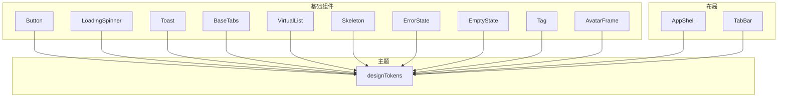
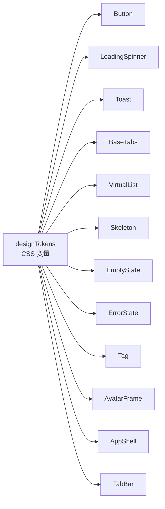
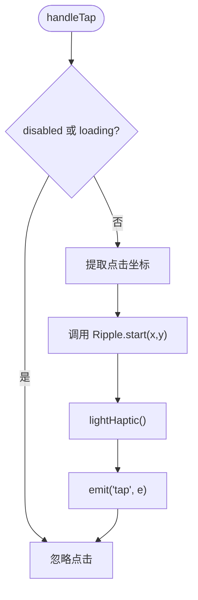
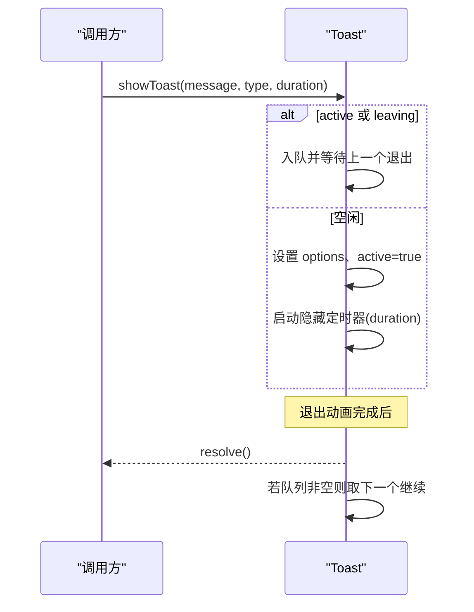
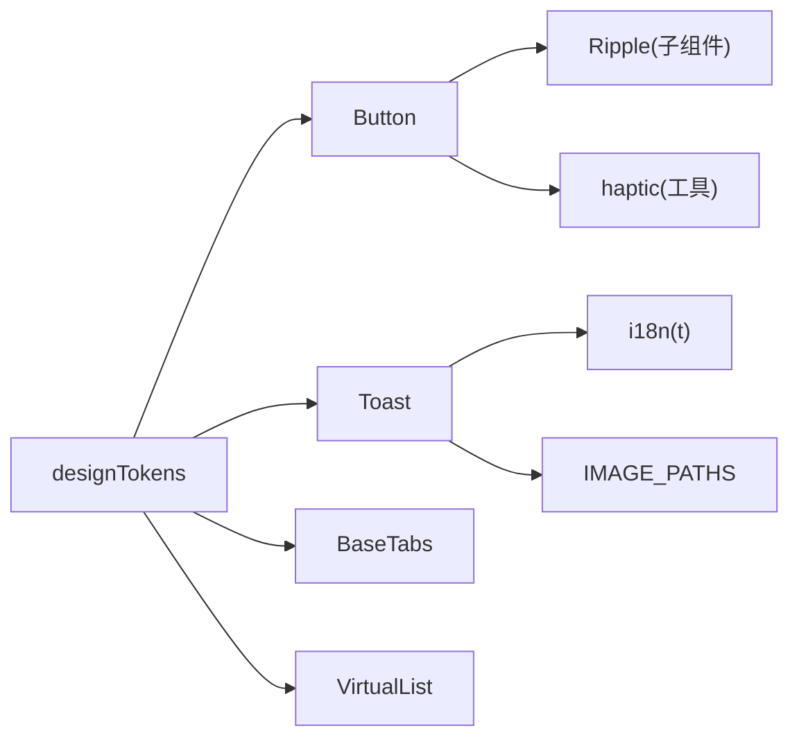

# 基础组件设计

<cite>
**本文引用的文件**
- [apps/client/src/components/common/Button.vue](file://apps/client/src/components/common/Button.vue)
- [apps/client/src/components/common/LoadingSpinner.vue](file://apps/client/src/components/common/LoadingSpinner.vue)
- [apps/client/src/components/common/Toast.vue](file://apps/client/src/components/common/Toast.vue)
- [apps/client/src/components/common/BaseTabs.vue](file://apps/client/src/components/common/BaseTabs.vue)
- [apps/client/src/components/common/VirtualList.vue](file://apps/client/src/components/common/VirtualList.vue)
- [apps/client/src/components/common/Skeleton.vue](file://apps/client/src/components/common/Skeleton.vue)
- [apps/client/src/components/common/SectionCard.vue](file://apps/client/src/components/common/SectionCard.vue)
- [apps/client/src/components/common/BottomActionBar.vue](file://apps/client/src/components/common/BottomActionBar.vue)
- [apps/client/src/components/common/PageStateContainer.vue](file://apps/client/src/components/common/PageStateContainer.vue)
- [apps/client/src/components/common/ErrorState.vue](file://apps/client/src/components/common/ErrorState.vue)
- [apps/client/src/components/common/EmptyState.vue](file://apps/client/src/components/common/EmptyState.vue)
- [apps/client/src/components/common/Tag.vue](file://apps/client/src/components/common/Tag.vue)
- [apps/client/src/components/common/AvatarFrame.vue](file://apps/client/src/components/common/AvatarFrame.vue)
- [apps/client/src/components/layout/AppShell.vue](file://apps/client/src/components/layout/AppShell.vue)
- [apps/client/src/components/layout/TabBar.vue](file://apps/client/src/components/layout/TabBar.vue)
- [apps/client/src/theme/tokens.ts](file://apps/client/src/theme/tokens.ts)
</cite>

## 目录
1. [简介](#简介)
2. [项目结构](#项目结构)
3. [核心组件](#核心组件)
4. [架构总览](#架构总览)
5. [详细组件分析](#详细组件分析)
6. [依赖关系分析](#依赖关系分析)
7. [性能考量](#性能考量)
8. [故障排查指南](#故障排查指南)
9. [结论](#结论)
10. [附录：API 与使用示例](#附录api-与使用示例)

## 简介
本设计文档面向 Campus Love 前端应用的基础组件体系，围绕“单一职责、高内聚低耦合、可配置性强”的设计原则，系统化梳理通用 UI（Button、Icon、Loading、Modal）、布局（FlexBox、Grid）与表单（Input、Select、DatePicker）等组件的落地方案。结合仓库中已实现的 common 与 layout 组件，补充缺失的通用能力，形成一套主题化、国际化、多端兼容且具备性能优化策略的基础组件库。

## 项目结构
当前仓库的前端代码位于 apps/client，组件主要分布在：
- common：通用 UI 与状态展示组件（按钮、加载、提示、骨架屏、标签、头像框、空态/错误态、页面容器等）
- layout：应用级布局与导航（AppShell、TabBar）
- theme：设计令牌（tokens）与主题变量，统一颜色、字号、间距、阴影等

图表来源
- [apps/client/src/components/common/Button.vue:1-319](file://apps/client/src/components/common/Button.vue#L1-L319)
- [apps/client/src/components/common/LoadingSpinner.vue:1-53](file://apps/client/src/components/common/LoadingSpinner.vue#L1-L53)
- [apps/client/src/components/common/Toast.vue:1-347](file://apps/client/src/components/common/Toast.vue#L1-L347)
- [apps/client/src/components/common/BaseTabs.vue:1-290](file://apps/client/src/components/common/BaseTabs.vue#L1-L290)
- [apps/client/src/components/common/VirtualList.vue](file://apps/client/src/components/common/VirtualList.vue)
- [apps/client/src/components/common/Skeleton.vue](file://apps/client/src/components/common/Skeleton.vue)
- [apps/client/src/components/common/ErrorState.vue](file://apps/client/src/components/common/ErrorState.vue)
- [apps/client/src/components/common/EmptyState.vue](file://apps/client/src/components/common/EmptyState.vue)
- [apps/client/src/components/common/Tag.vue](file://apps/client/src/components/common/Tag.vue)
- [apps/client/src/components/common/AvatarFrame.vue](file://apps/client/src/components/common/AvatarFrame.vue)
- [apps/client/src/components/layout/AppShell.vue](file://apps/client/src/components/layout/AppShell.vue)
- [apps/client/src/components/layout/TabBar.vue](file://apps/client/src/components/layout/TabBar.vue)
- [apps/client/src/theme/tokens.ts](file://apps/client/src/theme/tokens.ts)

章节来源
- [apps/client/src/components/common/Button.vue:1-319](file://apps/client/src/components/common/Button.vue#L1-L319)
- [apps/client/src/components/common/LoadingSpinner.vue:1-53](file://apps/client/src/components/common/LoadingSpinner.vue#L1-L53)
- [apps/client/src/components/common/Toast.vue:1-347](file://apps/client/src/components/common/Toast.vue#L1-L347)
- [apps/client/src/components/common/BaseTabs.vue:1-290](file://apps/client/src/components/common/BaseTabs.vue#L1-L290)

## 核心组件
- Button：多变体、多尺寸、无障碍、涟漪动效、Haptic 反馈、跨平台点击坐标兼容
- LoadingSpinner：统一的圆形加载指示器，支持可选文案
- Toast：顶部通知，支持队列、动画、类型图标、i18n 默认文案、Promise API
- BaseTabs：下划线/胶囊/块状三种样式，支持滚动与等分、徽章显示
- VirtualList：长列表虚拟渲染，按需渲染可视区项，降低内存与重排开销
- Skeleton/EmptyState/ErrorState：占位/空态/错误态统一体验
- Tag/AvatarFrame：小型展示型组件，配合 tokens 适配主题
- AppShell/TabBar：应用壳与底部导航，承载路由与全局布局

章节来源
- [apps/client/src/components/common/Button.vue:1-319](file://apps/client/src/components/common/Button.vue#L1-L319)
- [apps/client/src/components/common/LoadingSpinner.vue:1-53](file://apps/client/src/components/common/LoadingSpinner.vue#L1-L53)
- [apps/client/src/components/common/Toast.vue:1-347](file://apps/client/src/components/common/Toast.vue#L1-L347)
- [apps/client/src/components/common/BaseTabs.vue:1-290](file://apps/client/src/components/common/BaseTabs.vue#L1-L290)
- [apps/client/src/components/common/VirtualList.vue](file://apps/client/src/components/common/VirtualList.vue)
- [apps/client/src/components/common/Skeleton.vue](file://apps/client/src/components/common/Skeleton.vue)
- [apps/client/src/components/common/EmptyState.vue](file://apps/client/src/components/common/EmptyState.vue)
- [apps/client/src/components/common/ErrorState.vue](file://apps/client/src/components/common/ErrorState.vue)
- [apps/client/src/components/common/Tag.vue](file://apps/client/src/components/common/Tag.vue)
- [apps/client/src/components/common/AvatarFrame.vue](file://apps/client/src/components/common/AvatarFrame.vue)
- [apps/client/src/components/layout/AppShell.vue](file://apps/client/src/components/layout/AppShell.vue)
- [apps/client/src/components/layout/TabBar.vue](file://apps/client/src/components/layout/TabBar.vue)

## 架构总览
基础组件以 designTokens 为唯一视觉源，通过 CSS 变量在组件内消费；通用 UI 组件保持最小依赖，仅引入必要的主题与工具函数；布局组件负责组合与编排。事件模型采用 Vue 的 props/emits 约定，保证组件边界清晰。跨端兼容性通过条件编译与事件字段兼容处理实现。

图表来源
- [apps/client/src/theme/tokens.ts](file://apps/client/src/theme/tokens.ts)
- [apps/client/src/components/common/Button.vue:1-319](file://apps/client/src/components/common/Button.vue#L1-L319)
- [apps/client/src/components/common/LoadingSpinner.vue:1-53](file://apps/client/src/components/common/LoadingSpinner.vue#L1-L53)
- [apps/client/src/components/common/Toast.vue:1-347](file://apps/client/src/components/common/Toast.vue#L1-L347)
- [apps/client/src/components/common/BaseTabs.vue:1-290](file://apps/client/src/components/common/BaseTabs.vue#L1-L290)
- [apps/client/src/components/common/VirtualList.vue](file://apps/client/src/components/common/VirtualList.vue)
- [apps/client/src/components/common/Skeleton.vue](file://apps/client/src/components/common/Skeleton.vue)
- [apps/client/src/components/common/EmptyState.vue](file://apps/client/src/components/common/EmptyState.vue)
- [apps/client/src/components/common/ErrorState.vue](file://apps/client/src/components/common/ErrorState.vue)
- [apps/client/src/components/common/Tag.vue](file://apps/client/src/components/common/Tag.vue)
- [apps/client/src/components/common/AvatarFrame.vue](file://apps/client/src/components/common/AvatarFrame.vue)
- [apps/client/src/components/layout/AppShell.vue](file://apps/client/src/components/layout/AppShell.vue)
- [apps/client/src/components/layout/TabBar.vue](file://apps/client/src/components/layout/TabBar.vue)

## 详细组件分析

### Button 组件
- 设计要点
  - 单一职责：只负责按钮交互与外观，不关心业务逻辑
  - 高内聚：样式、事件、无障碍属性封装在内
  - 可配置性：variant/size/block/loading/disabled/icon/ripple
- 属性与事件
  - 属性：variant（primary/secondary/outline/ghost/wechat/danger/success/romance/text）、size（sm/md/lg）、block、loading、disabled、icon、ripple
  - 事件：tap（携带跨端兼容的坐标信息）
- 样式定制
  - 通过 CSS 变量控制高度、内边距、字号、涟漪颜色
  - 按压态通过 hover-class 实现跨端一致
- 无障碍与可访问性
  - role="button"、aria-disabled、aria-busy
- 多端兼容
  - 点击坐标取自 detail.x/y 或 changedTouches，兼容 H5 与 mp-weixin
  - 涟漪默认关闭，显式开启避免抖动
- 性能
  - 涟漪与 haptic 仅在非禁用/非加载中触发

图表来源
- [apps/client/src/components/common/Button.vue:1-319](file://apps/client/src/components/common/Button.vue#L1-L319)

章节来源
- [apps/client/src/components/common/Button.vue:1-319](file://apps/client/src/components/common/Button.vue#L1-L319)

### LoadingSpinner 组件
- 功能：统一的圆形加载指示器，可选文本提示
- 可配置：text（字符串）
- 无障碍：role="status"、aria-live="polite"
- 样式：基于 tokens 的边框色与动画时长

章节来源
- [apps/client/src/components/common/LoadingSpinner.vue:1-53](file://apps/client/src/components/common/LoadingSpinner.vue#L1-L53)

### Toast 组件
- 功能：顶部滑入通知，支持 success/error/warning/info
- 队列管理：新 toast 进入时旧 toast 先退出再展示，避免互相干扰
- i18n：默认文案从 t('common.success'/'common.networkError') 读取
- 图标：使用 SVG 资源替代 Unicode，兼容旧版微信基础库
- API：showToast/showSuccessToast/showErrorToast 返回 Promise
- 动画：滑入/滑出动画，安全区域适配

图表来源
- [apps/client/src/components/common/Toast.vue:1-347](file://apps/client/src/components/common/Toast.vue#L1-L347)

章节来源
- [apps/client/src/components/common/Toast.vue:1-347](file://apps/client/src/components/common/Toast.vue#L1-L347)

### BaseTabs 组件
- 功能：统一标签页，支持 underline/pill/block 三种变体，横向滚动与等分宽度
- 属性：tabs、modelValue、variant、scrollable、equalSplit、activeColor、badgeColor
- 事件：update:modelValue、change
- 徽章：数字 >99 显示 99+，背景色来自 tokens
- 无障碍：role="tablist"/"tab"、aria-selected、aria-label

章节来源
- [apps/client/src/components/common/BaseTabs.vue:1-290](file://apps/client/src/components/common/BaseTabs.vue#L1-L290)

### VirtualList 组件
- 功能：长列表虚拟渲染，仅渲染可视区项，减少 DOM 节点与重排
- 关键能力：可视区计算、项高度缓存、滚动位置映射
- 适用场景：消息列表、推荐流等大数据集

章节来源
- [apps/client/src/components/common/VirtualList.vue](file://apps/client/src/components/common/VirtualList.vue)

### Skeleton / EmptyState / ErrorState
- Skeleton：骨架占位，模拟内容区块形状与明暗层次
- EmptyState：无数据时的引导界面
- ErrorState：错误态提示与重试入口

章节来源
- [apps/client/src/components/common/Skeleton.vue](file://apps/client/src/components/common/Skeleton.vue)
- [apps/client/src/components/common/EmptyState.vue](file://apps/client/src/components/common/EmptyState.vue)
- [apps/client/src/components/common/ErrorState.vue](file://apps/client/src/components/common/ErrorState.vue)

### Tag / AvatarFrame
- Tag：轻量标签，用于分类、状态、计数等
- AvatarFrame：头像外框，支持尺寸与边框样式

章节来源
- [apps/client/src/components/common/Tag.vue](file://apps/client/src/components/common/Tag.vue)
- [apps/client/src/components/common/AvatarFrame.vue](file://apps/client/src/components/common/AvatarFrame.vue)

### AppShell / TabBar
- AppShell：应用外壳，提供头部/底部/内容区布局容器
- TabBar：底部导航，承载页面切换与活跃态

章节来源
- [apps/client/src/components/layout/AppShell.vue](file://apps/client/src/components/layout/AppShell.vue)
- [apps/client/src/components/layout/TabBar.vue](file://apps/client/src/components/layout/TabBar.vue)

## 依赖关系分析
- 主题依赖：所有组件通过 CSS 变量消费 tokens，确保主题一致性
- 模块依赖：Button 依赖 Ripple 与 haptic；Toast 依赖 i18n 与图片资源路径
- 布局依赖：AppShell/TabBar 作为应用级容器，组合业务页面

图表来源
- [apps/client/src/components/common/Button.vue:1-319](file://apps/client/src/components/common/Button.vue#L1-L319)
- [apps/client/src/components/common/Toast.vue:1-347](file://apps/client/src/components/common/Toast.vue#L1-L347)
- [apps/client/src/components/common/BaseTabs.vue:1-290](file://apps/client/src/components/common/BaseTabs.vue#L1-L290)
- [apps/client/src/theme/tokens.ts](file://apps/client/src/theme/tokens.ts)

章节来源
- [apps/client/src/components/common/Button.vue:1-319](file://apps/client/src/components/common/Button.vue#L1-L319)
- [apps/client/src/components/common/Toast.vue:1-347](file://apps/client/src/components/common/Toast.vue#L1-L347)
- [apps/client/src/components/common/BaseTabs.vue:1-290](file://apps/client/src/components/common/BaseTabs.vue#L1-L290)

## 性能考量
- 按需加载
  - 将大体积组件（如 VirtualList、复杂 Sheet/Modal）进行懒加载与分包，减少首屏包体
  - 对非必要第三方库按页面引入
- 虚拟渲染
  - VirtualList 仅渲染可视区项，降低内存占用与重排
  - 列表项高度缓存与稳定 key 提升滚动性能
- 事件委托
  - 长列表使用事件委托绑定点击，减少事件监听器数量
  - Button 内部统一 handleTap，减少重复逻辑
- 动画与重绘
  - 使用 transform/opacity 等合成层动画，避免强制同步布局
  - 按钮按压态使用 hover-class，避免 JS 频繁操作 DOM
- 主题变量
  - 通过 CSS 变量统一样式，减少运行时样式计算与分支

[本节为通用指导，无需具体文件引用]

## 故障排查指南
- Toast 队列与定时器泄漏
  - 现象：多次快速调用 showToast 出现闪烁或残留
  - 原因：leaving 期间覆盖 options 导致计时交错
  - 解决：leaving 阶段也入队，等待上一个完全消失后再展示；统一清理 hideTimer/leaveTimer/queueTimer
- 按钮点击坐标跨端不一致
  - 现象：涟漪起点偏移
  - 解决：优先读取 detail.x/y，回退到 changedTouches[0].clientX/Y
- 主题变量未生效
  - 检查是否引入 theme/tokens 并在根样式中声明 CSS 变量
  - 确认组件样式使用了 var(--...) 而非硬编码值
- 虚拟列表滚动卡顿
  - 检查项高度是否稳定；未稳定时使用固定高度或动态估算
  - 避免在滚动回调中进行昂贵计算

章节来源
- [apps/client/src/components/common/Toast.vue:1-347](file://apps/client/src/components/common/Toast.vue#L1-L347)
- [apps/client/src/components/common/Button.vue:1-319](file://apps/client/src/components/common/Button.vue#L1-L319)
- [apps/client/src/components/common/VirtualList.vue](file://apps/client/src/components/common/VirtualList.vue)

## 结论
本基础组件体系以 designTokens 为核心，遵循单一职责、高内聚低耦合与强可配置性原则，覆盖了通用 UI、布局与状态展示的核心场景。通过虚拟渲染、事件委托、跨端兼容与无障碍支持，兼顾了可维护性与性能。建议后续补齐 FlexBox/Grid 与 Input/Select/DatePicker 等高频表单与布局组件，完善 Modal 体系，形成更完整的基础设施。

[本节为总结，无需具体文件引用]

## 附录：API 与使用示例

### Button
- 属性
  - variant：primary | secondary | outline | ghost | wechat | danger | success | romance | text
  - size：sm | md | lg
  - block：boolean
  - loading：boolean
  - disabled：boolean
  - icon：string
  - ripple：boolean（默认 false）
- 事件
  - tap：回调参数包含跨端兼容的坐标字段
- 使用示例（路径）
  - [Button 组件定义](file://apps/client/src/components/common/Button.vue#L1-L319)

章节来源
- [apps/client/src/components/common/Button.vue:1-319](file://apps/client/src/components/common/Button.vue#L1-L319)

### LoadingSpinner
- 属性
  - text：string（可选）
- 使用示例（路径）
  - [LoadingSpinner 组件定义](file://apps/client/src/components/common/LoadingSpinner.vue#L1-L53)

章节来源
- [apps/client/src/components/common/LoadingSpinner.vue:1-53](file://apps/client/src/components/common/LoadingSpinner.vue#L1-L53)

### Toast
- 方法
  - showToast(message, type?, duration?)
  - showSuccessToast(message?, duration?)
  - showErrorToast(message?, duration?)
- 行为
  - 自动队列、动画、i18n 默认文案、Promise 返回
- 使用示例（路径）
  - [Toast 组件定义](file://apps/client/src/components/common/Toast.vue#L1-L347)

章节来源
- [apps/client/src/components/common/Toast.vue:1-347](file://apps/client/src/components/common/Toast.vue#L1-L347)

### BaseTabs
- 属性
  - tabs：数组（key、label、badge?）
  - modelValue：string
  - variant：underline | pill | block
  - scrollable：boolean
  - equalSplit：boolean
  - activeColor：string（可选）
  - badgeColor：string（可选）
- 事件
  - update:modelValue(key)
  - change(key, tab)
- 使用示例（路径）
  - [BaseTabs 组件定义](file://apps/client/src/components/common/BaseTabs.vue#L1-L290)

章节来源
- [apps/client/src/components/common/BaseTabs.vue:1-290](file://apps/client/src/components/common/BaseTabs.vue#L1-L290)

### VirtualList
- 能力
  - 可视区渲染、高度缓存、滚动定位
- 使用建议
  - 为每项提供稳定 key；尽量固定高度或使用可预测的高度估算
- 参考（路径）
  - [VirtualList 组件](file://apps/client/src/components/common/VirtualList.vue)

章节来源
- [apps/client/src/components/common/VirtualList.vue](file://apps/client/src/components/common/VirtualList.vue)

### Skeleton / EmptyState / ErrorState
- Skeleton：占位骨架，用于页面加载前占位
- EmptyState：无数据时展示引导
- ErrorState：错误信息与重试
- 参考（路径）
  - [Skeleton](file://apps/client/src/components/common/Skeleton.vue)
  - [EmptyState](file://apps/client/src/components/common/EmptyState.vue)
  - [ErrorState](file://apps/client/src/components/common/ErrorState.vue)

章节来源
- [apps/client/src/components/common/Skeleton.vue](file://apps/client/src/components/common/Skeleton.vue)
- [apps/client/src/components/common/EmptyState.vue](file://apps/client/src/components/common/EmptyState.vue)
- [apps/client/src/components/common/ErrorState.vue](file://apps/client/src/components/common/ErrorState.vue)

### Tag / AvatarFrame
- Tag：轻量标签，支持尺寸与颜色
- AvatarFrame：头像框，支持边框与尺寸
- 参考（路径）
  - [Tag](file://apps/client/src/components/common/Tag.vue)
  - [AvatarFrame](file://apps/client/src/components/common/AvatarFrame.vue)

章节来源
- [apps/client/src/components/common/Tag.vue](file://apps/client/src/components/common/Tag.vue)
- [apps/client/src/components/common/AvatarFrame.vue](file://apps/client/src/components/common/AvatarFrame.vue)

### 布局组件（AppShell / TabBar）
- AppShell：应用外壳，提供整体布局框架
- TabBar：底部导航，承载页面切换
- 参考（路径）
  - [AppShell](file://apps/client/src/components/layout/AppShell.vue)
  - [TabBar](file://apps/client/src/components/layout/TabBar.vue)

章节来源
- [apps/client/src/components/layout/AppShell.vue](file://apps/client/src/components/layout/AppShell.vue)
- [apps/client/src/components/layout/TabBar.vue](file://apps/client/src/components/layout/TabBar.vue)

### 待补齐的通用能力（规划）
- 布局组件
  - FlexBox：flex 布局封装，支持方向、对齐、间距、换行
  - Grid：网格布局封装，支持列数、间距、自适应
- 表单组件
  - Input：输入框，支持校验、占位符、前缀/后缀、清除
  - Select：选择器，支持单选/多选、搜索、分页
  - DatePicker：日期选择器，支持范围选择与本地化
- 弹窗组件
  - Modal：模态框，支持标题、内容、动作、遮罩、层级
- 图标组件
  - Icon：SVG 图标封装，支持尺寸、颜色、旋转、翻转
- 国际化适配
  - 所有用户可见文案通过 i18n 资源读取，避免硬编码
- 多端兼容性
  - 统一事件模型与样式降级，确保 H5/mp-weixin 一致表现

[本节为规划说明，无需具体文件引用]