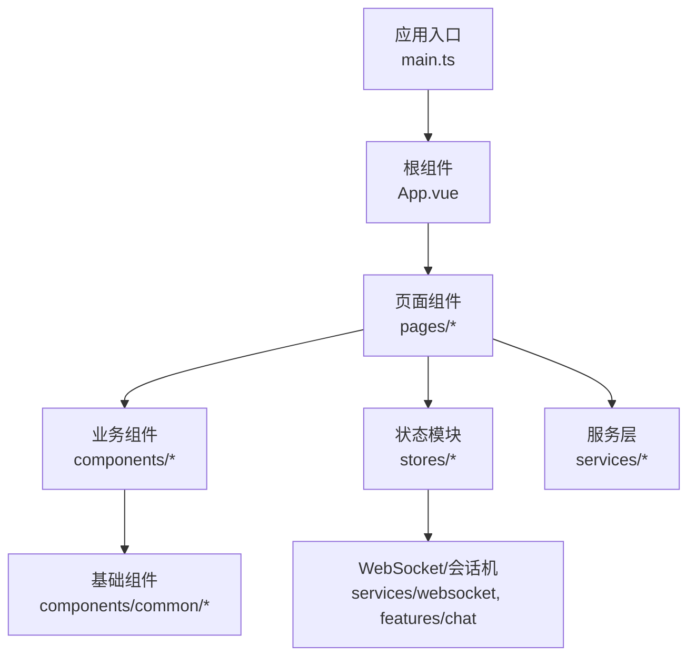
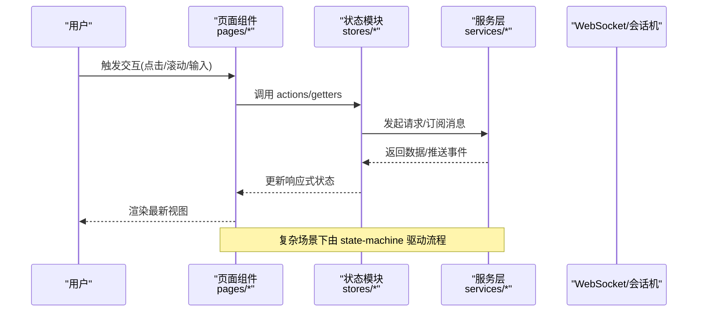
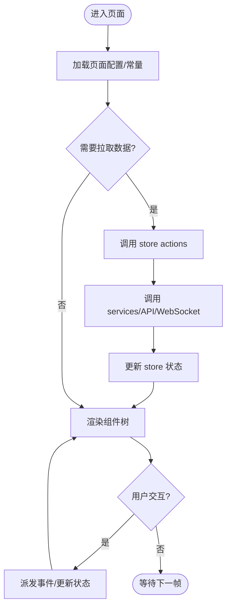
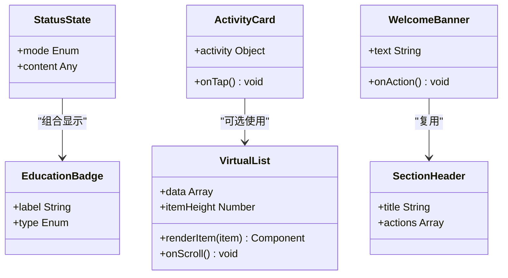
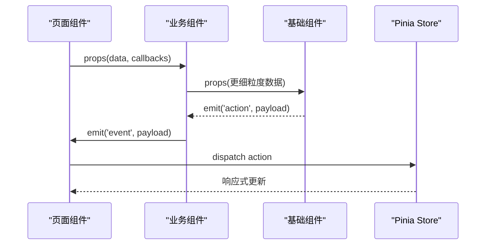
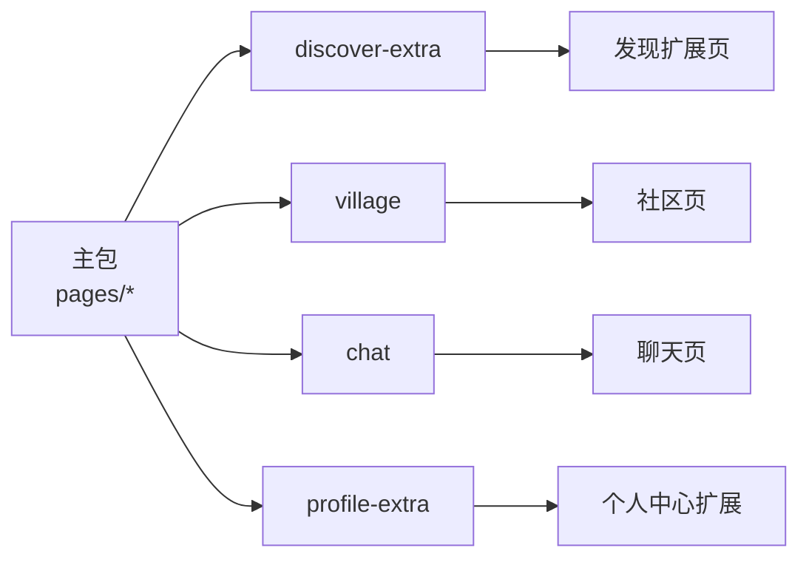
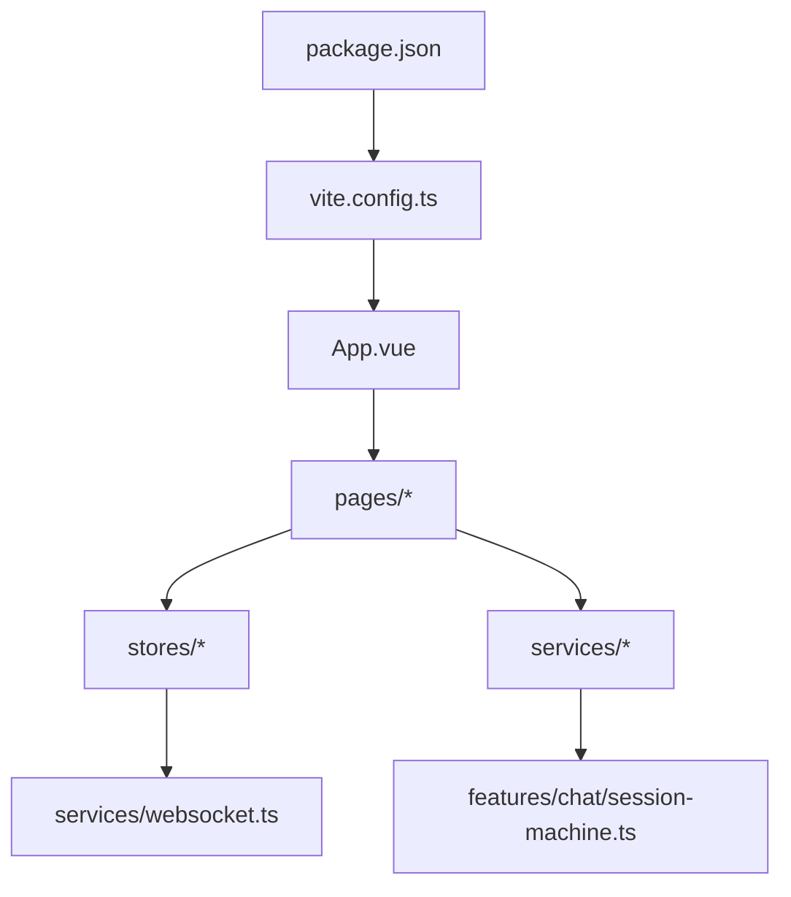

# 组件架构设计

<cite>
**本文引用的文件**
- [apps/client/package.json](file://apps/client/package.json)
- [apps/client/vite.config.ts](file://apps/client/vite.config.ts)
- [apps/client/project.config.json](file://apps/client/project.config.json)
- [apps/client/src/main.ts](file://apps/client/src/main.ts)
- [apps/client/src/App.vue](file://apps/client/src/App.vue)
- [apps/client/src/pages/home/index.vue](file://apps/client/src/pages/home/index.vue)
- [apps/client/src/pages/discover/index.vue](file://apps/client/src/pages/discover/index.vue)
- [apps/client/src/pages/messages/index.vue](file://apps/client/src/pages/messages/index.vue)
- [apps/client/src/pages/profile/index.vue](file://apps/client/src/pages/profile/index.vue)
- [apps/client/src/components/common/VirtualList.vue](file://apps/client/src/components/common/VirtualList.vue)
- [apps/client/src/components/common/SectionHeader.vue](file://apps/client/src/components/common/SectionHeader.vue)
- [apps/client/src/components/common/EducationBadge.vue](file://apps/client/src/components/common/EducationBadge.vue)
- [apps/client/src/components/common/StatusState.vue](file://apps/client/src/components/common/StatusState.vue)
- [apps/client/src/components/home/ActivityCard.vue](file://apps/client/src/components/home/ActivityCard.vue)
- [apps/client/src/components/home/WelcomeBanner.vue](file://apps/client/src/components/home/WelcomeBanner.vue)
- [apps/client/src/stores/discover.ts](file://apps/client/src/stores/discover.ts)
- [apps/client/src/stores/chat.ts](file://apps/client/src/stores/chat.ts)
- [apps/client/src/stores/village.ts](file://apps/client/src/stores/village.ts)
- [apps/client/src/stores/campus-wall.ts](file://apps/client/src/stores/campus-wall.ts)
- [apps/client/src/services/websocket.ts](file://apps/client/src/services/websocket.ts)
- [apps/client/src/services/websocket/state-machine.ts](file://apps/client/src/services/websocket/state-machine.ts)
- [apps/client/src/features/chat/session-machine.ts](file://apps/client/src/features/chat/session-machine.ts)
- [apps/client/src/config/home-sections.ts](file://apps/client/src/config/home-sections.ts)
- [apps/client/src/constants/api.ts](file://apps/client/src/constants/api.ts)
- [apps/client/src/constants/ui.ts](file://apps/client/src/constants/ui.ts)
</cite>

## 目录
1. [简介](#简介)
2. [项目结构](#项目结构)
3. [核心组件](#核心组件)
4. [架构总览](#架构总览)
5. [详细组件分析](#详细组件分析)
6. [依赖关系分析](#依赖关系分析)
7. [性能考虑](#性能考虑)
8. [故障排查指南](#故障排查指南)
9. [结论](#结论)
10. [附录](#附录)

## 简介
本文件面向 Campus Love 前端（uni-app）的组件架构，系统性说明页面组件、业务组件与基础组件的分层职责，组件命名与文件组织约定，以及 uni-app 分包策略。文档还覆盖组件通信模式（props、事件、Pinia、provide/inject）、生命周期管理、性能优化（懒加载、虚拟列表）与样式隔离方案，并提供具体使用示例与最佳实践建议。

## 项目结构
- 应用入口与初始化：main.ts 负责创建 Vue 应用实例、注册插件与全局配置；App.vue 作为根组件承载布局与路由容器。
- 页面组件（pages）：按功能域划分路由页面，如首页、发现、聊天、个人中心等，承担页面级数据获取与导航编排。
- 业务组件（components）：按领域或通用性分层，common 提供基础 UI 元素（卡片、标签、状态占位等），home/discover/chat/profile 等目录封装特定业务的复合组件。
- 状态与存储（stores）：基于 Pinia 的状态模块，围绕 discover、chat、village、campus-wall 等域组织可共享状态。
- 服务与网络（services）：统一封装 API 调用、WebSocket 连接与消息协议；state-machine 用于会话/消息流控制。
- 配置与常量（config/constants）：集中管理路由分段、UI 常量、API 地址等。

图表来源
- [apps/client/src/main.ts](file://apps/client/src/main.ts)
- [apps/client/src/App.vue](file://apps/client/src/App.vue)
- [apps/client/src/pages/home/index.vue](file://apps/client/src/pages/home/index.vue)
- [apps/client/src/components/common/VirtualList.vue](file://apps/client/src/components/common/VirtualList.vue)
- [apps/client/src/stores/chat.ts](file://apps/client/src/stores/chat.ts)
- [apps/client/src/services/websocket.ts](file://apps/client/src/services/websocket.ts)

章节来源
- [apps/client/src/main.ts](file://apps/client/src/main.ts)
- [apps/client/src/App.vue](file://apps/client/src/App.vue)
- [apps/client/package.json](file://apps/client/package.json)

## 核心组件
- 页面组件（pages）
  - 首页 index：聚合首页区块、活动推荐、欢迎横幅等，负责页面级数据装配与路由跳转。
  - 发现 discover：内容发现与推荐，驱动 discovery store 并渲染发现卡片。
  - 聊天 chat：会话列表与消息收发，驱动 chat store 与 WebSocket 通道。
  - 个人资料 profile：用户信息展示与编辑入口，联动 campus-wall 等状态。
- 业务组件（components）
  - home：ActivityCard、WelcomeBanner 等首页相关复合组件。
  - common：通用 UI 原子/分子组件，如 VirtualList、SectionHeader、EducationBadge、StatusState 等。
- 基础能力
  - 虚拟列表：VirtualList 用于长列表渲染优化。
  - 状态展示：StatusState 统一错误/空态/加载态。
  - 徽章/标题：EducationBadge、SectionHeader 提供一致的视觉规范。

章节来源
- [apps/client/src/pages/home/index.vue](file://apps/client/src/pages/home/index.vue)
- [apps/client/src/pages/discover/index.vue](file://apps/client/src/pages/discover/index.vue)
- [apps/client/src/pages/messages/index.vue](file://apps/client/src/pages/messages/index.vue)
- [apps/client/src/pages/profile/index.vue](file://apps/client/src/pages/profile/index.vue)
- [apps/client/src/components/home/ActivityCard.vue](file://apps/client/src/components/home/ActivityCard.vue)
- [apps/client/src/components/home/WelcomeBanner.vue](file://apps/client/src/components/home/WelcomeBanner.vue)
- [apps/client/src/components/common/VirtualList.vue](file://apps/client/src/components/common/VirtualList.vue)
- [apps/client/src/components/common/SectionHeader.vue](file://apps/client/src/components/common/SectionHeader.vue)
- [apps/client/src/components/common/EducationBadge.vue](file://apps/client/src/components/common/EducationBadge.vue)
- [apps/client/src/components/common/StatusState.vue](file://apps/client/src/components/common/StatusState.vue)

## 架构总览
下图展示了从页面到组件、再到状态与服务的数据流向，体现 uni-app 的页面-组件-状态-服务的解耦协作。

图表来源
- [apps/client/src/stores/discover.ts](file://apps/client/src/stores/discover.ts)
- [apps/client/src/stores/chat.ts](file://apps/client/src/stores/chat.ts)
- [apps/client/src/services/websocket.ts](file://apps/client/src/services/websocket.ts)
- [apps/client/src/features/chat/session-machine.ts](file://apps/client/src/features/chat/session-machine.ts)

## 详细组件分析

### 页面组件分层与职责
- 首页 pages/index
  - 聚合 Home 区段配置，组合 ActivityCard、WelcomeBanner 等。
  - 通过 stores 获取数据，处理页面级导航与事件转发。
- 发现 pages/discover
  - 驱动 discover store，分页加载推荐内容，支持筛选与交互。
- 聊天 pages/chat
  - 维护会话上下文，绑定 WebSocket 消息，驱动 chat store。
  - 使用 session-machine 管理会话生命周期。
- 个人资料 pages/profile
  - 展示用户信息与社交动态，联动 campus-wall 状态。

图表来源
- [apps/client/src/pages/home/index.vue](file://apps/client/src/pages/home/index.vue)
- [apps/client/src/pages/discover/index.vue](file://apps/client/src/pages/discover/index.vue)
- [apps/client/src/pages/messages/index.vue](file://apps/client/src/pages/messages/index.vue)
- [apps/client/src/pages/profile/index.vue](file://apps/client/src/pages/profile/index.vue)
- [apps/client/src/stores/discover.ts](file://apps/client/src/stores/discover.ts)
- [apps/client/src/stores/chat.ts](file://apps/client/src/stores/chat.ts)

章节来源
- [apps/client/src/pages/home/index.vue](file://apps/client/src/pages/home/index.vue)
- [apps/client/src/pages/discover/index.vue](file://apps/client/src/pages/discover/index.vue)
- [apps/client/src/pages/messages/index.vue](file://apps/client/src/pages/messages/index.vue)
- [apps/client/src/pages/profile/index.vue](file://apps/client/src/pages/profile/index.vue)

### 业务组件与基础组件
- 基础组件（components/common）
  - VirtualList：实现可视区域渲染，减少 DOM 压力，适用于长列表场景。
  - SectionHeader：统一的区块标题与操作按钮容器。
  - EducationBadge / StatusState：标准化徽章与状态占位。
- 业务组件（components/home 等）
  - ActivityCard：活动卡片，承载图片、标题、摘要与交互。
  - WelcomeBanner：欢迎横幅，承载引导文案与跳转。

图表来源
- [apps/client/src/components/common/VirtualList.vue](file://apps/client/src/components/common/VirtualList.vue)
- [apps/client/src/components/common/SectionHeader.vue](file://apps/client/src/components/common/SectionHeader.vue)
- [apps/client/src/components/common/EducationBadge.vue](file://apps/client/src/components/common/EducationBadge.vue)
- [apps/client/src/components/common/StatusState.vue](file://apps/client/src/components/common/StatusState.vue)
- [apps/client/src/components/home/ActivityCard.vue](file://apps/client/src/components/home/ActivityCard.vue)
- [apps/client/src/components/home/WelcomeBanner.vue](file://apps/client/src/components/home/WelcomeBanner.vue)

章节来源
- [apps/client/src/components/common/VirtualList.vue](file://apps/client/src/components/common/VirtualList.vue)
- [apps/client/src/components/common/SectionHeader.vue](file://apps/client/src/components/common/SectionHeader.vue)
- [apps/client/src/components/common/EducationBadge.vue](file://apps/client/src/components/common/EducationBadge.vue)
- [apps/client/src/components/common/StatusState.vue](file://apps/client/src/components/common/StatusState.vue)
- [apps/client/src/components/home/ActivityCard.vue](file://apps/client/src/components/home/ActivityCard.vue)
- [apps/client/src/components/home/WelcomeBanner.vue](file://apps/client/src/components/home/WelcomeBanner.vue)

### 状态管理与通信模式
- 状态模块（stores）
  - discover.ts：管理发现页数据、分页、筛选等。
  - chat.ts：管理会话、消息、在线状态等。
  - village.ts：社区相关内容状态。
  - campus-wall.ts：校园墙相关状态。
- 通信模式
  - props 传递：父组件向子组件传入数据与回调。
  - 事件发射：子组件通过 emit 上报交互，父组件处理副作用。
  - Pinia 共享：跨组件/页面共享状态与异步逻辑。
  - provide/inject：在深层组件间注入主题、国际化或全局配置。

图表来源
- [apps/client/src/stores/discover.ts](file://apps/client/src/stores/discover.ts)
- [apps/client/src/stores/chat.ts](file://apps/client/src/stores/chat.ts)
- [apps/client/src/components/home/ActivityCard.vue](file://apps/client/src/components/home/ActivityCard.vue)
- [apps/client/src/components/common/VirtualList.vue](file://apps/client/src/components/common/VirtualList.vue)

章节来源
- [apps/client/src/stores/discover.ts](file://apps/client/src/stores/discover.ts)
- [apps/client/src/stores/chat.ts](file://apps/client/src/stores/chat.ts)
- [apps/client/src/stores/village.ts](file://apps/client/src/stores/village.ts)
- [apps/client/src/stores/campus-wall.ts](file://apps/client/src/stores/campus-wall.ts)

### uni-app 分包策略（subpackages）
- 分包目的：降低主包体积、按需加载、提升启动速度。
- 功能分包职责划分（结合项目结构与常见实践）
  - discover-extra：发现扩展内容与推荐页增量资源。
  - village：社区/圈子相关页面与资源。
  - chat：即时通讯相关页面与静态资源。
  - profile-extra：个人中心扩展页与高级功能。
- 分包配置位置：project.config.json 中定义 subpackages，并在路由与页面清单中声明对应路径。
- 加载时机：首次仅加载主包与必要分包，其他分包在路由命中时懒加载。

图表来源
- [apps/client/project.config.json](file://apps/client/project.config.json)

章节来源
- [apps/client/project.config.json](file://apps/client/project.config.json)

### 生命周期管理与优化
- 页面生命周期：onLoad/onShow/onHide/onUnload 配合 store 初始化与清理，避免内存泄漏。
- 组件生命周期：setup 中订阅 WebSocket，beforeUnmount 中取消订阅与定时器。
- 懒加载：页面级分包与组件级 import() 延迟加载非首屏资源。
- 虚拟列表：对长列表采用 VirtualList 只渲染可见项，显著降低重排与回流。

章节来源
- [apps/client/src/components/common/VirtualList.vue](file://apps/client/src/components/common/VirtualList.vue)
- [apps/client/src/services/websocket.ts](file://apps/client/src/services/websocket.ts)
- [apps/client/src/features/chat/session-machine.ts](file://apps/client/src/features/chat/session-machine.ts)

### 样式隔离方案
- 单文件组件 <style scoped> 保证组件样式隔离。
- 全局样式集中在 uni.scss，提供主题变量与公共样式。
- 通过 CSS Modules 或命名空间类名避免冲突（如需）。
- 分包页面尽量复用基础组件样式，减少重复定义。

章节来源
- [apps/client/uni.scss](file://apps/client/uni.scss)

## 依赖关系分析
- 构建与工具链：vite.config.ts 定义开发/构建行为，package.json 定义工作区与脚本。
- 运行时依赖：Vue 生态、Pinia、WebSocket、GSAP 动画等。
- 模块化边界：页面依赖 store 与服务；组件仅依赖基础组件与常量配置。

图表来源
- [apps/client/package.json](file://apps/client/package.json)
- [apps/client/vite.config.ts](file://apps/client/vite.config.ts)
- [apps/client/src/App.vue](file://apps/client/src/App.vue)
- [apps/client/src/stores/chat.ts](file://apps/client/src/stores/chat.ts)
- [apps/client/src/services/websocket.ts](file://apps/client/src/services/websocket.ts)
- [apps/client/src/features/chat/session-machine.ts](file://apps/client/src/features/chat/session-machine.ts)

章节来源
- [apps/client/package.json](file://apps/client/package.json)
- [apps/client/vite.config.ts](file://apps/client/vite.config.ts)

## 性能考虑
- 分包与懒加载：将非关键页面放入分包，按需加载；组件内使用动态 import。
- 虚拟列表：长列表使用 VirtualList 进行可视渲染，避免全量 DOM。
- 状态更新节流：store actions 中对高频事件进行节流/防抖。
- 图片与资源：合理使用 CDN、压缩与缓存策略；静态资源放在 public 或 assets。
- 动画与过渡：使用 GSAP 或轻量过渡，避免阻塞主线程。

[本节为通用性能建议，不直接引用具体代码]

## 故障排查指南
- WebSocket 断连与重连：检查 services/websocket 的连接状态与重连策略；关注状态机异常分支。
- 状态不同步：确认 store actions 的幂等性与副作用清理；使用调试工具查看状态变化。
- 组件未渲染：检查 props 类型校验与默认值；确认异步数据已加载完成。
- 样式错乱：确认 style scoped 生效；检查全局样式覆盖顺序。

章节来源
- [apps/client/src/services/websocket.ts](file://apps/client/src/services/websocket.ts)
- [apps/client/src/features/chat/session-machine.ts](file://apps/client/src/features/chat/session-machine.ts)
- [apps/client/src/stores/chat.ts](file://apps/client/src/stores/chat.ts)

## 结论
本项目采用清晰的页面-组件-状态-服务分层，结合 uni-app 分包与虚拟列表等机制，实现了良好的可维护性与性能表现。建议在后续迭代中持续遵循命名与组织规范，完善状态机与错误处理，强化样式隔离与资源优化，以提升整体质量与交付效率。

## 附录

### 组件命名与文件组织约定
- 页面组件：pages/<domain>/<page>.vue，单一职责，仅编排数据与导航。
- 业务组件：components/<domain>/<ComponentName>.vue，复用度高且具备领域语义。
- 基础组件：components/common/<ComponentName>.vue，纯 UI 原子/分子组件。
- 状态模块：stores/<domain>.ts，按域拆分，避免大单体 store。
- 服务层：services/*.ts，对外暴露稳定接口；内部可使用 state-machine 管理流程。
- 配置与常量：config/*.ts、constants/*.ts，集中管理易变参数。

章节来源
- [apps/client/src/config/home-sections.ts](file://apps/client/src/config/home-sections.ts)
- [apps/client/src/constants/api.ts](file://apps/client/src/constants/api.ts)
- [apps/client/src/constants/ui.ts](file://apps/client/src/constants/ui.ts)

### 组件通信最佳实践
- 优先使用 props 与 emit，保持单向数据流清晰。
- 跨层级共享使用 provide/inject 传递小范围上下文（如主题、语言）。
- 全局状态使用 Pinia，避免跨组件 prop drilling。
- 异步流程与复杂状态迁移使用 state-machine 管理，提高可测试性。

章节来源
- [apps/client/src/stores/discover.ts](file://apps/client/src/stores/discover.ts)
- [apps/client/src/stores/chat.ts](file://apps/client/src/stores/chat.ts)
- [apps/client/src/features/chat/session-machine.ts](file://apps/client/src/features/chat/session-machine.ts)

### 使用示例与参考路径
- 首页聚合：参考首页页面与活动卡片、欢迎横幅的组合方式。
  - 参考路径：[apps/client/src/pages/home/index.vue](file://apps/client/src/pages/home/index.vue)、[apps/client/src/components/home/ActivityCard.vue](file://apps/client/src/components/home/ActivityCard.vue)、[apps/client/src/components/home/WelcomeBanner.vue](file://apps/client/src/components/home/WelcomeBanner.vue)
- 发现分页与推荐：参考发现页与 discover store 的协作。
  - 参考路径：[apps/client/src/pages/discover/index.vue](file://apps/client/src/pages/discover/index.vue)、[apps/client/src/stores/discover.ts](file://apps/client/src/stores/discover.ts)
- 聊天会话与消息：参考聊天页、chat store 与 WebSocket/会话机。
  - 参考路径：[apps/client/src/pages/messages/index.vue](file://apps/client/src/pages/messages/index.vue)、[apps/client/src/stores/chat.ts](file://apps/client/src/stores/chat.ts)、[apps/client/src/services/websocket.ts](file://apps/client/src/services/websocket.ts)、[apps/client/src/features/chat/session-machine.ts](file://apps/client/src/features/chat/session-machine.ts)
- 基础组件使用：参考 VirtualList、SectionHeader、EducationBadge、StatusState 的使用方式。
  - 参考路径：[apps/client/src/components/common/VirtualList.vue](file://apps/client/src/components/common/VirtualList.vue)、[apps/client/src/components/common/SectionHeader.vue](file://apps/client/src/components/common/SectionHeader.vue)、[apps/client/src/components/common/EducationBadge.vue](file://apps/client/src/components/common/EducationBadge.vue)、[apps/client/src/components/common/StatusState.vue](file://apps/client/src/components/common/StatusState.vue)