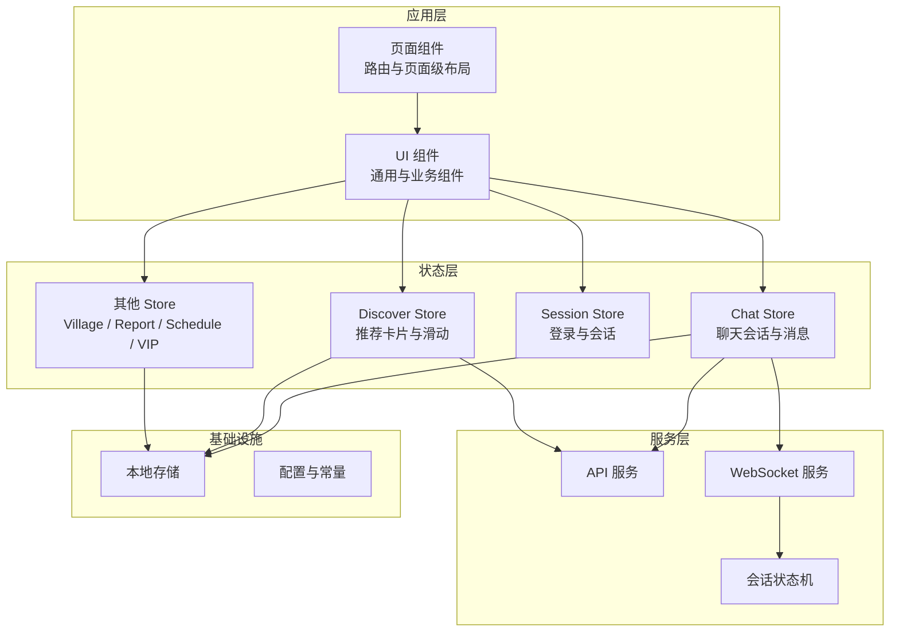
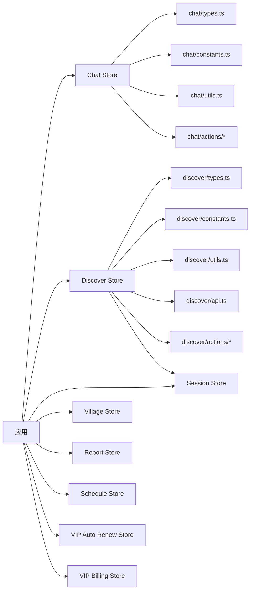
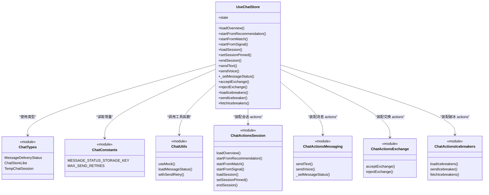
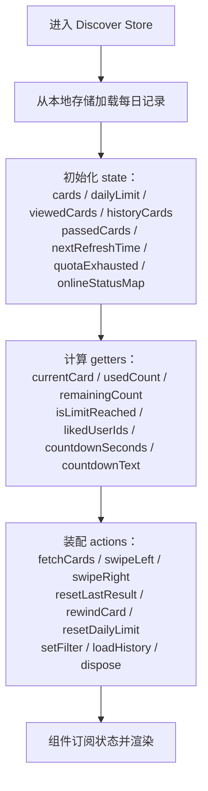
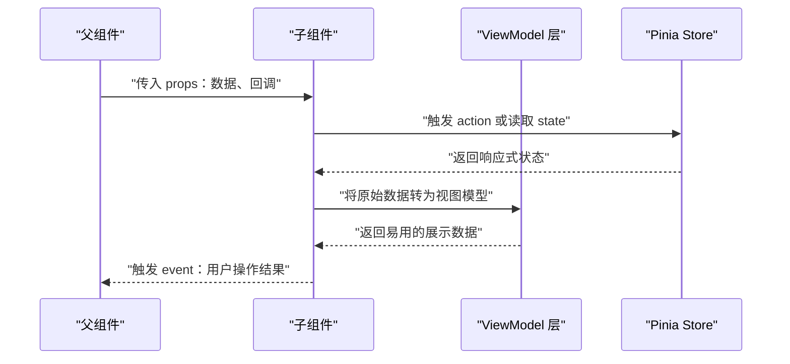
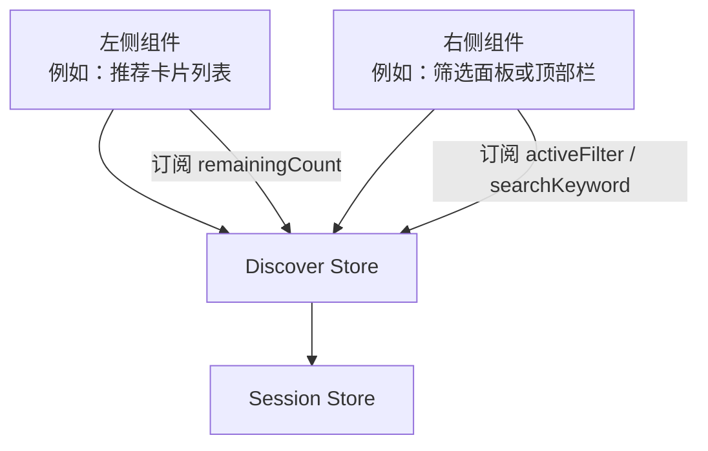
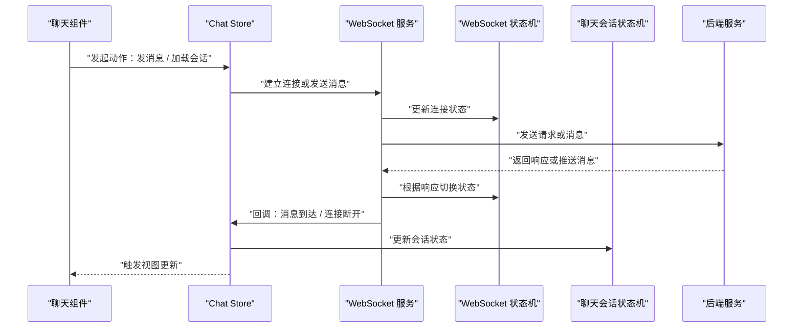
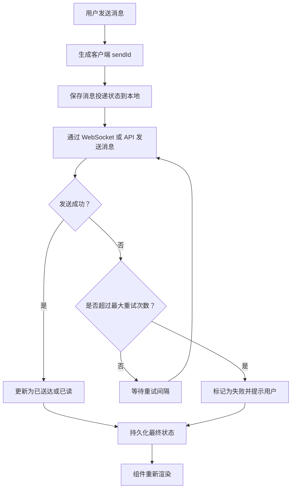
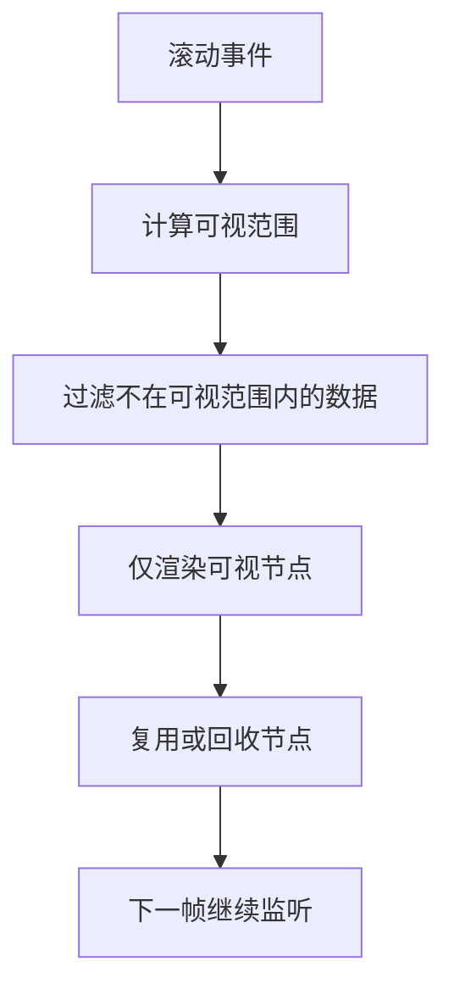

# 组件通信机制

<cite>
**本文引用的文件**   
- [apps/client/package.json](file://apps/client/package.json)
- [apps/client/src/stores/chat.ts](file://apps/client/src/stores/chat.ts)
- [apps/client/src/stores/chat/index.ts](file://apps/client/src/stores/chat/index.ts)
- [apps/client/src/stores/discover.ts](file://apps/client/src/stores/discover.ts)
- [apps/client/src/stores/discover/index.ts](file://apps/client/src/stores/discover/index.ts)
- [apps/client/src/stores/session.ts](file://apps/client/src/stores/session.ts)
- [apps/client/src/stores/village.ts](file://apps/client/src/stores/village.ts)
- [apps/client/src/stores/report.ts](file://apps/client/src/stores/report.ts)
- [apps/client/src/stores/schedule.ts](file://apps/client/src/stores/schedule.ts)
- [apps/client/src/stores/vip-auto-renew.ts](file://apps/client/src/stores/vip-auto-renew.ts)
- [apps/client/src/stores/vip-billing.ts](file://apps/client/src/stores/vip-billing.ts)
- [apps/client/src/services/websocket.ts](file://apps/client/src/services/websocket.ts)
- [apps/client/src/services/websocket/state-machine.ts](file://apps/client/src/services/websocket/state-machine.ts)
- [apps/client/src/services/websocket/types.ts](file://apps/client/src/services/websocket/types.ts)
- [apps/client/src/services/websocket/constants.ts](file://apps/client/src/services/websocket/constants.ts)
- [apps/client/src/features/chat/session-machine.ts](file://apps/client/src/features/chat/session-machine.ts)
- [apps/client/src/view-models/login.ts](file://apps/client/src/view-models/login.ts)
- [apps/client/src/components/common/VirtualList.vue](file://apps/client/src/components/common/VirtualList.vue)
- [apps/client/src/components/common/StatusState.vue](file://apps/client/src/components/common/StatusState.vue)
- [apps/client/src/components/home/ActivityCard.vue](file://apps/client/src/components/home/ActivityCard.vue)
- [apps/client/src/components/home/WelcomeBanner.vue](file://apps/client/src/components/home/WelcomeBanner.vue)
- [apps/client/src/tests/stores/checkin.spec.ts](file://apps/client/src/tests/stores/checkin.spec.ts)
- [apps/client/src/tests/stores/circle.spec.ts](file://apps/client/src/tests/stores/circle.spec.ts)
- [apps/client/src/tests/stores/discover.spec.ts](file://apps/client/src/tests/stores/discover.spec.ts)
</cite>

## 目录

1. [引言](#引言)
2. [项目结构与通信边界](#项目结构与通信边界)
3. [核心通信模式总览](#核心通信模式总览)
4. [Pinia 全局状态与模块化 Store](#pinia-全局状态与模块化-store)
5. [父子组件通信：Props、Events 与 ViewModel](#父子组件通信props-events-与-viewmodel)
6. [兄弟组件通信：共享 Store 与派生数据](#兄弟组件通信共享-store-与派生数据)
7. [跨层级组件通信：Provide/Inject 的适用位置](#跨层级组件通信-provideinject-的适用位置)
8. [异步通信：WebSocket、会话状态机与错误处理](#异步通信websocket会话状态机与错误处理)
9. [性能优化与资源管理](#性能优化与资源管理)
10. [典型场景与最佳实践](#典型场景与最佳实践)
11. [故障排查指南](#故障排查指南)
12. [结论](#结论)

## 引言

Campus Love 前端是一个基于 Vue 与 Pinia 的前端应用，代码位于 monorepo 的 `apps/client` 工作空间中。从仓库根 `package.json` 可见，该仓库使用 pnpm workspace，前端入口是 `apps/client`，后端管理端是 `apps/admin`。

本文聚焦“组件通信机制”，围绕以下目标展开：

- 明确父子组件、兄弟组件、跨层级组件和全局状态四类通信模式的职责边界。
- 分析项目中 Pinia Store 的模块化设计、异步操作处理和状态持久化方式。
- 解释 WebSocket 与状态机在聊天与会话通信中的作用。
- 给出状态更新优化、事件防抖节流、内存泄漏防护等性能建议。
- 提供可落地的最佳实践和示例路径，避免直接粘贴大段实现代码。

需要特别说明的是：仓库中未提供完整的 Vue 单文件组件源码视图，因此本文对“组件内部实现细节”的分析以现有 store、服务层、测试文件和少量组件入口为依据；涉及具体 DOM 渲染或模板绑定的细节时，会明确标注为“概念性说明”。

## 项目结构与通信边界

从项目结构看，前端代码主要分布在 `apps/client/src` 下，按职责划分为：

| 目录 | 主要职责 | 与通信的关系 |
|---|---|---|
| `stores/*` | 全局状态与业务逻辑封装 | 兄弟组件、跨页面、跨组件共享状态的主通道 |
| `services/*` | API、WebSocket、配置等外部依赖 | 驱动 Store 状态变化，间接影响所有订阅方 |
| `components/*` | 页面级或通用 UI 组件 | 通过 props/events 与父组件通信，通过 Store 访问全局状态 |
| `view-models/*` | 面向视图的数据转换模型 | 把 Store 原始数据转换为组件更友好的数据结构 |
| `features/*` | 按业务领域组织的特性逻辑 | 通常由多个组件、Store 和 service 协作完成 |
| `tests/*` | 单元测试与集成测试 | 验证 Store、组件和服务的通信契约 |

**图示来源**   
- [apps/client/src/stores/chat/index.ts:1-131](file://apps/client/src/stores/chat/index.ts#L1-L131)
- [apps/client/src/stores/discover/index.ts:1-200](file://apps/client/src/stores/discover/index.ts#L1-L200)
- [apps/client/src/services/websocket.ts:1-19](file://apps/client/src/services/websocket.ts#L1-L19)
- [apps/client/src/features/chat/session-machine.ts:1-112](file://apps/client/src/features/chat/session-machine.ts#L1-L112)

**章节来源**   
- [apps/client/package.json:1-48](file://apps/client/package.json#L1-L48)

## 核心通信模式总览

| 通信模式 | 适用场景 | 在本项目中的体现 | 注意事项 |
|---|---|---|---|
| 父子组件 Props + Events | 直接子树内数据下行、事件上行 | 通用组件如 `VirtualList`、`StatusState`、`ActivityCard` 等适合用 props 接收数据、events 触发回调 | 避免深层嵌套 prop drilling；复杂表单可结合 `v-model` 或组合式函数 |
| 兄弟组件通过 Pinia | 无共同父组件或跨页面共享状态 | `chat`、`discover`、`session`、`village`、`report`、`schedule`、`vip-*` 等 Store | 优先让 Store 持有真实状态，组件只消费派生值 |
| 跨层级 Provide/Inject | 主题、权限、国际化、全局弹窗等横切能力 | 本项目更倾向 Store 作为全局状态中心；Provide/Inject 更适合非状态型上下文 | 不要滥用为“隐式全局变量” |
| 全局状态 Store | 用户信息、聊天列表、推荐卡片、VIP 状态、定时任务等 | Pinia `defineStore` 定义 state、getters、actions | 异步操作放在 actions，副作用要可清理 |
| 事件总线 | 解耦两个没有引用关系的模块 | 本项目未见明显独立事件总线实现，更多用 Store 或 WebSocket 事件驱动 | 大型应用中可用轻量事件 emitter，但要防止泄露 |
| WebSocket 推送 | 聊天消息、在线状态、实时通知 | WebSocket 服务与聊天 Store、会话状态机配合 | 连接断开重连、消息幂等、断网降级需考虑 |

**章节来源**   
- [apps/client/src/stores/chat/index.ts:1-131](file://apps/client/src/stores/chat/index.ts#L1-L131)
- [apps/client/src/stores/discover/index.ts:1-200](file://apps/client/src/stores/discover/index.ts#L1-L200)
- [apps/client/src/services/websocket.ts:1-19](file://apps/client/src/services/websocket.ts#L1-L19)

## Pinia 全局状态与模块化 Store

### Store 总体组织

项目的全局状态集中在 `apps/client/src/stores` 下，采用“按功能域拆分”的模式。每个主要功能都有独立的 Store 文件：

- `chat.ts`：聊天相关状态，实际实现拆到 `stores/chat/` 目录。
- `discover.ts`：推荐卡片、滑动、筛选、回退等状态，实现拆到 `stores/discover/` 目录。
- `session.ts`：登录与会话状态，被 `discover` 的 getter 引用。
- `village.ts`、`report.ts`、`schedule.ts`：社区、举报、排班等业务状态。
- `vip-auto-renew.ts`、`vip-billing.ts`：会员自动续费与计费状态。

这种设计符合单一职责原则：一个 Store 聚焦一个业务域，避免把所有状态塞进一个巨型对象。

**图示来源**   
- [apps/client/src/stores/chat.ts:1-18](file://apps/client/src/stores/chat.ts#L1-L18)
- [apps/client/src/stores/chat/index.ts:1-131](file://apps/client/src/stores/chat/index.ts#L1-L131)
- [apps/client/src/stores/discover.ts:1-17](file://apps/client/src/stores/discover.ts#L1-L17)
- [apps/client/src/stores/discover/index.ts:1-200](file://apps/client/src/stores/discover/index.ts#L1-L200)
- [apps/client/src/stores/session.ts:1-200](file://apps/client/src/stores/session.ts#L1-L200)

### Chat Store 的模块化设计

`chat.ts` 本身只是 re-export 入口，真正实现位于 `stores/chat/index.ts`。注释明确说明了拆分动机：原单文件过长，违反单一职责原则，拆分为 types、constants、utils、higher-order、actions 等多个文件。

关键设计点：

1. **state 描述当前聊天界面所需数据**，包括概览加载状态、错误消息、聊天概览、活跃会话、破冰话题列表、消息投递状态映射。
2. **actions 来自不同 action 文件**，通过 method shorthand 形式装配到 `useChatStore`。
3. **消息投递状态支持本地持久化**，解决刷新后丢失发送状态的问题。
4. **对外暴露类型与常量**，保持外部 import 路径兼容。

**图示来源**   
- [apps/client/src/stores/chat/index.ts:1-131](file://apps/client/src/stores/chat/index.ts#L1-L131)
- [apps/client/src/stores/chat.ts:1-18](file://apps/client/src/stores/chat.ts#L1-L18)

### Discover Store 的状态与 Getter

`discover/index.ts` 展示了较完整的 Pinia Store 定义，包括 state、getters 和 actions 装配。其特点包括：

- state 初始值会从本地存储加载每日记录。
- getters 计算当前卡片、已用次数、剩余次数、倒计时、喜欢用户集合等。
- `remainingCount` 中通过 `useSessionStore()` 判断是否为超级测试账号，从而放行无限配额。
- actions 拆分为 fetch、swipe、rewind、storage、filter、history 等模块。

**图示来源**   
- [apps/client/src/stores/discover/index.ts:1-200](file://apps/client/src/stores/discover/index.ts#L1-L200)

**章节来源**   
- [apps/client/src/stores/chat.ts:1-18](file://apps/client/src/stores/chat.ts#L1-L18)
- [apps/client/src/stores/chat/index.ts:1-131](file://apps/client/src/stores/chat/index.ts#L1-L131)
- [apps/client/src/stores/discover.ts:1-17](file://apps/client/src/stores/discover.ts#L1-L17)
- [apps/client/src/stores/discover/index.ts:1-200](file://apps/client/src/stores/discover/index.ts#L1-L200)
- [apps/client/src/stores/session.ts:1-200](file://apps/client/src/stores/session.ts#L1-L200)

## 父子组件通信：Props、Events 与 ViewModel

### Props 与 Events 的基本模式

对于父子组件通信，推荐遵循“数据向下、事件向上”的原则：

- 父组件通过 props 向子组件传递展示数据、行为开关、回调函数。
- 子组件通过 events（Vue 3 中通常为自定义事件）向父组件报告用户操作或状态变化。
- 如果子组件需要双向绑定输入，可使用 `v-model` 或组合式函数封装。

在 Campus Love 中，通用组件如 `VirtualList`、`StatusState`、`ActivityCard`、`WelcomeBanner` 等都属于这类场景。由于完整组件源码未全部呈现，这里给出约定：

| 组件 | 推荐 props | 推荐 events | 用途 |
|---|---|---|---|
| `VirtualList` | 数据源、虚拟滚动参数、渲染项组件、占位符 | `onScroll`、`onLoadMore`、`onItemVisible` | 长列表渲染 |
| `StatusState` | 状态枚举、文案、图标、空态内容 | `onRetry`、`onAction` | 统一空态、加载中、错误态 |
| `ActivityCard` | 活动标题、时间、封面图、跳转链接 | `onClick`、`onShare` | 首页活动卡片 |
| `WelcomeBanner` | 欢迎文案、引导按钮、是否显示 | `onClose`、`onGuideClick` | 首页欢迎横幅 |

### ViewModel 在父子通信中的作用

`view-models/login.ts` 属于 view-model 层，负责把领域数据转换为视图更友好格式。类似地，`view-models/chat` 也用于把聊天原始数据转换为聊天概览视图和聊天会话视图。

这种分层的好处是：

- 组件不直接耦合后端字段。
- Store 可以返回规范化数据。
- 视图层做二次加工，比如格式化时间、拼接头像 URL、合并多源字段。

**图示来源**   
- [apps/client/src/view-models/login.ts:1-8](file://apps/client/src/view-models/login.ts#L1-L8)
- [apps/client/src/stores/chat/index.ts:1-131](file://apps/client/src/stores/chat/index.ts#L1-L131)

**章节来源**   
- [apps/client/src/components/common/VirtualList.vue:1-200](file://apps/client/src/components/common/VirtualList.vue#L1-L200)
- [apps/client/src/components/common/StatusState.vue:1-72](file://apps/client/src/components/common/StatusState.vue#L1-L72)
- [apps/client/src/components/home/ActivityCard.vue:1-179](file://apps/client/src/components/home/ActivityCard.vue#L1-L179)
- [apps/client/src/components/home/WelcomeBanner.vue:1-153](file://apps/client/src/components/home/WelcomeBanner.vue#L1-L153)
- [apps/client/src/view-models/login.ts:1-8](file://apps/client/src/view-models/login.ts#L1-L8)

## 兄弟组件通信：共享 Store 与派生数据

兄弟组件之间不应直接互相引用，而应通过 Pinia Store 共享状态。典型场景包括：

- 聊天列表组件与聊天详情组件共享当前会话。
- 发现页卡片组件与顶部导航共享筛选条件。
- 用户头像组件与个人资料组件共享登录状态。
- VIP 组件与支付组件共享计费状态。

### 共享状态的正确姿势

推荐做法：

1. 把真实业务状态放入 Store。
2. 组件通过 `useXxxStore()` 获取 store 实例。
3. 组件只读取派生后的数据，例如 getters 或 computed。
4. 修改状态通过调用 store action，而不是直接赋值。

以 Discover Store 为例，`remainingCount` 会读取 `dailyLimit`、`extraQuota` 和 `viewedCards.length`，并根据 session 状态调整返回值。这样，任何订阅了 `remainingCount` 的组件都能得到一致结果。

**图示来源**   
- [apps/client/src/stores/discover/index.ts:1-200](file://apps/client/src/stores/discover/index.ts#L1-L200)
- [apps/client/src/stores/session.ts:1-200](file://apps/client/src/stores/session.ts#L1-L200)

### 派生数据优于手动同步

不要在兄弟组件中互相传状态，也不要维护两份相同数据。例如：

- 不要在一个组件里维护 `searchKeyword`，再手动传给另一个组件。
- 应该让搜索框写入 Store，另一个组件从 Store 读取。
- 如果需要复杂过滤结果，应在 Store 或组件的 computed 中计算，而不是在多个地方各自实现一次。

**章节来源**   
- [apps/client/src/stores/discover/index.ts:1-200](file://apps/client/src/stores/discover/index.ts#L1-L200)
- [apps/client/src/stores/session.ts:1-200](file://apps/client/src/stores/session.ts#L1-L200)

## 跨层级组件通信：Provide/Inject 的适用位置

Provide/Inject 适合传递“组件树上下文”，而不适合替代 Store。在项目中有全局状态的情况下，优先选择 Store；只有在以下情况才考虑 Provide/Inject：

- 非响应式配置，例如插件注入的第三方库实例。
- 组件树级上下文，例如主题、语言、权限检查器、全局弹窗控制器。
- 临时调试或测试环境下的 mock 注入。

### 何时不用 Provide/Inject

- 不要用 Provide/Inject 代替 props，尤其当数据会频繁变化时。
- 不要把整个 Store 通过 Provide/Inject 传递，这会让依赖关系变得不透明。
- 不要在深层嵌套组件中通过多层 inject 拼装业务逻辑。

### 推荐优先级

| 场景 | 首选方案 | 备选方案 |
|---|---|---|
| 父子间简单数据 | props / v-model | emits |
| 兄弟组件共享状态 | Pinia Store | 组合式函数 + 共享模块（谨慎） |
| 跨多层非状态上下文 | Provide/Inject | 插件系统 |
| 跨页面、跨组件全局状态 | Pinia Store | 路由状态（仅限路由相关） |
| 实时推送数据 | WebSocket + Store | 事件总线（小型场景） |

**章节来源**   
- [apps/client/src/stores/chat/index.ts:1-131](file://apps/client/src/stores/chat/index.ts#L1-L131)
- [apps/client/src/stores/discover/index.ts:1-200](file://apps/client/src/stores/discover/index.ts#L1-L200)

## 异步通信：WebSocket、会话状态机与错误处理

### WebSocket 架构

聊天通信不仅依赖 HTTP API，还使用 WebSocket 进行实时消息传输。相关文件包括：

- `services/websocket.ts`：WebSocket 服务入口。
- `services/websocket/state-machine.ts`：WebSocket 连接状态机。
- `services/websocket/types.ts`：WebSocket 相关类型。
- `services/websocket/constants.ts`：WebSocket 常量。
- `features/chat/session-machine.ts`：聊天会话状态机。

**图示来源**   
- [apps/client/src/services/websocket.ts:1-19](file://apps/client/src/services/websocket.ts#L1-L19)
- [apps/client/src/services/websocket/state-machine.ts:1-121](file://apps/client/src/services/websocket/state-machine.ts#L1-L121)
- [apps/client/src/services/websocket/types.ts:1-56](file://apps/client/src/services/websocket/types.ts#L1-L56)
- [apps/client/src/services/websocket/constants.ts:1-78](file://apps/client/src/services/websocket/constants.ts#L1-L78)
- [apps/client/src/features/chat/session-machine.ts:1-112](file://apps/client/src/features/chat/session-machine.ts#L1-L112)

### 状态机在异步流程中的作用

状态机用于把 WebSocket 或聊天会话的生命周期抽象为有限状态，例如：

- 连接前：未连接、正在连接。
- 连接中：握手、鉴权、恢复历史消息。
- 连接后：空闲、收消息、发消息。
- 异常分支：断线、鉴权失败、服务器关闭。

这种方式比分散的布尔标志更清晰，也更易于测试和维护。

### 错误处理与重试

Chat Store 的消息投递状态和本地持久化体现了错误处理的思路：

- 每条消息有客户端生成的唯一 ID。
- 消息投递状态保存到本地存储。
- 刷新或切换会话后可恢复展示状态。
- 存在重试相关常量和工具函数，例如 `MAX_SEND_RETRIES` 和 `withSendRetry`。

**图示来源**   
- [apps/client/src/stores/chat/index.ts:1-131](file://apps/client/src/stores/chat/index.ts#L1-L131)

**章节来源**   
- [apps/client/src/services/websocket.ts:1-19](file://apps/client/src/services/websocket.ts#L1-L19)
- [apps/client/src/services/websocket/state-machine.ts:1-121](file://apps/client/src/services/websocket/state-machine.ts#L1-L121)
- [apps/client/src/services/websocket/types.ts:1-56](file://apps/client/src/services/websocket/types.ts#L1-L56)
- [apps/client/src/services/websocket/constants.ts:1-78](file://apps/client/src/services/websocket/constants.ts#L1-L78)
- [apps/client/src/features/chat/session-machine.ts:1-112](file://apps/client/src/features/chat/session-machine.ts#L1-L112)
- [apps/client/src/stores/chat/index.ts:1-131](file://apps/client/src/stores/chat/index.ts#L1-L131)

## 性能优化与资源管理

### 状态更新优化

1. **减少不必要的响应式更新**  
   - 大型列表数据应放在 Store 中，并通过 getters 或组件 computed 派生。
   - 避免在每次渲染时创建新对象或数组字面量。
   - 对频繁变化的状态，考虑使用 `shallowRef` 或不可变更新策略。

2. **Getter 中避免昂贵计算**  
   - 如果 getter 需要访问其他 Store，应确保不会造成循环依赖。
   - 对大数据集，优先在 Store 中缓存结果。

3. **按需加载 Store**  
   - 只在需要时引入 Store，避免首屏加载无关逻辑。
   - 对重型 Store 可考虑懒加载。

### 事件防抖与节流

- 搜索输入建议使用防抖，避免每次按键都触发 API。
- 滑动、拖拽等高频交互建议使用节流。
- Discover Store 的命名中存在 `debouncedSave`，说明本地存储写入可能已经做了防抖处理。

### 内存泄漏防护

1. **WebSocket 连接清理**  
   - 组件销毁时应关闭连接或移除监听器。
   - Store 级别应提供 `dispose` 方法，集中释放定时器、监听器和连接。

2. **定时器清理**  
   - 倒计时、轮询、心跳等定时器必须在合适时机清除。

3. **事件监听器清理**  
   - `window.addEventListener`、DOM 事件、全局事件总线监听都应配对移除。

4. **大对象清理**  
   - 聊天历史、图片缓存、虚拟列表节点等应限制大小。

### 虚拟列表与长列表

`VirtualList.vue` 表明项目关注长列表渲染性能。虚拟列表的核心思想是只渲染可视区域内的节点，减少 DOM 数量。

**图示来源**   
- [apps/client/src/components/common/VirtualList.vue:1-200](file://apps/client/src/components/common/VirtualList.vue#L1-L200)

**章节来源**   
- [apps/client/src/stores/discover/index.ts:1-200](file://apps/client/src/stores/discover/index.ts#L1-L200)
- [apps/client/src/components/common/VirtualList.vue:1-200](file://apps/client/src/components/common/VirtualList.vue#L1-L200)

## 典型场景与最佳实践

### 场景一：父子组件传递活动数据

**推荐做法：**

- 父组件从 Store 或 API 获取活动数据。
- 父组件通过 props 把活动标题、时间、封面图传给 `ActivityCard`。
- `ActivityCard` 通过事件通知父组件点击或分享。
- 如果活动详情需要跨组件共享，则放入 Store，而不是层层传递 props。

**避免做法：**

- 在子组件中直接调用全局 API。
- 在子组件中维护活动状态，导致多处数据不一致。
- 通过 window 或全局变量传递活动数据。

### 场景二：聊天消息发送与状态同步

**推荐做法：**

- 用户在聊天组件中触发发送。
- 组件调用 `useChatStore().sendText()`。
- Store 生成 sendId，保存本地状态，然后发送。
- WebSocket 或 API 返回成功后更新状态。
- 组件订阅 Store 状态并渲染消息气泡。

**避免做法：**

- 组件直接管理消息发送状态。
- 刷新后丢失消息状态。
- 同时维护多个消息副本。

### 场景三：推荐卡片滑动与每日限额

**推荐做法：**

- 滑动操作调用 `useDiscoverStore().swipeRight()` 或 `swipeLeft()`。
- Store 更新 `viewedCards`、`passedCards`、`lastSwipeResult`。
- `remainingCount` 根据限额和额外配额计算剩余次数。
- 达到上限时禁用滑动或展示提示。

**避免做法：**

- 在组件中维护滑动计数。
- 多个组件各自判断是否达到上限。
- 滑动后立即刷新整页。

### 场景四：登录状态影响多个页面

**推荐做法：**

- 登录状态保存在 `session` Store。
- 各页面通过 `useSessionStore()` 读取登录状态。
- 路由守卫或页面组件根据状态决定展示内容。
- 登出时清理 Token、用户信息和相关订阅。

**避免做法：**

- 在多个组件中复制登录状态。
- 使用 localStorage 直接读写登录状态而不经过 Store。
- 在未登录状态下加载敏感数据。

### 场景五：全局弹窗或主题切换

**推荐做法：**

- 如果是响应式全局状态，放入 Store。
- 如果是非响应式上下文，使用 Provide/Inject。
- 避免把业务数据混入 Provide/Inject。

**避免做法：**

- 用 Provide/Inject 传递大量业务数据。
- 在不同层级重复 provide/inject 同一数据。

**章节来源**   
- [apps/client/src/components/home/ActivityCard.vue:1-179](file://apps/client/src/components/home/ActivityCard.vue#L1-L179)
- [apps/client/src/stores/chat/index.ts:1-131](file://apps/client/src/stores/chat/index.ts#L1-L131)
- [apps/client/src/stores/discover/index.ts:1-200](file://apps/client/src/stores/discover/index.ts#L1-L200)
- [apps/client/src/stores/session.ts:1-200](file://apps/client/src/stores/session.ts#L1-L200)

## 故障排查指南

### 问题一：消息刷新后丢失发送状态

**可能原因：**

- 消息投递状态未持久化。
- 本地存储键名不一致。
- 刷新后没有恢复状态。

**排查步骤：**

1. 检查 Chat Store 的消息投递状态初始化逻辑。
2. 确认本地存储键名是否与常量一致。
3. 查看刷新后 `messageDeliveryStatus` 是否正确恢复。
4. 检查 WebSocket 或 API 回调是否更新了最终状态。

**参考路径：**  
- [apps/client/src/stores/chat/index.ts:1-131](file://apps/client/src/stores/chat/index.ts#L1-L131)

### 问题二：推荐卡片剩余次数不正确

**可能原因：**

- `dailyLimit`、`extraQuota`、`viewedCards.length` 三者不一致。
- 本地记录未正确加载。
- 超级测试账号配额旁路逻辑干扰。

**排查步骤：**

1. 打印 `usedCount`、`remainingCount`、`isLimitReached`。
2. 检查本地每日记录加载逻辑。
3. 确认 session 是否为超级测试账号。
4. 检查滑动 action 是否正确增加 `viewedCards`。

**参考路径：**  
- [apps/client/src/stores/discover/index.ts:1-200](file://apps/client/src/stores/discover/index.ts#L1-L200)

### 问题三：WebSocket 连接反复重连

**可能原因：**

- 状态机未正确处理断线状态。
- 重连间隔过短或无退避。
- 组件销毁后仍尝试发送消息。

**排查步骤：**

1. 检查 WebSocket 状态机状态流转。
2. 检查连接断开时的清理逻辑。
3. 确认组件销毁时是否关闭连接。
4. 检查是否有重复订阅或重复连接。

**参考路径：**  
- [apps/client/src/services/websocket.ts:1-19](file://apps/client/src/services/websocket.ts#L1-L19)
- [apps/client/src/services/websocket/state-machine.ts:1-121](file://apps/client/src/services/websocket/state-machine.ts#L1-L121)

### 问题四：组件订阅过多导致卡顿

**可能原因：**

- 组件订阅了整个 Store 对象。
- 在 render 中创建新对象。
- 列表项没有使用虚拟列表或 key 不稳定。

**排查步骤：**

1. 只订阅必要的 state 或 getter。
2. 避免在模板中执行复杂计算。
3. 对长列表使用虚拟列表。
4. 检查组件 diff 是否因 key 变化过大导致重建。

**参考路径：**  
- [apps/client/src/components/common/VirtualList.vue:1-200](file://apps/client/src/components/common/VirtualList.vue#L1-L200)

### 问题五：Store 测试失败

**常见测试关注点：**

- 初始 state 是否符合预期。
- action 是否修改 state。
- 异步 action 是否正确处理成功和失败。
- 本地存储是否被正确读写。
- 定时器或监听器是否被清理。

**参考路径：**  
- [apps/client/src/tests/stores/checkin.spec.ts:1-159](file://apps/client/src/tests/stores/checkin.spec.ts#L1-L159)
- [apps/client/src/tests/stores/circle.spec.ts:1-200](file://apps/client/src/tests/stores/circle.spec.ts#L1-L200)
- [apps/client/src/tests/stores/discover.spec.ts:1-200](file://apps/client/src/tests/stores/discover.spec.ts#L1-L200)

**章节来源**   
- [apps/client/src/stores/chat/index.ts:1-131](file://apps/client/src/stores/chat/index.ts#L1-L131)
- [apps/client/src/stores/discover/index.ts:1-200](file://apps/client/src/stores/discover/index.ts#L1-L200)
- [apps/client/src/services/websocket.ts:1-19](file://apps/client/src/services/websocket.ts#L1-L19)
- [apps/client/src/services/websocket/state-machine.ts:1-121](file://apps/client/src/services/websocket/state-machine.ts#L1-L121)
- [apps/client/src/components/common/VirtualList.vue:1-200](file://apps/client/src/components/common/VirtualList.vue#L1-L200)
- [apps/client/src/tests/stores/checkin.spec.ts:1-159](file://apps/client/src/tests/stores/checkin.spec.ts#L1-L159)
- [apps/client/src/tests/stores/circle.spec.ts:1-200](file://apps/client/src/tests/stores/circle.spec.ts#L1-L200)
- [apps/client/src/tests/stores/discover.spec.ts:1-200](file://apps/client/src/tests/stores/discover.spec.ts#L1-L200)

## 结论

Campus Love 前端的组件通信机制以 Pinia Store 为核心，辅以父子组件 props/events、WebSocket 实时通信和模块化 action 设计。整体通信策略可以概括为：

1. **局部状态交给组件**，尤其是只影响单个组件的内部状态。
2. **父子通信用 props 和 events**，保持数据流向清晰。
3. **兄弟组件和跨层级共享状态用 Store**，避免隐式依赖。
4. **全局上下文用 Provide/Inject**，但只用于非状态型或插件型能力。
5. **异步通信通过 Service 和 Store 分离**，WebSocket 和状态机负责连接生命周期，Store 负责状态更新。
6. **性能优化重点在于状态派生、虚拟列表、防抖节流和资源清理**。

在实际开发中，建议始终问自己三个问题：

- 这个状态是否应该属于某个组件私有？
- 这个数据是否需要跨组件或跨页面共享？
- 这个副作用是否应该放在 Store 或 Service 中？

如果答案是“需要共享”，就优先考虑 Store；如果答案是“只影响当前组件”，就使用 props、events 或组合式函数。这样可以在保证可维护性的同时，获得较好的性能和可测试性。