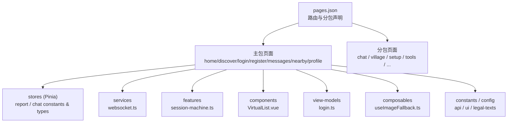
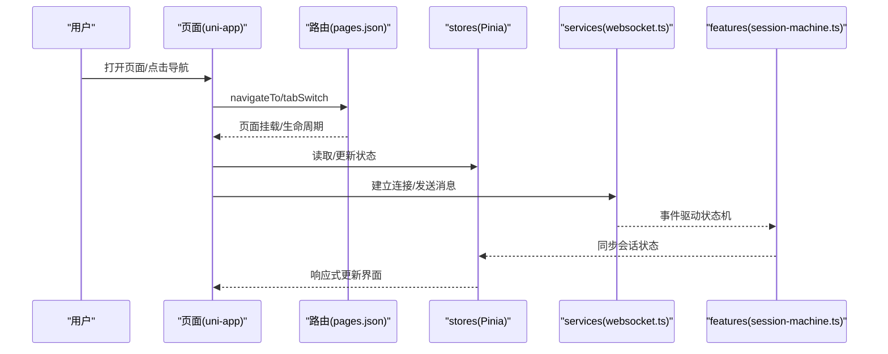
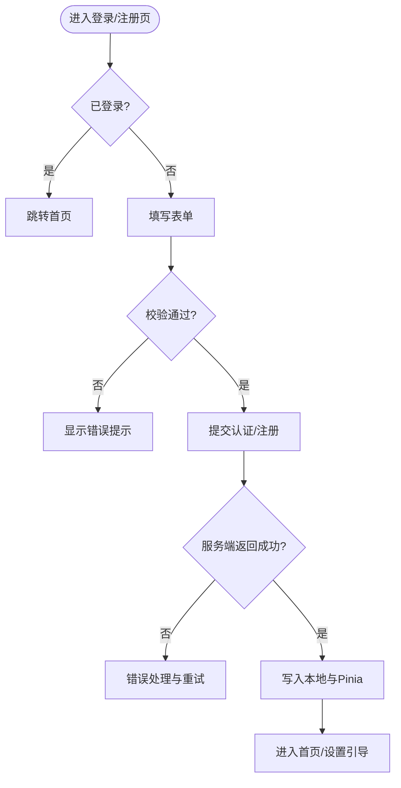
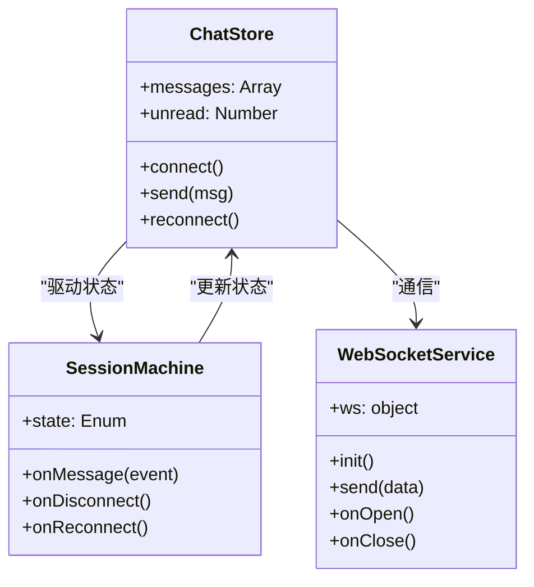
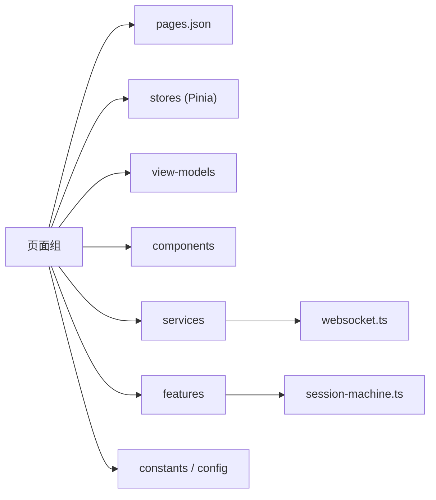

# 页面组件设计

<cite>
**本文引用的文件**   
- [apps/client/src/pages.json](file://apps/client/src/pages.json)
- [apps/client/src/pages/home/index.vue](file://apps/client/src/pages/home/index.vue)
- [apps/client/src/pages/discover/index.vue](file://apps/client/src/pages/discover/index.vue)
- [apps/client/src/pages/login/index.vue](file://apps/client/src/pages/login/index.vue)
- [apps/client/src/pages/register/index.vue](file://apps/client/src/pages/register/index.vue)
- [apps/client/src/pages/messages/index.vue](file://apps/client/src/pages/messages/index.vue)
- [apps/client/src/pages/profile/index.vue](file://apps/client/src/pages/profile/index.vue)
- [apps/client/src/subpackages/chat/chat-session/index.vue](file://apps/client/src/subpackages/chat/chat-session/index.vue)
- [apps/client/src/subpackages/village/village/index.vue](file://apps/client/src/subpackages/village/village/index.vue)
- [apps/client/src/view-models/login.ts](file://apps/client/src/view-models/login.ts)
- [apps/client/src/stores/report.ts](file://apps/client/src/stores/report.ts)
- [apps/client/src/stores/chat/constants.ts](file://apps/client/src/stores/chat/constants.ts)
- [apps/client/src/stores/chat/types.ts](file://apps/client/src/stores/chat/types.ts)
- [apps/client/src/stores/chat/utils.ts](file://apps/client/src/stores/chat/utils.ts)
- [apps/client/src/services/websocket.ts](file://apps/client/src/services/websocket.ts)
- [apps/client/src/features/chat/session-machine.ts](file://apps/client/src/features/chat/session-machine.ts)
- [apps/client/src/components/common/VirtualList.vue](file://apps/client/src/components/common/VirtualList.vue)
- [apps/client/src/composables/useImageFallback.ts](file://apps/client/src/composables/useImageFallback.ts)
- [apps/client/src/config/legal-texts.ts](file://apps/client/src/config/legal-texts.ts)
- [apps/client/src/constants/api.ts](file://apps/client/src/constants/api.ts)
- [apps/client/src/constants/ui.ts](file://apps/client/src/constants/ui.ts)
- [apps/client/src/custom-tab-bar/index.json](file://apps/client/src/custom-tab-bar/index.json)
</cite>

## 目录
1. [简介](#简介)
2. [项目结构](#项目结构)
3. [核心组件与职责划分](#核心组件与职责划分)
4. [架构总览](#架构总览)
5. [详细组件分析](#详细组件分析)
6. [依赖关系分析](#依赖关系分析)
7. [性能优化策略](#性能优化策略)
8. [故障排查指南](#故障排查指南)
9. [结论](#结论)
10. [附录：路由与分包清单](#附录：路由与分包清单)

## 简介
本设计文档聚焦 Campus Love uni-app 前端应用的页面组件体系，围绕主包页面（discover、login、register、messages、profile 等）与分包页面（chat、village 等）的职责边界、路由配置、导航逻辑与生命周期管理展开。文档同时说明页面状态管理（Pinia store 集成）、多端适配（微信小程序与 H5）策略，以及懒加载、预加载、数据缓存与内存管理等性能优化实践，并提供开发示例与最佳实践建议。

## 项目结构
应用采用 uni-app + Vue 的常见工程结构，以 pages.json 统一声明路由与分包；主包承载高频入口页与基础导航能力，分包按功能域拆分以降低首屏体积并支持按需加载。关键目录包括：
- pages：主包页面，如首页、发现、登录、注册、消息、附近、个人中心
- subpackages：功能分包，如聊天会话、校园圈子、广场/村、设置向导、工具集等
- stores：全局状态（Pinia），含报告上报、聊天常量与类型等
- services：网络与实时通信服务，包含 WebSocket 客户端
- features：领域特性实现，如聊天会话状态机
- components：通用与业务组件，如虚拟列表、图片回退 Hook
- view-models：视图模型层，组织页面级响应式状态与行为
- config/constants：配置与常量（API、UI、法律文本等）

图表来源
- [apps/client/src/pages.json:1-200](file://apps/client/src/pages.json#L1-L200)

章节来源
- [apps/client/src/pages.json:1-200](file://apps/client/src/pages.json#L1-L200)

## 核心组件与职责划分
- 主包页面
  - discover：发现页，聚合推荐/匹配/活动入口，承担流量分发与内容列表展示
  - login：登录页，处理认证流程与错误提示，驱动跳转至注册或首页
  - register：注册页，完成用户信息收集与校验，成功后引导完善资料或进入首页
  - messages：消息中心，聚合系统通知与互动消息，提供未读管理与跳转
  - profile：个人中心，展示个人信息、任务与设置入口，维护用户态
- 分包页面
  - chat：聊天会话页，负责消息收发、会话状态机、WebSocket 连接与离线恢复
  - village：广场/村模块，帖子浏览、发布、详情与历史查看，承载社区内容生态

职责边界原则：
- 主包页面专注“路由入口 + 轻量状态 + 跨端导航”，避免重型逻辑下沉到页面
- 分包页面承载“重交互/重渲染”场景，结合分包懒加载减少首屏压力
- 状态管理集中在 stores 与 view-models，页面仅消费与触发

章节来源
- [apps/client/src/pages/home/index.vue:1-200](file://apps/client/src/pages/home/index.vue#L1-L200)
- [apps/client/src/pages/discover/index.vue:1-200](file://apps/client/src/pages/discover/index.vue#L1-L200)
- [apps/client/src/pages/login/index.vue:1-200](file://apps/client/src/pages/login/index.vue#L1-L200)
- [apps/client/src/pages/register/index.vue:1-200](file://apps/client/src/pages/register/index.vue#L1-L200)
- [apps/client/src/pages/messages/index.vue:1-200](file://apps/client/src/pages/messages/index.vue#L1-L200)
- [apps/client/src/pages/profile/index.vue:1-200](file://apps/client/src/pages/profile/index.vue#L1-L200)
- [apps/client/src/subpackages/chat/chat-session/index.vue:1-200](file://apps/client/src/subpackages/chat/chat-session/index.vue#L1-L200)
- [apps/client/src/subpackages/village/village/index.vue:1-200](file://apps/client/src/subpackages/village/village/index.vue#L1-L200)

## 架构总览
页面通过 uni-app 路由系统进行导航，使用自定义 TabBar 控制底部导航；页面内状态由 Pinia 统一管理，网络请求与实时通信由 services 封装；复杂交互通过 features 的状态机管理；通用 UI 通过 components 复用。

图表来源
- [apps/client/src/pages.json:1-200](file://apps/client/src/pages.json#L1-L200)
- [apps/client/src/services/websocket.ts:1-19](file://apps/client/src/services/websocket.ts#L1-L19)
- [apps/client/src/features/chat/session-machine.ts:1-112](file://apps/client/src/features/chat/session-machine.ts#L1-L112)
- [apps/client/src/stores/chat/constants.ts:1-17](file://apps/client/src/stores/chat/constants.ts#L1-L17)

章节来源
- [apps/client/src/custom-tab-bar/index.json:1-3](file://apps/client/src/custom-tab-bar/index.json#L1-L3)
- [apps/client/src/pages.json:1-200](file://apps/client/src/pages.json#L1-L200)

## 详细组件分析

### 主包页面：登录与注册
- 登录页负责输入校验、调用认证接口、保存令牌与用户信息，并在成功后根据角色/状态跳转至首页或注册完善流程
- 注册页负责表单收集、校验与提交，完成后进入设置引导或直接进入首页
- 状态管理：通过 view-models 组织登录/注册流程，stores 维护全局登录态与上报统计
- 多端适配：基于 uni-app 条件编译与平台 API 兼容，确保微信小程序与 H5 表现一致

图表来源
- [apps/client/src/view-models/login.ts:1-8](file://apps/client/src/view-models/login.ts#L1-L8)
- [apps/client/src/stores/report.ts:1-67](file://apps/client/src/stores/report.ts#L1-L67)
- [apps/client/src/constants/api.ts:1-81](file://apps/client/src/constants/api.ts#L1-L81)

章节来源
- [apps/client/src/pages/login/index.vue:1-200](file://apps/client/src/pages/login/index.vue#L1-L200)
- [apps/client/src/pages/register/index.vue:1-200](file://apps/client/src/pages/register/index.vue#L1-L200)
- [apps/client/src/view-models/login.ts:1-8](file://apps/client/src/view-models/login.ts#L1-L8)
- [apps/client/src/stores/report.ts:1-67](file://apps/client/src/stores/report.ts#L1-L67)

### 主包页面：发现与消息
- 发现页聚合推荐卡片、匹配入口与活动列表，滚动渲染需关注长列表性能
- 消息中心聚合系统通知与互动消息，支持未读计数与批量操作
- 状态管理：stores 维护消息集合、未读计数与筛选状态；必要时使用分页与增量更新
- 多端适配：注意小程序与 H5 在滚动、键盘与弹窗行为差异

章节来源
- [apps/client/src/pages/discover/index.vue:1-200](file://apps/client/src/pages/discover/index.vue#L1-L200)
- [apps/client/src/pages/messages/index.vue:1-200](file://apps/client/src/pages/messages/index.vue#L1-L200)

### 主包页面：个人中心
- 个人中心展示用户信息、任务进度、隐私与安全设置入口
- 状态管理：stores 维护用户档案、任务与设置项；支持本地缓存与远程同步
- 多端适配：注意小程序权限（如相册、定位）与 H5 的差异处理

章节来源
- [apps/client/src/pages/profile/index.vue:1-200](file://apps/client/src/pages/profile/index.vue#L1-L200)

### 分包页面：聊天会话
- 聊天会话页负责消息列表渲染、输入发送、在线状态与离线恢复
- 状态管理：stores 定义聊天常量与类型，features 用状态机管理会话生命周期；services 封装 WebSocket 连接与重连策略
- 性能优化：虚拟列表渲染大量消息；图片懒加载与占位图；消息去重与增量同步

图表来源
- [apps/client/src/stores/chat/types.ts:1-86](file://apps/client/src/stores/chat/types.ts#L1-L86)
- [apps/client/src/stores/chat/constants.ts:1-17](file://apps/client/src/stores/chat/constants.ts#L1-L17)
- [apps/client/src/features/chat/session-machine.ts:1-112](file://apps/client/src/features/chat/session-machine.ts#L1-L112)
- [apps/client/src/services/websocket.ts:1-19](file://apps/client/src/services/websocket.ts#L1-L19)

章节来源
- [apps/client/src/subpackages/chat/chat-session/index.vue:1-200](file://apps/client/src/subpackages/chat/chat-session/index.vue#L1-L200)
- [apps/client/src/stores/chat/types.ts:1-86](file://apps/client/src/stores/chat/types.ts#L1-L86)
- [apps/client/src/stores/chat/constants.ts:1-17](file://apps/client/src/stores/chat/constants.ts#L1-L17)
- [apps/client/src/stores/chat/utils.ts:1-97](file://apps/client/src/stores/chat/utils.ts#L1-L97)
- [apps/client/src/features/chat/session-machine.ts:1-112](file://apps/client/src/features/chat/session-machine.ts#L1-L112)
- [apps/client/src/services/websocket.ts:1-19](file://apps/client/src/services/websocket.ts#L1-L19)

### 分包页面：广场/村
- 广场/村模块提供帖子浏览、发布、详情与历史记录，支持标签筛选与分页加载
- 状态管理：stores 维护帖子列表、筛选条件与缓存键；必要时做本地缓存与增量更新
- 多端适配：注意小程序图片加载限制与 H5 的性能差异，合理使用虚拟列表与懒加载

章节来源
- [apps/client/src/subpackages/village/village/index.vue:1-200](file://apps/client/src/subpackages/village/village/index.vue#L1-L200)

## 依赖关系分析
- 页面依赖路由配置（pages.json）进行导航与分包加载
- 页面依赖 stores 管理全局状态，依赖 view-models 组织页面级响应式逻辑
- 聊天相关页面依赖 services 与 features，保证实时通信与状态一致性
- 通用组件与 composable 提升复用率与可测试性
- 常量与配置集中管理，便于多端差异化处理与统一变更

图表来源
- [apps/client/src/pages.json:1-200](file://apps/client/src/pages.json#L1-L200)
- [apps/client/src/services/websocket.ts:1-19](file://apps/client/src/services/websocket.ts#L1-L19)
- [apps/client/src/features/chat/session-machine.ts:1-112](file://apps/client/src/features/chat/session-machine.ts#L1-L112)

章节来源
- [apps/client/src/constants/api.ts:1-81](file://apps/client/src/constants/api.ts#L1-L81)
- [apps/client/src/constants/ui.ts:1-47](file://apps/client/src/constants/ui.ts#L1-L47)
- [apps/client/src/config/legal-texts.ts:1-200](file://apps/client/src/config/legal-texts.ts#L1-L200)

## 性能优化策略
- 分包与懒加载
  - 将聊天、广场等功能放入 subpackages，配合 pages.json 路由延迟加载，降低首屏体积
  - 非关键路径页面使用懒加载，进入时再加载资源
- 预加载与数据缓存
  - 对即将访问的分包页面进行预加载，缩短首次渲染时间
  - 列表数据采用本地缓存与增量更新，减少重复请求
- 渲染优化
  - 长列表使用 VirtualList 虚拟滚动，避免 DOM 节点过多导致卡顿
  - 图片懒加载与占位图，结合 useImageFallback 提升容错与体验
- 内存管理
  - 及时断开 WebSocket 连接与清理定时器，避免内存泄漏
  - 大对象在离开页面时释放引用，必要时手动 GC 提示
- 多端适配
  - 使用 uni-app 条件编译与平台 API 适配，确保微信小程序与 H5 一致体验
  - 针对小程序限制（如图片大小、网络并发）做降级处理

章节来源
- [apps/client/src/components/common/VirtualList.vue:1-200](file://apps/client/src/components/common/VirtualList.vue#L1-L200)
- [apps/client/src/composables/useImageFallback.ts:1-85](file://apps/client/src/composables/useImageFallback.ts#L1-L85)
- [apps/client/src/services/websocket.ts:1-19](file://apps/client/src/services/websocket.ts#L1-L19)

## 故障排查指南
- 聊天断线重连
  - 检查 WebSocket 连接状态与重连策略，确认状态机是否正确迁移
  - 核对消息去重与顺序修复逻辑，避免重复或乱序
- 页面崩溃或白屏
  - 检查路由配置与分包路径是否正确，确认页面是否存在
  - 审查 stores 初始化与依赖注入，避免空引用
- 性能问题
  - 使用性能监控脚本评估 TTI/FP/FCP 指标
  - 对长列表与大图渲染进行专项优化（虚拟列表、懒加载、压缩）
- 多端差异
  - 对比小程序与 H5 的行为差异，使用条件编译隔离平台特定逻辑
  - 注意权限与存储差异（如 localStorage vs 小程序 storage）

章节来源
- [apps/client/src/features/chat/session-machine.ts:1-112](file://apps/client/src/features/chat/session-machine.ts#L1-L112)
- [apps/client/src/stores/chat/utils.ts:1-97](file://apps/client/src/stores/chat/utils.ts#L1-L97)
- [apps/client/src/config/legal-texts.ts:1-200](file://apps/client/src/config/legal-texts.ts#L1-L200)

## 结论
本项目通过清晰的页面职责划分、统一的路由与分包策略、集中的状态管理与可靠的实时通信架构，实现了良好的可维护性与可扩展性。配合虚拟列表、懒加载、缓存与内存管理等优化手段，有效提升了多端性能与用户体验。建议在后续迭代中持续完善监控与自动化测试，保障质量与稳定性。

## 附录：路由与分包清单
- 主包页面（示例）
  - home、discover、login、register、messages、nearby、profile
- 分包页面（示例）
  - chat（聊天会话）
  - village（广场/村）
  - setup（设置向导）
  - tools（工具集）
  - circles（圈子）
  - market（商城）
  - vip（会员）
  - profile-extra（个人扩展）
  - discover-extra（发现扩展）

章节来源
- [apps/client/src/pages.json:1-200](file://apps/client/src/pages.json#L1-L200)
- [apps/client/src/custom-tab-bar/index.json:1-3](file://apps/client/src/custom-tab-bar/index.json#L1-L3)