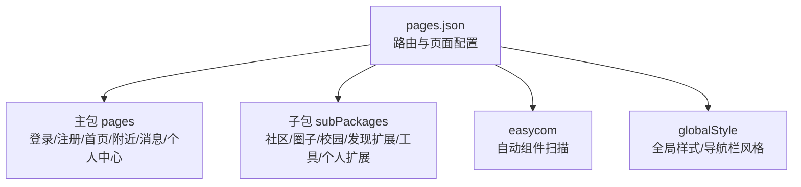
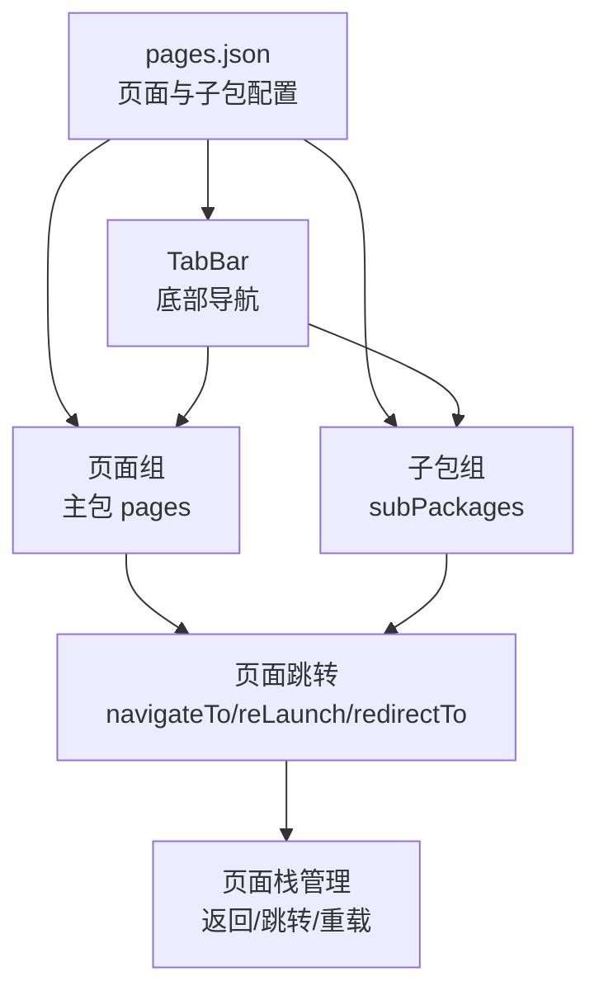
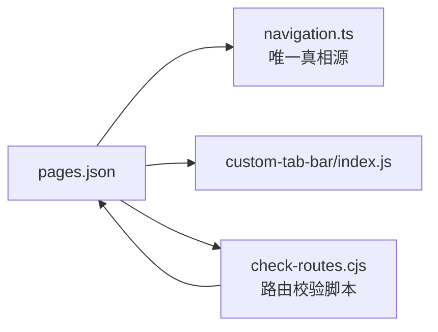

# 路由与导航系统

<cite>
**本文档引用的文件**
- [apps/client/src/pages.json](file://apps/client/src/pages.json)
- [scripts/check-routes.cjs](file://scripts/check-routes.cjs)
</cite>

## 目录
1. [简介](#简介)
2. [项目结构](#项目结构)
3. [核心组件](#核心组件)
4. [架构总览](#架构总览)
5. [详细组件分析](#详细组件分析)
6. [依赖关系分析](#依赖关系分析)
7. [性能考虑](#性能考虑)
8. [故障排查指南](#故障排查指南)
9. [结论](#结论)
10. [附录](#附录)

## 简介
本章节为 Campus Love 前端应用的路由与导航系统文档。重点围绕 uni-app 的页面路由机制、TabBar 集成、分包与子包加载、页面跳转与参数传递、以及移动端导航与页面栈管理进行说明。由于仓库未提供自定义路由守卫或拦截器实现，本文档仅基于现有配置与脚本进行客观分析与建议，不虚构未在代码中出现的逻辑。

## 项目结构
当前前端应用采用 uni-app 标准结构，路由通过 pages.json 声明式配置：
- 主包 pages 数组用于注册常用页面（登录、注册、首页、附近、消息、个人中心等）。
- subPackages 数组按功能域拆分子包（village、circles、campus、discover-extra、tools、profile-extra 等），提升首屏加载速度并支持按需加载。
- easycom 启用自动扫描组件库，简化组件引入。
- globalStyle 统一全局样式与导航栏风格。

图表来源
- [apps/client/src/pages.json:1-200](file://apps/client/src/pages.json#L1-L200)

章节来源
- [apps/client/src/pages.json:1-200](file://apps/client/src/pages.json#L1-L200)

## 核心组件
- 页面路由配置：通过 pages.json 的 pages 与 subPackages 完成页面注册与分包组织。
- TabBar 集成：pages.json 注释明确提示 tabBar.list 需与 src/config/navigation.ts 保持一致，且需在 custom-tab-bar/index.js 同步 tabs 列表，形成“唯一真相源”的维护流程。
- 页面样式与下拉刷新：在页面级 style 中启用 enablePullDownRefresh 以支持下拉刷新体验。
- 动态路由生成：仓库未发现动态路由生成逻辑；页面路径均为静态声明。如需动态化，应结合后端配置或构建期脚本生成路由表。
- 嵌套路由：uni-app 不支持传统 Vue Router 的嵌套路由概念；通过子包与页面级跳转实现功能分组与层级组织。
- 权限守卫与导航拦截器：仓库未发现自定义路由守卫或拦截器实现；建议在 uni-app 生命周期与全局入口中实现登录态检查与角色校验。

章节来源
- [apps/client/src/pages.json:1-200](file://apps/client/src/pages.json#L1-L200)

## 架构总览
下图展示 uni-app 路由与导航的核心关系：pages.json 作为路由与分包的唯一配置中心，驱动页面注册与加载；TabBar 与页面跳转共同构成导航流；子包按需加载优化首屏性能。

图表来源
- [apps/client/src/pages.json:1-200](file://apps/client/src/pages.json#L1-L200)

## 详细组件分析

### 路由配置结构与分包策略
- 主包页面：登录、注册、首页、附近、消息、个人中心等高频页面直接注册在主包，保证快速启动。
- 子包划分：按业务域划分为 village、circles、campus、discover-extra、tools、profile-extra，降低主包体积，提高按需加载效率。
- 页面级样式：如 enablePullDownRefresh 控制下拉刷新行为，增强交互体验。
- 唯一真相源：TabBar 配置需与 navigation.ts 与 custom-tab-bar/index.js 保持同步，避免多源不一致导致导航异常。

章节来源
- [apps/client/src/pages.json:1-200](file://apps/client/src/pages.json#L1-L200)

### 页面跳转与参数传递
- 跳转方式：使用 uni-app 提供的 navigateTo、redirectTo、reLaunch、switchTab 等 API 进行页面跳转与 Tab 切换。
- 参数传递：通过 URL 查询参数或页面 onLoad/onShow 生命周期接收参数，确保跨页数据流转。
- 安全校验：对传入参数进行基础校验与白名单过滤，防止注入风险。

[本节为通用实践说明，不直接分析具体文件]

### 导航守卫与权限控制
- 现状：仓库未发现自定义路由守卫或拦截器实现。
- 建议方案：
  - 在应用启动时校验登录态与校园认证状态，必要时引导至登录页。
  - 在页面 onShow 中进行角色权限校验，根据角色决定可访问页面集合。
  - 针对敏感页面增加二次确认与最小权限原则。
  - 使用 Pinia/Store 集中管理用户状态，并在跳转前读取权限信息进行决策。

[本节为通用实践说明，不直接分析具体文件]

### 开发模式特殊处理与 URL 参数解析
- 开发模式：建议在 dev 环境下开启调试日志与路由追踪，便于定位跳转问题。
- URL 参数解析：统一封装参数解析函数，处理类型转换与缺失字段默认值，确保页面稳定渲染。
- 元信息维护：可在页面级维护 title、meta 等元信息，配合导航栏标题与 SEO（H5）优化。

[本节为通用实践说明，不直接分析具体文件]

### 移动端导航的特殊考虑
- TabBar 集成：遵循 pages.json 注释中的维护顺序，先在 navigation.ts 修改 appTabs，再同步到 pages.json 的 tabBar.list，最后更新 custom-tab-bar/index.js 的 tabs。
- 返回行为控制：合理使用 switchTab 切换底部 Tab，使用 redirectTo 替换当前页，使用 reLaunch 清空页面栈重启应用。
- 页面栈管理：避免过深页面栈导致内存压力；必要时使用 redirectTo 或 reLaunch 控制栈深度。

章节来源
- [apps/client/src/pages.json:1-200](file://apps/client/src/pages.json#L1-L200)

## 依赖关系分析
- 配置文件依赖：pages.json 是路由与导航的核心配置，TabBar 与其存在强耦合，需保持同步。
- 脚本验证：scripts/check-routes.cjs 可用于检查路由配置一致性，建议纳入 CI 流程保障质量。

图表来源
- [apps/client/src/pages.json:1-200](file://apps/client/src/pages.json#L1-L200)
- [scripts/check-routes.cjs](file://scripts/check-routes.cjs)

章节来源
- [apps/client/src/pages.json:1-200](file://apps/client/src/pages.json#L1-L200)
- [scripts/check-routes.cjs](file://scripts/check-routes.cjs)

## 性能考虑
- 分包与懒加载：利用 subPackages 将非核心功能拆分，减少主包体积，缩短首屏时间。
- 页面级优化：仅在需要时启用下拉刷新，避免不必要的网络请求与渲染开销。
- 导航策略：优先使用 switchTab 切换底部 Tab，减少页面栈增长；对临时页面使用 redirectTo 替代 navigateTo。
- 资源加载：图片与静态资源建议使用 CDN 与压缩格式，配合懒加载与预缓存策略。

[本节为通用实践说明，不直接分析具体文件]

## 故障排查指南
- 路由不一致：若出现 TabBar 与页面无法匹配的问题，优先检查 pages.json 与 navigation.ts、custom-tab-bar/index.js 的一致性。
- 跳转失败：检查页面路径是否正确、子包是否已正确声明、参数是否被截断或编码错误。
- 性能问题：通过开发者工具的 Network 与 Performance 面板分析页面加载耗时与跳转卡顿点。
- 校验脚本：运行 scripts/check-routes.cjs 检测路由配置，定位潜在错误。

章节来源
- [apps/client/src/pages.json:1-200](file://apps/client/src/pages.json#L1-L200)
- [scripts/check-routes.cjs](file://scripts/check-routes.cjs)

## 结论
当前 Campus Love 前端应用采用 uni-app 的标准路由与分包策略，通过 pages.json 集中管理页面与子包，结合 TabBar 实现底部导航。仓库未发现自定义路由守卫与拦截器实现，建议后续在应用入口与页面生命周期中加入登录态检查与权限控制，完善导航安全性与可维护性。同时，持续使用 check-routes.cjs 等脚本保障路由配置一致性，并结合分包与页面级优化提升性能。

[本节为总结性内容，不直接分析具体文件]

## 附录
- 术语说明：
  - 主包：应用启动即加载的核心代码与页面。
  - 子包：按功能划分的可按需加载的代码块。
  - TabBar：底部固定导航栏，通常用于主要模块切换。
  - 页面栈：当前应用内已打开页面的有序集合，影响返回行为与内存占用。

[本节为概念性说明，不直接分析具体文件]