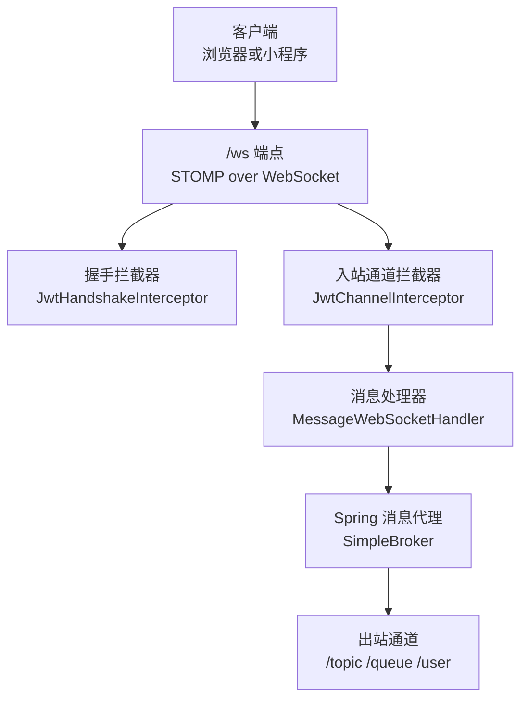
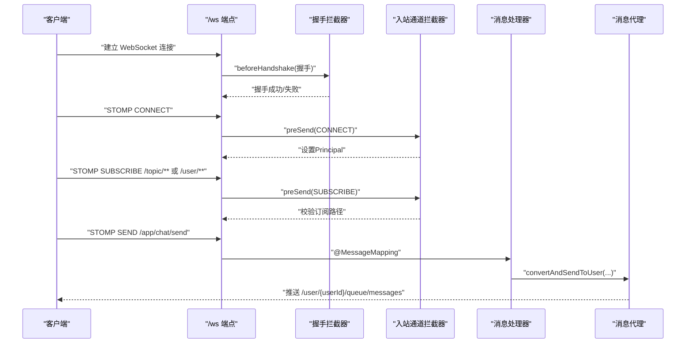
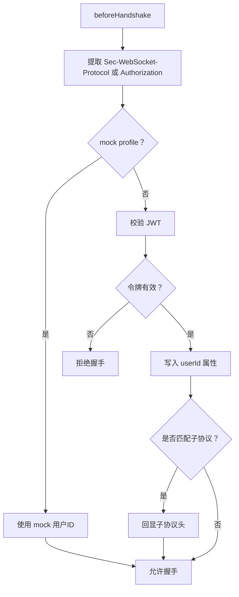
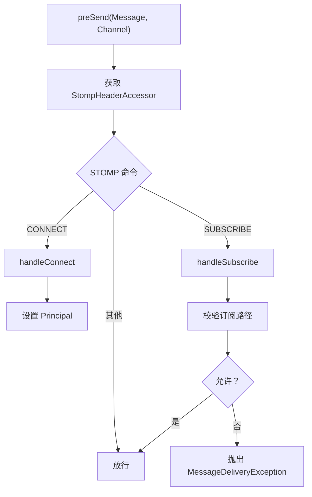
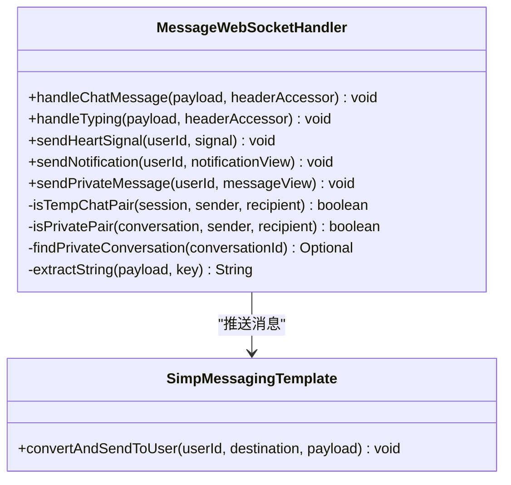
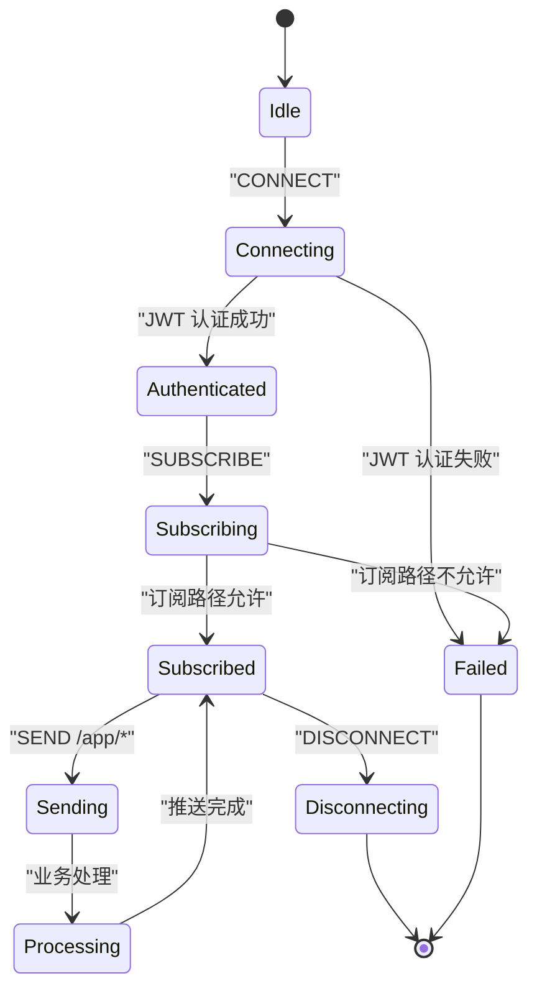
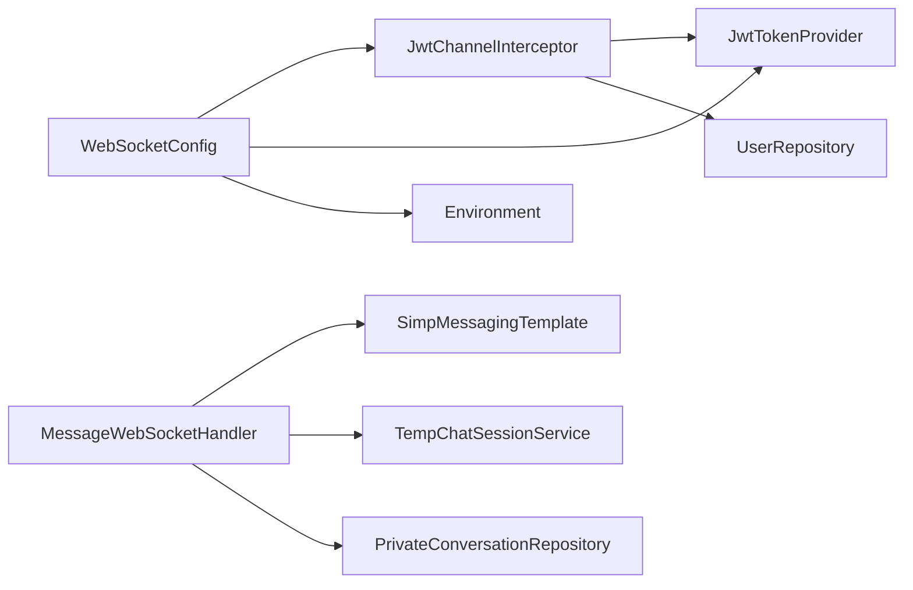

# STOMP协议配置

<cite>
**本文引用的文件**   
- [WebSocketConfig.java](file://apps/api/src/main/java/com/campuslove/api/config/WebSocketConfig.java)
- [JwtChannelInterceptor.java](file://apps/api/src/main/java/com/campuslove/api/config/JwtChannelInterceptor.java)
- [MessageWebSocketHandler.java](file://apps/api/src/main/java/com/campuslove/api/chat/MessageWebSocketHandler.java)
- [JwtChannelInterceptorTest.java](file://apps/api/src/test/java/com/campuslove/api/config/JwtChannelInterceptorTest.java)
</cite>

## 目录
1. [引言](#引言)
2. [项目结构](#项目结构)
3. [核心组件](#核心组件)
4. [架构总览](#架构总览)
5. [详细组件分析](#详细组件分析)
6. [依赖关系分析](#依赖关系分析)
7. [性能与可观测性](#性能与可观测性)
8. [故障排查指南](#故障排查指南)
9. [结论](#结论)
10. [附录：客户端连接与消息示例](#附录客户端连接与消息示例)

## 引言
本技术文档围绕 Campus Love 后端中的 WebSocket STOMP 实时通信能力，聚焦以下目标：
- 解释 `@EnableWebSocketMessageBroker` 的作用以及 Spring WebSocket 消息代理的整体配置方式。
- 详细说明 `/ws` 端点的注册过程，包括跨域来源限制、SockJS 兼容模式与握手拦截器的集成。
- 文档化消息代理前缀与路由机制：发布前缀 `/app`、订阅前缀 `/topic`、用户专属前缀 `/user`、队列前缀 `/queue`。
- 说明点对点消息与广播消息的路由差异。
- 覆盖 CONNECT 到 DISCONNECT 的 STOMP 帧生命周期、JWT 认证与安全校验、错误处理策略。
- 给出客户端连接示例、典型消息路径与性能优化建议。

本项目使用 Spring Framework 的 `WebSocketMessageBrokerConfigurer` 体系实现 STOMP over WebSocket，并在握手阶段与入站通道阶段分别进行 JWT 校验，保障实时消息通道的安全性。

**章节来源**
- [WebSocketConfig.java:23-38](file://apps/api/src/main/java/com/campuslove/api/config/WebSocketConfig.java#L23-L38)
- [JwtChannelInterceptor.java:13-39](file://apps/api/src/main/java/com/campuslove/api/config/JwtChannelInterceptor.java#L13-L39)

## 项目结构
Campus Love 后端中与 STOMP WebSocket 相关的核心代码位于 API 应用模块中，主要涉及三类职责：
- 配置类：启用消息代理、注册 STOMP 端点、配置消息代理前缀与入站通道拦截器。
- 握手拦截器：在 HTTP 升级到 WebSocket 之前校验 JWT，完成早期鉴权。
- 通道拦截器：在 STOMP 帧进入消息管道时校验 CONNECT 与 SUBSCRIBE。
- 业务处理器：监听 `/app/*` 消息并推送至 `/user/{userId}/queue/**`。

**图表来源**
- [WebSocketConfig.java:102-154](file://apps/api/src/main/java/com/campuslove/api/config/WebSocketConfig.java#L102-L154)
- [JwtChannelInterceptor.java:55-103](file://apps/api/src/main/java/com/campuslove/api/config/JwtChannelInterceptor.java#L55-L103)
- [MessageWebSocketHandler.java:106-116](file://apps/api/src/main/java/com/campuslove/api/chat/MessageWebSocketHandler.java#L106-L116)

**章节来源**
- [WebSocketConfig.java:23-38](file://apps/api/src/main/java/com/campuslove/api/config/WebSocketConfig.java#L23-L38)
- [WebSocketConfig.java:102-154](file://apps/api/src/main/java/com/campuslove/api/config/WebSocketConfig.java#L102-L154)

## 核心组件
- `WebSocketConfig`：启用 STOMP 消息代理，注册 `/ws` 端点，配置消息代理前缀和入站通道拦截器。
- `JwtChannelInterceptor`：作为 `ChannelInterceptor`，在 CONNECT 阶段验证 JWT 并设置 Principal，在 SUBSCRIBE 阶段校验订阅路径权限。
- `JwtHandshakeInterceptor`：作为 `HandshakeInterceptor`，在 WebSocket 握手阶段从 `Sec-WebSocket-Protocol` 或 `Authorization` 头提取 JWT。
- `MessageWebSocketHandler`：作为 `@Controller`，通过 `@MessageMapping` 监听 `/app/chat/send` 等消息，并通过 `SimpMessagingTemplate` 推送至用户队列。

**章节来源**
- [WebSocketConfig.java:38-39](file://apps/api/src/main/java/com/campuslove/api/config/WebSocketConfig.java#L38-L39)
- [WebSocketConfig.java:102-154](file://apps/api/src/main/java/com/campuslove/api/config/WebSocketConfig.java#L102-L154)
- [JwtChannelInterceptor.java:55-103](file://apps/api/src/main/java/com/campuslove/api/config/JwtChannelInterceptor.java#L55-L103)
- [JwtChannelInterceptor.java:204-271](file://apps/api/src/main/java/com/campuslove/api/config/JwtChannelInterceptor.java#L204-L271)
- [MessageWebSocketHandler.java:106-116](file://apps/api/src/main/java/com/campuslove/api/chat/MessageWebSocketHandler.java#L106-L116)

## 架构总览
STOMP over WebSocket 的请求链路如下：
1. 客户端向 `/ws` 发起 WebSocket 连接；若浏览器不支持原生 WebSocket，则走 SockJS 降级。
2. 握手阶段由 `JwtHandshakeInterceptor.beforeHandshake` 校验 JWT，并将用户 ID 写入 WebSocket session 属性。
3. 客户端发送 STOMP CONNECT 帧，携带 Authorization 或 token 原生 header。
4. `JwtChannelInterceptor.preSend` 解析 CONNECT 命令，校验 JWT 并设置 STOMP header 中的 Principal。
5. 客户端发送 SUBSCRIBE 订阅 `/topic/**` 或 `/user/{userId}/queue/**`。
6. `JwtChannelInterceptor.handleSubscribe` 校验订阅路径是否允许。
7. 客户端发送 SEND 到 `/app/chat/send`，由 `MessageWebSocketHandler.handleChatMessage` 处理。
8. 服务端通过 `SimpMessagingTemplate.convertAndSendToUser` 推送消息到 `/user/{recipientId}/queue/messages`。

**图表来源**
- [WebSocketConfig.java:119-128](file://apps/api/src/main/java/com/campuslove/api/config/WebSocketConfig.java#L119-L128)
- [JwtChannelInterceptor.java:55-103](file://apps/api/src/main/java/com/campuslove/api/config/JwtChannelInterceptor.java#L55-L103)
- [JwtChannelInterceptor.java:204-271](file://apps/api/src/main/java/com/campuslove/api/config/JwtChannelInterceptor.java#L204-L271)
- [MessageWebSocketHandler.java:106-116](file://apps/api/src/main/java/com/campuslove/api/chat/MessageWebSocketHandler.java#L106-L116)

## 详细组件分析

### `@EnableWebSocketMessageBroker` 与消息代理配置
`WebSocketConfig` 使用 `@EnableWebSocketMessageBroker` 启用 Spring 的 STOMP 消息代理。该注解会创建基于内存的消息代理（默认）并提供 STOMP 协议支持，使 `@MessageMapping`、`@SendTo`、`@SendToUser` 等注解生效。

关键配置如下：
- `configureMessageBroker`：
  - `enableSimpleBroker("/topic", "/queue")`：启用简单消息代理，支持广播主题 `/topic` 和用户队列 `/queue`。
  - `setApplicationDestinationPrefixes("/app")`：客户端发送消息的目标以 `/app` 开头，如 `/app/chat/send`。
  - `setUserDestinationPrefix("/user")`：用户专属目的地前缀，配合 `convertAndSendToUser` 将消息路由到 `/user/{userId}/queue/**`。

注意：当前实现未显式调用 `setTaskScheduler`，因此心跳检测、定时清理等依赖 Spring 默认调度器。若需自定义心跳间隔、线程池或任务调度，可在后续扩展中添加 `@EnableScheduling` 并注入 `TaskScheduler`。

**章节来源**
- [WebSocketConfig.java:38-39](file://apps/api/src/main/java/com/campuslove/api/config/WebSocketConfig.java#L38-L39)
- [WebSocketConfig.java:102-107](file://apps/api/src/main/java/com/campuslove/api/config/WebSocketConfig.java#L102-L107)

### `/ws` 端点注册、CORS 与 SockJS
`registerStompEndpoints` 负责注册 STOMP 端点：
- 端点路径：`/ws`。
- CORS 来源限制：通过 `allowed-origin-patterns` 配置注入，为空时不限制 Origin，生产环境必须显式配置域名模式。
- 握手拦截器：`JwtHandshakeInterceptor` 在握手阶段校验 JWT。
- SockJS 兼容：`withSockJS()` 启用 SockJS fallback，便于不支持原生 WebSocket 的环境。

```mermaid
flowchart TD
    Start["注册 /ws 端点"] --> ParseOrigin["解析 allowed-origin-patterns"]
    ParseOrigin --> HasOrigin{"是否有来源模式？"}
    HasOrigin -->|是| SetOrigin["设置 AllowedOriginPatterns"]
    HasOrigin -->|否| SkipOrigin["不限制来源"]
    SetOrigin --> AddInterceptor["添加 JwtHandshakeInterceptor"]
    SkipOrigin --> AddInterceptor
    AddInterceptor --> EnableSockJS["启用 withSockJS()"]
    EnableSockJS --> End["端点就绪"]
```

**图表来源**
- [WebSocketConfig.java:119-128](file://apps/api/src/main/java/com/campuslove/api/config/WebSocketConfig.java#L119-L128)
- [WebSocketConfig.java:136-144](file://apps/api/src/main/java/com/campuslove/api/config/WebSocketConfig.java#L136-L144)

**章节来源**
- [WebSocketConfig.java:119-128](file://apps/api/src/main/java/com/campuslove/api/config/WebSocketConfig.java#L119-L128)
- [WebSocketConfig.java:136-144](file://apps/api/src/main/java/com/campuslove/api/config/WebSocketConfig.java#L136-L144)

### 握手拦截器：JWT 提取与子协议回显
`JwtHandshakeInterceptor` 在 `beforeHandshake` 中执行以下逻辑：
- 从 `Sec-WebSocket-Protocol` 子协议头提取 `bearer.{token}`。
- 若子协议未提供，则回退到 `Authorization` 请求头。
- 成功认证后将用户 ID 存入 WebSocket session 属性。
- 若匹配到子协议，则在响应头回显 `Sec-WebSocket-Protocol`，满足浏览器原生 WebSocket 的子协议协商要求。
- mock profile 下跳过真实 JWT 校验，使用配置的兜底用户 ID。

**图表来源**
- [WebSocketConfig.java:172-255](file://apps/api/src/main/java/com/campuslove/api/config/WebSocketConfig.java#L172-L255)
- [WebSocketConfig.java:282-328](file://apps/api/src/main/java/com/campuslove/api/config/WebSocketConfig.java#L282-L328)

**章节来源**
- [WebSocketConfig.java:172-255](file://apps/api/src/main/java/com/campuslove/api/config/WebSocketConfig.java#L172-L255)
- [WebSocketConfig.java:282-328](file://apps/api/src/main/java/com/campuslove/api/config/WebSocketConfig.java#L282-L328)

### 入站通道拦截器：CONNECT 与 SUBSCRIBE 安全校验
`JwtChannelInterceptor` 实现 `ChannelInterceptor`，在 `preSend` 中根据 STOMP 命令类型执行不同校验：
- CONNECT：从 `Authorization` 或 `token` 原生 header 提取 JWT，校验有效性、撤销状态、用户禁用状态，成功后设置 Principal。
- SUBSCRIBE：仅允许 `/topic/**` 公共主题与 `/user/{userId}/queue/**` 用户队列；禁止订阅其他用户队列或非 queue 子路径。
- 其他命令：直接放行。

**图表来源**
- [JwtChannelInterceptor.java:55-103](file://apps/api/src/main/java/com/campuslove/api/config/JwtChannelInterceptor.java#L55-L103)
- [JwtChannelInterceptor.java:123-199](file://apps/api/src/main/java/com/campuslove/api/config/JwtChannelInterceptor.java#L123-L199)
- [JwtChannelInterceptor.java:204-271](file://apps/api/src/main/java/com/campuslove/api/config/JwtChannelInterceptor.java#L204-L271)

**章节来源**
- [JwtChannelInterceptor.java:55-103](file://apps/api/src/main/java/com/campuslove/api/config/JwtChannelInterceptor.java#L55-L103)
- [JwtChannelInterceptor.java:123-199](file://apps/api/src/main/java/com/campuslove/api/config/JwtChannelInterceptor.java#L123-L199)
- [JwtChannelInterceptor.java:204-271](file://apps/api/src/main/java/com/campuslove/api/config/JwtChannelInterceptor.java#L204-L271)

### 消息处理器：点对点与广播路由
`MessageWebSocketHandler` 是 `@Controller`，监听 `/app/chat/send` 和 `/app/chat/typing`：
- `/app/chat/send`：接收聊天消息，校验发送者、接收者、会话关系，落库后通过 `convertAndSendToUser` 推送至 `/user/{recipientId}/queue/messages`。
- `/app/chat/typing`：接收“正在输入”状态，不落库，仅转发至 `/user/{recipientId}/queue/typing`。
- 其他服务方法：`sendHeartSignal`、`sendNotification`、`sendPrivateMessage` 均通过 `convertAndSendToUser` 推送至 `/user/{userId}/queue/signals`、`/queue/notifications`、`/queue/messages`。

**图表来源**
- [MessageWebSocketHandler.java:106-116](file://apps/api/src/main/java/com/campuslove/api/chat/MessageWebSocketHandler.java#L106-L116)
- [MessageWebSocketHandler.java:250-291](file://apps/api/src/main/java/com/campuslove/api/chat/MessageWebSocketHandler.java#L250-L291)
- [MessageWebSocketHandler.java:407-455](file://apps/api/src/main/java/com/campuslove/api/chat/MessageWebSocketHandler.java#L407-L455)

**章节来源**
- [MessageWebSocketHandler.java:106-116](file://apps/api/src/main/java/com/campuslove/api/chat/MessageWebSocketHandler.java#L106-L116)
- [MessageWebSocketHandler.java:250-291](file://apps/api/src/main/java/com/campuslove/api/chat/MessageWebSocketHandler.java#L250-L291)
- [MessageWebSocketHandler.java:407-455](file://apps/api/src/main/java/com/campuslove/api/chat/MessageWebSocketHandler.java#L407-L455)

### STOMP 帧生命周期管理
STOMP 帧的生命周期从 CONNECT 开始，经过 SUBSCRIBE、SEND，最终到 DISCONNECT：
- CONNECT：握手拦截器与通道拦截器双重校验 JWT。
- SUBSCRIBE：仅允许 `/topic/**` 与 `/user/{userId}/queue/**`。
- SEND：由 `@MessageMapping` 处理器接收，校验业务参数后推送。
- DISCONNECT：Spring 默认处理，释放会话资源。

**图表来源**
- [JwtChannelInterceptor.java:123-199](file://apps/api/src/main/java/com/campuslove/api/config/JwtChannelInterceptor.java#L123-L199)
- [JwtChannelInterceptor.java:204-271](file://apps/api/src/main/java/com/campuslove/api/config/JwtChannelInterceptor.java#L204-L271)
- [MessageWebSocketHandler.java:106-116](file://apps/api/src/main/java/com/campuslove/api/chat/MessageWebSocketHandler.java#L106-L116)

**章节来源**
- [JwtChannelInterceptor.java:123-199](file://apps/api/src/main/java/com/campuslove/api/config/JwtChannelInterceptor.java#L123-L199)
- [JwtChannelInterceptor.java:204-271](file://apps/api/src/main/java/com/campuslove/api/config/JwtChannelInterceptor.java#L204-L271)
- [MessageWebSocketHandler.java:106-116](file://apps/api/src/main/java/com/campuslove/api/chat/MessageWebSocketHandler.java#L106-L116)

## 依赖关系分析
- `WebSocketConfig` 依赖 `JwtChannelInterceptor`、`JwtTokenProvider`、`Environment`。
- `JwtChannelInterceptor` 依赖 `JwtTokenProvider`、`Environment`、`UserRepository`（可选）。
- `MessageWebSocketHandler` 依赖 `SimpMessagingTemplate`、`TempChatSessionService`、`TempChatMessageService`、`PrivateConversationRepository`、`PrivateMessageService`。

**图表来源**
- [WebSocketConfig.java:69-93](file://apps/api/src/main/java/com/campuslove/api/config/WebSocketConfig.java#L69-L93)
- [JwtChannelInterceptor.java:55-79](file://apps/api/src/main/java/com/campuslove/api/config/JwtChannelInterceptor.java#L55-L79)
- [MessageWebSocketHandler.java:53-85](file://apps/api/src/main/java/com/campuslove/api/chat/MessageWebSocketHandler.java#L53-L85)

**章节来源**
- [WebSocketConfig.java:69-93](file://apps/api/src/main/java/com/campuslove/api/config/WebSocketConfig.java#L69-L93)
- [JwtChannelInterceptor.java:55-79](file://apps/api/src/main/java/com/campuslove/api/config/JwtChannelInterceptor.java#L55-L79)
- [MessageWebSocketHandler.java:53-85](file://apps/api/src/main/java/com/campuslove/api/chat/MessageWebSocketHandler.java#L53-L85)

## 性能与可观测性
- 消息体长度限制：`MessageWebSocketHandler` 对 `content` 和 `kind` 字段进行长度校验，防止超大消息占用内存或带宽。
- 日志记录：握手、CONNECT、SUBSCRIBE、SEND 等关键路径均有日志输出，便于追踪认证失败、越权订阅、会话关系校验失败等问题。
- 心跳检测：当前未显式配置心跳间隔，依赖 Spring 默认行为；如需调整，可在 `WebSocketConfig` 中注入 `TaskScheduler` 并配置 `enableSimpleBroker` 的心跳相关选项。
- 序列化器：当前未自定义 `setMessageConverters`，使用 Spring 默认 JSON 序列化；若需高性能或特定格式，可引入 Jackson 自定义配置。

[本节为通用指导，不涉及具体代码行引用]

## 故障排查指南
常见问题与定位思路：
- 握手失败：检查 `Sec-WebSocket-Protocol` 或 `Authorization` 头是否正确传递 JWT。
- CONNECT 被拒绝：检查 JWT 是否有效、是否被撤销、用户是否被禁用。
- SUBSCRIBE 被拒绝：确认订阅路径是否为 `/topic/**` 或 `/user/{userId}/queue/**`。
- 消息未推送：检查 `convertAndSendToUser` 的目标用户 ID 是否与订阅用户一致。
- mock 模式异常：确认 active profiles 包含 `mock`，且配置了 `app.mock.principal-user-id`。

**章节来源**
- [JwtChannelInterceptorTest.java:41-120](file://apps/api/src/test/java/com/campuslove/api/config/JwtChannelInterceptorTest.java#L41-L120)
- [JwtChannelInterceptor.java:123-199](file://apps/api/src/main/java/com/campuslove/api/config/JwtChannelInterceptor.java#L123-L199)
- [JwtChannelInterceptor.java:204-271](file://apps/api/src/main/java/com/campuslove/api/config/JwtChannelInterceptor.java#L204-L271)

## 结论
Campus Love 的 STOMP WebSocket 配置通过 `@EnableWebSocketMessageBroker` 启用消息代理，结合 `/ws` 端点、握手拦截器与入站通道拦截器，实现了安全的实时消息通道。消息路由遵循 `/app` 发布前缀、`/topic` 广播前缀、`/user` 用户前缀与 `/queue` 队列前缀的规范。JWT 在握手与 CONNECT 阶段双重校验，SUBSCRIBE 阶段进一步限制订阅路径，确保点对点与广播消息的安全性与正确性。

[本节为总结性内容，不涉及具体代码行引用]

## 附录：客户端连接与消息示例

### 客户端连接示例
- WebSocket 端点：`/ws`
- 子协议：`bearer.{jwt}`（通过 `Sec-WebSocket-Protocol`）
- 备选方案：`Authorization: Bearer {jwt}`

### 消息路径示例
- 订阅广播主题：`/topic/news`
- 订阅用户队列：`/user/{userId}/queue/messages`
- 发送聊天消息：`/app/chat/send`
- 发送正在输入状态：`/app/chat/typing`

### 错误处理建议
- 握手失败：返回 401 或断开连接。
- CONNECT 失败：抛出 `MessageDeliveryException`，客户端重连。
- SUBSCRIBE 失败：返回 403，提示订阅路径不允许。
- SEND 失败：记录日志，不传播无效消息。

[本节为概念性示例，不涉及具体代码行引用]