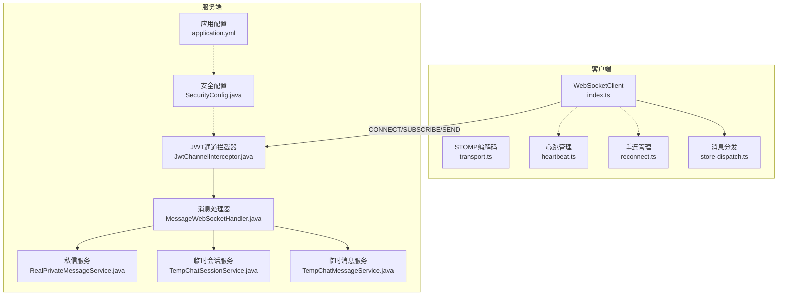
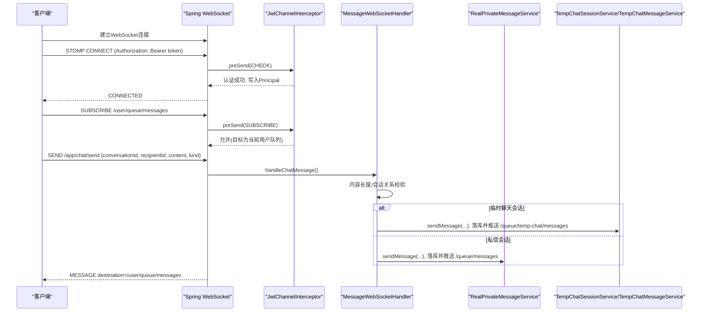
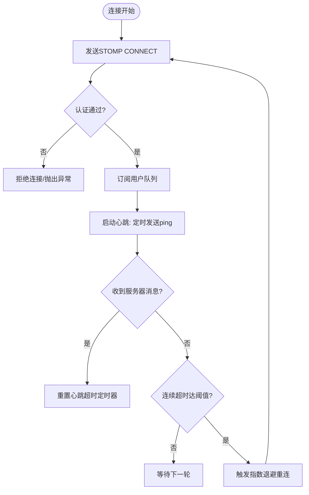
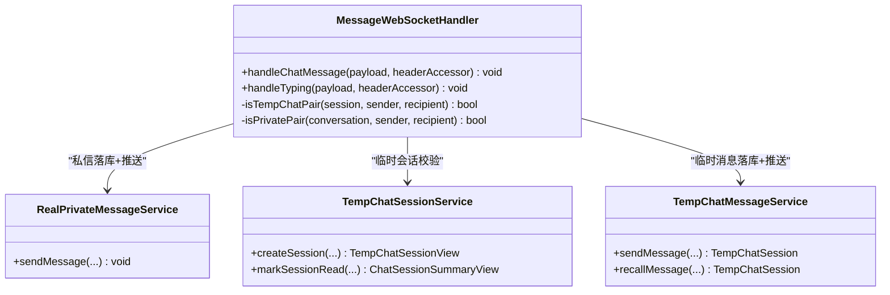
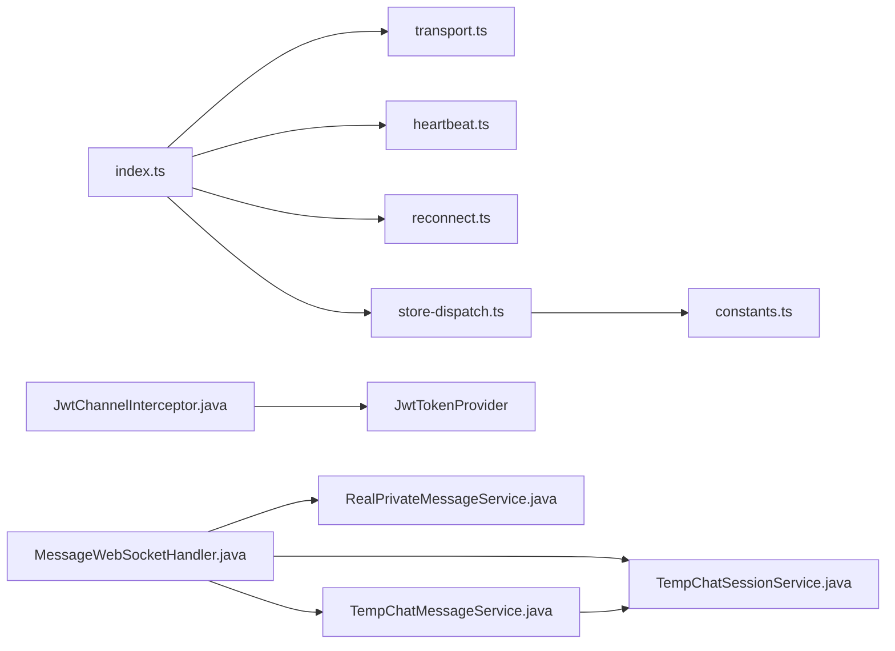

# WebSocket实时通信

<cite>
**本文引用的文件**
- [MessageWebSocketHandler.java](file://apps/api/src/main/java/com/campuslove/api/chat/MessageWebSocketHandler.java)
- [RealPrivateMessageService.java](file://apps/api/src/main/java/com/campuslove/api/chat/RealPrivateMessageService.java)
- [TempChatSessionService.java](file://apps/api/src/main/java/com/campuslove/api/chat/TempChatSessionService.java)
- [TempChatMessageService.java](file://apps/api/src/main/java/com/campuslove/api/chat/TempChatMessageService.java)
- [JwtChannelInterceptor.java](file://apps/api/src/main/java/com/campuslove/api/config/JwtChannelInterceptor.java)
- [SecurityConfig.java](file://apps/api/src/main/java/com/campuslove/api/config/SecurityConfig.java)
- [application.yml](file://apps/api/src/main/resources/application.yml)
- [index.ts](file://apps/client/src/services/websocket/index.ts)
- [transport.ts](file://apps/client/src/services/websocket/transport.ts)
- [store-dispatch.ts](file://apps/client/src/services/websocket/store-dispatch.ts)
- [heartbeat.ts](file://apps/client/src/services/websocket/heartbeat.ts)
- [reconnect.ts](file://apps/client/src/services/websocket/reconnect.ts)
- [constants.ts](file://apps/client/src/services/websocket/constants.ts)
</cite>

## 目录
1. [简介](#简介)
2. [项目结构](#项目结构)
3. [核心组件](#核心组件)
4. [架构总览](#架构总览)
5. [详细组件分析](#详细组件分析)
6. [依赖关系分析](#依赖关系分析)
7. [性能考量](#性能考量)
8. [故障排查指南](#故障排查指南)
9. [结论](#结论)
10. [附录](#附录)

## 简介
本技术文档围绕 Campus Love 的 WebSocket 实时通信能力，系统性说明 STOMP 协议在 Spring WebSocket 中的配置与使用、连接生命周期管理（建立、认证拦截、心跳检测、断线重连）、消息路由策略（点对点、群组、频道广播）、消息持久化与离线处理、聊天室状态与在线状态同步、消息已读回执、内容过滤与安全校验、以及客户端集成要点。后端采用 Spring WebSocket + STOMP，前端基于 uni-app 手动实现简化 STOMP 帧编解码与连接管理。

## 项目结构
后端集中在 apps/api 的 chat 与 config 包：
- 消息处理器：MessageWebSocketHandler，负责 /app/chat/send、/app/chat/typing 等消息路由与推送
- 私信服务：RealPrivateMessageService，封装私信会话与消息的持久化与推送
- 临时聊天会话：TempChatSessionService、TempChatMessageService，负责临时会话生命周期、消息落库与推送
- 安全拦截器：JwtChannelInterceptor，负责 CONNECT/SUBSCRIBE 阶段的 JWT 鉴权与路径权限控制
- 安全配置：SecurityConfig 放行 /ws/**，其他 REST 按规则鉴权
- 应用配置：application.yml 提供 Redis、RabbitMQ、Tomcat、Actuator 等运行期配置

前端集中在 apps/client 的 services/websocket：
- index.ts：WebSocketClient 主体，封装连接、订阅、发送、心跳、重连与状态机
- transport.ts：STOMP 帧构建/解析、WS URL/子协议构造
- store-dispatch.ts：将不同队列消息分发到 Pinia Store
- heartbeat.ts：ping/pong 心跳管理与超时判定
- reconnect.ts：指数退避重连策略
- constants.ts：协议常量（版本、分隔符、心跳间隔、重连参数）

图表来源
- [index.ts:1-120](file://apps/client/src/services/websocket/index.ts#L1-L120)
- [transport.ts:1-80](file://apps/client/src/services/websocket/transport.ts#L1-L80)
- [JwtChannelInterceptor.java:1-120](file://apps/api/src/main/java/com/campuslove/api/config/JwtChannelInterceptor.java#L1-L120)
- [MessageWebSocketHandler.java:1-120](file://apps/api/src/main/java/com/campuslove/api/chat/MessageWebSocketHandler.java#L1-L120)
- [RealPrivateMessageService.java:1-120](file://apps/api/src/main/java/com/campuslove/api/chat/RealPrivateMessageService.java#L1-L120)
- [TempChatSessionService.java:1-120](file://apps/api/src/main/java/com/campuslove/api/chat/TempChatSessionService.java#L1-L120)
- [TempChatMessageService.java:1-120](file://apps/api/src/main/java/com/campuslove/api/chat/TempChatMessageService.java#L1-L120)
- [SecurityConfig.java:1-120](file://apps/api/src/main/java/com/campuslove/api/config/SecurityConfig.java#L1-L120)
- [application.yml:1-120](file://apps/api/src/main/resources/application.yml#L1-L120)

章节来源
- [index.ts:1-200](file://apps/client/src/services/websocket/index.ts#L1-L200)
- [JwtChannelInterceptor.java:1-200](file://apps/api/src/main/java/com/campuslove/api/config/JwtChannelInterceptor.java#L1-L200)
- [MessageWebSocketHandler.java:1-200](file://apps/api/src/main/java/com/campuslove/api/chat/MessageWebSocketHandler.java#L1-L200)

## 核心组件
- STOMP 认证拦截器：在 CONNECT 阶段校验 JWT，设置 Principal；在 SUBSCRIBE 阶段限制仅能订阅 /topic/** 与 /user/{自身userId}/queue/**，防止越权订阅他人队列
- 消息处理器：统一接收 /app/chat/send 与 /app/chat/typing，完成内容长度校验、会话关系校验（临时聊天或私信），并委托对应服务落库与推送
- 私信服务：封装私信会话创建、消息发送（含敏感词过滤、拉黑检查、未读计数更新）与消息推送
- 临时聊天服务：会话创建/过期/关闭/置顶/已读标记，消息发送/撤回/预览生成，通过 SimpMessagingTemplate 推送至对端用户队列
- 客户端 WebSocket 客户端：手动构建 STOMP 帧，管理连接、心跳、重连、订阅与消息分发；支持 CONNECT 握手超时、心跳连续超时容错、指数退避重连

章节来源
- [JwtChannelInterceptor.java:120-307](file://apps/api/src/main/java/com/campuslove/api/config/JwtChannelInterceptor.java#L120-L307)
- [MessageWebSocketHandler.java:120-455](file://apps/api/src/main/java/com/campuslove/api/chat/MessageWebSocketHandler.java#L120-L455)
- [RealPrivateMessageService.java:120-220](file://apps/api/src/main/java/com/campuslove/api/chat/RealPrivateMessageService.java#L120-L220)
- [TempChatSessionService.java:120-300](file://apps/api/src/main/java/com/campuslove/api/chat/TempChatSessionService.java#L120-L300)
- [TempChatMessageService.java:120-311](file://apps/api/src/main/java/com/campuslove/api/chat/TempChatMessageService.java#L120-L311)
- [index.ts:200-600](file://apps/client/src/services/websocket/index.ts#L200-L600)

## 架构总览
后端通过 Spring WebSocket + STOMP 暴露 /ws/** 端点；客户端以原始 WebSocket 连接并手工实现 STOMP 帧交互。连接建立后，客户端发送 CONNECT 帧携带 Authorization Bearer Token，服务端 JwtChannelInterceptor 解析并验证，成功则设置 Principal。随后客户端订阅用户私有队列（/user/queue/messages、signals、notifications、matches、temp-chat、checkin、typing），服务端通过 SimpMessagingTemplate.convertAndSendToUser 推送至对应用户队列。消息发送统一经 MessageWebSocketHandler 进行鉴权与会话关系校验，再委托业务服务完成落库与推送。

图表来源
- [JwtChannelInterceptor.java:120-307](file://apps/api/src/main/java/com/campuslove/api/config/JwtChannelInterceptor.java#L120-L307)
- [MessageWebSocketHandler.java:120-455](file://apps/api/src/main/java/com/campuslove/api/chat/MessageWebSocketHandler.java#L120-L455)
- [RealPrivateMessageService.java:120-220](file://apps/api/src/main/java/com/campuslove/api/chat/RealPrivateMessageService.java#L120-L220)
- [TempChatSessionService.java:120-300](file://apps/api/src/main/java/com/campuslove/api/chat/TempChatSessionService.java#L120-L300)
- [TempChatMessageService.java:120-311](file://apps/api/src/main/java/com/campuslove/api/chat/TempChatMessageService.java#L120-L311)
- [index.ts:200-600](file://apps/client/src/services/websocket/index.ts#L200-L600)

## 详细组件分析

### STOMP 协议与连接生命周期
- 连接建立：客户端通过 transport.ts 构建 ws/wss URL（移除 /api 后缀），并通过子协议 bearer.${token} 传递令牌；服务端 SecurityConfig 放行 /ws/**
- 认证拦截：JwtChannelInterceptor 在 CONNECT 阶段从 Authorization 头提取 Bearer Token，验证签名、是否撤销、用户是否禁用；成功后设置 Principal
- 订阅权限：SUBSCRIBE 阶段仅允许 /topic/** 公共主题与 /user/{自身userId}/queue/** 私有队列；兼容 Spring 简写 /user/queue/**
- 心跳检测：客户端每 HEARTBEAT_INTERVAL_MS 发送 JSON ping（{"type":"ping"}），收到任何服务器消息（含 {"type":"pong"}）重置超时定时器；连续超时达到阈值触发重连
- 断线重连：ReconnectManager 采用指数退避（1s/2s/4s/8s/16s/30s上限），最大次数耗尽时通知业务层降级提示；重连成功后重新订阅所有活跃频道

图表来源
- [JwtChannelInterceptor.java:120-307](file://apps/api/src/main/java/com/campuslove/api/config/JwtChannelInterceptor.java#L120-L307)
- [heartbeat.ts:1-154](file://apps/client/src/services/websocket/heartbeat.ts#L1-L154)
- [reconnect.ts:1-176](file://apps/client/src/services/websocket/reconnect.ts#L1-L176)
- [transport.ts:1-120](file://apps/client/src/services/websocket/transport.ts#L1-L120)
- [index.ts:200-600](file://apps/client/src/services/websocket/index.ts#L200-L600)

章节来源
- [JwtChannelInterceptor.java:120-307](file://apps/api/src/main/java/com/campuslove/api/config/JwtChannelInterceptor.java#L120-L307)
- [index.ts:200-600](file://apps/client/src/services/websocket/index.ts#L200-L600)
- [transport.ts:120-275](file://apps/client/src/services/websocket/transport.ts#L120-L275)

### 消息路由策略
- 点对点消息：MessageWebSocketHandler 根据 conversationId 判断会话类型（临时聊天或私信），调用相应服务落库并推送至 /user/{recipientId}/queue/messages 或 /queue/temp-chat/messages
- 群组/频道广播：服务端可通过 SimpMessagingTemplate.convertAndSendToUser 向指定用户队列推送信号/通知/匹配事件；公共主题 /topic/** 可被任意认证用户订阅
- “正在输入”状态：/app/chat/typing 经同一会话关系校验后转发至 /user/{recipientId}/queue/typing，前端预留回调处理

图表来源
- [MessageWebSocketHandler.java:120-455](file://apps/api/src/main/java/com/campuslove/api/chat/MessageWebSocketHandler.java#L120-L455)
- [RealPrivateMessageService.java:120-220](file://apps/api/src/main/java/com/campuslove/api/chat/RealPrivateMessageService.java#L120-L220)
- [TempChatSessionService.java:120-300](file://apps/api/src/main/java/com/campuslove/api/chat/TempChatSessionService.java#L120-L300)
- [TempChatMessageService.java:120-311](file://apps/api/src/main/java/com/campuslove/api/chat/TempChatMessageService.java#L120-L311)

章节来源
- [MessageWebSocketHandler.java:120-455](file://apps/api/src/main/java/com/campuslove/api/chat/MessageWebSocketHandler.java#L120-L455)

### 消息持久化与历史查询
- 私信消息：RealPrivateMessageService.sendMessage 完成敏感词过滤、拉黑检查、会话预览与未读计数更新，并推送消息视图；历史消息由 REST 接口加载（不在本文件体现）
- 临时聊天消息：TempChatMessageService.sendMessage 创建实体、更新会话最后预览与未读数，推送对方；recallMessage 支持 2 分钟内撤回并更新预览
- 会话列表与详情：TempChatSessionService.listSessions/getOverview 批量预加载对方信息，惰性检查过期并返回摘要；getSession 返回消息列表（过期会话为空）

章节来源
- [RealPrivateMessageService.java:120-220](file://apps/api/src/main/java/com/campuslove/api/chat/RealPrivateMessageService.java#L120-L220)
- [TempChatMessageService.java:120-311](file://apps/api/src/main/java/com/campuslove/api/chat/TempChatMessageService.java#L120-L311)
- [TempChatSessionService.java:120-300](file://apps/api/src/main/java/com/campuslove/api/chat/TempChatSessionService.java#L120-L300)

### 聊天室状态、在线状态与已读回执
- 临时聊天会话：支持创建、过期、关闭、置顶/取消置顶、已读标记；markSessionRead 将当前用户未读归零并持久化
- 在线状态：通过心跳检测维持连接活性；服务端不主动维护“在线/离线”位，依赖心跳与重连机制感知可用性
- 已读回执：客户端进入会话后可调用后端已读接口（会话级），临时聊天通过 markSessionRead 实现；私信未读计数在服务端维护

章节来源
- [TempChatSessionService.java:300-566](file://apps/api/src/main/java/com/campuslove/api/chat/TempChatSessionService.java#L300-L566)
- [heartbeat.ts:1-154](file://apps/client/src/services/websocket/heartbeat.ts#L1-L154)

### 安全校验与内容过滤
- 认证与授权：JwtChannelInterceptor 校验 JWT 有效性、是否撤销、用户是否禁用；SUBSCRIBE 仅允许订阅自身队列
- 会话关系校验：MessageWebSocketHandler 强制校验 sender/recipient 为会话双方，禁止自发自收；临时聊天与私信分别校验
- 内容安全：临时聊天与私信均接入 SensitiveWordFilter，过滤敏感词；消息体长度限制防止超大载荷

章节来源
- [JwtChannelInterceptor.java:120-307](file://apps/api/src/main/java/com/campuslove/api/config/JwtChannelInterceptor.java#L120-L307)
- [MessageWebSocketHandler.java:120-220](file://apps/api/src/main/java/com/campuslove/api/chat/MessageWebSocketHandler.java#L120-L220)
- [TempChatMessageService.java:120-220](file://apps/api/src/main/java/com/campuslove/api/chat/TempChatMessageService.java#L120-L220)
- [RealPrivateMessageService.java:120-220](file://apps/api/src/main/java/com/campuslove/api/chat/RealPrivateMessageService.java#L120-L220)

### 客户端集成示例
- 连接：wsClient.connect(token)，内部构建 ws URL 与子协议，发送 CONNECT 帧
- 订阅：subscribe(destination, callback)，自动去重并在重连后恢复
- 发送：send("/app/chat/send", payload)，payload 包含 conversationId、recipientId、content、kind
- 断开：disconnect()，发送 DISCONNECT 帧后延迟关闭底层连接

章节来源
- [index.ts:200-600](file://apps/client/src/services/websocket/index.ts#L200-L600)
- [transport.ts:120-275](file://apps/client/src/services/websocket/transport.ts#L120-L275)

### WebSocket 集群部署、负载均衡与会话共享
- 当前实现使用 SimpMessagingTemplate 向用户队列推送，依赖 Spring 默认内存会话与单实例广播；若需多实例部署，应引入 Redis 或消息中间件作为消息代理以共享会话与广播
- application.yml 已配置 Redis 与 RabbitMQ，可作为后续扩展基础；需在 WebSocket 配置中启用消息代理与粘性会话策略（如 Redis 绑定会话、负载均衡器保持长连接亲和）
- 生产建议：Nginx/网关层开启 WebSocket 支持（Upgrade/Connection 头透传），后端启用容器线程池与连接数优化（已配置 Tomcat threads/max-connections）

章节来源
- [application.yml:1-200](file://apps/api/src/main/resources/application.yml#L1-L200)

## 依赖关系分析
- 客户端模块内聚：index.ts 聚合 transport、heartbeat、reconnect、store-dispatch；constants.ts 集中协议常量
- 服务端模块职责清晰：JwtChannelInterceptor 专注认证与订阅权限；MessageWebSocketHandler 负责路由与校验；业务服务专注落库与推送
- 外部依赖：Redis/RabbitMQ 用于未来消息代理与缓存；SensitiveWordFilter 用于内容安全

图表来源
- [index.ts:1-200](file://apps/client/src/services/websocket/index.ts#L1-L200)
- [transport.ts:1-120](file://apps/client/src/services/websocket/transport.ts#L1-L120)
- [heartbeat.ts:1-120](file://apps/client/src/services/websocket/heartbeat.ts#L1-L120)
- [reconnect.ts:1-120](file://apps/client/src/services/websocket/reconnect.ts#L1-L120)
- [store-dispatch.ts:1-120](file://apps/client/src/services/websocket/store-dispatch.ts#L1-L120)
- [JwtChannelInterceptor.java:1-120](file://apps/api/src/main/java/com/campuslove/api/config/JwtChannelInterceptor.java#L1-L120)
- [MessageWebSocketHandler.java:1-120](file://apps/api/src/main/java/com/campuslove/api/chat/MessageWebSocketHandler.java#L1-L120)

章节来源
- [index.ts:1-200](file://apps/client/src/services/websocket/index.ts#L1-L200)
- [MessageWebSocketHandler.java:1-120](file://apps/api/src/main/java/com/campuslove/api/chat/MessageWebSocketHandler.java#L1-L120)

## 性能考量
- 批量预加载：临时聊天会话列表批量加载对方用户信息，避免 N+1 查询
- 未读计数批量统计：私信会话未读数 GROUP BY 一次性统计
- 心跳容错：连续超时阈值避免弱网抖动导致频繁重连
- 指数退避重连：降低网络不可用时的重试压力，快速恢复时优先重连
- 消息长度限制：统一限制 content/kind 长度，防止内存与带宽滥用

[本节为通用指导，无需具体文件引用]

## 故障排查指南
- 认证失败：检查 CONNECT 帧 Authorization 头是否携带有效 Bearer Token；服务端日志输出 Unauthorized/revoked/disabled 原因
- 订阅被拒：确认订阅目标为 /topic/** 或 /user/{自身userId}/queue/**；Spring 简写 /user/queue/** 已被拦截器兼容
- 心跳超时：检查客户端是否持续收到服务器消息；连续超时达阈值会触发重连；弱网环境下可能因丢包导致误判
- 重连耗尽：达到最大重连次数后停止自动重连；业务层可引导用户手动 connect(token) 重试
- 消息丢失：检查队列分发逻辑（store-dispatch）是否匹配新队列名；未知队列类型会上报 Sentry 便于追踪
- 会话关系校验失败：确保 conversationId 与 recipientId 为会话双方；临时聊天与私信分别校验，否则拒绝发送

章节来源
- [JwtChannelInterceptor.java:120-307](file://apps/api/src/main/java/com/campuslove/api/config/JwtChannelInterceptor.java#L120-L307)
- [index.ts:600-1021](file://apps/client/src/services/websocket/index.ts#L600-L1021)
- [store-dispatch.ts:1-200](file://apps/client/src/services/websocket/store-dispatch.ts#L1-L200)
- [heartbeat.ts:1-154](file://apps/client/src/services/websocket/heartbeat.ts#L1-L154)
- [reconnect.ts:1-176](file://apps/client/src/services/websocket/reconnect.ts#L1-L176)

## 结论
本系统通过 Spring WebSocket + STOMP 实现了稳定的实时通信能力，结合严格的认证与订阅权限控制、完善的会话关系校验与内容过滤，保证了消息的安全性与一致性。客户端采用手动 STOMP 实现，具备心跳检测、指数退避重连与订阅恢复能力。后续可扩展消息代理（Redis/RabbitMQ）以实现多实例部署与跨节点广播，进一步提升可用性与扩展性。

[本节为总结，无需具体文件引用]

## 附录

### 消息协议定义（节选）
- 连接帧：CONNECT，头：accept-version=1.2, heart-beat=30000,30000, Authorization: Bearer <token>
- 订阅帧：SUBSCRIBE，头：id=<subId>, destination=/user/queue/<queueName>
- 发送帧：SEND，头：destination=/app/chat/send, content-type=application/json；体：{conversationId, recipientId, content, kind, quoteRef?}
- 心跳帧：JSON {"type":"ping"}；响应 {"type":"pong"}

章节来源
- [index.ts:200-600](file://apps/client/src/services/websocket/index.ts#L200-L600)
- [transport.ts:120-275](file://apps/client/src/services/websocket/transport.ts#L120-L275)
- [constants.ts:1-78](file://apps/client/src/services/websocket/constants.ts#L1-L78)