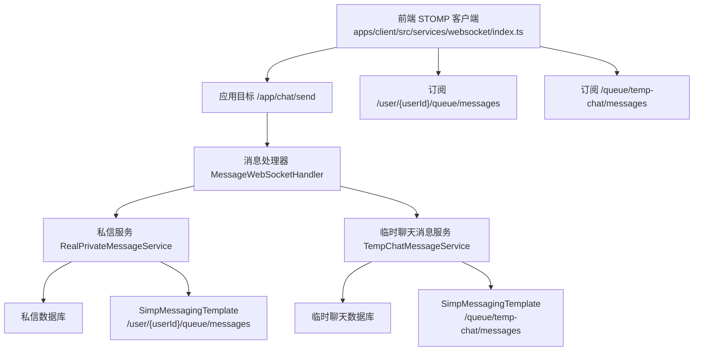
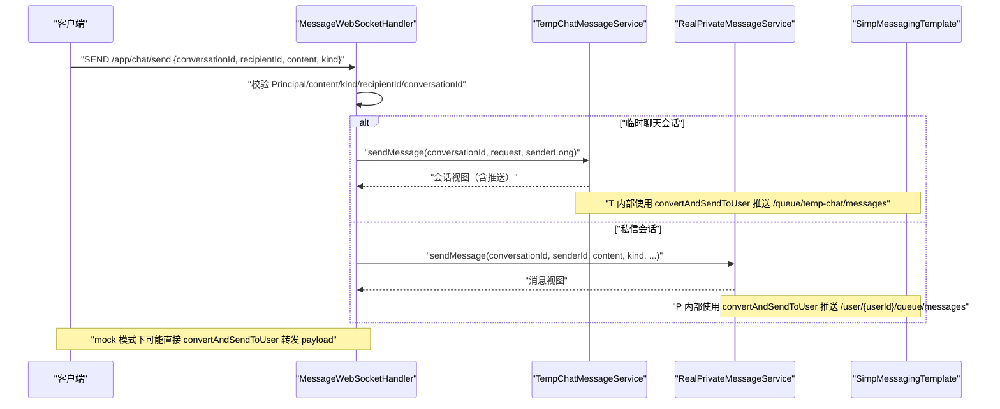
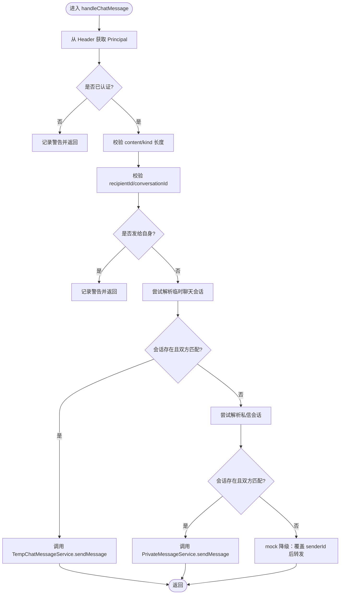
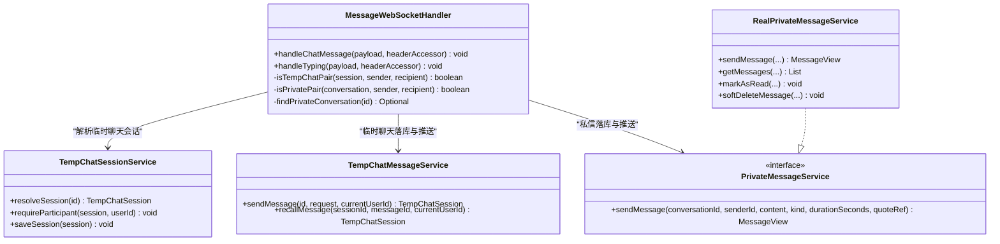
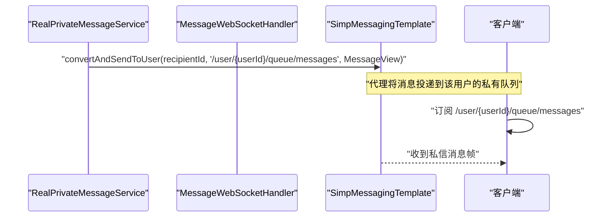
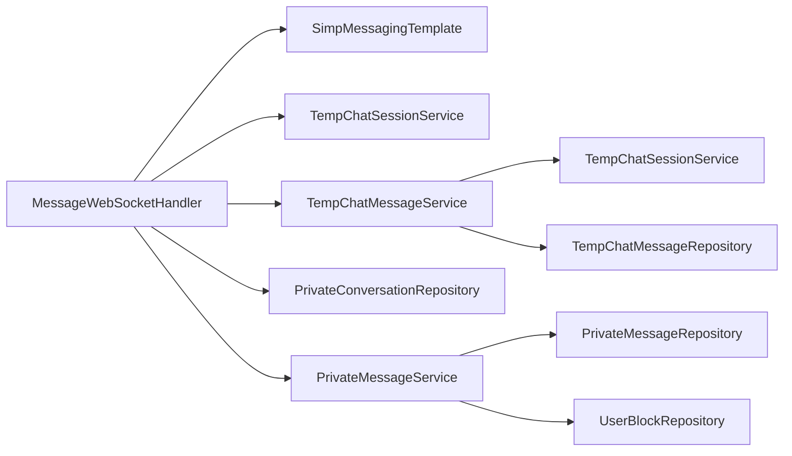

# 消息处理机制

<cite>
**本文引用的文件**   
- [MessageWebSocketHandler.java](file://apps/api/src/main/java/com/campuslove/api/chat/MessageWebSocketHandler.java)
- [PrivateMessageService.java](file://apps/api/src/main/java/com/campuslove/api/chat/PrivateMessageService.java)
- [RealPrivateMessageService.java](file://apps/api/src/main/java/com/campuslove/api/chat/RealPrivateMessageService.java)
- [TempChatMessageService.java](file://apps/api/src/main/java/com/campuslove/api/chat/TempChatMessageService.java)
- [TempChatSessionService.java](file://apps/api/src/main/java/com/campuslove/api/chat/TempChatSessionService.java)
- [TempChatService.java](file://apps/api/src/main/java/com/campuslove/api/chat/TempChatService.java)
- [RealTempChatService.java](file://apps/api/src/main/java/com/campuslove/api/chat/RealTempChatService.java)
- [index.ts](file://apps/client/src/services/websocket/index.ts)
- [api-params.ts](file://apps/client/src/constants/api-params.ts)
</cite>

## 目录
1. [引言](#引言)
2. [项目结构定位](#项目结构定位)
3. [核心组件](#核心组件)
4. [架构总览](#架构总览)
5. [详细组件分析](#详细组件分析)
6. [依赖关系分析](#依赖关系分析)
7. [性能考虑](#性能考虑)
8. [故障排查指南](#故障排查指南)
9. [结论](#结论)

## 引言
本文面向 Campus Love 后端 WebSocket 消息处理链路，围绕 `MessageWebSocketHandler` 中的 `@MessageMapping("/chat/send")` 端点展开，完整说明消息路由、消息类型识别、私信与临时聊天两条处理路径、消息持久化、推送目标构建、安全校验、状态管理以及错误处理策略。同时给出客户端 STOMP 订阅模型与协议常量，帮助读者从端到端视角理解“发送→落库→推送→接收”的闭环。

## 项目结构定位
本项目采用多模块前端 + Spring Boot 后端的工程组织方式：
- 后端聊天能力集中在 `apps/api/src/main/java/com/campuslove/api/chat` 包下，包含 WebSocket 处理器、私信服务接口及实现、临时聊天会话与消息服务、公开 API 编排类。
- 前端 WebSocket 客户端位于 `apps/client/src/services/websocket`，基于 uni-app 的原始 WebSocket 手动实现简化版 STOMP，负责连接、认证、订阅与分发。
- 前端协议常量集中定义于 `apps/client/src/constants/api-params.ts`，统一维护 `/app`、`/user/{userId}/queue/*` 等 STOMP 前缀与主题。

**图表来源**
- [MessageWebSocketHandler.java:1-200](file://apps/api/src/main/java/com/campuslove/api/chat/MessageWebSocketHandler.java#L1-L200)
- [RealPrivateMessageService.java:200-350](file://apps/api/src/main/java/com/campuslove/api/chat/RealPrivateMessageService.java#L200-L350)
- [TempChatMessageService.java:1-200](file://apps/api/src/main/java/com/campuslove/api/chat/TempChatMessageService.java#L1-L200)
- [index.ts:1-200](file://apps/client/src/services/websocket/index.ts#L1-L200)

**章节来源**
- [MessageWebSocketHandler.java:1-200](file://apps/api/src/main/java/com/campuslove/api/chat/MessageWebSocketHandler.java#L1-L200)
- [index.ts:1-200](file://apps/client/src/services/websocket/index.ts#L1-L200)
- [api-params.ts:1-167](file://apps/client/src/constants/api-params.ts#L1-L167)

## 核心组件
- `MessageWebSocketHandler`：STOMP 消息入口，负责解析认证用户、参数校验、会话类型识别（私信 vs 临时聊天）、关系校验、调用对应服务落库与推送。
- `PrivateMessageService` 与 `RealPrivateMessageService`：私信业务抽象与真实实现，提供会话创建、消息发送、分页拉取、已读标记、软删消息、会话置顶与免打扰等功能；消息发送时完成敏感词过滤、预览更新、未读计数更新和实时推送。
- `TempChatMessageService`：临时聊天消息发送与撤回，负责会话阶段切换、引用快照、预览文本、未读计数与对方推送。
- `TempChatSessionService`：临时聊天会话生命周期与视图转换，持有 `SimpMessagingTemplate` 用于会话级事件推送。
- `TempChatService` 与 `RealTempChatService`：对外暴露临时聊天接口，内部委托会话与消息组件。
- 前端 `WebSocketClient` 与 `WS_TOPICS`：构造 STOMP CONNECT、SUBSCRIBE、SEND 帧，订阅用户私有队列与应用目标前缀，与后端路径保持一致。

**章节来源**
- [MessageWebSocketHandler.java:1-455](file://apps/api/src/main/java/com/campuslove/api/chat/MessageWebSocketHandler.java#L1-L455)
- [PrivateMessageService.java:1-116](file://apps/api/src/main/java/com/campuslove/api/chat/PrivateMessageService.java#L1-L116)
- [RealPrivateMessageService.java:1-528](file://apps/api/src/main/java/com/campuslove/api/chat/RealPrivateMessageService.java#L1-L528)
- [TempChatMessageService.java:1-311](file://apps/api/src/main/java/com/campuslove/api/chat/TempChatMessageService.java#L1-L311)
- [TempChatSessionService.java:1-200](file://apps/api/src/main/java/com/campuslove/api/chat/TempChatSessionService.java#L1-L200)
- [TempChatService.java:1-71](file://apps/api/src/main/java/com/campuslove/api/chat/TempChatService.java#L1-L71)
- [RealTempChatService.java:1-134](file://apps/api/src/main/java/com/campuslove/api/chat/RealTempChatService.java#L1-L134)
- [index.ts:1-200](file://apps/client/src/services/websocket/index.ts#L1-L200)
- [api-params.ts:1-167](file://apps/client/src/constants/api-params.ts#L1-L167)

## 架构总览
`/app/chat/send` 是客户端通过 STOMP SEND 发送聊天消息的应用目标。服务端根据 `conversationId` 尝试解析为临时聊天会话或私信会话，并分别走不同落库与推送分支。若相关服务不可用（mock 模式），则退化为仅转发，不执行强一致性落库。

**图表来源**
- [MessageWebSocketHandler.java:100-455](file://apps/api/src/main/java/com/campuslove/api/chat/MessageWebSocketHandler.java#L100-L455)
- [TempChatMessageService.java:80-200](file://apps/api/src/main/java/com/campuslove/api/chat/TempChatMessageService.java#L80-L200)
- [RealPrivateMessageService.java:200-350](file://apps/api/src/main/java/com/campuslove/api/chat/RealPrivateMessageService.java#L200-L350)

**章节来源**
- [MessageWebSocketHandler.java:100-455](file://apps/api/src/main/java/com/campuslove/api/chat/MessageWebSocketHandler.java#L100-L455)

## 详细组件分析

### `@MessageMapping("/chat/send")` 消息路由与处理流程
- 认证与身份来源：从 `SimpMessageHeaderAccessor.getUser()` 获取 `Principal`，以服务端认证用户为准，不信任客户端 payload 中的发送者。
- 载荷长度限制：对 `content` 与 `kind` 字段进行最大长度校验，防止超大消息刷内存与带宽。
- 基础参数校验：拒绝缺失 `recipientId`、`conversationId`，禁止发送给自己。
- 会话类型识别：
  - 先尝试解析为临时聊天会话；若成功且双方关系合法，则调用 `TempChatMessageService.sendMessage` 落库并推送。
  - 否则尝试解析为私信会话；若关系合法且 `PrivateMessageService` 可用，则调用 `sendMessage` 完成落库、预览更新与推送。
  - 若相关服务不可用，则降级为仅覆盖 `senderId` 后转发到 `/queue/messages`。
- “正在输入”通道：另有 `@MessageMapping("/chat/typing")`，遵循同一会话关系校验逻辑，仅转发瞬态 typing 帧，不落库。

**图表来源**
- [MessageWebSocketHandler.java:100-455](file://apps/api/src/main/java/com/campuslove/api/chat/MessageWebSocketHandler.java#L100-L455)

**章节来源**
- [MessageWebSocketHandler.java:100-455](file://apps/api/src/main/java/com/campuslove/api/chat/MessageWebSocketHandler.java#L100-L455)

### 消息类型识别逻辑：私信聊天与临时聊天
- 临时聊天：
  - 通过 `TempChatSessionService.resolveSession(conversationId)` 解析会话。
  - 使用 `isTempChatPair(session, senderLong, recipientLong)` 校验双方顺序可互换。
  - 由 `TempChatMessageService.sendMessage` 负责落库、会话阶段推进、预览更新、未读计数与推送。
- 私信聊天：
  - 通过 `findPrivateConversation(conversationId)` 支持按数据库 ID 或 `conversationUid` 查找。
  - 使用 `isPrivatePair(conversation, senderLong, recipientLong)` 校验双方顺序可互换。
  - 由 `PrivateMessageService.sendMessage` 负责敏感词过滤、引用快照、预览更新、会话最后消息时间更新、推送。

**图表来源**
- [MessageWebSocketHandler.java:1-455](file://apps/api/src/main/java/com/campuslove/api/chat/MessageWebSocketHandler.java#L1-L455)
- [TempChatSessionService.java:1-200](file://apps/api/src/main/java/com/campuslove/api/chat/TempChatSessionService.java#L1-L200)
- [TempChatMessageService.java:1-311](file://apps/api/src/main/java/com/campuslove/api/chat/TempChatMessageService.java#L1-L311)
- [PrivateMessageService.java:1-116](file://apps/api/src/main/java/com/campuslove/api/chat/PrivateMessageService.java#L1-L116)
- [RealPrivateMessageService.java:1-528](file://apps/api/src/main/java/com/campuslove/api/chat/RealPrivateMessageService.java#L1-L528)

**章节来源**
- [MessageWebSocketHandler.java:100-455](file://apps/api/src/main/java/com/campuslove/api/chat/MessageWebSocketHandler.java#L100-L455)
- [TempChatMessageService.java:1-311](file://apps/api/src/main/java/com/campuslove/api/chat/TempChatMessageService.java#L1-L311)
- [RealPrivateMessageService.java:200-528](file://apps/api/src/main/java/com/campuslove/api/chat/RealPrivateMessageService.java#L200-L528)

### 消息持久化机制
- 私信消息持久化：
  - `MessageWebSocketHandler` 在确认是私信会话且关系合法后，调用 `PrivateMessageService.sendMessage(conversationId, senderId, content, kind, null, quoteRef)`。
  - `RealPrivateMessageService.sendMessage` 会：
    - 校验会话存在与发送者为参与者。
    - 拉黑拦截（任一方拉黑另一方时抛业务异常）。
    - 敏感词过滤。
    - 引用回复生成 `quote_context` 快照，并将消息类型规范化为 `quote`。
    - 写入 `PrivateMessage`，立即回填主键。
    - 更新会话最后消息预览与时间。
    - 通过 `SimpMessagingTemplate.convertAndSendToUser(recipientId, "/queue/messages", messageView)` 推送。
- 临时聊天消息持久化：
  - `MessageWebSocketHandler` 在临时聊天场景构造 `ChatMessageRequest`，调用 `TempChatMessageService.sendMessage(conversationId, request, senderLong)`。
  - `TempChatMessageService.sendMessage` 会：
    - 解析会话并校验当前用户为参与者。
    - 检查过期与会话阶段（matching 阶段首条消息自动转 active）。
    - 服务端判定 `sender`（self/peer），不信任客户端值。
    - 敏感词过滤。
    - 可选引用快照生成（同会话内引用校验）。
    - 写入 `TempChatMessage`，更新会话预览、最后消息时间与未读计数。
    - 通过 `sessionService.getMessagingTemplate().convertAndSendToUser(recipientId, "/queue/temp-chat/messages", messageView)` 推送。

**章节来源**
- [MessageWebSocketHandler.java:150-350](file://apps/api/src/main/java/com/campuslove/api/chat/MessageWebSocketHandler.java#L150-L350)
- [RealPrivateMessageService.java:200-350](file://apps/api/src/main/java/com/campuslove/api/chat/RealPrivateMessageService.java#L200-L350)
- [TempChatMessageService.java:80-200](file://apps/api/src/main/java/com/campuslove/api/chat/TempChatMessageService.java#L80-L200)

### 消息推送策略与目标地址
- 私信推送：
  - 目标地址：`/user/{recipientId}/queue/messages`。
  - 推送载体：`MessageView`。
  - 触发方：`RealPrivateMessageService.sendMessage` 内部调用 `SimpMessagingTemplate.convertAndSendToUser`。
- 临时聊天推送：
  - 目标地址：`/queue/temp-chat/messages`。
  - 推送载体：`ChatMessageView`。
  - 触发方：`TempChatMessageService.sendMessage` 内部通过 `TempChatSessionService.getMessagingTemplate()` 推送。
- 其他推送通道：
  - 心动信号：`/user/{userId}/queue/signals`。
  - 通知：`/user/{userId}/queue/notifications`。
  - 正在输入：`/queue/typing`（瞬时提示，不落库）。
- 客户端订阅：
  - 前端使用 `WS_TOPICS.userMessages(userId)` 构造 `/user/{userId}/queue/messages` 订阅。
  - 临时聊天消息通常由临时聊天页面订阅 `/queue/temp-chat/messages`。

**图表来源**
- [RealPrivateMessageService.java:200-350](file://apps/api/src/main/java/com/campuslove/api/chat/RealPrivateMessageService.java#L200-L350)
- [MessageWebSocketHandler.java:300-455](file://apps/api/src/main/java/com/campuslove/api/chat/MessageWebSocketHandler.java#L300-L455)
- [api-params.ts:80-167](file://apps/client/src/constants/api-params.ts#L80-L167)

**章节来源**
- [RealPrivateMessageService.java:200-350](file://apps/api/src/main/java/com/campuslove/api/chat/RealPrivateMessageService.java#L200-L350)
- [TempChatMessageService.java:150-200](file://apps/api/src/main/java/com/campuslove/api/chat/TempChatMessageService.java#L150-L200)
- [api-params.ts:80-167](file://apps/client/src/constants/api-params.ts#L80-L167)

### 消息安全校验
- 发送者身份验证：
  - 所有 WebSocket 入口从 `SimpMessageHeaderAccessor.getUser()` 获取 `Principal`，拒绝匿名发送。
  - `senderId` 来自服务端认证信息，不信任客户端 payload。
- 接收者权限检查：
  - 临时聊天：`isTempChatPair` 要求 `sender` 与 `recipient` 必须等于会话的 `userA` 与 `userB` 之一，顺序可互换。
  - 私信：`isPrivatePair` 要求 `sender` 与 `recipient` 必须等于会话的 `userA` 与 `userB` 之一，顺序可互换。
  - `TempChatMessageService` 额外通过 `requireParticipant` 校验当前用户为会话参与者，并对 `sender` 做服务端重算（self/peer）。
- 消息长度限制：
  - `content` 最大长度与 REST 端 `SendMessageRequest @Size(max=5000)` 一致。
  - `kind` 最大长度为 32，空字符串视为默认值。
- 自发自收拦截：
  - 禁止 `senderId.equals(recipientId)`。
- 拉黑拦截（私信）：
  - `RealPrivateMessageService.sendMessage` 在发送前检测拉黑关系，任一方拉黑另一方即抛出业务异常。

**章节来源**
- [MessageWebSocketHandler.java:100-200](file://apps/api/src/main/java/com/campuslove/api/chat/MessageWebSocketHandler.java#L100-L200)
- [TempChatMessageService.java:80-200](file://apps/api/src/main/java/com/campuslove/api/chat/TempChatMessageService.java#L80-L200)
- [RealPrivateMessageService.java:200-350](file://apps/api/src/main/java/com/campuslove/api/chat/RealPrivateMessageService.java#L200-L350)

### 消息状态管理：已读回执、消息撤回与会话更新
- 已读回执（私信）：
  - 读取消息列表时调用 `markAsRead(conversationId, userId)`，批量标记非本人未读消息为已读。
  - 拉取历史消息支持 `desc`（最新在前）与 `asc`（更早历史）两种排序方向。
- 消息撤回（临时聊天）：
  - 仅允许消息发送者在 2 分钟内撤回。
  - 撤回后将消息标记为 `recalled=true`，正文替换为 `[已撤回]`。
  - 撤回后同步更新会话预览，避免会话列表仍显示撤回前的内容。
  - 系统消息不可撤回。
- 会话更新：
  - 私信：发送消息后更新 `lastMessagePreview`、`lastMessageAt`、`updatedAt`。
  - 临时聊天：首次消息将会话从 `matching` 推进至 `active`，更新预览、时间和未读计数。

**章节来源**
- [RealPrivateMessageService.java:350-528](file://apps/api/src/main/java/com/campuslove/api/chat/RealPrivateMessageService.java#L350-L528)
- [TempChatMessageService.java:200-311](file://apps/api/src/main/java/com/campuslove/api/chat/TempChatMessageService.java#L200-L311)

### 消息协议定义与客户端对接
- 客户端发送目标：
  - 应用目标前缀：`/app`。
  - 发送端点：`/app/chat/send`。
- 客户端订阅目标：
  - 私信队列：`/user/{userId}/queue/messages`。
  - 心动信号队列：`/user/{userId}/queue/signals`。
  - 通知队列：`/user/{userId}/queue/notifications`。
  - 临时聊天消息队列：`/queue/temp-chat/messages`。
- 请求体关键字段：
  - `conversationId`：会话标识（私信可为数据库 ID 或 `conversationUid`；临时聊天为会话 ID）。
  - `recipientId`：接收者用户 ID。
  - `content`：消息正文。
  - `kind`：消息类型（text/image/voice/emoji/system/quote 等）。
  - `quoteRef`：被引用消息 ID（私信与临时聊天均支持，但需属于同一会话）。
- 客户端实现要点：
  - 使用 `WS_TOPICS.appAction("chat", "send")` 构造发送目的地。
  - 使用 `WS_TOPICS.userMessages(userId)` 构造私信订阅目的地。
  - 认证通过子协议头与 STOMP CONNECT Authorization 头传递 token。

**章节来源**
- [api-params.ts:80-167](file://apps/client/src/constants/api-params.ts#L80-L167)
- [index.ts:1-200](file://apps/client/src/services/websocket/index.ts#L1-L200)

### 错误处理策略
- 认证失败：拒绝匿名发送，记录警告日志。
- 参数缺失或非法：
  - 缺少 `recipientId`、`conversationId`、`content`。
  - `senderId`/`recipientId` 非数字格式。
  - `kind` 超长。
- 会话关系不匹配：
  - 临时聊天或私信中，`sender` 与 `recipient` 不是会话双方。
- 拉黑拦截（私信）：
  - 抛出 `BlockedException`，携带业务错误码。
- 落库失败：
  - 临时聊天与私信落库失败时，`MessageWebSocketHandler` 拒绝继续转发，避免未落库消息被传播。
- Mock 降级：
  - 当临时聊天或私信相关服务 Bean 为 null 时，回退为仅覆盖 `senderId` 后转发到 `/queue/messages`，保证联调可用。

**章节来源**
- [MessageWebSocketHandler.java:100-455](file://apps/api/src/main/java/com/campuslove/api/chat/MessageWebSocketHandler.java#L100-L455)
- [RealPrivateMessageService.java:200-350](file://apps/api/src/main/java/com/campuslove/api/chat/RealPrivateMessageService.java#L200-L350)

## 依赖关系分析
- `MessageWebSocketHandler` 依赖：
  - `SimpMessagingTemplate`：通用推送通道。
  - `TempChatSessionService`、`TempChatMessageService`：临时聊天会话解析与消息落库推送。
  - `PrivateConversationRepository`、`PrivateMessageService`：私信会话查找与消息落库推送。
- `RealPrivateMessageService` 依赖：
  - Repository 层访问私信实体。
  - `SensitiveWordFilter`：敏感词过滤。
  - `SimpMessagingTemplate`：私信消息推送。
  - `UserBlockRepository`：拉黑关系校验。
- `TempChatMessageService` 依赖：
  - `TempChatSessionService`：会话解析、参与者校验、视图转换与推送模板。
  - `SensitiveWordFilter`：临时聊天敏感词过滤。
  - `TempChatMessageRepository`：消息持久化。
- 前端依赖：
  - `WebSocketClient`：封装 STOMP 帧编解码、心跳、重连与状态机。
  - `WS_TOPICS`：统一协议常量，避免散落的硬编码。

**图表来源**
- [MessageWebSocketHandler.java:1-200](file://apps/api/src/main/java/com/campuslove/api/chat/MessageWebSocketHandler.java#L1-L200)
- [RealPrivateMessageService.java:1-200](file://apps/api/src/main/java/com/campuslove/api/chat/RealPrivateMessageService.java#L1-L200)
- [TempChatMessageService.java:1-120](file://apps/api/src/main/java/com/campuslove/api/chat/TempChatMessageService.java#L1-L120)

**章节来源**
- [MessageWebSocketHandler.java:1-200](file://apps/api/src/main/java/com/campuslove/api/chat/MessageWebSocketHandler.java#L1-L200)
- [RealPrivateMessageService.java:1-200](file://apps/api/src/main/java/com/campuslove/api/chat/RealPrivateMessageService.java#L1-L200)
- [TempChatMessageService.java:1-120](file://apps/api/src/main/java/com/campuslove/api/chat/TempChatMessageService.java#L1-L120)

## 性能考虑
- 批量预加载：
  - 私信会话列表批量加载对方用户信息与未读数，避免 N+1 查询。
- 批量更新已读：
  - `markAsReadByConversationAndSenderNot` 批量标记未读消息为已读。
- 会话预览优化：
  - 临时聊天与私信发送消息后更新 `lastMessagePreview`，减少前端渲染开销。
- 敏感词过滤：
  - 私信与临时聊天均接入敏感词过滤，避免不当内容扩散。
- 事务边界：
  - 临时聊天服务重构后，`RealTempChatService` 直接注入容器管理的 Bean，确保组件级 `@Transactional` 生效，避免事务失效导致数据不一致。

[本节为通用性能建议，不直接分析具体代码片段]

## 故障排查指南
- 客户端无法收到私信消息：
  - 检查是否订阅 `/user/{userId}/queue/messages`。
  - 检查 `MessageWebSocketHandler` 是否成功进入私信分支并调用 `PrivateMessageService.sendMessage`。
  - 检查拉黑关系是否导致发送被拦截。
- 临时聊天消息未落库：
  - 检查 `conversationId` 是否能被 `TempChatSessionService.resolveSession` 解析。
  - 检查 `TempChatMessageService.sendMessage` 是否因会话过期或关闭而跳过落库。
  - 检查撤回逻辑是否误改预览导致会话列表异常。
- Mock 模式行为差异：
  - 当临时聊天或私信服务 Bean 为 null 时，`MessageWebSocketHandler` 仅转发 payload，不会落库；联调时需确认当前 profile。
- 正在输入提示异常：
  - 检查 `/chat/typing` 参数完整性与会话关系校验。
  - 注意 typing 帧仅转发，不落库。

**章节来源**
- [MessageWebSocketHandler.java:200-455](file://apps/api/src/main/java/com/campuslove/api/chat/MessageWebSocketHandler.java#L200-L455)
- [TempChatMessageService.java:200-311](file://apps/api/src/main/java/com/campuslove/api/chat/TempChatMessageService.java#L200-L311)
- [RealPrivateMessageService.java:200-528](file://apps/api/src/main/java/com/campuslove/api/chat/RealPrivateMessageService.java#L200-L528)

## 结论
Campus Love 的 WebSocket 消息处理机制以 `MessageWebSocketHandler` 为入口，通过严格的身份与关系校验，区分私信与临时聊天两条处理路径，并分别交由 `PrivateMessageService` 与 `TempChatMessageService` 完成持久化与推送。私信使用 `/user/{userId}/queue/messages`，临时聊天使用 `/queue/temp-chat/messages`，两者均在服务层完成敏感词过滤、预览更新与未读计数管理。前端通过 STOMP 客户端订阅相应队列，保持端到端一致的协议约定。整体设计兼顾安全性、可扩展性与可观测性，并为 mock 模式提供了降级路径。

[本节为总结性内容，不直接分析具体文件]