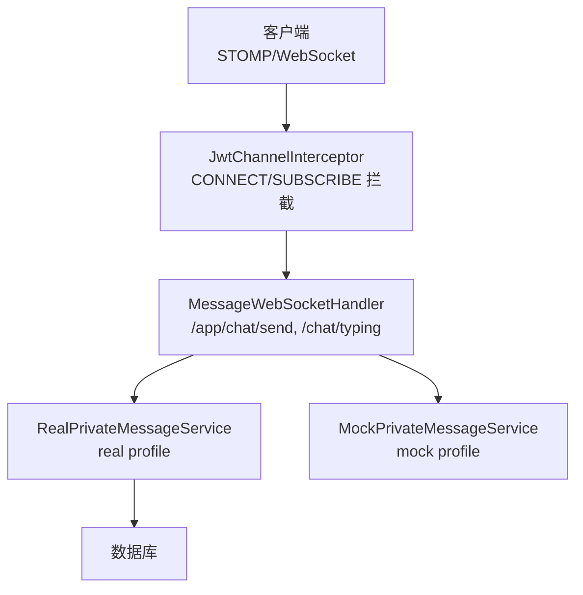
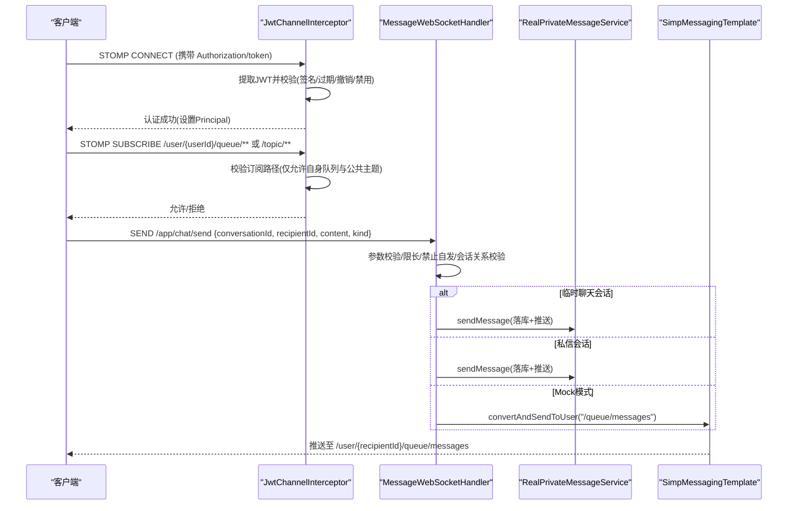
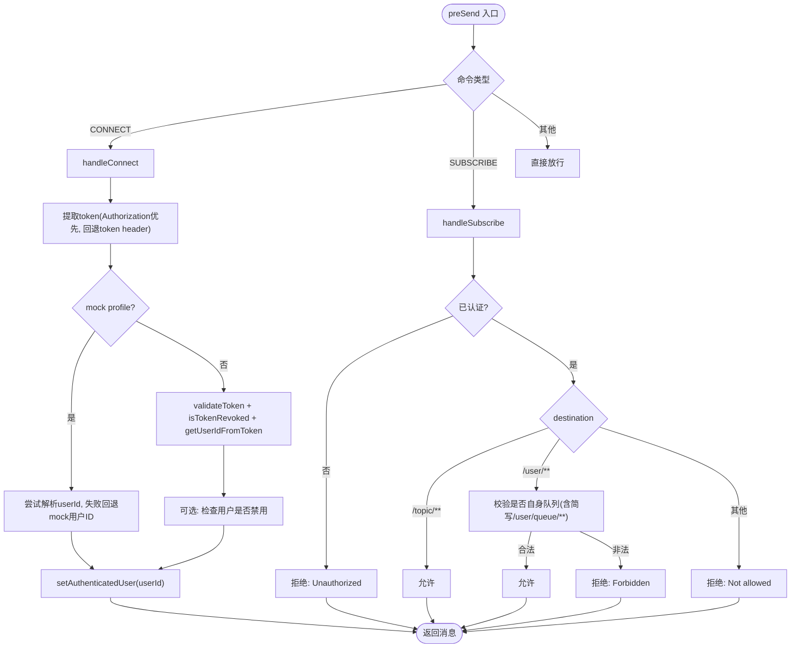
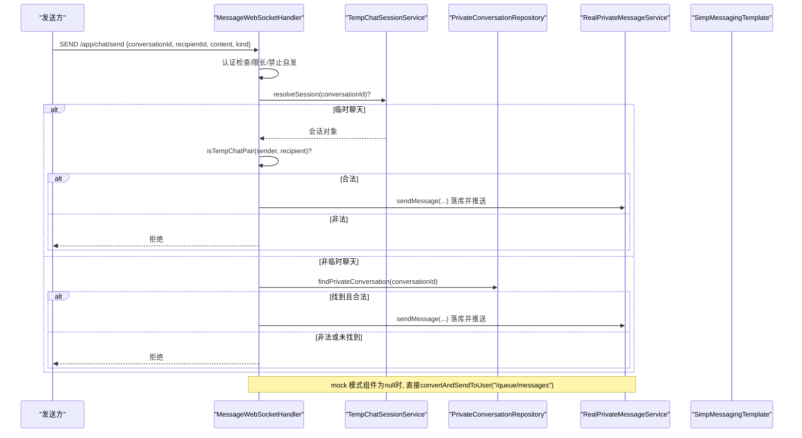
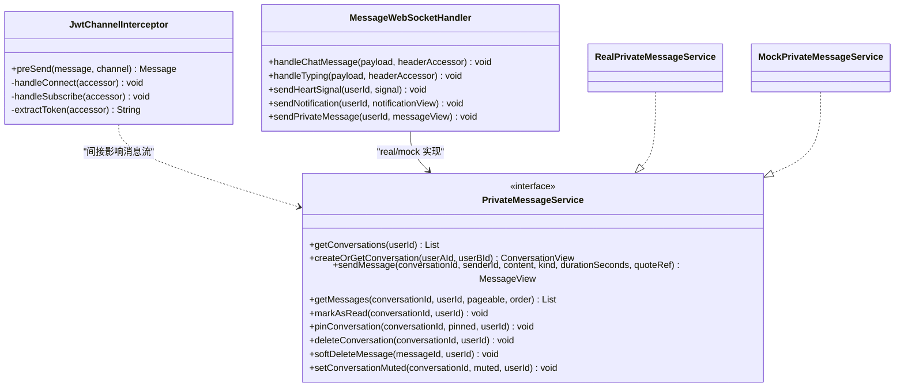

# 连接与会话管理

<cite>
**本文引用的文件**
- [JwtChannelInterceptor.java](file://apps/api/src/main/java/com/campuslove/api/config/JwtChannelInterceptor.java)
- [MessageWebSocketHandler.java](file://apps/api/src/main/java/com/campuslove/api/chat/MessageWebSocketHandler.java)
- [RealPrivateMessageService.java](file://apps/api/src/main/java/com/campuslove/api/chat/RealPrivateMessageService.java)
- [MockPrivateMessageService.java](file://apps/api/src/main/java/com/campuslove/api/chat/MockPrivateMessageService.java)
- [JwtChannelInterceptorTest.java](file://apps/api/src/test/java/com/campuslove/api/config/JwtChannelInterceptorTest.java)
</cite>

## 目录
1. [引言](#引言)
2. [项目结构](#项目结构)
3. [核心组件](#核心组件)
4. [架构总览](#架构总览)
5. [详细组件分析](#详细组件分析)
6. [依赖关系分析](#依赖关系分析)
7. [性能考量](#性能考量)
8. [故障排查指南](#故障排查指南)
9. [结论](#结论)
10. [附录](#附录)

## 引言
本技术文档聚焦 Campus Love 后端 WebSocket 连接与会话管理，重点解释 STOMP 通道中的 JWT 认证拦截、订阅权限控制、用户认证状态管理、会话生命周期与 Mock 模式降级策略，并总结安全校验规则与异常处理最佳实践。目标是帮助开发者快速理解从客户端建立 WebSocket 到消息推送的完整链路，以及在不同运行环境下如何保证一致性与安全性。

## 项目结构
与 WebSocket 连接与会话相关的核心代码位于后端 API 模块中：
- STOMP 通道拦截器负责 CONNECT/SUBSCRIBE 的安全校验与认证上下文设置
- WebSocket 消息处理器负责业务消息路由、会话关系校验与消息落库/推送
- 私信服务提供真实与 Mock 两种实现，分别对应 real 与 mock profile

图表来源
- [JwtChannelInterceptor.java:1-200](file://apps/api/src/main/java/com/campuslove/api/config/JwtChannelInterceptor.java#L1-L200)
- [MessageWebSocketHandler.java:1-200](file://apps/api/src/main/java/com/campuslove/api/chat/MessageWebSocketHandler.java#L1-L200)
- [RealPrivateMessageService.java:1-200](file://apps/api/src/main/java/com/campuslove/api/chat/RealPrivateMessageService.java#L1-L200)
- [MockPrivateMessageService.java:1-119](file://apps/api/src/main/java/com/campuslove/api/chat/MockPrivateMessageService.java#L1-L119)

章节来源
- [JwtChannelInterceptor.java:1-200](file://apps/api/src/main/java/com/campuslove/api/config/JwtChannelInterceptor.java#L1-L200)
- [MessageWebSocketHandler.java:1-200](file://apps/api/src/main/java/com/campuslove/api/chat/MessageWebSocketHandler.java#L1-L200)

## 核心组件
- JwtChannelInterceptor：在 STOMP 通道层对 CONNECT 和 SUBSCRIBE 进行拦截，完成 JWT 验证与订阅路径权限控制，并在认证通过后通过 accessor.setUser() 设置 Principal，供后续处理器使用。
- MessageWebSocketHandler：监听 /app/chat/send 与 /chat/typing，进行参数校验、长度限制、禁止自发消息、会话关系校验（临时聊天或私信），并根据环境选择落库与推送逻辑。
- RealPrivateMessageService：real profile 下的私信服务，负责持久化消息、更新会话预览与未读数、敏感词过滤、拉黑关系检查等。
- MockPrivateMessageService：mock profile 下的私信服务，返回预置数据，不落地数据库，用于联调演示。

章节来源
- [JwtChannelInterceptor.java:1-200](file://apps/api/src/main/java/com/campuslove/api/config/JwtChannelInterceptor.java#L1-L200)
- [MessageWebSocketHandler.java:1-200](file://apps/api/src/main/java/com/campuslove/api/chat/MessageWebSocketHandler.java#L1-L200)
- [RealPrivateMessageService.java:1-200](file://apps/api/src/main/java/com/campuslove/api/chat/RealPrivateMessageService.java#L1-L200)
- [MockPrivateMessageService.java:1-119](file://apps/api/src/main/java/com/campuslove/api/chat/MockPrivateMessageService.java#L1-L119)

## 架构总览
下图展示了从客户端连接到消息发送的核心调用链与安全校验点：

图表来源
- [JwtChannelInterceptor.java:1-200](file://apps/api/src/main/java/com/campuslove/api/config/JwtChannelInterceptor.java#L1-L200)
- [JwtChannelInterceptor.java:201-307](file://apps/api/src/main/java/com/campuslove/api/config/JwtChannelInterceptor.java#L201-L307)
- [MessageWebSocketHandler.java:1-200](file://apps/api/src/main/java/com/campuslove/api/chat/MessageWebSocketHandler.java#L1-L200)
- [MessageWebSocketHandler.java:201-455](file://apps/api/src/main/java/com/campuslove/api/chat/MessageWebSocketHandler.java#L201-L455)
- [RealPrivateMessageService.java:1-200](file://apps/api/src/main/java/com/campuslove/api/chat/RealPrivateMessageService.java#L1-L200)

## 详细组件分析

### JwtChannelInterceptor 分析
职责与流程：
- CONNECT 阶段：
  - 从 STOMP CONNECT 帧 nativeHeaders 中提取 JWT：优先 Authorization（支持 Bearer 前缀或直接 token 值），其次回退到 token 原生 header。
  - 非 mock profile 时：校验 JWT 有效性、是否已被撤销、是否能解析出 userId；若配置了用户库则进一步检查用户是否被禁用。
  - mock profile 时：跳过真实 JWT 校验，尝试解析 userId，失败则回退到配置的 mock 用户 ID；随后设置 Principal。
  - 成功认证后通过 accessor.setUser(new Principal{getName()=userId}) 将用户写入头，供后续命令使用。
- SUBSCRIBE 阶段：
  - 必须已认证（否则拒绝）。
  - 允许订阅 /topic/** 公共主题。
  - 对于 /user/**，仅允许订阅自己的队列，兼容 Spring 标准简写 /user/queue/**（服务端会解析为当前会话用户的队列）。
  - 其他路径一律拒绝。
- 其他命令：直接放行，由具体处理器负责校验。

关键点与边界：
- Token 来源优先级明确，避免 URL 查询参数方式，统一通过 STOMP 帧头传递。
- 登出/撤销的 token 将被拒绝（jti 黑名单检查）。
- 禁用用户无法建立 WebSocket 长连接。
- Mock 模式检测通过 active profiles 包含 “mock” 判断，保持与 HTTP mock 认证语义一致。

图表来源
- [JwtChannelInterceptor.java:1-200](file://apps/api/src/main/java/com/campuslove/api/config/JwtChannelInterceptor.java#L1-L200)
- [JwtChannelInterceptor.java:201-307](file://apps/api/src/main/java/com/campuslove/api/config/JwtChannelInterceptor.java#L201-L307)

章节来源
- [JwtChannelInterceptor.java:1-200](file://apps/api/src/main/java/com/campuslove/api/config/JwtChannelInterceptor.java#L1-L200)
- [JwtChannelInterceptor.java:201-307](file://apps/api/src/main/java/com/campuslove/api/config/JwtChannelInterceptor.java#L201-L307)
- [JwtChannelInterceptorTest.java:1-200](file://apps/api/src/test/java/com/campuslove/api/config/JwtChannelInterceptorTest.java#L1-L200)
- [JwtChannelInterceptorTest.java:201-368](file://apps/api/src/test/java/com/campuslove/api/config/JwtChannelInterceptorTest.java#L201-L368)

### MessageWebSocketHandler 分析
职责与流程：
- 监听 /app/chat/send：
  - 从 STOMP 头获取已认证的 Principal，得到 senderId，不信任 payload 中的 senderId。
  - 统一限长：content/kind 超长直接拒绝。
  - 禁止给自己发消息。
  - 会话关系校验：
    - 临时聊天会话：尝试解析并校验双方关系，成功后委托 TempChatMessageService 落库并推送（此处不再重复推送）。
    - 私信会话：尝试查找会话并校验双方关系，成功后复用 PrivateMessageService.sendMessage 落库并推送（内部完成敏感词过滤、会话预览与未读计数更新、推送 /queue/messages）。
    - 组件不可用（mock 模式）：覆盖 senderId 后转发到 /user/{recipientId}/queue/messages。
- 监听 /chat/typing：
  - 参数校验、禁止 self typing、会话关系校验（临时聊天或私信），mock 模式下退化为仅校验非空后转发。
  - 推送 /user/{recipientId}/queue/typing。

关键安全点：
- 所有 senderId 来自已认证 Principal，防止伪造。
- 会话关系严格校验，避免跨会话发消息。
- 落库失败则拒绝转发，避免“半持久化”消息扩散。

图表来源
- [MessageWebSocketHandler.java:1-200](file://apps/api/src/main/java/com/campuslove/api/chat/MessageWebSocketHandler.java#L1-L200)
- [MessageWebSocketHandler.java:201-455](file://apps/api/src/main/java/com/campuslove/api/chat/MessageWebSocketHandler.java#L201-L455)

章节来源
- [MessageWebSocketHandler.java:1-200](file://apps/api/src/main/java/com/campuslove/api/chat/MessageWebSocketHandler.java#L1-L200)
- [MessageWebSocketHandler.java:201-455](file://apps/api/src/main/java/com/campuslove/api/chat/MessageWebSocketHandler.java#L201-L455)

### 用户认证状态管理
- CONNECT 成功后，JwtChannelInterceptor 通过 accessor.setUser(new Principal{getName()=userId}) 将用户写入 STOMP 头。
- 后续 SUBSCRIBE/SEND 等操作可通过 StompHeaderAccessor.getUser() 获取已认证用户信息。
- 不同命令中的获取方式：
  - SUBSCRIBE：从 accessor.getUser() 获取当前订阅者身份，用于路径权限校验。
  - SEND（/app/chat/send）：从 SimpMessageHeaderAccessor.getUser() 获取 senderId，作为唯一可信发送方标识。
  - typing（/chat/typing）：同样从 HeaderAccessor 获取 senderId 并参与会话关系校验。

章节来源
- [JwtChannelInterceptor.java:1-200](file://apps/api/src/main/java/com/campuslove/api/config/JwtChannelInterceptor.java#L1-L200)
- [MessageWebSocketHandler.java:1-200](file://apps/api/src/main/java/com/campuslove/api/chat/MessageWebSocketHandler.java#L1-L200)

### 会话生命周期管理
- 连接建立：客户端发起 STOMP CONNECT，携带 JWT；拦截器校验并通过后建立会话。
- 用户身份绑定：CONNECT 成功后设置 Principal，后续命令均可读取。
- 会话存储：
  - 临时聊天：通过 TempChatMessageService 落库（由 WS 处理器委托）。
  - 私信：通过 PrivateMessageService.sendMessage 落库并更新会话预览/未读计数。
- 连接清理：DISCONNECT 命令不做额外拦截，交由框架默认行为处理；若需要显式清理资源，可在断开回调中执行（如取消订阅、清理缓存等）。

章节来源
- [JwtChannelInterceptor.java:1-200](file://apps/api/src/main/java/com/campuslove/api/config/JwtChannelInterceptor.java#L1-L200)
- [MessageWebSocketHandler.java:201-455](file://apps/api/src/main/java/com/campuslove/api/chat/MessageWebSocketHandler.java#L201-L455)

### Mock 模式下的降级处理策略
- Mock profile 检测：通过 environment.getActiveProfiles() 包含 “mock” 来判断。
- CONNECT 降级：
  - 跳过真实 JWT 校验；尝试解析 userId，失败回退到配置的 mock 用户 ID。
  - 设置 Principal 后继续后续流程。
- 消息处理降级：
  - 当 TempChatSessionService/PrivateMessageService 为 null（mock 模式）时，WS 处理器直接覆盖 senderId 并转发到 /queue/messages，保证联调可用。
- 私信列表与消息：MockPrivateMessageService 返回预置数据，便于演示最近聊天/正在升温等场景。

章节来源
- [JwtChannelInterceptor.java:1-200](file://apps/api/src/main/java/com/campuslove/api/config/JwtChannelInterceptor.java#L1-L200)
- [MessageWebSocketHandler.java:1-200](file://apps/api/src/main/java/com/campuslove/api/chat/MessageWebSocketHandler.java#L1-L200)
- [MockPrivateMessageService.java:1-119](file://apps/api/src/main/java/com/campuslove/api/chat/MockPrivateMessageService.java#L1-L119)

### 安全校验规则
- 禁止给自己发消息：senderId 等于 recipientId 直接拒绝。
- 会话关系验证：
  - 临时聊天：校验 sender/recipient 是否为 session.userA/userB。
  - 私信：校验 sender/recipient 是否为 conversation.userA/userB。
- 消息权限控制：
  - CONNECT 必须携带有效 JWT（或 mock 模式），否则拒绝。
  - SUBSCRIBE 仅允许 /topic/** 与 /user/{自身userId}/queue/**（含标准简写 /user/queue/**）。
  - SEND 路径 /app/chat/send 由处理器负责业务级权限校验。
- 拉黑与敏感内容：
  - RealPrivateMessageService 在发送消息时进行拉黑关系检查与敏感词过滤，确保被拉黑用户无法通信。

章节来源
- [JwtChannelInterceptor.java:201-307](file://apps/api/src/main/java/com/campuslove/api/config/JwtChannelInterceptor.java#L201-L307)
- [MessageWebSocketHandler.java:1-200](file://apps/api/src/main/java/com/campuslove/api/chat/MessageWebSocketHandler.java#L1-L200)
- [MessageWebSocketHandler.java:201-455](file://apps/api/src/main/java/com/campuslove/api/chat/MessageWebSocketHandler.java#L201-L455)
- [RealPrivateMessageService.java:1-200](file://apps/api/src/main/java/com/campuslove/api/chat/RealPrivateMessageService.java#L1-L200)

## 依赖关系分析
- JwtChannelInterceptor 依赖 JwtTokenProvider 进行 JWT 校验与撤销检查；可选依赖 UserRepository 进行用户禁用检查。
- MessageWebSocketHandler 依赖：
  - SimpMessagingTemplate 用于推送消息到用户专属队列。
  - TempChatSessionService 与 TempChatMessageService（real profile 专用，mock 下为 null）。
  - PrivateConversationRepository 用于私信会话查找与关系校验。
  - PrivateMessageService 接口，运行时根据 profile 注入 Real 或 Mock 实现。

图表来源
- [JwtChannelInterceptor.java:1-200](file://apps/api/src/main/java/com/campuslove/api/config/JwtChannelInterceptor.java#L1-L200)
- [MessageWebSocketHandler.java:1-200](file://apps/api/src/main/java/com/campuslove/api/chat/MessageWebSocketHandler.java#L1-L200)
- [RealPrivateMessageService.java:1-200](file://apps/api/src/main/java/com/campuslove/api/chat/RealPrivateMessageService.java#L1-L200)
- [MockPrivateMessageService.java:1-119](file://apps/api/src/main/java/com/campuslove/api/chat/MockPrivateMessageService.java#L1-L119)

章节来源
- [JwtChannelInterceptor.java:1-200](file://apps/api/src/main/java/com/campuslove/api/config/JwtChannelInterceptor.java#L1-L200)
- [MessageWebSocketHandler.java:1-200](file://apps/api/src/main/java/com/campuslove/api/chat/MessageWebSocketHandler.java#L1-L200)

## 性能考量
- 批量优化：RealPrivateMessageService 在获取会话列表时批量加载对方用户信息与未读数，避免 N+1 查询。
- 长度限制：WS 消息 content/kind 统一限长，防止内存与带宽压力。
- 落库失败即拒绝转发：避免“半持久化”消息导致的数据不一致与重复消费。
- Mock 模式降级：在无真实服务时直接转发，降低联调成本但需在生产环境启用真实服务。

[本节为通用指导，无需引用具体文件]

## 故障排查指南
常见问题与定位建议：
- CONNECT 被拒绝：
  - 检查是否携带 Authorization 或 token 头；确认 JWT 有效且未被撤销；确认用户未被禁用。
  - 参考断言：无 token、无效 token、无法提取 userId 均抛出 MessageDeliveryException。
- SUBSCRIBE 被拒绝：
  - 确认目标路径为 /topic/** 或 /user/{自身userId}/queue/**；注意标准简写 /user/queue/** 也应允许。
  - 未认证状态下订阅会被拒绝。
- SEND 被拒绝：
  - 检查 senderId 是否从 Header 获取（不可信 payload）；content/kind 是否超长；是否给自己发消息；会话关系是否匹配。
  - 落库失败会拒绝转发，避免未持久化消息传播。
- Mock 模式异常：
  - 确认 active profiles 包含 “mock”；若服务为 null，WS 处理器会退化转发；私信列表/消息为预置数据。

章节来源
- [JwtChannelInterceptorTest.java:1-200](file://apps/api/src/test/java/com/campuslove/api/config/JwtChannelInterceptorTest.java#L1-L200)
- [JwtChannelInterceptorTest.java:201-368](file://apps/api/src/test/java/com/campuslove/api/config/JwtChannelInterceptorTest.java#L201-L368)
- [MessageWebSocketHandler.java:1-200](file://apps/api/src/main/java/com/campuslove/api/chat/MessageWebSocketHandler.java#L1-L200)
- [MessageWebSocketHandler.java:201-455](file://apps/api/src/main/java/com/campuslove/api/chat/MessageWebSocketHandler.java#L201-L455)

## 结论
JwtChannelInterceptor 在 STOMP 通道层提供了统一的认证与订阅权限控制，确保只有持有有效 JWT 的用户可建立连接，且只能订阅公共主题与自身队列。MessageWebSocketHandler 在业务层完成严格的会话关系校验与消息安全控制，结合 Real/Mock 私有消息服务，既保证了生产环境的完整性与一致性，又支持开发联调的便捷性。遵循本文所述的安全规则与异常处理实践，可有效提升系统的稳定性与安全性。

[本节为总结性内容，无需引用具体文件]

## 附录
- 连接状态监控建议：
  - 记录 CONNECT/SUBSCRIBE/SEND 的关键日志（sessionId、userId、destination），便于追踪问题。
  - 关注拒绝原因（Unauthorized/Forbidden/Not allowed），快速定位前端传参与后端校验差异。
- 故障恢复最佳实践：
  - 客户端重连机制：在 CONNECT 失败或网络中断后指数退避重试。
  - 订阅幂等：客户端避免重复订阅同一队列，服务端应容忍重复订阅。
  - 心跳保活：定期发送轻量心跳或 ping/pong，及时感知连接失效。

[本节为通用指导，无需引用具体文件]