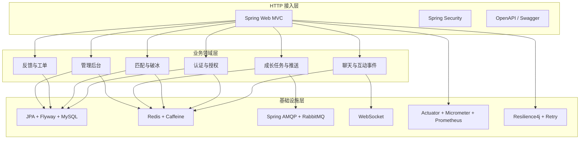
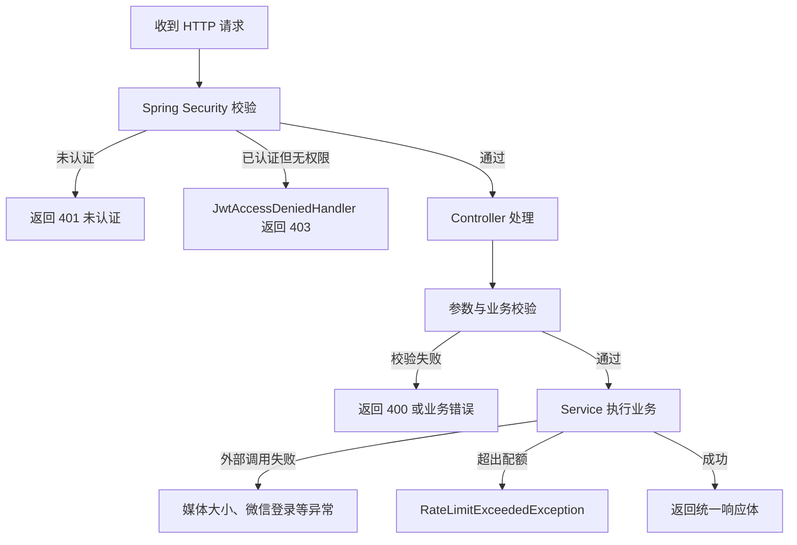
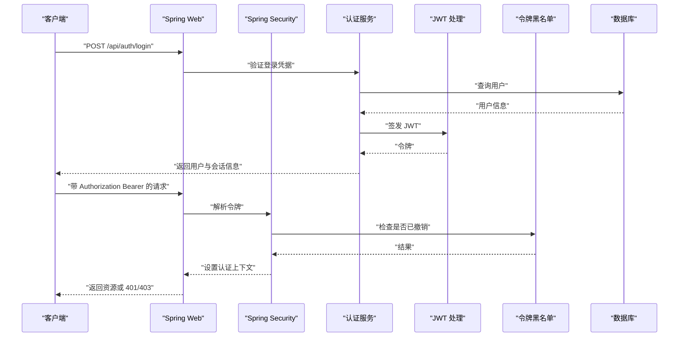
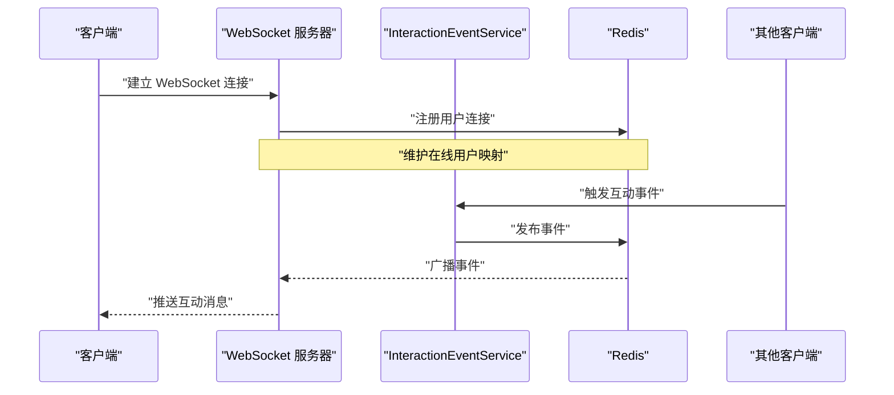
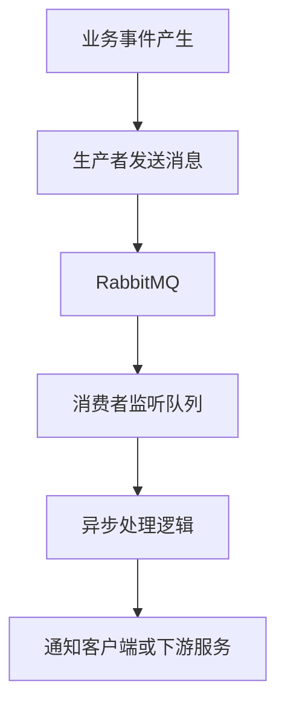
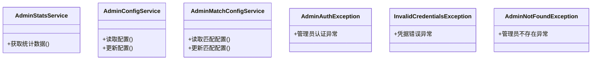
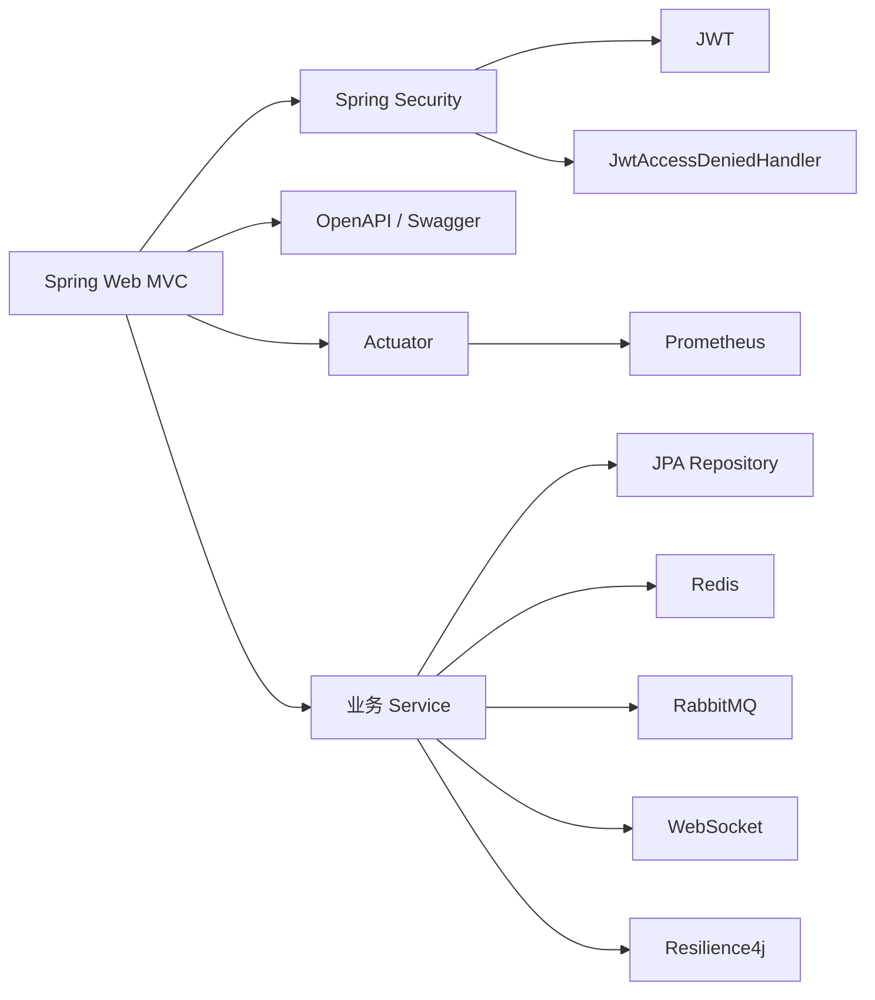

# 后端架构设计

<cite>
**本文引用的文件**   
- [pom.xml](file://apps/api/pom.xml)
- [JwtAccessDeniedHandler.java](file://apps/api/src/main/java/com/campuslove/api/auth/JwtAccessDeniedHandler.java)
- [TokenBlacklistService.java](file://apps/api/src/main/java/com/campuslove/api/auth/TokenBlacklistService.java)
- [ChatConfig.java](file://apps/api/src/main/java/com/campuslove/api/config/ChatConfig.java)
- [MatchConfig.java](file://apps/api/src/main/java/com/campuslove/api/config/MatchConfig.java)
- [RabbitConfig.java](file://apps/api/src/main/java/com/campuslove/api/config/RabbitConfig.java)
- [RateLimit.java](file://apps/api/src/main/java/com/campuslove/api/ratelimit/RateLimit.java)
- [RateLimitExceededException.java](file://apps/api/src/main/java/com/campuslove/api/ratelimit/RateLimitExceededException.java)
- [InteractionEventService.java](file://apps/api/src/main/java/com/campuslove/api/chat/InteractionEventService.java)
- [MockInteractionEventService.java](file://apps/api/src/main/java/com/campuslove/api/chat/MockInteractionEventService.java)
- [OnlineStatusService.java](file://apps/api/src/main/java/com/campuslove/api/user/OnlineStatusService.java)
- [MockOnlineStatusService.java](file://apps/api/src/main/java/com/campuslove/api/user/MockOnlineStatusService.java)
- [PushPreferenceService.java](file://apps/api/src/main/java/com/campuslove/api/growth/PushPreferenceService.java)
- [SocialProgressService.java](file://apps/api/src/main/java/com/campuslove/api/growth/SocialProgressService.java)
- [CheckInService.java](file://apps/api/src/main/java/com/campuslove/api/growth/CheckInService.java)
- [FeedbackTicketType.java](file://apps/api/src/main/java/com/campuslove/api/feedback/FeedbackTicketType.java)
- [SubmissionStatus.java](file://apps/api/src/main/java/com/campuslove/api/feedback/SubmissionStatus.java)
- [SubmissionRecordView.java](file://apps/api/src/main/java/com/campuslove/api/feedback/SubmissionRecordView.java)
- [FeedbackRepository.java](file://apps/api/src/main/java/com/campuslove/api/repository/FeedbackRepository.java)
- [DailyQuestionRepository.java](file://apps/api/src/main/java/com/campuslove/api/repository/DailyQuestionRepository.java)
- [PrivateConversationRepository.java](file://apps/api/src/main/java/com/campuslove/api/repository/PrivateConversationRepository.java)
- [UserSessionRepository.java](file://apps/api/src/main/java/com/campuslove/api/repository/UserSessionRepository.java)
- [MatchConfigEntityRepository.java](file://apps/api/src/main/java/com/campuslove/api/repository/MatchConfigEntityRepository.java)
- [AdminAppRuleRepository.java](file://apps/api/src/main/java/com/campuslove/api/repository/AdminAppRuleRepository.java)
- [AdminAppSwitchRepository.java](file://apps/api/src/main/java/com/campuslove/api/repository/AdminAppSwitchRepository.java)
- [RecommendStrategyRepository.java](file://apps/api/src/main/java/com/campuslove/api/repository/RecommendStrategyRepository.java)
- [AdminStatsService.java](file://apps/api/src/main/java/com/campuslove/api/admin/AdminStatsService.java)
- [AdminConfigService.java](file://apps/api/src/main/java/com/campuslove/api/admin/AdminConfigService.java)
- [AdminMatchConfigService.java](file://apps/api/src/main/java/com/campuslove/api/admin/AdminMatchConfigService.java)
- [AdminAuthException.java](file://apps/api/src/main/java/com/campuslove/api/admin/auth/AdminAuthException.java)
- [InvalidCredentialsException.java](file://apps/api/src/main/java/com/campuslove/api/admin/auth/InvalidCredentialsException.java)
- [AdminNotFoundException.java](file://apps/api/src/main/java/com/campuslove/api/admin/auth/AdminNotFoundException.java)
- [MediaSizeLimitExceededException.java](file://apps/api/src/main/java/com/campuslove/api/media/MediaSizeLimitExceededException.java)
- [WechatLoginException.java](file://apps/api/src/main/java/com/campuslove/api/auth/WechatLoginException.java)
- [InvalidTokenException.java](file://apps/api/src/main/java/com/campuslove/api/auth/InvalidTokenException.java)
- [TokenRevokedException.java](file://apps/api/src/main/java/com/campuslove/api/auth/TokenRevokedException.java)
- [HeartSignalView.java](file://apps/api/src/main/java/com/campuslove/api/match/HeartSignalView.java)
- [IcebreakerService.java](file://apps/api/src/main/java/com/campuslove/api/match/IcebreakerService.java)
- [RewindResultView.java](file://apps/api/src/main/java/com/campuslove/api/match/RewindResultView.java)
- [DoNotDisturbService.java](file://apps/api/src/main/java/com/campuslove/api/growth/DoNotDisturbService.java)
- [MakeUpCheckInResultView.java](file://apps/api/src/main/java/com/campuslove/api/growth/MakeUpCheckInResultView.java)
</cite>

## 目录

1. [引言](#引言)
2. [项目结构](#项目结构)
3. [核心组件](#核心组件)
4. [架构总览](#架构总览)
5. [详细组件分析](#详细组件分析)
6. [依赖关系分析](#依赖关系分析)
7. [性能与可靠性](#性能与可靠性)
8. [故障排查指南](#故障排查指南)
9. [结论](#结论)
10. [附录：API 与配置清单](#附录api-与配置清单)

## 引言

Campus Love 后端 API 是一个基于 Spring Boot 3、Java 17 的 Web 服务，围绕校园社交场景提供用户认证授权、匹配推荐、消息互动、成长任务、反馈工单和管理后台能力。从工程可见，它采用典型的 Controller-Service-Repository 分层组织业务代码，并通过 Spring Security、JWT、Redis、WebSocket、Spring AMQP、Micrometer、Resilience4j 等组件构建认证、缓存、实时通信、异步处理和可观测性体系。

本设计文档聚焦以下目标：

- 说明 Spring Boot 3 的分层架构、模块化设计与依赖注入方式。
- 描述 RESTful API 设计规范、异常处理策略和日志记录体系。
- 解释用户认证授权、JWT 令牌管理与权限控制实现。
- 说明 JPA/MyBatis 混合访问层的现状、事务边界与缓存策略。
- 梳理 WebSocket 实时通信、消息队列集成与异步任务处理。
- 总结配置管理、环境变量隔离和多环境部署思路。
- 补充 API 版本管理、接口契约测试和性能监控方案建议。

## 项目结构

后端主应用位于 `apps/api`，是一个 Maven 模块，继承 `spring-boot-starter-parent:3.3.1`，并声明了 Web、JPA、Flyway、MySQL、Security、WebSocket、Actuator、Prometheus、AMQP、Redis、Caffeine、Bucket4j、Resilience4j、OpenAPI/Swagger 等依赖。这表明项目以 Spring MVC 为 HTTP 入口，使用 JPA 作为主要数据访问抽象，通过 Flyway 做数据库迁移，使用 Redis 做分布式缓存和令牌黑名单，使用 RabbitMQ 做异步消息，使用 Prometheus 暴露指标。

**图示来源**   
- [pom.xml:1-200](file://apps/api/pom.xml#L1-L200)

该结构体现“按功能域分包”的组织方式：`auth`、`match`、`chat`、`growth`、`feedback`、`admin`、`repository`、`config`、`ratelimit`、`media` 等包分别承担不同职责；`dto`、`entity`（由 JPA 表映射）和 `view` 则用于跨层数据传输。

**章节来源**   
- [pom.xml:1-200](file://apps/api/pom.xml#L1-L200)

## 核心组件

### 分层架构与依赖注入

- **控制器层**：负责解析 HTTP 请求、参数校验、调用 Service、返回统一响应。项目中存在大量 View、Dto、枚举类型，说明控制器或 Service 会进行领域模型到 API 视图对象的转换。
- **服务层**：封装业务规则，例如在线状态、签到、免打扰、推送偏好、社交进度、破冰、反馈提交、管理统计等。
- **仓储层**：JPA Repository 定义在 `repository` 包中，对应 MySQL 实体表，如用户会话、私信、每日题目、匹配配置、管理规则、推荐策略等。
- **配置类**：`config` 包中的 ChatConfig、MatchConfig、RabbitConfig 等将外部系统能力装配为 Spring Bean。
- **安全组件**：Spring Security 配合 JWT 处理器、访问拒绝处理器、令牌黑名单服务完成认证授权。
- **中间件与切面**：限流注解、审计注解、AOP 切面用于横切关注点。

这种分层使 HTTP 层保持薄，业务逻辑集中在 Service，数据访问集中在 Repository，便于单元测试和替换底层实现。

**章节来源**   
- [pom.xml:1-200](file://apps/api/pom.xml#L1-L200)
- [ChatConfig.java](file://apps/api/src/main/java/com/campuslove/api/config/ChatConfig.java)
- [MatchConfig.java](file://apps/api/src/main/java/com/campuslove/api/config/MatchConfig.java)
- [RabbitConfig.java](file://apps/api/src/main/java/com/campuslove/api/config/RabbitConfig.java)

### RESTful API 设计规范

从 OpenAPI YAML 文件集合和 Java 端点类型可以推断 API 风格：

- 使用 RESTful URL，例如用户、动态、圈子、消息、通知、推荐、点赞、签到、反馈等。
- 使用标准 HTTP 方法表达资源操作：GET 查询、POST 创建、PUT/PATCH 更新、DELETE 删除。
- 使用统一错误体包含业务码、消息、traceId 和 HTTP 状态码。
- 使用路径参数表达资源标识，查询参数表达过滤条件。
- 敏感接口需要携带 JWT，管理接口通常限定管理员角色。

OpenAPI 规范文件可作为接口契约的基础，配合 springdoc-openapi 生成 Swagger UI。

**章节来源**   
- [pom.xml:1-200](file://apps/api/pom.xml#L1-L200)

### 异常处理策略

项目建立了多层异常体系：

- **认证异常**：`InvalidTokenException`、`TokenRevokedException`、`WechatLoginException` 表示令牌无效、已撤销或第三方登录失败。
- **权限异常**：`JwtAccessDeniedHandler` 统一处理 403 访问拒绝，返回标准 JSON 错误体，包含 traceId。
- **管理后台异常**：`AdminAuthException`、`InvalidCredentialsException`、`AdminNotFoundException` 区分管理员未认证、凭据错误和找不到管理员。
- **媒体限制异常**：`MediaSizeLimitExceededException` 用于上传文件大小超限。
- **限流异常**：`RateLimitExceededException` 与 `@RateLimit` 注解配合，表示请求超过速率限制。

所有异常最终会被全局异常处理器转换为统一格式，便于前端解析和链路追踪。

**图示来源**   
- [JwtAccessDeniedHandler.java:1-99](file://apps/api/src/main/java/com/campuslove/api/auth/JwtAccessDeniedHandler.java#L1-L99)
- [RateLimit.java](file://apps/api/src/main/java/com/campuslove/api/ratelimit/RateLimit.java)
- [RateLimitExceededException.java](file://apps/api/src/main/java/com/campuslove/api/ratelimit/RateLimitExceededException.java)
- [MediaSizeLimitExceededException.java](file://apps/api/src/main/java/com/campuslove/api/media/MediaSizeLimitExceededException.java)
- [WechatLoginException.java](file://apps/api/src/main/java/com/campuslove/api/auth/WechatLoginException.java)
- [InvalidTokenException.java](file://apps/api/src/main/java/com/campuslove/api/auth/InvalidTokenException.java)
- [TokenRevokedException.java](file://apps/api/src/main/java/com/campuslove/api/auth/TokenRevokedException.java)

**章节来源**   
- [JwtAccessDeniedHandler.java:1-99](file://apps/api/src/main/java/com/campuslove/api/auth/JwtAccessDeniedHandler.java#L1-L99)
- [RateLimit.java](file://apps/api/src/main/java/com/campuslove/api/ratelimit/RateLimit.java)
- [RateLimitExceededException.java](file://apps/api/src/main/java/com/campuslove/api/ratelimit/RateLimitExceededException.java)
- [MediaSizeLimitExceededException.java](file://apps/api/src/main/java/com/campuslove/api/media/MediaSizeLimitExceededException.java)
- [WechatLoginException.java](file://apps/api/src/main/java/com/campuslove/api/auth/WechatLoginException.java)
- [InvalidTokenException.java](file://apps/api/src/main/java/com/campuslove/api/auth/InvalidTokenException.java)
- [TokenRevokedException.java](file://apps/api/src/main/java/com/campuslove/api/auth/TokenRevokedException.java)

### 用户认证、授权与 JWT 管理

认证授权流程大致如下：

1. 客户端发起登录请求，服务端验证用户名密码或第三方登录凭证。
2. 成功后签发 JWT，并将必要信息写入 `UserSession` 或通过 Redis 存储。
3. 后续请求在 Header 中携带 JWT，Security 过滤器链解析并设置当前认证上下文。
4. 若令牌无效、过期或被拉黑，返回 401。
5. 若用户已认证但无权访问某资源，`JwtAccessDeniedHandler` 返回 403。
6. 管理后台额外校验管理员身份，失败时抛出管理员相关异常。

**图示来源**   
- [JwtAccessDeniedHandler.java:1-99](file://apps/api/src/main/java/com/campuslove/api/auth/JwtAccessDeniedHandler.java#L1-L99)
- [TokenBlacklistService.java](file://apps/api/src/main/java/com/campuslove/api/auth/TokenBlacklistService.java)
- [InvalidTokenException.java](file://apps/api/src/main/java/com/campuslove/api/auth/InvalidTokenException.java)
- [TokenRevokedException.java](file://apps/api/src/main/java/com/campuslove/api/auth/TokenRevokedException.java)
- [WechatLoginException.java](file://apps/api/src/main/java/com/campuslove/api/auth/WechatLoginException.java)

**章节来源**   
- [JwtAccessDeniedHandler.java:1-99](file://apps/api/src/main/java/com/campuslove/api/auth/JwtAccessDeniedHandler.java#L1-L99)
- [TokenBlacklistService.java](file://apps/api/src/main/java/com/campuslove/api/auth/TokenBlacklistService.java)

### 数据库访问层：JPA、Flyway 与 Repository

项目明确引入 `spring-boot-starter-data-jpa`、`flyway-core`、`flyway-mysql` 和 `mysql-connector-j`，说明：

- 使用 JPA 作为 ORM 抽象。
- 使用 Flyway 管理数据库版本迁移。
- 使用 MySQL 作为持久化存储。
- Repository 接口按领域划分：用户会话、私信、每日题目、匹配配置、管理规则、推荐策略、反馈、活动报名等。

目前从源码可见的主要是 JPA Repository。若存在 MyBatis Mapper，则属于混合访问层：JPA 用于常规实体 CRUD，MyBatis 可能用于复杂查询、报表或遗留 SQL。

```mermaid
classDiagram
    class FeedbackRepository {
        <<interface>>
        +save()
        +findByTicketId()
        +countByStatus()
    }
    class UserSessionRepository {
        <<interface>>
        +findByUserId()
        +deleteBySessionId()
    }
    class PrivateConversationRepository {
        <<interface>>
        +findByConvId()
        +findByUserIds()
    }
    class DailyQuestionRepository {
        <<interface>>
        +findToday()
        +saveAnswer()
    }
    class MatchConfigEntityRepository {
        <<interface>>
        +findById()
        +updateConfig()
    }
    class AdminAppRuleRepository {
        <<interface>>
        +findAll()
        +saveRule()
    }
    class AdminAppSwitchRepository {
        <<interface>>
        +getSwitch()
        +setSwitch()
    }
    class RecommendStrategyRepository {
        <<interface>>
        +findByStrategyName()
        +saveStrategy()
    }
```

**图示来源**   
- [FeedbackRepository.java](file://apps/api/src/main/java/com/campuslove/api/repository/FeedbackRepository.java)
- [UserSessionRepository.java](file://apps/api/src/main/java/com/campuslove/api/repository/UserSessionRepository.java)
- [PrivateConversationRepository.java](file://apps/api/src/main/java/com/campuslove/api/repository/PrivateConversationRepository.java)
- [DailyQuestionRepository.java](file://apps/api/src/main/java/com/campuslove/api/repository/DailyQuestionRepository.java)
- [MatchConfigEntityRepository.java](file://apps/api/src/main/java/com/campuslove/api/repository/MatchConfigEntityRepository.java)
- [AdminAppRuleRepository.java](file://apps/api/src/main/java/com/campuslove/api/repository/AdminAppRuleRepository.java)
- [AdminAppSwitchRepository.java](file://apps/api/src/main/java/com/campuslove/api/repository/AdminAppSwitchRepository.java)
- [RecommendStrategyRepository.java](file://apps/api/src/main/java/com/campuslove/api/repository/RecommendStrategyRepository.java)

**章节来源**   
- [pom.xml:1-200](file://apps/api/pom.xml#L1-L200)
- [FeedbackRepository.java](file://apps/api/src/main/java/com/campuslove/api/repository/FeedbackRepository.java)
- [UserSessionRepository.java](file://apps/api/src/main/java/com/campuslove/api/repository/UserSessionRepository.java)
- [PrivateConversationRepository.java](file://apps/api/src/main/java/com/campuslove/api/repository/PrivateConversationRepository.java)
- [DailyQuestionRepository.java](file://apps/api/src/main/java/com/campuslove/api/repository/DailyQuestionRepository.java)
- [MatchConfigEntityRepository.java](file://apps/api/src/main/java/com/campuslove/api/repository/MatchConfigEntityRepository.java)
- [AdminAppRuleRepository.java](file://apps/api/src/main/java/com/campuslove/api/repository/AdminAppRuleRepository.java)
- [AdminAppSwitchRepository.java](file://apps/api/src/main/java/com/campuslove/api/repository/AdminAppSwitchRepository.java)
- [RecommendStrategyRepository.java](file://apps/api/src/main/java/com/campuslove/api/repository/RecommendStrategyRepository.java)

### 事务管理与缓存策略

- **事务管理**：JPA 默认使用声明式事务。涉及写操作的 Service 方法应标注事务边界，确保多个 Repository 调用在同一个事务中提交或回滚。
- **本地缓存**：Caffeine 作为 L1 缓存，适合单元测试或低并发降级场景。
- **分布式缓存**：Redis 用于 Token 黑名单、限流计数、会话缓存、在线状态、匹配提示等。
- **缓存一致性**：写操作应先更新数据库，再失效或更新缓存；读操作可先查缓存，未命中再查库并回填。

**章节来源**   
- [pom.xml:1-200](file://apps/api/pom.xml#L1-L200)

### WebSocket 实时通信架构

WebSocket 依赖已声明，`ChatConfig` 表明聊天模块有专门配置。结合 `InteractionEventService` 和 `MockInteractionEventService`，可以推断：

- 服务端维护用户连接。
- 当发生点赞、查看、破冰、匹配等互动事件时，向目标用户推送消息。
- Mock 实现可用于开发或测试环境，避免真实 WebSocket 依赖。
- 线上可用 Redis Pub/Sub 或消息队列做多实例广播。

**图示来源**   
- [ChatConfig.java](file://apps/api/src/main/java/com/campuslove/api/config/ChatConfig.java)
- [InteractionEventService.java](file://apps/api/src/main/java/com/campuslove/api/chat/InteractionEventService.java)
- [MockInteractionEventService.java](file://apps/api/src/main/java/com/campuslove/api/chat/MockInteractionEventService.java)

**章节来源**   
- [ChatConfig.java](file://apps/api/src/main/java/com/campuslove/api/config/ChatConfig.java)
- [InteractionEventService.java](file://apps/api/src/main/java/com/campuslove/api/chat/InteractionEventService.java)
- [MockInteractionEventService.java](file://apps/api/src/main/java/com/campuslove/api/chat/MockInteractionEventService.java)

### 消息队列集成与异步任务处理

项目引入 Spring AMQP，`RabbitConfig` 表明存在 RabbitMQ 配置。`mq` 包中的 `MatchEventMessage`、`CheckInEventMessage` 表示匹配和签到事件通过消息队列异步处理。典型用途包括：

- 匹配结果异步通知。
- 签到奖励发放。
- 推送通知。
- 外部服务调用重试。

**图示来源**   
- [RabbitConfig.java](file://apps/api/src/main/java/com/campuslove/api/config/RabbitConfig.java)
- [CheckInEventMessage.java](file://apps/api/src/main/java/com/campuslove/api/mq/CheckInEventMessage.java)
- [MatchEventMessage.java](file://apps/api/src/main/java/com/campuslove/api/mq/MatchEventMessage.java)

**章节来源**   
- [pom.xml:1-200](file://apps/api/pom.xml#L1-L200)
- [RabbitConfig.java](file://apps/api/src/main/java/com/campuslove/api/config/RabbitConfig.java)
- [CheckInEventMessage.java](file://apps/api/src/main/java/com/campuslove/api/mq/CheckInEventMessage.java)
- [MatchEventMessage.java](file://apps/api/src/main/java/com/campuslove/api/mq/MatchEventMessage.java)

### 配置管理、环境变量隔离与多环境部署

- 使用 Spring Boot 配置文件与环境变量管理数据库、Redis、RabbitMQ、JWT、限流、开关等配置。
- 通过不同 profile 或环境变量区分 dev、test、staging、prod。
- `ChatConfig`、`MatchConfig`、`RabbitConfig` 等配置类集中装配外部依赖。
- Actuator 暴露健康检查和运行指标，Prometheus 暴露 Micrometer 指标。

部署建议：

- 使用 Docker Compose 或 Kubernetes 编排应用、MySQL、Redis、RabbitMQ、Prometheus、Grafana。
- 使用配置中心或环境变量注入敏感信息，不放入代码仓库。
- 使用镜像标签与 Git commit 关联，保证可追溯。

**章节来源**   
- [pom.xml:1-200](file://apps/api/pom.xml#L1-L200)
- [ChatConfig.java](file://apps/api/src/main/java/com/campuslove/api/config/ChatConfig.java)
- [MatchConfig.java](file://apps/api/src/main/java/com/campuslove/api/config/MatchConfig.java)
- [RabbitConfig.java](file://apps/api/src/main/java/com/campuslove/api/config/RabbitConfig.java)

### API 版本管理、接口契约测试与性能监控

- **API 版本管理**：建议在 URL 中保留 `/api/v1/...`，或在 Header 中引入版本字段；向后兼容变更优先，破坏性变更升级版本号。
- **接口契约测试**：OpenAPI YAML 文件可作为契约基础，配合 springdoc-openapi 自动生成文档；也可用工具校验实际接口与契约的一致性。
- **性能监控**：Actuator + Micrometer + Prometheus 暴露 JVM、HTTP、数据库、Redis、自定义指标；Grafana 展示仪表盘。
- **容量规划**：根据 QPS、延迟、缓存命中率、消息积压情况调整实例数、连接池、线程池和队列大小。

**章节来源**   
- [pom.xml:1-200](file://apps/api/pom.xml#L1-L200)

## 详细组件分析

### 认证与授权组件

#### JwtAccessDeniedHandler

该类实现 Spring Security 的访问拒绝处理器，用于处理已认证但权限不足的情况。其职责包括：

- 生成 traceId。
- 记录警告日志。
- 返回统一的 403 JSON 响应。
- 通过 `X-Trace-Id` 头支持链路追踪。

它与“未认证 401”处理器分工明确，避免把权限问题误判为登录问题。

**章节来源**   
- [JwtAccessDeniedHandler.java:1-99](file://apps/api/src/main/java/com/campuslove/api/auth/JwtAccessDeniedHandler.java#L1-L99)

#### TokenBlacklistService

令牌黑名单服务用于管理已撤销的 JWT。常见场景包括用户主动登出、强制下线、安全审计后吊销令牌。Redis 适合作为黑名单存储，支持快速查找和过期清理。

**章节来源**   
- [TokenBlacklistService.java](file://apps/api/src/main/java/com/campuslove/api/auth/TokenBlacklistService.java)

### 聊天与互动事件

`InteractionEventService` 是互动事件的抽象服务，`MockInteractionEventService` 是其模拟实现。该设计允许在不同环境下切换真实或模拟行为，便于开发和测试。

**章节来源**   
- [InteractionEventService.java](file://apps/api/src/main/java/com/campuslove/api/chat/InteractionEventService.java)
- [MockInteractionEventService.java](file://apps/api/src/main/java/com/campuslove/api/chat/MockInteractionEventService.java)

### 用户在线状态

`OnlineStatusService` 与 `MockOnlineStatusService` 体现了在线状态服务的接口与模拟实现分离。线上可使用 Redis 维护在线用户集合，离线时使用内存或 Mock。

**章节来源**   
- [OnlineStatusService.java](file://apps/api/src/main/java/com/campuslove/api/user/OnlineStatusService.java)
- [MockOnlineStatusService.java](file://apps/api/src/main/java/com/campuslove/api/user/MockOnlineStatusService.java)

### 成长任务与推送

成长模块包括：

- `CheckInService`：签到逻辑。
- `DoNotDisturbService`：免打扰配置与服务。
- `PushPreferenceService`：推送偏好服务。
- `SocialProgressService`：社交进度服务。

这些服务通常会结合 Redis、数据库和消息队列，完成状态更新、通知和统计。

**章节来源**   
- [CheckInService.java](file://apps/api/src/main/java/com/campuslove/api/growth/CheckInService.java)
- [DoNotDisturbService.java](file://apps/api/src/main/java/com/campuslove/api/growth/DoNotDisturbService.java)
- [PushPreferenceService.java](file://apps/api/src/main/java/com/campuslove/api/growth/PushPreferenceService.java)
- [SocialProgressService.java](file://apps/api/src/main/java/com/campuslove/api/growth/SocialProgressService.java)

### 反馈与工单

反馈模块包含类型、状态、视图和 Repository：

- `FeedbackTicketType`：工单类型。
- `SubmissionStatus`：提交状态。
- `SubmissionRecordView`：提交记录视图。
- `FeedbackRepository`：反馈数据访问。

这构成一个完整的反馈提交流程：用户提交 → 落库 → 管理员处理 → 状态流转。

**章节来源**   
- [FeedbackTicketType.java](file://apps/api/src/main/java/com/campuslove/api/feedback/FeedbackTicketType.java)
- [SubmissionStatus.java](file://apps/api/src/main/java/com/campuslove/api/feedback/SubmissionStatus.java)
- [SubmissionRecordView.java](file://apps/api/src/main/java/com/campuslove/api/feedback/SubmissionRecordView.java)
- [FeedbackRepository.java](file://apps/api/src/main/java/com/campuslove/api/repository/FeedbackRepository.java)

### 匹配与破冰

匹配模块包含：

- `HeartSignalView`：心动信号视图。
- `IcebreakerService`：破冰话题服务。
- `RewindResultView`：回溯或重新匹配结果视图。

匹配逻辑通常依赖推荐策略、用户画像、行为数据和配置项。

**章节来源**   
- [HeartSignalView.java](file://apps/api/src/main/java/com/campuslove/api/match/HeartSignalView.java)
- [IcebreakerService.java](file://apps/api/src/main/java/com/campuslove/api/match/IcebreakerService.java)
- [RewindResultView.java](file://apps/api/src/main/java/com/campuslove/api/match/RewindResultView.java)

### 管理后台

管理后台包含统计数据、配置管理、匹配配置、审计注解和管理员权限校验。关键组件：

- `AdminStatsService`：管理统计数据服务。
- `AdminConfigService`：管理应用配置服务。
- `AdminMatchConfigService`：管理匹配配置服务。
- `AdminAuthException`、`InvalidCredentialsException`、`AdminNotFoundException`：管理员相关异常。
- `Auditable`：审计注解，配合 AOP 自动记录管理操作。

**图示来源**   
- [AdminStatsService.java](file://apps/api/src/main/java/com/campuslove/api/admin/AdminStatsService.java)
- [AdminConfigService.java](file://apps/api/src/main/java/com/campuslove/api/admin/AdminConfigService.java)
- [AdminMatchConfigService.java](file://apps/api/src/main/java/com/campuslove/api/admin/AdminMatchConfigService.java)
- [AdminAuthException.java](file://apps/api/src/main/java/com/campuslove/api/admin/auth/AdminAuthException.java)
- [InvalidCredentialsException.java](file://apps/api/src/main/java/com/campuslove/api/admin/auth/InvalidCredentialsException.java)
- [AdminNotFoundException.java](file://apps/api/src/main/java/com/campuslove/api/admin/auth/AdminNotFoundException.java)

**章节来源**   
- [AdminStatsService.java](file://apps/api/src/main/java/com/campuslove/api/admin/AdminStatsService.java)
- [AdminConfigService.java](file://apps/api/src/main/java/com/campuslove/api/admin/AdminConfigService.java)
- [AdminMatchConfigService.java](file://apps/api/src/main/java/com/campuslove/api/admin/AdminMatchConfigService.java)
- [AdminAuthException.java](file://apps/api/src/main/java/com/campuslove/api/admin/auth/AdminAuthException.java)
- [InvalidCredentialsException.java](file://apps/api/src/main/java/com/campuslove/api/admin/auth/InvalidCredentialsException.java)
- [AdminNotFoundException.java](file://apps/api/src/main/java/com/campuslove/api/admin/auth/AdminNotFoundException.java)

## 依赖关系分析

**图示来源**   
- [pom.xml:1-200](file://apps/api/pom.xml#L1-L200)
- [JwtAccessDeniedHandler.java:1-99](file://apps/api/src/main/java/com/campuslove/api/auth/JwtAccessDeniedHandler.java#L1-L99)

### 耦合与内聚

- 高内聚：每个业务域有独立 Service、View、DTO 和 Repository。
- 合理解耦：通过接口与 Mock 实现分离，便于测试。
- 横切关注点：限流、审计、异常处理、日志、监控通过注解和全局处理器处理，减少业务代码污染。

### 外部依赖

- MySQL：主数据存储。
- Redis：缓存、令牌黑名单、限流、分布式锁。
- RabbitMQ：异步消息。
- WebSocket：实时通信。
- Prometheus/Grafana：监控与可视化。
- OpenAPI/Swagger：接口文档。

**章节来源**   
- [pom.xml:1-200](file://apps/api/pom.xml#L1-L200)

## 性能与可靠性

### 性能考虑

- 使用 Caffeine 作为本地缓存，降低热点数据访问延迟。
- 使用 Redis 作为分布式缓存，提升横向扩展能力。
- 使用 RabbitMQ 削峰填谷，避免同步调用外部系统造成阻塞。
- 使用 Bucket4j 做 API 限流，保护后端不被突发流量压垮。
- 使用连接池和合理的线程池配置，避免资源耗尽。
- 对慢查询和大数据量查询使用分页、索引和投影。

### 可靠性考虑

- Resilience4j 提供熔断、降级、重试能力，保护外部依赖。
- Spring Retry 支持方法级重试，适用于幂等外部调用。
- Redisson 提供分布式锁，防止并发重复扣费或重复处理。
- Actuator 暴露健康检查，配合负载均衡器剔除不健康实例。
- 数据库迁移使用 Flyway，保证版本一致。

**章节来源**   
- [pom.xml:1-200](file://apps/api/pom.xml#L1-L200)

## 故障排查指南

### 常见问题定位

1. **401 未认证**  
   - 检查 JWT 是否携带、是否过期、是否在黑名单中。
   - 查看 `InvalidTokenException`、`TokenRevokedException`、`WechatLoginException` 相关日志。

2. **403 无权限**  
   - 检查用户角色是否满足接口要求。
   - 查看 `JwtAccessDeniedHandler` 日志和 traceId。

3. **管理后台无法登录**  
   - 检查 `AdminAuthException`、`InvalidCredentialsException`、`AdminNotFoundException`。
   - 确认管理员账号是否存在且启用。

4. **上传失败**  
   - 检查 `MediaSizeLimitExceededException`。
   - 确认对象存储配置和大小限制。

5. **接口被限流**  
   - 检查 `RateLimitExceededException`。
   - 调整 `@RateLimit` 的配额或后端扩容。

6. **实时消息不推送**  
   - 检查 WebSocket 连接是否正常。
   - 检查 Redis Pub/Sub 或消息队列是否连通。

7. **指标缺失**  
   - 检查 Actuator 和 Prometheus 配置。
   - 确认 `/actuator/prometheus` 可访问。

**章节来源**   
- [JwtAccessDeniedHandler.java:1-99](file://apps/api/src/main/java/com/campuslove/api/auth/JwtAccessDeniedHandler.java#L1-L99)
- [MediaSizeLimitExceededException.java](file://apps/api/src/main/java/com/campuslove/api/media/MediaSizeLimitExceededException.java)
- [RateLimitExceededException.java](file://apps/api/src/main/java/com/campuslove/api/ratelimit/RateLimitExceededException.java)
- [AdminAuthException.java](file://apps/api/src/main/java/com/campuslove/api/admin/auth/AdminAuthException.java)
- [InvalidCredentialsException.java](file://apps/api/src/main/java/com/campuslove/api/admin/auth/InvalidCredentialsException.java)
- [AdminNotFoundException.java](file://apps/api/src/main/java/com/campuslove/api/admin/auth/AdminNotFoundException.java)

## 结论

Campus Love 后端 API 采用 Spring Boot 3 的典型分层架构，围绕认证授权、匹配推荐、聊天互动、成长任务、反馈工单和管理后台构建业务能力。项目通过 JPA、Flyway、MySQL、Redis、RabbitMQ、WebSocket、Actuator、Prometheus、Resilience4j、Bucket4j 等组件，形成了可扩展、可观测、具备韧性的后端平台。未来可在 API 版本管理、契约测试、灰度发布、链路追踪、数据库读写分离和缓存一致性方面继续完善。

[无需章节来源，因为本节为总结性内容]

## 附录：API 与配置清单

### 主要 API 领域

- 用户与认证：登录、注册、令牌刷新、注销。
- 用户资料与关注：个人资料、关注列表、粉丝列表。
- 动态与圈子：发帖、评论、点赞、圈子管理。
- 匹配与破冰：心动、匹配结果、破冰话题。
- 消息与聊天：私信、互动事件、WebSocket 推送。
- 成长任务：签到、免打扰、推送偏好、社交进度。
- 反馈与工单：提交反馈、工单状态、管理员处理。
- 管理后台：统计数据、配置开关、匹配策略、审计日志。

### 主要配置项

- 数据库：URL、用户名、密码、连接池。
- Redis：地址、端口、密码、连接池、超时。
- RabbitMQ：地址、端口、用户名、密码、虚拟主机。
- JWT：密钥、有效期、算法。
- 限流：QPS、窗口大小、注解默认值。
- 外部服务：微信登录、短信、对象存储、第三方 SDK。
- 监控：Actuator 端点、Prometheus 抓取配置。

**章节来源**   
- [pom.xml:1-200](file://apps/api/pom.xml#L1-L200)