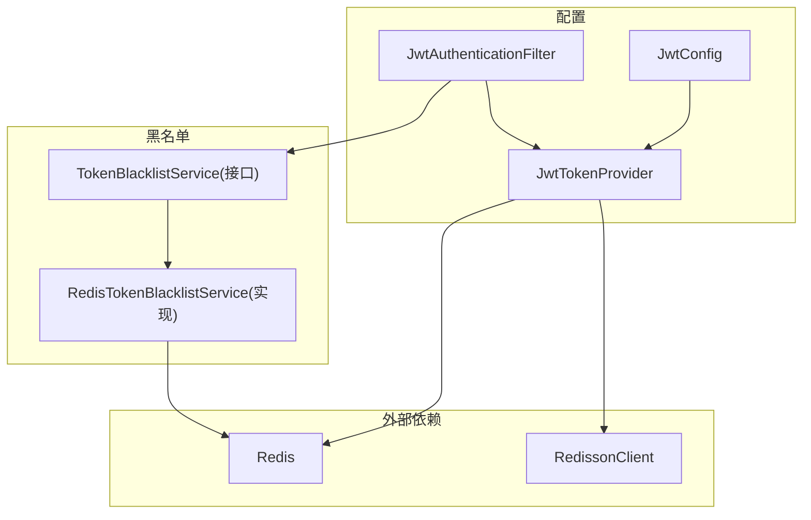
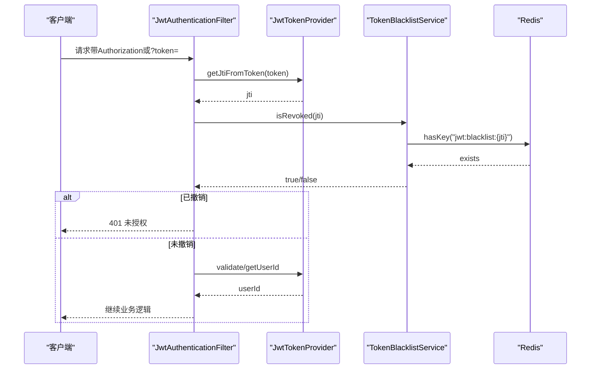
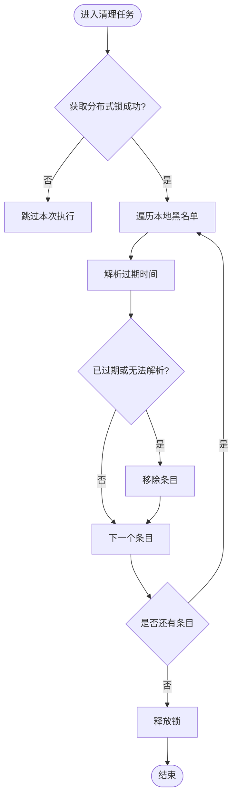
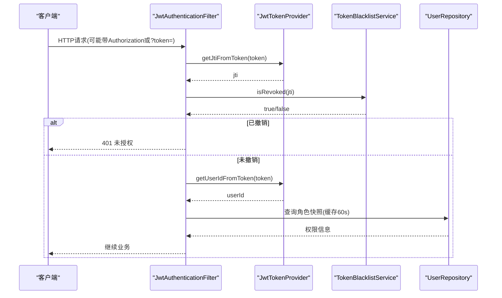
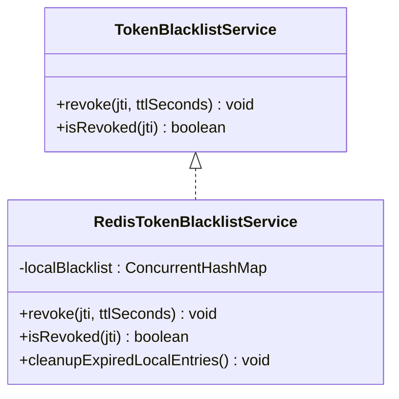
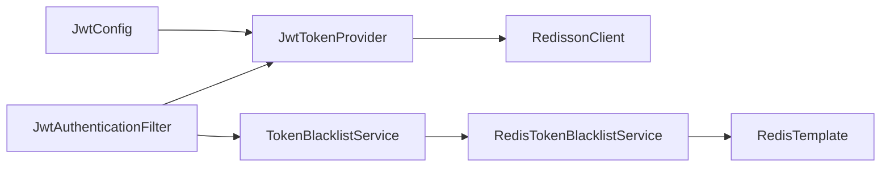

# JWT令牌管理

<cite>
**本文引用的文件**
- [JwtTokenProvider.java](file://apps/api/src/main/java/com/campuslove/api/config/JwtTokenProvider.java)
- [JwtConfig.java](file://apps/api/src/main/java/com/campuslove/api/config/JwtConfig.java)
- [JwtAuthenticationFilter.java](file://apps/api/src/main/java/com/campuslove/api/config/JwtAuthenticationFilter.java)
- [TokenBlacklistService.java](file://apps/api/src/main/java/com/campuslove/api/auth/TokenBlacklistService.java)
- [RedisTokenBlacklistService.java](file://apps/api/src/main/java/com/campuslove/api/auth/RedisTokenBlacklistService.java)
</cite>

## 目录
1. [简介](#简介)
2. [项目结构](#项目结构)
3. [核心组件](#核心组件)
4. [架构总览](#架构总览)
5. [详细组件分析](#详细组件分析)
6. [依赖关系分析](#依赖关系分析)
7. [性能考量](#性能考量)
8. [故障排查指南](#故障排查指南)
9. [结论](#结论)
10. [附录](#附录)

## 简介
本技术文档围绕 Campus Love 后端的JWT令牌管理系统展开，系统涵盖令牌的生成、验证、刷新与撤销全生命周期；详细说明JwtTokenProvider的实现原理（HMAC-SHA256签名、密钥版本管理与kid头支持）、令牌黑名单机制（Redis持久化与本地内存降级、jti在撤销中的作用），以及媒体访问令牌（media token）的特殊设计（scope声明、短期TTL与查询参数传递）。同时覆盖密钥轮换、分布式锁保护与定时清理任务、错误处理流程与性能优化建议，并给出安全最佳实践。

## 项目结构
JWT相关能力主要位于后端API模块的config与auth包中：
- config包：JwtConfig（配置与安全校验）、JwtTokenProvider（令牌签发/解析/媒体令牌）、JwtAuthenticationFilter（认证过滤器与黑名单集成）
- auth包：TokenBlacklistService接口与RedisTokenBlacklistService实现（基于Redis+本地内存的黑名单）

图示来源
- [JwtConfig.java:1-105](file://apps/api/src/main/java/com/campuslove/api/config/JwtConfig.java#L1-L105)
- [JwtTokenProvider.java:1-438](file://apps/api/src/main/java/com/campuslove/api/config/JwtTokenProvider.java#L1-L438)
- [JwtAuthenticationFilter.java:1-290](file://apps/api/src/main/java/com/campuslove/api/config/JwtAuthenticationFilter.java#L1-L290)
- [TokenBlacklistService.java:1-54](file://apps/api/src/main/java/com/campuslove/api/auth/TokenBlacklistService.java#L1-L54)
- [RedisTokenBlacklistService.java:1-208](file://apps/api/src/main/java/com/campuslove/api/auth/RedisTokenBlacklistService.java#L1-L208)

章节来源
- [JwtConfig.java:1-105](file://apps/api/src/main/java/com/campuslove/api/config/JwtConfig.java#L1-L105)
- [JwtTokenProvider.java:1-438](file://apps/api/src/main/java/com/campuslove/api/config/JwtTokenProvider.java#L1-L438)
- [JwtAuthenticationFilter.java:1-290](file://apps/api/src/main/java/com/campuslove/api/config/JwtAuthenticationFilter.java#L1-L290)
- [TokenBlacklistService.java:1-54](file://apps/api/src/main/java/com/campuslove/api/auth/TokenBlacklistService.java#L1-L54)
- [RedisTokenBlacklistService.java:1-208](file://apps/api/src/main/java/com/campuslove/api/auth/RedisTokenBlacklistService.java#L1-L208)

## 核心组件
- JwtConfig：绑定app.jwt.*配置项，启动时校验密钥安全性（长度、默认值检查），提供过期时间与密钥版本。
- JwtTokenProvider：负责签发用户JWT与短期媒体令牌，提取jti/scope/过期时间等，提供撤销兼容方法，并提供定时清理任务。
- TokenBlacklistService / RedisTokenBlacklistService：定义并实现基于jti的黑名单服务，支持Redis持久化与本地内存降级。
- JwtAuthenticationFilter：从请求中提取token（Authorization或媒体路径查询参数），进行黑名单检查、签名校验与角色注入。

章节来源
- [JwtConfig.java:1-105](file://apps/api/src/main/java/com/campuslove/api/config/JwtConfig.java#L1-L105)
- [JwtTokenProvider.java:1-438](file://apps/api/src/main/java/com/campuslove/api/config/JwtTokenProvider.java#L1-L438)
- [TokenBlacklistService.java:1-54](file://apps/api/src/main/java/com/campuslove/api/auth/TokenBlacklistService.java#L1-L54)
- [RedisTokenBlacklistService.java:1-208](file://apps/api/src/main/java/com/campuslove/api/auth/RedisTokenBlacklistService.java#L1-L208)
- [JwtAuthenticationFilter.java:1-290](file://apps/api/src/main/java/com/campuslove/api/config/JwtAuthenticationFilter.java#L1-L290)

## 架构总览
JWT令牌的生命周期包括：
- 生成：服务端通过JwtTokenProvider根据用户ID签发JWT，附带唯一jti与kid（密钥版本），设置过期时间。媒体令牌为短期TTL并携带scope=media。
- 验证：JwtAuthenticationFilter解析Authorization或媒体查询参数中的token，校验签名、过期与黑名单（jti），并将用户角色注入SecurityContext。
- 刷新：由业务层调用刷新接口（本仓库未包含具体刷新控制器代码），结合滑动会话策略使用相同密钥与有效期。
- 撤销：通过TokenBlacklistService将jti写入黑名单（Redis优先，失败降级到本地内存），后续请求拦截。

图示来源
- [JwtAuthenticationFilter.java:1-290](file://apps/api/src/main/java/com/campuslove/api/config/JwtAuthenticationFilter.java#L1-L290)
- [JwtTokenProvider.java:1-438](file://apps/api/src/main/java/com/campuslove/api/config/JwtTokenProvider.java#L1-L438)
- [TokenBlacklistService.java:1-54](file://apps/api/src/main/java/com/campuslove/api/auth/TokenBlacklistService.java#L1-L54)
- [RedisTokenBlacklistService.java:1-208](file://apps/api/src/main/java/com/campuslove/api/auth/RedisTokenBlacklistService.java#L1-L208)

## 详细组件分析

### JwtTokenProvider：令牌签发与解析
- 签名算法与密钥：HMAC-SHA256，密钥来自JwtConfig.secret（启动时校验长度>=32字符且非默认不安全值）。
- kid头与密钥版本：签发时在header写入keyId（keyVersion），用于未来多版本密钥校验（当前仅校验当前密钥，预留轮换能力）。
- jti：每个令牌附带唯一UUID作为jti，用于黑名单撤销。
- 媒体令牌：generateMediaToken生成短期TTL（5分钟）且scope=media的令牌，供媒体代理URL使用。
- 过期与剩余TTL：提供getExpirationFromToken与getRemainingTtlSeconds，便于黑名单TTL设置。
- 撤销兼容：保留revokeToken/isTokenRevoked以兼容历史无jti的旧令牌（仅本地内存），新流程统一走jti黑名单。
- 定时清理：cleanupExpiredRevokedTokens每小时执行一次，使用Redisson分布式锁确保多实例仅一个实例清理，避免重复扫描与数据竞争。

图示来源
- [JwtTokenProvider.java:1-438](file://apps/api/src/main/java/com/campuslove/api/config/JwtTokenProvider.java#L1-L438)

章节来源
- [JwtTokenProvider.java:1-438](file://apps/api/src/main/java/com/campuslove/api/config/JwtTokenProvider.java#L1-L438)

### JwtConfig：配置与安全校验
- 密钥校验：启动时检测secret为空、默认不安全值或长度不足，拒绝启动并提示环境变量设置。
- 过期时间：默认2小时（7200000ms），可通过配置覆盖；与在线会话TTL共用同一配置源。
- 密钥版本：keyVersion写入kid，为后续KMS/Vault多版本密钥校验预留。

章节来源
- [JwtConfig.java:1-105](file://apps/api/src/main/java/com/campuslove/api/config/JwtConfig.java#L1-L105)

### JwtAuthenticationFilter：认证与黑名单集成
- 令牌来源：优先从Authorization头提取Bearer token；对媒体路径/api/v1/media/**支持?token=查询参数（可配置严格模式，仅接受scope=media的短期令牌）。
- 黑名单校验：先提取jti，若存在则查询TokenBlacklistService.isRevoked；命中则清除上下文并放行至异常处理器返回401。
- 用户身份注入：解析userId并加载角色快照（Caffeine缓存60秒），注入ROLE_USER/ADMIN/SUPER_ADMIN，设置SecurityContext。
- 错误处理：BadCredentialsException与TokenRevokedException均清空上下文，交由统一异常处理返回标准JSON错误体。

图示来源
- [JwtAuthenticationFilter.java:1-290](file://apps/api/src/main/java/com/campuslove/api/config/JwtAuthenticationFilter.java#L1-L290)
- [JwtTokenProvider.java:1-438](file://apps/api/src/main/java/com/campuslove/api/config/JwtTokenProvider.java#L1-L438)
- [TokenBlacklistService.java:1-54](file://apps/api/src/main/java/com/campuslove/api/auth/TokenBlacklistService.java#L1-L54)

章节来源
- [JwtAuthenticationFilter.java:1-290](file://apps/api/src/main/java/com/campuslove/api/config/JwtAuthenticationFilter.java#L1-L290)

### TokenBlacklistService 与 RedisTokenBlacklistService：黑名单机制
- 设计要点：
  - 键为jti而非完整token，遵循RFC 7519，减少存储开销与泄露风险。
  - TTL=JWT剩余有效期，自然过期后自动清理。
  - Redis不可用时降级到本地内存（ConcurrentHashMap），保证主流程可用。
- 实现细节：
  - revoke(jti, ttlSeconds)：双写本地内存与Redis（失败仅记录日志），幂等。
  - isRevoked(jti)：先查本地内存（惰性清理过期条目），再查Redis；任一命中即视为已撤销。
  - 定时清理：每小时清理本地内存中过期的黑名单条目，防止只增不减。

图示来源
- [TokenBlacklistService.java:1-54](file://apps/api/src/main/java/com/campuslove/api/auth/TokenBlacklistService.java#L1-L54)
- [RedisTokenBlacklistService.java:1-208](file://apps/api/src/main/java/com/campuslove/api/auth/RedisTokenBlacklistService.java#L1-L208)

章节来源
- [TokenBlacklistService.java:1-54](file://apps/api/src/main/java/com/campuslove/api/auth/TokenBlacklistService.java#L1-L54)
- [RedisTokenBlacklistService.java:1-208](file://apps/api/src/main/java/com/campuslove/api/auth/RedisTokenBlacklistService.java#L1-L208)

## 依赖关系分析
- JwtConfig依赖Spring Boot配置绑定，并在启动阶段执行安全校验。
- JwtTokenProvider依赖JwtConfig提供的密钥、过期时间与版本，并通过RedissonClient进行分布式锁控制。
- JwtAuthenticationFilter依赖JwtTokenProvider与TokenBlacklistService，完成令牌解析、黑名单校验与用户角色注入。
- RedisTokenBlacklistService依赖RedisTemplate进行持久化，并具备本地内存降级能力。

图示来源
- [JwtConfig.java:1-105](file://apps/api/src/main/java/com/campuslove/api/config/JwtConfig.java#L1-L105)
- [JwtTokenProvider.java:1-438](file://apps/api/src/main/java/com/campuslove/api/config/JwtTokenProvider.java#L1-L438)
- [JwtAuthenticationFilter.java:1-290](file://apps/api/src/main/java/com/campuslove/api/config/JwtAuthenticationFilter.java#L1-L290)
- [TokenBlacklistService.java:1-54](file://apps/api/src/main/java/com/campuslove/api/auth/TokenBlacklistService.java#L1-L54)
- [RedisTokenBlacklistService.java:1-208](file://apps/api/src/main/java/com/campuslove/api/auth/RedisTokenBlacklistService.java#L1-L208)

章节来源
- [JwtConfig.java:1-105](file://apps/api/src/main/java/com/campuslove/api/config/JwtConfig.java#L1-L105)
- [JwtTokenProvider.java:1-438](file://apps/api/src/main/java/com/campuslove/api/config/JwtTokenProvider.java#L1-L438)
- [JwtAuthenticationFilter.java:1-290](file://apps/api/src/main/java/com/campuslove/api/config/JwtAuthenticationFilter.java#L1-L290)
- [TokenBlacklistService.java:1-54](file://apps/api/src/main/java/com/campuslove/api/auth/TokenBlacklistService.java#L1-L54)
- [RedisTokenBlacklistService.java:1-208](file://apps/api/src/main/java/com/campuslove/api/auth/RedisTokenBlacklistService.java#L1-L208)

## 性能考量
- 角色快照缓存：JwtAuthenticationFilter使用Caffeine缓存用户角色与禁用状态（TTL=60秒），显著降低高频请求下的数据库往返。
- 黑名单查询优先级：先本地内存后Redis，缩短延迟并增强容错。
- 定时清理：黑名单与撤销令牌定期清理，避免内存与Redis无限增长。
- 分布式锁：清理任务使用Redisson分布式锁，避免多实例重复执行。
- 媒体令牌短期TTL：减少泄露窗口与影响范围，降低安全风险。

[本节为通用性能指导，不直接分析特定文件]

## 故障排查指南
- 登录失败/认证失败：
  - 检查Authorization头是否正确携带Bearer token，或媒体路径是否正确使用?token=（仅在媒体端点允许）。
  - 确认JwtConfig.secret已正确设置且满足长度要求；否则应用启动即失败。
- 令牌被撤销：
  - 检查TokenBlacklistService.isRevoked是否返回true；查看Redis是否存在对应jti条目。
  - 若Redis不可用，确认本地内存黑名单是否生效；注意多实例场景下Redis故障期间的降级语义。
- 媒体令牌无效：
  - 确认媒体令牌scope=media且TTL未过期；开启严格模式后，完整用户JWT不得通过?token=传递。
- 清理任务未执行：
  - 检查@Scheduled是否启用；确认Redisson分布式锁获取是否成功；查看日志中“跳过本次执行”提示。

章节来源
- [JwtConfig.java:1-105](file://apps/api/src/main/java/com/campuslove/api/config/JwtConfig.java#L1-L105)
- [JwtAuthenticationFilter.java:1-290](file://apps/api/src/main/java/com/campuslove/api/config/JwtAuthenticationFilter.java#L1-L290)
- [RedisTokenBlacklistService.java:1-208](file://apps/api/src/main/java/com/campuslove/api/auth/RedisTokenBlacklistService.java#L1-L208)
- [JwtTokenProvider.java:1-438](file://apps/api/src/main/java/com/campuslove/api/config/JwtTokenProvider.java#L1-L438)

## 结论
该JWT令牌管理系统以JwtTokenProvider为核心，结合JwtAuthenticationFilter与TokenBlacklistService实现了完整的令牌生命周期管理：签发（含媒体令牌）、验证（含黑名单与角色注入）、撤销（jti维度，Redis+本地内存降级）与定时清理。JwtConfig确保密钥安全与版本管理，配合kid头支持未来密钥轮换。整体设计兼顾安全性、性能与可扩展性，适合分布式部署与高并发场景。

[本节为总结，不直接分析特定文件]

## 附录

### 令牌结构示例（文本描述）
- 普通用户JWT：
  - header：alg=HS256，kid=keyVersion
  - payload：sub=userId，jti=UUID，iat=签发时间，exp=过期时间
  - 无scope声明
- 媒体访问JWT：
  - header：alg=HS256，kid=keyVersion
  - payload：sub=userId，jti=UUID，iat=签发时间，exp=过期时间（约5分钟），scope=media

[本节为概念性说明，不直接分析特定文件]

### 安全最佳实践
- 密钥管理：
  - 必须通过环境变量设置安全的JWT_SECRET，长度至少32字符，避免默认或弱密钥。
  - 逐步接入KMS/Vault实现多版本密钥管理，配合kid进行轮换。
- 令牌长度与过期策略：
  - 使用较短的默认过期时间（如2小时），通过刷新接口实现滑动会话。
  - 媒体令牌采用短期TTL（5分钟），限制泄露窗口。
- 黑名单与撤销：
  - 始终使用jti作为撤销键，避免存储完整token。
  - 确保Redis不可用时本地内存降级生效，保障可用性。
- 传输与存储：
  - 尽量使用Authorization头传递token；媒体路径严格模式下禁止完整JWT进入URL。
  - 关注访问日志与浏览器历史，避免敏感token泄露。

[本节为通用安全指导，不直接分析特定文件]