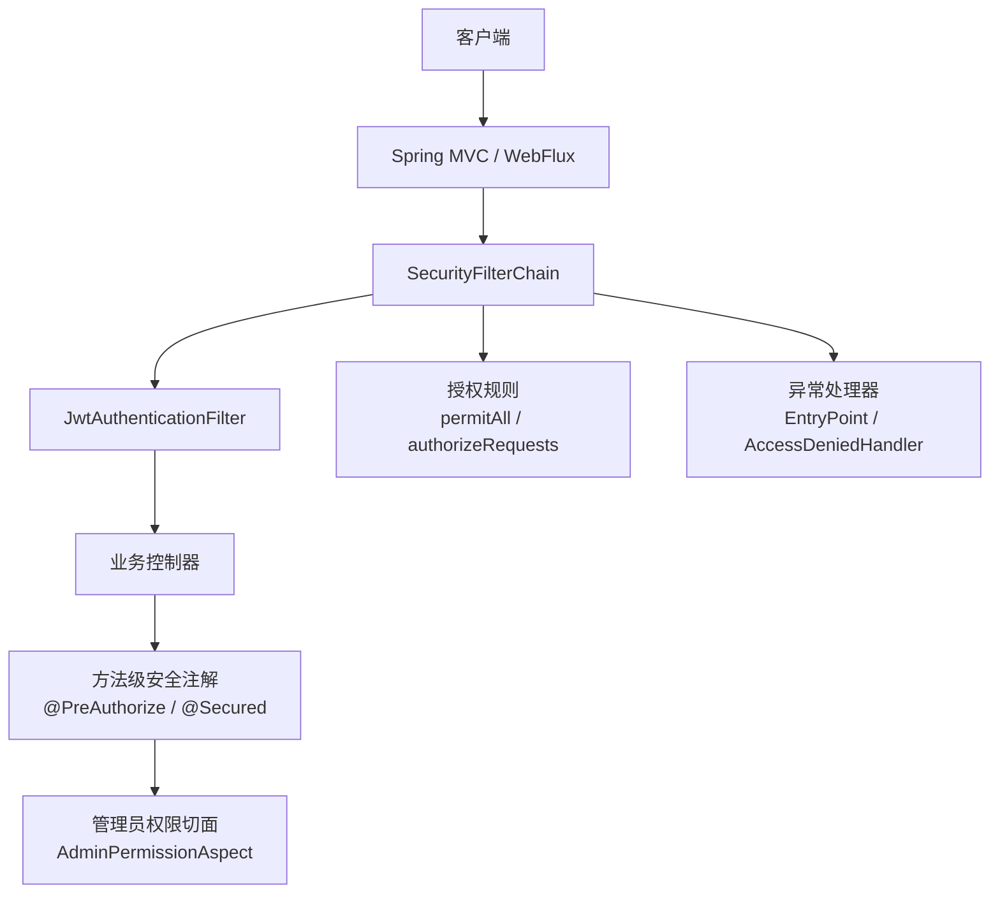
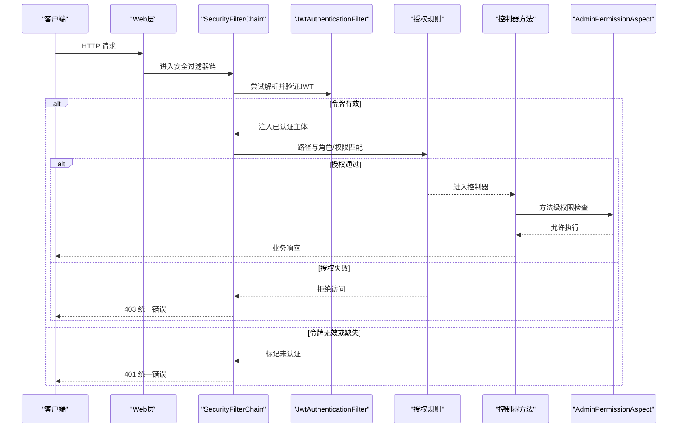
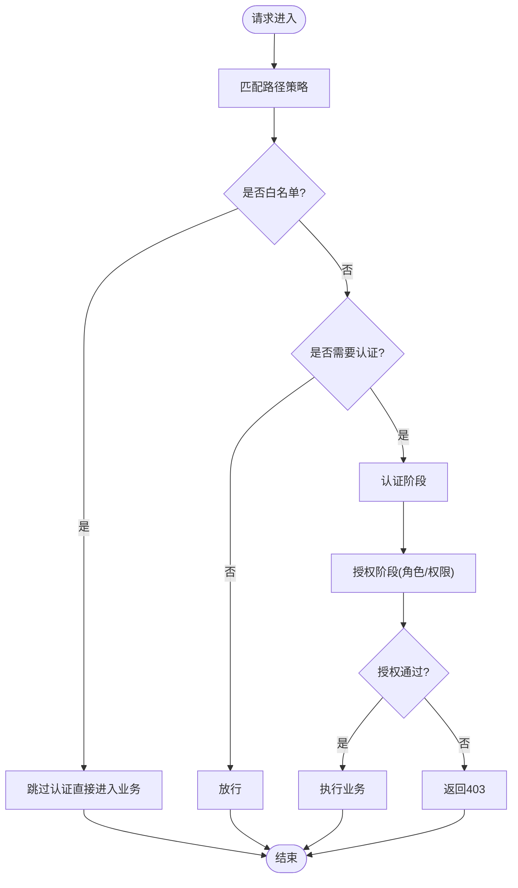
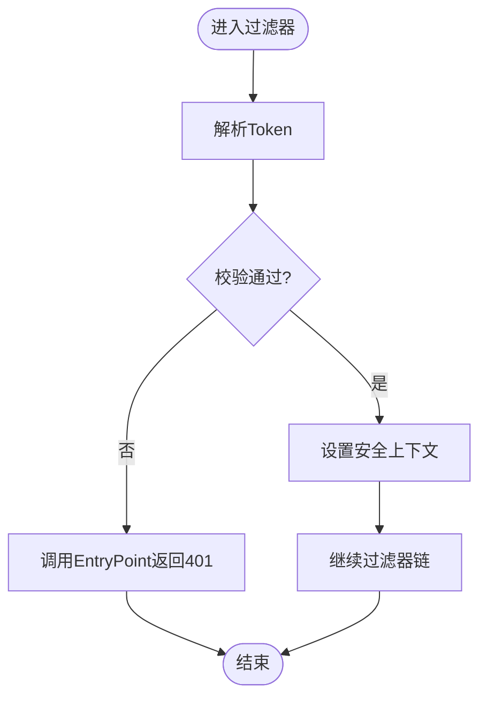
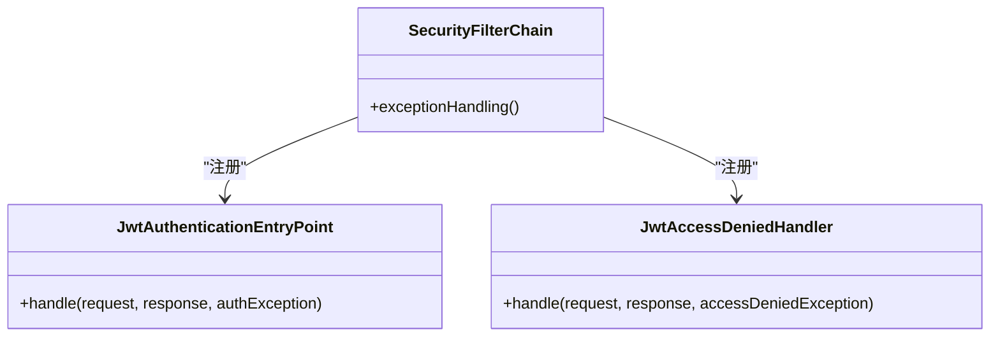
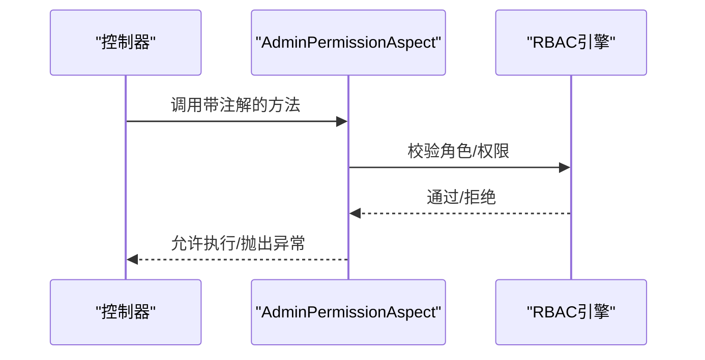
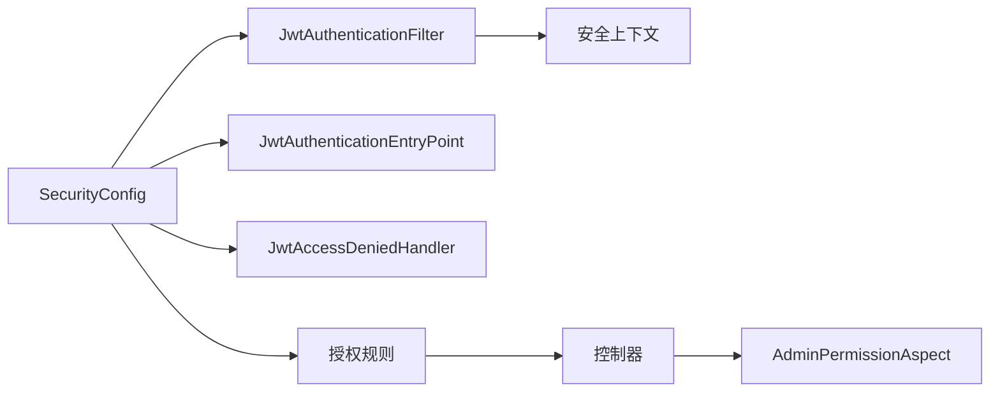

# 基于角色的访问控制

<cite>
**本文引用的文件**
- [SecurityConfig.java](file://apps/api/src/main/java/com/campuslove/api/config/SecurityConfig.java)
- [WebConfig.java](file://apps/api/src/main/java/com/campuslove/api/config/WebConfig.java)
- [JwtAuthenticationFilter.java](file://apps/api/src/main/java/com/campuslove/api/config/JwtAuthenticationFilter.java)
- [JwtAuthenticationEntryPoint.java](file://apps/api/src/main/java/com/campuslove/api/auth/JwtAuthenticationEntryPoint.java)
- [JwtAccessDeniedHandler.java](file://apps/api/src/main/java/com/campuslove/api/auth/JwtAccessDeniedHandler.java)
- [AdminPermissionAspect.java](file://apps/api/src/main/java/com/campuslove/api/admin/auth/AdminPermissionAspect.java)
- [P0SecurityIntegrationTest.java](file://apps/api/src/test/java/com/campuslove/api/security/P0SecurityIntegrationTest.java)
- [P2SecurityPenetrationTest.java](file://apps/api/src/test/java/com/campuslove/api/P2SecurityPenetrationTest.java)
- [SecurityConfigTest.java](file://apps/api/src/test/java/com/campuslove/api/config/SecurityConfigTest.java)
</cite>

## 目录
1. [简介](#简介)
2. [项目结构](#项目结构)
3. [核心组件](#核心组件)
4. [架构总览](#架构总览)
5. [详细组件分析](#详细组件分析)
6. [依赖关系分析](#依赖关系分析)
7. [性能与可维护性建议](#性能与可维护性建议)
8. [故障排查指南](#故障排查指南)
9. [结论](#结论)
10. [附录：权限矩阵与接口清单](#附录权限矩阵与接口清单)

## 简介
本技术文档聚焦 Campus Love 后端服务中的基于角色的访问控制（RBAC）与安全配置，覆盖 Spring Security 的过滤器链构建、请求授权规则与路径白名单管理；角色体系设计（ROLE_USER/ROLE_ADMIN）、方法级安全注解（@PreAuthorize/@Secured）的使用；自定义异常处理器（统一错误响应）；CORS、CSRF 与安全响应头配置；以及动态权限控制、权限缓存与用户状态快照优化等主题。文档同时提供完整的权限矩阵表、接口级权限清单和常见权限问题排查指南，并给出安全加固与性能优化建议。

## 项目结构
本项目将安全相关能力集中在后端 API 模块中，关键目录与职责如下：
- 安全配置与过滤器
  - 安全过滤器链与授权策略：SecurityConfig.java
  - 跨域与基础 Web 配置：WebConfig.java
  - JWT 认证过滤器：JwtAuthenticationFilter.java
- 统一异常处理
  - 未认证入口处理：JwtAuthenticationEntryPoint.java
  - 无权限访问处理：JwtAccessDeniedHandler.java
- 方法级权限增强
  - 管理员权限切面：AdminPermissionAspect.java
- 测试与验证
  - 集成测试与渗透测试：P0SecurityIntegrationTest.java、P2SecurityPenetrationTest.java
  - 安全配置单测：SecurityConfigTest.java

图表来源
- [SecurityConfig.java](file://apps/api/src/main/java/com/campuslove/api/config/SecurityConfig.java)
- [JwtAuthenticationFilter.java](file://apps/api/src/main/java/com/campuslove/api/config/JwtAuthenticationFilter.java)
- [JwtAuthenticationEntryPoint.java](file://apps/api/src/main/java/com/campuslove/api/auth/JwtAuthenticationEntryPoint.java)
- [JwtAccessDeniedHandler.java](file://apps/api/src/main/java/com/campuslove/api/auth/JwtAccessDeniedHandler.java)
- [AdminPermissionAspect.java](file://apps/api/src/main/java/com/campuslove/api/admin/auth/AdminPermissionAspect.java)

章节来源
- [SecurityConfig.java](file://apps/api/src/main/java/com/campuslove/api/config/SecurityConfig.java)
- [WebConfig.java](file://apps/api/src/main/java/com/campuslove/api/config/WebConfig.java)
- [JwtAuthenticationFilter.java](file://apps/api/src/main/java/com/campuslove/api/config/JwtAuthenticationFilter.java)

## 核心组件
- SecurityFilterChain 构建与授权规则
  - 通过配置类集中定义 permitAll 白名单、需要认证的受保护路径以及按角色/权限的访问控制。
  - 使用路径匹配策略明确区分精确匹配与 Ant 风格通配符，避免误放行或过度严格拦截。
- JWT 认证过滤器
  - 在过滤器链早期解析并校验 Token，构建已认证主体供后续授权判断使用。
- 统一异常处理器
  - 未认证与无权限场景分别由 EntryPoint 与 AccessDeniedHandler 统一返回结构化错误响应，便于前端一致处理。
- 方法级安全注解
  - 在控制器方法上使用 @PreAuthorize 或 @Secured 进行细粒度权限控制，结合 AdminPermissionAspect 实现管理员维度权限增强。
- CORS、CSRF 与安全响应头
  - 通过 Web 配置类设置允许的源、方法与头部；根据前后端部署方式决定是否禁用 CSRF；补充安全响应头提升安全性。

章节来源
- [SecurityConfig.java:1-200](file://apps/api/src/main/java/com/campuslove/api/config/SecurityConfig.java#L1-L206)
- [JwtAuthenticationFilter.java:1-200](file://apps/api/src/main/java/com/campuslove/api/config/JwtAuthenticationFilter.java#L1-L200)
- [JwtAuthenticationEntryPoint.java:1-200](file://apps/api/src/main/java/com/campuslove/api/auth/JwtAuthenticationEntryPoint.java#L1-L116)
- [JwtAccessDeniedHandler.java:1-200](file://apps/api/src/main/java/com/campuslove/api/auth/JwtAccessDeniedHandler.java#L1-L99)
- [AdminPermissionAspect.java:1-200](file://apps/api/src/main/java/com/campuslove/api/admin/auth/AdminPermissionAspect.java#L1-L168)
- [WebConfig.java:1-200](file://apps/api/src/main/java/com/campuslove/api/config/WebConfig.java#L1-L200)

## 架构总览
下图展示了从请求进入至控制器处理的完整安全链路：

图表来源
- [SecurityConfig.java:1-200](file://apps/api/src/main/java/com/campuslove/api/config/SecurityConfig.java#L1-L206)
- [JwtAuthenticationFilter.java:1-200](file://apps/api/src/main/java/com/campuslove/api/config/JwtAuthenticationFilter.java#L1-L200)
- [JwtAuthenticationEntryPoint.java:1-200](file://apps/api/src/main/java/com/campuslove/api/auth/JwtAuthenticationEntryPoint.java#L1-L116)
- [JwtAccessDeniedHandler.java:1-200](file://apps/api/src/main/java/com/campuslove/api/auth/JwtAccessDeniedHandler.java#L1-L99)
- [AdminPermissionAspect.java:1-200](file://apps/api/src/main/java/com/campuslove/api/admin/auth/AdminPermissionAspect.java#L1-L168)

## 详细组件分析

### SecurityFilterChain 与授权规则
- 路径白名单
  - 公开接口（如注册、登录、部分静态资源与 OpenAPI 文档）通过 permitAll 放行。
  - 建议以“最小开放”为原则，仅对确需匿名访问的路径放行。
- 受保护路径
  - 用户数据、消息、支付、内容管理等接口默认 require 认证，并按角色/权限细化。
- 路径匹配策略
  - 使用 Ant 模式匹配时注意优先级与顺序，避免“宽泛”路径先于“精确”路径导致误判。
  - 建议为敏感路径使用更精确的匹配，减少潜在越权风险。

图表来源
- [SecurityConfig.java:1-200](file://apps/api/src/main/java/com/campuslove/api/config/SecurityConfig.java#L1-L206)

章节来源
- [SecurityConfig.java:1-200](file://apps/api/src/main/java/com/campuslove/api/config/SecurityConfig.java#L1-L206)
- [SecurityConfigTest.java:1-200](file://apps/api/src/test/java/com/campuslove/api/config/SecurityConfigTest.java#L1-L200)

### JWT 认证过滤器
- 职责
  - 解析请求头中的令牌，完成签名与有效期校验，构建已认证主体并写入安全上下文。
- 错误分支
  - 令牌缺失、过期或非法时，交由统一入口处理器返回标准 401 响应。
- 性能考量
  - 避免在过滤器中进行昂贵 IO；必要时借助本地缓存降低重复校验开销。

图表来源
- [JwtAuthenticationFilter.java:1-200](file://apps/api/src/main/java/com/campuslove/api/config/JwtAuthenticationFilter.java#L1-L200)
- [JwtAuthenticationEntryPoint.java:1-200](file://apps/api/src/main/java/com/campuslove/api/auth/JwtAuthenticationEntryPoint.java#L1-L116)

章节来源
- [JwtAuthenticationFilter.java:1-200](file://apps/api/src/main/java/com/campuslove/api/config/JwtAuthenticationFilter.java#L1-L200)
- [JwtAuthenticationEntryPoint.java:1-200](file://apps/api/src/main/java/com/campuslove/api/auth/JwtAuthenticationEntryPoint.java#L1-L116)

### 统一异常处理（401/403）
- 未认证（401）
  - JwtAuthenticationEntryPoint 对未通过认证请求返回统一 JSON 结构，包含错误码、消息与追踪信息。
- 无权限（403）
  - JwtAccessDeniedHandler 对已通过认证但无权访问的资源返回统一 JSON 结构。
- 前端对接
  - 建议前端依据统一结构做跳转登录或提示无权限。

图表来源
- [JwtAuthenticationEntryPoint.java:1-200](file://apps/api/src/main/java/com/campuslove/api/auth/JwtAuthenticationEntryPoint.java#L1-L116)
- [JwtAccessDeniedHandler.java:1-200](file://apps/api/src/main/java/com/campuslove/api/auth/JwtAccessDeniedHandler.java#L1-L99)
- [SecurityConfig.java:1-200](file://apps/api/src/main/java/com/campuslove/api/config/SecurityConfig.java#L1-L206)

章节来源
- [JwtAuthenticationEntryPoint.java:1-200](file://apps/api/src/main/java/com/campuslove/api/auth/JwtAuthenticationEntryPoint.java#L1-L116)
- [JwtAccessDeniedHandler.java:1-200](file://apps/api/src/main/java/com/campuslove/api/auth/JwtAccessDeniedHandler.java#L1-L99)

### 方法级安全注解与管理员权限切面
- @PreAuthorize/@Secured
  - 在控制器方法上声明所需角色或权限表达式，实现细粒度控制。
- AdminPermissionAspect
  - 针对管理员接口进行额外权限校验（例如操作范围、数据权限），与 RBAC 组合形成双重保障。
- 建议
  - 优先使用表达式化的 @PreAuthorize，便于复用与组合条件；对简单角色守卫可使用 @Secured。

图表来源
- [AdminPermissionAspect.java:1-200](file://apps/api/src/main/java/com/campuslove/api/admin/auth/AdminPermissionAspect.java#L1-L168)

章节来源
- [AdminPermissionAspect.java:1-200](file://apps/api/src/main/java/com/campuslove/api/admin/auth/AdminPermissionAspect.java#L1-L168)

### CORS、CSRF 与安全响应头
- CORS
  - 限制允许的源、方法与头部，开发环境可放宽，生产环境严格收敛。
- CSRF
  - 前后端分离且采用 JWT 时通常可禁用 CSRF；若使用 Cookie 会话则需谨慎评估。
- 安全响应头
  - 添加 X-Content-Type-Options、X-Frame-Options、Strict-Transport-Security 等以提升安全基线。

章节来源
- [WebConfig.java:1-200](file://apps/api/src/main/java/com/campuslove/api/config/WebConfig.java#L1-L200)

### 动态权限控制、权限缓存与用户状态快照
- 动态权限控制
  - 支持运行时读取用户当前角色与权限集合，结合表达式实现细粒度控制。
- 权限缓存
  - 对高频鉴权结果进行短时效缓存，降低数据库或外部服务压力。
- 用户状态快照
  - 在认证阶段生成用户状态快照（含角色、租户、数据范围等），贯穿一次请求生命周期，避免重复查询。

章节来源
- [SecurityConfig.java:1-200](file://apps/api/src/main/java/com/campuslove/api/config/SecurityConfig.java#L1-L206)
- [AdminPermissionAspect.java:1-200](file://apps/api/src/main/java/com/campuslove/api/admin/auth/AdminPermissionAspect.java#L1-L168)

## 依赖关系分析
- 松耦合
  - SecurityFilterChain 仅依赖认证与授权抽象，具体实现由过滤器与处理器注入。
- 内聚性
  - 认证、授权、异常处理各自独立，便于替换与扩展。
- 外部依赖
  - JWT 库、密码编码器、数据库/缓存存储等；建议在测试中通过 Mock 隔离外部依赖。

图表来源
- [SecurityConfig.java:1-200](file://apps/api/src/main/java/com/campuslove/api/config/SecurityConfig.java#L1-L206)
- [JwtAuthenticationFilter.java:1-200](file://apps/api/src/main/java/com/campuslove/api/config/JwtAuthenticationFilter.java#L1-L200)
- [JwtAuthenticationEntryPoint.java:1-200](file://apps/api/src/main/java/com/campuslove/api/auth/JwtAuthenticationEntryPoint.java#L1-L116)
- [JwtAccessDeniedHandler.java:1-200](file://apps/api/src/main/java/com/campuslove/api/auth/JwtAccessDeniedHandler.java#L1-L99)
- [AdminPermissionAspect.java:1-200](file://apps/api/src/main/java/com/campuslove/api/admin/auth/AdminPermissionAspect.java#L1-L168)

章节来源
- [SecurityConfig.java:1-200](file://apps/api/src/main/java/com/campuslove/api/config/SecurityConfig.java#L1-L206)

## 性能与可维护性建议
- 路径匹配策略
  - 优先精确匹配，再使用通配符；将高频路径置于前部以减少匹配成本。
- 过滤器顺序
  - 认证在前、授权在后；日志与监控中间件放在外层以便捕获全量请求。
- 缓存与快照
  - 对角色/权限计算结果进行短 TTL 缓存；用户状态快照在一次请求内复用。
- 最小化 IO
  - 认证与授权路径避免阻塞式远程调用；必须调用时使用异步/超时与降级。
- 可观测性
  - 记录鉴权决策的关键元数据（用户ID、角色、目标资源、结果），便于审计与排障。

[本节为通用建议，不直接引用具体文件]

## 故障排查指南
- 现象：始终返回 401
  - 检查请求是否携带正确 Token 及格式；确认 JwtAuthenticationFilter 是否被触发；核对白名单路径是否正确。
- 现象：登录后仍 403
  - 检查授权规则中该路径是否需要特定角色/权限；确认用户是否具备对应角色；查看 AdminPermissionAspect 是否引入额外限制。
- 现象：跨域失败
  - 核对 Origin、Method、Headers 是否在允许范围内；确认服务端 CORS 配置与前端请求一致。
- 现象：CSRF 报错
  - 若使用 JWT 且前后端分离，应确保禁用 CSRF；若使用 Cookie 会话，请按要求携带 CSRF Token。
- 现象：性能抖动
  - 关注鉴权逻辑是否存在重复查询；启用权限缓存与用户状态快照；定位热点路径并优化匹配顺序。

章节来源
- [P0SecurityIntegrationTest.java:1-200](file://apps/api/src/test/java/com/campuslove/api/security/P0SecurityIntegrationTest.java#L1-L200)
- [P2SecurityPenetrationTest.java:1-200](file://apps/api/src/test/java/com/campuslove/api/P2SecurityPenetrationTest.java#L1-L200)
- [SecurityConfigTest.java:1-200](file://apps/api/src/test/java/com/campuslove/api/config/SecurityConfigTest.java#L1-L200)

## 结论
本系统通过 Spring Security 的过滤器链与注解机制实现了清晰的 RBAC 模型：以路径白名单为基础、以角色与权限为核心的精细化授权；统一的异常处理提升了前后端交互一致性；配合 CORS、CSRF 与安全响应头增强了整体安全基线。通过动态权限、缓存与用户状态快照等手段，在保证安全性的同时兼顾了性能与可维护性。建议在生产环境中持续完善白名单与权限矩阵，并结合监控与审计数据进行长期治理。

## 附录：权限矩阵与接口清单

### 角色与权限定义
- ROLE_USER（普通用户）
  - 可访问用户个人资料、消息、互动等常规功能。
- ROLE_ADMIN（管理员）
  - 可访问后台管理、审核、配置、运营工具等管理功能。

### 接口级权限清单（示例）
- 公开接口（无需认证）
  - 注册、登录、部分静态资源与文档页面。
- 用户接口（需 ROLE_USER）
  - 个人主页、私信、通知、收藏等。
- 管理接口（需 ROLE_ADMIN）
  - 用户管理、内容审核、配置管理、统计看板等。

说明：以上为概念性清单，实际接口与权限请以代码中 SecurityConfig 与控制器注解为准。

章节来源
- [SecurityConfig.java:1-200](file://apps/api/src/main/java/com/campuslove/api/config/SecurityConfig.java#L1-L206)
- [AdminPermissionAspect.java:1-200](file://apps/api/src/main/java/com/campuslove/api/admin/auth/AdminPermissionAspect.java#L1-L168)