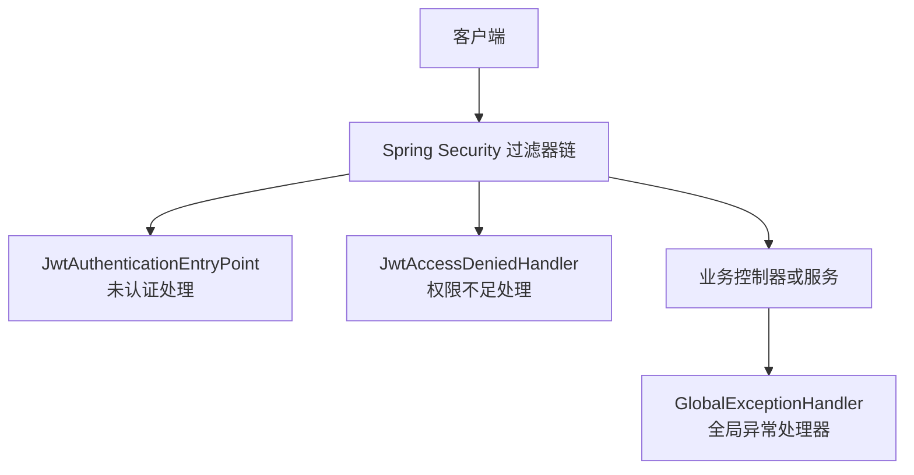
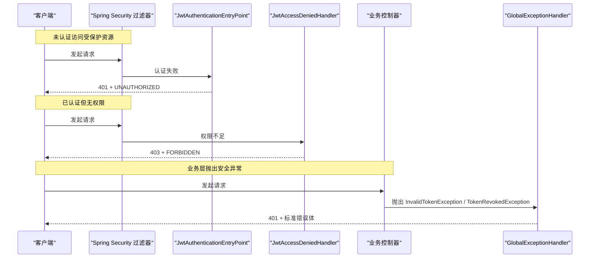
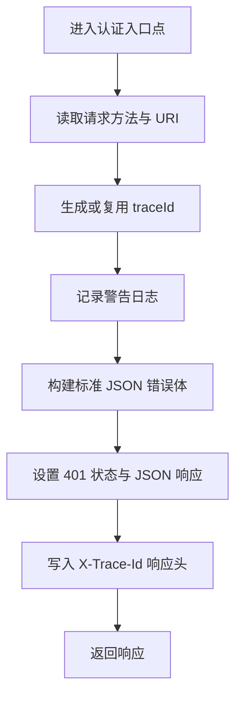
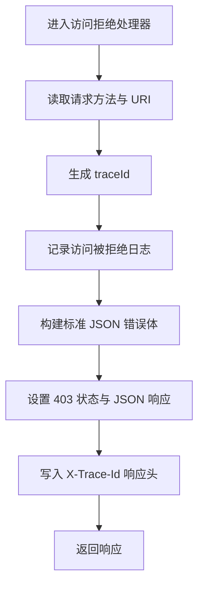
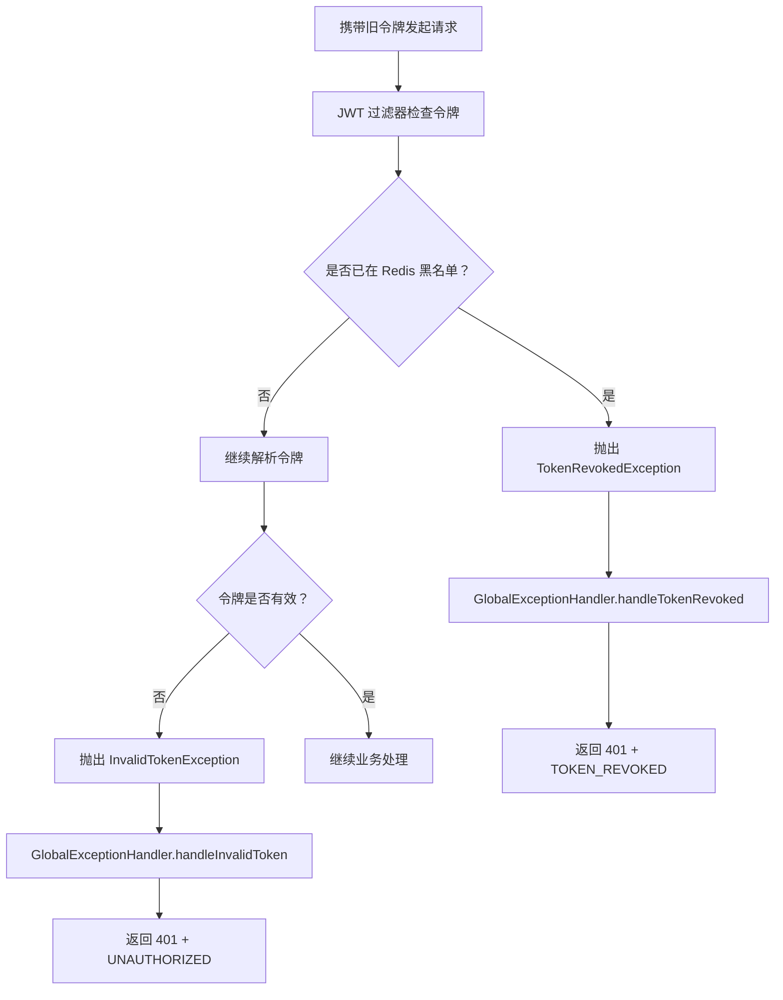
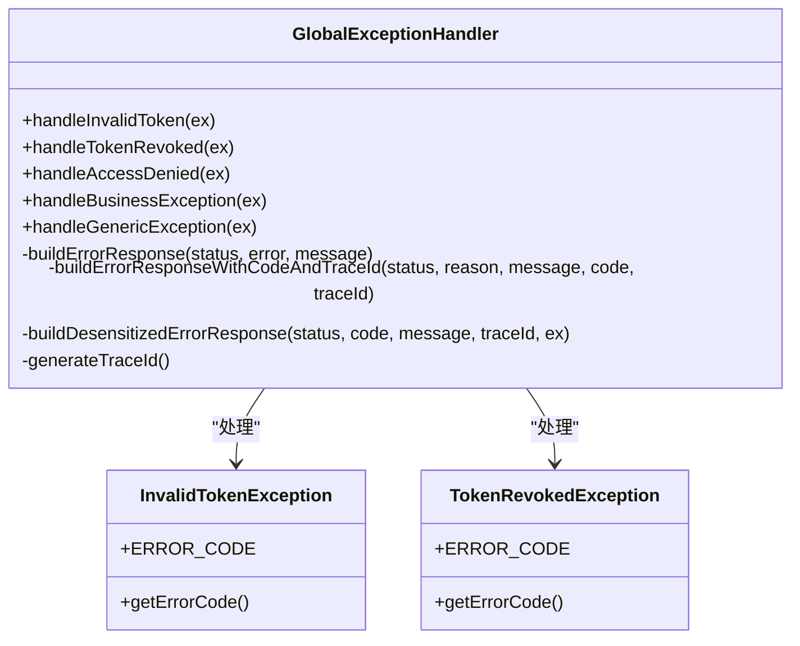
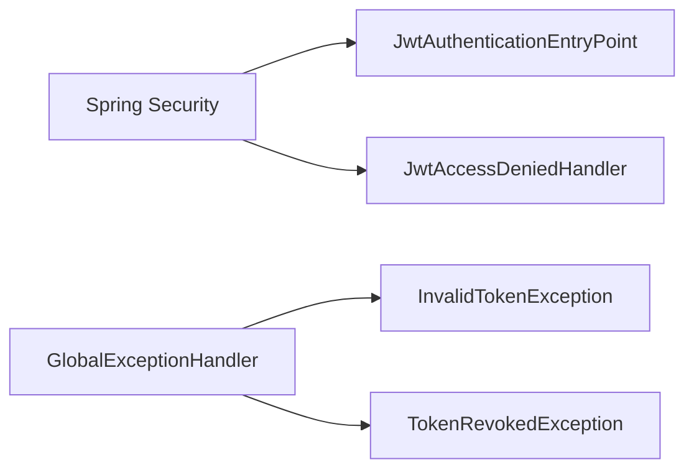

# 安全异常处理

<cite>
**本文引用的文件**   
- [JwtAuthenticationEntryPoint.java](file://apps/api/src/main/java/com/campuslove/api/auth/JwtAuthenticationEntryPoint.java)
- [JwtAccessDeniedHandler.java](file://apps/api/src/main/java/com/campuslove/api/auth/JwtAccessDeniedHandler.java)
- [TokenRevokedException.java](file://apps/api/src/main/java/com/campuslove/api/auth/TokenRevokedException.java)
- [InvalidTokenException.java](file://apps/api/src/main/java/com/campuslove/api/auth/InvalidTokenException.java)
- [GlobalExceptionHandler.java](file://apps/api/src/main/java/com/campuslove/api/config/GlobalExceptionHandler.java)
</cite>

## 目录

1. [引言](#引言)
2. [项目结构定位](#项目结构定位)
3. [核心组件](#核心组件)
4. [架构总览](#架构总览)
5. [详细组件分析](#详细组件分析)
6. [依赖关系分析](#依赖关系分析)
7. [性能与可观测性](#性能与可观测性)
8. [常见安全异常场景](#常见安全异常场景)
9. [错误码规范](#错误码规范)
10. [前端错误处理指南](#前端错误处理指南)
11. [调试与排错](#调试与排错)
12. [监控告警建议](#监控告警建议)
13. [结论](#结论)

## 引言

Campus Love 后端的安全异常处理围绕 Spring Security 的认证入口、访问拒绝处理器，以及全局异常处理器展开。其目标是：

- 对未认证请求返回统一 401 响应；
- 对已认证但权限不足请求返回统一 403 响应；
- 将 JWT 相关业务异常映射为标准化 JSON 错误体；
- 通过 `traceId` 串联客户端报错与服务端日志；
- 在生产环境脱敏内部异常细节，避免泄露系统实现信息。

这套机制既面向外部调用方，也面向内部运维、审计和前端分支逻辑。

## 项目结构定位

与安全异常处理直接相关的代码位于后端 API 模块中：

| 组件 | 职责 | 关键路径 |
|---|---|---|
| JWT 认证入口点 | 处理未认证请求 | `apps/api/src/main/java/com/campuslove/api/auth/JwtAuthenticationEntryPoint.java` |
| JWT 访问拒绝处理器 | 处理权限不足请求 | `apps/api/src/main/java/com/campuslove/api/auth/JwtAccessDeniedHandler.java` |
| Token 撤销异常 | 表示 JWT 已被主动撤销 | `apps/api/src/main/java/com/campuslove/api/auth/TokenRevokedException.java` |
| 无效 Token 异常 | 表示 JWT 解析失败、过期或签名无效 | `apps/api/src/main/java/com/campuslove/api/auth/InvalidTokenException.java` |
| 全局异常处理器 | 统一转换各类异常为标准响应 | `apps/api/src/main/java/com/campuslove/api/config/GlobalExceptionHandler.java` |

**图示来源**
- [JwtAuthenticationEntryPoint.java:1-116](file://apps/api/src/main/java/com/campuslove/api/auth/JwtAuthenticationEntryPoint.java#L1-L116)
- [JwtAccessDeniedHandler.java:1-99](file://apps/api/src/main/java/com/campuslove/api/auth/JwtAccessDeniedHandler.java#L1-L99)
- [GlobalExceptionHandler.java:1-915](file://apps/api/src/main/java/com/campuslove/api/config/GlobalExceptionHandler.java#L1-L915)

**章节来源**
- [JwtAuthenticationEntryPoint.java:1-116](file://apps/api/src/main/java/com/campuslove/api/auth/JwtAuthenticationEntryPoint.java#L1-L116)
- [JwtAccessDeniedHandler.java:1-99](file://apps/api/src/main/java/com/campuslove/api/auth/JwtAccessDeniedHandler.java#L1-L99)
- [GlobalExceptionHandler.java:1-915](file://apps/api/src/main/java/com/campuslove/api/config/GlobalExceptionHandler.java#L1-L915)

## 核心组件

### JwtAuthenticationEntryPoint：未认证请求处理

该组件实现 Spring Security 的 `AuthenticationEntryPoint`，用于拦截未携带有效身份信息的受保护请求。

| 维度 | 说明 |
|---|---|
| HTTP 状态码 | 401 Unauthorized |
| 标准错误码 | `UNAUTHORIZED` |
| 默认提示 | 未认证或令牌已失效，请重新登录 |
| traceId 来源 | 优先复用 MDC 中的链路 traceId，缺失时生成 UUID |
| 安全策略 | 不暴露具体 token 解析失败原因 |
| 典型触发 | 缺少 Authorization 头、token 过期、token 签名无效、token 已被撤销 |

它写入的标准响应包含以下字段：

| 字段 | 含义 |
|---|---|
| `code` | 业务错误码 |
| `message` | 面向终端用户的通用提示 |
| `traceId` | 请求追踪标识 |
| `status` | HTTP 状态码数值 |
| `X-Trace-Id` | 响应头中的追踪标识 |

**章节来源**
- [JwtAuthenticationEntryPoint.java:1-116](file://apps/api/src/main/java/com/campuslove/api/auth/JwtAuthenticationEntryPoint.java#L1-L116)

### JwtAccessDeniedHandler：权限不足请求处理

该组件实现 Spring Security 的 `AccessDeniedHandler`，用于拦截已认证但权限不足的请求。

| 维度 | 说明 |
|---|---|
| HTTP 状态码 | 403 Forbidden |
| 标准错误码 | `FORBIDDEN` |
| 默认提示 | 您没有权限执行此操作 |
| traceId 来源 | 当前实现使用随机 UUID |
| 典型触发 | 普通用户访问管理端接口、角色权限不足 |

它与 `JwtAuthenticationEntryPoint` 的关键区别是：**401 表示“不知道你是谁”，403 表示“知道你是谁，但你没权限”**。

**章节来源**
- [JwtAccessDeniedHandler.java:1-99](file://apps/api/src/main/java/com/campuslove/api/auth/JwtAccessDeniedHandler.java#L1-L99)

### TokenRevokedException：令牌撤销异常

该异常表示 JWT 本身可能仍然有效（签名和有效期正常），但因被加入 Redis 黑名单而被拒绝访问。

| 维度 | 说明 |
|---|---|
| 语义 | 令牌已被主动撤销 |
| 标准错误码 | `TOKEN_REVOKED` |
| 对应 HTTP 状态码 | 401 |
| 前端含义 | 原令牌失效，需要重新登录 |
| 与无效 Token 的区别 | 不是签名错误或过期，而是黑名单撤销 |

**章节来源**
- [TokenRevokedException.java:1-57](file://apps/api/src/main/java/com/campuslove/api/auth/TokenRevokedException.java#L1-L57)

### InvalidTokenException：无效 Token 异常

该异常表示 JWT 本身无法正常使用，例如解析失败、签名无效、过期、格式错误或缺失。

| 维度 | 说明 |
|---|---|
| 语义 | Token 本身无效 |
| 标准错误码 | `UNAUTHORIZED` |
| 对应 HTTP 状态码 | 401 |
| 前端含义 | 认证失败，通常需要重新登录 |
| 与撤销令牌的区别 | 不是黑名单撤销，而是 token 自身不可用 |

**章节来源**
- [InvalidTokenException.java:1-53](file://apps/api/src/main/java/com/campuslove/api/auth/InvalidTokenException.java#L1-L53)

### GlobalExceptionHandler：全局异常处理器

该处理器是安全异常处理的中心枢纽。它将 Spring Security、业务异常、框架异常和第三方服务异常统一转换为结构化响应。

主要职责包括：

- 处理参数校验异常；
- 处理 HTTP 客户端异常；
- 处理非法参数；
- 处理钱包余额不足；
- 处理媒体上传限制；
- 处理功能封存异常；
- 处理内容安全检查异常；
- 处理访问拒绝；
- 处理管理员相关异常；
- 处理微信登录异常；
- 处理约束校验异常；
- 处理无效 Token 和已撤销 Token；
- 处理实体不存在；
- 处理数据库完整性冲突；
- 处理上传大小超限；
- 处理速率限制；
- 处理每日限额；
- 处理资源不存在；
- 处理 HTTP 方法不支持；
- 兜底处理所有未捕获异常；
- 兜底处理业务异常基类；
- 处理 AI 服务相关异常。

**章节来源**
- [GlobalExceptionHandler.java:1-915](file://apps/api/src/main/java/com/campuslove/api/config/GlobalExceptionHandler.java#L1-L915)

## 架构总览

安全异常处理的整体流程如下：

**图示来源**
- [JwtAuthenticationEntryPoint.java:1-116](file://apps/api/src/main/java/com/campuslove/api/auth/JwtAuthenticationEntryPoint.java#L1-L116)
- [JwtAccessDeniedHandler.java:1-99](file://apps/api/src/main/java/com/campuslove/api/auth/JwtAccessDeniedHandler.java#L1-L99)
- [GlobalExceptionHandler.java:401-460](file://apps/api/src/main/java/com/campuslove/api/config/GlobalExceptionHandler.java#L401-L460)

## 详细组件分析

### 未认证请求处理流程

当 Spring Security 发现请求无法建立有效认证上下文时，会调用 `JwtAuthenticationEntryPoint`。

**图示来源**
- [JwtAuthenticationEntryPoint.java:60-116](file://apps/api/src/main/java/com/campuslove/api/auth/JwtAuthenticationEntryPoint.java#L60-L116)

关键点：

- 响应体包含 `code`、`message`、`traceId`、`status`；
- 响应头包含 `X-Trace-Id`；
- traceId 优先从 MDC 中获取，保证与请求链路日志一致；
- message 不暴露内部 token 错误细节；
- 使用 UTF-8 编码，避免中文乱码。

**章节来源**
- [JwtAuthenticationEntryPoint.java:60-116](file://apps/api/src/main/java/com/campuslove/api/auth/JwtAuthenticationEntryPoint.java#L60-L116)

### 权限不足请求处理流程

当用户已通过认证，但无权访问目标资源时，Spring Security 调用 `JwtAccessDeniedHandler`。

**图示来源**
- [JwtAccessDeniedHandler.java:40-99](file://apps/api/src/main/java/com/campuslove/api/auth/JwtAccessDeniedHandler.java#L40-L99)

注意：当前实现的 `generateTraceId()` 直接使用 `UUID.randomUUID()`，与 `JwtAuthenticationEntryPoint` 的 MDC 复用策略存在口径差异。若希望两端 traceId 完全一致，可在生产环境中将两者统一为基于 MDC 的实现。

**章节来源**
- [JwtAccessDeniedHandler.java:40-99](file://apps/api/src/main/java/com/campuslove/api/auth/JwtAccessDeniedHandler.java#L40-L99)

### 令牌撤销异常处理流程

令牌撤销的核心在于区分“token 本身无效”和“token 已被主动撤销”。

**图示来源**
- [TokenRevokedException.java:1-57](file://apps/api/src/main/java/com/campuslove/api/auth/TokenRevokedException.java#L1-L57)
- [InvalidTokenException.java:1-53](file://apps/api/src/main/java/com/campuslove/api/auth/InvalidTokenException.java#L1-L53)
- [GlobalExceptionHandler.java:401-460](file://apps/api/src/main/java/com/campuslove/api/config/GlobalExceptionHandler.java#L401-L460)

**章节来源**
- [TokenRevokedException.java:1-57](file://apps/api/src/main/java/com/campuslove/api/auth/TokenRevokedException.java#L1-L57)
- [InvalidTokenException.java:1-53](file://apps/api/src/main/java/com/campuslove/api/auth/InvalidTokenException.java#L1-L53)
- [GlobalExceptionHandler.java:401-460](file://apps/api/src/main/java/com/campuslove/api/config/GlobalExceptionHandler.java#L401-L460)

### 全局异常处理器与安全框架集成

全局异常处理器通过 `@RestControllerAdvice` 注册，能够捕获控制器层抛出的异常，也能捕获 Spring MVC 层抛出的异常。

与安全相关的核心处理逻辑包括：

| 异常类型 | HTTP 状态码 | 错误码 | 前端行为 |
|---|---:|---|---|
| `InvalidTokenException` | 401 | `UNAUTHORIZED` | 跳转到登录页或拉起重新登录流程 |
| `TokenRevokedException` | 401 | `TOKEN_REVOKED` | 明确提示令牌已撤销，需重新登录 |
| `AccessDeniedException` | 403 | 通常由处理器构造通用响应 | 提示权限不足 |
| `AdminDisabledException` | 403 | `ADMIN_DISABLED` | 提示账号已被禁用 |
| `InvalidCredentialsException` | 401 | `INVALID_CREDENTIALS` | 提示凭据无效 |
| `WechatLoginException` | 根据业务错误码映射 | 随异常携带 | 按微信登录错误分支处理 |
| 未捕获异常 | 500 | `INTERNAL_ERROR` | 展示友好错误并收集 traceId |

**图示来源**
- [GlobalExceptionHandler.java:401-460](file://apps/api/src/main/java/com/campuslove/api/config/GlobalExceptionHandler.java#L401-L460)
- [GlobalExceptionHandler.java:601-800](file://apps/api/src/main/java/com/campuslove/api/config/GlobalExceptionHandler.java#L601-L800)
- [InvalidTokenException.java:1-53](file://apps/api/src/main/java/com/campuslove/api/auth/InvalidTokenException.java#L1-L53)
- [TokenRevokedException.java:1-57](file://apps/api/src/main/java/com/campuslove/api/auth/TokenRevokedException.java#L1-L57)

**章节来源**
- [GlobalExceptionHandler.java:401-460](file://apps/api/src/main/java/com/campuslove/api/config/GlobalExceptionHandler.java#L401-L460)
- [GlobalExceptionHandler.java:601-800](file://apps/api/src/main/java/com/campuslove/api/config/GlobalExceptionHandler.java#L601-L800)

## 依赖关系分析

安全异常处理组件之间的依赖关系如下：

**图示来源**
- [JwtAuthenticationEntryPoint.java:1-116](file://apps/api/src/main/java/com/campuslove/api/auth/JwtAuthenticationEntryPoint.java#L1-L116)
- [JwtAccessDeniedHandler.java:1-99](file://apps/api/src/main/java/com/campuslove/api/auth/JwtAccessDeniedHandler.java#L1-L99)
- [GlobalExceptionHandler.java:401-460](file://apps/api/src/main/java/com/campuslove/api/config/GlobalExceptionHandler.java#L401-L460)

耦合与内聚分析：

- `JwtAuthenticationEntryPoint` 与 `JwtAccessDeniedHandler` 高度内聚于 Spring Security 适配层；
- 两个处理器都负责构造标准 JSON 响应，存在一定重复逻辑；
- `GlobalExceptionHandler` 是异常分类和响应构造的中心；
- `InvalidTokenException` 和 `TokenRevokedException` 仅承担错误码和语义表达职责，保持低耦合；
- 如果未来统一响应构造逻辑，可将公共 JSON 构建抽取为工具类，降低重复。

潜在改进点：

1. 统一 `traceId` 生成策略，使 401 和 403 响应都优先复用 MDC；
2. 抽取统一的错误响应构建器；
3. 在 `JwtAccessDeniedHandler` 中增加更丰富的上下文信息，如角色、所需权限等；
4. 为安全异常增加指标埋点，便于监控统计。

**章节来源**
- [JwtAuthenticationEntryPoint.java:1-116](file://apps/api/src/main/java/com/campuslove/api/auth/JwtAuthenticationEntryPoint.java#L1-L116)
- [JwtAccessDeniedHandler.java:1-99](file://apps/api/src/main/java/com/campuslove/api/auth/JwtAccessDeniedHandler.java#L1-L99)
- [GlobalExceptionHandler.java:401-460](file://apps/api/src/main/java/com/campuslove/api/config/GlobalExceptionHandler.java#L401-L460)

## 性能与可观测性

### 性能特性

- `ObjectMapper` 作为静态实例复用，避免每次请求重复创建序列化器；
- 异常响应体结构简单，JSON 序列化开销较低；
- 日志级别以 `warn` 为主，避免对高频 401/403 造成过大日志压力；
- 全局兜底异常使用 `error` 日志，仅记录真实未处理异常。

### 可观测性

| 维度 | 实现 |
|---|---|
| 请求追踪 | `traceId` 写入响应体和响应头 |
| 认证失败日志 | 记录方法、URI、原因、traceId |
| 权限拒绝日志 | 记录方法、URI、原因、traceId |
| Token 撤销日志 | 记录错误码、消息、traceId |
| 无效 Token 日志 | 记录错误码、消息、traceId |
| 未捕获异常日志 | 记录完整堆栈和 traceId |
| 生产脱敏 | 隐藏异常类名、堆栈、根因消息 |

**章节来源**
- [JwtAuthenticationEntryPoint.java:60-116](file://apps/api/src/main/java/com/campuslove/api/auth/JwtAuthenticationEntryPoint.java#L60-L116)
- [JwtAccessDeniedHandler.java:40-99](file://apps/api/src/main/java/com/campuslove/api/auth/JwtAccessDeniedHandler.java#L40-L99)
- [GlobalExceptionHandler.java:601-660](file://apps/api/src/main/java/com/campuslove/api/config/GlobalExceptionHandler.java#L601-L660)

## 常见安全异常场景

### JWT 过期

| 场景 | 异常或处理器 | HTTP 状态码 | 错误码 | 前端处理 |
|---|---|---:|---|---|
| JWT 过期 | 通常由过滤器或解析逻辑导致认证失败 | 401 | `UNAUTHORIZED` | 清理本地令牌，跳转登录 |
| 前端刷新令牌失败 | 若仍走认证入口点 | 401 | `UNAUTHORIZED` | 提示重新登录 |

### JWT 签名无效

| 场景 | 异常或处理器 | HTTP 状态码 | 错误码 | 前端处理 |
|---|---|---:|---|---|
| 服务端密钥变更 | `InvalidTokenException` | 401 | `UNAUTHORIZED` | 强制重新登录 |
| 客户端篡改令牌 | `InvalidTokenException` | 401 | `UNAUTHORIZED` | 拒绝并重定向登录 |

### 用户主动登出后继续使用旧令牌

| 场景 | 异常或处理器 | HTTP 状态码 | 错误码 | 前端处理 |
|---|---|---:|---|---|
| 令牌已加入 Redis 黑名单 | `TokenRevokedException` | 401 | `TOKEN_REVOKED` | 提示令牌已撤销，清除本地存储并登录 |

### 用户被禁用

| 场景 | 异常或处理器 | HTTP 状态码 | 错误码 | 前端处理 |
|---|---|---:|---|---|
| 管理员账号被禁用 | `AdminDisabledException` | 403 | `ADMIN_DISABLED` | 提示账号已被禁用 |
| 普通用户被禁用 | 通常由业务认证逻辑或微信登录异常处理 | 视业务而定 | 依异常定义 | 提示联系管理员 |

### 权限不足

| 场景 | 异常或处理器 | HTTP 状态码 | 错误码 | 前端处理 |
|---|---|---:|---|---|
| 普通用户访问管理端 | `JwtAccessDeniedHandler` 或 `AccessDeniedException` | 403 | `FORBIDDEN` | 显示权限不足提示 |
| 角色不匹配 | `AccessDeniedException` | 403 | 通用响应 | 隐藏敏感菜单或按钮 |

### 其他安全相关场景

| 场景 | 异常或处理器 | HTTP 状态码 | 错误码 | 前端处理 |
|---|---|---:|---|---|
| 请求频率过高 | `RateLimitExceededException` | 429 | 通常带限流相关错误码 | 提示稍后再试 |
| 每日限额用完 | `DailyLimitExceededException` | 429 | `DAILY_LIMIT_EXCEEDED` | 提示当日次数已用完 |
| AI 服务未配置 API Key | `AiApiUnauthorizedException` | 401 | `AI_API_UNAUTHORIZED` | 提示联系管理员 |
| AI 上游服务异常 | `AiApiException` | 502 | `AI_API_ERROR` | 提示服务暂时不可用 |

**章节来源**
- [JwtAccessDeniedHandler.java:1-99](file://apps/api/src/main/java/com/campuslove/api/auth/JwtAccessDeniedHandler.java#L1-L99)
- [GlobalExceptionHandler.java:401-460](file://apps/api/src/main/java/com/campuslove/api/config/GlobalExceptionHandler.java#L401-L460)
- [GlobalExceptionHandler.java:601-800](file://apps/api/src/main/java/com/campuslove/api/config/GlobalExceptionHandler.java#L601-L800)

## 错误码规范

### 安全相关错误码表

| 错误码 | HTTP 状态码 | 含义 | 触发位置 | 前端建议 |
|---|---:|---|---|---|
| `UNAUTHORIZED` | 401 | 未认证或令牌无效 | `JwtAuthenticationEntryPoint`、`InvalidTokenException` | 跳转登录或拉起重新登录 |
| `TOKEN_REVOKED` | 401 | 令牌已被撤销 | `TokenRevokedException` | 清除旧令牌，重新登录 |
| `FORBIDDEN` | 403 | 权限不足 | `JwtAccessDeniedHandler` | 显示权限不足提示 |
| `ADMIN_DISABLED` | 403 | 管理员账号被禁用 | `AdminDisabledException` | 提示账号已被禁用 |
| `INVALID_CREDENTIALS` | 401 | 凭据无效 | `InvalidCredentialsException` | 提示用户名或密码错误 |
| `AI_API_UNAUTHORIZED` | 401 | AI 服务未授权 | `AiApiUnauthorizedException` | 提示联系管理员补全配置 |
| `AI_API_ERROR` | 502 | AI 上游服务异常 | `AiApiException` | 提示服务暂不可用 |
| `DAILY_LIMIT_EXCEEDED` | 429 | 每日限额超出 | `DailyLimitExceededException` | 提示当日次数已用完 |

### 统一错误响应结构

| 字段 | 类型 | 含义 | 是否必传 |
|---|---|---|---|
| `code` | 字符串 | 业务错误码 | 推荐 |
| `message` | 字符串 | 面向终端用户的提示 | 是 |
| `status` | 数字 | HTTP 状态码 | 推荐 |
| `traceId` | 字符串 | 请求追踪标识 | 安全相关响应推荐 |
| `error` | 字符串 | 错误类型描述或业务错误码 | 视处理器实现 |

注意：不同处理器使用的响应结构略有差异：

- `JwtAuthenticationEntryPoint` 使用 `code`、`message`、`traceId`、`status`；
- `JwtAccessDeniedHandler` 使用 `code`、`message`、`traceId`、`status`；
- `GlobalExceptionHandler` 多数处理器使用 `error`、`message`、`status`，并在业务异常中追加 `code` 和 `traceId`。

这种差异意味着前端应同时兼容两种结构：优先读取 `code`，其次回退到 `error`；始终读取 `message` 和 `status`；利用 `traceId` 进行问题上报。

**章节来源**
- [JwtAuthenticationEntryPoint.java:1-116](file://apps/api/src/main/java/com/campuslove/api/auth/JwtAuthenticationEntryPoint.java#L1-L116)
- [JwtAccessDeniedHandler.java:1-99](file://apps/api/src/main/java/com/campuslove/api/auth/JwtAccessDeniedHandler.java#L1-L99)
- [GlobalExceptionHandler.java:401-460](file://apps/api/src/main/java/com/campuslove/api/config/GlobalExceptionHandler.java#L401-L460)
- [GlobalExceptionHandler.java:601-800](file://apps/api/src/main/java/com/campuslove/api/config/GlobalExceptionHandler.java#L601-L800)

## 前端错误处理指南

### 统一错误解析建议

前端不应只依赖 HTTP 状态码，因为同一状态码可能对应多种业务含义。建议实现一个统一解析函数：

1. 解析 HTTP 状态码；
2. 解析响应体中的 `code`；
3. 若无 `code`，则解析 `error`；
4. 提取 `message` 作为用户可见提示；
5. 保存 `traceId` 用于错误上报；
6. 根据错误码做分支处理，而不是只判断 HTTP 状态码。

### 认证失败分支

| 错误码 | 前端动作 |
|---|---|
| `UNAUTHORIZED` | 清理本地 token，跳转登录页 |
| `TOKEN_REVOKED` | 提示令牌已撤销，清理本地存储并跳转登录 |
| `INVALID_CREDENTIALS` | 提示凭据无效，允许重试 |
| `AI_API_UNAUTHORIZED` | 提示联系管理员，不引导用户重复登录 |

### 权限不足分支

| 错误码 | 前端动作 |
|---|---|
| `FORBIDDEN` | 显示权限不足提示，隐藏敏感操作 |
| `ADMIN_DISABLED` | 提示账号已被禁用 |

### 错误上报字段

上报时应包含：

| 字段 | 用途 |
|---|---|
| `traceId` | 关联服务端日志 |
| `code` | 错误分类 |
| `status` | HTTP 状态 |
| `message` | 用户可见文案 |
| `uri` | 请求路径 |
| `method` | 请求方法 |
| `timestamp` | 发生时间 |
| `userId` | 可选，用于用户侧问题定位 |

**章节来源**
- [JwtAuthenticationEntryPoint.java:1-116](file://apps/api/src/main/java/com/campuslove/api/auth/JwtAuthenticationEntryPoint.java#L1-L116)
- [JwtAccessDeniedHandler.java:1-99](file://apps/api/src/main/java/com/campuslove/api/auth/JwtAccessDeniedHandler.java#L1-L99)
- [GlobalExceptionHandler.java:401-460](file://apps/api/src/main/java/com/campuslove/api/config/GlobalExceptionHandler.java#L401-L460)

## 调试与排错

### 快速定位步骤

1. 从客户端错误中获取 `traceId`；
2. 在服务端日志中搜索相同 `traceId`；
3. 确认是 401、403 还是 500；
4. 根据错误码判断是认证问题、权限问题还是服务器内部问题；
5. 如果是 401，进一步区分 `UNAUTHORIZED` 和 `TOKEN_REVOKED`；
6. 如果是 403，检查用户角色和目标接口权限配置；
7. 如果是 500，查看全局兜底异常日志中的堆栈信息。

### 常见问题

| 现象 | 可能原因 | 排查方向 |
|---|---|---|
| 所有受保护接口返回 401 | 未携带 token 或 token 无效 | 检查请求头、token 生成和校验逻辑 |
| 登录后立即返回 401 | token 已过期或被撤销 | 检查 Redis 黑名单和用户登出逻辑 |
| 普通用户能访问管理端 | 权限配置缺失 | 检查 Spring Security 路径授权规则 |
| 前端看到 500 但业务未显式报错 | 未捕获异常落入兜底处理器 | 查看全局异常日志 |
| 401 和 403 的 traceId 不一致 | 两个处理器 traceId 生成策略不同 | 统一为 MDC 复用策略 |

### 日志记录规范

| 级别 | 使用场景 |
|---|---|
| `warn` | 认证失败、权限拒绝、业务异常、限流、每日限额 |
| `error` | 未捕获异常、上游服务异常 |
| 不记录敏感信息 | 不在响应体中输出 token、密码、用户隐私 |
| 保留 traceId | 所有安全相关日志都应包含 traceId |

**章节来源**
- [JwtAuthenticationEntryPoint.java:60-116](file://apps/api/src/main/java/com/campuslove/api/auth/JwtAuthenticationEntryPoint.java#L60-L116)
- [JwtAccessDeniedHandler.java:40-99](file://apps/api/src/main/java/com/campuslove/api/auth/JwtAccessDeniedHandler.java#L40-L99)
- [GlobalExceptionHandler.java:601-660](file://apps/api/src/main/java/com/campuslove/api/config/GlobalExceptionHandler.java#L601-L660)

## 监控告警建议

### 指标采集

建议采集以下指标：

| 指标 | 维度 | 用途 |
|---|---|---|
| 安全异常总数 | HTTP 状态码、错误码 | 整体安全事件趋势 |
| 认证失败率 | 错误码、URI、客户端类型 | 检测 token 失效或注入攻击 |
| 权限拒绝率 | 用户角色、URI | 检测越权尝试 |
| Token 撤销率 | 用户 ID、时间窗口 | 检测批量登出或异常活动 |
| 500 错误率 | 错误码、traceId | 检测未处理异常 |
| 限流触发率 | 客户端 IP、URI | 检测滥用或爬虫 |

### 告警阈值建议

| 条件 | 建议告警 |
|---|---|
| 每分钟 `UNAUTHORIZED` 超过阈值 | 通知安全团队 |
| `TOKEN_REVOKED` 突增 | 检查是否存在批量 token 泄漏或异常登出 |
| `FORBIDDEN` 集中在管理端接口 | 检查是否有未授权探测 |
| 500 错误持续上升 | 通知研发排查未捕获异常 |
| 限流异常突增 | 检查是否存在恶意请求或配置不当 |

### 生产脱敏要求

- 禁止将异常堆栈、数据库结构、内部错误细节返回给前端；
- 仅在服务端日志中记录详细信息；
- 通过 `traceId` 关联客户端上报和服务端日志；
- 业务异常的用户可见消息可直接透传，因为其设计目标是面向终端用户；
- 非业务异常的原始消息在生产环境应脱敏。

**章节来源**
- [GlobalExceptionHandler.java:1-120](file://apps/api/src/main/java/com/campuslove/api/config/GlobalExceptionHandler.java#L1-L120)
- [GlobalExceptionHandler.java:601-660](file://apps/api/src/main/java/com/campuslove/api/config/GlobalExceptionHandler.java#L601-L660)

## 结论

Campus Love 的安全异常处理机制以 Spring Security 为核心，结合自定义异常类和全局异常处理器，形成了分层清晰、职责明确的异常处理体系：

- `JwtAuthenticationEntryPoint` 负责未认证请求的统一 401 响应；
- `JwtAccessDeniedHandler` 负责权限不足请求的统一 403 响应；
- `InvalidTokenException` 和 `TokenRevokedException` 分别表达 token 无效和 token 被撤销两类语义；
- `GlobalExceptionHandler` 作为统一出口，将安全异常、业务异常和框架异常转换为结构化响应；
- `traceId` 贯穿请求、日志和响应，形成端到端可追踪能力；
- 生产环境采用脱敏策略，避免泄露内部实现细节。

后续可重点改进的方向包括：统一 traceId 生成策略、抽象统一错误响应构建器、增强权限拒绝上下文信息、完善安全指标采集与告警规则。这些改进不会改变现有行为契约，但能提升可维护性、可观测性和安全性。