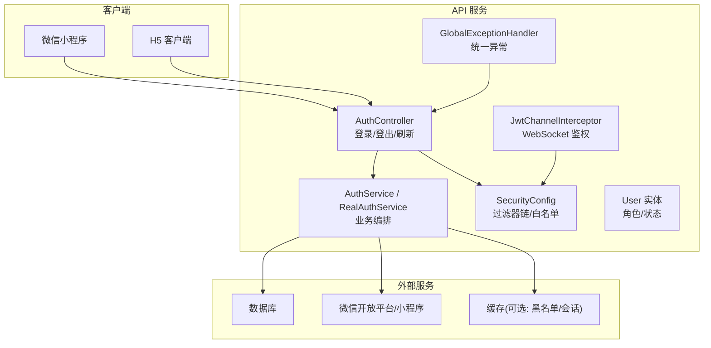
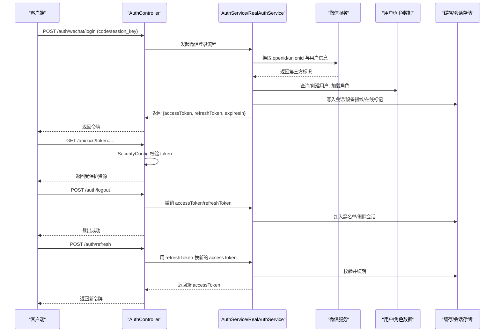
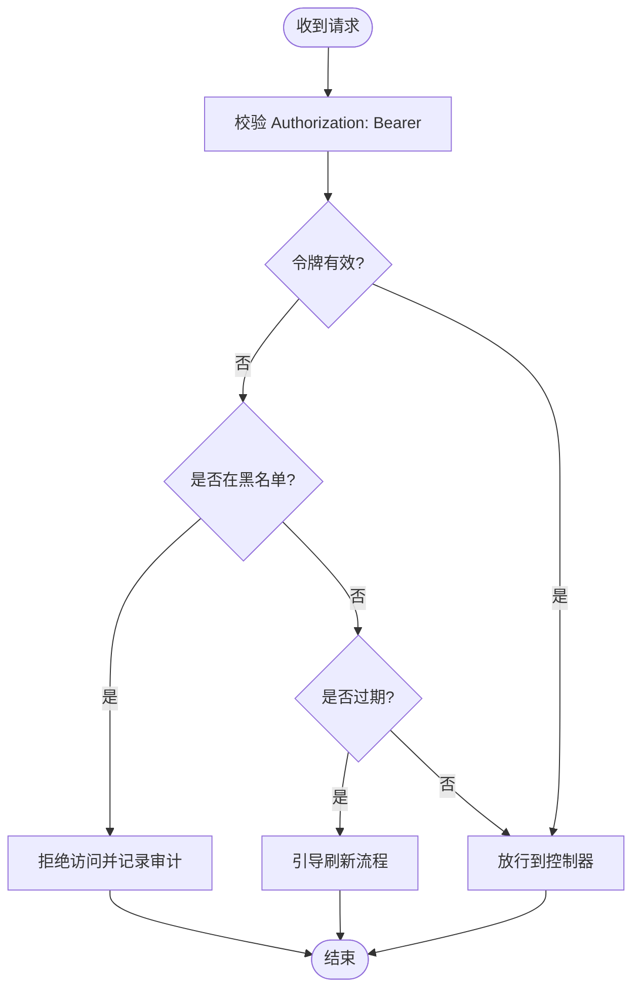
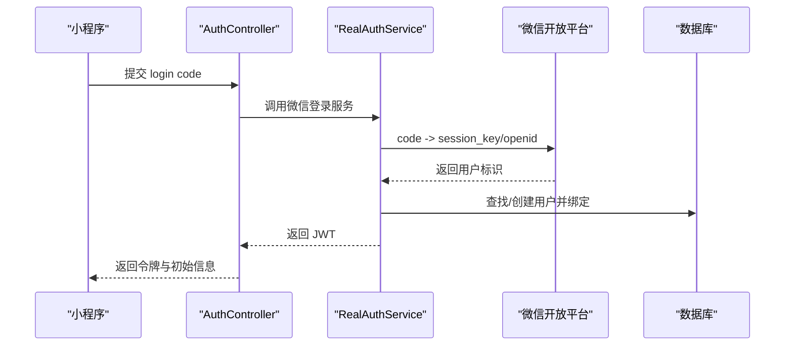
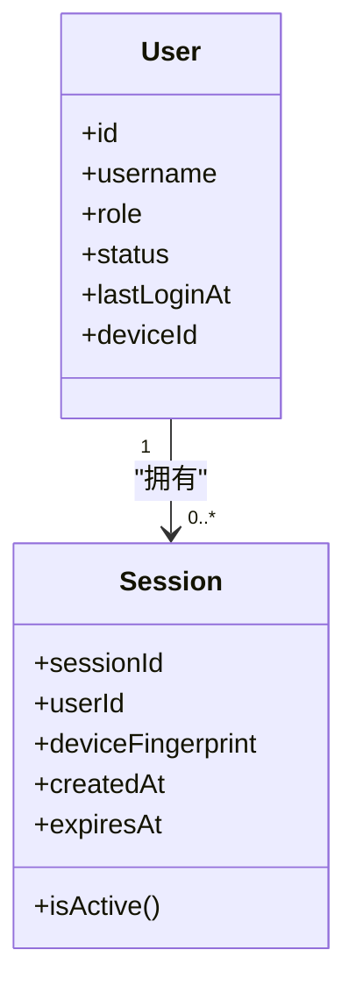
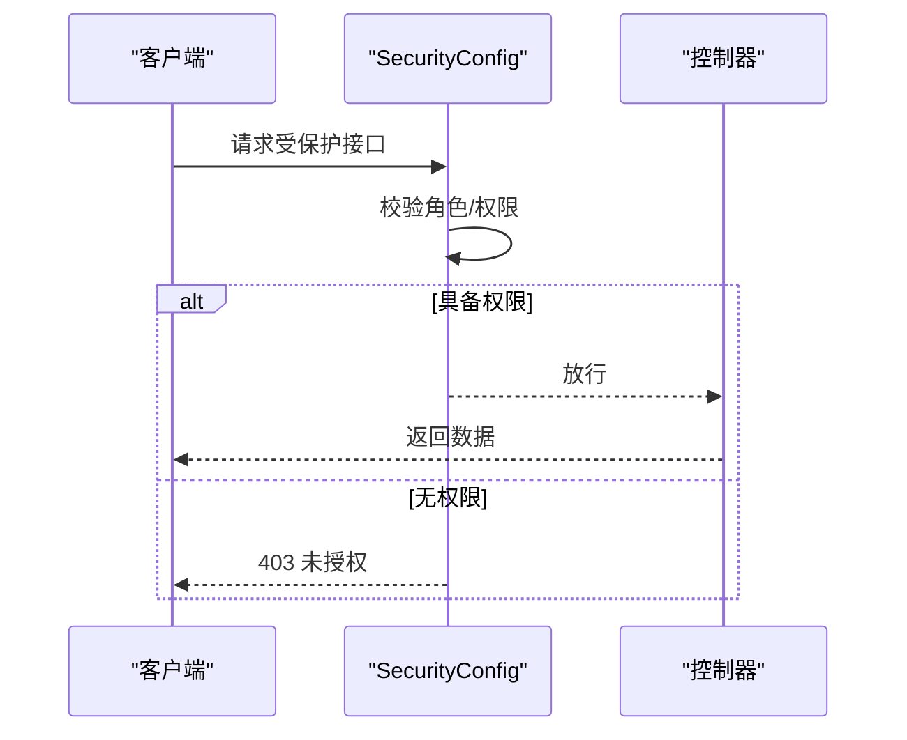
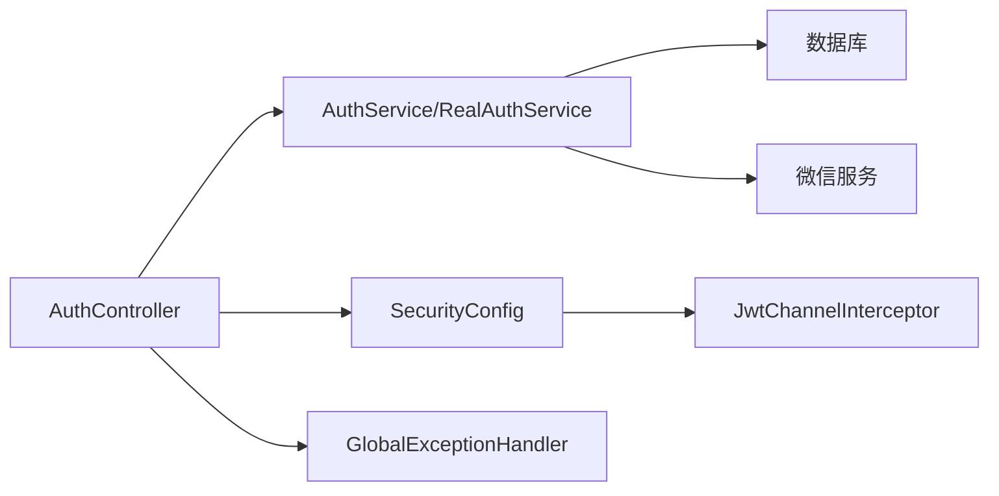
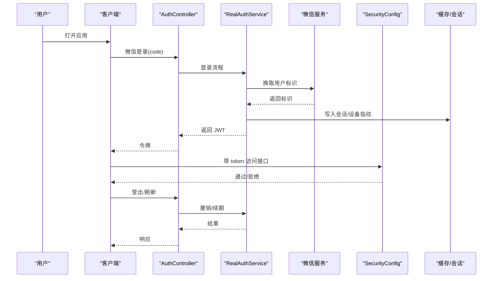

# 安全认证与授权

<cite>
**本文引用的文件**
- [AuthController.java](file://apps/api/src/main/java/com/campuslove/api/auth/AuthController.java)
- [AuthService.java](file://apps/api/src/main/java/com/campuslove/api/auth/AuthService.java)
- [RealAuthService.java](file://apps/api/src/main/java/com/campuslove/api/auth/RealAuthService.java)
- [SecurityConfig.java](file://apps/api/src/main/java/com/campuslove/api/config/SecurityConfig.java)
- [JwtChannelInterceptor.java](file://apps/api/src/main/java/com/campuslove/api/config/JwtChannelInterceptor.java)
- [GlobalExceptionHandler.java](file://apps/api/src/main/java/com/campuslove/api/config/GlobalExceptionHandler.java)
- [User.java](file://apps/api/src/main/java/com/campuslove/api/entity/User.java)
- [ErrorMessages.java](file://apps/api/src/main/java/com/campuslove/api/common/ErrorMessages.java)
- [PhoneBindingController.java](file://apps/api/src/main/java/com/campuslove/api/auth/PhoneBindingController.java)
- [P0SecurityIntegrationTest.java](file://apps/api/src/test/java/com/campuslove/api/security/P0SecurityIntegrationTest.java)
- [AdminPermissionTest.java](file://apps/api/src/test/java/com/campuslove/api/admin/AdminPermissionTest.java)
- [RedisTokenBlacklistServiceTest.java](file://apps/api/src/test/java/com/campuslove/api/auth/RedisTokenBlacklistServiceTest.java)
- [AuthControllerLogoutTest.java](file://apps/api/src/test/java/com/campuslove/api/auth/AuthControllerLogoutTest.java)
- [pom.xml](file://apps/api/pom.xml)
</cite>

## 目录
1. [简介](#简介)
2. [项目结构](#项目结构)
3. [核心组件](#核心组件)
4. [架构总览](#架构总览)
5. [详细组件分析](#详细组件分析)
6. [依赖关系分析](#依赖关系分析)
7. [性能考量](#性能考量)
8. [故障排查指南](#故障排查指南)
9. [结论](#结论)
10. [附录](#附录)

## 简介
本文件为 Campus Love 安全认证系统的安全技术文档，聚焦以下主题：
- JWT 令牌生命周期管理（生成、校验、刷新、撤销）
- 微信登录集成流程（OAuth2.0 授权码模式与小程序登录）
- 用户会话管理、设备绑定与在线状态追踪
- 基于角色的访问控制（RBAC）：权限注解、动态菜单、接口级权限控制
- 密码安全策略、敏感操作防护与防重放攻击机制
- 第三方平台绑定、多账号关联与身份合并逻辑
- 安全异常处理、审计日志记录与威胁检测机制
- 完整认证流程图与安全最佳实践

## 项目结构
后端采用 Spring Boot 3 工程，认证相关代码集中在 auth 包与 config 包中；实体模型在 entity 包；通用错误消息在 common 包。前端客户端位于 apps/client，提供微信登录交互与令牌存储。

图表来源
- [SecurityConfig.java](file://apps/api/src/main/java/com/campuslove/api/config/SecurityConfig.java)
- [AuthController.java](file://apps/api/src/main/java/com/campuslove/api/auth/AuthController.java)
- [AuthService.java](file://apps/api/src/main/java/com/campuslove/api/auth/AuthService.java)
- [RealAuthService.java](file://apps/api/src/main/java/com/campuslove/api/auth/RealAuthService.java)
- [JwtChannelInterceptor.java](file://apps/api/src/main/java/com/campuslove/api/config/JwtChannelInterceptor.java)
- [GlobalExceptionHandler.java](file://apps/api/src/main/java/com/campuslove/api/config/GlobalExceptionHandler.java)
- [User.java](file://apps/api/src/main/java/com/campuslove/api/entity/User.java)

章节来源
- [pom.xml:1-120](file://apps/api/pom.xml#L1-L120)

## 核心组件
- 控制器层：AuthController 暴露登录、登出、刷新等认证接口，对外定义标准请求/响应契约。
- 服务层：AuthService 抽象认证流程，RealAuthService 实现真实环境下的微信登录、JWT 签发与撤销、会话管理。
- 安全配置：SecurityConfig 配置 URL 白名单、过滤器链、跨域、CSRF 策略与接口级鉴权开关。
- WebSocket 拦截器：JwtChannelInterceptor 对 WebSocket 握手进行 JWT 校验与会话绑定。
- 实体与数据：User 实体承载用户信息、角色、状态等；通过 JPA/SQL 持久化。
- 异常处理：GlobalExceptionHandler 统一封装安全相关异常与错误码。
- 辅助能力：ErrorMessages 集中错误文案；PhoneBindingController 支持手机号绑定/解绑。

章节来源
- [AuthController.java](file://apps/api/src/main/java/com/campuslove/api/auth/AuthController.java)
- [AuthService.java](file://apps/api/src/main/java/com/campuslove/api/auth/AuthService.java)
- [RealAuthService.java](file://apps/api/src/main/java/com/campuslove/api/auth/RealAuthService.java)
- [SecurityConfig.java](file://apps/api/src/main/java/com/campuslove/api/config/SecurityConfig.java)
- [JwtChannelInterceptor.java](file://apps/api/src/main/java/com/campuslove/api/config/JwtChannelInterceptor.java)
- [GlobalExceptionHandler.java](file://apps/api/src/main/java/com/campuslove/api/config/GlobalExceptionHandler.java)
- [User.java](file://apps/api/src/main/java/com/campuslove/api/entity/User.java)
- [ErrorMessages.java](file://apps/api/src/main/java/com/campuslove/api/common/ErrorMessages.java)
- [PhoneBindingController.java](file://apps/api/src/main/java/com/campuslove/api/auth/PhoneBindingController.java)

## 架构总览
下图展示一次典型“微信登录 → 签发JWT → 调用受保护接口”的端到端流程，以及登出/刷新时的令牌管理。

图表来源
- [AuthController.java](file://apps/api/src/main/java/com/campuslove/api/auth/AuthController.java)
- [AuthService.java](file://apps/api/src/main/java/com/campuslove/api/auth/AuthService.java)
- [RealAuthService.java](file://apps/api/src/main/java/com/campuslove/api/auth/RealAuthService.java)
- [SecurityConfig.java](file://apps/api/src/main/java/com/campuslove/api/config/SecurityConfig.java)

## 详细组件分析

### 1) JWT 令牌生命周期管理
- 令牌生成
  - 触发点：微信登录成功后由服务层生成短期 access_token 与长期 refresh_token。
  - 载荷包含：用户标识、角色、设备指纹、签发时间、过期时间等。
  - 签名与加密：使用服务端密钥进行签名，确保不可篡改；建议配合 HTTPS 传输。
- 令牌验证
  - 校验点：SecurityConfig 配置的过滤器链对所有受保护接口进行拦截，解析并校验 JWT。
  - 校验内容：签名、过期、是否已被撤销（黑名单）。
- 令牌刷新
  - 触发点：access_token 过期或接近过期时，客户端携带 refresh_token 请求刷新接口。
  - 策略：服务端校验 refresh_token 有效性，必要时要求二次验证（如短信验证码）。
- 令牌撤销
  - 触发点：登出、修改密码、检测到异常设备/异地登录。
  - 机制：将令牌加入黑名单或使会话失效，后续请求被拒绝。

图表来源
- [SecurityConfig.java](file://apps/api/src/main/java/com/campuslove/api/config/SecurityConfig.java)
- [AuthController.java](file://apps/api/src/main/java/com/campuslove/api/auth/AuthController.java)

章节来源
- [AuthController.java](file://apps/api/src/main/java/com/campuslove/api/auth/AuthController.java)
- [AuthService.java](file://apps/api/src/main/java/com/campuslove/api/auth/AuthService.java)
- [RealAuthService.java](file://apps/api/src/main/java/com/campuslove/api/auth/RealAuthService.java)
- [SecurityConfig.java](file://apps/api/src/main/java/com/campuslove/api/config/SecurityConfig.java)
- [RedisTokenBlacklistServiceTest.java](file://apps/api/src/test/java/com/campuslove/api/auth/RedisTokenBlacklistServiceTest.java)

### 2) 微信登录集成（OAuth2.0 授权码 + 小程序）
- 授权码模式
  - 客户端获取 code 后提交至后端，后端以 code 换取用户唯一标识（openid/unionid）。
  - 若用户不存在则创建访客/新用户，并建立本地账户与第三方标识的绑定关系。
- 小程序登录
  - 小程序通过 wx.login 获取临时凭证，后端用于换取会话及用户信息。
  - 首次登录完成实名认证/资料完善后可升级为正式账户。
- 绑定与合并
  - 同一微信标识可绑定多个本地账户，需遵循“主从账户”或“合并”策略，避免重复资产。
  - 合并时需处理冲突字段（头像、昵称、等级、积分等），保留策略应可配置。

图表来源
- [AuthController.java](file://apps/api/src/main/java/com/campuslove/api/auth/AuthController.java)
- [RealAuthService.java](file://apps/api/src/main/java/com/campuslove/api/auth/RealAuthService.java)

章节来源
- [AuthController.java](file://apps/api/src/main/java/com/campuslove/api/auth/AuthController.java)
- [RealAuthService.java](file://apps/api/src/main/java/com/campuslove/api/auth/RealAuthService.java)

### 3) 用户会话管理、设备绑定与在线状态
- 会话管理
  - 每次登录/刷新均更新会话上下文，包含用户ID、角色、设备指纹、最近活跃时间。
  - 支持多端并发与会话隔离，按设备维度维护在线列表。
- 设备绑定
  - 首次登录记录设备指纹（IMEI/UUID/UA+IP 组合哈希），允许用户主动解绑。
  - 设备变更触发安全策略：强制重新认证或二次验证。
- 在线状态
  - 通过心跳或接口访问更新时间戳；离线超时自动清理。
  - 广播在线状态给好友列表（可选功能）。

图表来源
- [User.java](file://apps/api/src/main/java/com/campuslove/api/entity/User.java)

章节来源
- [User.java](file://apps/api/src/main/java/com/campuslove/api/entity/User.java)
- [JwtChannelInterceptor.java](file://apps/api/src/main/java/com/campuslove/api/config/JwtChannelInterceptor.java)

### 4) RBAC 角色访问控制（权限注解、动态菜单、接口级控制）
- 角色与权限
  - 用户实体包含角色字段，扩展时可增加权限集合。
  - 接口级权限通过 SecurityConfig 或自定义注解（如 @RequireRole）控制。
- 动态菜单
  - 根据用户角色与服务端菜单配置渲染不同导航。
- 测试覆盖
  - 管理员权限用例验证角色控制生效。

图表来源
- [SecurityConfig.java](file://apps/api/src/main/java/com/campuslove/api/config/SecurityConfig.java)

章节来源
- [AdminPermissionTest.java](file://apps/api/src/test/java/com/campuslove/api/admin/AdminPermissionTest.java)
- [SecurityConfig.java](file://apps/api/src/main/java/com/campuslove/api/config/SecurityConfig.java)

### 5) 密码安全策略、敏感操作防护与防重放攻击
- 密码策略
  - 最小长度、复杂度、历史重复限制；禁止弱口令。
  - 存储采用加盐哈希（如 BCrypt/Argon2），禁止明文存储。
- 敏感操作防护
  - 关键操作（改密、绑定手机、支付）要求二次验证（短信/人脸/扫码）。
  - 操作频率限制与冷却时间。
- 防重放攻击
  - 请求签名：时间戳 + 随机数 + 签名，服务端校验时效与唯一性。
  - 幂等键：对写操作引入幂等键，防止重复提交。

章节来源
- [GlobalExceptionHandler.java](file://apps/api/src/main/java/com/campuslove/api/config/GlobalExceptionHandler.java)
- [ErrorMessages.java](file://apps/api/src/main/java/com/campuslove/api/common/ErrorMessages.java)

### 6) 第三方平台绑定、多账号关联与身份合并
- 绑定
  - 支持微信、手机号、邮箱等多标识绑定，形成“主账户 + 附属标识”的结构。
- 多账号关联
  - 同一自然人的多个账户可通过“信任链”关联，便于资产迁移。
- 身份合并
  - 合并前进行冲突检测与提示；合并后归档旧账户，保留必要审计痕迹。

章节来源
- [PhoneBindingController.java](file://apps/api/src/main/java/com/campuslove/api/auth/PhoneBindingController.java)
- [RealAuthService.java](file://apps/api/src/main/java/com/campuslove/api/auth/RealAuthService.java)

### 7) 安全异常处理、审计日志与威胁检测
- 统一异常处理
  - GlobalExceptionHandler 捕获认证失败、越权、参数非法等异常，返回标准化错误码。
- 审计日志
  - 记录登录/登出、权限判定、敏感操作的关键事件（用户、设备、IP、时间、结果）。
- 威胁检测
  - 高频失败登录、异地登录、异常设备指纹等触发告警与风控策略（冻结、验证码）。

章节来源
- [GlobalExceptionHandler.java](file://apps/api/src/main/java/com/campuslove/api/config/GlobalExceptionHandler.java)
- [ErrorMessages.java](file://apps/api/src/main/java/com/campuslove/api/common/ErrorMessages.java)
- [P0SecurityIntegrationTest.java](file://apps/api/src/test/java/com/campuslove/api/security/P0SecurityIntegrationTest.java)

## 依赖关系分析
- 框架依赖
  - Spring Boot Web、Validation、JDBC、JPA、Flyway 等。
- 模块耦合
  - AuthController 依赖 AuthService/RealAuthService；SecurityConfig 注入全局过滤链；JwtChannelInterceptor 复用 JWT 校验逻辑。
- 外部依赖
  - 微信开放平台 API；数据库与缓存（可选）用于会话与黑名单。

图表来源
- [AuthController.java](file://apps/api/src/main/java/com/campuslove/api/auth/AuthController.java)
- [AuthService.java](file://apps/api/src/main/java/com/campuslove/api/auth/AuthService.java)
- [RealAuthService.java](file://apps/api/src/main/java/com/campuslove/api/auth/RealAuthService.java)
- [SecurityConfig.java](file://apps/api/src/main/java/com/campuslove/api/config/SecurityConfig.java)
- [JwtChannelInterceptor.java](file://apps/api/src/main/java/com/campuslove/api/config/JwtChannelInterceptor.java)
- [GlobalExceptionHandler.java](file://apps/api/src/main/java/com/campuslove/api/config/GlobalExceptionHandler.java)

章节来源
- [pom.xml:1-120](file://apps/api/pom.xml#L1-L120)

## 性能考量
- 令牌校验
  - 优先内存校验签名与有效期；黑名单查询使用 Redis 缓存以降低延迟。
- 会话管理
  - 使用轻量级会话对象，减少数据库读写频率；定期清理过期会话。
- 微信接口
  - 合理设置重试与退避；缓存短期可用的 openid/session_key 映射。
- 限流与熔断
  - 对登录、刷新、绑定等接口实施限流；对第三方接口启用熔断降级。

[本节为通用指导，不直接分析具体文件]

## 故障排查指南
- 常见问题
  - 登录失败：检查 code 是否过期、微信回调域名配置是否正确。
  - 401/403：确认 token 是否有效、是否已登出或被拉黑；检查角色权限。
  - 刷新失败：核对 refresh_token 是否过期或已被吊销。
- 定位步骤
  - 查看统一异常输出与错误码；核对审计日志中的登录/权限判定事件。
  - 通过单元测试复现：参考 P0SecurityIntegrationTest、AuthControllerLogoutTest、RedisTokenBlacklistServiceTest。
- 快速修复
  - 重置黑名单、清理过期会话；修正微信配置；调整限流阈值。

章节来源
- [GlobalExceptionHandler.java](file://apps/api/src/main/java/com/campuslove/api/config/GlobalExceptionHandler.java)
- [P0SecurityIntegrationTest.java](file://apps/api/src/test/java/com/campuslove/api/security/P0SecurityIntegrationTest.java)
- [AuthControllerLogoutTest.java](file://apps/api/src/test/java/com/campuslove/api/auth/AuthControllerLogoutTest.java)
- [RedisTokenBlacklistServiceTest.java](file://apps/api/src/test/java/com/campuslove/api/auth/RedisTokenBlacklistServiceTest.java)

## 结论
本系统通过 Spring Security 过滤器链与自定义拦截器实现了完整的 JWT 生命周期管理与微信 OAuth2.0 集成；结合会话与设备指纹，提供细粒度的 RBAC 控制与在线状态追踪。配合统一异常处理、审计日志与风控策略，构建了可观测、可治理的安全基线。建议在后续迭代中持续强化：
- 令牌安全：缩短有效期、强制刷新、严格黑名单策略
- 风控增强：多因子认证、行为分析、设备画像
- 可观测性：更丰富的审计指标与告警规则

[本节为总结，不直接分析具体文件]

## 附录

### A. 认证流程图（完整）

图表来源
- [AuthController.java](file://apps/api/src/main/java/com/campuslove/api/auth/AuthController.java)
- [RealAuthService.java](file://apps/api/src/main/java/com/campuslove/api/auth/RealAuthService.java)
- [SecurityConfig.java](file://apps/api/src/main/java/com/campuslove/api/config/SecurityConfig.java)

### B. 安全最佳实践清单
- 传输安全：全站 HTTPS，启用 HSTS，禁用弱加密套件。
- 令牌策略：短效 access_token，长效 refresh_token；刷新需二次验证。
- 权限最小化：默认拒绝，显式授权；接口级与数据级双重控制。
- 会话安全：设备指纹绑定，异地/异常设备强校验；及时清理过期会话。
- 密码策略：复杂规则、历史重复、加盐哈希存储。
- 防重放：请求签名、时间戳与随机数、幂等键。
- 审计与监控：关键操作全量审计，异常告警与封禁策略。
- 合规与隐私：最小化采集、脱敏展示、可撤回授权。

[本节为通用指导，不直接分析具体文件]