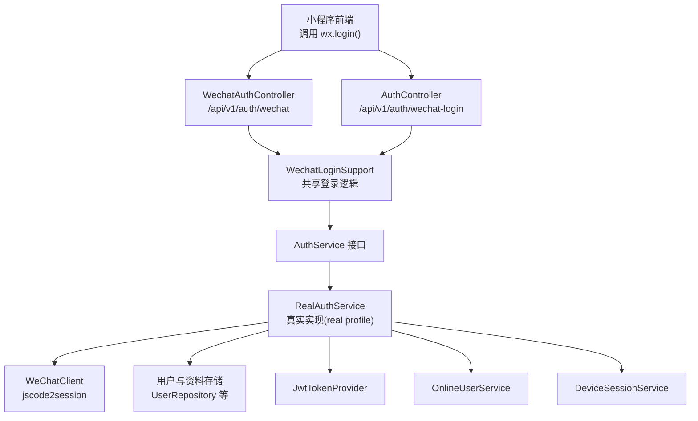
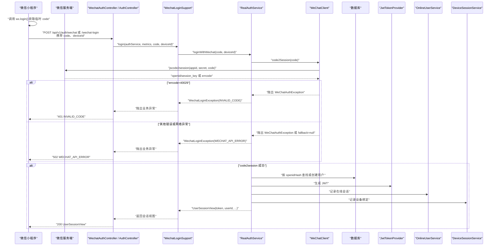
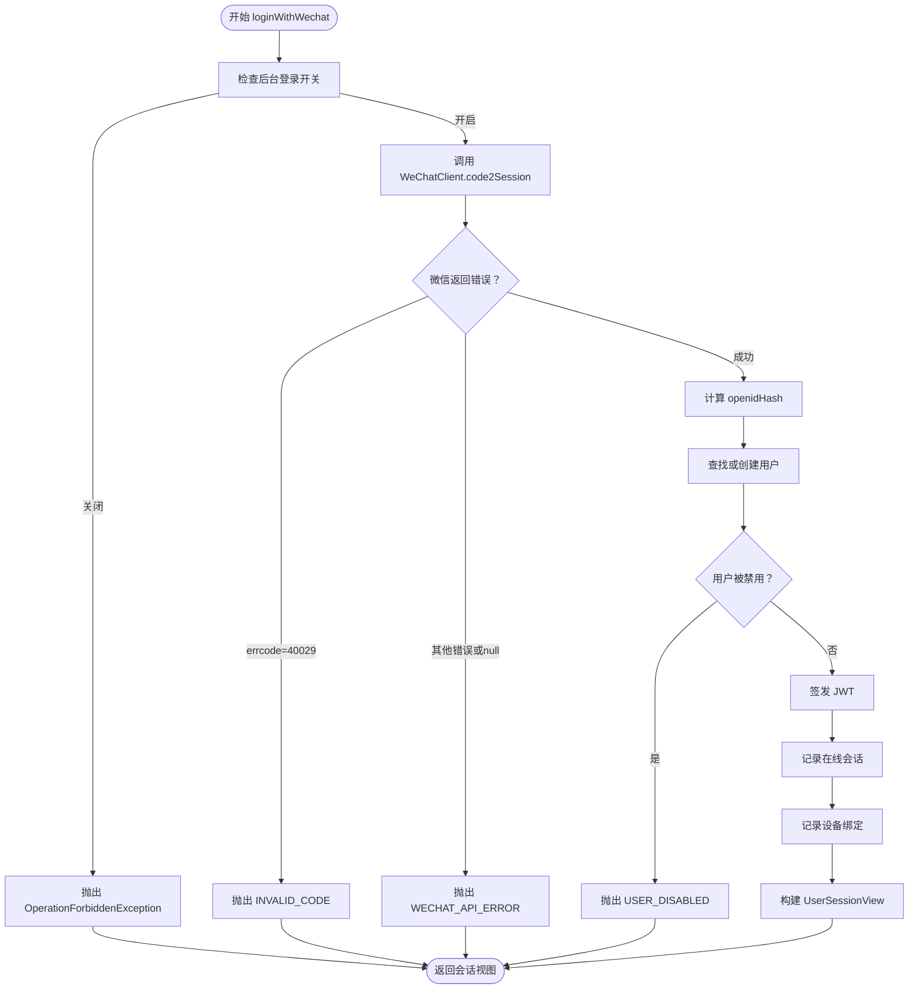
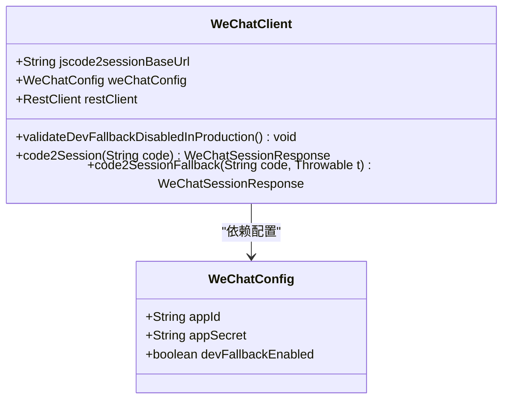
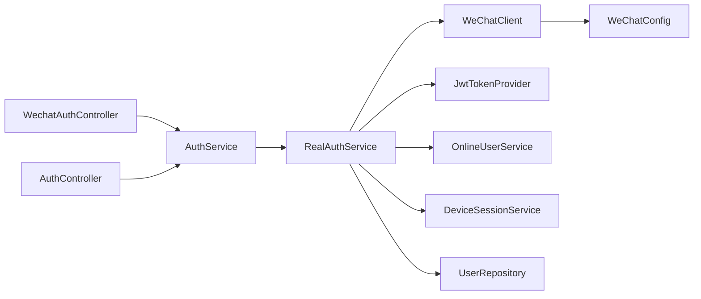

# 微信OAuth集成

<cite>
**本文引用的文件**   
- [AuthController.java](file://apps/api/src/main/java/com/campuslove/api/auth/AuthController.java)
- [WechatAuthController.java](file://apps/api/src/main/java/com/campuslove/api/auth/WechatAuthController.java)
- [WechatLoginSupport.java](file://apps/api/src/main/java/com/campuslove/api/auth/WechatLoginSupport.java)
- [WechatLoginRequest.java](file://apps/api/src/main/java/com/campuslove/api/auth/WechatLoginRequest.java)
- [AuthService.java](file://apps/api/src/main/java/com/campuslove/api/auth/AuthService.java)
- [RealAuthService.java](file://apps/api/src/main/java/com/campuslove/api/auth/RealAuthService.java)
- [ThirdPartyAuthService.java](file://apps/api/src/main/java/com/campuslove/api/auth/ThirdPartyAuthService.java)
- [WeChatClient.java](file://apps/api/src/main/java/com/campuslove/api/auth/WeChatClient.java)
- [WeChatConfig.java](file://apps/api/src/main/java/com/campuslove/api/config/WeChatConfig.java)
</cite>

## 目录
1. [引言](#引言)
2. [项目结构](#项目结构)
3. [核心组件](#核心组件)
4. [架构总览](#架构总览)
5. [详细组件分析](#详细组件分析)
6. [依赖关系分析](#依赖关系分析)
7. [性能与韧性特性](#性能与韧性特性)
8. [故障排查指南](#故障排查指南)
9. [安全考虑](#安全考虑)
10. [结论](#结论)

## 引言
本文面向 Campus Love 微信小程序 OAuth 登录集成，围绕 `wx.login()` 获取临时 code 到后端签发 JWT 令牌的完整链路展开。重点覆盖以下实现：

- 微信小程序登录端点：`WechatAuthController`（推荐路径 `/api/v1/auth/wechat`）与 `AuthController`（兼容路径 `/api/v1/auth/wechat-login`）。
- 共享登录逻辑：`WechatLoginSupport`，统一指标埋点和异常语义。
- 真实业务实现：`RealAuthService.loginWithWechat`，负责微信 code2session、用户查找或创建、禁用检查、JWT 签发、在线会话和设备记录。
- 微信客户端：`WeChatClient.code2Session`，封装 jscode2session 调用、错误映射、降级与重试熔断限流。
- 第三方登录路径：`ThirdPartyAuthService`，用于“第三方账号登录”场景的对比和一致性说明。

文档同时提供认证流程图、错误码对照表、调试建议以及敏感数据与重放防护等安全注意事项。

## 项目结构
本项目为多应用仓库中的 API 服务部分，微信 OAuth 相关代码集中在 `apps/api` 下的认证模块中：

**图示来源**
- [WechatAuthController.java:1-97](file://apps/api/src/main/java/com/campuslove/api/auth/WechatAuthController.java#L1-L97)
- [AuthController.java:1-200](file://apps/api/src/main/java/com/campuslove/api/auth/AuthController.java#L1-L200)
- [WechatLoginSupport.java:1-66](file://apps/api/src/main/java/com/campuslove/api/auth/WechatLoginSupport.java#L1-L66)
- [AuthService.java:1-107](file://apps/api/src/main/java/com/campuslove/api/auth/AuthService.java#L1-L107)
- [RealAuthService.java:306-520](file://apps/api/src/main/java/com/campuslove/api/auth/RealAuthService.java#L306-L520)
- [WeChatClient.java:1-200](file://apps/api/src/main/java/com/campuslove/api/auth/WeChatClient.java#L1-L200)

**章节来源**
- [WechatAuthController.java:1-97](file://apps/api/src/main/java/com/campuslove/api/auth/WechatAuthController.java#L1-L97)
- [AuthController.java:1-200](file://apps/api/src/main/java/com/campuslove/api/auth/AuthController.java#L1-L200)

## 核心组件
- **WechatAuthController**：暴露推荐的小程序登录端点 `/api/v1/auth/wechat`，接收 `WechatLoginRequest`，委托 `AuthService.loginWithWechat`，并通过 `WechatLoginSupport` 统一指标埋点和失败原因记录。
- **AuthController**：保留旧路径 `/api/v1/auth/wechat-login`，作为兼容别名，同样委托 `WechatLoginSupport`。
- **WechatLoginSupport**：共享登录实现，调用 `AuthService.loginWithWechat`，成功时记录登录成功指标，失败时记录失败原因（使用异常类名避免泄露敏感信息）。
- **AuthService**：认证服务接口，定义 `loginWithWechat(code, deviceId)` 等方法；具体实现在 real profile 下由 `RealAuthService` 提供。
- **RealAuthService**：真实微信登录实现，负责：
  - 后台开关校验（`app_switch.login_open`）。
  - 调用 `WeChatClient.code2Session` 换取 openid。
  - 对 openid 做 SHA-256 派生 hash 后查询/创建用户。
  - 禁用用户拦截。
  - 签发 JWT。
  - 写入在线会话和设备记录。
  - 并发首登唯一约束冲突重试。
- **WeChatClient**：封装微信 jscode2session 调用，处理 dev-fallback、errcode 映射、网络异常、熔断、重试和限流，并在 fallback 返回 null 由上层转为 WECHAT_API_ERROR。
- **WeChatConfig**：注入 `appId`、`appSecret`、`devFallbackEnabled` 等配置项。

**章节来源**
- [WechatAuthController.java:1-97](file://apps/api/src/main/java/com/campuslove/api/auth/WechatAuthController.java#L1-L97)
- [AuthController.java:120-200](file://apps/api/src/main/java/com/campuslove/api/auth/AuthController.java#L120-L200)
- [WechatLoginSupport.java:1-66](file://apps/api/src/main/java/com/campuslove/api/auth/WechatLoginSupport.java#L1-L66)
- [AuthService.java:1-107](file://apps/api/src/main/java/com/campuslove/api/auth/AuthService.java#L1-L107)
- [RealAuthService.java:306-520](file://apps/api/src/main/java/com/campuslove/api/auth/RealAuthService.java#L306-L520)
- [WeChatClient.java:1-200](file://apps/api/src/main/java/com/campuslove/api/auth/WeChatClient.java#L1-L200)
- [WeChatConfig.java:1-78](file://apps/api/src/main/java/com/campuslove/api/config/WeChatConfig.java#L1-L78)

## 架构总览
下图展示从微信小程序发起登录到后端签发 JWT 的端到端流程：

**图示来源**
- [WechatAuthController.java:1-97](file://apps/api/src/main/java/com/campuslove/api/auth/WechatAuthController.java#L1-L97)
- [AuthController.java:120-200](file://apps/api/src/main/java/com/campuslove/api/auth/AuthController.java#L120-L200)
- [WechatLoginSupport.java:1-66](file://apps/api/src/main/java/com/campuslove/api/auth/WechatLoginSupport.java#L1-L66)
- [RealAuthService.java:306-520](file://apps/api/src/main/java/com/campuslove/api/auth/RealAuthService.java#L306-L520)
- [WeChatClient.java:1-200](file://apps/api/src/main/java/com/campuslove/api/auth/WeChatClient.java#L1-L200)

## 详细组件分析

### 微信小程序登录端点：WechatAuthController 与 AuthController
- **WechatAuthController** 暴露 `/api/v1/auth/wechat`，是推荐路径。请求体为 `WechatLoginRequest`，包含：
  - `code`：微信小程序临时登录凭证，不可为空，由 `wx.login()` 返回，有效期短。
  - `deviceId`：可选设备标识，用于设备管理。
- **AuthController** 保留 `/api/v1/auth/wechat-login`，作为兼容旧客户端的别名。
- 两个端点都通过 `@RateLimit(capacity=10, refillTokens=0.1, key="#request.remoteAddr")` 进行 IP 维度限流，防止登录爆破。
- 两个端点最终都委托 `WechatLoginSupport.login`，确保指标埋点和异常处理语义一致。

**章节来源**
- [WechatAuthController.java:1-97](file://apps/api/src/main/java/com/campuslove/api/auth/WechatAuthController.java#L1-L97)
- [AuthController.java:120-200](file://apps/api/src/main/java/com/campuslove/api/auth/AuthController.java#L120-L200)
- [WechatLoginRequest.java:1-15](file://apps/api/src/main/java/com/campuslove/api/auth/WechatLoginRequest.java#L1-L15)

### 共享登录逻辑：WechatLoginSupport
`WechatLoginSupport` 将控制器层和业务层的职责解耦：

- 成功路径：调用 `AuthService.loginWithWechat`，成功后尝试记录登录成功指标；指标失败不影响主流程。
- 失败路径：捕获 `RuntimeException`，记录登录失败指标，失败原因使用异常类名，避免泄露敏感信息；随后重新抛出异常，交由全局异常处理器转换为标准化 HTTP 响应。

该设计避免了两端点各自重复实现导致的契约漂移风险。

**章节来源**
- [WechatLoginSupport.java:1-66](file://apps/api/src/main/java/com/campuslove/api/auth/WechatLoginSupport.java#L1-L66)

### 真实登录业务实现：RealAuthService.loginWithWechat
`RealAuthService` 在 real profile 下激活，承担微信登录的核心业务逻辑：

1. **后台开关校验**：若 `app_switch.login_open=false`，直接拒绝登录，返回 403。
2. **远程调用移出事务边界**：为避免微信接口耗时占用数据库连接，`code2Session` 调用放在事务外，仅 DB 操作进入事务。
3. **微信 code2session 调用与错误映射**：
   - 捕获 `WeChatClient.WeChatAuthException`。
   - `errcode=40029` 映射为 `INVALID_CODE`（401），提示 code 失效。
   - 其他 errcode 或网络异常映射为 `WECHAT_API_ERROR`（502）。
   - 若 fallback 返回 null（熔断/重试耗尽），也转为 `WECHAT_API_ERROR`，避免 NPE 导致 500。
4. **openid 唯一性保护**：
   - 使用 `hashOpenid(openid)` 计算 SHA-256 派生 hash。
   - 以 openidHash 作为唯一查询键，避免明文 openid 泄露。
5. **查找或创建用户**：
   - 通过 `userRepository.findByOpenid(openidHash)` 查找已有用户。
   - 未命中则创建新用户，初始昵称、完成度、时间戳等字段填充。
   - 捕获 `DataIntegrityViolationException`（并发首登 uk_users_openid 冲突），最多重试一次。
6. **禁用用户检查**：已禁用用户禁止登录，返回 USER_DISABLED（403）。
7. **签发 JWT**：使用 `JwtTokenProvider.generateToken(userId)`。
8. **在线会话与设备记录**：
   - 调用 `recordOnlineSession` 写入 Redis（TTL=JWT剩余有效期）。
   - 调用 `recordLoginDevice` 记录设备绑定（deviceId 缺失记为 unknown）。
9. **构建会话视图**：根据用户资料和完成度计算 `profileCompleted`、`campusVerified`、`scheduleCompleted` 等字段，返回 `UserSessionView`。

**图示来源**
- [RealAuthService.java:306-520](file://apps/api/src/main/java/com/campuslove/api/auth/RealAuthService.java#L306-L520)

**章节来源**
- [RealAuthService.java:306-520](file://apps/api/src/main/java/com/campuslove/api/auth/RealAuthService.java#L306-L520)

### 微信客户端：WeChatClient 与 jscode2session 交互
`WeChatClient` 负责与微信 jscode2session 接口交互：

- **配置注入**：
  - `appId`、`appSecret` 来自 `WeChatConfig`。
  - `jscode2sessionBaseUrl` 支持环境变量覆盖，便于代理或域名切换。
- **dev-fallback 模式**：
  - 当 `WECHAT_DEV_FALLBACK_ENABLED=true` 时，不真正调用微信，而是按 code 派生固定 openid（`dev-wechat-{code}`），走正常登录注册链路。
  - 生产环境（prod/real profile）强制禁止该开关，启动时校验失败即抛异常。
- **API 调用与错误处理**：
  - 使用 `RestClient` 构造 URI，自动 URL 编码参数，避免拼接注入风险。
  - 若返回 `errcode != 0`，抛出 `WeChatAuthException`，携带 errmsg 和 errcode。
  - 若 openid 为空，抛出 `WeChatAuthException`。
  - 网络异常包装为 `WeChatAuthException`。
- **韧性策略**：
  - `@CircuitBreaker`：连续失败超阈值后熔断 30s，半开试探。
  - `@Retry`：网络抖动/临时 5xx 自动重试 2 次，指数退避。
  - `@RateLimiter`：每秒最多 10 次调用，避免触发微信侧 QPS 限制。
  - fallback 方法在熔断打开、重试耗尽或限流拒绝时返回 null，由 `RealAuthService` 转为 WECHAT_API_ERROR。

**图示来源**
- [WeChatClient.java:1-200](file://apps/api/src/main/java/com/campuslove/api/auth/WeChatClient.java#L1-L200)
- [WeChatConfig.java:1-78](file://apps/api/src/main/java/com/campuslove/api/config/WeChatConfig.java#L1-L78)

**章节来源**
- [WeChatClient.java:1-200](file://apps/api/src/main/java/com/campuslove/api/auth/WeChatClient.java#L1-L200)
- [WeChatConfig.java:1-78](file://apps/api/src/main/java/com/campuslove/api/config/WeChatConfig.java#L1-L78)

### 用户账户查找与创建、唯一性保证与敏感数据处理
- **唯一性保证**：
  - 使用 `openidHash = hashOpenid(openid)` 作为唯一查询键。
  - 数据库存在 `uk_users_openid` 唯一约束，防止同一 openid 对应多个用户。
  - 并发首登可能触发唯一约束冲突，`findOrCreateUserForWechatLogin` 捕获 `DataIntegrityViolationException` 并最多重试一次。
- **敏感数据处理**：
  - openid 不直接明文持久化，而是使用 SHA-256 派生 hash 存储。
  - 日志输出使用 `SensitiveDataMasker.mask(openid)` 脱敏。
  - 代码注释指出未来如需原始 openid，应单独加密存储并使用 `AesEncryptor`。
- **用户创建默认值**：
  - 昵称使用默认新用户名。
  - 资料完成度初始为 0。
  - 关注数、粉丝数初始为 0。
  - 创建时间和更新时间设置为当前业务时区时间。

**章节来源**
- [RealAuthService.java:306-520](file://apps/api/src/main/java/com/campuslove/api/auth/RealAuthService.java#L306-L520)
- [RealAuthService.java:1185-1220](file://apps/api/src/main/java/com/campuslove/api/auth/RealAuthService.java#L1185-L1220)

### 设备绑定机制、在线状态追踪与会话管理
- **设备绑定**：
  - 登录成功后调用 `recordLoginDevice`，将 `userId`、`deviceId`、`platform="wechat"`、`jwtToken.jti` 写入设备会话服务。
  - `deviceSessionService` 为可选注入，单元测试可为 null；失败仅记录日志，不影响登录主流程。
- **在线状态追踪**：
  - 登录成功后调用 `recordOnlineSession`，将 `userId`、`jti`、`loginMethod="wechat"`、`ttlSeconds` 写入 `OnlineUserService`。
  - Redis 优先、本地内存降级；TTL 与 JWT 剩余有效期一致。
- **会话管理**：
  - JWT 由 `JwtTokenProvider.generateToken(userId)` 签发。
  - 刷新令牌时检查 jti 黑名单，已登出 token 不可刷新。
  - 登出时将 jti 加入黑名单，立即失效。

**章节来源**
- [RealAuthService.java:1151-1183](file://apps/api/src/main/java/com/campuslove/api/auth/RealAuthService.java#L1151-L1183)
- [RealAuthService.java:450-520](file://apps/api/src/main/java/com/campuslove/api/auth/RealAuthService.java#L450-L520)

### 第三方登录路径对比：ThirdPartyAuthService
`ThirdPartyAuthService` 提供“第三方账号登录”能力，其微信登录流程与主登录路径类似但独立：

- 通过 `weChatClient.code2Session` 获取 openid。
- 对 openid 做 SHA-256 派生 hash，按 `(provider, openIdHash)` 查询绑定记录。
- 已绑定则登录，未绑定则创建用户并绑定。
- 新增禁用用户检查，防止绕过管理员封禁。
- 签发 JWT 并记录设备绑定。

该路径与主登录路径共同体现“不信任客户端 openId”的安全原则：必须经服务端 code2session 验证。

**章节来源**
- [ThirdPartyAuthService.java:1-200](file://apps/api/src/main/java/com/campuslove/api/auth/ThirdPartyAuthService.java#L1-L200)
- [ThirdPartyAuthService.java:200-398](file://apps/api/src/main/java/com/campuslove/api/auth/ThirdPartyAuthService.java#L200-L398)

## 依赖关系分析

**图示来源**
- [WechatAuthController.java:1-97](file://apps/api/src/main/java/com/campuslove/api/auth/WechatAuthController.java#L1-L97)
- [AuthController.java:120-200](file://apps/api/src/main/java/com/campuslove/api/auth/AuthController.java#L120-L200)
- [AuthService.java:1-107](file://apps/api/src/main/java/com/campuslove/api/auth/AuthService.java#L1-L107)
- [RealAuthService.java:306-520](file://apps/api/src/main/java/com/campuslove/api/auth/RealAuthService.java#L306-L520)
- [WeChatClient.java:1-200](file://apps/api/src/main/java/com/campuslove/api/auth/WeChatClient.java#L1-L200)
- [WeChatConfig.java:1-78](file://apps/api/src/main/java/com/campuslove/api/config/WeChatConfig.java#L1-L78)

**章节来源**
- [AuthService.java:1-107](file://apps/api/src/main/java/com/campuslove/api/auth/AuthService.java#L1-L107)
- [RealAuthService.java:306-520](file://apps/api/src/main/java/com/campuslove/api/auth/RealAuthService.java#L306-L520)

## 性能与韧性特性
- **事务边界优化**：
  - `loginWithWechat` 不再整体加 `@Transactional`，远程调用移出事务，减少数据库连接占用时间。
  - 用户查找/创建放入 `findOrCreateUserForWechatLogin` 的事务中，保证原子性。
- **外部依赖韧性**：
  - 熔断器：连续失败后熔断 30s，半开试探。
  - 重试：网络抖动/临时 5xx 自动重试 2 次，指数退避。
  - 限流：每秒最多 10 次微信 API 调用，避免触发微信侧 QPS 限制。
- **登录接口限流**：
  - `/api/v1/auth/wechat` 和 `/api/v1/auth/wechat-login` 均使用 IP 维度限流，桶容量 10，每 10 秒补充 1 个令牌。
- **监控指标**：
  - 登录成功/失败次数通过 `AuthMetrics` 记录，失败原因使用异常类名，避免泄露敏感信息。

[本节为通用性能讨论，不直接分析特定代码片段]

## 故障排查指南

### 常见错误码对照表
| HTTP 状态码 | 业务错误码 | 含义 | 可能原因 | 处理建议 |
|-------------|------------|------|----------|----------|
| 200 | 无 | 登录成功 | code 有效，用户已存在或已创建，JWT 签发成功 | 前端保存 token 并跳转主页 |
| 401 | INVALID_CODE | 微信 code 失效或已过期 | 前端未及时发送 code，或 code 已被使用 | 重新拉起 `wx.login()` 获取新 code |
| 403 | USER_DISABLED | 用户已被管理员禁用 | 用户被后台封禁 | 提示用户联系管理员 |
| 429 | RATE_LIMITED | 触发登录接口限流 | 同一 IP 短时间内多次登录 | 前端适当重试或提示稍后再试 |
| 502 | WECHAT_API_ERROR | 微信 API 调用失败 | 网络异常、微信服务不可用、errcode 非 0 | 提示稍后重试，查看后端日志 |

### 调试步骤
1. **确认小程序端 code 有效性**：
   - 检查是否每次登录前都调用 `wx.login()` 获取最新 code。
   - 注意 code 时效短，不应缓存复用。
2. **检查后端日志中的微信错误**：
   - 若出现 `errcode=40029`，说明 code 无效或已过期。
   - 若出现网络异常或 errcode 非 0，说明微信 API 调用失败。
3. **检查熔断/重试/限流状态**：
   - 若频繁出现 WECHAT_API_ERROR，检查是否触发熔断或限流。
   - 检查 `WECHAT_DEV_FALLBACK_ENABLED` 是否在 prod/real profile 下误开。
4. **检查用户唯一性冲突**：
   - 若出现并发首登唯一约束冲突，系统会重试一次；仍失败需检查数据库索引和并发量。
5. **检查敏感数据脱敏**：
   - 日志中 openid、phone、token 应被脱敏，不应出现明文。

**章节来源**
- [RealAuthService.java:306-520](file://apps/api/src/main/java/com/campuslove/api/auth/RealAuthService.java#L306-L520)
- [WeChatClient.java:1-200](file://apps/api/src/main/java/com/campuslove/api/auth/WeChatClient.java#L1-L200)

## 安全考虑
- **code 时效性与重放攻击防护**：
  - code 由 `wx.login()` 实时获取，后端立即调用微信 code2session 验证，不缓存。
  - 微信侧保证 code 一次性使用，后端不自行实现重放检测，但通过快速处理和失败重试上限降低风险。
- **敏感数据保护**：
  - openid 使用 SHA-256 派生 hash 存储，避免明文泄露。
  - 日志中使用 `SensitiveDataMasker` 脱敏 openid、phone、token。
  - 未来如需原始 openid，应单独加密存储并使用 `AesEncryptor`。
- **生产环境开关保护**：
  - `WECHAT_DEV_FALLBACK_ENABLED=true` 在生产环境（prod/real profile）禁止启用，否则可伪造 openid 登录。
- **禁用用户拦截**：
  - 微信登录和第三方登录均检查 `user.isDisabled()`，防止被封禁用户绕过登录。
- **JWT 安全性**：
  - 签发基于 userId 的 JWT。
  - 刷新令牌时检查 jti 黑名单，已登出 token 不可刷新。
  - 登出时将 jti 加入黑名单，立即失效。

**章节来源**
- [RealAuthService.java:306-520](file://apps/api/src/main/java/com/campuslove/api/auth/RealAuthService.java#L306-L520)
- [WeChatClient.java:1-200](file://apps/api/src/main/java/com/campuslove/api/auth/WeChatClient.java#L1-L200)
- [ThirdPartyAuthService.java:1-200](file://apps/api/src/main/java/com/campuslove/api/auth/ThirdPartyAuthService.java#L1-L200)

## 结论
Campus Love 的微信小程序 OAuth 登录集成通过分层设计实现了清晰的职责分离：

- 控制器层统一接收请求并限流。
- 共享逻辑层统一指标埋点和异常语义。
- 业务层负责微信 code2session、用户查找/创建、禁用检查、JWT 签发、在线会话和设备记录。
- 客户端层封装微信 API 调用，并提供熔断、重试、限流和降级能力。

该方案在保证功能完整性的同时，兼顾了性能、韧性和安全性。建议在部署时严格配置微信凭据、关闭 dev-fallback 开关，并监控登录成功率、失败原因和微信 API 可用性。